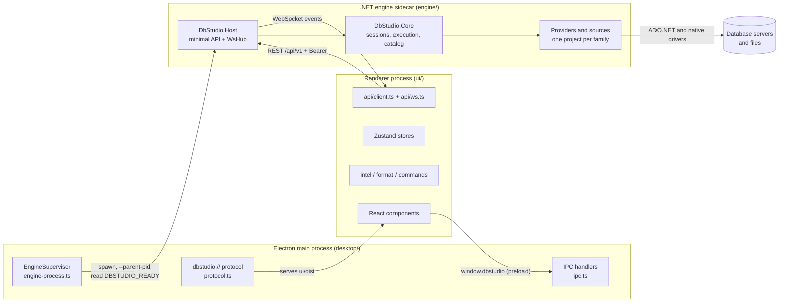
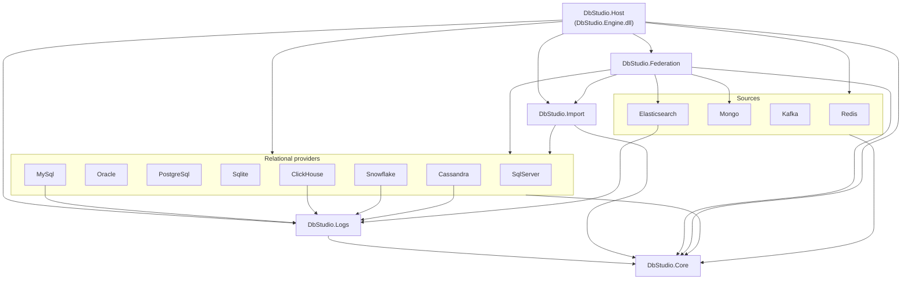
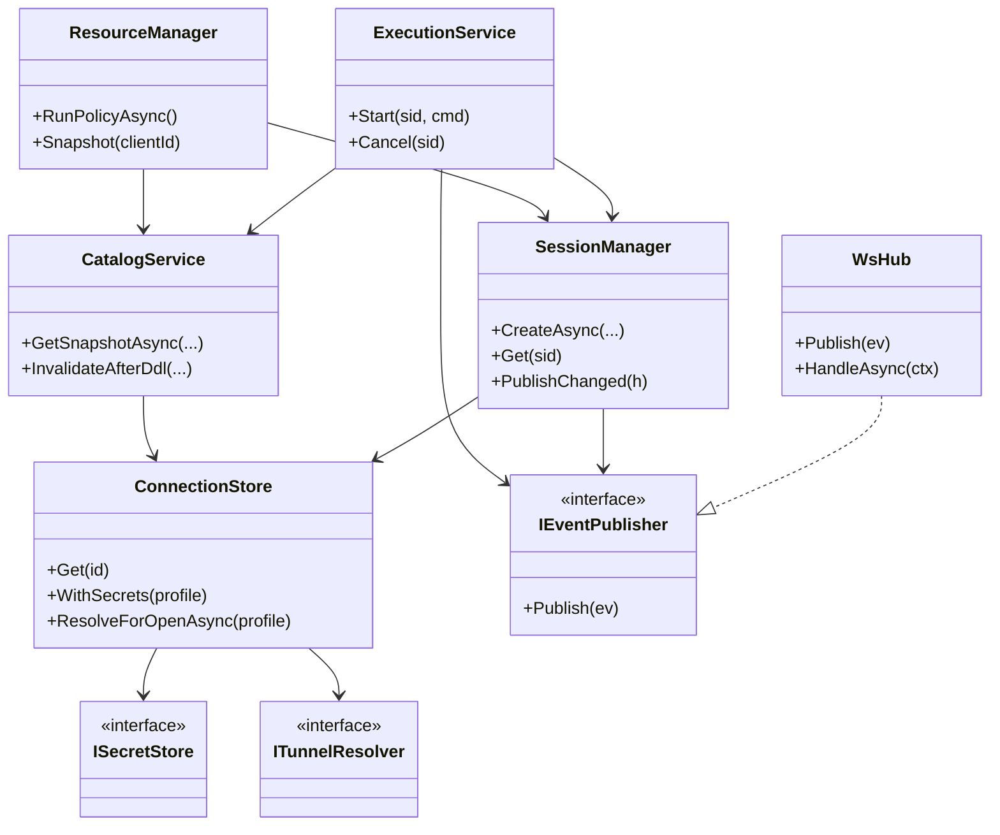
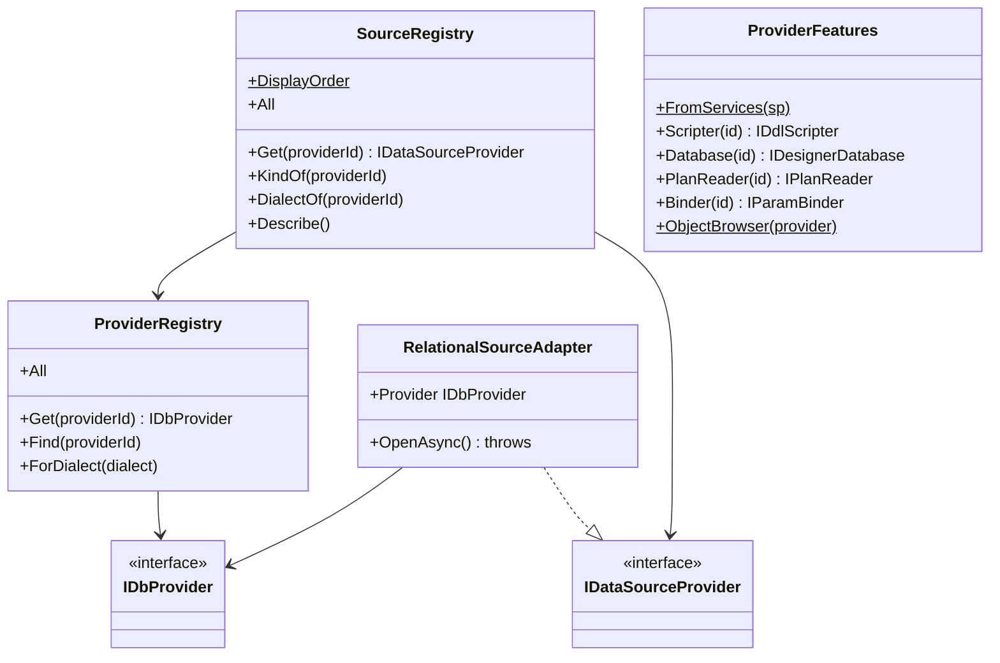
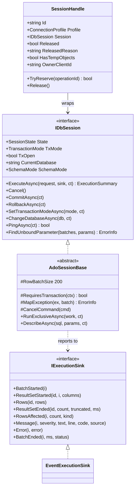
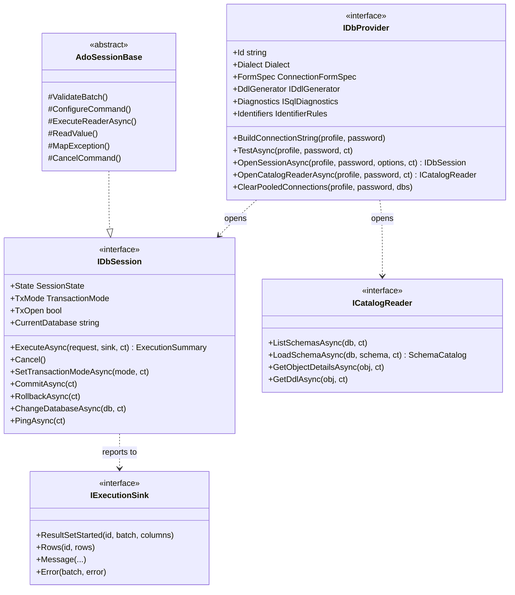
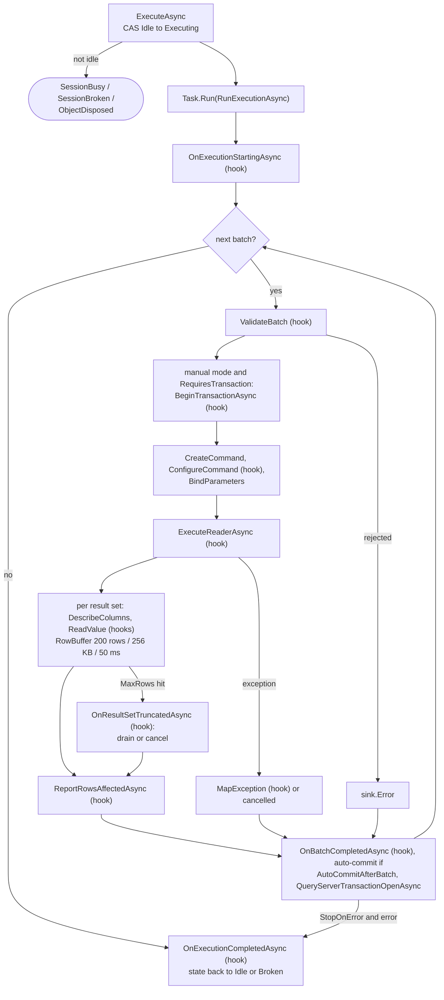

# Shared diagrams (package E)

Reusable Mermaid blocks owned by package E. Copy a block into your chapter and cite its source figure; labels stay in English in both languages. Code read at 08528ae.

## Three processes of Rowlit (II-03 figure 3.1)

## Engine project references (II-03 figure 3.4)

## Core services and dependencies (II-05 figure 5.2)

## Registries and keyed features (II-07 figure 7.2)

## Session contract and handle (II-08 figure 8.1)

## Relational provider contract (II-09 figure 9.1)

## AdoSessionBase execution loop (II-09 figure 9.2)

