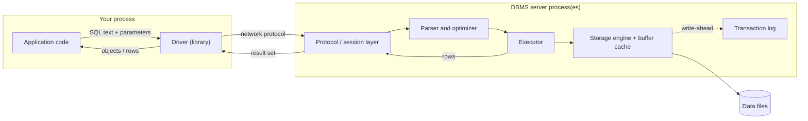
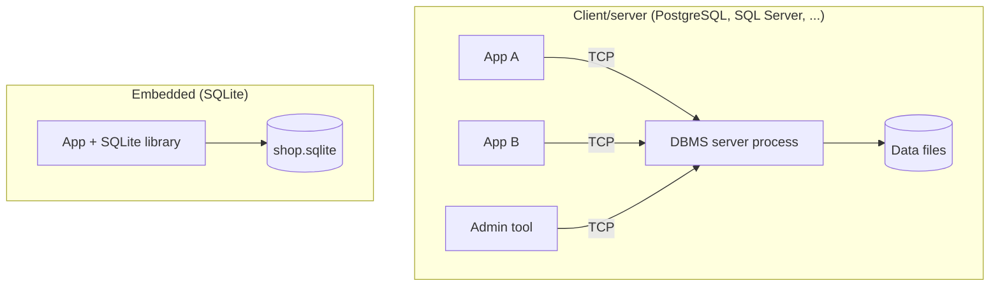

# 1. What a database is

> **Language:** English | [فارسی](../../fa/part1/01-what-is-a-database.md) | **Next:** [2. The relational model](02-relational-model.md)
> **Level:** L1 beginner → L2 | **Part:** I
> **In one sentence:** a database is organised, durable data that a program called a DBMS looks after for you, so that many programs can store, find and change it safely.
> **You will learn:**
> - why a folder of files stops working as soon as data grows or two people touch it
> - what a DBMS adds on top of files: durability, concurrency, a query language, access control
> - the difference between a client/server database and an embedded one
> - the words instance, database, schema, connection, session and driver, and how they nest
> - what a database IDE such as Rowlit is: a client
>
> **Prerequisites:** none.

## 1. The idea (beginner)

Imagine a small online shop. In the first week the owner keeps orders in a spreadsheet: one row per order, with the
customer's name, the product, the price and the date. This works. A year later there are 40,000 rows, two people edit
the sheet at the same time, a laptop crashes while the file is being saved, and the owner needs the answer to "which
customers bought a keyboard but never a mouse?". Every one of those problems has a standard solution, and the
collection of solutions is what we call a **database**.

A [database](../glossary.md#database) is an organised, persistent collection of data. "Organised" means the data
has a declared structure (tables, columns, types, relationships), not just text in a file. "Persistent" means it
survives a restart, a crash and a power cut. The software that stores the data and answers questions about it is the
[DBMS](../glossary.md#dbms) (database management system). People often say "database" for both the data and the
software; this book tries to say "DBMS" when it means the software. A DBMS that stores data in related tables is a
relational DBMS, or [RDBMS](../glossary.md#rdbms) ([chapter I-02](02-relational-model.md)).

A DBMS gives you four things that a folder of files does not:

1. **Durability.** When the DBMS says "saved", the data is on disk, even if the machine dies one millisecond later.
2. **Concurrency.** Many programs can read and write at the same time without seeing half-finished work or overwriting
   each other.
3. **A query language.** You describe what you want ("customers who bought a keyboard but no mouse") and the DBMS
   decides how to get it. For relational databases the language is [SQL](../glossary.md#sql).
4. **Control.** You can say who may read which table, and the DBMS refuses everyone else; you can also declare rules
   ("an order must belong to an existing customer") that the DBMS enforces on every change.

The rest of this chapter makes these four points concrete, introduces the vocabulary that every later chapter uses,
and shows where a tool like Rowlit fits.

### 1.1 The problem with files

Consider the same data as a text file, `orders.csv`:

```text
order_id,customer,email,product,price,date
1,Alice,alice@example.com,Keyboard,49.90,2026-01-05
1,Alice,alice@example.com,Mouse,19.50,2026-01-05
2,Alice,alice@example.com,Mouse,19.50,2026-02-11
3,Bob,,Monitor,199.00,2026-02-12
```

You can open it in any editor, and for 4 lines nothing is wrong. As it grows, the following problems appear. Each is
named here because a later chapter solves it.

| Problem | What happens with a file | What a DBMS does | Chapter |
|---|---|---|---|
| **Search cost** | Finding Alice's orders reads the whole file, every time. | Keeps extra structures ([indexes](../glossary.md#index)) so a lookup touches a few pages, not the entire file. | [I-07](07-indexes.md) |
| **Redundancy** | Alice's email is repeated on every line. Change it in one place and the file disagrees with itself. | The data model splits facts into tables so each fact is stored once. | [I-05](05-modelling-and-normalisation.md) |
| **Integrity** | Nothing stops a line with a price of `abc` or a customer who does not exist. | Types and [constraints](../glossary.md#constraint) are checked on every write. | [I-05](05-modelling-and-normalisation.md) |
| **Concurrent writers** | Two people save at once; the last save wins and the other change disappears. | [Transactions](../glossary.md#transaction) and locks or versions keep changes apart. | [I-09](09-transactions-and-isolation.md), [I-10](10-concurrency-locking-mvcc.md) |
| **Partial writes** | The machine dies halfway through a save; the file is cut off. | A write-ahead log makes each change all-or-nothing. | [I-11](11-logging-and-recovery.md) |
| **Access control** | Anyone who can read the file can read everything in it. | Users, roles and privileges decide per table or even per row. | [I-14](14-security.md) |
| **Scale** | The file no longer fits in memory; a program that loads it all crashes. | Reads pages on demand and caches the hot ones. | [I-06](06-storage-internals.md) |

None of these problems is impossible to solve in your own program. The point is that thirty years of work have gone
into solving them well, once, in software that you can reuse.

### 1.2 What a DBMS looks like from outside

From the application's point of view, a database is something you **connect** to, send **queries** to, and receive
**results** from. A query is a request for data or for a change. A result is a table of rows. The sequence is always
the same:

1. The application opens a [connection](../glossary.md#connection) (a communication channel to the DBMS, with a
   login).
2. It sends text, for example `SELECT name FROM customers WHERE country_id = 1`.
3. The DBMS parses the text, plans how to answer it, reads the data and sends back a [result set](../glossary.md#result-set).
4. The application reads the rows, sends more queries, and closes the connection.

The text is SQL in a relational database. In other families of databases the "text" is a different command language
(Redis commands, MongoDB's query documents, CQL for Cassandra); [chapter I-16](16-nosql-families.md) covers them.

## 2. How it works (practitioner)

### 2.1 Layers between your code and the disk

**Figure 1.1: the path of one query from an application to the files.**



Reading the figure from left to right:

- The **application** is your program: a web server, a script, a desktop tool.
- The [driver](../glossary.md#driver) is a library inside your program that speaks the DBMS's network language
  (its [wire protocol](../glossary.md#wire-protocol)). It turns "run this SQL" into bytes on a socket and the reply
  back into rows you can use. JDBC (Java), ADO.NET (.NET), `psycopg` (Python), `node-postgres` (JavaScript) and
  ODBC are drivers or driver standards. The driver is the only part you install on the client side.
- The **protocol layer** of the DBMS authenticates you and keeps the state of your session.
- The **parser and optimizer** read the SQL and choose a plan ([chapter I-08](08-query-processing.md)).
- The **executor** runs the plan.
- The **storage engine** reads and writes pages of the data files, using a memory cache called the buffer pool
  ([chapter I-06](06-storage-internals.md)).
- The **transaction log** records every change before the data files are touched ([chapter I-11](11-logging-and-recovery.md)).

You do not need to remember the boxes. The point of the figure is that "the database" is not one thing: it is a
pipeline, and each stage is a place where a problem can occur and where a tuning decision can be made.

### 2.2 Client/server and embedded databases

There are two ways to arrange the DBMS and the application.

**Client/server.** The DBMS is a separate program, usually on another machine, which runs all the time and owns the
data files. Your application and every other application connect to it over a network. PostgreSQL, SQL Server,
Oracle, MySQL, MariaDB, ClickHouse, Cassandra and Snowflake (as a cloud service) all work this way. The advantages
are that many clients share one database, that the DBMS can be secured and monitored in one place, and that
resources (memory, disks) are dedicated to it. The cost is that someone has to install, run, back up and upgrade a
server.

**Embedded.** The DBMS is a library linked into your application, and the "database" is a single file that your
program opens directly. [SQLite](../glossary.md#embedded-database) is the best-known example and is probably the
most widely deployed database in the world, because phones, browsers and many desktop apps use it. There is no server,
no network and no login; there is also no way for two machines to share the file safely. DuckDB is another embedded
engine, aimed at analytics.

**Figure 1.2: client/server versus embedded.**



| | Client/server | Embedded |
|---|---|---|
| Installation | Install and run a server | Add a library |
| Who can connect | Any client with network access and a login | Only the process that opened the file |
| Concurrency | Many writers, managed by the DBMS | Many readers, one writer at a time (SQLite) |
| Security | Users, roles, TLS | The operating system's file permissions |
| Typical use | Web back ends, enterprise systems, warehouses | Mobile apps, desktop apps, tests, small tools |

### 2.3 The vocabulary of containers

Every DBMS organises its objects in a hierarchy, but the names of the levels differ and the same word means different
things in different products. These are the words this book uses.

- An [**instance**](../glossary.md#instance) is a running copy of the DBMS software: its processes and memory. One
  machine can run several instances (for example on different ports).
- A **database** is a named collection of tables and other objects inside an instance. Some systems let a single
  connection use only one database at a time (PostgreSQL), others let one query reach across
  databases (SQL Server, MySQL).
- A [**schema**](../glossary.md#schema) has two meanings and the glossary keeps both:
  1. *Structure*: the definition of the tables, columns and types ("the schema of the shop database").
  2. *Namespace*: a named container of tables inside a database, used to group them and to give them separate
     owners and permissions. `sales.invoices` is the table `invoices` in the schema `sales`.
  When this book says "schema" it will say which meaning, unless it is obvious.
- A **table** holds rows. A **view**, a **sequence**, a **function** and a **procedure** are other kinds of objects
  that live in a schema.
- The [**system catalog**](../glossary.md#system-catalog) is the set of tables and views in which the DBMS records
  the definition of everything above (which tables exist, their columns, who owns them). You query it with ordinary
  SQL (`information_schema`, `pg_catalog`, `sys.*`, `ALL_TABLES` and so on, compared in
  [chapter I-17](17-dialect-comparison.md)); a database IDE reads it to fill its object tree.
- A [**session**](../glossary.md#session) is the server-side state that belongs to one connection: who you are, which
  database you use, whether a transaction is open, temporary tables, settings. In practice one connection is one
  session.

The levels differ by product:

| System | Top level | Then | Then | Notes |
|---|---|---|---|---|
| PostgreSQL 17 | [cluster](../glossary.md#cluster) (one server instance with its data directory) | database | schema | A connection is bound to one database; there is no cross-database query without an extension. Default schema `public`. |
| SQL Server 2022 | instance | database | schema | Three-part names `shop.sales.Invoices` work across databases on the same instance. Default schema `dbo`. |
| Oracle 23 | instance (with a container database and pluggable databases) | pluggable database (PDB) | schema = user | In Oracle a schema *is* a user account that owns objects. The seed uses user `shop`. |
| MySQL 8.4 / MariaDB 11 | server | database | (none) | `SCHEMA` is a synonym for `DATABASE`; there is no separate namespace level. |
| SQLite 3.4x | the file | `main` (plus attached files) | (none) | A connection opens one file; `ATTACH` adds more. |
| ClickHouse 24.8 | server | database | (none) | Each table also has a table engine ([I-15](15-oltp-vs-olap-columnar.md)). |
| Snowflake | account | database | schema | Compute (the warehouse) is a separate object from storage. |
| Cassandra 5 | cluster | keyspace | (none) | A keyspace is the closest thing to a database; it declares how data is replicated. |

You can see why the word "schema" needs care. Oracle users and MySQL databases are, loosely, the same thing as a
PostgreSQL schema; the point is the *grouping and ownership*, not the keyword.

### 2.4 The `shop` example

From now on the book uses `shop`, the small database described in [How to read](../00-how-to-read.md). Here are the
facts, shown in PostgreSQL syntax:

```sql
-- engine/tests/docker/seed-postgres.sql:28-33 (trimmed)
CREATE TABLE public.countries (id integer PRIMARY KEY, name text NOT NULL);
CREATE TABLE public.customers (
  id integer GENERATED BY DEFAULT AS IDENTITY PRIMARY KEY,
  name varchar(100) NOT NULL,
  email public.email_address,
  country_id integer REFERENCES public.countries(id));
```

Three countries, five customers (Alice, Bob, Chie, Dora, Emil), four products, six orders and seven order lines. A
first query:

```sql
SELECT id, name, email FROM customers WHERE country_id = 1;
```

| id | name | email |
|---|---|---|
| 1 | Alice | alice@example.com |
| 4 | Dora | dora@example.com |

What happened, using the layers of Figure 1.1: the driver sent the text; the optimizer saw that `country_id` has no
index and chose a scan of the whole (tiny) table; the executor returned the two rows whose `country_id` is 1
(Germany); the driver delivered them. With five rows the plan does not matter. With fifty million rows it would be the
difference between a millisecond and a minute, which is what [chapter I-07](07-indexes.md) is about.

### 2.5 Who works with a database

| Role | Typical tasks | Tools |
|---|---|---|
| **Application developer** | Writes SQL or uses an ORM to read and write data; designs tables for a feature. | A driver, a SQL editor, migrations |
| **DBA** ([database administrator](../glossary.md#dba)) | Installs and upgrades the DBMS, backups, security, performance, capacity. | Command-line tools, monitoring, a SQL client |
| **Data engineer** | Moves data between systems, builds pipelines and warehouses. | SQL, orchestrators, bulk-load tools |
| **Analyst / data scientist** | Asks questions of data, builds reports. | SQL, BI tools, notebooks |
| **Tester / support** | Checks what the application really stored; reproduces a customer's problem. | A read-only SQL client |

Everyone in this table needs a way to talk to the database directly, without going through an application. The
program they use is a **database client**, and a client with an editor, a schema browser, a results grid and many
helpers is a **database IDE** (integrated development environment).

### 2.6 Where Rowlit fits

Rowlit is such a client. It does not store your data. It connects to a running DBMS (or opens a SQLite file) using a
driver, sends SQL that you type or that it generates, and displays what comes back. Everything in Figure 1.1 to the
left of "DBMS server" has an equivalent in Rowlit: the editor produces the SQL, a database provider inside the Rowlit
engine plays the part of the driver, and the grid shows the result set. Part II explains each of those pieces. For now,
keep one fact: Rowlit is a **client**, so everything it can do is bounded by what the DBMS allows the account it logs in
with to do. [Chapter II-01](../part2/01-what-is-a-database-ide.md) describes the job of a database IDE in more detail.

## 3. Deep dive (senior)

> **Deep dive (L3): how servers handle connections.**
> The "protocol layer" of Figure 1.1 hides real design differences that matter when you size a server or a connection pool.
> - **PostgreSQL** starts one operating-system process (a *backend*) per connection, forked from the postmaster. A
>   process per connection is robust (a crash is isolated) but heavy, so PostgreSQL deployments usually put a pooler
>   such as PgBouncer in front of the server when there are hundreds of clients.
> - **MySQL and MariaDB** serve each connection with a thread by default; MySQL's enterprise edition and MariaDB offer a
>   thread pool.
> - **SQL Server** runs its own user-mode scheduler (SQLOS). A connection is a session; sessions are multiplexed on
>   a small number of worker threads, one scheduler per CPU.
> - **Oracle** uses dedicated server processes by default, with an optional shared-server mode and connection pooling
>   (DRCP).
> - **SQLite** has no server at all: the code of the DBMS runs on the application's thread, and a lock on the file
>   decides who may write.
> - **ClickHouse** and **Cassandra** are single multi-threaded server processes (Cassandra on the JVM) that expect few,
>   long-lived or very many lightweight client connections.
> Because these models differ, "how many connections is too many" has a different answer in each engine. See
> [chapter I-13](13-performance-tuning.md) for pooling and [chapter II-08](../part2/08-connections-sessions-execution.md)
> for why Rowlit gives each editor tab its own physical connection and does not pool them.

> **Deep dive (L3): wire protocols.**
> Each family of DBMSs has its own protocol, and a driver is mostly an implementation of it: PostgreSQL's frontend/backend
> protocol (v3), SQL Server's TDS (tabular data stream), MySQL's protocol (shared by MariaDB), Oracle's TNS/Net8,
> Cassandra's native CQL binary protocol, ClickHouse's native TCP protocol plus an HTTP interface. Snowflake is HTTPS
> only. Because the protocol is the contract, a tool that speaks PostgreSQL's protocol can talk to any PostgreSQL-compatible server
> (CockroachDB, Aurora PostgreSQL, YugabyteDB and others); this is why "PostgreSQL-compatible" is a common claim.

**Database kinds in one glance.** This book's Part I is mainly about relational databases, which store data in tables
and are queried with SQL. They are the default, and every engine in the table above except Cassandra is of this kind. Other
families give up some relational features to gain something else: key-value stores (speed, simple access), document
stores (flexible shape), wide-column stores (write scale), search engines (relevance ranking), event logs (ordered
streams). [Chapter I-16](16-nosql-families.md) explains each. [Chapter I-15](15-oltp-vs-olap-columnar.md) explains
analytic (column-oriented) systems, which are relational in model but organised differently on disk.

## 4. In each engine

| Question | PostgreSQL 17 | SQL Server 2022 | Oracle 23 | MySQL 8.4 / MariaDB 11 | SQLite 3.4x | ClickHouse 24.8 | Snowflake | Cassandra 5 |
|---|---|---|---|---|---|---|---|---|
| Architecture | client/server | client/server | client/server | client/server | embedded | client/server | cloud service | client/server, distributed |
| Default port | 5432 | 1433 | 1521 | 3306 | none (a file) | 8123 HTTP, 9000 native | 443 (HTTPS) | 9042 |
| Rowlit `shop` sample | `localhost:15432` | `localhost,14333` | `localhost:15211/FREEPDB1` | `localhost:13306` / `:13307` | `shop.sqlite` file | `localhost:18123` | your account | `localhost:19042` (profile) |
| Name of a table's container | schema | schema | schema (= user) | database | (none) | database | schema | keyspace |
| Cross-database query in one connection | no | yes | via database link | yes | `ATTACH` | yes | yes | no (and no joins) |

The default ports are the product defaults; the Rowlit sample ports in the third row are the host ports published by
`engine/tests/docker/compose.yml` and are listed in [chapter I-18](18-exercise-answers.md).

## 5. Exercises

1. **Embedded or server?** For each of these decide whether the database is embedded or client/server, and say what
   would break if you copied it to a second machine while it was running: (a) the contacts database of a phone app,
   (b) the database behind a company's web shop, (c) the cache file of a desktop editor, (d) a data warehouse in the cloud.
2. **What a file cannot do.** Look at the `orders.csv` example in section 1.1. Write down four concrete things that can
   go wrong if two staff members use it at the same time, and for each name the DBMS feature (durability, concurrency,
   query language, control) that prevents it.
3. **Trace a query.** Write the layers of Figure 1.1 in order and, for the query `SELECT count(*) FROM customers`,
   say in one sentence what each layer does. Which layer sends the number 5 back?
4. **Names.** The `shop` seed puts the table `invoices` in a schema called `sales`. Write the name you would use to
   refer to it (a) in PostgreSQL, (b) in SQL Server, (c) in Oracle if `sales` were a user, (d) in MySQL if `sales`
   were a database. Which of the four can be used from a connection that has not selected `sales`?
5. **Hands on (SQLite, no installation).** Open `engine/tests/fixtures/shop.sqlite` with any SQLite client. Run
   `SELECT sqlite_version();` and `SELECT count(*) FROM customers;`. How many rows does the table have, and which
   layer of Figure 1.1 does not exist in this setup?

Answers: [Chapter I-18, section I-01](18-exercise-answers.md#i-01).

## Related chapters

- Next: [I-02, the relational model](02-relational-model.md).
- Later, in this part: [I-06 storage](06-storage-internals.md), [I-08 the query pipeline](08-query-processing.md),
  [I-09 transactions](09-transactions-and-isolation.md), [I-16 NoSQL](16-nosql-families.md).
- Part II: [II-01 what a database IDE is](../part2/01-what-is-a-database-ide.md), [II-03 architecture](../part2/03-big-picture-architecture.md).

## Glossary terms introduced here

[database](../glossary.md#database), [DBMS](../glossary.md#dbms), [RDBMS](../glossary.md#rdbms),
[SQL](../glossary.md#sql), [client/server](../glossary.md#client-server),
[embedded database](../glossary.md#embedded-database), [driver](../glossary.md#driver),
[wire protocol](../glossary.md#wire-protocol), [connection](../glossary.md#connection),
[session](../glossary.md#session), [query](../glossary.md#query), [result set](../glossary.md#result-set),
[instance](../glossary.md#instance), [cluster](../glossary.md#cluster), [schema](../glossary.md#schema),
[namespace](../glossary.md#namespace), [DBA](../glossary.md#dba), [system catalog](../glossary.md#system-catalog).
