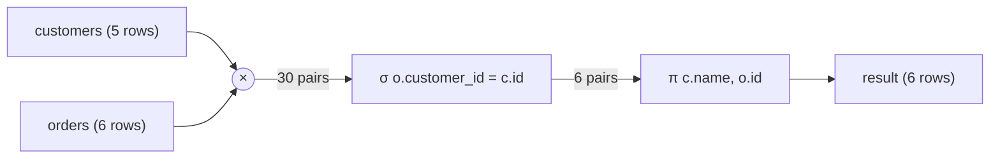
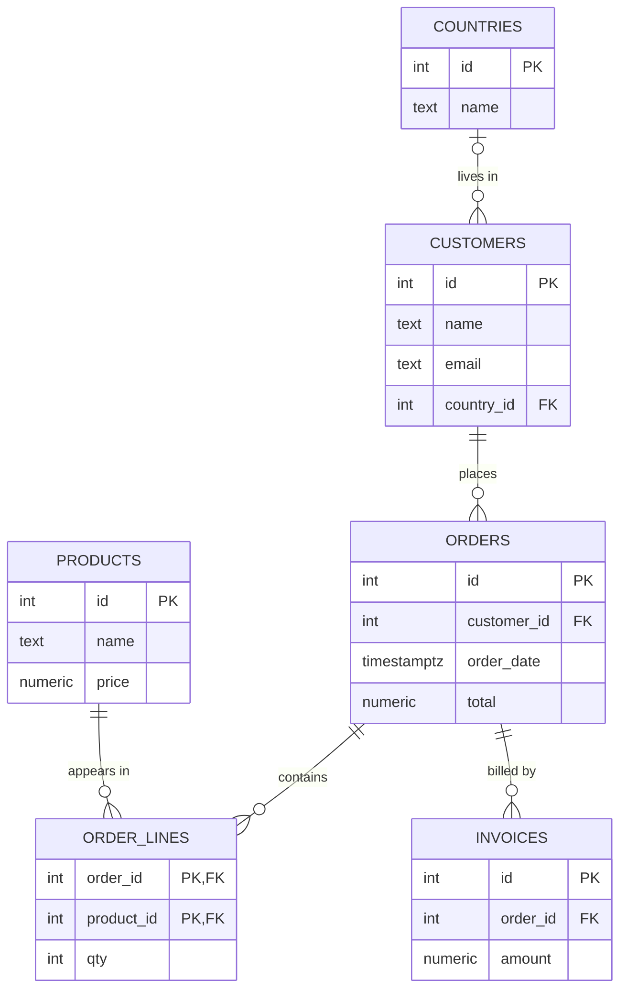

# 2. The relational model

> **Language:** English | [فارسی](../../fa/part1/02-relational-model.md) | **Previous:** [1. What a database is](01-what-is-a-database.md) | **Next:** [3. SQL I: reading data](03-sql-basics.md)
> **Level:** L1 beginner → L2 | **Part:** I
> **In one sentence:** the relational model describes data as tables of rows with keys that link them, and gives a small algebra of operations (select, project, join, union, difference) from which every query is built.
> **You will learn:**
> - the formal words (relation, tuple, attribute, domain) and their everyday equivalents (table, row, column, type)
> - the different kinds of key and why a primary key and a foreign key matter
> - what NULL really means and how three-valued logic changes the result of a comparison
> - the six core operations of relational algebra and the SQL that corresponds to each
> - how to read the `shop` entity-relationship diagram
>
> **Prerequisites:** [chapter I-01](01-what-is-a-database.md).

## 1. The idea (beginner)

In 1970 an IBM researcher, Edgar F. Codd, proposed a simple way to think about data: store facts in tables, and let
the user ask for what they want by combining tables, without saying where the data lives or how to fetch it. Almost
every business database since then, and the SQL language, descends from that proposal. It is called the **relational
model**, and the "relation" in its name is a mathematical word for what you already know as a table.

A table has columns that name the facts you store (`name`, `email`) and rows that each hold one thing (one customer).
The model adds three ideas on top of that picture. First, **a row is identified by a key**, a column or group of
columns whose value is different for every row, so you can always point at exactly one row. Second, **rows in
different tables are linked by copying a key**: an order does not repeat the customer's name and email, it stores the
customer's key and you look the rest up when you need it. Third, **you work on whole tables at a time**: a query takes
tables in and gives a table back, and because the result is itself a table you can feed it to the next query.

Those three ideas are enough to design the `shop` database and to understand what every SQL statement in the next two
chapters means. This chapter gives them their proper names, adds the one slightly strange concept (NULL), and introduces
the small algebra that the SQL optimizer uses internally.

### 1.1 The words

The formal vocabulary comes from mathematics; the everyday vocabulary comes from spreadsheets and from SQL. Both are used
in real documentation, so learn the mapping.

| Formal (relational model) | SQL / everyday | Example in `shop` |
|---|---|---|
| [relation](../glossary.md#relation) | [table](../glossary.md#relation) | `customers` |
| [tuple](../glossary.md#tuple) | [row](../glossary.md#tuple) (also "record") | `(1, 'Alice', 'alice@example.com', 1)` |
| [attribute](../glossary.md#attribute) | [column](../glossary.md#attribute) (also "field") | `email` |
| [domain](../glossary.md#domain) | data type plus constraints | `email` is text that contains `@`; `total` is a number with 2 decimals |
| degree | number of columns | `customers` has degree 4 |
| cardinality (of a relation) | number of rows | `customers` has 5 rows |
| heading / schema | the list of column names and types | `customers(id, name, email, country_id)` |
| body | the set of rows | the five customers |

Two warnings. First, the word *cardinality* is used for two different things: the number of rows in a table, and the
"one-to-many" nature of a relationship between tables (section 2.6). Context decides. Second, the formal model says a
relation is a **set**, so it has no duplicate rows and no order. SQL tables are looser: they may contain duplicate
rows (when there is no key) and a query result has no inherent order until you add `ORDER BY`. A collection that allows
duplicates but has no order is called a [bag](../glossary.md#bag) (or multiset). Keep this difference in mind; it
explains why SQL has both `UNION` and `UNION ALL`, and `DISTINCT`.

## 2. How it works (practitioner)

### 2.1 Relations, order and duplicates

A relation has these properties:

1. **Rows have no order.** "The first row" has no meaning unless you sort. If a query returns rows in a nice order
   today, that is an accident of storage; the optimizer is allowed to change it tomorrow.
2. **Columns have no meaning by position** in the formal model; you refer to them by name. SQL does let you write
   `ORDER BY 2`, which is convenient but fragile.
3. **Every value is atomic**: one value per cell, not a list. A cell with `'vip,b2b'` that you split in code breaks this
   rule (the first normal form in [chapter I-05](05-modelling-and-normalisation.md)). Several engines let you store
   arrays or JSON anyway; that is a deliberate step outside the strict model.
4. **Every row has a value for every column**, even if that value is the special marker NULL (section 2.3).
5. **The rows are distinct** (a set). A table with a primary key guarantees this.

### 2.2 Keys

A [key](../glossary.md#candidate-key) is the answer to "how do I name exactly one row?". There are several kinds, and
they are best learned in the order a designer would meet them.

- A **superkey** is any set of columns that is unique for every row. `(id, name)` is a superkey of `customers` because
  `id` alone already is.
- A [**candidate key**](../glossary.md#candidate-key) is a *minimal* superkey: remove any column and it stops being
  unique. A table can have several. In `customers`, `id` is a candidate key. `email` would be another if every customer
  had a distinct email and none were missing (in the seed two customers have no email, so it cannot be a key there).
- The [**primary key**](../glossary.md#primary-key) is the one candidate key that you choose as the official identifier.
  It cannot contain NULL, and the DBMS creates an index on it so lookups are fast. The other candidate keys become
  "alternate keys", usually declared with a `UNIQUE` constraint. A table has at most one primary key.
- A [**composite key**](../glossary.md#composite-key) uses more than one column. In `order_lines` the primary key is
  `(order_id, product_id)`: one order may contain many products and one product may appear in many orders, but a given
  product appears at most once in a given order. (If you wanted the same product on two lines you would need a line
  number in the key, as Rowlit's own sample database does with `(OrderId, LineNo)`.)
- A [**surrogate key**](../glossary.md#surrogate-key) is an identifier invented by the system and with no business
  meaning: `customers.id` is a generated integer (`GENERATED BY DEFAULT AS IDENTITY` in PostgreSQL, `IDENTITY(1,1)` in SQL
  Server, `AUTO_INCREMENT` in MySQL). A [**natural key**](../glossary.md#natural-key) is a value that already exists in
  the real world and is unique, such as a country code `DE` or an ISBN. Natural keys look attractive and have a bad habit:
  the real world changes them (people change email, countries rename). [Chapter I-05](05-modelling-and-normalisation.md)
  discusses the trade-off.
- A [**foreign key**](../glossary.md#foreign-key) is a column (or columns) in one table whose values must appear as a key
  in another table. `orders.customer_id` refers to `customers.id`. This is how rows in different tables are linked.

The rule that a foreign key value must match an existing key, or be NULL if the column allows it, is called
[**referential integrity**](../glossary.md#referential-integrity). The DBMS enforces it: trying to insert an order for
customer 99 fails because customer 99 does not exist, and trying to delete customer 1 fails (or cascades, or sets NULL,
depending on what you declared) while orders still point at it. In `shop`:

```sql
-- engine/tests/docker/seed-postgres.sql:36-41 (trimmed)
CREATE TABLE public.orders (
  id integer CONSTRAINT pk_orders PRIMARY KEY,
  customer_id integer NOT NULL CONSTRAINT fk_orders_customers REFERENCES public.customers(id),
  order_date timestamptz NOT NULL,
  total numeric(12,2) NOT NULL);
```

`pk_orders` and `fk_orders_customers` are constraint names. Naming constraints is a habit worth having, because the name
appears in error messages.

### 2.3 NULL and three-valued logic

The seed data contains two customers without an email and one without a country. The relational model has no place for
"unknown", so SQL adds a marker, [NULL](../glossary.md#null). NULL does not mean zero, an empty string or false. It
means **there is no value here**, either because it is unknown (we have not asked Emil for his country) or because it
does not apply. This one marker causes more surprises than any other feature of SQL, so it is worth understanding
exactly.

Any comparison that involves NULL does not return true or false. It returns a third value, **UNKNOWN**. The logic that
results is [three-valued logic](../glossary.md#three-valued-logic). The truth tables:

| `a` | `b` | `a AND b` | `a OR b` |
|---|---|---|---|
| TRUE | TRUE | TRUE | TRUE |
| TRUE | FALSE | FALSE | TRUE |
| TRUE | UNKNOWN | UNKNOWN | TRUE |
| FALSE | FALSE | FALSE | FALSE |
| FALSE | UNKNOWN | FALSE | UNKNOWN |
| UNKNOWN | UNKNOWN | UNKNOWN | UNKNOWN |

`NOT UNKNOWN` is UNKNOWN. Read the table with "I don't know" in mind: `UNKNOWN AND FALSE` is FALSE because whatever the
unknown value is, the whole thing cannot be true; `UNKNOWN OR TRUE` is TRUE for the same reason.

Now the rule that surprises everyone: **a `WHERE` clause keeps a row only if its condition is TRUE.** FALSE and UNKNOWN
both discard the row. Three consequences, each demonstrated with the `shop` data:

```sql
SELECT name FROM customers WHERE country_id = 1;        -- Alice, Dora
SELECT name FROM customers WHERE country_id <> 1;       -- Bob, Chie (Emil is missing!)
SELECT name FROM customers WHERE country_id IS NULL;    -- Emil
```

`country_id <> 1` is UNKNOWN for Emil, because we do not know whether his unknown country is Germany, so he is
discarded. If you want "everyone who is not in Germany, including those with no country" you must say so:
`WHERE country_id <> 1 OR country_id IS NULL`, or, where the engine supports it, `country_id IS DISTINCT FROM 1`.

Also:

- `NULL = NULL` is UNKNOWN, not TRUE. Use `IS NULL` and `IS NOT NULL`. A query `WHERE email = NULL` returns no rows in
  every engine.
- **Aggregates skip NULLs.** `SELECT count(*), count(email), count(country_id) FROM customers` returns 5, 3 and 4:
  `count(*)` counts rows, `count(column)` counts non-NULL values. `avg` and `sum` also ignore NULLs, which means the
  average of `(10, NULL, 20)` is 15, not 10.
- **`GROUP BY`, `DISTINCT` and `UNION` treat NULLs as equal to each other.** Grouping `customers` by `country_id`
  gives four groups, one of them the NULL group, even though `NULL = NULL` is not TRUE. SQL has two different notions of
  "same": the comparison `=` and the *not distinct* test used by grouping.
- A `CHECK` constraint passes when its condition is UNKNOWN. `CHECK (qty > 0)` allows a NULL `qty`; combine it with
  `NOT NULL` if you mean both.
- `NOT IN` with a NULL in the list returns no rows. `WHERE id NOT IN (SELECT country_id FROM customers)` is `id <> 1 AND
  id <> 2 AND id <> 3 AND id <> NULL`, and the last term makes the whole chain at best UNKNOWN. Chapter
  [I-03](03-sql-basics.md) shows the example and the safe alternatives (`NOT EXISTS`, `LEFT JOIN … IS NULL`).

### 2.4 Relational algebra

Codd's second contribution is a set of operations on relations, the [relational algebra](../glossary.md#relational-algebra).
You never write it in a SQL editor, but it is how optimizers think: a SQL statement is translated into a tree of these
operations, rearranged to a cheaper tree, and executed ([chapter I-08](08-query-processing.md)). Learn the operators once
and the SQL clauses stop being a list of keywords to memorise.

| Operator | Symbol | What it does | SQL |
|---|---|---|---|
| [Selection](../glossary.md#selection) | σ<sub>condition</sub>(R) | Keeps the rows where the condition holds | `WHERE` |
| [Projection](../glossary.md#projection) | π<sub>columns</sub>(R) | Keeps only some columns (and removes duplicates in the pure model) | the column list of `SELECT` (add `DISTINCT` for the set behaviour) |
| Rename | ρ | Gives a relation or column a new name | `AS` ([alias](../glossary.md#alias)) |
| Cartesian product | R × S | Every row of R paired with every row of S | `CROSS JOIN` or a comma between tables |
| Union | R ∪ S | Rows in R or S (same columns required) | `UNION` |
| Difference | R − S | Rows in R that are not in S | `EXCEPT` (`MINUS` in Oracle) |
| Intersection | R ∩ S | Rows in both (derivable from the others) | `INTERSECT` |
| [Join](../glossary.md#join) | R ⋈<sub>condition</sub> S | Product followed by selection | `JOIN … ON` |
| Division | R ÷ S | Rows of R that are paired with *all* rows of S | no keyword; `NOT EXISTS` twice |

The first six (selection, projection, rename, product, union, difference) are sufficient: the others can be expressed
with them. A language that can express all six is called *relationally complete*, and SQL is at least that.

**Selection and projection on `customers`.**

σ<sub>country_id = 1</sub>(customers) is "the customers in Germany":

```sql
SELECT * FROM customers WHERE country_id = 1;
```

| id | name | email | country_id |
|---|---|---|---|
| 1 | Alice | alice@example.com | 1 |
| 4 | Dora | dora@example.com | 1 |

π<sub>country_id</sub>(customers) is the single column of country ids. In the pure model the result is a set, so
the duplicate `1` collapses; in SQL you must ask for it:

```sql
SELECT country_id FROM customers;            -- 5 rows: 1, 2, 3, 1, NULL   (a bag)
SELECT DISTINCT country_id FROM customers;   -- 4 rows: 1, 2, 3, NULL      (a set)
```

**Product and join.** The product `customers × orders` has 5 × 6 = 30 rows: every customer paired with every order.
Almost all of those pairs are nonsense (Alice paired with Bob's order). A join keeps only the pairs where the keys
match. These two queries are the same relation:

```sql
SELECT c.name, o.id AS order_id FROM customers c, orders o WHERE o.customer_id = c.id;
SELECT c.name, o.id AS order_id FROM customers c JOIN orders o ON o.customer_id = c.id;
```

| name | order_id |
|---|---|
| Alice | 1 |
| Alice | 2 |
| Bob | 3 |
| Chie | 4 |
| Dora | 5 |
| Dora | 6 |

**Figure 2.1: a join is a product followed by a selection and a projection.**



Emil has no orders, so he is in none of the 6 matching pairs. That is why an inner join loses him, and why the
*outer* joins in [chapter I-03](03-sql-basics.md) exist.

A real optimizer never builds the 30-row product; it uses the index on `orders.customer_id`. The product is the
**meaning** of the join, and the plan is how the engine reaches the same answer faster.

**Union, difference, intersection.** They need two relations with the same columns:

```sql
SELECT id FROM customers EXCEPT SELECT customer_id FROM orders;   -- 5  (Emil)
```

"Customers that never ordered" is customer ids minus ordering customer ids.

**Division** answers questions of the form "for all". "Which customers have bought every product that Alice has
bought?" Alice has bought Keyboard and Mouse; only Alice herself has bought both, so the answer is Alice. SQL has no
division keyword; the standard idiom is a double negation, "there is no product of Alice's that this customer has not
bought":

```sql
SELECT c.name
FROM customers c
WHERE NOT EXISTS (
  SELECT 1 FROM products p
  WHERE p.id IN (SELECT l.product_id FROM order_lines l JOIN orders o ON o.id = l.order_id WHERE o.customer_id = 1)
    AND NOT EXISTS (
      SELECT 1 FROM order_lines l2 JOIN orders o2 ON o2.id = l2.order_id
      WHERE o2.customer_id = c.id AND l2.product_id = p.id));
```

| name |
|---|
| Alice |

You will rarely need division, and when you do it is worth a comment in the code. It is shown here to complete the
set.

**The closure property.** Each operator takes relations and returns a relation. Because the output has the same kind
as the input, operators compose without limit: `π(σ(R ⋈ S))`. This [closure](../glossary.md#closure) is the reason
SQL allows a subquery wherever a table may appear, and it is why a query is a tree.

### 2.5 The seed as relations

For reference, the full `shop` data (the same rows in every engine; the `order_date` timestamps are shortened to minutes):

`countries`

| id | name |
|---|---|
| 1 | Germany |
| 2 | France |
| 3 | Japan |

`customers`

| id | name | email | country_id |
|---|---|---|---|
| 1 | Alice | alice@example.com | 1 |
| 2 | Bob | NULL | 2 |
| 3 | Chie | chie@example.jp | 3 |
| 4 | Dora | dora@example.com | 1 |
| 5 | Emil | NULL | NULL |

`products`

| id | name | price |
|---|---|---|
| 1 | Keyboard | 49.90 |
| 2 | Mouse | 19.50 |
| 3 | Monitor | 199.00 |
| 4 | Cable | 5.25 |

`orders`

| id | customer_id | order_date | total |
|---|---|---|---|
| 1 | 1 | 2026-01-05 10:00 | 120.50 |
| 2 | 1 | 2026-02-11 09:30 | 19.50 |
| 3 | 2 | 2026-02-12 14:00 | 199.00 |
| 4 | 3 | 2026-03-01 08:15 | 54.15 |
| 5 | 4 | 2026-03-02 17:45 | 5.25 |
| 6 | 4 | 2026-03-03 12:00 | 249.00 |

`order_lines` (primary key `(order_id, product_id)`)

| order_id | product_id | qty |
|---|---|---|
| 1 | 1 | 2 |
| 1 | 2 | 1 |
| 2 | 2 | 1 |
| 3 | 3 | 1 |
| 4 | 1 | 1 |
| 4 | 4 | 1 |
| 6 | 3 | 1 |

Two facts about this data are worth noticing now because later chapters use them. Order 5 has **no lines**, and the
`total` of an order is a stored number that does not always equal the sum of its lines (order 1 stores 120.50 but its
lines add up to 119.30; order 4 stores 54.15 but its lines add up to 55.15; order 6 stores 249.00 for a single 199.00 monitor). The fixture does not try to be
self-consistent. This is exactly the situation that [chapter I-05](05-modelling-and-normalisation.md) warns against:
when the same fact is stored twice, the copies drift apart.

### 2.6 The `shop` entity-relationship diagram

An [entity-relationship diagram](../glossary.md#er-diagram) (ER diagram) draws tables as boxes (entities) and
foreign keys as lines (relationships). The line ends show the
[cardinality](../glossary.md#cardinality-relationship) of the relationship: for each row on one side, how many rows may
exist on the other. The notation used here is [crow's foot](../glossary.md#crows-foot): a bar means "exactly one", a
circle means "zero", a three-pronged fork means "many".

**Figure 2.2: the `shop` model.**



How to read it:

- `CUSTOMERS ||--o{ ORDERS`: each order belongs to exactly one customer (`||`), and a customer has zero or more orders
  (`o{`). The foreign key `orders.customer_id` is `NOT NULL`, which is what makes it "exactly one".
- `COUNTRIES |o--o{ CUSTOMERS`: a customer has *zero or one* country (`|o`), because `country_id` may be NULL (Emil).
  A country has zero or more customers.
- `ORDERS ||--o{ ORDER_LINES` and `PRODUCTS ||--o{ ORDER_LINES`: **a many-to-many relationship between orders and
  products** is split into two one-to-many relationships through a *link table* (also called junction or associative
  table), `order_lines`, whose composite primary key is the pair of foreign keys. Every many-to-many relationship in a
  relational database becomes a link table. The link table is a good place to store facts about the relationship
  itself, such as `qty`.
- `INVOICES` exists only in the PostgreSQL and SQL Server seeds, in a second schema called `sales`
  (`sales.invoices`), which also demonstrates a foreign key that crosses schemas.

The names in the diagram are the PostgreSQL names. The SQL Server seed uses PascalCase (`Customers`, `CountryId`),
Oracle upper-case (`CUSTOMERS`, `COUNTRY_ID`); the model is identical.

## 3. Deep dive (senior)

> **Deep dive (L3): where SQL departs from the model.**
> SQL was designed after the model and deliberately breaks several of its rules, mostly for performance and
> practicality. The consequences matter when you reason about queries or write an optimizer rule.
> - **Bags, not sets.** Removing duplicates requires sorting or hashing the data, which is expensive, so SQL keeps
>   duplicates unless you write `DISTINCT` or `UNION`. The algebra for bags is slightly different: `UNION ALL` adds
>   multiplicities, `INTERSECT ALL` takes the minimum and `EXCEPT ALL` subtracts them (supported by PostgreSQL and
>   standard SQL; not by every engine). Equivalences that hold for sets can fail for bags, so an optimizer must prove
>   a rewrite is safe for the actual semantics.
> - **Order is part of the result only when requested.** The model has no order; `ORDER BY` turns the result into a list.
> - **NULL.** Codd added "missing information" markers to the model later (he proposed two kinds, "missing but
>   applicable" and "missing and inapplicable"); SQL standardised one. Three-valued logic breaks familiar laws:
>   `x = x` is not a tautology, `x OR NOT x` is not always TRUE, and `NOT (a = b)` is not the same as `a <> b` once NULLs
>   are present in the data. Optimizers must be careful when moving predicates across outer joins and `NOT IN`.
> - **Duplicate column names and unnamed columns** are allowed in a result; the model requires named, distinct attributes.
> - **Physical details leak.** The model separates the logical from the physical, and SQL mostly follows, but
>   features such as `ROWID`, `ctid`, index hints and `LIMIT` without `ORDER BY` expose the storage layer.
> - **Referential integrity is optional.** The DBMS enforces it only when you declare the foreign key, and several engines
>   accept the declaration without enforcing it (see the table below).

> **Deep dive (L3): NULL and keys.** The relational model says a primary key can never be NULL. SQL agrees for primary
> keys, but a *unique* constraint is allowed to contain NULLs, and the engines disagree about how many. SQL Server
> treats NULL as an ordinary value for uniqueness purposes and allows exactly one NULL in a unique index; PostgreSQL,
> MySQL, MariaDB and SQLite allow any number, because two NULLs are "not equal"; PostgreSQL 15 added `UNIQUE NULLS NOT
> DISTINCT` to choose the other behaviour. Oracle also allows several NULLs in a single-column unique index, but for
> a composite unique index it rejects two rows whose non-null columns are equal and whose other columns are all NULL (a
> row with every column NULL is simply not indexed). When you port a schema, test this.

## 4. In each engine

| Topic | PostgreSQL 17 | SQL Server 2022 | Oracle 23 | MySQL 8.4 / MariaDB 11 | SQLite 3.4x | ClickHouse 24.8 | Snowflake | Cassandra 5 |
|---|---|---|---|---|---|---|---|---|
| Primary key enforced | yes | yes | yes | yes (InnoDB) | yes (`PRIMARY KEY` is unique; NULLs are accepted in non-integer keys unless `NOT NULL`, a historic quirk) | **no**: `PRIMARY KEY` is a sort/sparse-index key, not a uniqueness rule | informational only, **not enforced** | yes, and an `INSERT` with an existing key overwrites (upsert) |
| Foreign key enforced | yes | yes | yes | yes (InnoDB) | only when `PRAGMA foreign_keys = ON` for that connection | no foreign keys | informational only | no foreign keys, no joins |
| `NOT NULL` enforced | yes | yes | yes | yes | yes | yes (columns are non-nullable unless `Nullable(T)`) | yes | primary-key columns only |
| Default `ORDER BY x` places NULLs | last when ascending | first when ascending | last when ascending | first when ascending | first when ascending | last (`NULLS LAST`) | last when ascending | not applicable |
| Syntax to control it | `NULLS FIRST` / `NULLS LAST` | no keyword; use `ORDER BY CASE WHEN x IS NULL …` | `NULLS FIRST` / `NULLS LAST` | no keyword (MySQL); use `ISNULL(x)` | `NULLS FIRST` / `NULLS LAST` since 3.30 | `NULLS FIRST` / `NULLS LAST` | `NULLS FIRST` / `NULLS LAST` | none |
| Empty string `''` is… | a value, distinct from NULL | a value | **the same as NULL** | a value | a value | a value | a value | a value |
| Null-safe equality | `IS NOT DISTINCT FROM` | `IS NOT DISTINCT FROM` (2022) | `DECODE(a, b, 1, 0) = 1` (no operator) | `<=>` | `IS` / `IS NOT` | `isNotDistinctFrom()` (not verified for 24.8) | `IS NOT DISTINCT FROM`, `EQUAL_NULL()` | not applicable |

Cells that start with "informational" mean the engine parses the constraint, stores it in its catalog (BI tools use
it to infer relationships), and never rejects a violating row. Verify with the version you use; the table records
behaviour at the versions listed. A particularly dangerous row is Oracle's: in Oracle a string of length zero *is*
NULL, so `WHERE name = ''` never returns anything, and `'abc' || NULL` is `'abc'`.

## 5. Exercises

1. **Keys.** In `order_lines`, is `order_id` alone a key? Is `product_id` alone? Why is `(order_id, product_id)` the
   primary key and not `(order_id, product_id, qty)`? What would have to change in the table to let one order have the
   Mouse on two separate lines?
2. **Three-valued logic.** Evaluate each of the following as TRUE, FALSE or UNKNOWN: `NULL = NULL`; `NULL IS NULL`;
   `1 <> NULL`; `NULL OR TRUE`; `NULL AND FALSE`; `NOT NULL`; `(1 = 1) AND (NULL = 2)`.
3. **Counting.** Without running anything, predict `SELECT count(*), count(email), count(country_id), count(DISTINCT
   country_id) FROM customers`. Then predict how many rows `SELECT * FROM customers WHERE country_id <> 1` returns and
   which customers are missing from the answer. Run both to check.
4. **Algebra.** Write the relational-algebra expression (with σ, π and ⋈) and the SQL for "the names of customers who
   have placed an order with a total over 100". Draw its expression tree. Which of the two relations is larger before
   the join, and what does an optimizer prefer to do first, the selection or the join?
5. **Model.** The shop wants product reviews: a customer may review a product, at most once, with a rating from 1 to 5
   and some text. Draw the entities and cardinalities in crow's foot notation, choose the primary key of the new table,
   and write the `CREATE TABLE` including the foreign keys and a `CHECK` constraint. Is this a one-to-many or a
   many-to-many relationship, and why does the new table look like `order_lines`?
6. **Set versus bag.** `SELECT country_id FROM customers UNION SELECT id FROM countries` returns how many rows, and how
   many does the same query return with `UNION ALL`? Which rows does the first one remove and why does NULL appear
   exactly once?

Answers: [Chapter I-18, section I-02](18-exercise-answers.md#i-02).

## Related chapters

- Previous: [I-01 what a database is](01-what-is-a-database.md). Next: [I-03 SQL I](03-sql-basics.md), which turns the
  algebra into SELECT statements.
- [I-05 modelling and normalisation](05-modelling-and-normalisation.md) continues with keys, constraints and the design of
  tables.
- [I-08 the query pipeline](08-query-processing.md) shows how a SQL statement is converted into the algebra trees of
  section 2.4 and optimised.
- Part II: Rowlit draws the same kind of diagram for any connected database ([II-15](../part2/15-import-export-plans-er.md),
  ER diagrams).

## Glossary terms introduced here

[relation](../glossary.md#relation), [tuple](../glossary.md#tuple), [attribute](../glossary.md#attribute),
[domain](../glossary.md#domain), [bag](../glossary.md#bag), [candidate key](../glossary.md#candidate-key),
[primary key](../glossary.md#primary-key), [composite key](../glossary.md#composite-key),
[surrogate key](../glossary.md#surrogate-key), [natural key](../glossary.md#natural-key),
[foreign key](../glossary.md#foreign-key), [referential integrity](../glossary.md#referential-integrity),
[NULL](../glossary.md#null), [three-valued logic](../glossary.md#three-valued-logic),
[relational algebra](../glossary.md#relational-algebra), [selection](../glossary.md#selection),
[projection](../glossary.md#projection), [join](../glossary.md#join), [closure](../glossary.md#closure),
[alias](../glossary.md#alias), [ER diagram](../glossary.md#er-diagram),
[cardinality (relationship)](../glossary.md#cardinality-relationship), [crow's foot](../glossary.md#crows-foot).
