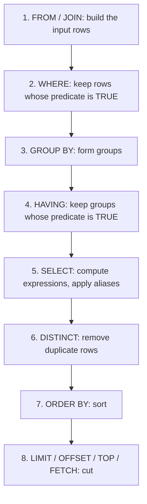
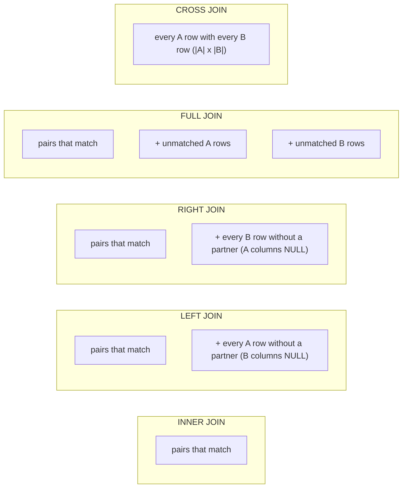

# 3. SQL I: reading data

> **Language:** English | [فارسی](../../fa/part1/03-sql-basics.md) | **Previous:** [2. The relational model](02-relational-model.md) | **Next:** [4. SQL II: advanced queries](04-sql-advanced.md)
> **Level:** L1 beginner | **Part:** I
> **In one sentence:** a SELECT statement describes the rows you want, and the DBMS decides how to fetch them; this chapter teaches the clauses, the joins, grouping and the basic statements that change data.
> **You will learn:**
> - the anatomy of `SELECT` and the order in which its clauses are really evaluated
> - how to filter, sort, limit and page results, and how that differs between engines
> - inner, left, right, full, cross and self joins, with pictures and the `shop` rows
> - aggregates, `GROUP BY` and `HAVING`, and the classic join-and-sum mistake
> - set operations, the safe ways to ask "who has no ...", and the basics of `INSERT`, `UPDATE`, `DELETE` and `CREATE TABLE`
>
> **Prerequisites:** [I-01](01-what-is-a-database.md), [I-02](02-relational-model.md).
> **About the outputs:** results of the SQLite versions of these queries were produced by running them on the `shop` fixture (SQLite 3.51). For the other engines the query returns the same rows; where the engine's syntax differs, the output is *illustrative output* computed from the seed data. Numbers are shown the PostgreSQL way (`120.50`).

## 1. The idea (beginner)

SQL (Structured Query Language, usually pronounced "sequel" or "S-Q-L") is the language you use to talk to a
relational database. Its central idea is that it is **declarative**: you say *what* result you want, not *how* to
compute it. "Give me the names of customers in Germany" does not tell the DBMS to open a file, loop over rows or use an
index; the DBMS makes those choices. You can write correct SQL without knowing them, and you can later learn them
([chapters I-07 and I-08](07-indexes.md)) to make the same SQL faster.

SQL statements fall into groups, depending on what they do. The names appear everywhere in documentation, so learn
them now.

| Group | Name | Purpose | Examples |
|---|---|---|---|
| [DQL](../glossary.md#dql) | Data Query Language | Read data | `SELECT` |
| [DML](../glossary.md#dml) | Data Manipulation Language | Change rows | `INSERT`, `UPDATE`, `DELETE`, `MERGE` |
| [DDL](../glossary.md#ddl) | Data Definition Language | Change structure | `CREATE`, `ALTER`, `DROP`, `TRUNCATE` |
| [DCL](../glossary.md#dcl) | Data Control Language | Permissions | `GRANT`, `REVOKE` |
| [TCL](../glossary.md#tcl) | Transaction Control Language | Group changes | `BEGIN`, `COMMIT`, `ROLLBACK`, `SAVEPOINT` |

Some authors count `SELECT` as part of DML; the split above is the most common. This chapter is almost entirely about
`SELECT`. The last section shows the other statements just enough to modify the `shop` data in the exercises.
Transactions get [chapter I-09](09-transactions-and-isolation.md); permissions get [chapter I-14](14-security.md).

SQL keywords are not case sensitive (`select` and `SELECT` are the same), and a statement ends with a semicolon in most
tools. This book writes keywords in capitals and identifiers in lower case, which is a convention, not a rule.

## 2. How it works (practitioner)

### 2.1 The shape of a SELECT

```sql
SELECT   <what to return>          -- projection: columns and expressions
FROM     <where the rows come from>-- tables, joins, subqueries
WHERE    <row filter>              -- predicate on single rows
GROUP BY <grouping columns>        -- collapse rows into groups
HAVING   <group filter>            -- predicate on groups
ORDER BY <sort keys>               -- order the result
LIMIT    <how many>                -- (spelling depends on the engine)
```

Only `SELECT` is required in most engines (and `FROM` in all but a few; Oracle needed `FROM dual` before version 23).
The clauses are always written in this order, but the DBMS **evaluates them in a different order**, and that order
explains most of the rules you will meet.

**Figure 3.1: the logical order of evaluation of a SELECT.**



The order is *logical*: it is the meaning of the statement. The optimizer is free to execute in any order that
gives the same result, for example filtering before joining ([chapter I-08](08-query-processing.md)). What the order
tells you:

- `WHERE` runs before `SELECT`, so **an alias defined in the select list cannot be used in `WHERE`** in standard SQL
  (`SELECT total * 1.19 AS gross ... WHERE gross > 100` fails in PostgreSQL, SQL Server and Oracle). Some engines are
  more lenient in other clauses: MySQL and PostgreSQL accept aliases in `GROUP BY`, SQLite even in `WHERE`
  (do not rely on it). Repeat the expression, or put the query in a subquery or a CTE ([chapter I-04](04-sql-advanced.md)).
- `ORDER BY` runs after `SELECT`, so it **can** use aliases.
- `WHERE` runs before grouping, so it cannot contain aggregates; `HAVING` runs after, so it can.
- `LIMIT` is last: the DBMS must compute and sort the whole result before it can know which rows are first.

### 2.2 Projection, expressions, literals and aliases

The select list chooses columns. It can also hold any [expression](../glossary.md#expression): arithmetic, function
calls, string operations, `CASE`. A [literal](../glossary.md#literal) is a value written directly in the statement:
`42`, `'Alice'`, `DATE '2026-01-05'`. An [alias](../glossary.md#alias), introduced by `AS`, names a column or a table in
the statement.

```sql
SELECT id,
       name,
       coalesce(email, '(none)') AS email,
       upper(name)               AS shout
FROM customers
WHERE id <= 3;
```

| id | name | email | shout |
|---|---|---|---|
| 1 | Alice | alice@example.com | ALICE |
| 2 | Bob | (none) | BOB |
| 3 | Chie | chie@example.jp | CHIE |

`coalesce(a, b, …)` returns its first argument that is not NULL, so it is how you replace NULL with a default value. It
is standard SQL and works in every engine in this book (SQL Server and Oracle also have `ISNULL` and `NVL`; prefer
`coalesce`).

`SELECT *` returns every column. It is convenient for exploring and harmful in application code: the result changes when
someone adds a column, and it fetches data you do not need ([chapter I-13](13-performance-tuning.md)).

[`DISTINCT`](../glossary.md#distinct) removes duplicate rows from the result: `SELECT DISTINCT customer_id FROM orders`
returns 1, 2, 3, 4 (four rows) instead of six. It applies to the *whole* row, not to the first column.

A table alias shortens names and is mandatory for a self join (section 2.5): `FROM customers c`. Once you give a table an
alias, use the alias everywhere in that statement.

### 2.3 Filtering with WHERE

A [predicate](../glossary.md#predicate) is a condition that is TRUE, FALSE or UNKNOWN for each row
([chapter I-02](02-relational-model.md), three-valued logic). `WHERE` keeps the rows for which it is TRUE.

| Predicate | Meaning | Example on `shop` |
|---|---|---|
| `=`, `<>`, `<`, `<=`, `>`, `>=` | comparison (`<>` is "not equal"; `!=` also works in most engines) | `total >= 100` |
| `AND`, `OR`, `NOT` | combine predicates; `AND` binds tighter than `OR` | `country_id = 1 AND email IS NOT NULL` |
| `BETWEEN a AND b` | inclusive range | `total BETWEEN 19.50 AND 120.50` |
| `IN (…)` | membership in a list or subquery | `customer_id IN (1, 3)` |
| `LIKE 'pat'` | pattern; `%` any run of characters, `_` one character | `name LIKE '%i%'` |
| `IS NULL`, `IS NOT NULL` | NULL tests (never use `= NULL`) | `email IS NULL` |
| `EXISTS (subquery)` | there is at least one row | [chapter I-04](04-sql-advanced.md) |

```sql
SELECT id, total FROM orders
WHERE total BETWEEN 19.50 AND 120.50 AND customer_id IN (1, 3)
ORDER BY id;
```

| id | total |
|---|---|
| 1 | 120.50 |
| 2 | 19.50 |
| 4 | 54.15 |

Remember the two NULL traps. `WHERE email = NULL` returns nothing (use `IS NULL`). `WHERE country_id <> 1` silently drops
Emil, whose country is NULL. Always ask: "what should happen to the rows where this column is NULL?"

`LIKE` is case sensitive in PostgreSQL and Oracle, case insensitive by default in SQL Server and MySQL (it follows the
column's [collation](../glossary.md#collation)), and case insensitive for ASCII in SQLite. PostgreSQL has `ILIKE` for
case-insensitive matching. A pattern that starts with `%` cannot use an ordinary index ([chapter I-07](07-indexes.md)).

### 2.4 Sorting, limiting and paging

A result set has no order until you add `ORDER BY`. You can sort by several keys, each `ASC` (default) or `DESC`:

```sql
SELECT id, customer_id, total FROM orders ORDER BY total DESC LIMIT 3;
```

| id | customer_id | total |
|---|---|---|
| 6 | 4 | 249.00 |
| 3 | 2 | 199.00 |
| 1 | 1 | 120.50 |

To get the next page, skip rows with an offset. Always add a tie-breaker (here `id`) so that the order is deterministic;
otherwise rows with equal keys may appear on two pages or on none.

```sql
SELECT id, customer_id, total FROM orders ORDER BY total DESC, id LIMIT 3 OFFSET 3;
```

| id | customer_id | total |
|---|---|---|
| 4 | 3 | 54.15 |
| 2 | 1 | 19.50 |
| 5 | 4 | 5.25 |

The syntax for "only the first N rows" is the most visible difference between dialects:

| Engine | First 3 rows | Rows 4 to 6 |
|---|---|---|
| PostgreSQL 17 | `… ORDER BY total DESC LIMIT 3` | `LIMIT 3 OFFSET 3` or `OFFSET 3 ROWS FETCH NEXT 3 ROWS ONLY` |
| SQL Server 2022 | `SELECT TOP (3) … ORDER BY total DESC` | `ORDER BY total DESC OFFSET 3 ROWS FETCH NEXT 3 ROWS ONLY` (needs `ORDER BY`) |
| Oracle 23 | `… ORDER BY total DESC FETCH FIRST 3 ROWS ONLY` (older: `WHERE ROWNUM <= 3` on a sorted subquery) | `OFFSET 3 ROWS FETCH NEXT 3 ROWS ONLY` |
| MySQL 8.4 / MariaDB 11 | `LIMIT 3` | `LIMIT 3 OFFSET 3` or `LIMIT 3, 3` (offset first) |
| SQLite 3.4x | `LIMIT 3` | `LIMIT 3 OFFSET 3` |
| ClickHouse 24.8 | `LIMIT 3` | `LIMIT 3 OFFSET 3` or `LIMIT 3, 3` |
| Snowflake | `LIMIT 3` or `TOP 3` | `LIMIT 3 OFFSET 3` |
| Cassandra 5 (CQL) | `LIMIT 3` | no `OFFSET`; page with the paging state or by clustering key |

Offset paging is simple and gets slower the deeper you page: the DBMS still has to produce and discard all the skipped
rows. [Chapter I-13](13-performance-tuning.md) shows the alternative, keyset pagination.

### 2.5 Joins

A [join](../glossary.md#join) combines rows from two tables that satisfy a condition, normally "the foreign key equals
the primary key". The kinds differ in what happens to rows that find no partner.

**Figure 3.2: which rows each join keeps (A = left table, B = right table).**



**Inner join.** Only matched pairs. Emil, who has no orders, does not appear.

```sql
SELECT c.name, o.id AS order_id, o.total
FROM customers c
JOIN orders o ON o.customer_id = c.id
ORDER BY o.id;
```

| name | order_id | total |
|---|---|---|
| Alice | 1 | 120.50 |
| Alice | 2 | 19.50 |
| Bob | 3 | 199.00 |
| Chie | 4 | 54.15 |
| Dora | 5 | 5.25 |
| Dora | 6 | 249.00 |

`JOIN` alone means `INNER JOIN`. The condition after `ON` is the *join predicate*.

**Left (outer) join.** Every row of the left table, with NULLs where the right table has no match. This is what you want
for "all customers, with their orders if any":

```sql
SELECT c.name, o.id AS order_id, o.total
FROM customers c
LEFT JOIN orders o ON o.customer_id = c.id
ORDER BY c.id, o.id;
```

| name | order_id | total |
|---|---|---|
| Alice | 1 | 120.50 |
| Alice | 2 | 19.50 |
| Bob | 3 | 199.00 |
| Chie | 4 | 54.15 |
| Dora | 5 | 5.25 |
| Dora | 6 | 249.00 |
| Emil | NULL | NULL |

**Right and full joins.** `RIGHT JOIN` is a left join with the tables swapped; most people write `LEFT JOIN` and reorder
the tables. A `FULL JOIN` keeps unmatched rows from both sides. `countries FULL JOIN customers` shows both a country
with no customers (none in the seed) and a customer with no country (Emil):

```sql
SELECT co.name AS country, c.name AS customer
FROM countries co
FULL JOIN customers c ON c.country_id = co.id
ORDER BY c.id;
```

| country | customer |
|---|---|
| Germany | Alice |
| France | Bob |
| Japan | Chie |
| Germany | Dora |
| NULL | Emil |

MySQL and MariaDB have no `FULL JOIN`; emulate it with a `LEFT JOIN` unioned with a `RIGHT JOIN`. Cassandra has no joins
at all: you model the data so that a single table answers each query ([chapter I-16](16-nosql-families.md)).
SQLite supports `RIGHT` and `FULL` joins since 3.39.

**Cross join.** Every combination, no condition: `countries CROSS JOIN products` gives 3 × 4 = 12 rows. Cross joins are
rarely what you want, but they generate calendars and test data. The old syntax `FROM a, b` (a comma) is a cross join, and
adding `WHERE a.k = b.k` turned it into an inner join before the `JOIN` keyword existed. Forgetting the `WHERE` produces
the accidental cross join, the usual cause of a query that returns millions of rows.

**Self join.** A table joined to itself, with two different aliases. "Pairs of customers from the same country":

```sql
SELECT a.name AS customer_a, b.name AS customer_b, a.country_id
FROM customers a
JOIN customers b ON a.country_id = b.country_id AND a.id < b.id;
```

| customer_a | customer_b | country_id |
|---|---|---|
| Alice | Dora | 1 |

The `a.id < b.id` condition keeps each pair once and removes a customer paired with themself. (Emil's NULL country does
not match anything, because `NULL = NULL` is UNKNOWN.) Self joins are also how hierarchies stored as "parent id" columns
are walked, which [chapter I-04](04-sql-advanced.md) does better with recursive CTEs.

**Natural join and `USING`.** `NATURAL JOIN` joins on all columns with the same name; it breaks silently when someone adds
a column, so avoid it. `JOIN … USING (country_id)` joins on one named column that exists in both tables and returns it
once; it is fine and shorter than `ON` when the names match. SQL Server does not support `USING`.

**Joining three or more tables** is just repeating the pattern. Which products did each customer buy?

```sql
SELECT c.name, p.name AS product, l.qty
FROM customers c
JOIN orders o       ON o.customer_id = c.id
JOIN order_lines l  ON l.order_id = o.id
JOIN products p     ON p.id = l.product_id
ORDER BY c.id, o.id, p.id;
```

| name | product | qty |
|---|---|---|
| Alice | Keyboard | 2 |
| Alice | Mouse | 1 |
| Alice | Mouse | 1 |
| Bob | Monitor | 1 |
| Chie | Keyboard | 1 |
| Chie | Cable | 1 |
| Dora | Monitor | 1 |

Alice's Mouse appears twice because she bought it in two different orders (1 and 2). The row count is the number of rows
of the *innermost* table in the chain, `order_lines` (7). Remember that sentence; it explains the trap in section 2.6.

**`ON` versus `WHERE` in outer joins.** For an inner join it makes no difference whether a condition sits in `ON` or in
`WHERE`. For an outer join it does. Both queries below ask about orders over 100, but they answer different questions:

```sql
-- A: the condition is part of the join. Customers without a big order are kept, with NULLs.
SELECT c.name, o.id AS order_id, o.total
FROM customers c LEFT JOIN orders o ON o.customer_id = c.id AND o.total > 100 ORDER BY c.id;

-- B: the condition filters the joined result. Rows with NULL totals are discarded.
SELECT c.name, o.id AS order_id, o.total
FROM customers c LEFT JOIN orders o ON o.customer_id = c.id WHERE o.total > 100 ORDER BY c.id;
```

| A: name | order_id | total |
|---|---|---|
| Alice | 1 | 120.50 |
| Bob | 3 | 199.00 |
| Chie | NULL | NULL |
| Dora | 6 | 249.00 |
| Emil | NULL | NULL |

| B: name | order_id | total |
|---|---|---|
| Alice | 1 | 120.50 |
| Bob | 3 | 199.00 |
| Dora | 6 | 249.00 |

Query B put the filter after the outer join, where `NULL > 100` is UNKNOWN, so the unmatched customers disappear and the
`LEFT JOIN` has quietly become an inner join. The rule: *conditions on the optional (right) side belong in `ON`.*

### 2.6 Aggregates, GROUP BY and HAVING

An [aggregate function](../glossary.md#aggregate) turns many rows into one value: `count`, `sum`, `avg`, `min`, `max`. Without
`GROUP BY`, the whole result is one group:

```sql
SELECT count(*) AS orders, min(total) AS lo, max(total) AS hi, sum(total) AS revenue, round(avg(total), 2) AS mean
FROM orders;
```

| orders | lo | hi | revenue | mean |
|---|---|---|---|---|
| 6 | 5.25 | 249.00 | 647.40 | 107.90 |

`count(*)` counts rows, `count(col)` counts rows where `col` is not NULL, `count(DISTINCT col)` counts distinct non-NULL
values. On `customers`, `count(*)`, `count(email)` and `count(DISTINCT country_id)` are 5, 3 and 3.

[`GROUP BY`](../glossary.md#group-by) forms one group per distinct combination of the grouping columns and computes the
aggregates per group:

```sql
SELECT c.name, count(o.id) AS orders, sum(o.total) AS revenue
FROM customers c
LEFT JOIN orders o ON o.customer_id = c.id
GROUP BY c.id, c.name
ORDER BY c.id;
```

| name | orders | revenue |
|---|---|---|
| Alice | 2 | 140.00 |
| Bob | 1 | 199.00 |
| Chie | 1 | 54.15 |
| Dora | 2 | 254.25 |
| Emil | 0 | NULL |

Observe three things. Emil is there because of the `LEFT JOIN`, and his `count(o.id)` is 0, not NULL, because
`count(column)` of no rows is zero (whereas `sum` of no rows is NULL; wrap it in `coalesce(sum(...), 0)` if you want
0). Second, `count(o.id)` and not `count(*)`: `count(*)` would count Emil's single padded row and give 1. Third, the
`SELECT` list contains only grouping columns and aggregates. **Every column in the select list must either be in
`GROUP BY` or inside an aggregate**; otherwise "which of the group's values should be shown?" has no answer. PostgreSQL,
SQL Server and Oracle reject such a query. MySQL 8 rejects it by default (`ONLY_FULL_GROUP_BY`), but older versions and
SQLite return an arbitrary row's value, a classic source of wrong reports.

`HAVING` filters groups after aggregation, `WHERE` filters rows before:

```sql
SELECT customer_id, count(*) AS orders, sum(total) AS revenue
FROM orders
GROUP BY customer_id
HAVING sum(total) > 100
ORDER BY customer_id;
```

| customer_id | orders | revenue |
|---|---|---|
| 1 | 2 | 140.00 |
| 2 | 1 | 199.00 |
| 4 | 2 | 254.25 |

Use `WHERE` for anything that can be decided per row, because filtering early means fewer rows to group. A condition such as
`order_date >= '2026-02-01'` belongs in `WHERE`; a condition on `sum(total)` can only be in `HAVING`.

**The fan-out trap.** Joining a one-to-many relationship repeats the "one" side once for every matching "many" row, and
an aggregate then counts the repeated values. Total revenue is `sum(total)` over `orders`: 647.40. Join to the order lines
first and sum again:

```sql
SELECT sum(o.total) AS wrong_sum FROM orders o JOIN order_lines l ON l.order_id = o.id;
```

| wrong_sum |
|---|
| 816.80 |

Order 1 has two lines, so its total 120.50 was added twice; order 4 has two lines, so 54.15 was added twice; order 5 has
none, so its 5.25 vanished. The fix is to aggregate each side separately before joining, or to not join at all if you do
not need the other table. Whenever a query joins and then sums, ask which table's rows are being repeated.

### 2.7 Set operations

Set operations combine two result sets that have the same number of columns with compatible types.

| Operation | Result | Duplicates |
|---|---|---|
| `UNION` | rows in either input | removed |
| `UNION ALL` | rows in either input | kept (and cheaper: no sorting or hashing needed to remove them) |
| `INTERSECT` | rows in both | removed |
| `EXCEPT` (Oracle: `MINUS`) | rows in the first but not in the second | removed |

```sql
SELECT name FROM customers WHERE country_id = 1
UNION
SELECT name FROM customers WHERE email IS NOT NULL
ORDER BY name;
```

| name |
|---|
| Alice |
| Chie |
| Dora |

The first query returns Alice and Dora, the second returns Alice, Chie and Dora; `UNION` merges them into three rows,
`UNION ALL` would return five. `ORDER BY` applies to the combined result and goes at the end. Use `UNION ALL` unless you
need the de-duplication. In ClickHouse a bare `UNION` is an error unless the `union_default_mode` setting is set; write
`UNION ALL` or `UNION DISTINCT`.

`EXCEPT` is one way to answer "who has no orders": `SELECT id FROM customers EXCEPT SELECT customer_id FROM orders`
returns 5. The next section shows the more flexible ways.

### 2.8 Asking "who has none": the anti-join

"Customers without orders" is the single most common query where NULL and joins collide. Three correct forms and one
wrong one:

```sql
-- 1. LEFT JOIN and test for the missing partner
SELECT c.name FROM customers c
LEFT JOIN orders o ON o.customer_id = c.id
WHERE o.id IS NULL;

-- 2. NOT EXISTS (usually the clearest)
SELECT c.name FROM customers c
WHERE NOT EXISTS (SELECT 1 FROM orders o WHERE o.customer_id = c.id);

-- 3. EXCEPT (returns ids; join back for names)
SELECT id FROM customers EXCEPT SELECT customer_id FROM orders;
```

Each returns Emil. The wrong one is `NOT IN`:

```sql
-- Which countries have no customer other than Chie?  Expected: Japan.
SELECT name FROM countries
WHERE id NOT IN (SELECT country_id FROM customers WHERE name <> 'Chie');
```

| name |
|---|
| *(no rows)* |

The subquery returns `1, 2, 1, NULL` (Emil's NULL country). `3 NOT IN (1, 2, 1, NULL)` means `3 <> 1 AND 3 <> 2 AND 3 <>
1 AND 3 <> NULL`, and the last term is UNKNOWN, so the whole condition is never TRUE. Add `AND country_id IS NOT NULL` inside
the subquery, or use `NOT EXISTS`, and the answer is Japan. Prefer `NOT EXISTS`, which has no such trap.

### 2.9 CASE and conditional values

`CASE` is SQL's if-then-else and works anywhere an expression is allowed:

```sql
SELECT id, total,
       CASE WHEN total >= 200 THEN 'large'
            WHEN total >= 100 THEN 'medium'
            ELSE 'small' END AS size
FROM orders ORDER BY id;
```

| id | total | size |
|---|---|---|
| 1 | 120.50 | medium |
| 2 | 19.50 | small |
| 3 | 199.00 | medium |
| 4 | 54.15 | small |
| 5 | 5.25 | small |
| 6 | 249.00 | large |

The branches are tested in order and the first one that is TRUE wins; with no match and no `ELSE`, the result is NULL.

### 2.10 Changing data and structure: the basics

Even a reading chapter needs a few statements that change things. Run these on a scratch copy of `shop`, not on data you
care about.

**INSERT.**

```sql
INSERT INTO customers (name, email, country_id) VALUES ('Farid', 'farid@example.ir', NULL);
INSERT INTO products (id, name, price) VALUES (5, 'Webcam', 59.00), (6, 'Headset', 79.90);
```

List the columns you are providing; columns you omit get their `DEFAULT`, or NULL, or are generated (the `id` of
`customers` comes from an identity). Multi-row `VALUES` is one statement, faster than several. `INSERT … SELECT` copies rows
from a query. After an insert, many engines can return the generated key (`RETURNING id` in PostgreSQL, SQLite and MariaDB;
`OUTPUT inserted.Id` in SQL Server; `RETURNING … INTO` in Oracle).

**UPDATE.**

```sql
UPDATE products SET price = price * 1.10 WHERE id = 4;
```

**DELETE.**

```sql
DELETE FROM customers WHERE id = 6;
```

**The two most expensive mistakes in SQL are an `UPDATE` or a `DELETE` without a `WHERE`.** They change every row. Two habits
protect you: write the `WHERE` first (or run the same `WHERE` in a `SELECT` before you run the `DELETE`), and use a
[transaction](../glossary.md#transaction) so you can roll back ([chapter I-09](09-transactions-and-isolation.md)).
Database tools often warn when they see a data-changing statement without `WHERE`; Rowlit's read-only guard and destructive-statement
confirmation work this way ([chapter II-08](../part2/08-connections-sessions-execution.md)).

`TRUNCATE TABLE orders` removes every row quickly and, in most engines, cannot be undone row by row; it is DDL, not DML, in
several engines. A `DELETE` or `UPDATE` that violates a foreign key is rejected; section 5 of
[chapter I-05](05-modelling-and-normalisation.md) shows the `ON DELETE` options.

**CREATE TABLE.** Creating a table is DDL:

```sql
CREATE TABLE reviews (
  customer_id integer NOT NULL REFERENCES customers (id),
  product_id  integer NOT NULL REFERENCES products (id),
  rating      integer NOT NULL CHECK (rating BETWEEN 1 AND 5),
  comment     text,
  created_at  timestamp NOT NULL DEFAULT CURRENT_TIMESTAMP,
  PRIMARY KEY (customer_id, product_id)
);
```

A table definition is a list of columns (name, [data type](../glossary.md#data-type), optional rules) plus table-level
constraints. This example runs unchanged on PostgreSQL, SQLite and MySQL; SQL Server wants `nvarchar(max)` or similar instead
of `text`, and Oracle `varchar2` and `timestamp` with its own defaults. Data types, constraints and design are the subject of
[chapter I-05](05-modelling-and-normalisation.md). `ALTER TABLE reviews ADD COLUMN helpful integer NOT NULL DEFAULT 0`
changes a table (SQL Server and Oracle omit the word `COLUMN`), and `DROP TABLE reviews` removes it. Dropping is
immediate. PostgreSQL, SQL Server and SQLite can roll a `DROP TABLE` back if it ran inside an open transaction; MySQL,
MariaDB and Oracle commit DDL implicitly, so it cannot be undone.

**DCL and TCL in one line each.** `GRANT SELECT ON customers TO analyst` allows a user or role to read a table;
`BEGIN; …; COMMIT;` or `ROLLBACK;` groups statements into one all-or-nothing unit. Both have their own chapters.

## 3. Deep dive (senior)

> **Deep dive (L3): what "declarative" costs and buys.**
> Because the statement says only *what*, the same SQL can run as very different plans, and a harmless-looking change
> (an extra join, a function around a column, a changed constant) can flip the plan from milliseconds to minutes. The
> optimizer's freedom rests on equivalences of the algebra in [chapter I-02](02-relational-model.md): it can reorder inner
> joins, push `WHERE` below a join, and turn `IN` subqueries into joins. It may **not** reorder outer joins freely, and
> that is exactly why section 2.5's rule "conditions on the optional side belong in `ON`" matters: moving a predicate across
> an outer join changes the result, so the optimizer will not do it for you.
>
> A second consequence is that `SELECT … ORDER BY` is the only way to obtain an order. Engines return rows in whatever
> order the chosen plan produces them, and that order can change after an index is added, after statistics are
> refreshed, or with a different degree of parallelism. Code that "works" because the rows came back in primary-key order
> today will fail one day.

> **Deep dive (L3): tie-breaking and `WITH TIES`.**
> SQL:2008 allows `FETCH FIRST 3 ROWS WITH TIES`, which returns every row that ties with the last one (PostgreSQL 13+,
> Oracle 12c+, SQL Server's `TOP (3) WITH TIES`). It is the right answer for "top three prices" when two products share
> the third-highest price. `LIMIT` without `WITH TIES` picks one of the tied rows arbitrarily unless you add a unique
> tie-breaker column to `ORDER BY`.

> **Deep dive (L3): `GROUP BY` extensions.**
> `GROUP BY ROLLUP (a, b)` adds subtotal and grand-total rows, `CUBE` adds all combinations, and `GROUPING SETS` lists the
> groupings explicitly (PostgreSQL, SQL Server, Oracle, Snowflake, MySQL via `WITH ROLLUP`, ClickHouse via `WITH ROLLUP/CUBE`,
> not SQLite). They replace several `UNION ALL`ed queries with one scan.

## 4. In each engine

Beyond the `LIMIT` table in section 2.4, the differences a beginner meets first:

| Topic | PostgreSQL 17 | SQL Server 2022 | Oracle 23 | MySQL 8.4 / MariaDB 11 | SQLite 3.4x | ClickHouse 24.8 | Snowflake | Cassandra 5 (CQL) |
|---|---|---|---|---|---|---|---|---|
| String concatenation | `a \|\| b` | `a + b`, `concat()` | `a \|\| b` | `concat(a, b)` (`\|\|` is OR unless `PIPES_AS_CONCAT`) | `a \|\| b` | `concat()`, `\|\|` | `a \|\| b`, `concat()` | not available in `SELECT` |
| Unquoted identifier folding | to lower case | preserved (case rules from the collation) | to **upper** case | tables: depends on the OS (`lower_case_table_names`); columns: case-insensitive | case-insensitive, preserved | case-sensitive | to **upper** case | to lower case |
| Quote an identifier | `"Name"` | `[Name]` or `"Name"` | `"NAME"` | `` `Name` `` (or `"` with `ANSI_QUOTES`) | `"Name"`, `` ` ``, `[ ]` | `"Name"` or `` ` `` | `"Name"` | `"Name"` |
| `SELECT` without `FROM` | yes | yes | yes in 23 (older: `FROM dual`) | yes | yes | yes | yes | no |
| `FULL JOIN` | yes | yes | yes | no | yes (3.39+) | yes | yes | no joins |
| `EXCEPT` | `EXCEPT` | `EXCEPT` | `MINUS` | `EXCEPT` (MySQL 8.0.31+, MariaDB 10.3+) | `EXCEPT` | `EXCEPT` | `EXCEPT` / `MINUS` | no set operations |
| Boolean type | `boolean` | `bit` (no boolean predicates as values) | `BOOLEAN` in 23ai (older: `NUMBER(1)`) | `BOOLEAN` = `TINYINT(1)` | no type; 0/1 | `Bool` | `BOOLEAN` | `boolean` |
| Current timestamp | `now()`, `CURRENT_TIMESTAMP` | `SYSDATETIME()`, `GETDATE()` | `SYSTIMESTAMP`, `CURRENT_TIMESTAMP` | `NOW()` | `CURRENT_TIMESTAMP` (UTC text) | `now()` | `CURRENT_TIMESTAMP` | `toTimestamp(now())` |
| `GROUP BY` with non-grouped column | error | error | error | error (`ONLY_FULL_GROUP_BY`, default in 8) | allowed (arbitrary row) | error | error | only partition/clustering keys |

Rowlit encodes these per-dialect rules (quoting, parameters, limits) in the provider's dialect description, which
[chapter II-09](../part2/09-relational-providers.md) explains; [chapter I-17](17-dialect-comparison.md) compares all of them
side by side.

## 5. Exercises

Use the `shop` data. State the expected rows before you run each query.

1. **Filter and sort.** List the name and email of customers who have an email address, ordered by name descending. How
   many rows? Now list the customers whose country is *not* Germany, including the one with no country. Which
   predicate do you need besides `<>`?
2. **Joins.** Write a query that returns each country name with the number of customers living there, including
   countries with no customers (there are none in the seed, so first insert one: `INSERT INTO countries VALUES (4, 'Chile')`).
   Which join type, which table is on the left, and why `count(c.id)` instead of `count(*)`?
3. **Grouping.** Revenue per customer, only for customers whose total revenue is above the average order total (647.40 / 6).
   Where does the average go, and why can it not be a `WHERE` condition on the same level as `sum`?
4. **The trap.** The shop owner asks for "total quantity sold per product, with the product's name, including products never
   sold". Write it. Then explain what would be wrong with `SELECT p.name, sum(o.total) ...` if you added `orders` to the join.
5. **Anti-join.** Write "products that no order line mentions" three different ways (`LEFT JOIN`, `NOT EXISTS`, `NOT IN`).
   What does each return on the seed data? Add `INSERT INTO products VALUES (5, 'Webcam', 59.00)` and answer again.
6. **Outer-join placement.** For every customer show the number of orders over 100 (0 if none). Write one version with the
   condition in `ON` and one in `WHERE`, run both, and explain the difference.

Answers: [Chapter I-18, section I-03](18-exercise-answers.md#i-03).

## Related chapters

- Previous: [I-02 relational model](02-relational-model.md). Next: [I-04 SQL II](04-sql-advanced.md), which adds subqueries,
  CTEs, window functions and more.
- [I-07 indexes](07-indexes.md) and [I-08 query processing](08-query-processing.md) explain how the statements here are executed.
- [I-13 performance tuning](13-performance-tuning.md): offset pagination, `SELECT *`, implicit conversions.
- [I-17 dialect comparison](17-dialect-comparison.md): all the syntax differences in one place.
- Part II: [II-08 executing SQL in Rowlit](../part2/08-connections-sessions-execution.md), [II-13 the results grid](../part2/13-results-grid-and-data-editing.md).

## Glossary terms introduced here

[DDL](../glossary.md#ddl), [DML](../glossary.md#dml), [DQL](../glossary.md#dql), [DCL](../glossary.md#dcl),
[TCL](../glossary.md#tcl), [expression](../glossary.md#expression), [literal](../glossary.md#literal),
[alias](../glossary.md#alias), [predicate](../glossary.md#predicate), [DISTINCT](../glossary.md#distinct),
[join](../glossary.md#join) (inner, outer, cross, self, natural), [aggregate](../glossary.md#aggregate),
[GROUP BY](../glossary.md#group-by), [HAVING](../glossary.md#having), [set operation](../glossary.md#set-operation),
[ORDER BY](../glossary.md#order-by), [LIMIT / OFFSET / TOP / FETCH](../glossary.md#limit-offset),
[collation](../glossary.md#collation), [data type](../glossary.md#data-type).
