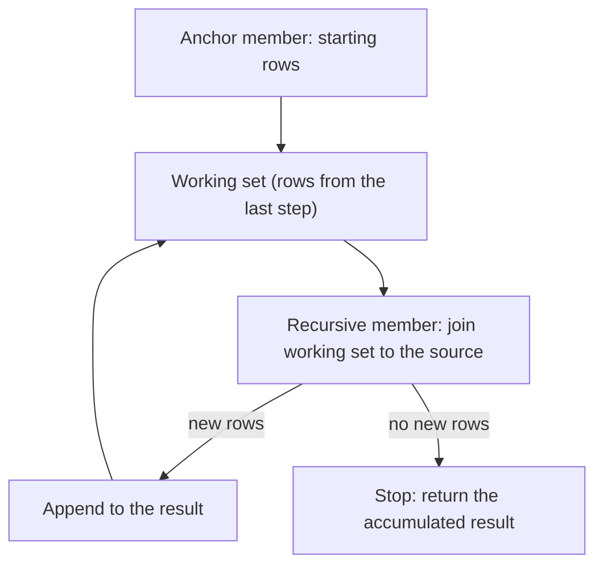
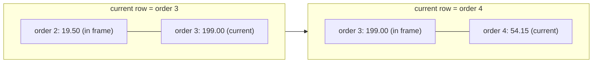

# 4. SQL II: advanced queries

> **Language:** English | [فارسی](../../fa/part1/04-sql-advanced.md) | **Previous:** [3. SQL I: reading data](03-sql-basics.md) | **Next:** [5. Data modelling and normalisation](05-modelling-and-normalisation.md)
> **Level:** L2 practitioner | **Part:** I
> **In one sentence:** subqueries, common table expressions, window functions, pivoting, lateral joins, upserts and JSON let one statement answer questions that would otherwise need several queries and application code.
> **You will learn:**
> - scalar, `IN`, `EXISTS` and correlated subqueries, and derived tables
> - CTEs, including recursive ones for trees and number series
> - window functions: ranking, running totals, `LAG`/`LEAD`, frames, top-N per group
> - pivoting with conditional aggregation, `PIVOT`, and `LATERAL` / `APPLY`
> - upsert and `MERGE` in each engine, JSON and array basics, temporary tables
> - the programmable objects: views, sequences, procedures, functions, packages, triggers, synonyms
>
> **Prerequisites:** [I-03](03-sql-basics.md).
> **About the outputs:** the SQLite-compatible queries were run on the `shop` fixture (SQLite 3.51); outputs for syntax that SQLite lacks (`LATERAL`, `APPLY`, `MERGE`, `PIVOT`) are *illustrative output* computed from the seed data.

## 1. The idea (beginner)

Chapter I-03 queries read one block of rows at a time. Real questions are often layered: "orders above the *average* order",
"each customer's *biggest* order", "the running total over time", "everyone below this manager in the company". Each needs a
query whose input depends on another query, or a calculation that looks across rows without collapsing them into one.
SQL has three tools for that, and this chapter is mostly about them:

- **Subqueries and CTEs** put a query inside another query, or give a query a name so the main statement reads top to bottom.
- **Window functions** compute a value for each row from a window of neighbouring rows (the previous row, all rows up to this
  one, the other rows in the same group), without the collapsing effect of `GROUP BY`.
- **Recursion** lets a query refer to its own output, which is how SQL walks trees.

The later sections cover tools that solve narrower problems (pivoting, lateral joins, upserts, JSON) and finish with a tour of
the objects you can store in the database next to tables: views, procedures, triggers and so on.

## 2. How it works (practitioner)

### 2.1 Subqueries

A [subquery](../glossary.md#subquery) is a `SELECT` inside another statement, in parentheses. Where it sits decides what it may return.

**Scalar subquery** (one row, one column) can be used like a value. Orders larger than the average order (the average is
107.90):

```sql
SELECT id, total
FROM orders
WHERE total > (SELECT avg(total) FROM orders)
ORDER BY id;
```

| id | total |
|---|---|
| 1 | 120.50 |
| 3 | 199.00 |
| 6 | 249.00 |

If a scalar subquery returns more than one row, the statement fails in PostgreSQL, SQL Server, Oracle and MySQL (SQLite quietly
uses the first row, which is worse). Scalar subqueries also work in the select list: `(SELECT count(*) FROM orders o WHERE o.customer_id = c.id)
AS orders` gives each customer a count, 0 for Emil.

**`IN` subquery** (one column, many rows) tests membership. Customers with an order over 100:

```sql
SELECT name FROM customers
WHERE id IN (SELECT customer_id FROM orders WHERE total > 100) ORDER BY id;   -- Alice, Bob, Dora
```

**`EXISTS`** (any shape) is TRUE if the subquery returns at least one row; the select list is irrelevant, so people write
`SELECT 1`. It is the right tool for "has at least one" and, negated, for "has none" (chapter I-03, section 2.8):

```sql
SELECT name FROM customers c
WHERE EXISTS (SELECT 1 FROM orders o WHERE o.customer_id = c.id AND o.total > 100) ORDER BY id;   -- Alice, Bob, Dora
```

`IN` and `EXISTS` give the same rows here. They differ with NULLs (`NOT IN` has the trap, `NOT EXISTS` does not) and, in
older optimizers, in speed; modern PostgreSQL, SQL Server, Oracle and MySQL 8 turn both into the same semi-join plan
([chapter I-08](08-query-processing.md)).

**Correlated subquery.** A [correlated subquery](../glossary.md#correlated-subquery) refers to a column of the outer query,
so it conceptually runs once per outer row. "Orders larger than that customer's own average":

```sql
SELECT o.id, o.customer_id, o.total
FROM orders o
WHERE o.total > (SELECT avg(o2.total) FROM orders o2 WHERE o2.customer_id = o.customer_id)
ORDER BY o.id;
```

| id | customer_id | total |
|---|---|---|
| 1 | 1 | 120.50 |
| 6 | 4 | 249.00 |

Customer 1 averages 70.00 (120.50 and 19.50), so only order 1 beats it; customer 2 and 3 have one order each and cannot beat
themselves. Real engines usually decorrelate such a query into a join with a grouped subquery; writing it that way
yourself is often faster to read and to run.

**Derived table** (subquery in `FROM`). A [derived table](../glossary.md#derived-table) is a subquery used as if it were a
table, and it must have an alias:

```sql
SELECT c.name, t.revenue
FROM customers c
JOIN (SELECT customer_id, sum(total) AS revenue FROM orders GROUP BY customer_id) t ON t.customer_id = c.id
ORDER BY t.revenue DESC;
```

| name | revenue |
|---|---|
| Dora | 254.25 |
| Bob | 199.00 |
| Alice | 140.00 |
| Chie | 54.15 |

This is also the cure for the fan-out trap of chapter I-03: aggregate the "many" side first, in a derived table, then join.
`ANY`/`SOME` and `ALL` compare a value with every value a subquery returns (`total > ALL (SELECT …)`), and are rarely needed.

### 2.2 Common table expressions

A [CTE](../glossary.md#cte) (common table expression) names a subquery with `WITH`, before the statement that uses it. The same
logic as the derived table above, but readable top-down, and a CTE can be used more than once:

```sql
WITH per_customer AS (
  SELECT customer_id, count(*) AS orders, sum(total) AS revenue
  FROM orders GROUP BY customer_id
),
avg_rev AS (
  SELECT avg(revenue) AS a FROM per_customer
)
SELECT c.name, p.orders, p.revenue
FROM per_customer p
JOIN customers c ON c.id = p.customer_id
CROSS JOIN avg_rev
WHERE p.revenue > avg_rev.a
ORDER BY p.revenue DESC;
```

| name | orders | revenue |
|---|---|---|
| Dora | 2 | 254.25 |
| Bob | 1 | 199.00 |

Customers whose revenue is above the average revenue per customer (161.85). The second CTE reads the first. A CTE is a naming
device, not a table: whether the engine computes it once and stores the result or expands it into every place it is used
is an optimizer decision. PostgreSQL 12 and later inline a CTE that is used once and has no side effects, and you can force
either behaviour with `MATERIALIZED` / `NOT MATERIALIZED`; SQL Server always expands CTEs like views; Oracle may materialise
one that is referenced several times; MySQL 8 merges them like derived tables. Do not use a CTE as an optimisation fence
unless you have verified your engine's behaviour.

SQL Server requires the statement before a `WITH` to end with `;`, otherwise `WITH` is parsed as a table hint. Write the
semicolon.

### 2.3 Recursive CTEs

A [recursive CTE](../glossary.md#recursive-cte) refers to itself. It has two parts joined by `UNION ALL`: the **anchor**
(the starting rows) and the **recursive member** (how to get the next rows from the previous ones). The engine runs the
anchor once, then repeats the recursive member on the rows produced by the previous step until a step produces no rows.

**Figure 4.1: how a recursive CTE iterates.**



A table of staff with a manager column makes the standard example. The data is a scratch table, not part of `shop`:

```sql
CREATE TABLE employees (id integer PRIMARY KEY, name text NOT NULL, manager_id integer REFERENCES employees(id));
INSERT INTO employees VALUES (1,'Ada',NULL),(2,'Ben',1),(3,'Cyra',1),(4,'Dmitri',2),(5,'Eli',2),(6,'Fay',4);
```

```sql
WITH RECURSIVE tree(id, name, depth, path) AS (
  SELECT id, name, 0, name FROM employees WHERE manager_id IS NULL       -- anchor: the root
  UNION ALL
  SELECT e.id, e.name, t.depth + 1, t.path || ' > ' || e.name            -- recursive member
  FROM employees e JOIN tree t ON e.manager_id = t.id
)
SELECT id, name, depth, path FROM tree ORDER BY path;
```

| id | name | depth | path |
|---|---|---|---|
| 1 | Ada | 0 | Ada |
| 2 | Ben | 1 | Ada > Ben |
| 4 | Dmitri | 2 | Ada > Ben > Dmitri |
| 6 | Fay | 3 | Ada > Ben > Dmitri > Fay |
| 5 | Eli | 2 | Ada > Ben > Eli |
| 3 | Cyra | 1 | Ada > Cyra |

Step 0 produces Ada; step 1 finds the employees whose manager is Ada (Ben, Cyra); step 2 finds Ben's and Cyra's reports
(Dmitri, Eli); step 3 finds Fay; step 4 finds nobody and stops. The same shape handles bills of materials ("what parts make up this
assembly"), category trees, and threaded comments.

Recursion is also the portable way to generate a series, such as a calendar to find days without sales:

```sql
WITH RECURSIVE d(day) AS (
  SELECT date('2026-02-10') UNION ALL SELECT date(day, '+1 day') FROM d WHERE day < '2026-02-14')
SELECT d.day, count(o.id) AS orders
FROM d LEFT JOIN orders o ON date(o.order_date) = d.day
GROUP BY d.day ORDER BY d.day;
```

| day | orders |
|---|---|
| 2026-02-10 | 0 |
| 2026-02-11 | 1 |
| 2026-02-12 | 1 |
| 2026-02-13 | 0 |
| 2026-02-14 | 0 |

(That is SQLite's date syntax; PostgreSQL has `generate_series`, which is simpler.) **A recursive CTE over data that contains
a cycle never ends.** Protect yourself with a depth limit in the `WHERE` of the recursive member, with `CYCLE`/`SEARCH` clauses
(PostgreSQL 14+), or by checking the path. SQL Server has a default limit of 100 recursion levels (`OPTION (MAXRECURSION n)`), and
SQL Server and Oracle write plain `WITH` (no `RECURSIVE` keyword) and, in Oracle, require a column list after the CTE name.

### 2.4 Window functions

A [window function](../glossary.md#window-function) computes a value for each row using a set of related rows (its *window*)
and, unlike an aggregate with `GROUP BY`, it **keeps every row**. The syntax is a function followed by `OVER (…)`:

```text
function(args) OVER (
    PARTITION BY <columns>     -- split rows into independent groups (optional)
    ORDER BY <columns>         -- order inside each group (needed for ranking and running values)
    <frame>                    -- which rows around the current one to include (optional)
)
```

[`PARTITION BY`](../glossary.md#window-partition) restarts the calculation for each group, much like `GROUP BY` but without
collapsing. The [frame](../glossary.md#frame) says which rows relative to the current row the function sees.

**Ranking.** `row_number()` numbers rows 1, 2, 3 within each partition. Number each customer's orders by size:

```sql
SELECT customer_id, id AS order_id, total,
       row_number() OVER (PARTITION BY customer_id ORDER BY total DESC) AS rn
FROM orders ORDER BY customer_id, rn;
```

| customer_id | order_id | total | rn |
|---|---|---|---|
| 1 | 1 | 120.50 | 1 |
| 1 | 2 | 19.50 | 2 |
| 2 | 3 | 199.00 | 1 |
| 3 | 4 | 54.15 | 1 |
| 4 | 6 | 249.00 | 1 |
| 4 | 5 | 5.25 | 2 |

Filtering on `rn` is the standard **top-N per group** pattern. Window functions cannot appear in `WHERE` (they run after it),
so wrap the query:

```sql
SELECT customer_id, order_id, total
FROM (SELECT customer_id, id AS order_id, total,
             row_number() OVER (PARTITION BY customer_id ORDER BY total DESC) AS rn
      FROM orders) t
WHERE rn = 1 ORDER BY customer_id;       -- each customer's largest order: 1, 3, 4, 6
```

`rank()`, `dense_rank()` and `row_number()` differ on ties. For prices 5.25, 5.25, 19.50, 49.90:

| price | row_number | rank | dense_rank |
|---|---|---|---|
| 5.25 | 1 | 1 | 1 |
| 5.25 | 2 | 1 | 1 |
| 19.50 | 3 | 3 | 2 |
| 49.90 | 4 | 4 | 3 |

`row_number` never repeats; `rank` repeats and leaves gaps; `dense_rank` repeats without gaps. `ntile(n)` cuts the ordered
rows into n buckets.

**Running totals and aggregates over a window.** Any aggregate can take `OVER`. With `ORDER BY` it becomes cumulative:

```sql
SELECT id, order_date, total, sum(total) OVER (ORDER BY order_date, id) AS running
FROM orders ORDER BY order_date, id;
```

| id | order_date | total | running |
|---|---|---|---|
| 1 | 2026-01-05 10:00 | 120.50 | 120.50 |
| 2 | 2026-02-11 09:30 | 19.50 | 140.00 |
| 3 | 2026-02-12 14:00 | 199.00 | 339.00 |
| 4 | 2026-03-01 08:15 | 54.15 | 393.15 |
| 5 | 2026-03-02 17:45 | 5.25 | 398.40 |
| 6 | 2026-03-03 12:00 | 249.00 | 647.40 |

`sum(total) OVER ()` with empty parentheses is the grand total on every row, so `100.0 * total / sum(total) OVER ()` is each
order's share (18.6, 3.0, 30.7, 8.4, 0.8, 38.5 percent).

**Looking at neighbours.** `lag(x)` returns the value from the previous row in the window, `lead(x)` from the next, each with
an optional offset and default:

```sql
SELECT id, total, lag(total) OVER (ORDER BY order_date, id) AS prev_total,
       total - lag(total) OVER (ORDER BY order_date, id)     AS delta
FROM orders ORDER BY order_date, id;
```

| id | total | prev_total | delta |
|---|---|---|---|
| 1 | 120.50 | NULL | NULL |
| 2 | 19.50 | 120.50 | -101.00 |
| 3 | 199.00 | 19.50 | 179.50 |
| 4 | 54.15 | 199.00 | -144.85 |
| 5 | 5.25 | 54.15 | -48.90 |
| 6 | 249.00 | 5.25 | 243.75 |

**Frames.** The frame refines the window when there is an `ORDER BY`. `ROWS BETWEEN 1 PRECEDING AND CURRENT ROW` means "this
row and the one before". A moving average of two orders:

```sql
SELECT id, total,
       round(avg(total) OVER (ORDER BY order_date, id ROWS BETWEEN 1 PRECEDING AND CURRENT ROW), 2) AS avg2
FROM orders ORDER BY order_date, id;       -- 120.50, 70.00, 109.25, 126.58, 29.70, 127.13
```

**Figure 4.2: the frame `ROWS BETWEEN 1 PRECEDING AND CURRENT ROW` slides with the current row.**



Two frame traps. **(1)** With an `ORDER BY` and no explicit frame, the default frame is `RANGE BETWEEN UNBOUNDED PRECEDING AND
CURRENT ROW`, so `last_value(total) OVER (ORDER BY id)` returns the *current* row's value, not the last of the partition. Write
`ROWS BETWEEN UNBOUNDED PRECEDING AND UNBOUNDED FOLLOWING` to see the true last value (249.00 in `shop`). **(2)** `RANGE` treats rows
with equal sort keys as one unit (peers), whereas `ROWS` counts physical rows; with ties, a running total over `RANGE` jumps by
the whole peer group. Prefer `ROWS` unless you want peers.

Window functions arrived late in some engines: PostgreSQL 8.4, SQL Server 2012 (full frames), Oracle 8i, MySQL 8.0, MariaDB 10.2,
SQLite 3.25, ClickHouse and Snowflake have them in the versions listed in this book. Cassandra has none.

### 2.5 Pivoting rows into columns

"Revenue per customer per month" naturally comes as rows `(customer, month, revenue)`, but a report wants one column per month.
The portable technique is **conditional aggregation**: a `CASE` inside an aggregate.

```sql
SELECT c.name,
       sum(CASE WHEN o.order_date >= '2026-01-01' AND o.order_date < '2026-02-01' THEN o.total ELSE 0 END) AS jan,
       sum(CASE WHEN o.order_date >= '2026-02-01' AND o.order_date < '2026-03-01' THEN o.total ELSE 0 END) AS feb,
       sum(CASE WHEN o.order_date >= '2026-03-01' AND o.order_date < '2026-04-01' THEN o.total ELSE 0 END) AS mar
FROM customers c LEFT JOIN orders o ON o.customer_id = c.id
GROUP BY c.id, c.name ORDER BY c.id;
```

| name | jan | feb | mar |
|---|---|---|---|
| Alice | 120.50 | 19.50 | 0.00 |
| Bob | 0.00 | 199.00 | 0.00 |
| Chie | 0.00 | 0.00 | 54.15 |
| Dora | 0.00 | 0.00 | 254.25 |
| Emil | 0.00 | 0.00 | 0.00 |

Half-open ranges (`>=` start, `<` next start) are the safe way to bucket timestamps. PostgreSQL, SQLite and ClickHouse have
shorter forms (`count(*) FILTER (WHERE total >= 100)` in PostgreSQL and SQLite; `sumIf(total, cond)` in ClickHouse). SQL Server,
Oracle and Snowflake also have a dedicated `PIVOT` operator that does the same thing when the column list is known:

#### SQL Server

```sql
SELECT * FROM (SELECT CustomerId, MONTH(OrderDate) AS m, Total FROM dbo.Orders) s
PIVOT (SUM(Total) FOR m IN ([1], [2], [3])) p;
```

The column list must be written out in the statement, so a truly dynamic pivot needs generated SQL. PostgreSQL has `crosstab()` in the
`tablefunc` extension for the same purpose. MySQL, MariaDB and SQLite have neither; use the `CASE` form.
The reverse, columns into rows, is `UNPIVOT` (SQL Server, Oracle, Snowflake), a `LATERAL (VALUES …)` or a `UNION ALL`.

### 2.6 LATERAL and APPLY

A normal join cannot let the right side refer to the left row. A **lateral** join can, which makes it a "for each row, run this
subquery" operator: [`LATERAL`](../glossary.md#lateral) in the standard, `CROSS APPLY` and `OUTER APPLY` in
[SQL Server and Oracle](../glossary.md#apply). The classic use is "top N per row" with an `ORDER BY … LIMIT` inside:

#### PostgreSQL

```sql
SELECT c.name, t.id AS order_id, t.total
FROM customers c
LEFT JOIN LATERAL (
  SELECT o.id, o.total FROM orders o WHERE o.customer_id = c.id ORDER BY o.total DESC LIMIT 2
) t ON true
ORDER BY c.id, t.total DESC;
```

#### SQL Server

```sql
SELECT c.Name, t.Id AS OrderId, t.Total
FROM dbo.Customers c
OUTER APPLY (SELECT TOP (2) o.Id, o.Total FROM dbo.Orders o WHERE o.CustomerId = c.Id ORDER BY o.Total DESC) t
ORDER BY c.Id, t.Total DESC;
```

Illustrative output (both): Alice 1 / 120.50 and 2 / 19.50; Bob 3 / 199.00; Chie 4 / 54.15; Dora 6 / 249.00 and 5 / 5.25; Emil
NULL / NULL (the `LEFT JOIN … ON true` and `OUTER APPLY` keep Emil; `CROSS APPLY` and a plain `JOIN LATERAL` would drop him). Oracle 12c
and later support `CROSS APPLY`, `OUTER APPLY` and `LATERAL`; MySQL has `LATERAL` since 8.0.14; Snowflake has `LATERAL`;
SQLite and ClickHouse 24 do not, so use the `row_number()` pattern of section 2.4. `LATERAL` is also how table-valued functions
and `unnest(array)` are applied per row.

### 2.7 Upsert and MERGE

An *upsert* is "insert this row, or update it if it already exists". Doing it with a `SELECT` followed by an `INSERT` or
`UPDATE` is wrong under concurrency (two sessions both see "missing" and both insert). Every engine therefore has an atomic form,
and they are all different. The example keeps a stock table: add 5 Webcams, or raise the quantity if the row exists.

```sql
CREATE TABLE stock (product_id integer PRIMARY KEY, qty integer NOT NULL);
```

| Engine | Statement |
|---|---|
| PostgreSQL 17, SQLite 3.24+ | `INSERT INTO stock VALUES (5, 5) ON CONFLICT (product_id) DO UPDATE SET qty = stock.qty + excluded.qty;` |
| MySQL 8.4, MariaDB 11 | `INSERT INTO stock VALUES (5, 5) ON DUPLICATE KEY UPDATE qty = qty + VALUES(qty);` (MySQL 8.0.20+ prefers a row alias; `REPLACE INTO` deletes and re-inserts, which also fires delete triggers) |
| SQL Server 2022, Oracle 23, Snowflake | `MERGE INTO stock t USING (SELECT 5 AS product_id, 5 AS qty) s ON t.product_id = s.product_id WHEN MATCHED THEN UPDATE SET t.qty = t.qty + s.qty WHEN NOT MATCHED THEN INSERT (product_id, qty) VALUES (s.product_id, s.qty);` (SQL Server requires a final `;`; Oracle has no `AS` for table aliases) |
| PostgreSQL 15+ | the same `MERGE` as above; PostgreSQL 17 adds `RETURNING` to `MERGE` |
| ClickHouse | no row-level upsert; insert a new version into a `ReplacingMergeTree` table and let merges drop old ones ([I-15](15-oltp-vs-olap-columnar.md)) |
| Cassandra | every `INSERT` and `UPDATE` is already an upsert of the primary key; `IF NOT EXISTS` makes a lightweight (slow) conditional insert |

`MERGE` can also `DELETE` matched rows and run a different action by condition, which makes it a bulk-synchronisation tool. SQL Server's
`MERGE` has a record of known issues and concurrency pitfalls, and many teams prefer `INSERT … ON CONFLICT`-style statements or explicit
locking there.

### 2.8 JSON and arrays

Relational purists store one fact per column. Real systems also store documents (an API response, a settings blob) in a JSON column,
and every engine has grown functions for it. Extracting the value `tier` from `{"tier":"gold","n":1,"tags":["vip","b2b"]}`:

| Engine | Extract a value | Turn an array into rows | Native JSON type |
|---|---|---|---|
| PostgreSQL 17 | `meta ->> 'tier'` (text), `meta -> 'tags' -> 1` (json), `meta @> '{"tier":"gold"}'` (containment, indexable with GIN) | `jsonb_array_elements_text(meta -> 'tags')` | `json`, `jsonb` (binary, indexable) |
| SQL Server 2022 | `JSON_VALUE(meta, '$.tier')`, `JSON_QUERY` for objects/arrays | `OPENJSON(meta, '$.tags')` | none: stored in `nvarchar(max)` (`isjson()` checks) |
| Oracle 23 | `JSON_VALUE(meta, '$.tier')` | `JSON_TABLE(meta, '$.tags[*]' COLUMNS (tag VARCHAR2 PATH '$'))` | `JSON` type |
| MySQL 8.4 | `meta ->> '$.tier'`, `JSON_EXTRACT` | `JSON_TABLE` | `JSON` (binary) |
| SQLite 3.4x | `json_extract(meta, '$.tier')`, `->>` | `json_each(meta, '$.tags')` | none (text) |
| ClickHouse 24.8 | `JSONExtractString(meta, 'tier')` | `arrayJoin(JSONExtract(meta, 'tags', 'Array(String)'))` | `JSON` (still maturing in 24.8; check) |
| Snowflake | `meta:tier::string` | `LATERAL FLATTEN(input => meta:tags)` | `VARIANT` |
| Cassandra 5 | `SELECT JSON …` and `INSERT … JSON` map rows to and from JSON | collections `list`, `set`, `map` | none (the collection types are first-class) |

In SQLite, `json_extract('{"tier":"gold","n":1,"tags":["vip","b2b"]}', '$.tags[1]')` returns `b2b`, and `json_each('["vip","b2b"]')`
returns two rows. The PostgreSQL seed has a table `extra_types` with a `jsonb` column `meta` and a `text[]` array column `tags` for exactly
this purpose (`engine/tests/docker/seed-postgres.sql:53-55`). **Arrays** are native in PostgreSQL (`text[]`, `ANY(array)`, `unnest`), Snowflake
(`ARRAY`), ClickHouse (`Array(T)`) and Cassandra (`list`/`set`/`map`); Oracle has `VARRAY` and nested tables; SQL Server and MySQL use
JSON or a child table. Storing arrays or JSON breaks first normal form ([chapter I-05](05-modelling-and-normalisation.md)) on purpose; do it
for data you read and write whole, and keep the facts you filter, join and aggregate on in ordinary columns.

### 2.9 Temporary tables and table variables

A [temporary table](../glossary.md#temp-table) holds intermediate results and disappears at the end of the session (or transaction).
It is the tool for splitting a long script into steps whose results you can inspect.

| Engine | Statement | Visible to |
|---|---|---|
| PostgreSQL, SQLite, Snowflake, ClickHouse | `CREATE TEMPORARY TABLE t (…)` | the session |
| MySQL, MariaDB | `CREATE TEMPORARY TABLE t (…)` | the session (cannot be reopened twice in one query) |
| SQL Server | `CREATE TABLE #t (…)` (`##t` is global) or `SELECT … INTO #t` | the session (the `#` prefix) |
| Oracle | `CREATE GLOBAL TEMPORARY TABLE` (structure is permanent, rows are private) or, from 18c, `CREATE PRIVATE TEMPORARY TABLE ORA$PTT_t` | rows: the session or transaction |
| Cassandra | none | |

SQL Server also has a [table variable](../glossary.md#table-variable), `DECLARE @ids TABLE (id int)`, scoped to the batch; it behaves
like a small temporary table but keeps different statistics, which matters for plans. The `shop` seed uses a table type `dbo.IdList`
(`engine/tests/docker/seed-mssql.sql:53`) to pass a list of ids into a procedure. Temporary tables interact with Rowlit's session handling,
because they live in one physical connection ([chapter II-08](../part2/08-connections-sessions-execution.md)).

### 2.10 Objects stored in the database

Beyond tables, a schema can hold code and helpers. Rowlit's explorer shows all of them, and the `shop` seeds create examples of each.

| Object | What it is | `shop` example |
|---|---|---|
| [View](../glossary.md#view) | a stored `SELECT` that you query like a table; no data of its own | `customer_orders` joins `customers` and `orders` (`seed-postgres.sql:71-73`, `seed-mssql.sql:81-83`) |
| [Materialized view](../glossary.md#materialized-view) | a view whose result is stored and must be refreshed (`REFRESH MATERIALIZED VIEW`) | `customer_totals` in PostgreSQL (`seed-postgres.sql:74-76`); Oracle and Snowflake have their own flavours; SQL Server's equivalent is an indexed view; MySQL has none |
| [Sequence](../glossary.md#sequence) | a counter object that hands out unique numbers | `public.order_numbers` starting at 1000 (`seed-postgres.sql:26`), `dbo.OrderNumbers` (`seed-mssql.sql:52`), `ORDERS_SEQ` (`seed-oracle.sql:89`) |
| [Identity column](../glossary.md#identity) | a column that generates its own values from an internal sequence | `customers.id` (`GENERATED BY DEFAULT AS IDENTITY`, `IDENTITY(1,1)`, `AUTO_INCREMENT`) |
| [Function](../glossary.md#function) | code that returns a value (scalar) or a table, usable inside a `SELECT` | `fn_tax(amount)` returns `amount * 0.19` (`seed-postgres.sql:78`) |
| [Stored procedure](../glossary.md#stored-procedure) | code run with `CALL` / `EXEC`, may change data, return result sets and OUT parameters | `add_order_line`, `get_customer_report` (`seed-postgres.sql:85-96`), `dbo.GetCustomerReport` (`seed-mssql.sql:92-100`) |
| [Package](../glossary.md#package) | (Oracle) a named bundle of procedures, functions and variables with a public specification and a private body | `ORDER_API` (`seed-oracle.sql:98-122`) |
| [Trigger](../glossary.md#trigger) | code that runs automatically before or after an `INSERT`, `UPDATE` or `DELETE` | `trg_orders_check` rejects a negative total (`seed-postgres.sql:97-102`) |
| [Synonym](../glossary.md#synonym) | an alias for another object (SQL Server, Oracle) | `dbo.Cust` for `dbo.Customers` (`seed-mssql.sql:127`), `CUST` in Oracle (`seed-oracle.sql:91`) |

Code in the database is written in a procedural extension: T-SQL (SQL Server), PL/SQL (Oracle), PL/pgSQL (PostgreSQL), MySQL's stored
program syntax, SQLite has none (triggers only). They are different languages with the same job; [chapter I-17](17-dialect-comparison.md)
compares them. Two advice points: keep business rules in one place (database or application, not half in each), and treat triggers
carefully, because they run invisibly and make "what does this `UPDATE` do?" hard to answer. Ordinary views are cheap and useful
for naming a join; a view on a view on a view becomes a performance puzzle.

## 3. Deep dive (senior)

> **Deep dive (L3): decorrelation and the optimizer.**
> A correlated subquery is semantically "run once per outer row", which would be quadratic. Optimizers rewrite it ("unnesting",
> "decorrelation") into a join with a grouped derived table or a semi-/anti-join. The rewrite is not always possible: subqueries with
> `LIMIT`, certain aggregates over empty sets (the "count bug", where `count(*)` of nothing is 0 but a join yields no row), and
> NULL-sensitive `NOT IN` require extra care. When you see a nested-loop plan with the subquery as the inner side, the rewrite
> was not made. You can often help by writing the join explicitly. See [chapter I-08](08-query-processing.md).

> **Deep dive (L3): how window functions run.**
> The engine sorts (or reuses an index order for) each distinct `PARTITION BY … ORDER BY` combination, then streams through the sorted rows
> maintaining the frame. Several window functions with the same window definition share one sort; different definitions each need
> a sort, so a query with five different windows is five sorts. A frame of `UNBOUNDED PRECEDING` to `CURRENT ROW` is computed
> incrementally (O(n)); a sliding frame of fixed width is also incremental for sum/count/avg but not for min/max in some engines.
> `RANGE` with equal sort keys makes peers; `GROUPS` frames (PostgreSQL 11+, SQLite 3.28+) count peer groups. Because windows run
> after `WHERE`, `GROUP BY` and `HAVING`, you can window over aggregates (`rank() OVER (ORDER BY sum(total) DESC)`) in the same query.

> **Deep dive (L3): `MERGE` semantics.**
> `MERGE` evaluates the join between target and source, classifies each source row as matched or not, and applies the first
> `WHEN` clause whose extra condition holds. If one target row matches several source rows, SQL Server and Oracle raise an error
> (a row would be updated twice); PostgreSQL does too. Under snapshot isolation two concurrent `MERGE`s can both decide "not matched" and both
> insert unless a unique index catches them ([chapter I-09](09-transactions-and-isolation.md)); `ON CONFLICT` avoids that by
> relying on the unique index directly.

## 4. In each engine

| Feature | PostgreSQL 17 | SQL Server 2022 | Oracle 23 | MySQL 8.4 / MariaDB 11 | SQLite 3.4x | ClickHouse 24.8 | Snowflake | Cassandra 5 |
|---|---|---|---|---|---|---|---|---|
| Subqueries (scalar, `IN`, `EXISTS`) | yes | yes | yes | yes | yes | yes, correlated subqueries limited | yes | no |
| CTE | `WITH` | `WITH` | `WITH` | `WITH` (MySQL 8.0+, MariaDB 10.2+) | `WITH` (3.8.3+) | `WITH` | `WITH` | no |
| Recursive CTE | `WITH RECURSIVE` | `WITH` (limit 100 levels) | `WITH`, column list required | `WITH RECURSIVE` | `WITH RECURSIVE` | limited; check release notes for 24.8 (not verified) | `WITH RECURSIVE` | no |
| Window functions | yes | yes | yes | yes (MySQL 8.0+, MariaDB 10.2+) | yes (3.25+) | yes | yes | no |
| `LATERAL` / `APPLY` | `LATERAL` | `CROSS`/`OUTER APPLY` | `LATERAL`, `APPLY` | `LATERAL` (MySQL 8.0.14+) | no | no | `LATERAL` | no |
| `PIVOT` operator | `crosstab` extension | yes | yes | no | no | `*If` combinators | yes | no |
| Upsert | `ON CONFLICT`, `MERGE` | `MERGE` | `MERGE` | `ON DUPLICATE KEY UPDATE` | `ON CONFLICT` | `ReplacingMergeTree` | `MERGE` | every write |
| Temporary tables | yes | `#t`, `@t` | global / private | yes | yes | yes | yes | no |
| Procedures and triggers | PL/pgSQL, etc. | T-SQL | PL/SQL, packages | stored programs | triggers only | no procedures; materialized views act as triggers | JavaScript / Snowflake Scripting procedures; tasks | triggers (Java), UDFs |

## 5. Exercises

1. **Subqueries.** Using a scalar subquery, list the products that cost more than the average product price (average
   68.41). Then list the customers who have placed no order over 100, in two ways: with `NOT EXISTS` and with `LEFT JOIN`. What is
   different about Emil in the answers?
2. **Derived table / CTE.** For each customer show the name, the number of orders and revenue, and each customer's share of
   total revenue as a percentage with one decimal. Do it once with a CTE and once with a window function over the grouped result.
3. **Top-N.** Show the two most expensive order lines per order (qty times price), using `row_number()`. Which orders have
   fewer than two lines, and what do you see for order 5?
4. **Running total and gaps.** Write a query that returns, for each order in date order, the number of days since the previous
   order (`lag` and a date subtraction in your engine). What is the value for the first order, and how do you replace it with 0?
5. **Recursion.** Using the `employees` table from section 2.3, list every employee below Ben (his direct and indirect
   reports) with their depth relative to Ben. Then run `UPDATE employees SET manager_id = 6 WHERE id = 1` (Ada now reports to Fay, which makes a cycle) and explain why your query
   (or any recursive query without protection) would never finish. How would you stop it?
6. **Upsert.** Create the `stock` table and run the upsert for product 5 twice. What are the quantities after each run? Then
   translate the statement to the other engine syntax in section 2.7 that you can test.

Answers: [Chapter I-18, section I-04](18-exercise-answers.md#i-04).

## Related chapters

- Previous: [I-03 SQL I](03-sql-basics.md). Next: [I-05 modelling and normalisation](05-modelling-and-normalisation.md).
- [I-08 query processing](08-query-processing.md): how subqueries, CTEs and windows are planned.
- [I-09 transactions](09-transactions-and-isolation.md): why upsert must be atomic.
- [I-17 dialect comparison](17-dialect-comparison.md): procedural languages and catalog views.
- Part II: Rowlit shows procedures, packages, views and sequences in the explorer ([II-10](../part2/10-catalog-and-metadata.md)) and
  runs routines with an "execute" dialog ([II-14](../part2/14-designers-and-ddl.md)).

## Glossary terms introduced here

[subquery](../glossary.md#subquery), [correlated subquery](../glossary.md#correlated-subquery),
[derived table](../glossary.md#derived-table), [CTE](../glossary.md#cte), [recursive CTE](../glossary.md#recursive-cte),
[window function](../glossary.md#window-function), [window partition](../glossary.md#window-partition),
[frame](../glossary.md#frame), [PIVOT](../glossary.md#pivot), [LATERAL](../glossary.md#lateral), [APPLY](../glossary.md#apply),
[MERGE](../glossary.md#merge), [upsert](../glossary.md#upsert), [temporary table](../glossary.md#temp-table),
[table variable](../glossary.md#table-variable), [stored procedure](../glossary.md#stored-procedure),
[function](../glossary.md#function), [package](../glossary.md#package), [trigger](../glossary.md#trigger),
[view](../glossary.md#view), [materialized view](../glossary.md#materialized-view), [sequence](../glossary.md#sequence),
[identity column](../glossary.md#identity), [synonym](../glossary.md#synonym).
