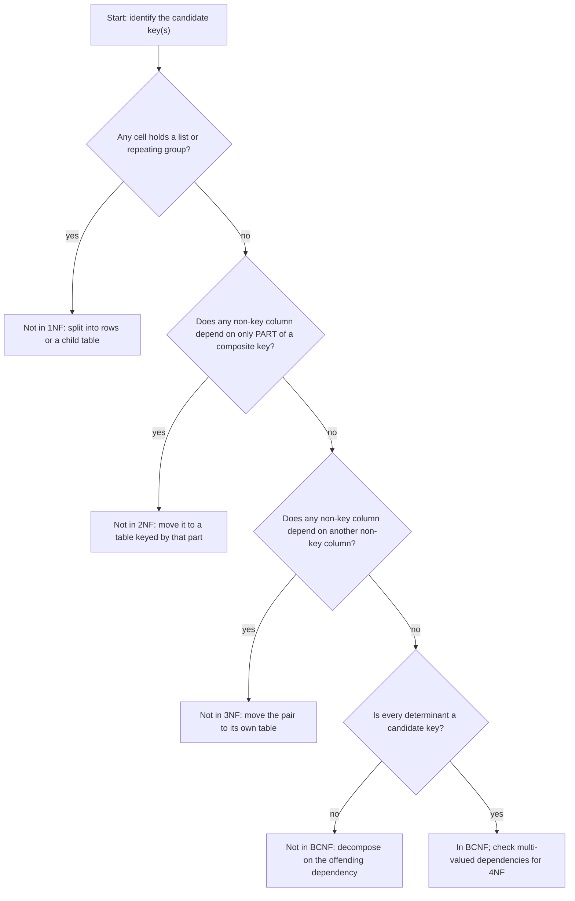
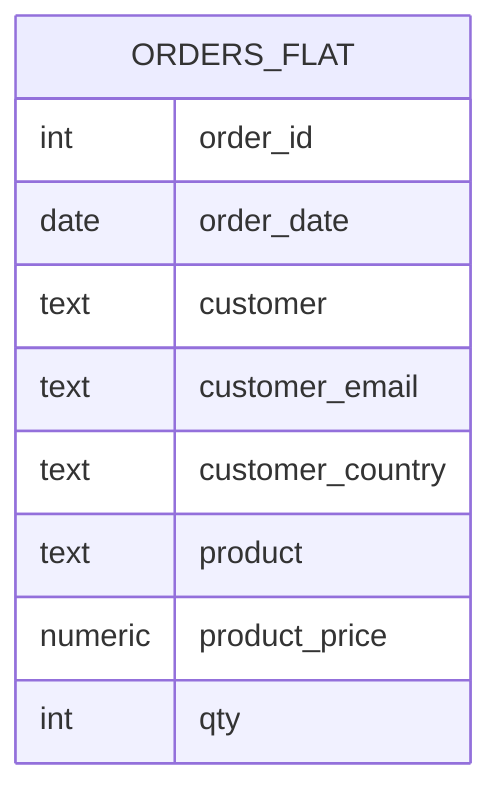
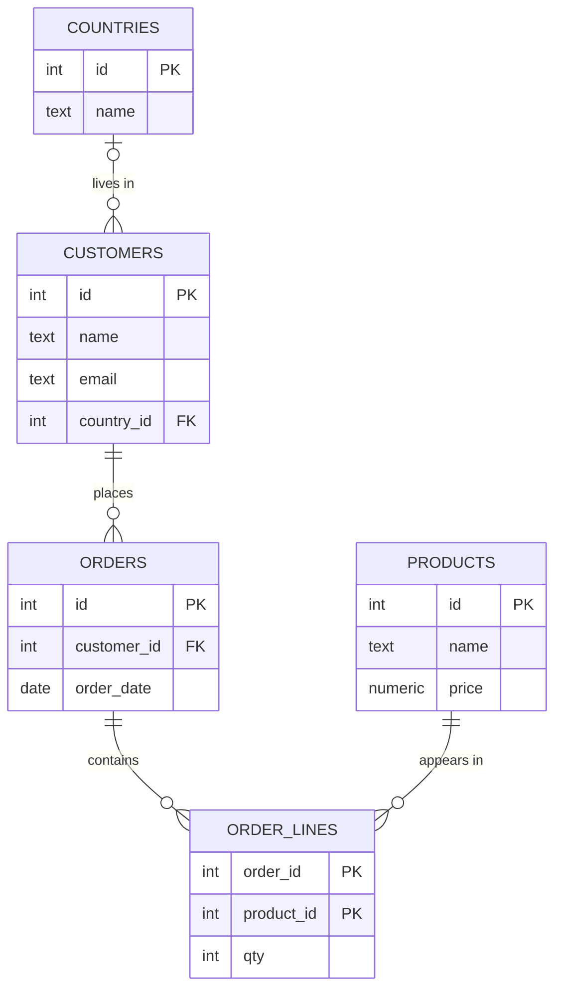

# 5. Data modelling and normalisation

> **Language:** English | [فارسی](../../fa/part1/05-modelling-and-normalisation.md) | **Previous:** [4. SQL II: advanced queries](04-sql-advanced.md) | **Next:** [6. Storage internals](06-storage-internals.md)
> **Level:** L2 practitioner | **Part:** I
> **In one sentence:** good table design stores each fact once, uses keys and constraints to make the database refuse nonsense, and breaks that rule only deliberately and for a measured reason.
> **You will learn:**
> - the three levels of a data model (conceptual, logical, physical) and how to find entities and relationships
> - functional dependencies and the normal forms 1NF, 2NF, 3NF and BCNF, with a worked example that turns a flat spreadsheet into the `shop` tables
> - the insert, update and delete anomalies that normalisation prevents
> - when and how to denormalise
> - constraints (`PRIMARY KEY`, `FOREIGN KEY`, `UNIQUE`, `CHECK`, `NOT NULL`, `DEFAULT`) and cascading actions
> - choosing data types: money, keys (integer versus UUID), timestamps and time zones, text and collation
>
> **Prerequisites:** [I-02](02-relational-model.md), [I-03](03-sql-basics.md).
> **About the outputs:** constraint behaviour in section 2.6 was run on SQLite 3.51 with `PRAGMA foreign_keys = ON`; the messages differ in wording but not in meaning in other engines.

## 1. The idea (beginner)

Suppose the shop owner designs the database the way she designed her spreadsheet: one wide table with one row per item sold.

| order_id | order_date | customer | customer_email | customer_country | product | product_price | qty |
|---|---|---|---|---|---|---|---|
| 1 | 2026-01-05 | Alice | alice@example.com | Germany | Keyboard | 49.90 | 2 |
| 1 | 2026-01-05 | Alice | alice@example.com | Germany | Mouse | 19.50 | 1 |
| 2 | 2026-02-11 | Alice | alice@example.com | Germany | Mouse | 19.50 | 1 |
| 3 | 2026-02-12 | Bob | NULL | France | Monitor | 199.00 | 1 |
| 4 | 2026-03-01 | Chie | chie@example.jp | Japan | Keyboard | 49.90 | 1 |

It works until the data changes. Alice's email appears three times; if she changes it and someone updates only two rows, the table now
disagrees with itself. A new product cannot be recorded until someone orders it, because every row needs an order. Deleting order 3
removes the only record that Bob exists. These three failures are called
[anomalies](../glossary.md#anomaly): the **update**, **insert** and **delete** anomaly. They all have the same root: one table
holds facts about several different things (customers, products, orders), so facts about one thing are repeated or tied to another.

**Normalisation** is the discipline of splitting such a table until each table is about one kind of thing and each fact is stored in one
place. The result is the `shop` schema of [chapter I-02](02-relational-model.md): `customers`, `products`, `orders`, `order_lines`,
`countries`. This chapter explains how to get there by a procedure rather than by instinct, how to tell when you are done, when to stop,
and which database features (constraints, types) keep the design honest once it exists.

## 2. How it works (practitioner)

### 2.1 Three levels of a model

Design happens in three layers, from most abstract to most concrete.

| Level | Question it answers | Typical artefact | Example |
|---|---|---|---|
| **Conceptual** | What things does the business care about and how are they related? | ER diagram without types; a glossary | Customers place orders; an order contains products |
| **Logical** | Which tables, columns and keys represent that, independent of one DBMS? | Normalised relational schema | `orders(id, customer_id, order_date, …)`; `order_lines` as a link table |
| **Physical** | How is it stored in *this* DBMS for speed and size? | `CREATE TABLE` with types, indexes, partitions, tablespaces | `numeric(12,2)`, `ix_orders_customer … INCLUDE (total)` |

Normalisation belongs to the logical level; indexes, partitions and storage options to the physical level (chapters
[I-06](06-storage-internals.md) and [I-07](07-indexes.md)). Mixing them leads to arguments such as "the schema is slow" when the
real fix is an index.

**Finding entities and relationships.** Write the sentences the business says out loud and underline the nouns and verbs. "A customer places
orders. An order contains order lines. Each line refers to a product and has a quantity." Nouns that have facts of their own (a customer has
a name and an email) become entities, and so tables. Verbs become relationships. Count each relationship from both sides: one customer, many
orders (one-to-many, foreign key on the "many" side); many orders, many products (many-to-many, link table with a composite key). A one-to-one relationship
(a customer and their passport details) is usually a sign that the two tables could be one, or that one side is optional and rarely used.

### 2.2 Functional dependencies

A [functional dependency](../glossary.md#functional-dependency) `A → B` says: *if you know the value of A, there is exactly one possible value
of B.* The notation reads "A determines B". Dependencies are facts about the business, not about the data you happen to have now:

- `order_id → order_date, customer_email` (an order has one date and one customer)
- `customer_email → customer, customer_country` (assume an email identifies one person)
- `product → product_price` (a product has one price at a time)
- `(order_id, product) → qty` (the quantity depends on the order *and* the product together)

The left side of a dependency is a *determinant*. A set of columns that determines every other column is a superkey, and a minimal one is a
candidate key ([chapter I-02](02-relational-model.md)). In the flat table above, the key is `(order_id, product)`, because that pair
determines everything else. The normal forms are rules about how the other dependencies relate to the key.

### 2.3 The normal forms

Each [normal form](../glossary.md#normal-form) is a stricter condition than the one before. A table in a higher form is also in all lower
forms.

**First normal form (1NF): every cell is a single atomic value, and rows are distinct.** No repeating groups, no lists in a cell. A cell
containing `'Keyboard x2, Mouse x1'` violates 1NF; so do columns `product1`, `product2`, `product3`. The flat table above is in 1NF.
Arrays and JSON columns ([chapter I-04](04-sql-advanced.md)) technically store several values in a cell; use them when you always read and
write the whole value, not for data you filter on.

**Second normal form (2NF): 1NF, and every non-key column depends on the *whole* key, not just part of it.** This only matters when the key
has more than one column. In the flat table, `product_price` depends only on `product`, which is half the key `(order_id, product)`;
`order_date` and `customer_*` depend only on `order_id`. Those are *partial dependencies*. They cause the anomalies above: the price of a
Mouse is stored once per order that contains a Mouse. The fix is to move each group of columns with the part of the key that determines it
into its own table:

- `orders(order_id, order_date, customer, customer_email, customer_country)`
- `products(product, product_price)`
- `order_lines(order_id, product, qty)`

**Third normal form (3NF): 2NF, and no non-key column depends on another non-key column** (no transitive dependency
key → X → Y). In the new `orders` table, `customer_email` and `customer_country` depend on `order_id` only *through* the customer: `order_id →
customer_email → customer_country`. A customer with ten orders repeats their country ten times. The fix is to give the customer a table:

- `customers(customer_id, name, email, country)`
- `orders(order_id, order_date, customer_id)`

and, since `country` is itself an entity with its own attributes (and a possible spelling problem), one more table: `countries(id, name)`
with `customers.country_id` pointing at it. A common summary of 3NF is: *every non-key column depends on the key, the whole key, and nothing
but the key.*

**Boyce-Codd normal form (BCNF): every determinant is a candidate key.** BCNF is a slightly stricter 3NF that only differs when a table has
several overlapping candidate keys. The textbook example is a table of who teaches which course to which student, under the rule that each
instructor teaches only one course:

| student | course | instructor |
|---|---|---|
| Ana | Databases | Prof. Karimi |
| Ben | Databases | Prof. Karimi |
| Ana | Networks | Prof. Rossi |

The candidate keys are `(student, course)` and `(student, instructor)`. The dependency `instructor → course` exists, but `instructor` is not a
key, so the table violates BCNF even though it is in 3NF (every column is part of a key). The anomaly: you cannot record that Prof. Lee teaches
Security until a student enrols. The BCNF decomposition is `teaches(instructor, course)` and `enrolments(student, instructor)`. The price is that
the original rule "a student has one instructor per course" is no longer enforceable with a key alone; some decompositions cannot preserve every
dependency. In practice 3NF is the working target and BCNF is the check you make when you see overlapping keys.

**Fourth normal form (4NF)** removes *multi-valued dependencies*: if a product has several independent colours and several independent sizes, a single table with
one row per `(product, colour, size)` combination multiplies rows and invites inconsistency; use `product_colours` and `product_sizes`. **Fifth
normal form (5NF)** deals with join dependencies that cannot be expressed by pairs of tables; it is rare outside textbooks.

**Figure 5.1: a way to decide which normal form a table is in.**



### 2.4 Worked example: from the spreadsheet to `shop`

Start from the flat table in section 1 and apply the steps.

**Figure 5.2: the flat table before and after normalisation.**





1. **Find the dependencies** (section 2.2) and the key `(order_id, product)`.
2. **2NF:** split off `products` (`product → price`), then `orders` (`order_id → date, customer…`); what remains is `order_lines(order_id,
   product, qty)`.
3. **3NF:** split `customers` out of `orders` (`customer → email, country`) and `countries` out of `customers`.
4. **Surrogate keys:** `product` as the name `Keyboard` is a natural key that changes when marketing renames it. Replace it with `products.id`
   and a `name` column. Likewise `customers.id`. (Section 2.7 discusses the choice.)
5. **Result:** the five tables of chapter I-02. Each fact exists once: Alice's email is one cell, the Mouse price is one cell.

The anomalies are gone. Change Alice's email in one row. Add a product with no orders: insert into `products`. Delete order 3: Bob stays in
`customers`. To get the spreadsheet back, join the tables ([chapter I-03](03-sql-basics.md)); the join is the price of normalisation, and a modern DBMS
makes it cheap if the foreign keys are indexed ([chapter I-07](07-indexes.md)).

**The fixture is not fully normalised.** Look at `orders.total` in the `shop` seed. It is a stored number that duplicates information already
in `order_lines` and `products.price`. As [chapter I-02](02-relational-model.md) noticed, it does not even agree with its lines (order 1 stores
120.50 and its lines sum to 119.30). A stored total is a deliberate *denormalisation* that a real shop would need for a reason (prices change; see below),
and the fixture shows the risk: redundant data drifts.

### 2.5 Denormalisation

[Denormalisation](../glossary.md#denormalisation) means adding redundancy on purpose. Reasons that hold up:

- **Historical accuracy.** A line must record the price *at the time of sale*. `products.price` changes tomorrow; the invoice from last year must not.
  So `order_lines.unit_price` is not redundant, it is a different fact (the sold price). Rowlit's built-in sample database does this (`OrderLines.UnitPrice`).
- **Read performance** for reports that join many large tables: keep a summary table or a materialized view, or store a counter such as `orders.total`
  updated by a trigger or by the application, and decide how stale it may be.
- **Warehouses.** Analytical schemas (star schemas, [chapter I-15](15-oltp-vs-olap-columnar.md)) are denormalised on purpose because they are read, rarely updated.
- **Systems without joins.** In Cassandra and, to a degree, in document stores, you duplicate data so one query reads one place ([chapter I-16](16-nosql-families.md)).

The discipline: normalise first, measure, denormalise only the specific places where a measurement justifies it, and say where the single source of
truth is and how each copy is kept consistent (trigger, application code, scheduled refresh, or "it is a snapshot, never updated").

### 2.6 Constraints

A [constraint](../glossary.md#constraint) is a rule the database enforces on every write, so no application bug can break it. They are the
implementation of the model's keys and domains.

| Constraint | Meaning | `shop` example |
|---|---|---|
| `NOT NULL` | the column must have a value | `customers.name`, `orders.customer_id` |
| `PRIMARY KEY` | unique and not null; at most one per table | `orders.id`; `(order_id, product_id)` on `order_lines` |
| `UNIQUE` | no two rows share the value(s); NULLs may be allowed ([chapter I-02](02-relational-model.md)) | would apply to `customers.email` if emails were required |
| `FOREIGN KEY … REFERENCES` | the value must exist in the parent table (or be NULL) | `orders.customer_id → customers.id` |
| `CHECK (condition)` | a row-level rule; passes when the condition is TRUE *or UNKNOWN* | `CHECK (qty > 0)`, the `email_address` domain `VALUE ~ '@'` |
| `DEFAULT value` | the value used when the column is omitted in `INSERT` | `order_lines.qty DEFAULT 1`, `orders.status DEFAULT 'new'` |

Name constraints explicitly (`CONSTRAINT fk_orders_customers FOREIGN KEY …`); the name appears in error messages and in migration scripts. The seeds do.

What happens when a rule is broken? SQLite, with `PRAGMA foreign_keys = ON`, on a small copy of the shop (the messages are the engine's own):

```sql
DELETE FROM customers WHERE id = 1;            -- FOREIGN KEY constraint failed        (orders point at Alice)
INSERT INTO orders VALUES (9, 99, 10);         -- FOREIGN KEY constraint failed        (no customer 99)
INSERT INTO orders VALUES (9, 2, -5);          -- CHECK constraint failed: total >= 0
INSERT INTO order_lines VALUES (3, 2, 0);      -- CHECK constraint failed: qty > 0
```

PostgreSQL reports `ERROR: insert or update on table "orders" violates foreign key constraint "fk_orders_customers"` (SQLSTATE 23503),
a `CHECK` violation is 23514, a unique violation 23505 and a not-null violation 23502. SQL Server uses error numbers 547 (foreign key or check),
2627/2601 (unique) and 515 (null). Applications that catch these codes can show friendly messages.

**Referential actions** say what happens to child rows when the parent row is deleted or its key changes:

| Action | On parent delete | Use |
|---|---|---|
| `NO ACTION` (default) / `RESTRICT` | the delete is refused | the safe default; `RESTRICT` checks immediately, `NO ACTION` at the end of the statement |
| `CASCADE` | the child rows are deleted too | children that make no sense without the parent (order lines of an order) |
| `SET NULL` | the child's foreign key becomes NULL | optional links, e.g. a note that refers to an order |
| `SET DEFAULT` | the child's key becomes the column default | rare |

```sql
CREATE TABLE order_lines (
  order_id integer NOT NULL REFERENCES orders(id) ON DELETE CASCADE,
  line_no  integer NOT NULL,
  qty      integer NOT NULL CHECK (qty > 0),
  PRIMARY KEY (order_id, line_no));
```

On the small copy, after `DELETE FROM orders WHERE id = 1`, the two lines of order 1 are gone with it, and a note row that pointed at order 1 with
`ON DELETE SET NULL` still exists with `order_id = NULL`. Use `CASCADE` sparingly: a deletion on a high-level table can silently remove thousands
of rows deeper in the schema. Engine limits: Oracle supports only `ON DELETE CASCADE` and `SET NULL` (no `ON UPDATE`); SQL Server forbids multiple cascade
paths to the same table and cycles; MySQL cascades do not fire triggers on the child rows. Foreign keys should normally be indexed on the child column,
because deleting a parent otherwise scans the child table ([chapter I-07](07-indexes.md)).

**Where the constraints live.** Defence in depth says check in the application *and* in the database; the database copy is the one that cannot be bypassed
(a script, another service, a manual `UPDATE`). Enforce in the database whatever must always be true.

### 2.7 Choosing keys and data types

**Surrogate versus natural key.** A [surrogate key](../glossary.md#surrogate-key) (generated integer or UUID) is stable, small and meaningless; a
[natural key](../glossary.md#natural-key) (email, ISBN, country code) is meaningful and sometimes changes. Default to a surrogate primary key and keep the natural key as a
`UNIQUE` constraint. Exceptions are tiny, stable reference tables (a country table keyed by ISO code `DE`) and link tables, where the composite of the two
foreign keys is the natural key.

**Integer versus UUID.** A 32-bit or 64-bit integer is compact, ordered and fast to index and join; it also reveals how many rows you have and is awkward in
distributed systems where many writers need to allocate ids without talking to each other. A [UUID/GUID](../glossary.md#uuid) is 128 bits, can be generated anywhere,
and cannot be guessed; the price is 16 bytes in every index and, for *random* UUIDs, scattered inserts that fragment indexes. Time-ordered UUID variants
(UUIDv7; `NEWSEQUENTIALID()` in SQL Server) keep most of the benefit with sequential inserts. PostgreSQL has a native `uuid` type and `gen_random_uuid()`
(see the `ext_id` column in `extra_types`); SQL Server has `uniqueidentifier`; Oracle uses `RAW(16)` with `SYS_GUID()`; MySQL uses `BINARY(16)`
with `UUID_TO_BIN()`. Do not store UUIDs as 36-character text if you can avoid it.

**Money.** Never use `float` or `double` for money: binary floating point cannot represent 0.10 exactly, and sums drift. Use an exact decimal type with
declared [precision and scale](../glossary.md#precision-scale): `numeric(12,2)` (PostgreSQL), `DECIMAL(12,2)` (SQL Server, MySQL, SQLite affinity), `NUMBER(12,2)`
(Oracle), `Decimal(12,2)` (ClickHouse). Precision is the total number of significant digits, scale the digits after the point: `numeric(12,2)` holds up
to 9,999,999,999.99. Store the currency alongside the amount. SQL Server's `MONEY` type exists but has rounding surprises in division; prefer `DECIMAL`.
SQLite stores `DECIMAL` as a floating-point or integer value internally ("type affinity"), so exact decimal arithmetic needs integers (cents).

**Text and collation.** Use a variable-length type with a sensible limit. A [collation](../glossary.md#collation) defines how text is compared and sorted:
case sensitivity, accent sensitivity, language rules. It decides whether `'alice' = 'Alice'` and in what order Persian, German or Turkish names sort. SQL
Server's default collations are case-insensitive; PostgreSQL's depend on the database locale (and are case-sensitive for equality); MySQL 8's default
`utf8mb4_0900_ai_ci` is case-insensitive; SQLite compares bytes unless a column says `COLLATE NOCASE`. Always use a Unicode-capable encoding
(UTF-8; `nvarchar` in SQL Server and Oracle's `NVARCHAR2` where the database character set is not Unicode); the `customer_notes` table in the MySQL seed holds Persian,
Arabic and Hebrew text for exactly this reason.

**Dates, times and time zones.** Decide per column whether you store an *instant* (the moment something happened, the same everywhere) or a *local wall-clock time* (a
shop opening at 09:00 wherever it is). For instants, store UTC or a type that normalises to UTC: PostgreSQL `timestamptz` (stores UTC, displays in the session
[time zone](../glossary.md#time-zone)), SQL Server `datetimeoffset` or `datetime2` holding UTC, Oracle `TIMESTAMP WITH TIME ZONE`, Snowflake `TIMESTAMP_LTZ` /
`TIMESTAMP_TZ`, ClickHouse `DateTime('UTC')`. Beware the types that lie by omission: Oracle's `DATE` includes a time of day, MySQL's `DATETIME` has no zone and
`TIMESTAMP` converts through the session zone, SQLite has no date type at all (text, real or integer). The `shop` seeds mix these: `orders.order_date` is
`timestamptz` in PostgreSQL (`seed-postgres.sql:39`), `DATETIME2` in SQL Server and a plain `DATE` in Oracle.

**Booleans, enums and status columns.** Use the engine's boolean where there is one (PostgreSQL `boolean`, Snowflake, ClickHouse `Bool`, Oracle 23ai `BOOLEAN`,
MySQL `TINYINT(1)`, SQL Server `bit`). For a small closed set of states, choose between an enum type (PostgreSQL `order_status`, MySQL `ENUM`; compact, awkward to change),
a `CHECK (status IN (…))` constraint (SQLite and the Rowlit sample database do this) and a lookup table with a foreign key (most flexible and self-documenting).

**Naming.** Pick one convention and keep it: singular or plural table names, `snake_case` versus `PascalCase`, `id` versus `customer_id` for keys, `_id` suffix on
foreign keys. The `shop` seeds use snake_case plural nouns in PostgreSQL, MySQL and SQLite and PascalCase in SQL Server, which also shows why a tool that
generates code from tables needs naming-convention options. Avoid reserved words as names (`order`, `user`, `group`, `date`), which is why the table is `orders`; every engine
has a different reserved list, and quoting them ([chapter I-17](17-dialect-comparison.md)) is a nuisance.

### 2.8 Schemas as namespaces

The word [schema](../glossary.md#schema) has a second meaning ([chapter I-01](01-what-is-a-database.md)): a named container of objects inside a database. Use schemas to group
tables by area (`sales`, `hr`), to apply permissions to a whole group, and to separate an application's tables from an extension's. The `shop` seed puts
`invoices` in `sales` (`sales.invoices`), and its foreign key to `public.orders` crosses schemas, which is allowed. In PostgreSQL the `search_path` setting decides
which schemas an unqualified name is looked up in; in SQL Server a user's default schema plays that role; in Oracle the schema is the user; in MySQL and ClickHouse
there is no separate level (a "schema" is a database). Always qualify names in migration scripts.

## 3. Deep dive (senior)

> **Deep dive (L3): dependency theory and decomposition.**
> A decomposition should be *lossless* (joining the pieces gives back exactly the original rows, no spurious tuples) and ideally
> *dependency-preserving* (every dependency can be enforced within one table). Splitting `R` into `R1` and `R2` is lossless if the shared columns
> are a key of at least one of them (Heath's theorem). 3NF always has a lossless, dependency-preserving decomposition (the synthesis algorithm
> from a minimal cover); BCNF always has a lossless one but not always a dependency-preserving one, which is why the course example loses the
> "one instructor per student and course" rule. Armstrong's axioms (reflexivity, augmentation, transitivity) derive every implied dependency;
> tools compute the *closure* of an attribute set to find keys. Real schemas are designed from the business rules, not by running the algorithm
> on data, because dependencies that hold in today's rows may be coincidences.

> **Deep dive (L3): when normalisation hurts, and what to do about it.**
> Fully normalised schemas turn a single logical read into many joins, and joins cost CPU, memory (hash tables) and sometimes I/O. Mitigations that keep correctness:
> covering indexes so the join does not touch the heap ([chapter I-07](07-indexes.md)); materialized or indexed views for hot aggregates;
> read replicas ([I-12](12-backup-replication-ha.md)); caching in the application with a clear invalidation rule. Denormalised copies need a
> *synchronisation story*: synchronous (a trigger, same transaction), asynchronous (an outbox or change-data-capture stream; accepting lag), or rebuild
> (nightly). The failure mode of an unsynchronised copy is the one in the fixture: two numbers, both "right", that disagree. Also consider EAV (entity-attribute-value)
> tables and generic JSON blobs, which look flexible and give up types, constraints and index efficiency; they are denormalisation in the other direction, and rarely a good idea outside configuration data.

> **Deep dive (L3): deferrable constraints and checking time.**
> Constraints are checked at the end of each statement (or immediately for `RESTRICT`). PostgreSQL and Oracle also allow `DEFERRABLE INITIALLY DEFERRED` foreign
> keys, checked only at `COMMIT`, which makes it possible to insert parent and child in either order or to swap two keys inside one transaction. SQL Server and MySQL
> do not defer foreign keys; the usual workaround is to order the statements or to disable the constraint temporarily (`ALTER TABLE … NOCHECK CONSTRAINT`,
> `SET FOREIGN_KEY_CHECKS = 0`), both of which are dangerous because they let bad data in without a check afterwards.

## 4. In each engine

| Topic | PostgreSQL 17 | SQL Server 2022 | Oracle 23 | MySQL 8.4 / MariaDB 11 | SQLite 3.4x | ClickHouse 24.8 | Snowflake | Cassandra 5 |
|---|---|---|---|---|---|---|---|---|
| Auto-generated key | `GENERATED … AS IDENTITY`, `serial` | `IDENTITY(1,1)`, `SEQUENCE` | `GENERATED … AS IDENTITY`, `SEQUENCE` | `AUTO_INCREMENT` | `INTEGER PRIMARY KEY` (rowid alias), `AUTOINCREMENT` | none (use `generateUUIDv4()`) | `IDENTITY` / `AUTOINCREMENT`, sequences | none (`uuid`, `timeuuid`) |
| `CHECK` enforced | yes | yes | yes | yes from MySQL 8.0.16 / MariaDB 10.2.1 | yes | yes (on insert) | not supported | no |
| `UNIQUE` / `PRIMARY KEY` enforced | yes | yes | yes | yes | yes | no | not enforced | primary key = upsert |
| Foreign keys | enforced, deferrable | enforced | enforced, deferrable | enforced (InnoDB) | enforced if `PRAGMA foreign_keys = ON` | none | declared, not enforced | none |
| Referential actions | all four | all four, no multiple cascade paths | `CASCADE`, `SET NULL` only | all (InnoDB) | all | n/a | n/a | n/a |
| Exact decimal | `numeric(p,s)` | `decimal(p,s)` | `NUMBER(p,s)` | `DECIMAL(p,s)` | no exact type (integers) | `Decimal(p,s)` | `NUMBER(p,s)` | `decimal` |
| Instant timestamp | `timestamptz` | `datetimeoffset` | `TIMESTAMP WITH TIME ZONE` | `TIMESTAMP` (UTC internally) | text/integer by convention | `DateTime('UTC')` | `TIMESTAMP_LTZ` | `timestamp` |
| UUID | `uuid` | `uniqueidentifier` | `RAW(16)` | `BINARY(16)` | blob/text | `UUID` | `VARCHAR` (`UUID_STRING()`) | `uuid`, `timeuuid` |
| Namespace inside a database | schema | schema | (schema = user) | none | attached database | none | schema | none (keyspace) |

## 5. Exercises

1. **Anomalies.** In the flat table of section 1, give one concrete example of an insert, an update and a delete anomaly. For each, say which functional
   dependency is responsible.
2. **Normal forms.** A table `enrolments(student, course, student_city, course_room, grade)` has key `(student, course)`. List the dependencies you would
   assume, say which normal form it violates first, and give the decomposition into 3NF with keys and foreign keys.
3. **BCNF.** In section 2.3 the course example has the candidate keys `(student, course)` and `(student, instructor)`. Show the BCNF decomposition and give one business rule
   that the new design can no longer enforce with a key. How would you enforce it anyway?
4. **Redundancy.** The `shop` seed stores `orders.total`. Write a query that lists the orders whose stored total differs from the sum of `qty * price` of their lines, and say which orders
   it returns. Then propose two ways to keep the total consistent, and the cost of each. Why does a real shop also need `order_lines.unit_price`?
5. **Constraints.** Write the `CREATE TABLE reviews` for the case "a customer may review a product once, rating 1 to 5, text optional, created time defaulting to now", with
   named constraints. Which actions would you choose for `ON DELETE` of the customer and of the product, and why?
6. **Types.** For each column pick a type in PostgreSQL and in SQL Server and justify: the price of a product; the time an order was placed (the shop sells in three time zones); a product's
   barcode (13 digits, leading zeros possible); a customer's preferred language; whether a product is discontinued.

Answers: [Chapter I-18, section I-05](18-exercise-answers.md#i-05).

## Related chapters

- Previous: [I-04 SQL II](04-sql-advanced.md). Next: [I-06 storage internals](06-storage-internals.md), which looks at how these tables are stored on disk.
- [I-02 relational model](02-relational-model.md): keys and referential integrity, the vocabulary used here.
- [I-07 indexes](07-indexes.md): indexing foreign keys; [I-14 security](14-security.md): schemas and privileges.
- [I-15 OLAP and columnar](15-oltp-vs-olap-columnar.md): star schemas and deliberate denormalisation.
- Part II: Rowlit's table designer builds constraints and keys from a form ([II-14](../part2/14-designers-and-ddl.md)).

## Glossary terms introduced here

[functional dependency](../glossary.md#functional-dependency), [normal form](../glossary.md#normal-form),
[normalisation](../glossary.md#normalisation), [denormalisation](../glossary.md#denormalisation), [anomaly](../glossary.md#anomaly),
[constraint](../glossary.md#constraint), [CHECK](../glossary.md#check-constraint), [DEFAULT](../glossary.md#default-value),
[UNIQUE](../glossary.md#unique-constraint), [cascade](../glossary.md#cascade), [data type](../glossary.md#data-type),
[precision / scale](../glossary.md#precision-scale), [collation](../glossary.md#collation), [time zone](../glossary.md#time-zone),
[UUID / GUID](../glossary.md#uuid), [schema (namespace)](../glossary.md#schema).
