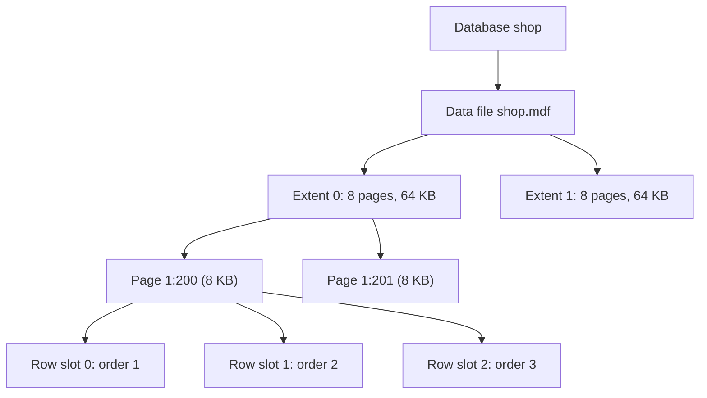
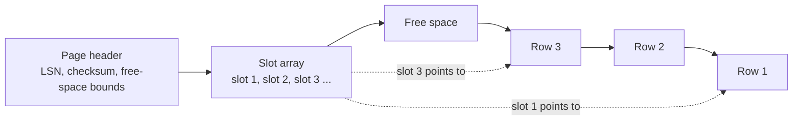
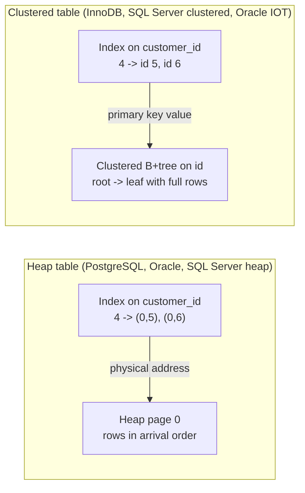

# 6. Storage internals

> **Level:** L3 senior (starts at L1) | **Part:** I | **Rowlit version:** 1.6.3 | [فارسی](../../fa/part1/06-storage-internals.md)
> **Previous:** [5. Data modelling and normalisation](05-modelling-and-normalisation.md) | **Next:** [7. Indexes in depth](07-indexes.md)
>
> **In one sentence:** a database stores every table as fixed-size pages in files, and the way rows sit on those pages (heap or clustered, in-row or off-row, full or with free space) decides how fast every later query can be.
>
> **You will learn:**
> - how files, extents, pages and rows nest, and why the page is the unit of all I/O;
> - what a slotted page looks like inside, and what a row identifier (RID, ctid, ROWID, rowid) really points at;
> - the difference between a heap table and a clustered (index-organised) table, engine by engine;
> - what happens when a row grows, moves or is too large for a page (forwarding, migration, HOT, TOAST, LOB, overflow pages);
> - what fill factor and free-space maps are for, and how the buffer pool keeps hot pages in memory;
> - why sequential I/O is cheap and random I/O is expensive, and how a columnar layout changes the picture.
>
> **Prerequisites:** [2. The relational model](02-relational-model.md), [3. SQL I](03-sql-basics.md). Helpful: [5. Modelling](05-modelling-and-normalisation.md) (data types).

## 1. The idea (beginner)

A table looks like a grid of rows and columns, but a disk does not store grids. It stores bytes in files. A database
engine therefore cuts each file into equal blocks called [pages](../glossary.md#page) (for example 8 KB) and puts rows
inside those pages. When you ask for one row, the engine never reads "one row" from disk: it reads the whole page that
holds it, keeps a copy in memory, and picks the row out of the copy. The page is to a database what a box is to a
warehouse: you can only carry whole boxes.

Two questions decide almost everything that follows. First, **in what order do the rows sit in the pages?** Either in no
particular order (a [heap](../glossary.md#heap): new rows go wherever there is room) or sorted by a key (a
[clustered index](../glossary.md#clustered-index): the table itself is a sorted tree). Second, **how many useful rows does
one page read bring?** A page full of the rows you need is one cheap read; a hundred pages that each hold one wanted row
is a hundred reads. Indexes ([chapter 7](07-indexes.md)) and the optimizer ([chapter 8](08-query-processing.md)) are,
underneath, strategies for reading fewer pages. This chapter shows what those pages look like.

## 2. How it works (practitioner)

### 2.1 From files to pages

Every relational engine uses the same four layers, with different names:

| Layer | What it is | PostgreSQL 17 | SQL Server 2022 | Oracle 23 | MySQL 8 / MariaDB 11 (InnoDB) | SQLite 3.4x |
|---|---|---|---|---|---|---|
| File | an operating-system file | one file per table/index, split into 1 GB segments, under `base/<db oid>/` | `.mdf` / `.ndf` data files per database | data files grouped into tablespaces | `.ibd` per table (file-per-table, default) or the system tablespace | the whole database is one file |
| Extent | a run of consecutive pages allocated together | none (the file grows page by page) | 8 pages = 64 KB | a set of contiguous blocks; size depends on the tablespace | 1 MB (64 pages of 16 KB) | none |
| Page / block | the unit of I/O and caching | 8 KB "block" (compile-time `BLCKSZ`) | 8 KB page | `DB_BLOCK_SIZE`, default 8 KB (2–32 KB) | 16 KB page (`innodb_page_size`) | 4096 bytes by default (512–65536) |
| Row | a record inside a page | "tuple" | "row" / "record" | "row piece" | "record" | "cell" holding a "record" |

A [page](../glossary.md#page) (Oracle says [block](../glossary.md#block)) is the smallest amount of data the engine
reads, writes, caches, locks with a latch and logs as a whole. An [extent](../glossary.md#extent) is a group of
consecutive pages handed out at once so that a table's pages are not scattered across the disk. Oracle and SQL Server
also have the [tablespace](../glossary.md#tablespace) / filegroup idea: a named set of files where you place objects.

**Figure 6.1 — From a file down to one row (SQL Server sizes as the example).**



The identifier "1:200" in the figure is SQL Server's way of naming a page: file 1, page 200. Every engine has such a
physical address, and every row address is "page address + position on the page".

#### Real numbers: Rowlit's SQLite sample

Rowlit creates a SQLite sample database ("Sample: Shop") with 24 countries, 300 customers, 60 products and 1,500 orders
(`engine/src/DbStudio.Core/Sample/SampleDatabase.cs:21`), schema at `SampleDatabase.cs:100-180`. It is a different
shape from the Docker `shop` seeds (PascalCase names, more rows), which makes it a good laboratory: it has enough rows to
fill several pages. SQLite ships a virtual table `dbstat` that reports every page. On a copy of the sample file
(SQLite 3.51.3, run with Node's `node:sqlite`; real output):

```sql
-- SQLite: page size, page count, pages per object
PRAGMA page_size;                    -- 4096
PRAGMA page_count;                   -- 112   (112 x 4 KB = 448 KB for the whole database)
SELECT name, count(*) AS pages, sum(ncell) AS cells, sum(unused) AS unused_bytes
FROM dbstat GROUP BY name ORDER BY pages DESC LIMIT 4;
```

| name | pages | cells | unused_bytes |
|---|---|---|---|
| OrderLines | 30 | 4551 | 7723 |
| Orders | 21 | 1519 | 6795 |
| sqlite_autoindex_OrderLines_1 | 14 | 4523 | 4905 |
| IX_OrderLines_ProductId | 11 | 4523 | 4429 |

Read it like this: the 1,500 orders fill 21 pages of 4 KB, about 75 rows per page. The extra 19 "cells" in `Orders`
(1,519 instead of 1,500) are the pointer cells of the one internal page that sits above the 20 leaf pages: the table is
a tree, which section 2.3 explains.

### 2.2 Inside a page: the slotted page

Almost every row store uses the same page layout, the [slotted page](../glossary.md#slotted-page):

**Figure 6.2 — A slotted page. Slots grow from the front, rows grow from the back, free space is in the middle.**



- The **page header** records the page's log sequence number (the [LSN](../glossary.md#lsn), used by recovery,
  [chapter 11](11-logging-and-recovery.md)), a checksum, and where free space starts and ends. PostgreSQL's header is 24
  bytes; SQL Server's is 96 bytes.
- The **slot array** (PostgreSQL: [line pointers](../glossary.md#line-pointer), 4 bytes each; SQL Server: the *row
  offset array* at the end of the page, 2 bytes per row) lists where each row starts.
- The **rows** are packed from the other end. Each row begins with its own small header (null bitmap, lengths and, in
  MVCC engines, transaction information; [chapter 10](10-concurrency-locking-mvcc.md)).

Why the indirection? Because a row can move **inside** the page (when the page is compacted, or the row grows) without
changing its address: the address names the slot, and only the slot's offset changes. Indexes keep pointing at the slot.

A row's physical address therefore has two parts, page and slot. Each engine names it differently:

| Engine | Name | Shape | Example |
|---|---|---|---|
| PostgreSQL | [`ctid`](../glossary.md#ctid) | (block number, line pointer) | `(0,3)` = block 0, third line pointer |
| SQL Server (heap) | [RID](../glossary.md#rid) | file : page : slot (8 bytes) | `1:200:2` |
| Oracle | [ROWID](../glossary.md#rowid) | data object, file, block, row (shown as 18 base-64 characters) | `AAAR3sAAEAAAACXAAA` |
| SQLite | [`rowid`](../glossary.md#rowid) | a 64-bit integer **key**, not a physical address | `7` |
| InnoDB | none | rows are found by primary key | — |

Try it on PostgreSQL (illustrative output: the Docker lab was not running when this chapter was written):

```sql
-- PostgreSQL 17, Docker shop database
SELECT ctid, id, customer_id, total FROM orders ORDER BY id;
```

| ctid | id | customer_id | total |
|---|---|---|---|
| (0,1) | 1 | 1 | 120.50 |
| (0,2) | 2 | 1 | 19.50 |
| (0,3) | 3 | 2 | 199.00 |
| … | … | … | … |

All six orders live in block 0. Run `UPDATE orders SET total = total WHERE id = 1;` and query again: order 1 now shows
`(0,7)`. PostgreSQL never overwrites a row in place; an update writes a new version and the old one stays until
[VACUUM](../glossary.md#vacuum) removes it ([chapter 10](10-concurrency-locking-mvcc.md)). `ctid` is therefore a
physical address, not an identity: never store it in an application.

<a id="heaps-and-clustered-tables"></a>

### 2.3 Heaps and clustered tables

A table's rows are stored in one of two ways.

**Heap.** Rows are placed wherever there is free space, in no key order. The engine finds a row through its physical
address (RID / ctid / ROWID). Every index, including the primary key, is a separate structure whose entries end in that
address. PostgreSQL tables are always heaps. Oracle tables are heaps by default ("heap-organised"). In SQL Server a table
without a clustered index is a heap.

**Clustered table / index-organised table.** The table *is* a B+tree ([chapter 7](07-indexes.md#b-plus-tree-structure))
sorted by a key: the leaf pages of the tree hold the full rows. This is SQL Server's
[clustered index](../glossary.md#clustered-index), Oracle's [index-organised table](../glossary.md#index-organised-table)
(`ORGANIZATION INDEX`), InnoDB's only table format, and SQLite's rowid table (sorted by `rowid`) or `WITHOUT ROWID`
table (sorted by the declared primary key). A secondary index on such a table cannot store a physical address, because
rows move when pages split; it stores the **clustering key** instead and finds the row by a second tree search.

**Figure 6.3 — Finding the row for `customer_id = 4` through a secondary index: heap (left) vs clustered table (right).**



Consequences you can use:

| Question | Heap | Clustered |
|---|---|---|
| Lookup by primary key | index search + one page read | one tree search; the leaf has the row |
| Lookup by secondary index | index search + one page read per row | index search + one **tree search** per row (the "bookmark" or [key lookup](../glossary.md#key-lookup)) |
| Range scan on the key (`WHERE id BETWEEN …`) | rows scattered unless the table was loaded in key order | rows are adjacent: few pages |
| Insert | cheap: append to any page with room | must go to the right leaf; a full leaf splits ([chapter 7](07-indexes.md#page-splits)) |
| Wide clustering key | — | every secondary index carries it: a 16-byte UUID key makes every index bigger |
| Random clustering key (UUID v4) | — | inserts land on random leaves: splits, half-empty pages, poor cache use |

InnoDB picks the clustering key for you: the `PRIMARY KEY`; if there is none, the first `UNIQUE` index whose columns are
all `NOT NULL`; otherwise a hidden 6-byte row id (`GEN_CLUST_INDEX`). SQL Server makes the primary key clustered by
default when no clustered index exists yet, which is why `PK_Orders` in `seed-mssql.sql:37` is clustered. A non-unique
clustered index gets a hidden 4-byte [uniquifier](../glossary.md#uniquifier) on duplicate keys.

SQLite shows the difference directly. In the sample database `Orders.Id` is declared `INTEGER NOT NULL PRIMARY KEY`
(`SampleDatabase.cs:133`), which makes it an alias of the `rowid`, the key of the table's own B-tree. A lookup by id
needs no index at all (real output):

```sql
EXPLAIN QUERY PLAN SELECT * FROM Orders WHERE Id = 7;
-- SEARCH Orders USING INTEGER PRIMARY KEY (rowid=?)
```

With a text primary key the table stays a rowid table and SQLite builds a separate unique index; a [`WITHOUT ROWID`](../glossary.md#without-rowid)
table is stored clustered on the declared key. Real output on 50,000 rows with keys like `C0001234`:

```sql
CREATE TABLE kv_rowid   (code TEXT PRIMARY KEY, v INTEGER);
CREATE TABLE kv_norowid (code TEXT PRIMARY KEY, v INTEGER) WITHOUT ROWID;
-- dbstat after loading 50,000 rows into each:
--   kv_rowid 234 pages + sqlite_autoindex_kv_rowid_1 230 pages = 464 pages
--   kv_norowid 230 pages, no extra index
EXPLAIN QUERY PLAN SELECT v FROM kv_rowid   WHERE code = 'C0001234';
-- SEARCH kv_rowid USING INDEX sqlite_autoindex_kv_rowid_1 (code=?)
EXPLAIN QUERY PLAN SELECT v FROM kv_norowid WHERE code = 'C0001234';
-- SEARCH kv_norowid USING PRIMARY KEY (code=?)
```

The clustered version is half the size and needs one tree search instead of two.

<a id="rows-that-grow"></a>

### 2.4 Rows that grow, move or do not fit

A row's size changes when you update a variable-length column. Engines handle "the row no longer fits where it was" in
different ways:

- **SQL Server heap: [forwarded records](../glossary.md#forwarded-record).** The row moves to another page and leaves a
  forwarding stub at the old RID, so indexes need not change. Reads that hit the stub do an extra page read.
  `sys.dm_db_index_physical_stats(...).forwarded_record_count` counts them; rebuilding the heap removes them.
- **Oracle: [row migration and row chaining](../glossary.md#row-chaining).** *Migration* moves a grown row to a new block
  and keeps a pointer in the old one (the ROWID stays valid). *Chaining* splits a row that is bigger than a block into
  pieces in several blocks. Both show up as the statistic "table fetch continued row".
- **PostgreSQL: new version, possibly [HOT](../glossary.md#hot-update).** Every update writes a new tuple version. If no
  indexed column changed and the same page has room, the update is a *heap-only tuple* (HOT) update: the old version
  points to the new one inside the page and no index entry is added. If the page is full, the new version goes to
  another page and **every index** of the table gets a new entry. Leaving free space on the page (section 2.5) is what
  makes HOT possible. `pg_stat_user_tables.n_tup_hot_upd` tells you how often it works.
- **InnoDB and other clustered tables:** the row stays in its leaf if it fits; otherwise the leaf splits. Secondary
  indexes are unaffected because they point by key.

Values that are too large for a page are stored **off-row** ([off-row](../glossary.md#off-row)): the row keeps a small
pointer and the value lives in separate pages.

| Engine | Name | When a value goes off-row | Pointer left in the row |
|---|---|---|---|
| PostgreSQL | [TOAST](../glossary.md#toast) | when a row is wider than about 2 KB (`TOAST_TUPLE_THRESHOLD`), values are first compressed (pglz, or lz4 with `default_toast_compression`), then moved to the table's `pg_toast.pg_toast_<oid>` table in chunks of about 2 KB | an 18-byte TOAST pointer |
| SQL Server | [LOB](../glossary.md#lob) / [row-overflow](../glossary.md#row-overflow) | a row may hold at most 8,060 bytes in-row; `varchar(n)`/`varbinary(n)` columns that push it over move to `ROW_OVERFLOW_DATA`; `(max)` types larger than 8,000 bytes go to `LOB_DATA` | a small pointer (24 bytes for row-overflow; a LOB root or text pointer for `LOB_DATA`) |
| Oracle | LOB segment (SecureFiles by default) | LOBs up to about 4,000 bytes can stay in the row (`ENABLE STORAGE IN ROW`); larger ones live in the LOB segment | a LOB locator |
| InnoDB | off-page columns | with the default `DYNAMIC` row format, long `TEXT`/`BLOB`/`VARCHAR` values that make the row too large (a row must fit in about half a 16 KB page) are stored entirely off-page | a 20-byte pointer |
| SQLite | [overflow pages](../glossary.md#overflow-page) | a record larger than a page-dependent threshold spills its tail into a chain of overflow pages | the first bytes plus the next page number |

SQLite, real output: a 10,000-character text in a 4 KB page database uses one leaf page plus two overflow pages.

```sql
CREATE TABLE docs (id INTEGER PRIMARY KEY, body TEXT);
INSERT INTO docs (body) VALUES ('short'), (printf('%.*c', 10000, 'x'));
SELECT pagetype, count(*) FROM dbstat WHERE name = 'docs' GROUP BY pagetype;
-- leaf 1, overflow 2
```

Practical rules: `SELECT *` on a table with large text columns reads the off-row pages too (and de-TOASTs, which costs
CPU); list the columns you need. Big values make rows wide, and wide rows mean fewer rows per page, so every scan reads
more pages.

<a id="free-space-and-fill-factor"></a>

### 2.5 Free space and fill factor

When a page is created or rebuilt, the engine can leave part of it empty so that later updates and inserts fit without
moving rows or splitting pages. That reserve is the [fill factor](../glossary.md#fill-factor) (Oracle:
[PCTFREE](../glossary.md#pctfree), the percentage kept free).

| Engine | Setting | Default | Applies to |
|---|---|---|---|
| PostgreSQL | `WITH (fillfactor = n)` on tables and indexes | tables 100, B-tree indexes 90 | heap pages (helps HOT updates) and index pages at build time |
| SQL Server | `FILLFACTOR = n` on indexes, `PAD_INDEX` for non-leaf levels | 0 (= 100) | only when an index is created or rebuilt; normal inserts fill pages fully |
| Oracle | `PCTFREE n` on tables and indexes | 10 | tables: room for row growth; indexes: at build only |
| InnoDB | `innodb_fill_factor` | 100 | sorted index builds; InnoDB also leaves about 1/16 of a page free when filling pages in key order |
| SQLite | none | — | — |

A lower fill factor trades space (and therefore more pages to read in scans) for fewer page splits and, in PostgreSQL,
more HOT updates. Use it on tables or indexes with frequent updates or random-key inserts; leave read-mostly tables at
100.

To find a page with room for a new row without reading every page, engines keep a
[free space map](../glossary.md#free-space-map): PostgreSQL's `_fsm` fork (a small tree of per-page free-space
categories), SQL Server's PFS (Page Free Space) pages, Oracle's bitmap blocks under Automatic Segment Space Management,
InnoDB's per-extent bitmaps. PostgreSQL has a second per-table map, the [visibility map](../glossary.md#visibility-map)
(`_vm` fork), which marks pages whose rows are all visible to every transaction; it powers index-only scans
([chapter 7](07-indexes.md#index-only-scans)).

### 2.6 The buffer pool

Reading from disk is thousands of times slower than reading from RAM, so every engine keeps recently used pages in a
shared memory area, the [buffer pool](../glossary.md#buffer-pool) (PostgreSQL: `shared_buffers`; Oracle: buffer cache;
SQLite: page cache).

**Figure 6.4 — A read and a write through the buffer pool.**


- A **[logical read](../glossary.md#logical-read)** finds the page in memory; a **physical read** has to fetch it from storage. Plans and statistics
  report both (PostgreSQL `Buffers: shared hit=… read=…`; SQL Server `SET STATISTICS IO`: `logical reads`, `physical
  reads`; Oracle: consistent gets / physical reads).
- A page changed in memory is a [dirty page](../glossary.md#dirty-page). It is written back later by a background writer
  or at a [checkpoint](../glossary.md#checkpoint), never before the log records that describe the change are on disk
  (write-ahead logging, [chapter 11](11-logging-and-recovery.md)).
- When the pool is full, a replacement policy picks a victim. Plain LRU is easily spoiled by one big scan, so engines use
  variants: PostgreSQL's [clock sweep](../glossary.md#clock-sweep) with usage counts plus a small **ring buffer** for big
  sequential scans and VACUUM (so a scan of a huge table does not evict everything else); InnoDB's *midpoint insertion*
  (new pages enter the "old" 3/8 of the LRU list and are promoted only if touched again after
  `innodb_old_blocks_time`, 1 s by default); SQL Server's LRU-K-style aging.
- PostgreSQL reads through the operating-system cache, so a page can be cached twice
  ([double buffering](../glossary.md#double-buffering)); this is why `shared_buffers` is usually set to about a quarter of
  RAM, not most of it. SQL Server, Oracle and InnoDB (`innodb_flush_method = O_DIRECT` on Linux) usually bypass the OS
  cache and take most of the memory themselves.

### 2.7 Sequential and random I/O

A [sequential scan](../glossary.md#sequential-scan) reads a table's pages in file order. The storage reads ahead, the
engine asks for many pages per request, and the cost per page is low. [Random I/O](../glossary.md#random-io) jumps
between distant pages (one page per row found through an index on a heap, for example). Each jump is a separate request.

| Storage | Random 8 KB reads per second (typical) | Sequential throughput (typical) |
|---|---|---|
| 7,200 rpm hard disk | about 100–200 | about 150–250 MB/s |
| SATA SSD | tens of thousands | about 500 MB/s |
| NVMe SSD | hundreds of thousands | several GB/s |

The gap shrank with SSDs, but it did not disappear, and in memory the same effect returns as CPU cache misses. Optimizers
encode it in their cost models: PostgreSQL's defaults are `seq_page_cost = 1.0` and `random_page_cost = 4.0`; on SSDs
many teams lower `random_page_cost` to about 1.1. This one ratio decides whether the planner prefers an index or a scan
([chapter 8](08-query-processing.md#cost-model)).

A rule of thumb that follows: reading a few percent of a table through an index on a heap can already cost more than
reading the whole table sequentially. Chapter 7 shows when, and how a clustered layout or a covering index changes it.

### 2.8 A look at columnar layout

Everything so far is a **row store**: one page holds whole rows. Analytic engines store each **column** separately, so a
query that sums `total` over 100 million orders reads only the `total` column, compressed. Page-level ideas still apply
but with different units:

- **ClickHouse MergeTree** writes each insert as an immutable *part*; inside a part every column is its own file
  (wide parts) or all columns share one file (compact parts, for small inserts). Rows are sorted by `ORDER BY` and grouped
  into *granules* of `index_granularity` rows (8,192 by default; `seed-clickhouse.sql:56` sets it explicitly), and the
  sparse primary index keeps one entry per granule ([chapter 7](07-indexes.md#clickhouse-sparse-primary-index)).
- **Snowflake** stores tables as immutable *micro-partitions* of roughly 50–500 MB of uncompressed data, columnar inside,
  with min/max metadata per column used to skip partitions.
- **SQL Server columnstore** groups about a million rows into a *row group* and stores each column of it as a compressed
  *segment*.

[Chapter 15](15-oltp-vs-olap-columnar.md) covers these engines in depth; here it is enough to see that "how many bytes
must I read to answer this?" is the same question in both worlds.

## 3. Deep dive (senior)

> **Deep dive (L3): a PostgreSQL heap tuple, byte by byte.**
> Each heap tuple starts with a 23-byte header (padded to 24): `t_xmin` and `t_xmax` (the creating and deleting
> transaction ids, the heart of MVCC), `t_cid`, `t_ctid` (points to itself, or to the newer version after an update),
> `t_infomask`/`t_infomask2` (flags such as "xmin committed", "has nulls", HOT bits and the number of attributes) and
> `t_hoff` (where data starts). A null bitmap follows when any column is NULL, then the column values, each aligned to its
> type's alignment (`int8` and `timestamptz` on 8 bytes, the `numeric` header on 4). Column order therefore matters: putting
> 8-byte columns first and 1-byte `boolean`s last can save several bytes per row. The `pageinspect` extension shows all
> of it (`SELECT * FROM heap_page_items(get_raw_page('orders', 0));`) and `pgstattuple` reports dead space. Run them only
> on a scratch database; they need superuser rights.

> **Deep dive (L3): SQL Server allocation structures.**
> An object's pages belong to *allocation units*: `IN_ROW_DATA`, `ROW_OVERFLOW_DATA` and `LOB_DATA`
> (`sys.allocation_units`). Each allocation unit has IAM (Index Allocation Map) pages listing its extents. GAM and SGAM
> pages track which extents are free or mixed, and PFS pages track how full each page is (heap free space) and whether it
> is allocated. Since SQL Server 2016, user databases allocate uniform extents only (`MIXED_PAGE_ALLOCATION OFF`). A heap
> has no order, so a heap scan follows the IAM in file order ("allocation order scan"). Insert-heavy tempdb workloads
> famously contended on PFS/GAM pages; SQL Server 2019 and 2022 added concurrent updates to them.

> **Deep dive (L3): InnoDB records.**
> Every clustered-index record carries two hidden system columns: `DB_TRX_ID` (6 bytes, last transaction that changed
> the row) and `DB_ROLL_PTR` (7 bytes, pointer into the undo log for the previous version, [chapter 10](10-concurrency-locking-mvcc.md)),
> plus `DB_ROW_ID` (6 bytes) when InnoDB generated the key. A secondary-index record is (index columns, primary-key
> columns). When a page drops below `MERGE_THRESHOLD` (50% by default) after deletes, InnoDB tries to merge it with a
> neighbour. Changes to secondary-index pages that are not in memory can be recorded in the *change buffer* and applied
> later, turning random writes into batched ones (MySQL 8.4 disables it by default: `innodb_change_buffering = none`).

> **Deep dive (L3): SQLite's B-trees and records.**
> A SQLite database file is a set of B-trees. A *table B-tree* is keyed by the 64-bit rowid and keeps rows only in leaves
> (a B+tree); an *index B-tree* stores (index columns, rowid) records and keeps keys in interior pages too (a classic
> B-tree). A record is a varint header listing each column's *serial type* followed by the values; integers are stored in
> 0, 1, 2, 3, 4, 6 or 8 bytes depending on their size, so small numbers are cheap. Page 1 starts with a 100-byte file
> header (page size, file format, free-list head). Deleted pages go to a free list and are reused; `VACUUM` rebuilds the
> file. The sample database runs `ANALYZE; VACUUM;` right after seeding (`SampleDatabase.cs:347`), which is why its pages
> are dense.

> **Deep dive (L3): why the page size is what it is.**
> Larger pages mean shallower trees and better sequential throughput, but more wasted reads for point lookups, more
> memory per cached hot row and bigger torn-write risk ([chapter 11](11-logging-and-recovery.md)). 8 KB (PostgreSQL,
> SQL Server, Oracle default) and 16 KB (InnoDB) are compromises chosen decades ago that still fit SSD page sizes
> well. Changing them is rarely worth it: PostgreSQL needs a recompile, SQL Server cannot change it at all, InnoDB and
> SQLite fix it when the database (or, for InnoDB, the instance) is created.

## 4. In each engine

| Topic | PostgreSQL 17 | SQL Server 2022 | Oracle 23 | MySQL 8 / MariaDB 11 (InnoDB) | SQLite 3.4x | ClickHouse 24+ | Snowflake | Cassandra 4/5 |
|---|---|---|---|---|---|---|---|---|
| Page size | 8 KB | 8 KB | 8 KB default | 16 KB default | 4 KB default | not page-based: granules of 8,192 rows in compressed column files | micro-partitions | SSTable blocks (compression chunks, 16 KB default in 4.x/5) |
| Default table layout | heap | heap, or clustered when a clustered index exists (PK by default) | heap; IOT on request | clustered on PK | rowid B-tree; `WITHOUT ROWID` clustered on PK | sorted by `ORDER BY` | columnar, unordered unless clustering keys | sorted by clustering key inside a partition (LSM) |
| Row address | `ctid` | RID (heap) / clustering key | ROWID | primary key | rowid | (part, granule, offset) | none exposed | partition key + clustering key |
| Large values | TOAST | row-overflow, LOB | LOB segments (SecureFiles) | off-page columns | overflow pages | column files, compressed | columnar, compressed | cells inside SSTables |
| Free-space reserve | `fillfactor` | `FILLFACTOR` (index build) | `PCTFREE` | `innodb_fill_factor` | none | none (immutable parts) | none (immutable) | none (immutable SSTables) |
| Cache | `shared_buffers` + OS cache | buffer pool | buffer cache | `innodb_buffer_pool_size` | page cache per connection | mark cache, uncompressed cache, OS cache | warehouse local disk cache, result cache | key cache, chunk cache, OS cache |
| Inspect pages | `pageinspect`, `pgstattuple` | `DBCC PAGE` (undocumented), `sys.dm_db_index_physical_stats` | `DBMS_SPACE`, block dumps | `INFORMATION_SCHEMA.INNODB_*`, `innodb_ruby` (external) | `dbstat`, `sqlite3_analyzer` | `system.parts`, `system.parts_columns` | `TABLE_STORAGE_METRICS` | `nodetool tablestats`, `sstablemetadata` |

Cassandra's storage engine (log-structured merge tree: commit log → memtable → immutable SSTables, merged by
compaction) is the subject of [chapter 16](16-nosql-families.md); it never updates a page in place.

*In Rowlit:* the explorer shows a table's indexes and the designer can set some storage options per provider
([Part II chapter 14](../part2/14-designers-and-ddl.md)); the sample SQLite database used above is created by
`SampleDatabase.CreateAsync` ([Part II chapter 9](../part2/09-relational-providers.md)).

## 5. Exercises

1. A PostgreSQL table has 1,000,000 rows of about 100 bytes each (header included). Estimate how many 8 KB pages it
   needs, and how many a sequential scan reads. Then estimate the pages with `fillfactor = 70`.
2. In SQL Server, `dbo.Orders` has a clustered primary key on `Id` and the nonclustered index `IX_Orders_CustomerId
   (CustomerId) INCLUDE (Total)` (`seed-mssql.sql:51`). What exactly is stored in a leaf row of that nonclustered index?
   What changes if the table were a heap?
3. You must choose a primary key for a 500-million-row InnoDB table with heavy inserts: `BIGINT AUTO_INCREMENT` or a
   random UUID stored as `CHAR(36)`. Give three storage reasons for your choice.
4. In PostgreSQL, an `UPDATE orders SET status = 'paid' WHERE id = 3` is not HOT. Name two possible reasons.
5. Using SQLite and `dbstat`, find which object in Rowlit's sample database has the most unused bytes per page. Write the
   query.
6. A query reads 2% of the rows of a 10 GB heap table through an index, in random order. With `seq_page_cost = 1` and
   `random_page_cost = 4`, and assuming every matching row is on a different page and nothing is cached, which is
   cheaper in page-cost units: the index path or a full sequential scan? (8 KB pages, 80 rows per page.)

## Answers

The answers are collected in [chapter 18](18-exercise-answers.md#chapter-6); they are repeated here so this chapter
stands alone.

<details>
<summary>Show answers</summary>

1. 8 KB minus the 24-byte header leaves 8,168 bytes; each row costs about 100 + 4 bytes (line pointer), so about 78 rows
   per page and 1,000,000 / 78 ≈ 12,800 pages (about 100 MB). A sequential scan reads all of them. With `fillfactor = 70`,
   inserts stop at 70% of the page: about 55 rows per page, ≈ 18,200 pages, so the scan reads about 42% more.
2. Each leaf row holds the key `CustomerId`, the included column `Total`, and the row locator. Because the table has a
   clustered index, the locator is the clustering key `Id`. On a heap the locator would be the 8-byte RID
   (file:page:slot) instead. In both cases there is also a small row header and null bitmap.
3. Any three of: an auto-increment key appends to the right-most leaf, so pages fill completely and do not split in the
   middle; random UUIDs scatter inserts across all leaves, causing splits and half-empty pages; `CHAR(36)` is at least 36 bytes
   versus 8, and every secondary index repeats the primary key; random
   keys spread the working set over the whole tree, so the buffer pool hit ratio drops; sequential keys keep recent rows
   together on few hot pages.
4. Either an indexed column changed (if `status` is in an index, such as the partial index predicate column of
   `ix_orders_open`, the update cannot be HOT: PostgreSQL treats columns used in index predicates and expressions as
   indexed), or the page had no free space for the new version (fill factor 100 on a full page).
5. `SELECT name, count(*) AS pages, sum(unused) * 1.0 / count(*) AS unused_per_page FROM dbstat GROUP BY name ORDER BY
   unused_per_page DESC LIMIT 1;` On the sample file this reports `sqlite_sequence` (the
   internal table behind `AUTOINCREMENT`: 4,070 of its 4,096 bytes unused), followed by `sqlite_autoindex_Countries_1`
   (3,873): tiny objects waste most of their single page, and that is fine.
6. The table has 10 GB / 8 KB ≈ 1,310,720 pages and about 104.9 million rows. 2% is about 2.1 million rows, each a random
   page read at cost 4: about 8.4 million units, plus the index pages. The sequential scan costs about 1.31 million units.
   The full scan is about six times cheaper, which is why optimizers stop using a non-covering index on a heap at a
   surprisingly low fraction of rows.

</details>

## Related chapters

- [7. Indexes in depth](07-indexes.md): B+tree pages, page splits, covering indexes and index-only scans build on this chapter.
- [8. The query pipeline and the optimizer](08-query-processing.md): how page counts become costs.
- [10. Concurrency: locks, latches, MVCC](10-concurrency-locking-mvcc.md): tuple versions, `xmin`/`xmax`, undo.
- [11. WAL, redo/undo, checkpoints, recovery](11-logging-and-recovery.md): dirty pages, checkpoints, torn pages.
- [15. OLTP vs OLAP and columnar engines](15-oltp-vs-olap-columnar.md): parts, granules, micro-partitions.
- Part II: [9. Relational providers](../part2/09-relational-providers.md) (the SQLite sample database).

## Glossary terms introduced here

[page](../glossary.md#page), [block](../glossary.md#block), [extent](../glossary.md#extent),
[tablespace](../glossary.md#tablespace), [slotted page](../glossary.md#slotted-page),
[line pointer](../glossary.md#line-pointer), [heap](../glossary.md#heap),
[clustered index](../glossary.md#clustered-index), [index-organised table](../glossary.md#index-organised-table),
[rowid](../glossary.md#rowid), [RID](../glossary.md#rid), [ctid](../glossary.md#ctid),
[uniquifier](../glossary.md#uniquifier), [WITHOUT ROWID](../glossary.md#without-rowid),
[forwarded record](../glossary.md#forwarded-record), [row migration / chaining](../glossary.md#row-chaining),
[HOT update](../glossary.md#hot-update), [off-row](../glossary.md#off-row), [TOAST](../glossary.md#toast),
[LOB](../glossary.md#lob), [row-overflow](../glossary.md#row-overflow), [overflow page](../glossary.md#overflow-page),
[fill factor](../glossary.md#fill-factor), [PCTFREE](../glossary.md#pctfree),
[free space map](../glossary.md#free-space-map), [buffer pool](../glossary.md#buffer-pool),
[logical read / physical read](../glossary.md#logical-read), [dirty page](../glossary.md#dirty-page),
[clock sweep](../glossary.md#clock-sweep), [double buffering](../glossary.md#double-buffering),
[sequential scan](../glossary.md#sequential-scan), [random I/O](../glossary.md#random-io).
Linked, owned elsewhere: [LSN](../glossary.md#lsn), [checkpoint](../glossary.md#checkpoint),
[VACUUM](../glossary.md#vacuum), [visibility map](../glossary.md#visibility-map), [key lookup](../glossary.md#key-lookup).
