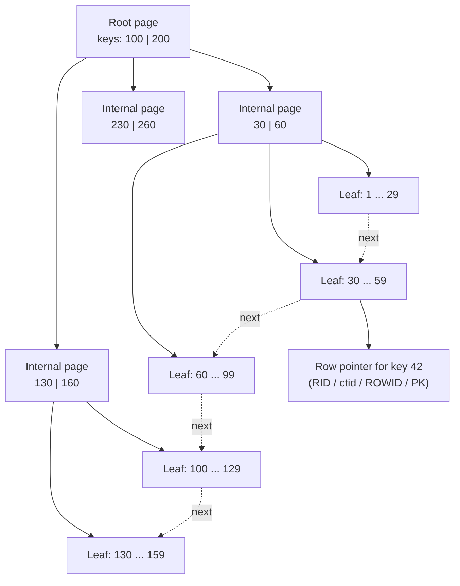
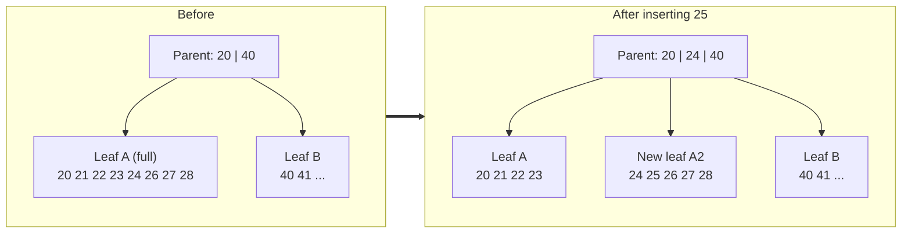
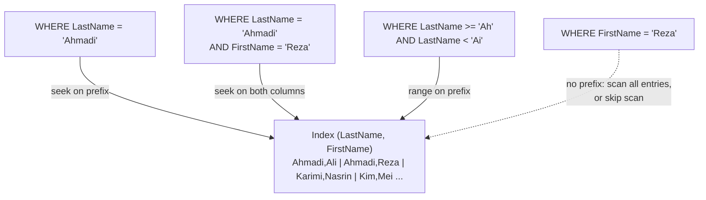
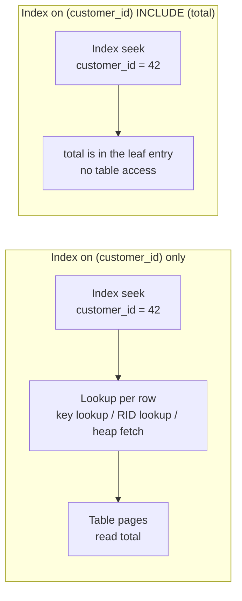
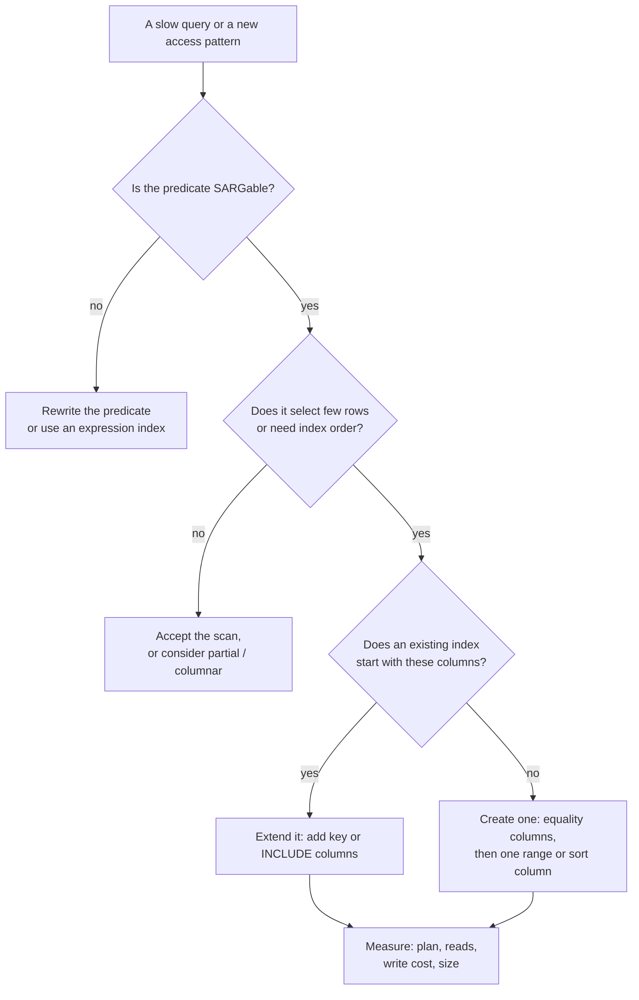
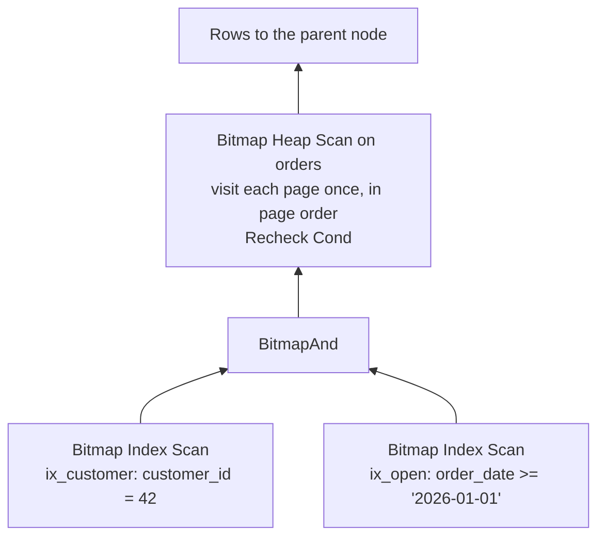
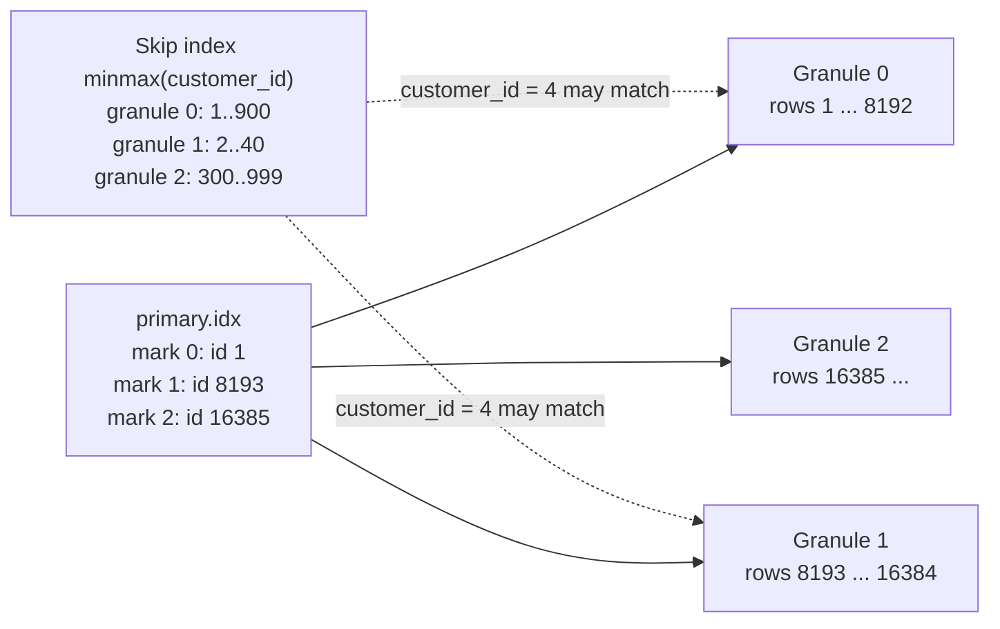

# 7. Indexes in depth

> **Level:** L3 senior (starts at L1) | **Part:** I | **Rowlit version:** 1.6.3 | [فارسی](../../fa/part1/07-indexes.md)
> **Previous:** [6. Storage internals](06-storage-internals.md) | **Next:** [8. The query pipeline and the optimizer](08-query-processing.md)
>
> **In one sentence:** an index is a second, sorted copy of some columns that lets the engine jump to the rows it needs
> instead of reading the whole table, and choosing, ordering and maintaining those copies is the single most effective
> performance skill a database developer has.
>
> **You will learn:**
> - how a B+tree is built (root, internal and leaf pages, fan-out, height) and why three or four page reads find any row
>   among millions;
> - how inserts split pages, why random keys hurt, and how column order in a composite index decides which queries it
>   can serve (the leftmost-prefix rule);
> - covering indexes, `INCLUDE`, index-only scans, key lookups, partial/filtered and expression indexes, unique indexes;
> - how selectivity, cardinality, statistics and histograms drive the optimizer's choice between an index and a scan;
> - how to read a plan for index use in every engine, why an index is sometimes ignored, and when not to index at all;
> - the other index families: hash, bitmap, GiST, SP-GiST, GIN, BRIN, full-text, columnstore, ClickHouse sparse and skip
>   indexes, Cassandra SAI, MongoDB compound indexes, and Snowflake's index-free pruning.
>
> **Prerequisites:** [6. Storage internals](06-storage-internals.md) (pages, heaps, clustered tables, the buffer pool).
> Helpful: [3. SQL I](03-sql-basics.md), [5. Modelling](05-modelling-and-normalisation.md) (keys and constraints).

## 1. The idea (beginner)

Think of a 900-page book without an index at the back. To find every page that mentions "deadlock" you would read all
900 pages. With an index you look up "deadlock" in a short sorted list, read "pages 212, 388, 401", and open exactly
those pages. A database [index](../glossary.md#index) is the same thing: a separate, **sorted** structure that maps
values of one or more columns (the *key*) to the places where the matching rows live. A query such as
`SELECT * FROM orders WHERE customer_id = 42` can then read a handful of pages instead of the whole table.

The index is not free. It takes space, every `INSERT`, `UPDATE` and `DELETE` must also change it, and it only helps
queries whose conditions match the way it is sorted. The rest of this chapter is about that bargain: how indexes work
inside, how the optimizer decides to use one (from statistics about your data), how to read a query plan to see what
really happened, and how to choose the few indexes that pay for themselves.

## 2. How it works (practitioner)

<a id="b-plus-tree-structure"></a>

### 2.1 The B-tree and the B+tree

Almost every "normal" index in a relational engine is a [B+tree](../glossary.md#b-plus-tree), a variant of the
[B-tree](../glossary.md#b-tree) (Bayer and McCreight, 1970). It is a balanced tree of pages:

- the [leaf pages](../glossary.md#leaf-node) hold every key in sorted order, each with a pointer to its row (a RID,
  `ctid`, ROWID or the clustering key; [chapter 6](06-storage-internals.md#heaps-and-clustered-tables)), or, in a
  clustered index, the row itself;
- leaves are **linked** to their neighbours, so a range (`BETWEEN`, `>`, `ORDER BY`) is read by walking sideways;
- [internal pages](../glossary.md#internal-node) above them hold only *separator keys* and child-page pointers: "keys
  below 40 are in child 1, keys from 40 to 79 in child 2 …";
- one root page sits at the top, and **every leaf is at the same depth**, so every search costs the same number of
  page reads: the tree's [height](../glossary.md#index-height).

In a classic B-tree, internal nodes also carry row pointers, so a search can stop early. Databases prefer the B+tree
because separator-only internal pages hold more entries, the tree is shallower, and all keys are together in the leaf
level for scans. (SQLite is a mixed case: its *table* trees are B+trees, its *index* trees keep keys in interior pages
like a classic B-tree.)

**Figure 7.1 — A three-level B+tree on `customer_id`. Every search reads one page per level; leaves are linked for range scans.**



**Fan-out decides height.** The [fan-out](../glossary.md#fan-out) is the number of children one internal page can
point to. With 8 KB pages and small keys (a 4-byte integer plus a pointer and a small entry header, roughly 16–20 bytes)
an internal page holds several hundred entries. With a fan-out of 400:

| Levels | Leaf pages reachable | Keys (about 300 per leaf) |
|---|---|---|
| 2 (root + leaves) | 400 | 120,000 |
| 3 | 160,000 | 48 million |
| 4 | 64 million | 19 billion |

So a lookup in a table of 50 million rows reads three or four index pages, and the top one or two levels are almost
always in the buffer pool. That is why an index lookup is "logarithmic" in theory and "a few cached page reads" in
practice.

Real numbers (SQLite 3.51.3, 4 KB pages; measured with `dbstat` on a scratch database): a two-column index on one
million rows of `(a INTEGER, b INTEGER)` has **3 levels**: a root page with 14 entries (15 children), 15 internal pages
with about 241 entries each, and 3,350 leaf pages holding about 298 entries each. The fan-out of about 240 comes from 4 KB
pages; with 8 KB pages it roughly doubles.

```sql
-- SQLite: height and shape of an index (scratch database)
SELECT pagetype, count(*) AS pages FROM dbstat WHERE name = 'ix_big_ab' GROUP BY pagetype;
-- internal 16, leaf 3350
SELECT ncell FROM dbstat WHERE name = 'ix_big_ab' AND path = '/';   -- 14 (the root page)
```

### 2.2 Searching, range scans and order

Three operations cover almost all index use:

1. **Seek (point lookup):** descend from the root to the one leaf that contains the key. Cost: height page reads, plus
   the row fetch.
2. **Range scan:** seek to the first qualifying key, then walk the linked leaves until a key falls outside the range.
   Cost: height + number of leaf pages in the range, plus the row fetches.
3. **Full index scan:** read all leaves in order. Cheaper than a table scan when the index is much narrower than the
   table, or when the query needs the rows in index order (`ORDER BY`, `GROUP BY`, merge join).

Because the leaves are sorted, an index also delivers **order for free**. Real output on Rowlit's SQLite sample
database, which has `CREATE INDEX IX_Orders_OrderDate ON Orders (OrderDate DESC)` (`SampleDatabase.cs:157`):

```sql
EXPLAIN QUERY PLAN
SELECT * FROM Orders WHERE OrderDate >= '2025-06-01' ORDER BY OrderDate DESC;
-- SEARCH Orders USING INDEX IX_Orders_OrderDate (OrderDate>?)
```

There is no "USE TEMP B-TREE FOR ORDER BY" line: the rows come out of the index already sorted. Compare an order the
index cannot provide:

```sql
EXPLAIN QUERY PLAN SELECT * FROM Orders ORDER BY Total DESC LIMIT 10;
-- SCAN Orders
-- USE TEMP B-TREE FOR ORDER BY
```

Every engine can read a B-tree backwards too (PostgreSQL shows `Index Scan Backward`), so `DESC` in an index definition
matters only for **mixed** orders in composite indexes, such as `ORDER BY customer_id ASC, order_date DESC`.

<a id="page-splits"></a>

### 2.3 How an insert splits a page

A new key must go to the one leaf where it belongs in sort order. If that leaf is full, the engine performs a
[page split](../glossary.md#page-split): it allocates a new page, moves about half of the entries to it, and inserts a
new separator into the parent. If the parent is full, it splits too; when the root splits, the tree grows one level. That
is the **only** way a B+tree grows taller, which is why it stays balanced.

**Figure 7.2 — Inserting key 25 into a full leaf: the leaf splits and the parent gains a separator.**



Consequences:

- **Splits cost writes and log volume**: three or more pages change and are logged ([chapter 11](11-logging-and-recovery.md)),
  and other sessions wait on the page latches meanwhile.
- **Random keys leave pages half empty.** After a 50/50 split both pages are half full; under random inserts a B-tree
  settles at about 69% average fill (ln 2, a classic result by Yao). Ever-increasing keys (identity, sequence, timestamp)
  always insert at the right edge; engines detect this and split the right-most page unevenly (PostgreSQL fills it to
  the fill factor, then starts a new page), so sequential keys produce nearly full pages.
- **A random clustering key spreads the working set.** With a random UUID (version 4) as the clustered key, every insert
  touches a random leaf, so the whole index must stay in the buffer pool to avoid reads. Time-ordered UUIDs (version 7)
  or a sequence avoid it.

Real measurement (SQLite, scratch database, 200,000 random integers inserted one by one into an indexed column):

| State of the index | Pages | Bytes used per page |
|---|---|---|
| After 200,000 random inserts | 692 | 90.9% |
| After `REINDEX` (rebuilt in sorted order) | 631 | 99.6% |

SQLite's balancing spreads entries over up to three sibling pages, so it stays fuller than the textbook 69%; PostgreSQL,
SQL Server and InnoDB split closer to 50/50 and show a larger gap. Leaving free space at build time (fill factor,
[chapter 6](06-storage-internals.md#free-space-and-fill-factor)) postpones splits on indexes that receive random
inserts.

<a id="composite-index-column-order"></a>

### 2.4 Composite indexes and the leftmost-prefix rule

A [composite index](../glossary.md#composite-index) has several key columns, sorted like a phone book: first by the
first column, then by the second inside equal first values, and so on. An index on `(LastName, FirstName)` is sorted by
last name; inside "Ahmadi" the first names are sorted.

**Figure 7.3 — What a composite index on (LastName, FirstName) can do. Solid paths are seeks; the dashed path must scan.**



The [leftmost-prefix rule](../glossary.md#leftmost-prefix): an index can be **searched** only on a leading run of its
columns. Real output from Rowlit's SQLite sample, which has `IX_Customers_LastName ON Customers (LastName, FirstName)`
(`SampleDatabase.cs:155`):

```sql
EXPLAIN QUERY PLAN SELECT * FROM Customers WHERE LastName = 'Ahmadi';
-- SEARCH Customers USING INDEX IX_Customers_LastName (LastName=?)
EXPLAIN QUERY PLAN SELECT * FROM Customers WHERE LastName = 'Ahmadi' AND FirstName = 'Reza';
-- SEARCH Customers USING INDEX IX_Customers_LastName (LastName=? AND FirstName=?)
EXPLAIN QUERY PLAN SELECT * FROM Customers WHERE FirstName = 'Reza';
-- SCAN Customers
EXPLAIN QUERY PLAN SELECT LastName, FirstName FROM Customers WHERE FirstName = 'Reza';
-- SCAN Customers USING COVERING INDEX IX_Customers_LastName
```

The last query cannot *seek* on `FirstName`, but the index contains both columns, so scanning the narrow index is
cheaper than scanning the table: the engine reads the index from end to end and filters.

**[Skip scan](../glossary.md#skip-scan).** If the leading column has few distinct values, an engine can seek once per distinct leading value: "for
each `a`, seek `b = 500`". Oracle (`INDEX SKIP SCAN`), MySQL 8.0.13+ ("Using index for skip scan"), SQLite (after
`ANALYZE`) and PostgreSQL 18 do this; PostgreSQL 17 and SQL Server 2022 do not. Real SQLite output on a scratch table of
one million rows where `a` has 10 distinct values:

```sql
CREATE INDEX ix_big_ab ON big (a, b);
EXPLAIN QUERY PLAN SELECT a, b FROM big WHERE b = 500;
-- SCAN big                                                     (before ANALYZE: no statistics)
ANALYZE;     -- sqlite_stat1 row for ix_big_ab: '1000000 100000 1'
EXPLAIN QUERY PLAN SELECT a, b FROM big WHERE b = 500;
-- SEARCH big USING COVERING INDEX ix_big_ab (ANY(a) AND b=?)
```

`ANY(a)` is SQLite's notation for the skip scan, and it appeared only once statistics said each `a` value repeats
100,000 times.

**How to order the columns.** Rules that hold in every B-tree engine:

1. Columns compared with **equality** first, then **one** range or sort column. In `(customer_id, order_date)`, the
   query `WHERE customer_id = 42 AND order_date >= '2026-01-01' ORDER BY order_date` is one seek plus a short sorted
   range. In `(order_date, customer_id)` the same query must scan every date from 2026 on and filter on `customer_id`.
2. After a range condition, later key columns can still **filter** inside the index (cheaply, without visiting rows),
   but they no longer narrow the seek.
3. Put the column that most queries share first; the index then also serves queries on that column alone, which makes a
   separate single-column index on it redundant.
4. "Most selective column first" is a weaker rule than 1–3: for pure equality on all columns the order hardly matters,
   because the seek uses all of them.

MongoDB states rule 1 as the [ESR rule](../glossary.md#esr-rule): Equality, then Sort, then Range.

<a id="covering-indexes"></a>

### 2.5 Covering indexes, INCLUDE and lookups

An index **covers** a query (it is a [covering index](../glossary.md#covering-index) for it) when every column the query needs (in `SELECT`, `WHERE`, `JOIN`, `ORDER BY`, `GROUP BY`) is
in the index. Then the table itself is never read. This matters because the step after the seek, fetching each row, is
usually the expensive part: one random page read per row on a heap, one more tree search per row on a clustered table.

**Figure 7.4 — The same seek, without and with a covering index.**



Each engine names the lookup step differently: [key lookup](../glossary.md#key-lookup) (SQL Server, clustered table),
[RID lookup](../glossary.md#rid-lookup) (SQL Server heap), `TABLE ACCESS BY INDEX ROWID` (Oracle), "heap fetch" inside an
`Index Scan` node (PostgreSQL), the second primary-key search (InnoDB).

There are two ways to add columns to an index:

- **As key columns:** `(customer_id, total)`. The extra columns are part of the sort order, appear in internal pages, can
  be searched and sorted on, and count toward key-size limits.
- **As [included columns](../glossary.md#include-columns):** `(customer_id) INCLUDE (total)`. The extra columns are stored
  only in the leaf entries. They cannot be searched, but they make internal pages smaller and do not affect uniqueness.
  Supported by SQL Server (since 2005) and PostgreSQL (since 11). Oracle, MySQL and SQLite have no `INCLUDE`; you append
  the columns to the key instead.

The Docker seeds use exactly this. PostgreSQL: `CREATE INDEX ix_orders_customer ON public.orders (customer_id) INCLUDE
(total);` (`seed-postgres.sql:56`); SQL Server: `CREATE NONCLUSTERED INDEX IX_Orders_CustomerId ON dbo.Orders
(CustomerId) INCLUDE (Total);` (`seed-mssql.sql:51`). In SQL Server the clustering key `Id` is in every nonclustered
leaf anyway, so `SELECT Id, Total FROM dbo.Orders WHERE CustomerId = 4` is covered, while adding `OrderDate` to the select
list brings back a key lookup per row.

On a clustered table (InnoDB, SQL Server with a clustered index) every secondary index implicitly covers the primary-key
columns. On MySQL's `shop`, `ix_orders_customer (customer_id)` (`seed-mysql.sql:39`) therefore covers
`SELECT id FROM orders WHERE customer_id = 4`: `EXPLAIN` shows `Using index` in its `Extra` column.

SQLite makes the lookup visible in its bytecode. Real output on the sample database, before and after a covering index:

```sql
EXPLAIN QUERY PLAN SELECT Id, Total FROM Orders WHERE CustomerId = 42;
-- SEARCH Orders USING INDEX IX_Orders_CustomerId (CustomerId=?)
CREATE INDEX IX_Orders_Customer_Total ON Orders (CustomerId, Total);
EXPLAIN QUERY PLAN SELECT Id, Total FROM Orders WHERE CustomerId = 42;
-- SEARCH Orders USING COVERING INDEX IX_Orders_Customer_Total (CustomerId=?)
```

In the full `EXPLAIN` listing of the first query, the loop contains a `DeferredSeek` opcode on the table cursor (go to
the row in the table B-tree) before `Column` reads `Total` from the table; the covering version reads `Total` from the
index cursor and has no `DeferredSeek`. [Chapter 8](08-query-processing.md#sqlite-bytecode) shows both listings.

<a id="index-only-scans"></a>

#### Index-only scans and the visibility map (PostgreSQL)

PostgreSQL index entries carry no visibility information (MVCC lives in the heap tuple header,
[chapter 10](10-concurrency-locking-mvcc.md)). So an [index-only scan](../glossary.md#index-only-scan) must still check
whether each row is visible to the current snapshot. It does so cheaply through the
[visibility map](../glossary.md#visibility-map): if the heap page is marked *all-visible*, the row is visible and the heap
is not touched; otherwise PostgreSQL visits the heap page. `EXPLAIN ANALYZE` counts those visits as `Heap Fetches`.
`VACUUM` sets the bits, so a freshly loaded or heavily updated table gets fewer benefits from index-only scans until it is
vacuumed. SQL Server and InnoDB do not have this issue for the latest committed data, because their secondary indexes are
maintained in place with the row; SQL Server's snapshot isolation reads versions from the version store instead.

#### Worked example: PostgreSQL before and after (lab)

The Docker `shop` has only six orders, and on six rows PostgreSQL correctly prefers a sequential scan of one page over
any index. To see indexes at work, build a scratch schema with one million orders, run the examples, then drop it.

```sql
-- PostgreSQL 17, Docker shop database, scratch schema (drop it afterwards)
CREATE SCHEMA lab;
CREATE TABLE lab.orders AS
SELECT g AS id,
       1 + (g * 7919) % 100000 AS customer_id,              -- exactly 10 orders per customer
       timestamptz '2024-01-01' + (g % 730) * interval '1 day' AS order_date,
       round((random() * 500)::numeric, 2) AS total,
       (ARRAY['new','paid','shipped','delivered','cancelled'])[1 + g % 5] AS status
FROM generate_series(1, 1000000) AS g;
ALTER TABLE lab.orders ADD PRIMARY KEY (id);
ANALYZE lab.orders;
EXPLAIN (ANALYZE, BUFFERS) SELECT id, total FROM lab.orders WHERE customer_id = 42;
```

Illustrative output (the Docker lab was not running when this chapter was written; costs and times are typical for
PostgreSQL 17 and will differ on your machine):

```text
Gather  (cost=1000.00..14542.43 rows=10 width=10) (actual time=0.412..38.917 rows=10 loops=1)
  Workers Planned: 2
  Workers Launched: 2
  Buffers: shared hit=8334
  ->  Parallel Seq Scan on orders  (cost=0.00..13542.43 rows=4 width=10) (actual time=12.106..33.014 rows=3 loops=3)
        Filter: (customer_id = 42)
        Rows Removed by Filter: 333330
        Buffers: shared hit=8334
Planning Time: 0.110 ms
Execution Time: 38.951 ms
```

Read it bottom-up: three processes (two workers and the leader, `loops=3`) each scanned a third of the 8,334 pages and
threw away 333,330 rows to find 10. Now add the seed's index shape:

```sql
CREATE INDEX ix_lab_orders_customer ON lab.orders (customer_id) INCLUDE (total);
EXPLAIN (ANALYZE, BUFFERS) SELECT id, total FROM lab.orders WHERE customer_id = 42;
```

```text
Bitmap Heap Scan on orders  (cost=4.50..44.27 rows=10 width=10) (actual time=0.041..0.067 rows=10 loops=1)
  Recheck Cond: (customer_id = 42)
  Heap Blocks: exact=10
  Buffers: shared hit=13
  ->  Bitmap Index Scan on ix_lab_orders_customer  (cost=0.00..4.50 rows=10 width=0) (actual time=0.030..0.030 rows=10 loops=1)
        Index Cond: (customer_id = 42)
        Buffers: shared hit=3
Execution Time: 0.089 ms
```

13 pages instead of 8,334: 3 index pages (root, internal, leaf) and 10 heap pages, because `id` is not in the index and
the ten rows live on ten different pages. (A bitmap heap scan sorts the row pointers by page before visiting the heap;
section 3 explains it.) Select only indexed columns and the heap disappears:

```sql
EXPLAIN (ANALYZE, BUFFERS) SELECT customer_id, total FROM lab.orders WHERE customer_id = 42;
```

```text
Index Only Scan using ix_lab_orders_customer on orders  (cost=0.42..4.60 rows=10 width=9) (actual time=0.022..0.025 rows=10 loops=1)
  Index Cond: (customer_id = 42)
  Heap Fetches: 10
  Buffers: shared hit=13
```

`Heap Fetches: 10`: the table was just created and never vacuumed, so the visibility map is empty and every row still
needs a heap visit. Run `VACUUM lab.orders;` and repeat: `Heap Fetches: 0` and `Buffers: shared hit=3`. Finish with
`DROP SCHEMA lab CASCADE;`.

<a id="partial-and-expression-indexes"></a>

### 2.6 Partial, filtered and expression indexes

A [partial index](../glossary.md#partial-index) (SQL Server: [filtered index](../glossary.md#filtered-index)) indexes
only the rows that satisfy a `WHERE` clause. It is smaller, cheaper to maintain, and its statistics describe only those
rows. The PostgreSQL seed has one: `CREATE INDEX ix_orders_open ON public.orders (order_date) WHERE status <>
'cancelled';` (`seed-postgres.sql:57`). The optimizer may use it only when it can **prove** that the query's `WHERE`
implies the index predicate. Real SQLite output on the sample (scratch copy):

```sql
CREATE INDEX IX_Orders_Open ON Orders (OrderDate) WHERE Status <> 'cancelled';
EXPLAIN QUERY PLAN SELECT Id, OrderDate FROM Orders
WHERE Status <> 'cancelled' AND OrderDate >= '2025-06-01';
-- SEARCH Orders USING INDEX IX_Orders_Open (OrderDate>?)
EXPLAIN QUERY PLAN SELECT Id, OrderDate FROM Orders WHERE OrderDate >= '2025-06-01';
-- SEARCH Orders USING COVERING INDEX IX_Orders_OrderDate (OrderDate>?)
```

The second query does not mention `Status`, so the partial index might miss rows; the engine uses the full
`IX_Orders_OrderDate` instead. Typical uses: "open" or "unprocessed" rows in a queue table, soft-deleted rows excluded
(`WHERE deleted_at IS NULL`), a unique constraint that applies only to active rows
(`CREATE UNIQUE INDEX … ON users (email) WHERE active`).

Engine notes:

- **PostgreSQL, SQLite:** full support; implication proving is simple (the query must contain the predicate or something
  obviously stronger, such as `x = 5` for an index `WHERE x > 0` in PostgreSQL).
- **SQL Server filtered indexes:** simple predicates only (no `OR` across columns, no functions); they require certain
  `SET` options (`ANSI_NULLS`, `QUOTED_IDENTIFIER` … ON); and a **parameterised** query such as `WHERE Status = @s` cannot
  use a filtered index on `Status = 'new'`, because the cached plan must be valid for every value of `@s`. `OPTION
  (RECOMPILE)` or a literal works.
- **Oracle:** no partial indexes on ordinary tables. Use the fact that a B-tree does not store entries whose key columns
  are all NULL: `CREATE INDEX ix_open ON orders (CASE WHEN status <> 'cancelled' THEN order_date END);` indexes only
  open orders, and queries must use the same `CASE` expression. (Oracle's `INDEXING PARTIAL` is about partitions.)
- **MySQL, MariaDB:** no partial indexes.

An [expression index](../glossary.md#expression-index) (Oracle: function-based index; MySQL 8.0.13+: functional key
part) indexes the result of an expression. A predicate on a function of a column cannot use a plain index on the column,
because the index is sorted by the column, not by the function's result. Real SQLite output:

```sql
EXPLAIN QUERY PLAN SELECT * FROM Customers WHERE lower(LastName) = 'ahmadi';
-- SCAN Customers
CREATE INDEX IX_Customers_LowerLast ON Customers (lower(LastName));
EXPLAIN QUERY PLAN SELECT * FROM Customers WHERE lower(LastName) = 'ahmadi';
-- SEARCH Customers USING INDEX IX_Customers_LowerLast (<expr>=?)
```

| Engine | Syntax | Notes |
|---|---|---|
| PostgreSQL | `CREATE INDEX ON customers (lower(name));` | the function must be `IMMUTABLE`; the query must use the identical expression |
| SQL Server | index a computed column: `ALTER TABLE t ADD name_lower AS LOWER(Name); CREATE INDEX … (name_lower);` | the optimizer also matches the expression itself to the computed column; deterministic functions only |
| Oracle | `CREATE INDEX ix ON customers (LOWER(name));` | gather statistics afterwards; hidden virtual column underneath |
| MySQL 8.0.13+ | `CREATE INDEX ix ON customers ((lower(name)));` | note the double parentheses |
| MariaDB 11 | no functional index; index a `VIRTUAL` / `PERSISTENT` generated column | |
| SQLite 3.9+ | `CREATE INDEX ix ON Customers (lower(LastName));` | deterministic functions only |

Expression indexes are also the clean fix for case-insensitive search, date truncation (`date_trunc('day', created)`),
and JSON fields (`(meta->>'tier')` in PostgreSQL, `JSON_VALUE` computed columns in SQL Server).

### 2.7 Unique indexes and constraints

A [unique index](../glossary.md#unique-index) refuses a second entry with the same key. `PRIMARY KEY` and `UNIQUE`
constraints ([chapter 5](05-modelling-and-normalisation.md)) are enforced by one, created automatically (SQLite names
it `sqlite_autoindex_<table>_<n>`; in the sample, `UQ_Customers_Email` created
`sqlite_autoindex_Customers_1`, and real output for `WHERE Email = …` is
`SEARCH Customers USING INDEX sqlite_autoindex_Customers_1 (Email=?)`). Uniqueness also helps the optimizer: an equality on a unique key returns at most one row, so the
plan can stop after one match (PostgreSQL, SQL Server and Oracle use this for join elimination and better estimates).

NULL handling differs, and it bites when you migrate:

| Engine | Multiple NULLs in a unique column? |
|---|---|
| PostgreSQL | yes by default; `UNIQUE NULLS NOT DISTINCT` (15+) allows only one |
| SQL Server | **no**: a unique index allows one NULL; use a filtered unique index `WHERE col IS NOT NULL` for "unique when present" |
| Oracle | yes for single-column keys (all-NULL keys are not stored); composite keys with some NULLs must be unique on the rest |
| MySQL / MariaDB, SQLite | yes |

### 2.8 Selectivity, cardinality and statistics

<a id="statistics-and-histograms"></a>

The optimizer chooses between "seek the index and fetch rows" and "scan the table" by **estimating how many rows match**.

- [Selectivity](../glossary.md#selectivity) is the fraction of rows a predicate keeps: `customer_id = 42` on a table where
  each customer has 10 of 1,000,000 orders has selectivity 0.00001; `status <> 'cancelled'` keeps 0.8. "Highly selective"
  means a *small* fraction.
- [Cardinality](../glossary.md#cardinality-statistics), in optimizer language, means either the number of distinct values
  of a column (`n_distinct`) or the estimated number of rows an operator returns. (The data-modelling meaning, "one to
  many", is a different word; see [chapter 2](02-relational-model.md).)
- [Density](../glossary.md#density) (SQL Server's term) is 1 / number of distinct values: the average selectivity of an
  equality.

Where do the numbers come from? From [statistics](../glossary.md#statistics) collected by `ANALYZE` (PostgreSQL, SQLite,
MySQL `ANALYZE TABLE`), `UPDATE STATISTICS` / auto-stats (SQL Server) or `DBMS_STATS` (Oracle): row and page counts, null
fractions, distinct counts, the most common values with their frequencies, and a [histogram](../glossary.md#histogram)
of the rest.

**Read real statistics: SQLite's `sqlite_stat1`.** On Rowlit's sample database (real output):

| tbl | idx | stat |
|---|---|---|
| Orders | IX_Orders_CustomerId | `1500 6` |
| Orders | IX_Orders_OrderDate | `1500 3` |
| Customers | IX_Customers_LastName | `300 8 2` |
| OrderLines | sqlite_autoindex_OrderLines_1 | `4523 4 1` |

The first number is the row count; then, for each leading prefix of the index, the average number of rows per distinct
value. `1500 6` says an equality on `CustomerId` returns about 6 rows on average (1,500 orders / 296 distinct
customers ≈ 5.1, rounded up by SQLite). `300 8 2` says one last name matches about 8 customers, and a (last, first) pair
about 2. `4523 4 1` says an order has about 4 lines and `(OrderId, LineNo)` is unique.

**Averages lie when data is skewed.** The sample database generates a deliberately skewed customer distribution
(`SampleDatabase.cs:329`): customer 1 has 37 orders, customer 2 has 22, while the average is about 5. An estimate of 6
rows is fine for most customers and wrong by a factor of 6 for customer 1. That is why the big engines keep more than an
average:

- **[Most common values (MCV)](../glossary.md#most-common-values)** with their frequencies: PostgreSQL `pg_stats.most_common_vals` / `most_common_freqs`;
  Oracle frequency and top-frequency histograms. An equality on a common value uses its exact frequency.
- **Histograms** for the rest: the sorted values are cut into buckets. PostgreSQL uses an *equi-depth* histogram
  (`histogram_bounds`: each bucket holds the same number of rows; `default_statistics_target = 100` gives up to 100
  buckets and 100 MCVs); SQL Server keeps at most 200 steps, each with `RANGE_HI_KEY`, `EQ_ROWS`, `RANGE_ROWS`,
  `DISTINCT_RANGE_ROWS`, `AVG_RANGE_ROWS` (`DBCC SHOW_STATISTICS`); Oracle has frequency, top-frequency, height-balanced
  (legacy) and hybrid histograms with up to 2,048 buckets; MySQL 8 has singleton and equi-height histograms built on
  request (`ANALYZE TABLE t UPDATE HISTOGRAM ON col WITH 64 BUCKETS`) and uses them for non-indexed columns; SQLite keeps
  sample rows in `sqlite_stat4` only when compiled with `SQLITE_ENABLE_STAT4`.
- **Correlation**: PostgreSQL's `pg_stats.correlation` (−1 to 1) says how well the physical row order follows the column
  order. Near ±1, an index range scan reads adjacent heap pages (cheap); near 0, every row is a random page. Oracle's
  equivalent per index is the [clustering factor](../glossary.md#clustering-factor) (`USER_INDEXES.CLUSTERING_FACTOR`):
  close to the number of table blocks is good, close to the number of rows is bad.

```sql
-- PostgreSQL 17: what the planner knows about a column
SELECT null_frac, n_distinct, most_common_vals, most_common_freqs, correlation
FROM pg_stats WHERE schemaname = 'public' AND tablename = 'orders' AND attname = 'status';
```

On the six-row seed you will see `n_distinct` near the number of statuses present and an MCV list that covers every
value (illustrative: the seed inserts all six orders with the default `'new'`, so `most_common_vals = {new}` and
`most_common_freqs = {1}`).

```sql
-- SQL Server 2022: the histogram behind IX_Orders_CustomerId
DBCC SHOW_STATISTICS ('dbo.Orders', 'IX_Orders_CustomerId') WITH HISTOGRAM;
```

**Combining predicates.** For `WHERE a = 1 AND b = 2` the classic assumption is *independence*: selectivity(a) ×
selectivity(b). For correlated columns (city and country, model and maker) this underestimates badly. Remedies:
PostgreSQL extended statistics (`CREATE STATISTICS s (dependencies, ndistinct, mcv) ON city, country FROM customers;`),
SQL Server's newer cardinality estimator (2014+) which uses *exponential backoff* instead of pure multiplication, and
multi-column statistics (SQL Server creates them for composite indexes; Oracle column groups via
`DBMS_STATS.CREATE_EXTENDED_STATS`).

**Stale statistics** are the most common reason a good index is ignored or a bad plan appears after a big load. Engines
refresh them automatically but lazily: PostgreSQL autovacuum analyzes a table after `autovacuum_analyze_threshold` (50) +
`autovacuum_analyze_scale_factor` (0.1) × rows have changed; SQL Server (compatibility level 130+) after about
MIN(500 + 20% of rows, √(1000 × rows)) modifications; Oracle's maintenance window gathers stale ones (more than 10%
changed by default); InnoDB recalculates persistent statistics after about 10% of the rows change. After a bulk load, run
`ANALYZE` yourself.

<a id="reading-a-plan-for-index-use"></a>

### 2.9 Reading a plan for index use

[Chapter 8](08-query-processing.md) teaches plans in general; here is the index-specific vocabulary, side by side.

| What happened | PostgreSQL | SQL Server | Oracle | MySQL / MariaDB | SQLite |
|---|---|---|---|---|---|
| Whole table read | `Seq Scan` | `Table Scan` (heap) / `Clustered Index Scan` | `TABLE ACCESS FULL` | `type: ALL` | `SCAN t` |
| Seek / range in an index | `Index Scan` with `Index Cond` | `Index Seek` with `Seek Predicates` | `INDEX UNIQUE SCAN` / `INDEX RANGE SCAN` | `type: const / eq_ref / ref / range` | `SEARCH t USING INDEX i (…)` |
| Whole index read | `Index Scan` without `Index Cond`, `Index Only Scan` | `Index Scan` | `INDEX FULL SCAN` / `INDEX FAST FULL SCAN` | `type: index` | `SCAN t USING INDEX i` |
| Covered, no table access | `Index Only Scan` (+ `Heap Fetches`) | seek/scan with no lookup operator | no `TABLE ACCESS` line under the index | `Extra: Using index` | `USING COVERING INDEX` |
| Row fetch after the index | inside `Index Scan`; `Bitmap Heap Scan` | `Key Lookup` / `RID Lookup` + `Nested Loops` | `TABLE ACCESS BY INDEX ROWID [BATCHED]` | implicit (PK lookup) | implicit (`DeferredSeek` in bytecode) |
| Condition applied after reading | `Filter:` + `Rows Removed by Filter` | `Predicate` (vs `Seek Predicates`) | `filter(…)` (vs `access(…)`) | `Extra: Using where` | not shown in EQP |
| Condition checked inside the index before the row fetch | (index quals on non-leading columns) | `Predicate` on the index operator | `filter` on the index line | `Extra: Using index condition` ([index condition pushdown](../glossary.md#index-condition-pushdown)) | — |
| Several indexes combined | `BitmapAnd` / `BitmapOr` | index intersection (rare) | `BITMAP AND` / `BITMAP CONVERSION` | `type: index_merge` | `MULTI-INDEX OR` |
| Sort needed | `Sort` (+ `Sort Method`) | `Sort` | `SORT ORDER BY` | `Extra: Using filesort` | `USE TEMP B-TREE FOR ORDER BY` |

The single most important distinction is **[seek predicate](../glossary.md#seek-predicate) vs
[residual predicate](../glossary.md#residual-predicate)**. A seek predicate limits *which part of the index is read*.
A residual predicate is checked *after* reading a row or entry and only throws rows away. Real SQLite output: the
sample's `Orders` has an index on `CustomerId` but not on `Status`:

```sql
EXPLAIN QUERY PLAN SELECT * FROM Orders WHERE CustomerId = 42 AND Status = 'new';
-- SEARCH Orders USING INDEX IX_Orders_CustomerId (CustomerId=?)
```

Only `CustomerId=?` appears in parentheses: that is the seek. `Status = 'new'` is checked on each fetched row. In SQL
Server the same shape shows as `Seek Predicates: CustomerId = 42` on the `Index Seek` and `Predicate: Status = 'new'` on
the `Key Lookup`; in Oracle as `access("CUSTOMER_ID"=42)` and `filter("STATUS"='new')`.

Illustrative Oracle output for the seed's plain index `IX_ORDERS_CUSTOMER (CUSTOMER_ID)` (`seed-oracle.sql:50`):

```sql
EXPLAIN PLAN FOR SELECT id, total FROM orders WHERE customer_id = 4;
SELECT * FROM TABLE(DBMS_XPLAN.DISPLAY);
```

```text
------------------------------------------------------------------------------------------
| Id  | Operation                           | Name               | Rows | Bytes | Cost (%CPU)|
------------------------------------------------------------------------------------------
|   0 | SELECT STATEMENT                    |                    |    2 |    52 |     2   (0)|
|   1 |  TABLE ACCESS BY INDEX ROWID BATCHED| ORDERS             |    2 |    52 |     2   (0)|
|*  2 |   INDEX RANGE SCAN                  | IX_ORDERS_CUSTOMER |    2 |       |     1   (0)|
------------------------------------------------------------------------------------------
Predicate Information (identified by operation id):
---------------------------------------------------
   2 - access("CUSTOMER_ID"=4)
```

Illustrative MySQL 8.4 output on the seed:

```sql
EXPLAIN SELECT id, total FROM orders WHERE customer_id = 4;
```

| id | select_type | table | type | possible_keys | key | key_len | ref | rows | filtered | Extra |
|---|---|---|---|---|---|---|---|---|---|---|
| 1 | SIMPLE | orders | ref | ix_orders_customer | ix_orders_customer | 4 | const | 2 | 100.00 | NULL |

`type = ref` is an equality seek on a non-unique index, `key_len = 4` says all 4 bytes of the `INT` key are used (for a
composite index, `key_len` tells you how many leading columns the seek uses), `rows` is the estimate. Change the select
list to `id` only and `Extra` becomes `Using index`.

### 2.10 When an index is not used

If a plan shows a scan where you expected a seek, check these causes in order. Every example below is real SQLite
output on the sample database unless marked otherwise.

1. **A function or arithmetic on the indexed column.** `WHERE CustomerId + 0 = 42` → `SCAN Orders`. Rewrite the
   predicate so the column stands alone (`WHERE created >= '2026-03-01' AND created < '2026-03-02'` instead of
   `WHERE date(created) = '2026-03-01'`), or build an expression index. A predicate the engine can seek with is called
   [SARGable](../glossary.md#sargable) ([chapter 13](13-performance-tuning.md)).
2. **A type conversion on the column.** `WHERE CAST(CustomerId AS TEXT) = '42'` → `SCAN Orders`. The same happens
   implicitly: in SQL Server, comparing a `VARCHAR` column with an `NVARCHAR` parameter converts the column
   (`CONVERT_IMPLICIT` warning in the plan); in MySQL, comparing a string column with a number converts every row.
   Match parameter types to column types.
3. **Collation or case rules that differ from the index.** `WHERE LastName LIKE 'Ah%'` → `SCAN Customers`, although
   `WHERE LastName >= 'Ah' AND LastName < 'Ai'` → `SEARCH … (LastName>? AND LastName<?)`. SQLite's `LIKE` is
   case-insensitive by default, and the index is sorted with the case-sensitive `BINARY` collation, so it cannot be
   used; an index declared `COLLATE NOCASE` (or `PRAGMA case_sensitive_like = ON`) enables it. PostgreSQL has the same
   trap: in a non-C collation, `LIKE 'abc%'` needs an index built with `text_pattern_ops`.
4. **A leading wildcard.** `LIKE '%son'` can never seek a B-tree; use a trigram index (PostgreSQL `pg_trgm` with GIN) or
   full-text search (section 3).
5. **No leading column** of a composite index in the predicate (section 2.4), and no skip scan.
6. **`OR` across different columns.** Engines handle it by combining indexes (SQLite `MULTI-INDEX OR`, PostgreSQL
   `BitmapOr`, MySQL `index_merge`) or by scanning; a `UNION ALL` rewrite sometimes helps. Real SQLite output:

   ```sql
   EXPLAIN QUERY PLAN SELECT * FROM Orders WHERE CustomerId = 42 OR OrderDate = '2025-01-01';
   -- MULTI-INDEX OR
   --   INDEX 1
   --     SEARCH Orders USING INDEX IX_Orders_CustomerId (CustomerId=?)
   --   INDEX 2
   --     SEARCH Orders USING INDEX IX_Orders_OrderDate (OrderDate=?)
   ```

7. **Low selectivity.** `Status = 'cancelled'` matches 228 of 1,500 sample orders (15%): with no index on `Status` the
   plan is `SCAN Orders`, and even with one, fetching 15% of rows one by one would cost more than reading 21 pages.
   This is the optimizer being right, not wrong.
8. **A tiny table.** One or two pages are cheaper to scan than to seek: the six-row Docker seeds use scans everywhere.
9. **Stale or missing statistics** (section 2.8), or a **parameterised plan** compiled for a different value
   ([parameter sniffing](08-query-processing.md#parameter-sniffing)).
10. **`IS NULL` in Oracle** on a single-column B-tree: NULL keys are not stored, so `WHERE col IS NULL` cannot use it
    (index `(col, 0)` instead, which stores every row).

### 2.11 The cost of an index, and when not to index

Each index is a write tax and a memory tax:

- **Write amplification.** An `INSERT` into a table with five indexes writes six structures. An `UPDATE` of an indexed
  column deletes and inserts an index entry. In PostgreSQL an update that cannot be HOT adds a new entry to **every**
  index ([chapter 6](06-storage-internals.md#rows-that-grow)). Each change is also logged.
- **Space and cache.** Indexes compete with table pages for the buffer pool. On many OLTP systems the indexes are larger
  than the tables.
- **Locking and contention.** Unique checks, page splits and hot right-most pages (many sessions inserting increasing
  keys) serialize writers. SQL Server 2019+ has `OPTIMIZE_FOR_SEQUENTIAL_KEY`; Oracle offers reverse key indexes
  ([reverse key index](../glossary.md#reverse-key-index)), at the price of losing range scans.
- **Plan risk.** Every extra index is another option the optimizer can misjudge.

Do not add an index when: the table is small; the column has few distinct values and is not used in a partial index or
for a covering scan; the predicate is never SARGable; the table is write-heavy and the query runs once a day (scan it);
an existing composite index already starts with the same columns (an index on `(a)` is redundant next to `(a, b)`,
except for size and uniqueness).

**Always index:** primary keys and unique constraints (automatic); **foreign key columns** that you join on or delete
parents through (PostgreSQL, SQL Server and Oracle do *not* create these automatically; MySQL InnoDB does). Without
one, every `DELETE` of a customer scans `orders` to check the foreign key, and in Oracle it can also lock the whole child
table.

Find unused and missing indexes with the engine's own counters:

```sql
-- PostgreSQL: indexes never scanned since statistics were reset
SELECT schemaname, relname, indexrelname, idx_scan, pg_size_pretty(pg_relation_size(indexrelid)) AS size
FROM pg_stat_user_indexes WHERE idx_scan = 0 ORDER BY pg_relation_size(indexrelid) DESC;
```

```sql
-- SQL Server: reads vs writes per index since the last restart
SELECT OBJECT_NAME(s.object_id) AS table_name, i.name, s.user_seeks, s.user_scans, s.user_lookups, s.user_updates
FROM sys.dm_db_index_usage_stats AS s
JOIN sys.indexes AS i ON i.object_id = s.object_id AND i.index_id = s.index_id
WHERE s.database_id = DB_ID() ORDER BY s.user_updates DESC;
-- Missing-index suggestions: sys.dm_db_missing_index_details (treat them as hints, not orders)
```

Also: Oracle `DBA_INDEX_USAGE` (12.2+) and invisible indexes (`ALTER INDEX … INVISIBLE`) to test a drop safely; MySQL
`sys.schema_unused_indexes` and invisible indexes (`ALTER TABLE … ALTER INDEX … INVISIBLE`, 8.0+); MariaDB `IGNORED`
indexes (10.6+).

**Figure 7.5 — A short decision path for a proposed index.**



### 2.12 Fragmentation, bloat and maintenance

Over time an index loses shape in two ways:

- **Internal fragmentation / [bloat](../glossary.md#index-bloat):** pages are emptier than they could be (after splits
  and deletes), so the index is bigger than needed and scans read more pages. In PostgreSQL, deleted or updated entries
  stay in the index until VACUUM removes them; PostgreSQL 13+ deduplicates equal keys and 14+ deletes obsolete entries
  "bottom-up" before splitting, which reduces bloat a lot.
- **Logical [fragmentation](../glossary.md#fragmentation):** the next leaf in key order is not the next page in the
  file, so range scans become random I/O on spinning disks. This matters much less on SSDs.

Measuring and fixing ([rebuild / reorganize](../glossary.md#index-rebuild)):

| Engine | Measure | Fix online | Fix offline |
|---|---|---|---|
| PostgreSQL | `pgstattuple`/`pgstatindex` (extension), bloat estimate queries | `REINDEX INDEX CONCURRENTLY ix` (12+), `pg_repack` (external) | `REINDEX`, `VACUUM FULL` (table and its indexes, exclusive lock) |
| SQL Server | `sys.dm_db_index_physical_stats` (`avg_fragmentation_in_percent`, `avg_page_space_used_in_percent`) | `ALTER INDEX … REORGANIZE` (always online), `REBUILD WITH (ONLINE = ON, RESUMABLE = ON)` (Enterprise) | `ALTER INDEX … REBUILD` |
| Oracle | `INDEX_STATS` after `ANALYZE INDEX … VALIDATE STRUCTURE` | `ALTER INDEX … REBUILD ONLINE`, `ALTER INDEX … COALESCE` / `SHRINK SPACE` | `ALTER INDEX … REBUILD` |
| MySQL / MariaDB | `INFORMATION_SCHEMA.INNODB_TABLESPACES`, `data_free` | `OPTIMIZE TABLE` (online rebuild for InnoDB) | `ALTER TABLE … FORCE` |
| SQLite | `dbstat`, `sqlite3_analyzer` | — | `REINDEX`, `VACUUM` |

The classic SQL Server guidance ("reorganize at 5–30% fragmentation, rebuild above 30%") comes from the hard-disk era;
on SSD storage, page density (space used) matters more than order, and many teams rebuild only after large deletes or to
change fill factor. A rebuild also refreshes the index's statistics with a full scan in SQL Server; a reorganize does not.

Building indexes on a live system: PostgreSQL `CREATE INDEX CONCURRENTLY` (no write lock, two table scans, cannot run
inside a transaction; a failed build leaves an `INVALID` index to drop), SQL Server `WITH (ONLINE = ON)` (Enterprise
edition), Oracle `ONLINE`, MySQL/InnoDB online DDL (`ALGORITHM=INPLACE, LOCK=NONE`).

## 3. Deep dive (senior)

> **Deep dive (L3): hash indexes.**
> A [hash index](../glossary.md#hash-index) stores entries in buckets chosen by a hash of the key. It answers only
> equality, has no order (no ranges, no `ORDER BY`, no prefix) and its size does not depend on key length. PostgreSQL has
> `USING hash` (crash-safe since version 10; sometimes smaller than a B-tree for long text keys); MySQL's `MEMORY` engine
> uses hash indexes, and InnoDB builds an internal *adaptive hash index* over hot B-tree pages on its own; SQL Server has
> hash indexes only for memory-optimized tables (`BUCKET_COUNT`); Oracle has hash *clusters* instead. Hash joins
> ([chapter 8](08-query-processing.md#hash-join)) build temporary hash tables; that is a different thing.

> **Deep dive (L3): bitmap indexes and bitmap scans.**
> An Oracle [bitmap index](../glossary.md#bitmap-index) keeps, for each distinct value, a compressed bit string with one
> bit per row. `status = 'new' AND country = 'IR'` becomes a bitwise AND of two bitmaps, which is extremely fast for
> low-cardinality columns in a data warehouse. But one bitmap entry covers many rows, so updating one row locks all of
> them: bitmap indexes are wrong for OLTP tables with concurrent writes. PostgreSQL has no stored bitmap indexes but
> builds bitmaps **at run time**: a `Bitmap Index Scan` collects matching row pointers into an in-memory bitmap ordered
> by page, `BitmapAnd`/`BitmapOr` combine several, and a [bitmap heap scan](../glossary.md#bitmap-heap-scan) visits each
> heap page once, in file order. If the bitmap outgrows `work_mem` it becomes *lossy* (one bit per page instead of per
> row), which is why the plan shows `Recheck Cond` and `Heap Blocks: exact=… lossy=…`.

**Figure 7.6 — A PostgreSQL bitmap scan combining two indexes.**



> **Deep dive (L3): PostgreSQL's other access methods.**
> PostgreSQL indexes are pluggable *access methods* (`pg_am`), each with *operator classes* that say which operators it
> supports.
> - [GiST](../glossary.md#gist) (generalized search tree): a balanced tree of bounding predicates ("everything below is
>   inside this box / range"). Used for geometry (PostGIS), range types (`&&` overlap), full-text, nearest-neighbour
>   ordering (`ORDER BY pos <-> point(1,2)`), and exclusion constraints (`EXCLUDE USING gist (room WITH =, during WITH &&)`
>   for "no two bookings overlap").
> - [SP-GiST](../glossary.md#sp-gist) (space-partitioned GiST): unbalanced partitioning trees (quadtrees, k-d trees,
>   radix tries) for data that divides naturally: points, IP ranges (`inet`), text prefixes.
> - [GIN](../glossary.md#gin) (generalized inverted index): one entry per *element* (array member, JSON key/value, word,
>   trigram) pointing to all rows that contain it. Ideal for `tags @> ARRAY['vip']`, `meta @> '{"tier":"gold"}'`
>   (`jsonb_ops`, or the smaller `jsonb_path_ops` that supports only `@>`), full-text `@@`, and `LIKE '%son%'` with
>   `pg_trgm`. Writes are expensive, so GIN buffers new entries in a *pending list* (`fastupdate`) merged later. On the
>   seed, `CREATE INDEX ON extra_types USING gin (meta);` serves `WHERE meta ? 'tier'` (the operator the README warns is
>   not a placeholder).
> - [BRIN](../glossary.md#brin) (block range index): one tiny summary (min/max by default) per range of 128 heap pages
>   (`pages_per_range`). A BRIN on an append-only `created_at` column of a billion-row table can be a few hundred KB and
>   still skip most of the table, as long as the physical order follows the column (high correlation). It is a
>   [zone map](../glossary.md#zone-map) for PostgreSQL.
> - Extensions add more: `bloom` (a [Bloom filter](../glossary.md#bloom-filter) signature per row for many-column
>   equality), `pgvector` (HNSW and IVFFlat indexes for vector similarity), `btree_gin`/`btree_gist` (B-tree operators
>   inside GIN/GiST for mixed indexes).

> **Deep dive (L3): full-text and inverted indexes.**
> A [full-text index](../glossary.md#full-text-index) is an [inverted index](../glossary.md#inverted-index): text is
> split into tokens by an analyzer (lower-casing, stemming, stop words), and each token maps to the list of rows (and
> positions) containing it. PostgreSQL stores `tsvector` values and indexes them with GIN (`to_tsvector('english', body)
> @@ to_tsquery('index & scan')`); SQL Server has full-text catalogs with `CONTAINS`/`FREETEXT`; MySQL InnoDB has
> `FULLTEXT` indexes with `MATCH … AGAINST` (the MySQL seed has `FULLTEXT KEY ft_products_name (name, description)`,
> `seed-mysql.sql:49`); Oracle Text has `CONTEXT` indexes with `CONTAINS`; SQLite uses the FTS5 virtual table. Persian
> text needs care everywhere: the default parsers split on spaces but not on the zero-width non-joiner, and they do not
> normalise Arabic and Persian forms of «ی» and «ک»; normalise the text before indexing. Elasticsearch is built entirely
> on Lucene inverted indexes ([chapter 16](16-nosql-families.md)).

> **Deep dive (L3): columnstore indexes.**
> A SQL Server [columnstore](../glossary.md#columnstore) index stores a table column by column in *row groups* of up to
> 1,048,576 rows; each column of a row group is a compressed *segment* with min/max metadata, so a query skips
> segments whose range cannot match (*segment elimination*) and processes rows in batches of about 900 (*batch mode*,
> [chapter 8](08-query-processing.md#vectorised-execution)). New rows land in a row-store *delta store* that a background
> tuple mover compresses later. A clustered columnstore is the table itself (good for fact tables); a nonclustered
> columnstore on a row-store table supports analytics on OLTP data (HTAP). Oracle's equivalent is the In-Memory column
> store; MySQL HeatWave and MariaDB ColumnStore are separate engines. [Chapter 15](15-oltp-vs-olap-columnar.md) covers
> columnar storage itself.

<a id="clickhouse-sparse-primary-index"></a>

> **Deep dive (L3): ClickHouse's sparse primary index and skip indexes.**
> A MergeTree table is sorted by its `ORDER BY` key inside each part. The primary index is a
> [sparse index](../glossary.md#sparse-index): one entry ("mark") per *granule* of `index_granularity` rows (8,192 by
> default), not one per row. A query with a condition on the key's prefix binary-searches the marks and reads only the
> granules that may match; the rest of the work is a fast vectorised scan inside those granules. The primary key need not
> be unique, and its order decides everything: in the `shop` seed, `orders` is `ORDER BY (id)` (`seed-clickhouse.sql:54`)
> so `WHERE id = 3` touches one granule, while `WHERE customer_id = 4` cannot use the primary index. For that the seed adds
> a data [skip index](../glossary.md#skip-index): `INDEX ix_orders_customer customer_id TYPE minmax GRANULARITY 1`
> (`seed-clickhouse.sql:49`), which stores the min and max `customer_id` per block of granules and skips blocks whose
> range excludes 4. Other skip index types: `set(N)` (the distinct values, up to N), `bloom_filter`, `tokenbf_v1` and
> `ngrambf_v1` (Bloom filters over tokens or n-grams for text search). Skip indexes help only when matching values are
> clustered in few granules; on randomly spread values they cost reads without skipping anything. *Projections* (a
> hidden re-sorted copy of the table) are the ClickHouse answer to "a second sort order".

**Figure 7.7 — ClickHouse: the sparse primary index points at granules, not rows.**



Illustrative ClickHouse 24.8 output on the seed (its six orders sit in three monthly partitions, so three parts):

```sql
EXPLAIN indexes = 1 SELECT id, total FROM shop.orders WHERE customer_id = 4;
```

```text
Expression ((Project names + Projection))
  Expression
    ReadFromMergeTree (shop.orders)
    Indexes:
      MinMax
        Condition: true
        Parts: 3/3
        Granules: 3/3
      Partition
        Condition: true
        Parts: 3/3
        Granules: 3/3
      PrimaryKey
        Condition: true
        Parts: 3/3
        Granules: 3/3
      Skip
        Name: ix_orders_customer
        Description: minmax GRANULARITY 1
        Parts: 1/3
        Granules: 1/3
```

Only the March part contains customer 4 (orders 5 and 6), so the minmax skip index drops the January and February parts.

> **Deep dive (L3): Cassandra secondary indexes, SAI and query tables.**
> Cassandra finds rows by partition key (hashed to nodes) and clustering columns (sorted inside a partition). A query on
> any other column would have to ask every node. The traditional answer is **denormalisation**: one table per query, as
> the seed's `orders_by_customer` with `PRIMARY KEY ((customer_id), order_date, order_id)` and `CLUSTERING ORDER BY
> (order_date DESC, …)` (`seed-cassandra.cql:80-87`). Built-in alternatives: legacy [secondary indexes](../glossary.md#secondary-index)
> (local to each node, so a query fans out to all nodes; fine only together with a partition key), SASI (experimental,
> deprecated) and, since Cassandra 5.0, **SAI** ([storage-attached index](../glossary.md#sai)), which is attached to each
> SSTable and memtable, supports equality and ranges, and is far cheaper: the seed uses `CREATE INDEX customers_email_idx
> ON shop.customers (email) USING 'sai'` (`seed-cassandra.cql:56`). Materialized views (`orders_by_status` in the seed)
> are maintained by the server but are experimental and disabled by default in Cassandra 4 and 5. Without an index, CQL
> refuses a non-key filter unless you add `ALLOW FILTERING`, which means "scan everything, I accept the cost".

> **Deep dive (L3): MongoDB indexes.**
> MongoDB (WiredTiger) indexes are B-trees over document fields: single-field, compound (follow the ESR rule), multikey
> (automatically, when a field holds an array: one entry per element), text, `2dsphere` (geo), hashed (for hashed
> sharding), wildcard (`$**`, for unpredictable field names), TTL (expire documents after a time), partial
> (`partialFilterExpression`), sparse and unique. `explain("executionStats")` shows the stages: `IXSCAN` (index), `FETCH`
> (load the document: a lookup), `COLLSCAN` (full scan), `SORT` (in-memory sort, limited to 100 MB unless it can spill),
> and the decisive numbers `totalKeysExamined`, `totalDocsExamined` and `nReturned`. A covered query shows
> `totalDocsExamined: 0`.

> **Deep dive (L3): Snowflake and DuckDB.**
> Standard Snowflake tables have **no indexes** you can create. Every micro-partition carries min/max and distinct-count
> metadata per column, and the optimizer prunes partitions whose ranges cannot match; a *clustering key*
> (`ALTER TABLE orders CLUSTER BY (order_date)`) with Automatic Clustering keeps similar values together so pruning works.
> The *Search Optimization Service* (Enterprise edition) adds per-table search access paths for selective point lookups
> and substring search. Primary, unique and foreign keys are declared but **not enforced** on standard tables (only
> `NOT NULL` is); hybrid tables (Unistore) are the exception, with enforced keys and real indexes. DuckDB, the engine
> behind Rowlit's linked databases ([Part II chapter 16](../part2/16-linked-databases-federation.md)), keeps automatic
> min/max zone maps per row group and uses ART (adaptive radix tree) indexes for primary keys, unique constraints and
> explicit `CREATE INDEX`.

> **Deep dive (L3): concurrency inside a B-tree.**
> Many sessions read and modify the same tree at once. A naïve design would lock from root to leaf. Real engines use
> short **latches** ([chapter 10](10-concurrency-locking-mvcc.md)) with *latch coupling* (hold the parent only until the
> child is latched) or the Lehman–Yao **B-link tree** (PostgreSQL's `nbtree`): every page has a *high key* and a
> right-sibling link, so a reader that lands on a page that just split can move right instead of restarting, and readers
> take no latches on internal pages for longer than one page. InnoDB uses an index-level latch plus page latches and a
> pessimistic path for structure changes. These are why one hot page (the right-most leaf of an identity index under
> thousands of inserts per second) becomes the bottleneck long before the disk does.

## 4. In each engine

| Feature | PostgreSQL 17 | SQL Server 2022 | Oracle 23 | MySQL 8.4 / MariaDB 11 | SQLite 3.4x | ClickHouse 24+ | Snowflake | Cassandra 5 |
|---|---|---|---|---|---|---|---|---|
| Default index | B-tree (B-link) | B+tree (rowstore) | B-tree | B+tree (InnoDB) | B-tree | sparse primary index | none (pruning) | partition + clustering key |
| Clustered table | no (`CLUSTER` reorders once) | clustered index | IOT | always (PK) | rowid / `WITHOUT ROWID` | `ORDER BY` per part | clustering key (maintained in background) | clustering columns |
| `INCLUDE` columns | yes (11+) | yes | no | no | no | no | — | — |
| Partial / filtered | yes | filtered (simple predicates) | no (NULL-key trick) | no | yes | no | — | — |
| Expression index | yes (`IMMUTABLE`) | computed column + index | function-based | MySQL functional key part; MariaDB virtual column | yes | expressions in `ORDER BY` / skip index | — | — |
| Skip scan | no (18 adds it) | no | yes | MySQL 8.0.13+ | yes (with `ANALYZE`) | — | — | — |
| Hash | yes | memory-optimized tables | hash clusters | MEMORY engine; adaptive hash (internal) | no | `set`/Bloom skip indexes | — | partitioner hashes keys |
| Bitmap | run-time bitmaps | — | stored bitmap indexes | — | — | — | — | — |
| Full-text | GIN on `tsvector` | full-text catalog | Oracle Text | `FULLTEXT` | FTS5 | `tokenbf_v1`, `ngrambf_v1` | search optimization | SAI (text analysis in 5.0) |
| Spatial | GiST / SP-GiST (PostGIS) | spatial indexes | Spatial (R-tree) | `SPATIAL` (R-tree) | R*Tree module | — | geo functions, no index | — |
| Columnstore | extensions | clustered / nonclustered columnstore | In-Memory column store | separate engines | — | the table is columnar | the table is columnar | — |
| Statistics | `ANALYZE`, `pg_stats`, `CREATE STATISTICS` | auto stats, `DBCC SHOW_STATISTICS` | `DBMS_STATS` | `ANALYZE TABLE`, histograms | `ANALYZE`, `sqlite_stat1/4` | column statistics (24+, optional) | automatic metadata | none for the optimizer |
| Online build | `CONCURRENTLY` | `ONLINE = ON` (Enterprise) | `ONLINE` | online DDL | — | `MATERIALIZE INDEX` mutation | — | SAI builds in the background |

*In Rowlit:* the explorer lists each table's indexes, the table designer creates and changes them per provider
([Part II chapter 14](../part2/14-designers-and-ddl.md)), and the plan view renders the operators from section 2.9
([Part II chapter 15](../part2/15-import-export-plans-er.md)). For PostgreSQL the actual plan runs
`EXPLAIN (ANALYZE true, BUFFERS true, VERBOSE true, COSTS true, TIMING true, FORMAT JSON)`
(`engine/src/DbStudio.Providers.PostgreSql/Plans/PgPlanReader.cs:22`), so `Heap Fetches` and buffer counts are there.
SQL Server plans carry the server's missing-index hints into the plan nodes (`SqlServerPlanReader.cs:11-15`).

## 5. Exercises

1. A table has 200 million rows. Its index entries are about 20 bytes and pages are 8 KB with 90% fill. Estimate the
   fan-out and the height of a B+tree on it. How many page reads does a point lookup need if the top two levels are
   cached?
2. A query runs `WHERE country_id = ? AND created_at >= ? ORDER BY created_at DESC LIMIT 20` on `customers`. Design the
   best B-tree index, and explain why `(created_at, country_id)` is worse.
3. On the PostgreSQL seed, write a query that **can** use `ix_orders_open` and one that looks similar but **cannot**.
   Explain the difference using the word "implies".
4. In SQL Server, `SELECT Id, Total, OrderDate FROM dbo.Orders WHERE CustomerId = @c` shows an `Index Seek` on
   `IX_Orders_CustomerId` and a `Key Lookup` on `PK_Orders` for every row. Give two different index changes that remove
   the lookup, with one advantage and one disadvantage each.
5. Using Rowlit's SQLite sample, explain why `SELECT * FROM Customers WHERE LastName LIKE 'Ah%'` scans the table, and give
   at least two different fixes. Verify them with `EXPLAIN QUERY PLAN`.
6. `sqlite_stat1` says `Orders IX_Orders_CustomerId 1500 6`. Customer 1 has 37 orders. Explain what estimate SQLite uses
   for `WHERE CustomerId = 1`, how PostgreSQL would estimate the same predicate with default statistics on an identical
   table, and why the difference matters for a join.

## Answers

The answers are collected in [chapter 18](18-exercise-answers.md#chapter-7); they are repeated here so this chapter
stands alone.

<details>
<summary>Show answers</summary>

1. Usable space ≈ 8,168 × 0.9 ≈ 7,350 bytes; 7,350 / 20 ≈ 367 entries per page, so fan-out ≈ 360. Leaves needed:
   200,000,000 / 367 ≈ 545,000. One root above the leaves can address 360 leaves, two levels 360² ≈ 130,000 (too few),
   three levels 360³ ≈ 46.7 million (enough). So the tree has three levels above the leaves: root → internal →
   internal → leaf, height 4. With the top two levels cached, a lookup reads 2 pages (the lower internal page and the
   leaf), plus the row fetch.
2. `(country_id, created_at)`, optionally `INCLUDE` the selected columns or use `DESC` on `created_at` (not required,
   B-trees scan backwards). The seek uses `country_id = ?` and starts the range at `created_at >= ?`; rows come out in
   `created_at` order, so `LIMIT 20` stops after 20 entries without sorting. With `(created_at, country_id)` the range
   on `created_at` comes first, so the engine reads every recent customer of every country and filters on
   `country_id` (`country_id` is only a residual check inside the index), and it still reads more entries than 20.
3. Can: `SELECT id, order_date FROM orders WHERE status <> 'cancelled' AND order_date >= '2026-02-01';` (also
   `WHERE status = 'paid' AND …`, since `status = 'paid'` implies `status <> 'cancelled'`). Cannot:
   `SELECT id FROM orders WHERE order_date >= '2026-02-01';` because nothing in this `WHERE` implies
   `status <> 'cancelled'`; the index lacks cancelled orders, so using it could miss rows. (On six rows the planner will
   still choose `Seq Scan`; `SET enable_seqscan = off` shows which plans are *possible*.)
4. (a) Add `OrderDate` as an included column: `CREATE INDEX IX_Orders_CustomerId ON dbo.Orders (CustomerId) INCLUDE
   (Total, OrderDate) WITH (DROP_EXISTING = ON);` Advantage: the query is covered, the internal pages stay small.
   Disadvantage: a wider leaf level, and every change to `OrderDate` must update this index. (b) Make it a key column:
   `(CustomerId, OrderDate) INCLUDE (Total)`. Advantage: also serves `ORDER BY OrderDate` and date ranges per customer.
   Disadvantage: bigger internal pages and key-size limits; still updated on every `OrderDate` change. (c) A third
   option is a clustered index on `CustomerId`, which makes every query by customer a range scan; but it changes the
   whole table's layout and every other index's row locator, so it is rarely right for one query.
5. SQLite's `LIKE` is case-insensitive by default, while `IX_Customers_LastName` uses the case-sensitive `BINARY`
   collation, so a prefix range on the index would miss `ahmadi`. Fixes: (a) rewrite as a range when case-sensitivity is
   acceptable, `WHERE LastName >= 'Ah' AND LastName < 'Ai'` → `SEARCH … USING INDEX IX_Customers_LastName (LastName>?
   AND LastName<?)`; (b) `CREATE INDEX IX_Customers_LastName_NoCase ON Customers (LastName COLLATE NOCASE);` after which
   the `LIKE 'Ah%'` query can search that index; (c) `PRAGMA case_sensitive_like = ON;` which makes `LIKE` match the
   `BINARY` index (and changes `LIKE` semantics for the connection).
6. SQLite uses the average from `sqlite_stat1`: about 6 rows for any `CustomerId` value (without `sqlite_stat4` it has
   no per-value information). PostgreSQL collects up to 100 most-common values: customer 1 at 37/1,500 ≈ 2.5% would very
   likely be in the MCV list, so the estimate for `= 1` would be about 37, while values outside the list get
   (1 − sum of MCV frequencies) / (other distinct values). For a join, the estimated row count of this side decides the
   join algorithm and order: an estimate of 6 favours a nested loop with index seeks on the other table, which is fine
   for 6 rows and still acceptable for 37, but the same factor-6 error on a table of millions (6,000 estimated, 37,000
   real) can turn a good nested-loop plan into a slow one ([chapter 8](08-query-processing.md#cardinality-estimation)).

</details>

## Related chapters

- [6. Storage internals](06-storage-internals.md): pages, heaps, clustered tables, fill factor.
- [8. The query pipeline and the optimizer](08-query-processing.md): access paths, costs, join algorithms, plan reading.
- [10. Concurrency](10-concurrency-locking-mvcc.md): latches, MVCC and why PostgreSQL needs the visibility map.
- [13. Performance tuning](13-performance-tuning.md): SARGable predicates, N+1, measuring before indexing.
- [15. OLTP vs OLAP](15-oltp-vs-olap-columnar.md) and [16. NoSQL families](16-nosql-families.md): columnar, MergeTree,
  Cassandra and MongoDB internals.
- Part II: [14. Designers and DDL](../part2/14-designers-and-ddl.md), [15. Import, export, plans and ER diagrams](../part2/15-import-export-plans-er.md).

## Glossary terms introduced here

[index](../glossary.md#index), [B-tree](../glossary.md#b-tree), [B+tree](../glossary.md#b-plus-tree),
[leaf node](../glossary.md#leaf-node), [internal node](../glossary.md#internal-node), [fan-out](../glossary.md#fan-out),
[index height](../glossary.md#index-height), [page split](../glossary.md#page-split),
[composite index](../glossary.md#composite-index), [leftmost prefix](../glossary.md#leftmost-prefix),
[skip scan](../glossary.md#skip-scan), [ESR rule](../glossary.md#esr-rule), [covering index](../glossary.md#covering-index),
[INCLUDE columns](../glossary.md#include-columns), [key lookup](../glossary.md#key-lookup),
[RID lookup](../glossary.md#rid-lookup), [index-only scan](../glossary.md#index-only-scan),
[visibility map](../glossary.md#visibility-map), [partial index](../glossary.md#partial-index),
[filtered index](../glossary.md#filtered-index), [expression index](../glossary.md#expression-index),
[unique index](../glossary.md#unique-index), [selectivity](../glossary.md#selectivity),
[cardinality (statistics)](../glossary.md#cardinality-statistics), [density](../glossary.md#density),
[statistics](../glossary.md#statistics), [histogram](../glossary.md#histogram),
[most common values](../glossary.md#most-common-values), [clustering factor](../glossary.md#clustering-factor),
[seek predicate](../glossary.md#seek-predicate), [residual predicate](../glossary.md#residual-predicate),
[index condition pushdown](../glossary.md#index-condition-pushdown), [reverse key index](../glossary.md#reverse-key-index),
[index bloat](../glossary.md#index-bloat), [fragmentation](../glossary.md#fragmentation),
[rebuild / reorganize](../glossary.md#index-rebuild), [hash index](../glossary.md#hash-index),
[bitmap index](../glossary.md#bitmap-index), [bitmap heap scan](../glossary.md#bitmap-heap-scan),
[GiST](../glossary.md#gist), [SP-GiST](../glossary.md#sp-gist), [GIN](../glossary.md#gin), [BRIN](../glossary.md#brin),
[zone map](../glossary.md#zone-map), [Bloom filter](../glossary.md#bloom-filter),
[full-text index](../glossary.md#full-text-index), [inverted index](../glossary.md#inverted-index),
[columnstore](../glossary.md#columnstore), [sparse index](../glossary.md#sparse-index),
[skip index](../glossary.md#skip-index), [secondary index](../glossary.md#secondary-index), [SAI](../glossary.md#sai).
Linked, owned elsewhere: [SARGable](../glossary.md#sargable) (I-13).
