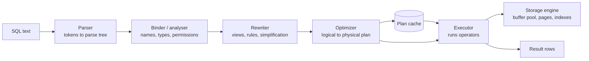
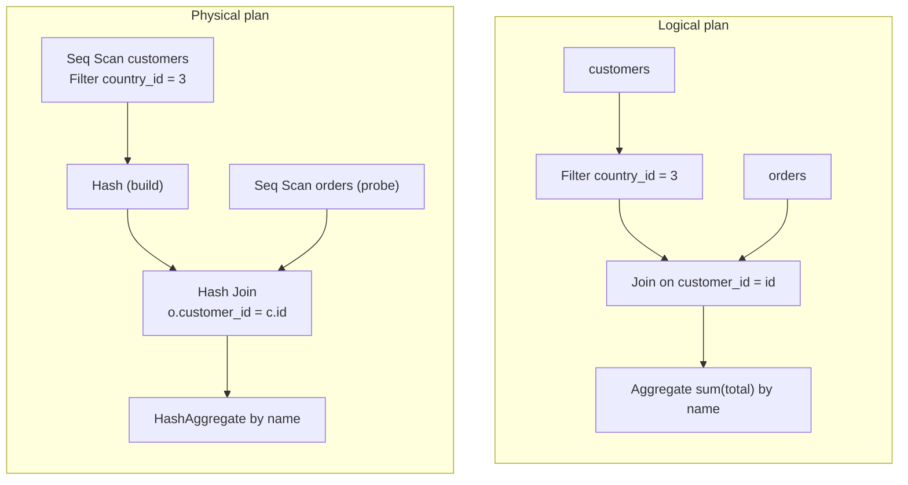
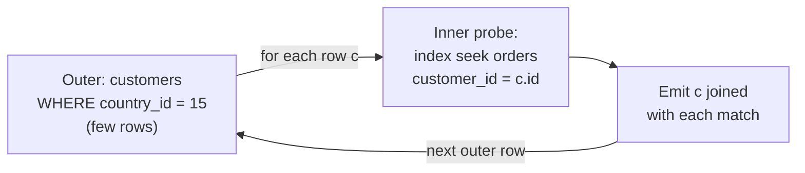
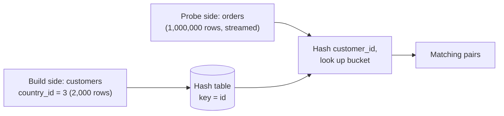
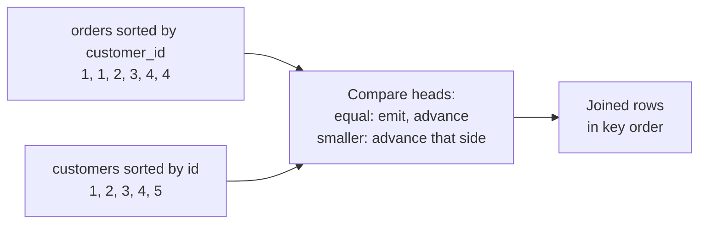
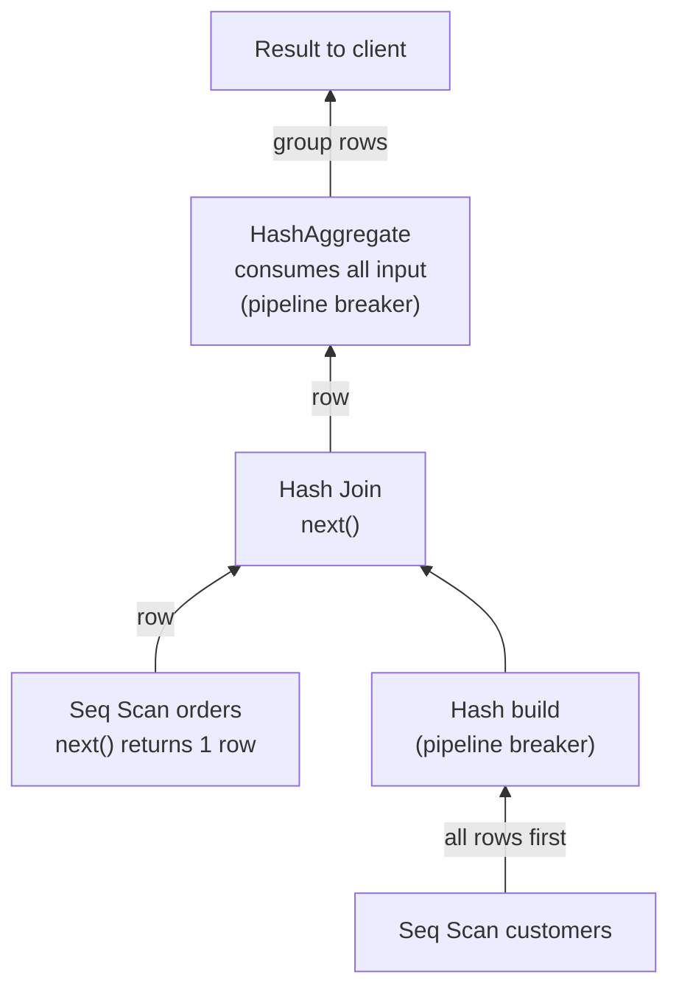
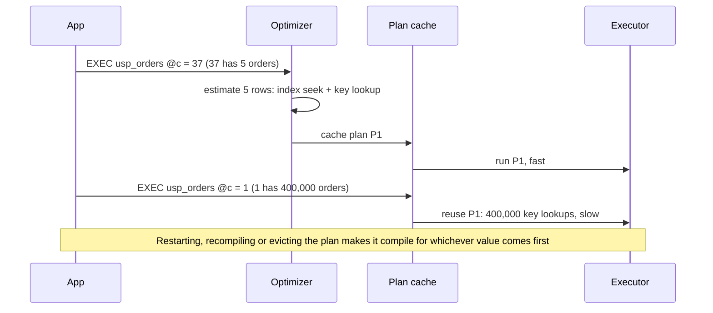

# 8. The query pipeline and the optimizer

> **Level:** L3 senior (starts at L1) | **Part:** I | **Rowlit version:** 1.6.3 | [فارسی](../../fa/part1/08-query-processing.md)
> **Previous:** [7. Indexes in depth](07-indexes.md) | **Next:** [9. Transactions, ACID and isolation](09-transactions-and-isolation.md)
>
> **In one sentence:** SQL says *what* you want; the engine's parser, binder, rewriter and cost-based optimizer turn it
> into a tree of physical operators that says *how* to get it, and reading that tree (the plan) is how you find out why
> a query is slow.
>
> **You will learn:**
> - the five stages every SQL statement passes through, and the difference between a parse tree, a logical plan and a
>   physical plan;
> - how a cost model turns page counts and row estimates into a number, and why cardinality estimates are the weakest link;
> - access paths, the three join algorithms (nested loop, hash, merge) and how the join order is searched;
> - query rewrites such as subquery unnesting, predicate push-down and projection pruning;
> - the Volcano iterator model, vectorised and compiled execution, parallel plans, memory grants and spills;
> - plan caching, prepared statements, parameter sniffing, bind peeking, generic plans, hints and plan guides;
> - how to read `EXPLAIN` output in PostgreSQL, SQL Server, Oracle, MySQL/MariaDB, SQLite, ClickHouse, Snowflake (and
>   why Cassandra has none).
>
> **Prerequisites:** [6. Storage internals](06-storage-internals.md), [7. Indexes in depth](07-indexes.md),
> [3. SQL I](03-sql-basics.md) and [4. SQL II](04-sql-advanced.md) (joins, subqueries).

## 1. The idea (beginner)

SQL is *declarative*: you describe the result (`the total spent by each customer from Iran`) and not the steps. The
database must work the steps out. Is it faster to read all orders and keep the Iranian ones, or to find the Iranian
customers first and then look up their orders through an index? Should it sort the rows or build a hash table? For a
query that joins five tables there are thousands of possible step sequences, and the fastest can be a million times
faster than the slowest.

The component that chooses is the [optimizer](../glossary.md#optimizer). It guesses how many rows each step will
produce (from statistics, [chapter 7](07-indexes.md#statistics-and-histograms)), estimates the cost of each candidate
plan, and picks the cheapest. The result is a [query plan](../glossary.md#explain): a tree of operators such as "scan
this table", "seek this index", "hash join these two inputs". Every engine can show you that tree with some form of
`EXPLAIN`. Learning to read it is the most useful diagnostic skill in this book: when a query is slow, the plan tells you
where the time goes and usually why.

## 2. How it works (practitioner)

### 2.1 The pipeline: parse, bind, rewrite, optimise, execute

**Figure 8.1 — The life of one SQL statement.**



1. **[Parser](../glossary.md#parser).** Splits the text into tokens and checks the grammar, producing a
   [parse tree](../glossary.md#parse-tree). Syntax errors come from here, before the database looks at any table.
   PostgreSQL's grammar is a Bison file (`gram.y`); SQLite uses its own Lemon parser generator; SQL Server's parser and
   Rowlit's T-SQL diagnostics both work on the same language rules (Rowlit uses Microsoft's ScriptDom library on the
   client side; [Part II chapter 11](../part2/11-intellisense.md)).
2. **[Binder / analyser](../glossary.md#binder).** Resolves every name against the catalog (which `orders`? which
   schema, which column, which overload of `fn_tax`?), derives data types, checks permissions, expands `*`. "Invalid
   column name" and "relation does not exist" come from here. SQL Server calls this step the *algebrizer*.
3. **[Rewriter](../glossary.md#rewriter).** Applies transformations that are always valid: expands views into their
   definitions, applies PostgreSQL rules and row-level security policies, folds constants (`WHERE 1 = 1 AND x > 2 + 3`
   becomes `x > 5`), normalises predicates. Some engines merge this with optimisation.
4. **[Optimizer](../glossary.md#optimizer).** Turns the [logical plan](../glossary.md#logical-plan) (relational algebra:
   join, filter, project, aggregate) into the cheapest [physical plan](../glossary.md#physical-plan) it can find (hash
   join vs nested loop, index seek vs scan, sort vs hash aggregate, the join order). This is the expensive stage, which is
   why engines cache its result ([section 2.9](#parameter-sniffing)).
5. **Executor.** Runs the physical operators, pulling pages through the buffer pool ([chapter 6](06-storage-internals.md))
   and streaming result rows to the client.

The difference between a logical and a physical plan is the difference between *what* and *how*:

**Figure 8.2 — One shop query as a logical plan (left) and as one possible physical plan (right).**

```sql
SELECT c.name, sum(o.total)
FROM customers c JOIN orders o ON o.customer_id = c.id
WHERE c.country_id = 3
GROUP BY c.name;
```



The logical plan does not say how the join is done or in which order the inputs are read; the physical plan does, and
there are many physical plans for one logical plan. Plans are drawn bottom-up: data flows from the leaves (table and index
access) to the root (the result).

<a id="cost-model"></a>

### 2.2 The cost model

A [cost-based optimizer](../glossary.md#cost-based-optimizer) gives every candidate plan a number and picks the lowest.
The number is not seconds; it is an abstract unit built from a [cost model](../glossary.md#cost-model): estimated page
reads (sequential and random) and estimated CPU work per row, both multiplied by estimated row counts. Older
*rule-based* optimizers (Oracle's RBO, desupported in 10g; early MySQL) ranked access paths by fixed rules ("an index
is always better than a scan"); every engine in this book is cost-based now, though MySQL and SQLite still use
heuristics more than the big three.

PostgreSQL's cost model is fully documented and the easiest to compute by hand. Its main constants (defaults in
PostgreSQL 17):

| Setting | Default | Meaning |
|---|---|---|
| `seq_page_cost` | 1.0 | read one page as part of a sequential scan |
| `random_page_cost` | 4.0 | read one page at a random position (often set to about 1.1 on SSDs) |
| `cpu_tuple_cost` | 0.01 | process one row |
| `cpu_index_tuple_cost` | 0.005 | process one index entry |
| `cpu_operator_cost` | 0.0025 | evaluate one operator or function call (for example one `=` in a filter) |
| `effective_cache_size` | 4 GB | how much of the data the planner may assume is cached (OS + shared buffers); affects index cost |
| `parallel_setup_cost` / `parallel_tuple_cost` | 1000 / 0.1 | starting workers, passing a row from a worker to the leader |

Worked example, using the lab table of [chapter 7](07-indexes.md#covering-indexes) (1,000,000 rows in 8,334 pages): a
sequential scan with one filter costs

`8,334 × 1.0 (pages) + 1,000,000 × 0.01 (rows) + 1,000,000 × 0.0025 (one "=" per row) = 20,834`

and PostgreSQL prints it as `cost=0.00..20834.00`. The two numbers are the **startup cost** (before the first row can be
returned; 0 for a scan, the whole input for a sort) and the **total cost** (all rows). The startup cost is what makes
`LIMIT` plans different: a plan that returns the first row quickly can win even if its total is higher.

Other engines use the same idea with less public detail. SQL Server's costs are in a unit historically calibrated to
"seconds on one 1990s machine" and are shown as *Estimated Subtree Cost*; Oracle's `Cost` column is expressed in units of
single-block reads, combining I/O and CPU (`%CPU` shows the CPU share); MySQL shows `query_cost` in `EXPLAIN FORMAT=JSON`
and `cost=` in `EXPLAIN ANALYZE`; SQLite's planner uses internal log-scaled estimates that it does not print.

Two warnings. Costs are only comparable **within one plan search**, never between queries or servers. And the cost is
only as good as the row estimates fed into it, which is the next section.

<a id="cardinality-estimation"></a>

### 2.3 Cardinality estimation

The [cardinality estimate](../glossary.md#cardinality-estimate) of an operator is the number of rows the optimizer
expects it to return. Every cost depends on it, and errors **multiply** up the tree. The classic formulas
(System R, 1979, still the basis everywhere):

| Predicate | Estimated selectivity |
|---|---|
| `col = constant` | the constant's frequency from the MCV list or histogram; otherwise 1 / n_distinct |
| `col > constant` | fraction of the histogram above the constant |
| `p1 AND p2` | sel(p1) × sel(p2) (independence) |
| `p1 OR p2` | sel(p1) + sel(p2) − sel(p1) × sel(p2) |
| `NOT p` | 1 − sel(p) |
| `col = ?` (unknown parameter) | 1 / n_distinct (the average) |
| `a.x = b.y` (equi-join) | 1 / max(n_distinct(a.x), n_distinct(b.y)) |
| `col LIKE '%abc%'`, a function, a UDF | a fixed guess (PostgreSQL uses 0.5% for equalities and pattern matches it cannot estimate and 33% for inequalities; SQL Server and Oracle have their own constants) |

Real numbers from Rowlit's SQLite sample show the effect. `sqlite_stat1` says an equality on `Orders.CustomerId`
returns about 6 rows ([chapter 7](07-indexes.md#statistics-and-histograms)). For the skewed customer 1 the true answer is
37. If that estimate feeds a join to `OrderLines` (about 4 lines per order), the optimizer expects 24 rows and gets 148;
one more join level with a similar error and the estimate is off by about 38 times ((37 / 6)²). A plan chosen for 24 rows (nested loop with
index seeks) is excellent; the same plan for 100,000 rows instead of 600 would be a disaster.

Where estimates typically break:

- correlated columns treated as independent (`city = 'Tehran' AND country = 'IR'` underestimated);
- skewed values with only averages known (parameters, missing histograms);
- predicates the statistics cannot see into: functions on columns, `LIKE '%…%'`, expressions across columns,
  JSON fields, table-valued functions, table variables (SQL Server before 2019 assumed one row);
- stale statistics after large loads;
- joins of joins, where each level's error compounds.

The fix is almost never "use a hint"; it is to give the optimizer better information (fresh statistics, extended or
multi-column statistics, a SARGable predicate, a computed column with statistics) or a query shape that is easier to
estimate. Section 3 covers engines that correct themselves at run time.

### 2.4 Access paths

An [access path](../glossary.md#access-path) is the way an operator reads one table. The menu, using the vocabulary of
[chapter 7](07-indexes.md#reading-a-plan-for-index-use):

| Access path | Best when | PostgreSQL | SQL Server | Oracle |
|---|---|---|---|---|
| [Table scan](../glossary.md#table-scan) | a large fraction of rows, a small table, no usable index | `Seq Scan` | `Table Scan` / `Clustered Index Scan` | `TABLE ACCESS FULL` |
| [Index seek](../glossary.md#index-seek) + row fetch | few rows, a SARGable predicate | `Index Scan` | `Index Seek` + `Key Lookup` | `INDEX RANGE SCAN` + `TABLE ACCESS BY INDEX ROWID` |
| Covering seek / index-only | the index holds every needed column | `Index Only Scan` | `Index Seek` alone | `INDEX RANGE SCAN` alone |
| Full [index scan](../glossary.md#index-scan) | the index is narrower than the table, or its order is needed | `Index Scan` / `Index Only Scan` without a condition | `Index Scan` | `INDEX FULL SCAN` / `FAST FULL SCAN` |
| Bitmap | a medium fraction of rows, or several indexes combined | `Bitmap Index Scan` + `Bitmap Heap Scan` | — | `BITMAP` operations |
| By row address | a known RID / ROWID / ctid | `Tid Scan` | `RID Lookup` | `TABLE ACCESS BY USER ROWID` |

The crossover between "seek + fetch" and "scan" is lower than intuition says. On a heap with random row placement,
fetching a row costs one random page read (4 units in PostgreSQL's default model) while a sequential scan costs about 1
unit per page that holds dozens of rows. [Chapter 6](06-storage-internals.md) (exercise 6) works out that
2% of rows through an index already costs six times a full scan. Correlation and caching move the line, which is why the
planner, not a fixed rule, decides.

### 2.5 Join algorithms

Every engine implements a join with one of three algorithms, plus variants for semi-joins (`EXISTS`, `IN`) and
anti-joins (`NOT EXISTS`, `NOT IN`).

<a id="nested-loop-join"></a>

**[Nested loop join](../glossary.md#nested-loop-join).** For each row of the *outer* input, find the matching rows of
the *inner* input. With an index on the inner join column, each probe is a seek: an *index nested loop*. Cost ≈ outer
rows × cost of one inner probe. Unbeatable when the outer side is small; terrible when it is large and the inner side
has no index.

**Figure 8.3 — Nested loop join: one inner probe per outer row.**



Real SQLite output on the sample (SQLite joins only with nested loops; the first line is the outer loop):

```sql
EXPLAIN QUERY PLAN
SELECT c.LastName, sum(o.Total)
FROM Customers c JOIN Orders o ON o.CustomerId = c.Id
WHERE c.CountryId = 15 GROUP BY c.LastName;
-- SCAN c USING INDEX IX_Customers_LastName
-- SEARCH o USING INDEX IX_Orders_CustomerId (CustomerId=?)
```

Note the outer scan uses `IX_Customers_LastName`: reading customers in last-name order makes the `GROUP BY c.LastName`
free (no temporary B-tree), a decision driven by an *interesting order*. When no index exists for the inner side, SQLite
builds a temporary *automatic index* for the duration of the query, and since 3.38 can add a Bloom filter to skip
probes that cannot match.

<a id="hash-join"></a>

**[Hash join](../glossary.md#hash-join).** Read the smaller input (the [build side](../glossary.md#build-side)) into an
in-memory hash table keyed on the join column; then stream the other input (the [probe side](../glossary.md#probe-side))
and look up each row in the hash table. Cost ≈ build rows + probe rows, nearly linear. Works only for equality joins,
needs memory for the build side, and returns nothing until the build is complete (a *blocking* operator for its build
input). If the build side does not fit in memory, both inputs are partitioned by hash into batches written to disk and
joined batch by batch (*grace* / *hybrid hash join*): the plan shows `Batches: 8` in PostgreSQL, a *hash warning /
spill* in SQL Server, `TempSpc` in Oracle.

**Figure 8.4 — Hash join: build once, probe many times.**



**[Merge join](../glossary.md#merge-join).** Read both inputs sorted on the join key and walk them together like a
zipper. Cost ≈ both inputs + sorting, if they are not already sorted (an index or a clustered key can provide the
order). Good for large inputs that are already ordered, for range or inequality joins in some engines, and when the
result must be sorted on the key anyway.

**Figure 8.5 — Merge join: two sorted inputs advanced in step.**



| | Nested loop | Hash join | Merge join |
|---|---|---|---|
| Join condition | any | equality only | equality (some engines also ranges) |
| Needs | an index on the inner side to be fast | memory for the build side | sorted inputs (or a sort) |
| Cost grows with | outer × inner probe | build + probe | sort + both inputs |
| First row arrives | immediately | after the build | after sorting (or immediately if pre-sorted) |
| Typical use | OLTP: few outer rows | reporting, large unsorted inputs | large pre-sorted inputs, `FULL OUTER JOIN` |
| PostgreSQL / SQL Server / Oracle | yes / yes / yes | yes / yes / yes | yes / yes / yes |
| MySQL 8.0.18+ / MariaDB 11 | yes / yes | yes (replaced block nested loop in 8.0.20) / block hash join (`join_cache_level`) | no / no |
| SQLite | yes (only algorithm) | no (automatic indexes instead) | no |
| ClickHouse | — | default (right-hand table in memory) | `full_sorting_merge`, `partial_merge` |

SQL Server 2017+ also has an **adaptive join** (it needs batch mode, which SQL Server 2019 extended to row-store tables): the plan contains both a hash join and
a nested loop, and picks one at run time after counting the build-side rows against a threshold.

### 2.6 Join order

For *n* tables there are *n!* left-deep orders and many more bushy shapes; for 10 tables, 3.6 million left-deep orders
before choosing algorithms. Optimizers search this space cleverly:

- **Dynamic programming** (Selinger et al., System R): find the best plan for every subset of 2 tables, then 3, building
  on the best smaller plans, keeping extra plans that deliver a useful sort order (*[interesting orders](../glossary.md#interesting-order)*).
  PostgreSQL does this exhaustively up to `geqo_threshold` = 12 relations, then switches to a genetic algorithm (GEQO).
  `join_collapse_limit` and `from_collapse_limit` (both 8) stop it from reordering explicit `JOIN` lists beyond 8 items.
- **Transformation-based search (Cascades / Volcano optimizer generator)**: SQL Server (and CockroachDB, Greenplum's
  Orca) keep a *memo* of equivalent expressions and apply rules until a time budget runs out. SQL Server searches in
  phases (trivial plan → search 0 → search 1 → search 2) and stops early when the plan is cheap enough; the plan's
  `Reason For Early Termination Of Statement Optimization` says "Good Enough Plan Found" or "Time Out".
- **Greedy / heuristic search**: MySQL's optimizer explores join orders depth-first with pruning
  (`optimizer_search_depth` = 62, `optimizer_prune_level` = 1); SQLite's "next generation query planner" keeps the N best
  partial paths at each step.

[Left-deep trees](../glossary.md#left-deep-tree) (each join has a base table as its inner input) pipeline well with
nested loops and keep the search small; [bushy trees](../glossary.md#bushy-tree) (joins of joins) can be better for
star schemas and parallel hash joins. You influence the order mainly through good statistics; hints are the last
resort (section 2.9).

<a id="predicate-push-down"></a>

### 2.7 Query rewrites: push-down, pruning, unnesting

Before and during the search, optimizers apply rewrites that are always (or usually) beneficial:

- **[Predicate push-down](../glossary.md#predicate-push-down).** Apply a filter as early (as low in the tree) as
  possible: below joins, into views and derived tables, into the scan itself, and across the network to a remote source.
  Fewer rows flow up, so every later operator is cheaper. `WHERE c.country_id = 3` in Figure 8.2 runs inside the scan of
  `customers`, not after the join.
- **[Projection pruning](../glossary.md#projection-pruning).** Read and carry only the columns that are used. In a row
  store it shrinks intermediate rows (smaller hash tables and sorts); in a column store it is the main saving, because
  unread columns are never touched on disk.
- **View merging and subquery unnesting.** A view or derived table is merged into the outer query so its tables can be
  joined in any order; `IN (subquery)` and `EXISTS` become [semi-joins](../glossary.md#semi-join), `NOT EXISTS` becomes
  an [anti-join](../glossary.md#anti-join), and a correlated scalar subquery may become a join plus aggregate. Real
  SQLite output shows both styles:

  ```sql
  EXPLAIN QUERY PLAN SELECT c.Id, (SELECT count(*) FROM Orders o WHERE o.CustomerId = c.Id) AS n FROM Customers c;
  -- SCAN c USING COVERING INDEX sqlite_autoindex_Customers_1
  -- CORRELATED SCALAR SUBQUERY 1
  --   SEARCH o USING COVERING INDEX IX_Orders_CustomerId (CustomerId=?)
  EXPLAIN QUERY PLAN SELECT * FROM Customers c
  WHERE EXISTS (SELECT 1 FROM Orders o WHERE o.CustomerId = c.Id AND o.Status = 'new');
  -- SCAN c
  -- SEARCH o EXISTS USING INDEX IX_Orders_CustomerId (CustomerId=?)
  ```

  SQLite keeps the correlated subquery and runs it once per customer through a covering index (fine here); PostgreSQL,
  SQL Server and Oracle would typically turn the second query into a hash or nested-loop *semi-join*.
- **Join elimination.** A `LEFT JOIN` to a table whose columns are not used, on a unique key, can be removed (PostgreSQL,
  SQL Server, Oracle). Trusted foreign keys allow the same for inner joins in SQL Server and Oracle.
- **OR expansion, constant folding, transitive predicates** (`a.x = b.x AND a.x = 5` implies `b.x = 5`, which can now
  use an index on `b`), **partition pruning** ([chapter 12](12-backup-replication-ha.md)).

These are the same two ideas Rowlit's linked databases use when they query several servers at once: push the
predicates and the column list down to each source, and fetch only what the local DuckDB engine needs. The per-dialect
rule for which predicates a source may evaluate is `PushdownSql.Accept`
(`engine/src/DbStudio.Federation/Pushdown/PushdownSql.cs:30-40`); see [Part II chapter 16](../part2/16-linked-databases-federation.md).

### 2.8 Execution models

<a id="volcano-model"></a>

**The Volcano (iterator) model.** Most row stores execute a plan as a tree of operators that each implement
`open()`, `next()` and `close()` (Graefe, 1994). The root asks its child for the next row, which asks its child, and so
on down to a scan: rows are *pulled* up one at a time. It is simple and pipelines naturally: a `LIMIT 10` on top of a
scan stops the scan after ten rows.

**Figure 8.6 — The Volcano model pulls one row at a time; a hash build is a pipeline breaker.**



Operators that must consume their whole input before producing output (sort, hash build, hash aggregate) are
[pipeline breakers](../glossary.md#pipeline-breaker); everything between two breakers runs as one pipeline. They are
also where memory is needed and where spills happen (section 2.10).

<a id="vectorised-execution"></a>

**Vectorised execution.** Calling `next()` per row costs a function call and branch mispredictions per row, which
dominates when data is in memory. [Vectorised](../glossary.md#vectorised-execution) engines pass *batches* of values
(column vectors of about a thousand values) between operators and run tight loops over them that the CPU can pipeline
and SIMD-accelerate (MonetDB/X100, 2005). ClickHouse, DuckDB, Snowflake and SQL Server's *batch mode* (columnstore, and
since 2019 also on row store) work this way; ClickHouse's `EXPLAIN PIPELINE` shows the processors that pass blocks.

**Compiled execution.** Another way to remove per-row overhead is to compile the plan into machine code. PostgreSQL
JIT-compiles expressions and tuple deforming with LLVM when the plan's total cost exceeds `jit_above_cost` (100,000);
the plan then shows a `JIT:` section. SQL Server compiles natively only for memory-optimized tables (natively compiled
procedures).

<a id="sqlite-bytecode"></a>

**SQLite's bytecode.** SQLite compiles every statement into a program for its virtual machine (VDBE), and plain
`EXPLAIN` prints it. Real output on the sample database for `SELECT Id, Total FROM Orders WHERE CustomerId = 42` with only
`IX_Orders_CustomerId` (trimmed: register columns omitted):

```text
addr  opcode        p1  p2  p3  p4
0     Init          0   12  0
1     OpenRead      0   9   0   6          -- cursor 0: the Orders table B-tree (root page 9)
2     OpenRead      1   14  0   k(2,,)     -- cursor 1: the index IX_Orders_CustomerId
3     Integer       42  1   0              -- r1 = 42
4     SeekGE        1   11  1   1          -- position the index cursor at the first key >= 42
5     IdxGT         1   11  1   1          -- stop when the index key > 42
6     DeferredSeek  1   0   0              -- move the table cursor to this entry's rowid (the lookup)
7     IdxRowid      1   2   0              -- Id = the rowid stored in the index entry
8     Column        0   5   3              -- Total read from the table row
9     ResultRow     2   2   0
10    Next          1   5   1              -- next index entry, loop to 5
11    Halt          0   0   0
```

With the covering index `IX_Orders_Customer_Total (CustomerId, Total)` the program shrinks to one cursor: no table
`OpenRead`, no `DeferredSeek`, and `Column 1 1 3` reads `Total` from the index entry itself. This is the clearest view
you will get of the difference between a lookup and a covered read ([chapter 7](07-indexes.md#covering-indexes)).

**Parallel query.** PostgreSQL, SQL Server, Oracle and the analytic engines split a scan among worker processes or
threads and combine their results with an exchange operator: PostgreSQL `Gather` / `Gather Merge` (`Workers Planned:
2`, controlled by `max_parallel_workers_per_gather`), SQL Server `Parallelism (Gather Streams / Repartition Streams)`
(`MAXDOP`, cost threshold for parallelism), Oracle `PX COORDINATOR` (`PARALLEL` hint / table degree). Parallelism makes
one query faster at the price of more total CPU; on a busy OLTP server it is often limited on purpose.

<a id="parameter-sniffing"></a>

### 2.9 Plan caching, parameters and parameter sniffing

Optimising a complex query can take milliseconds to seconds, so engines reuse plans. A
[plan cache](../glossary.md#plan-cache) keeps compiled plans keyed by statement text (and settings). A
[prepared statement](../glossary.md#prepared-statement) with parameters (`WHERE customer_id = @c`, `= $1`, `= :c`, `= ?`)
lets one plan serve every value. That saves compile time and protects against SQL injection
([chapter 14](14-security.md)), but it raises a question: **which value is the plan optimised for?**

<a id="parameter-sniffing-sequence"></a>

**[Parameter sniffing](../glossary.md#parameter-sniffing) (SQL Server).** The first execution compiles the plan using
the actual parameter values it sees ("sniffs"), and the plan is cached and reused for every later value.

**Figure 8.7 — Parameter sniffing: a plan compiled for a rare value is reused for a common one.**



The symptom is "the same procedure is sometimes fast and sometimes slow", or "it was fast until the plan was evicted".
Fixes, from most targeted to most general:

| Fix | What it does | Price |
|---|---|---|
| `OPTION (RECOMPILE)` on the statement | compile for each execution's values | compile CPU every time |
| `OPTION (OPTIMIZE FOR (@c = 1))` | always compile for a chosen value | good for the common case only |
| `OPTION (OPTIMIZE FOR UNKNOWN)` / local variables | compile for the average (density) | an average plan, never the best |
| Separate code paths (two procedures, dynamic SQL for the big customers) | different plans for different shapes | more code |
| Query Store plan forcing ([chapter 13](13-performance-tuning.md)) | pin a known good plan | must be maintained |
| SQL Server 2022 *Parameter Sensitive Plan* optimization (compatibility level 160) | caches up to three plan variants per statement by parameter range | automatic, only for detected skew |

**Other engines, same problem:**

- **PostgreSQL** prepares a statement once per session. With `plan_cache_mode = auto` (default), the first five
  executions get *custom plans* planned with the actual values; after that PostgreSQL builds a
  [generic plan](../glossary.md#generic-plan) (planned without values) and uses it if its estimated cost is not
  noticeably worse than the average custom plan. `force_custom_plan` and `force_generic_plan` override the choice, and
  `EXPLAIN (GENERIC_PLAN)` (16+) shows the generic plan for a statement with `$1` placeholders. Drivers that use the
  extended protocol prepare statements for you (Npgsql only when automatic preparation, `Max Auto Prepare`, is switched on).
- **Oracle** has a shared, instance-wide cursor cache. [Bind peeking](../glossary.md#bind-peeking) (9i) looks at the
  bind values on the hard parse, with the same risk as sniffing; *adaptive cursor sharing* (11g) notices when a
  bind-sensitive cursor performs badly for some values and creates additional child cursors. `CURSOR_SHARING = FORCE`
  replaces literals with binds for applications that do not use them (fewer hard parses, more sniffing risk).
- **MySQL / MariaDB** have no shared plan cache: a server-side prepared statement belongs to one session, and the
  optimizer still runs per execution for most of the work. (The old query *result* cache was removed in MySQL 8.0.)
- **SQLite** caches prepared statements per connection inside the driver; the plan is fixed at prepare time unless
  the schema or statistics change (a special case: a newly bound value can trigger a re-prepare when it matters to the plan,
  for example a `LIKE` pattern or, with `SQLITE_ENABLE_STAT4`, a value compared against the samples).

<a id="hints"></a>

**Hints and plan guides.** When the optimizer is wrong and better statistics cannot fix it, a
[hint](../glossary.md#hint) overrides one decision:

| Engine | Syntax | Examples |
|---|---|---|
| SQL Server | `OPTION (…)` query hints, `WITH (…)` table hints, join hints | `OPTION (HASH JOIN, MAXDOP 1)`, `WITH (INDEX (IX_Orders_CustomerId), FORCESEEK)`, `INNER LOOP JOIN` |
| Oracle | comment hints `/*+ … */` | `/*+ INDEX(o ix_orders_customer) LEADING(c o) USE_NL(o) */`, `/*+ FULL(o) PARALLEL(4) */` |
| MySQL 8 | optimizer hints `/*+ … */`, index hints | `/*+ JOIN_ORDER(c, o) */`, `/*+ NO_HASH_JOIN(o) */`, `FROM orders USE INDEX (ix_orders_customer)` |
| PostgreSQL | none in core; planner switches per session; extension `pg_hint_plan` | `SET enable_seqscan = off;` (diagnosis only) |
| SQLite | `INDEXED BY`, `NOT INDEXED`, `+col` to disable an index, `likelihood()` | `FROM Orders INDEXED BY IX_Orders_CustomerId` |
| ClickHouse | query settings | `SETTINGS join_algorithm = 'grace_hash'` |
| Snowflake | essentially none | — |

A hint freezes today's choice; when the data changes it can become the slow plan. *Plan guides* (SQL Server), *SQL plan
baselines* and *SQL profiles* (Oracle) and *Query Store forcing* attach hints or whole plans to a query **without
changing its text**, and are easier to review and remove. Use `SET enable_* = off` in PostgreSQL only to learn what
the alternative plan would cost, never in production code.

### 2.10 Memory, grants and spills

Sorts, hash tables and hash aggregates need working memory. Each engine budgets it differently:

| Engine | Setting | Unit | When it is too small |
|---|---|---|---|
| PostgreSQL | `work_mem` (4 MB default) × `hash_mem_multiplier` (2.0) for hashes | per operator, per worker | `Sort Method: external merge  Disk: …kB`, `Batches: n` > 1 in `Hash`, `Disk Usage` in `HashAggregate` |
| SQL Server | memory grant computed from estimates, reserved before the query runs | per query | sort / hash *spill* warnings to tempdb; `RESOURCE_SEMAPHORE` waits when grants queue |
| Oracle | PGA, `pga_aggregate_target` / `pga_aggregate_limit` | automatic per work area | one-pass / multi-pass work areas, `TempSpc` in plans |
| MySQL | `sort_buffer_size`, `join_buffer_size`, `tmp_table_size` | per operation | on-disk temporary tables, sort merge passes |
| ClickHouse | `max_memory_usage`, `max_bytes_before_external_group_by` / `_sort` | per query | spill to disk if enabled, otherwise the query fails with `MEMORY_LIMIT_EXCEEDED` |
| Snowflake | warehouse size | per warehouse | "Bytes spilled to local storage", then "remote storage" in the query profile |

A [spill](../glossary.md#spill) writes intermediate data to disk and reads it back, often making an operator ten times
slower. Spills are usually caused by **underestimated rows** (the grant or the hash table was sized for fewer rows), so
check the estimate before raising memory. A SQL Server [memory grant](../glossary.md#memory-grant) that is too large
wastes memory and makes other queries wait; SQL Server 2017+ adjusts grants for repeated queries (*memory grant
feedback*).

<a id="reading-explain"></a>

### 2.11 Reading EXPLAIN, engine by engine

[`EXPLAIN`](../glossary.md#explain) shows the plan. Two kinds exist everywhere: the
[estimated plan](../glossary.md#estimated-plan) (the optimizer's choice and estimates; nothing runs) and the
[actual plan](../glossary.md#actual-plan) (the statement runs and every [operator](../glossary.md#operator) reports
real row counts, time and I/O). The actual plan is the one to diagnose with, because the most important single check is:
**where do estimated and actual rows diverge?** The lowest operator where they diverge by an order of magnitude is
usually the root cause; everything above it was planned for the wrong numbers.

A reading procedure that works in every engine:

1. Find the operators with the most time or I/O (the hot spots), not the highest *estimated* cost percentage.
2. At each hot spot compare estimated and actual rows. A large gap means a statistics or estimation problem.
3. Check access paths: scans of large tables where few rows survive (`Rows Removed by Filter` large), lookups repeated
   thousands of times, predicates applied as residual filters instead of seeks.
4. Check joins: nested loops with a large outer side, hash joins that spill, sorts that spill.
5. Check warnings: implicit conversions, missing statistics, missing-index hints, excessive grants.
6. Change one thing, re-run the actual plan, compare.

Beware: an actual plan **executes the statement**. For `UPDATE`, `DELETE` or `INSERT`, wrap it in a transaction and roll
back (`BEGIN; EXPLAIN ANALYZE UPDATE …; ROLLBACK;`), or use the estimated plan.

#### PostgreSQL

```sql
-- PostgreSQL 17: estimated plan, then actual plan with buffer counts
EXPLAIN SELECT …;
EXPLAIN (ANALYZE, BUFFERS) SELECT …;
EXPLAIN (ANALYZE, BUFFERS, VERBOSE, SETTINGS, FORMAT JSON) SELECT …;   -- machine-readable, all details
```

Each node line reads `Node Type on table (cost=startup..total rows=estimate width=bytes) (actual time=first..last
rows=actual loops=n)`. Times and rows are **per loop**: a node with `rows=10 loops=2000` produced 20,000 rows in total,
and its time must be multiplied by `loops` too. `Buffers: shared hit=… read=… dirtied=…` counts 8 KB pages found in
shared buffers, read from the OS, and modified. Options worth knowing in 17: `SETTINGS` (non-default planner settings),
`WAL` (WAL generated), `SERIALIZE` (cost of converting output to wire format, 17+), `MEMORY` (planner memory, 17+),
`GENERIC_PLAN` (16+).

A worked join on the lab tables (illustrative output; build `lab.orders` as in [chapter 7](07-indexes.md#covering-indexes),
then add customers):

```sql
CREATE TABLE lab.customers AS
SELECT g AS id, 'customer ' || g AS name, g % 50 AS country_id FROM generate_series(1, 100000) AS g;
ANALYZE lab.customers;
SET max_parallel_workers_per_gather = 0;      -- keep the plan small for reading
EXPLAIN (ANALYZE, BUFFERS)
SELECT c.name, sum(o.total)
FROM lab.customers c JOIN lab.orders o ON o.customer_id = c.id
WHERE c.country_id = 3
GROUP BY c.name;
```

```text
HashAggregate  (cost=23103.00..23123.00 rows=2000 width=46) (actual time=96.512..96.903 rows=2000 loops=1)
  Group Key: c.name
  Batches: 1  Memory Usage: 369kB
  Buffers: shared hit=9103
  ->  Hash Join  (cost=2044.00..23053.00 rows=20000 width=19) (actual time=8.921..91.974 rows=20000 loops=1)
        Hash Cond: (o.customer_id = c.id)
        Buffers: shared hit=9103
        ->  Seq Scan on orders o  (cost=0.00..18334.00 rows=1000000 width=10) (actual time=0.010..38.122 rows=1000000 loops=1)
              Buffers: shared hit=8334
        ->  Hash  (cost=2019.00..2019.00 rows=2000 width=17) (actual time=8.811..8.812 rows=2000 loops=1)
              Buckets: 2048  Batches: 1  Memory Usage: 110kB
              Buffers: shared hit=769
              ->  Seq Scan on customers c  (cost=0.00..2019.00 rows=2000 width=17) (actual time=0.012..8.436 rows=2000 loops=1)
                    Filter: (country_id = 3)
                    Rows Removed by Filter: 98000
                    Buffers: shared hit=769
Planning Time: 0.231 ms
Execution Time: 97.104 ms
```

Reading it: the 2,000 customers of country 3 are the build side (`Hash`, 110 kB, one batch: no spill); all one million
orders are the probe side; estimates match actuals at every level (2,000, 20,000, 2,000), so the plan is the right shape
for this data. The cost is dominated by scanning all 8,334 order pages to keep 2% of them. The only way to make this
query much faster is a different access path for `orders`: with `ix_lab_orders_customer` and a selective enough country,
the planner would switch to a nested loop with 2,000 index probes, and you can compare the two by running the query
once with `SET enable_hashjoin = off` (diagnosis only). Run `DROP SCHEMA lab CASCADE;` when you are done.

Trouble signs in PostgreSQL plans: `rows=1` estimated against thousands actual (often a correlated predicate or a
function), `Rows Removed by Filter` close to the input size on a big table, `Sort Method: external merge`, `Batches` > 1,
high `loops` on an inner `Index Scan` under a `Nested Loop`, `Heap Fetches` close to `rows` on an `Index Only Scan`
(vacuum the table), `JIT` time larger than execution time on short queries.

#### SQL Server

```sql
-- SQL Server 2022: I/O and time counters, then the actual plan as XML
SET STATISTICS IO, TIME ON;
SET STATISTICS XML ON;          -- actual plan (the statement runs)
SELECT Id, Total, OrderDate FROM dbo.Orders WHERE CustomerId = 4;
SET STATISTICS XML OFF;
-- estimated plan only (nothing runs): SET SHOWPLAN_XML ON; … ; SET SHOWPLAN_XML OFF;
```

Illustrative messages output:

```text
Table 'Orders'. Scan count 1, logical reads 4, physical reads 0, read-ahead reads 0, lob logical reads 0.
 SQL Server Execution Times:
   CPU time = 0 ms,  elapsed time = 0 ms.
```

The graphical plan is read **right to left, top to bottom**: data flows from the right-most operators to `SELECT` on the
left. For this query on a large table the shape is `Index Seek (NonClustered) [IX_Orders_CustomerId]` → `Nested Loops
(Inner Join)` ← `Key Lookup (Clustered) [PK_Orders]` (because `OrderDate` is not in the index). Properties to look at on
each operator: *Actual Number of Rows* vs *Estimated Number of Rows*, *Number of Executions* (a key lookup executed
40,000 times is the problem), *Estimated Number of Rows to be Read* vs rows returned (a residual predicate), *Seek
Predicates* vs *Predicate*, and the warning triangle: `CONVERT_IMPLICIT`, *Operator used tempdb to spill data*,
*Columns With No Statistics*, *No Join Predicate*, *Excessive Grant*. The green *Missing Index* hint is a suggestion
computed for this one query; check it against your existing indexes before creating it. The *Estimated Subtree Cost*
percentages are estimates even in an actual plan.

#### Oracle

```sql
-- Oracle 23: estimated plan
EXPLAIN PLAN FOR SELECT o.id, o.total FROM orders o JOIN customers c ON c.id = o.customer_id WHERE c.country_id = 1;
SELECT * FROM TABLE(DBMS_XPLAN.DISPLAY);
-- actual plan of the last statement run in this session (needs access to V$ views)
SELECT /*+ GATHER_PLAN_STATISTICS */ o.id, o.total FROM orders o JOIN customers c ON c.id = o.customer_id WHERE c.country_id = 1;
SELECT * FROM TABLE(DBMS_XPLAN.DISPLAY_CURSOR(NULL, NULL, 'ALLSTATS LAST'));
```

Illustrative `ALLSTATS LAST` output on the seed (two customers in country 1, four orders between them):

```text
--------------------------------------------------------------------------------------------------------
| Id  | Operation                             | Name               | Starts | E-Rows | A-Rows | Buffers |
--------------------------------------------------------------------------------------------------------
|   0 | SELECT STATEMENT                      |                    |      1 |        |      4 |       9 |
|   1 |  NESTED LOOPS                         |                    |      1 |      4 |      4 |       9 |
|   2 |   NESTED LOOPS                        |                    |      1 |      4 |      4 |       8 |
|*  3 |    TABLE ACCESS FULL                  | CUSTOMERS          |      1 |      2 |      2 |       6 |
|*  4 |    INDEX RANGE SCAN                   | IX_ORDERS_CUSTOMER |      2 |      2 |      4 |       2 |
|   5 |   TABLE ACCESS BY INDEX ROWID         | ORDERS             |      4 |      1 |      4 |       1 |
--------------------------------------------------------------------------------------------------------
Predicate Information (identified by operation id):
   3 - filter("C"."COUNTRY_ID"=1)
   4 - access("O"."CUSTOMER_ID"="C"."ID")
```

Read Oracle plans by indentation: a parent's children are the lines indented one step below it, and the first child
runs first. `Starts` is how often the operation ran (here the index range scan ran once per customer: 2), `E-Rows` is the
estimate **per start** and `A-Rows` the actual **total**, so compare `E-Rows × Starts` with `A-Rows`. The two nested
loops are Oracle 12c+ *nested-loop batching*: the inner loop collects ROWIDs, the outer one fetches table rows in batches.
`access` predicates drive the index seek, `filter` predicates discard rows. `Buffers` are logical reads (consistent gets).

#### MySQL and MariaDB

```sql
-- MySQL 8.4
EXPLAIN SELECT o.id, o.total FROM orders o JOIN customers c ON c.id = o.customer_id WHERE c.country_id = 1;
EXPLAIN FORMAT=TREE SELECT …;          -- the iterator tree, estimates only
EXPLAIN ANALYZE SELECT …;              -- runs the query: estimates and actuals per iterator (8.0.18+)
EXPLAIN FORMAT=JSON SELECT …;          -- cost_info, used_columns, attached_condition
```

Tabular `EXPLAIN` has one row per table access in join order (the first row is the outermost table). The columns to
read: `type` (`const`, `eq_ref` one row by unique key per outer row, `ref` non-unique seek, `range`, `index` full index
scan, `ALL` full table scan), `key` and `key_len` (which index, how many key bytes are used), `rows` (estimated rows
examined per outer row) and `filtered` (percentage left after the conditions), and `Extra` (`Using index` = covering,
`Using where` = residual filter, `Using index condition` = index condition pushdown, `Using temporary`,
`Using filesort`, `Using join buffer (hash join)`). Illustrative `EXPLAIN ANALYZE` output on the seed:

```text
-> Nested loop inner join  (cost=1.40 rows=1) (actual time=0.048..0.061 rows=4 loops=1)
    -> Filter: (c.country_id = 1)  (cost=0.75 rows=1) (actual time=0.031..0.037 rows=2 loops=1)
        -> Table scan on c  (cost=0.75 rows=5) (actual time=0.029..0.034 rows=5 loops=1)
    -> Index lookup on o using ix_orders_customer (customer_id=c.id)  (cost=0.65 rows=1.2) (actual time=0.009..0.011 rows=2 loops=2)
```

As in PostgreSQL, `rows` and times in `actual` are averages per loop. MariaDB uses `ANALYZE FORMAT=JSON SELECT …`
(`r_rows`, `r_filtered`, `r_total_time_ms` next to the estimates) instead of `EXPLAIN ANALYZE`. For "why did it choose
that?", MySQL's `SET optimizer_trace = 'enabled=on'` followed by `SELECT * FROM information_schema.OPTIMIZER_TRACE`
shows every alternative and its cost.

#### SQLite

`EXPLAIN QUERY PLAN` prints one line per loop (real outputs throughout chapters 7 and 8): `SCAN` (full scan), `SEARCH`
(seek, with the constraint in parentheses), `USING COVERING INDEX`, `USING INTEGER PRIMARY KEY`, `USE TEMP B-TREE FOR
ORDER BY / GROUP BY / DISTINCT` (a sort), `CORRELATED SCALAR SUBQUERY`, `MULTI-INDEX OR`, `AUTOMATIC COVERING INDEX`.
Indentation shows nesting; the first loop is the outermost. Plain `EXPLAIN` shows the bytecode (section 2.8). SQLite has
no actual-plan mode with row counts; the `sqlite3` shell's `.scanstats on` (when compiled in) is the closest thing.

#### ClickHouse

```sql
-- ClickHouse 24.8
EXPLAIN SYNTAX SELECT …;                          -- the query after rewrites
EXPLAIN QUERY TREE SELECT …;                      -- the analyzer's resolved tree (24.3+ analyzer)
EXPLAIN PLAN indexes = 1, actions = 1 SELECT …;   -- steps, with parts and granules pruned by each index
EXPLAIN PIPELINE SELECT …;                        -- processors and parallel streams
EXPLAIN ESTIMATE SELECT …;                        -- parts, rows and marks to read per table
```

ClickHouse has no row-level cost model in the classic sense: the plan is mostly determined by the query's shape, and the
big decision is how much data `ReadFromMergeTree` can skip (partition pruning, the primary key, skip indexes; see the
example in [chapter 7](07-indexes.md#clickhouse-sparse-primary-index)). For actual numbers query `system.query_log`
(`read_rows`, `read_bytes`, `memory_usage`, `query_duration_ms`, `ProfileEvents['SelectedMarks']`). For joins, ClickHouse
builds the **right-hand** table of a `JOIN` in memory by default, so put the smaller table on the right (the new analyzer
can reorder simple cases).

#### Snowflake

```sql
-- Snowflake: compiled plan, no warehouse needed
EXPLAIN USING TEXT SELECT …;
EXPLAIN USING JSON SELECT …;
-- after running a query: operator statistics of the last query
SELECT * FROM TABLE(GET_QUERY_OPERATOR_STATS(LAST_QUERY_ID()));
```

`EXPLAIN` shows the operators (`TableScan`, `Filter`, `Join`, `Aggregate`, `Sort`, `Result`) with
`partitionsTotal` and `partitionsAssigned`: the micro-partitions left after pruning. The *Query Profile* in the web UI
(and `GET_QUERY_OPERATOR_STATS`) shows the executed operator tree with the share of time per operator, rows, pruning
statistics ("Partitions scanned" vs "Partitions total"), and "Bytes spilled to local / remote storage". Snowflake offers
almost no hints; the levers are pruning (clustering keys, filters on clustered columns), warehouse size and query shape.

#### Cassandra

Cassandra has no `EXPLAIN`: a CQL query can only be what the primary key allows, so there is nothing to choose. `TRACING
ON` in `cqlsh` records every step across coordinator and replicas (which nodes were asked, SSTables read, tombstones
scanned) with timings.

*In Rowlit:* the Explain command shows these plans in one plan view ([Part II chapter 15](../part2/15-import-export-plans-er.md)).
Each provider's plan reader issues the engine's own command and converts the output to one node model with estimated
and actual rows, cost and predicates (`engine/src/DbStudio.Core/Plans/PlanModels.cs:9-25`):

| Engine | Estimated plan in Rowlit | Actual plan in Rowlit | Source |
|---|---|---|---|
| PostgreSQL | `EXPLAIN (FORMAT JSON, VERBOSE, COSTS)`, `GENERIC_PLAN` for unbound parameters | `EXPLAIN (ANALYZE, BUFFERS, VERBOSE, COSTS, TIMING, FORMAT JSON)`; a read-only query runs twice so its rows are shown | `PgPlanReader.cs:12-24` |
| SQL Server | `SET SHOWPLAN_XML ON` | `SET STATISTICS XML ON` (rows stream normally) | `SqlServerPlanReader.cs:11-15` |
| Oracle | `EXPLAIN PLAN SET STATEMENT_ID = … FOR` + `DBMS_XPLAN.DISPLAY` | `STATISTICS_LEVEL = ALL`, then `DBMS_XPLAN.DISPLAY_CURSOR(…, 'ALLSTATS LAST')` | `OraclePlanReader.cs:12-16` |
| MySQL / MariaDB | `EXPLAIN FORMAT=JSON` | MySQL `EXPLAIN ANALYZE`, MariaDB `ANALYZE FORMAT=JSON` | `MySqlPlanReader.cs:13-17` |
| SQLite | `EXPLAIN QUERY PLAN` | the same tree (SQLite has no runtime statistics) | `SqlitePlanReader.cs:10-11` |
| ClickHouse | `EXPLAIN json = 1, indexes = 1, description = 1` + `EXPLAIN PIPELINE` | the query runs; counters from `system.query_log` | `ChPlanReader.cs:13-17` |
| Snowflake | `EXPLAIN USING JSON` | the query runs; `GET_QUERY_OPERATOR_STATS` | `SnowflakePlanReader.cs:11-17` |
| Cassandra | not supported: the message points to tracing | — | `CassandraModule.cs:27-28`, `CqlSession.cs:37-39` |

(Paths are under `engine/src/DbStudio.Providers.<Name>/Plans/` except the Cassandra and Core files.)

## 3. Deep dive (senior)

> **Deep dive (L3): inside a Cascades optimizer.**
> SQL Server's optimizer (descended from Graefe's Volcano/Cascades work) stores the query in a *memo*: groups of
> logically equivalent expressions. *Exploration rules* add equivalent logical alternatives to a group (join
> commutativity `A⋈B → B⋈A`, associativity, pushing aggregates below joins); *implementation rules* add physical
> alternatives (a logical join becomes hash, merge or nested-loop join). Costing works bottom-up with *required
> properties* (sort order, distribution) passed top-down, so a merge join can ask its children for sorted input and the
> memo remembers the cheapest way to deliver it. Because the full space is too large, the search runs in stages with
> time budgets. Trace flags 8606/8607/8615 (undocumented) dump the trees; you rarely need them, but knowing the memo
> exists explains why tiny query changes can produce unrelated plans: a different starting tree explores a different part
> of the space before the budget runs out.

> **Deep dive (L3): adaptive and feedback-driven optimisation.**
> Engines increasingly correct estimates at run time. SQL Server's *Intelligent Query Processing* family: adaptive joins
> (2017), interleaved execution for multi-statement table-valued functions (2017), memory grant feedback (2017 batch,
> 2019 row, 2022 percentile and persisted), table-variable deferred compilation (2019), and in 2022 cardinality
> estimation feedback, degree-of-parallelism feedback and Parameter Sensitive Plan optimization. Oracle has *adaptive
> plans* (12c: a statistics collector inside the plan switches nested loop to hash join on the first execution),
> *adaptive statistics* (dynamic sampling, SQL plan directives) and automatic SQL plan management. PostgreSQL deliberately
> has none of these in core (beyond choosing between custom and generic plans); its answers are extended statistics,
> `Memoize` nodes (14+) that cache inner-side results of nested loops, and `Incremental Sort` (13+).

> **Deep dive (L3): row goals.**
> `LIMIT`/`TOP n`, `EXISTS`, `IN` and `FAST n` tell the optimizer that only some rows are needed. It then favours plans
> with low startup cost: a nested loop over an index that returns rows in the right order beats a hash join that must
> build first. This is usually right and occasionally catastrophic: if the qualifying rows are rare, "stop after 10" turns
> into "scan almost everything in index order". The symptom is a query with `LIMIT 10` that is slower than without it.
> SQL Server shows `EstimateRowsWithoutRowGoal` in the plan and has `USE HINT ('DISABLE_OPTIMIZER_ROWGOAL')`; in
> PostgreSQL, compare the startup and total costs of the alternatives.

> **Deep dive (L3): hash joins at scale.**
> A *hybrid hash join* keeps the first batch of the build side in memory and writes the other batches to disk, so a
> slightly-too-large build side costs only a little extra I/O. Skew breaks the scheme: if one key holds most build rows,
> its batch never fits, and engines either repartition recursively or fall back to a nested loop for that batch. Bloom
> filters built from the build side and pushed into the probe-side scan (*bitmap filters* in SQL Server, *Bloom
> filters* in Oracle and ClickHouse, *runtime filters* in Snowflake and DuckDB) drop non-matching probe rows before they
> reach the join, often before they are decompressed. In distributed engines (Snowflake, ClickHouse clusters, Oracle
> PX) the join also needs a data movement strategy: *broadcast* the small side to every node, or *shuffle* both sides by
> join key. ClickHouse makes the choice explicit with `GLOBAL JOIN` and the `join_algorithm` setting (`hash`,
> `parallel_hash`, `grace_hash`, `partial_merge`, `full_sorting_merge`, `direct`).

> **Deep dive (L3): why the same query has different plans on two servers.**
> Different statistics (sampled at different times), different settings (`random_page_cost`, `work_mem`, `MAXDOP`,
> cost threshold for parallelism, compatibility level and cardinality estimator version in SQL Server,
> `optimizer_features_enable` in Oracle), different memory and CPU counts (parallel plans), different data volumes
> (the test server has 1% of production), and different cached plans (sniffed with different values). Before comparing
> plans, compare those. PostgreSQL's `EXPLAIN (SETTINGS)` prints the planner settings that differ from the defaults.

## 4. In each engine

| Topic | PostgreSQL 17 | SQL Server 2022 | Oracle 23 | MySQL 8.4 / MariaDB 11 | SQLite 3.4x | ClickHouse 24+ | Snowflake | Cassandra 5 |
|---|---|---|---|---|---|---|---|---|
| Optimizer style | cost-based, DP + GEQO ≥ 12 relations | cost-based Cascades, staged search | cost-based with query transformations, adaptive plans | cost-based, greedy join search; MariaDB 11 new cost model | cost-based N-best paths, nested loops only | rule-driven plan + index analysis | cost-based in cloud services | none (key-driven) |
| Join algorithms | NL, hash, merge, `Memoize` | NL, hash, merge, adaptive | NL (batched), hash, merge | NL (+BKA), hash (8.0.18+); MariaDB NL, block hash | NL (+ automatic index, Bloom filter) | hash variants, merge variants, direct | hash, merge; broadcast / shuffle | no joins |
| Execution | Volcano, JIT, parallel workers | row mode + batch mode, parallel | row source iterators, PX parallel | iterator executor | VDBE bytecode | vectorised pipeline | vectorised, distributed | per-partition reads |
| Plan cache | per session (prepared) | instance-wide plan cache, Query Store | shared cursor cache, SPM baselines | none shared | per connection (prepared statements) | query condition / result caches (optional) | result cache (24 h) | prepared statements per node |
| Parameter handling | custom vs generic plans | sniffing, PSP optimization | bind peeking, adaptive cursor sharing | per execution | at prepare | — | — | — |
| Hints | none in core (`pg_hint_plan`) | query, table and join hints, plan guides | `/*+ */` hints, profiles, baselines | `/*+ */` optimizer hints, index hints | `INDEXED BY`, `likelihood()` | settings | almost none | — |
| Estimated plan | `EXPLAIN` | `SHOWPLAN_XML` | `EXPLAIN PLAN` + `DBMS_XPLAN.DISPLAY` | `EXPLAIN [FORMAT=JSON/TREE]` | `EXPLAIN QUERY PLAN` | `EXPLAIN PLAN` | `EXPLAIN` | — |
| Actual plan | `EXPLAIN ANALYZE` | `STATISTICS XML`, live query stats | `DISPLAY_CURSOR ALLSTATS LAST` | `EXPLAIN ANALYZE` / MariaDB `ANALYZE` | — | `system.query_log` | Query Profile | `TRACING ON` |

## 5. Exercises

1. In PostgreSQL, a table has 50,000 pages and 4,000,000 rows. Compute the cost of `SELECT * FROM t WHERE a = 1` as a
   sequential scan with default constants. If an index scan for the same predicate returns 1,000 rows on 1,000 random
   pages, roughly what is its cost (ignore the index pages and CPU)? At how many matching rows on distinct pages are the
   two equal?
2. A plan shows `Nested Loop (rows=12) (actual rows=480000)` above `Index Scan on orders (rows=3) (actual rows=12000
   loops=40)`. Explain what is wrong, where the error starts and three things you would check.
3. Choose a join algorithm for each case and justify it: (a) 20 customers joined to their orders through an index on
   `orders.customer_id`; (b) a 50-million-row fact table joined to a 10,000-row dimension on an unindexed key; (c) two
   200-million-row tables both clustered on the join key, result needed in key order.
4. A stored procedure in SQL Server is fast for most customers and very slow for the largest one, but only some days.
   Explain the cause, and give two fixes with their trade-offs.
5. Using Rowlit's SQLite sample, write a query whose `EXPLAIN QUERY PLAN` contains `USE TEMP B-TREE FOR ORDER BY`, then
   change only the schema (one `CREATE INDEX`) so that line disappears. Explain why.

## Answers

The answers are collected in [chapter 18](18-exercise-answers.md#chapter-8); they are repeated here so this chapter
stands alone.

<details>
<summary>Show answers</summary>

1. Sequential scan: 50,000 × 1.0 + 4,000,000 × 0.01 + 4,000,000 × 0.0025 = 50,000 + 40,000 + 10,000 = **100,000**.
   Index scan for 1,000 rows on 1,000 random pages: about 1,000 × 4.0 = **4,000** (plus small index and CPU costs).
   Break-even: 100,000 / 4 = **25,000** rows on distinct pages, which is 0.625% of the table. (In reality PostgreSQL's
   index cost model accounts for caching via `effective_cache_size` and for correlation, so the real break-even moves,
   and above a few thousand rows it would usually choose a bitmap heap scan, which reads each page once in page order.)
2. Actual rows in PostgreSQL are per loop: the inner index scan was estimated at 3 rows per loop and returned 12,000
   per loop (40 × 12,000 = 480,000, the nested loop's actual output), a factor of 4,000. The nested loop's estimate (12)
   implies the planner also expected only about 4 outer rows (4 × 3), while 40 arrived: a second, smaller error. The
   decisive error starts at the inner index scan's estimate for `customer_id = outer.id`: the planner thinks a customer
   has 3 orders, these customers have 12,000. Check: (a) `pg_stats` for `orders.customer_id` (n_distinct, MCVs:
   is the skew visible? raise the statistics target); (b) whether the outer side is filtered by a predicate correlated
   with "big customers" (extended statistics, or a rewrite); (c) whether statistics are stale after a load (`ANALYZE`).
   With correct estimates a hash join of the outer side with `orders` would probably be chosen.
3. (a) Index nested loop: 20 seeks on `orders.customer_id`, first rows at once, minimal work. (b) Hash join with the
   10,000-row dimension as the build side (small hash table in memory) and the fact table as a streamed probe side; a
   nested loop would need an index on the dimension key and 50 million probes. (c) Merge join: both inputs are already
   sorted on the key, no sort and no hash table are needed, and the output is in key order for free.
4. Parameter sniffing: the plan is compiled for the parameter value of the first execution after the plan was created
   or evicted. On days when a small customer comes first, the cached plan (index seek + key lookups) is reused for the
   big customer, who needs hundreds of thousands of lookups. Fixes: `OPTION (RECOMPILE)` on the statement (always
   correct plans, compile cost every call); `OPTIMIZE FOR` a typical value or `OPTIMIZE FOR UNKNOWN` (stable, but one
   plan for all); forcing a plan through Query Store (stable, must be reviewed when data changes); a separate procedure
   or branch for the largest customers; on compatibility level 160, Parameter Sensitive Plan optimization may handle it
   automatically.
5. `EXPLAIN QUERY PLAN SELECT * FROM Orders ORDER BY Total DESC LIMIT 10;` shows `SCAN Orders` and `USE TEMP B-TREE FOR
   ORDER BY` (real output, see chapter 7, section 2.2). After `CREATE INDEX IX_Orders_Total ON Orders (Total);`
   the plan becomes `SCAN Orders USING INDEX IX_Orders_Total` with no temporary B-tree (real output): the index delivers rows already
   ordered by `Total` (read backwards for `DESC`), and `LIMIT 10` stops after ten index entries and ten row fetches.

</details>

## Related chapters

- [6. Storage internals](06-storage-internals.md): pages, sequential vs random I/O, the buffer pool.
- [7. Indexes in depth](07-indexes.md): access paths, statistics and histograms, reading a plan for index use.
- [9. Transactions](09-transactions-and-isolation.md) and [10. Concurrency](10-concurrency-locking-mvcc.md): what the
  executor must respect while it runs.
- [12. Backup, replication, partitioning](12-backup-replication-ha.md): partition pruning.
- [13. Performance tuning](13-performance-tuning.md): measuring first, Query Store, `pg_stat_statements`, anti-patterns.
- [15. OLTP vs OLAP](15-oltp-vs-olap-columnar.md): vectorised and columnar execution in depth.
- Part II: [15. Import, export, plans and ER diagrams](../part2/15-import-export-plans-er.md) (the plan view),
  [16. Linked databases and federation](../part2/16-linked-databases-federation.md) (push-down to sources),
  [9. Relational providers](../part2/09-relational-providers.md) (plan readers per provider).

## Glossary terms introduced here

[parser](../glossary.md#parser), [parse tree](../glossary.md#parse-tree), [binder / analyser](../glossary.md#binder),
[rewriter](../glossary.md#rewriter), [optimizer](../glossary.md#optimizer),
[cost-based optimizer](../glossary.md#cost-based-optimizer), [cost model](../glossary.md#cost-model),
[logical plan](../glossary.md#logical-plan), [physical plan](../glossary.md#physical-plan),
[cardinality estimate](../glossary.md#cardinality-estimate), [access path](../glossary.md#access-path),
[table scan](../glossary.md#table-scan), [index seek](../glossary.md#index-seek), [index scan](../glossary.md#index-scan),
[nested loop join](../glossary.md#nested-loop-join), [hash join](../glossary.md#hash-join),
[merge join](../glossary.md#merge-join), [build side](../glossary.md#build-side), [probe side](../glossary.md#probe-side),
[semi-join](../glossary.md#semi-join), [anti-join](../glossary.md#anti-join), [join order](../glossary.md#join-order),
[interesting order](../glossary.md#interesting-order), [left-deep tree](../glossary.md#left-deep-tree),
[bushy tree](../glossary.md#bushy-tree), [predicate push-down](../glossary.md#predicate-push-down),
[projection pruning](../glossary.md#projection-pruning), [Volcano model](../glossary.md#volcano-model),
[pipeline breaker](../glossary.md#pipeline-breaker), [vectorised execution](../glossary.md#vectorised-execution),
[plan cache](../glossary.md#plan-cache), [prepared statement](../glossary.md#prepared-statement),
[parameter sniffing](../glossary.md#parameter-sniffing), [generic plan](../glossary.md#generic-plan),
[bind peeking](../glossary.md#bind-peeking), [hint](../glossary.md#hint), [spill](../glossary.md#spill),
[memory grant](../glossary.md#memory-grant), [EXPLAIN](../glossary.md#explain),
[estimated plan](../glossary.md#estimated-plan), [actual plan](../glossary.md#actual-plan),
[operator](../glossary.md#operator).
Linked, owned elsewhere: [SARGable](../glossary.md#sargable) (I-13), [Query Store](../glossary.md#query-store) (I-13).
