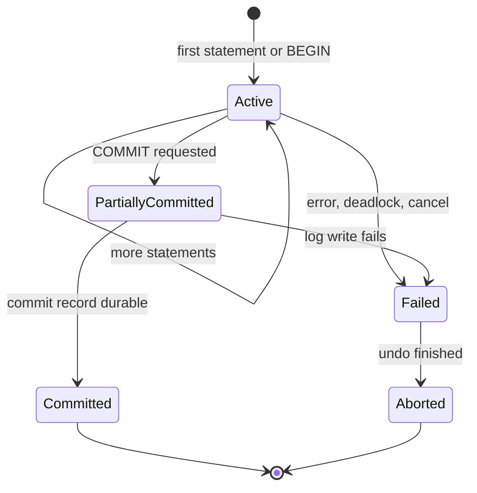
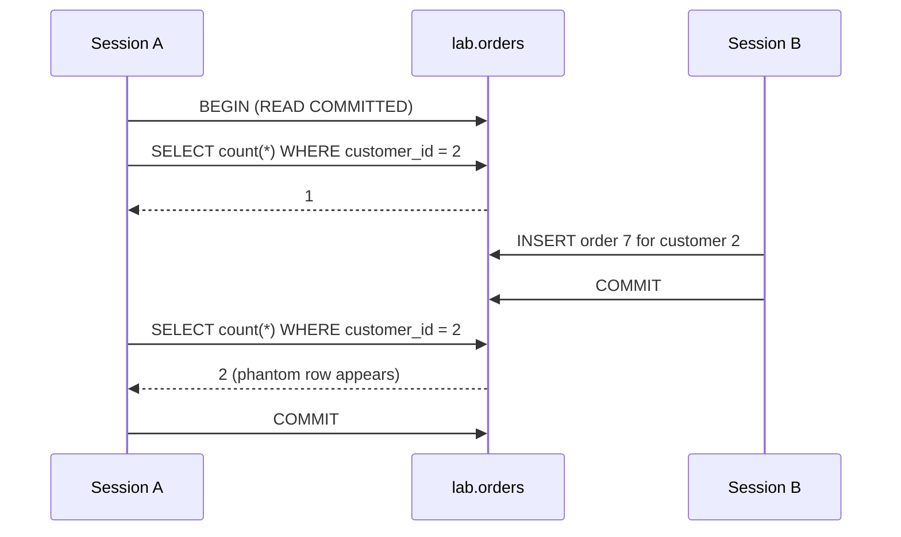
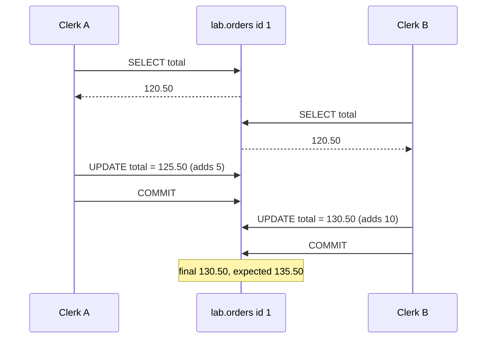

# 9. Transactions, ACID and isolation

> **Level:** L2 practitioner → L3 senior | **Part:** I | **Rowlit references read at:** `1d57848` (Rowlit 1.6.3)
> **In one sentence:** A transaction groups statements into one all-or-nothing unit, and the isolation level decides how much concurrent transactions may see of each other's unfinished work.
> **You will learn:**
> - what each letter of ACID promises, and which part of the engine keeps that promise;
> - how BEGIN / COMMIT / ROLLBACK, autocommit and savepoints work in each engine;
> - the classic anomalies (dirty read, non-repeatable read, phantom, lost update, write skew), reproduced on `shop`;
> - the four SQL isolation levels plus snapshot isolation and serializable snapshot isolation, and the default of every engine;
> - why a long transaction is expensive even when it does nothing.
>
> **Prerequisites:** [3. SQL I](03-sql-basics.md), [6. Storage internals](06-storage-internals.md) (pages, buffer pool).
>
> [فارسی](../../fa/part1/09-transactions-and-isolation.md) · Previous: [8. The query pipeline and the optimizer](08-query-processing.md) · Next: [10. Concurrency: locks, latches, MVCC](10-concurrency-locking-mvcc.md)

---

## 1. The idea (beginner)

A shop takes an order in several steps: insert the order header, insert its lines, update the order total, perhaps
write an invoice. If the server crashes after the second step, the database must not keep half an order. And if two
clerks edit the same order at the same moment, one clerk's change must not silently erase the other's. A
**[transaction](../glossary.md#transaction)** (a group of statements that the database treats as one unit of work) is the
tool for both problems: either every statement of the group takes effect, or none does, and while it runs it is
protected from the unfinished work of others.

The protection from others is not all-or-nothing. Full protection costs waiting or retries, so every engine offers
several **[isolation levels](../glossary.md#isolation-level)** (settings that say how much a transaction may see of
concurrent, uncommitted or freshly committed changes). Weaker levels are faster and allow certain surprises, called
**anomalies**. This chapter names each anomaly, shows it on the `shop` tables, and tells you which level in which engine
prevents it. The next chapter ([10](10-concurrency-locking-mvcc.md)) explains the machinery (locks and multi-version
rows) that the levels are built on.

## 2. How it works (practitioner)

### 2.1 ACID, letter by letter

**[ACID](../glossary.md#acid)** is the classic list of four transaction guarantees. Each letter is kept by a different part
of the engine, which is the most useful way to remember them.

| Letter | Promise | Who keeps it | Chapter |
|---|---|---|---|
| **[Atomicity](../glossary.md#atomicity)** | All statements of the transaction take effect, or none. A failure in the middle undoes the earlier ones. | The undo information (undo log, old row versions) and the recovery manager. | [11](11-logging-and-recovery.md) |
| **[Consistency](../glossary.md#consistency)** | A transaction moves the database from one valid state to another: constraints (PK, FK, CHECK, UNIQUE) hold at commit. | Constraint checks, triggers, and the application's own rules. | [5](05-modelling-and-normalisation.md) |
| **[Isolation](../glossary.md#isolation)** | Concurrent transactions do not see each other's partial work (to the degree the isolation level promises). | The concurrency control: locks and/or MVCC. | [10](10-concurrency-locking-mvcc.md) |
| **[Durability](../glossary.md#durability)** | Once COMMIT returns, the change survives a crash or power loss. | The write-ahead log flushed to stable storage at commit. | [11](11-logging-and-recovery.md) |

Two warnings that save many arguments:

- The "C" of ACID is not the "C" of the CAP theorem ([12](12-backup-replication-ha.md#33-cap-and-pacelc)). ACID
  consistency means "constraints hold"; CAP consistency means "every replica answers with the latest value".
- Consistency is partly *your* job. The database checks only the rules you declared. "An order total equals the sum of
  its lines" is a rule the `shop` schema does not declare, so no engine will enforce it for you.

### 2.2 Starting and ending a transaction

Every relational engine has three verbs: *begin*, *commit* (make the changes permanent and visible) and *rollback*
(undo them). The words differ.

#### PostgreSQL 17

```sql
BEGIN;                          -- or START TRANSACTION
UPDATE orders SET total = total + 5 WHERE id = 1;
INSERT INTO sales.invoices VALUES (3, 1, 125.50);
COMMIT;                         -- or ROLLBACK;
```

Without `BEGIN`, every statement runs in its own transaction (**[autocommit](../glossary.md#autocommit)**: the engine
commits after each statement). PostgreSQL DDL is transactional: `CREATE TABLE`, `ALTER TABLE` and even `DROP TABLE`
inside a transaction are undone by `ROLLBACK`. Exceptions are a few commands that refuse to run inside a transaction
block, such as `CREATE DATABASE`, `VACUUM` and `CREATE INDEX CONCURRENTLY`.

#### SQL Server 2022

```sql
BEGIN TRANSACTION;              -- BEGIN TRAN
UPDATE dbo.Orders SET Total = Total + 5 WHERE Id = 1;
COMMIT TRANSACTION;             -- or ROLLBACK TRANSACTION
SELECT @@TRANCOUNT;             -- nesting depth of BEGIN TRAN; 0 = no transaction
```

SQL Server is in autocommit mode by default. `SET IMPLICIT_TRANSACTIONS ON` switches to the Oracle-like style where
the first data statement opens a transaction that stays open until you commit. Nested `BEGIN TRAN` only increments
`@@TRANCOUNT`; the inner `COMMIT` decrements it and only the outermost commit really commits, while any `ROLLBACK`
(without a savepoint name) rolls back everything. Most DDL is transactional.

#### Oracle Database 23ai Free

Oracle has no `BEGIN` statement for transactions. A transaction starts implicitly with the first DML statement and ends
with `COMMIT` or `ROLLBACK`. **Every DDL statement commits implicitly**, before and after it runs: a `CREATE TABLE`
in the middle of your work commits the work done so far. Whether a client autocommits is a client setting: SQL*Plus
has `SET AUTOCOMMIT OFF` by default, while many drivers (ODP.NET, JDBC) commit each command unless the program opened
a transaction object.

#### MySQL 8 / MariaDB 11 (InnoDB)

```sql
START TRANSACTION;              -- or BEGIN
UPDATE orders SET total = total + 5 WHERE id = 1;
COMMIT;
SET autocommit = 0;             -- session-wide manual mode, like Oracle
```

`autocommit = 1` is the default. DDL (and some other statements such as `LOCK TABLES`) causes an **implicit commit**.
Transactions exist only for transactional storage engines; a `MyISAM` table ignores `ROLLBACK`.

#### SQLite 3.4x

```sql
BEGIN DEFERRED;     -- default: take locks only when first needed
BEGIN IMMEDIATE;    -- take the write lock now (recommended before a read-then-write)
BEGIN EXCLUSIVE;
COMMIT;             -- or END
```

SQLite autocommits each statement unless `BEGIN` was issued. DDL is transactional. SQLite allows only one writer at a
time for the whole database file, which makes it serializable by construction ([defaults per engine](#defaults-per-engine)).

#### ClickHouse, Cassandra, Snowflake

- **ClickHouse 24** has no general multi-statement transactions in normal use. An `INSERT` of one block into a
  MergeTree table is atomic (it creates one part, see [15](15-oltp-vs-olap-columnar.md)); experimental transactions
  (`allow_experimental_transactions`) exist but are not something to rely on.
- **Cassandra 4/5** has no multi-row transactions. A `BATCH` (logged batch) guarantees that all its writes are
  *eventually* applied, but other clients can observe them one by one. **Lightweight transactions** (`INSERT … IF NOT
  EXISTS`, `UPDATE … IF col = x`) give compare-and-set on one partition using Paxos. General transactions (Accord,
  CEP-15) were not part of the 5.0 release.
- **Snowflake** autocommits by default; `BEGIN` … `COMMIT` opens an explicit transaction. Its only isolation level is
  READ COMMITTED, DDL commits implicitly, and there are no savepoints.

> **In Rowlit:** the engine models the two client styles as `TransactionMode { Auto, Manual }`
> (`engine/src/DbStudio.Core/Models/CoreModels.cs:23`). In manual mode the transaction is opened lazily, only when a
> statement that needs one runs (`engine/src/DbStudio.Core/Services/AdoSessionBase.cs:1127-1131`). See
> [Part II chapter 8](../part2/08-connections-sessions-execution.md).

### 2.3 Transaction states

**Figure 9.1 — The life of a transaction.**



Figure 9.1 is the textbook model. Two states deserve attention:

- **Partially committed** is the short window after you asked for COMMIT and before the commit record is on disk. A
  crash in this window means the transaction never committed, even though all its statements ran. Durability starts
  only when the log write finishes ([11](11-logging-and-recovery.md)).
- **Failed** behaves differently per engine. PostgreSQL puts the whole transaction in an *aborted* state after any
  error: every further statement fails with `ERROR: current transaction is aborted, commands ignored until end of
  transaction block` (SQLSTATE `25P02`) until you `ROLLBACK`. SQL Server, Oracle and MySQL instead roll back **only the
  failing statement** and keep the transaction alive, except for severe errors (deadlock victim, and in SQL Server any
  error when `SET XACT_ABORT ON` is active).

### 2.4 Savepoints

A **[savepoint](../glossary.md#savepoint)** is a named marker inside a transaction. Rolling back to it undoes only the work
after the marker; the transaction stays open.

```sql
-- PostgreSQL, MySQL, SQLite (and Oracle without RELEASE)
BEGIN;
INSERT INTO sales.invoices VALUES (3, 4, 54.15);
SAVEPOINT before_fix;
UPDATE orders SET total = 0 WHERE id = 4;      -- oops
ROLLBACK TO SAVEPOINT before_fix;               -- the INSERT survives
RELEASE SAVEPOINT before_fix;                   -- forget the marker
COMMIT;
```

```sql
-- SQL Server: different words, no RELEASE
BEGIN TRAN;
INSERT INTO Sales.Invoices VALUES (3, 4, 54.15);
SAVE TRANSACTION before_fix;
UPDATE dbo.Orders SET Total = 0 WHERE Id = 4;
ROLLBACK TRANSACTION before_fix;
COMMIT;
```

Savepoints are how applications retry one step without losing the whole unit, and how a PostgreSQL client avoids the
aborted state: wrap each risky statement in a savepoint and roll back to it on error. They cost something: PostgreSQL
implements each savepoint as a subtransaction with its own transaction id, and a very large number of them in one
transaction slows down visibility checks.

> **In Rowlit:** PostgreSQL manual mode wraps every batch in `SAVEPOINT dbstudio_stmt`, released on success and rolled
> back on error, so one failing statement never leaves the tab in the `25P02` state
> (`engine/src/DbStudio.Providers.PostgreSql/PgSession.cs:22-23`, decision D-PG3 in `docs/PLAN-PG.md`).

### 2.5 The anomalies, on `shop`

The demonstrations below use **two sessions** (two connections, for example two `psql` windows or two editor tabs),
called A and B. Steps are numbered in time order. They change data, so run them on a scratch copy:

```sql
-- PostgreSQL 17, run once
CREATE SCHEMA lab;
CREATE TABLE lab.orders AS SELECT * FROM public.orders;
ALTER TABLE lab.orders ADD PRIMARY KEY (id);
-- … and when you are done:  DROP SCHEMA lab CASCADE;
```

Docker was not available when this chapter was written, so the outputs below are **illustrative output**, written from
the documented behaviour of PostgreSQL 17 and SQL Server 2022, not captured from a server.

#### Dirty read

A **[dirty read](../glossary.md#dirty-read)** means reading a change that another transaction has not committed yet (and
may still roll back).

| Step | Session A | Session B |
|---|---|---|
| 1 | | `BEGIN TRAN; UPDATE dbo.Orders SET Total = 0 WHERE Id = 1;` |
| 2 | `SET TRANSACTION ISOLATION LEVEL READ UNCOMMITTED;`<br/>`SELECT Total FROM dbo.Orders WHERE Id = 1;` → **0.00** | |
| 3 | | `ROLLBACK;` |

A reported a total that never existed. Only SQL Server (`READ UNCOMMITTED` or the `WITH (NOLOCK)` table hint) and
MySQL/MariaDB (`READ UNCOMMITTED`) allow dirty reads. PostgreSQL accepts the level name but runs it as READ
COMMITTED; Oracle does not offer it at all.

#### Non-repeatable read

A **[non-repeatable read](../glossary.md#non-repeatable-read)** means the same row, read twice in one transaction, has
changed in between because another transaction committed.

| Step | Session A (PostgreSQL, READ COMMITTED) | Session B |
|---|---|---|
| 1 | `BEGIN;`<br/>`SELECT total FROM lab.orders WHERE id = 1;` → **120.50** | |
| 2 | | `UPDATE lab.orders SET total = 130.50 WHERE id = 1;` (autocommit) |
| 3 | `SELECT total FROM lab.orders WHERE id = 1;` → **130.50** | |
| 4 | `COMMIT;` | |

Under READ COMMITTED each *statement* sees a fresh snapshot of committed data. Run step 1 with
`BEGIN ISOLATION LEVEL REPEATABLE READ;` and step 3 returns 120.50 again: the snapshot is taken once per *transaction*.

#### Phantom read

A **[phantom read](../glossary.md#phantom-read)** means a query with a search condition, repeated in one transaction,
returns a different *set* of rows because another transaction inserted or deleted matching rows. Locking a row you read
cannot prevent this, because the new row did not exist when you read.

**Figure 9.2 — A phantom: the same count gives two answers inside one transaction.**



In PostgreSQL, REPEATABLE READ already prevents this phantom (the snapshot hides order 7). In SQL Server, REPEATABLE
READ does **not** prevent it (it locks the rows it read, not the gap where a new row can appear); SERIALIZABLE does, with
key-range locks ([10](10-concurrency-locking-mvcc.md)).

#### Lost update

A **[lost update](../glossary.md#lost-update)** happens when two transactions read the same value, each computes a new
value in the application, and the second write overwrites the first.

**Figure 9.3 — Lost update: two clerks add a fee to order 1, only one fee survives.**



This anomaly is allowed by READ COMMITTED in every engine. Four fixes, from simplest to most general:

1. **Let the database do the arithmetic:** `UPDATE lab.orders SET total = total + 5 WHERE id = 1;`. The second update
   waits for the first one's row lock and then re-reads the newest committed value. Always correct, when the new value
   can be written as an expression.
2. **Pessimistic lock:** read with `SELECT total FROM lab.orders WHERE id = 1 FOR UPDATE;` (SQL Server:
   `WITH (UPDLOCK, ROWLOCK)`). The second reader waits until the first commits.
3. **Optimistic check:** keep a version column and write `UPDATE … SET total = 125.50, version = version + 1 WHERE id = 1
   AND version = 7;`. Zero rows updated means "someone changed it; reload and retry"
   ([10](10-concurrency-locking-mvcc.md#27-optimistic-and-pessimistic-concurrency)).
4. **A stronger level:** PostgreSQL REPEATABLE READ detects the conflict and fails clerk B with `ERROR: could not
   serialize access due to concurrent update` (SQLSTATE `40001`); SQL Server SNAPSHOT fails with error 3960; Oracle
   SERIALIZABLE fails with `ORA-08177`. The application must catch the error and retry the whole transaction.

MySQL needs special care: in InnoDB REPEATABLE READ a plain `SELECT` reads the old snapshot, but `UPDATE` always works on
the newest committed row, so the pattern in Figure 9.3 loses an update *even at REPEATABLE READ*. Use fix 1, 2 or 3.

#### Write skew

**[Write skew](../glossary.md#write-skew)** is the subtle one. Two transactions read an overlapping set of rows, each makes
a decision based on what it read, and each writes a *different* row. No row is written twice, so no row-level conflict
is detected, but together the writes break a rule that each transaction checked.

Business rule for the example: *a customer may have at most two unpaid (`status = 'new'`) orders.* Bob (customer 2)
has one.

| Step | Session A (REPEATABLE READ) | Session B (REPEATABLE READ) |
|---|---|---|
| 1 | `SELECT count(*) FROM lab.orders WHERE customer_id = 2 AND status = 'new';` → 1 | |
| 2 | | same query → 1 |
| 3 | `INSERT INTO lab.orders VALUES (7, 2, now(), 10, 'new');` | |
| 4 | | `INSERT INTO lab.orders VALUES (8, 2, now(), 20, 'new');` |
| 5 | `COMMIT;` | `COMMIT;` → both succeed: Bob now has **three** unpaid orders |

Snapshot isolation (PostgreSQL REPEATABLE READ, SQL Server SNAPSHOT, Oracle SERIALIZABLE) allows write skew. The cure
is true serializability: PostgreSQL SERIALIZABLE aborts one of the two with `ERROR: could not serialize access due to
read/write dependencies among transactions` (SQLSTATE `40001`), and SQL Server SERIALIZABLE blocks the second insert with
a key-range lock (in this interleaving both sessions already hold shared range locks and each tries to insert into the
range the other has locked, so the usual outcome is that one becomes a deadlock victim). Without serializable, the usual fixes are to lock a common "parent" row
(`SELECT … FROM customers WHERE id = 2 FOR UPDATE` in both sessions) or to turn the rule into a constraint the engine
can enforce.

The textbook version of write skew is two doctors on call: each checks "at least one other doctor is on call" and each
removes only themselves.

### 2.6 The isolation levels

The SQL standard defines four levels by the anomalies they forbid. The table also shows snapshot isolation, which the
standard does not name but most engines implement.

| Level | Dirty read | Non-repeatable read | Phantom | Lost update | Write skew |
|---|---|---|---|---|---|
| **[READ UNCOMMITTED](../glossary.md#read-uncommitted)** | possible | possible | possible | possible | possible |
| **[READ COMMITTED](../glossary.md#read-committed)** | no | possible | possible | possible | possible |
| **[REPEATABLE READ](../glossary.md#repeatable-read)** (standard, lock-based) | no | no | possible | no | possible |
| **[Snapshot isolation](../glossary.md#snapshot-isolation)** | no | no | no | no (first committer wins) | **possible** |
| **[SERIALIZABLE](../glossary.md#serializable)** | no | no | no | no | no |

Read the table as "what the level guarantees at least". Real engines often do better than the minimum, and in a few
places differently:

- **PostgreSQL** has three distinct behaviours: READ UNCOMMITTED = READ COMMITTED; REPEATABLE READ = snapshot isolation
  (no phantoms, but write skew possible); SERIALIZABLE = **[serializable snapshot isolation (SSI)](../glossary.md#ssi)**.
- **SQL Server** has five levels: READ UNCOMMITTED, READ COMMITTED (locking, or row versioning when the database option
  `READ_COMMITTED_SNAPSHOT` is ON), REPEATABLE READ (locking), SNAPSHOT (requires `ALLOW_SNAPSHOT_ISOLATION ON`),
  SERIALIZABLE (locking, with key-range locks).
- **Oracle** offers READ COMMITTED (default), SERIALIZABLE (which is snapshot isolation, so write skew is possible) and
  `SET TRANSACTION READ ONLY`.
- **MySQL InnoDB** offers all four. Its REPEATABLE READ is a hybrid: plain reads use a snapshot, locking reads and writes
  use the latest data plus next-key locks.

#### Defaults per engine

| Engine | Default level | What it means in practice |
|---|---|---|
| PostgreSQL 17 | READ COMMITTED | Snapshot per statement; no read locks. |
| SQL Server 2022 | READ COMMITTED (locking) | Readers take short shared locks and **wait for writers**, unless `READ_COMMITTED_SNAPSHOT` is ON (it is ON by default in Azure SQL Database, not in boxed SQL Server). |
| Oracle 23ai | READ COMMITTED | Statement-level read consistency from undo; readers never wait for writers. |
| MySQL 8 / MariaDB 11 | REPEATABLE READ | Snapshot from the first read of the transaction; next-key locks on locking reads. |
| SQLite 3.4x | SERIALIZABLE (effectively) | One writer at a time for the whole file. |
| Snowflake | READ COMMITTED (only level) | Statement-level snapshot. |
| ClickHouse 24 | no transactions | Each query reads a consistent set of parts. |
| Cassandra 4/5 | no transactions | Per-request consistency levels instead ([12](12-backup-replication-ha.md#32-consistency-models)). |

How to set the level:

```sql
-- PostgreSQL (first statement of the transaction, or as a session default)
BEGIN ISOLATION LEVEL SERIALIZABLE;
SET SESSION CHARACTERISTICS AS TRANSACTION ISOLATION LEVEL REPEATABLE READ;
SHOW transaction_isolation;

-- SQL Server (session setting, applies to following transactions)
SET TRANSACTION ISOLATION LEVEL SNAPSHOT;
DBCC USEROPTIONS;                                  -- shows "isolation level"

-- Oracle
SET TRANSACTION ISOLATION LEVEL SERIALIZABLE;      -- first statement of the transaction
ALTER SESSION SET ISOLATION_LEVEL = SERIALIZABLE;

-- MySQL
SET SESSION TRANSACTION ISOLATION LEVEL READ COMMITTED;
SELECT @@transaction_isolation;
```

> **In Rowlit:** the MySQL "Find in database" data search reads inside a read-only REPEATABLE READ transaction so the
> whole search sees one snapshot (`engine/src/DbStudio.Providers.MySql/MySqlSearcher.cs:75`).

### 2.7 Choosing a level

A practical rule set:

1. Start with the engine default, and write each read-modify-write as a single statement or a locking read.
2. Need a consistent multi-query report (totals that add up across several queries)? Use REPEATABLE READ / SNAPSHOT
   for that transaction, or a read-only transaction.
3. Have rules that span rows (limits, uniqueness across tables, "at least one")? Use SERIALIZABLE for those transactions
   and **retry on serialization failure**, or lock a parent row.
4. Never use READ UNCOMMITTED / `NOLOCK` for anything a person will act on. Besides dirty reads, `NOLOCK` scans in SQL
   Server can return a row twice or skip it when a page splits during the scan.

Every level above READ COMMITTED needs **retry logic**. A serializable system that never retries is not serializable;
it is merely failing.

## 3. Deep dive (senior)

> **Deep dive (L3) — why the standard's table is not enough.** The ANSI SQL-92 levels were defined by the anomalies
> dirty read (P1), non-repeatable read (P2) and phantom (P3). In 1995 Berenson, Bernstein, Gray, Melton and O'Neil
> ("A Critique of ANSI SQL Isolation Levels") showed that this definition is ambiguous and misses anomalies: lost
> update (P4), read skew and write skew (A5A, A5B). They also described snapshot isolation, which forbids P1–P3 in their
> strict reading and yet is not serializable because of write skew. That is why the table in 2.6 has extra columns,
> and why "REPEATABLE READ" means different things in SQL Server (lock-based, phantoms possible) and PostgreSQL
> (snapshot-based, no phantoms).

### 3.1 Serializability and two ways to get it

A schedule (an interleaving of operations of concurrent transactions) is **serializable** when its effect equals some
serial order of the same transactions. Engines reach that goal in two very different ways.

**[Two-phase locking (2PL)](../glossary.md#two-phase-locking)**. Each transaction has a growing phase (it acquires locks,
never releases) and a shrinking phase (it releases, never acquires). *Strict* 2PL holds write locks until commit;
*rigorous* 2PL holds all locks until commit, which is what SQL Server SERIALIZABLE and MySQL SERIALIZABLE do. To stop
phantoms, the locks must cover *predicates* or ranges, not only existing rows: SQL Server uses key-range locks on the
index, InnoDB uses next-key (gap) locks. Without a usable index the engine must lock much more (a whole table or index
range), which turns into blocking. 2PL is pessimistic: conflicts cause waiting, and waiting can cause deadlocks
([10](10-concurrency-locking-mvcc.md#24-deadlocks)).

**Serializable snapshot isolation (SSI)**. PostgreSQL (since 9.1) runs each serializable transaction on a snapshot,
as in snapshot isolation, and additionally tracks **read/write dependencies** (rw-antidependencies: T1 read a version
that T2 later overwrote). Cahill, Röhm and Fekete proved that every non-serializable execution under SI contains a
"dangerous structure" of two consecutive rw-edges in a cycle. PostgreSQL records reads as SIREAD *predicate locks*
(visible in `pg_locks` with mode `SIReadLock`; they never block anyone), detects the dangerous structure, and aborts
one transaction with SQLSTATE `40001`. False positives exist: a transaction can be aborted even though the actual
interleaving was harmless, especially when reads go through sequential scans (the predicate lock then covers the whole
relation). Indexes on the filtered columns make SSI more precise.

### 3.2 Read skew and the snapshot

**Read skew** is the multi-row cousin of the non-repeatable read: a report reads `orders` and then `sales.invoices`,
and a transfer commits between the two reads, so the report sees the "before" of one table and the "after" of the other.
READ COMMITTED allows it because each statement gets a new snapshot. A single statement is always consistent with
itself in MVCC engines (statement-level snapshot), so one query joining both tables is safe even at READ COMMITTED,
while two separate queries are not. This is a strong argument for putting the parts of a report that must agree into one
statement or into one REPEATABLE READ / SNAPSHOT transaction.

### 3.3 PostgreSQL READ COMMITTED and concurrent updates

In READ COMMITTED, when an `UPDATE` or `DELETE` finds that its target row was changed by a transaction that committed
after the statement's snapshot, PostgreSQL waits for that transaction, then **re-evaluates the WHERE clause against the
newest row version** and applies the change if it still matches (the "EvalPlanQual" recheck). That is why
`SET total = total + 5` never loses an update. The surprising side effect: a statement like
`UPDATE lab.orders SET status = 'paid' WHERE total > 100` can, under concurrency, update a set of rows that never
coexisted in any single snapshot. In REPEATABLE READ and SERIALIZABLE, PostgreSQL refuses instead and raises `40001`.

### 3.4 The cost of a long transaction

A transaction that stays open, even one that only ran a `SELECT` and is now waiting for a user, keeps paying:

- **Locks** taken by its writes (and in lock-based levels, its reads) are held until it ends. Others queue behind it
  ([blocking chains](10-concurrency-locking-mvcc.md#25-blocking-chains-and-kill)).
- **Old row versions cannot be cleaned up.** PostgreSQL VACUUM cannot remove dead tuples newer than the oldest open
  snapshot (bloat grows); SQL Server's version store in `tempdb` (or the persistent version store with Accelerated
  Database Recovery) keeps growing; InnoDB's purge cannot advance and the *history list length* rises; Oracle may still
  serve it from undo, but others start to see `ORA-01555 snapshot too old` if undo is undersized.
- **The log cannot be truncated** past the oldest active transaction (SQL Server `log_reuse_wait_desc =
  ACTIVE_TRANSACTION`), so the transaction log grows ([11](11-logging-and-recovery.md#25-log-truncation-and-log-growth)).
- **Recovery takes longer:** a crash rolls back all its work.

The two most common culprits are an interactive client in manual mode that someone forgot to commit, and an
application that opens a transaction, then calls a slow external service. PostgreSQL has
`idle_in_transaction_session_timeout` to end such sessions; `pg_stat_activity.state = 'idle in transaction'` finds them.

### 3.5 Error handling and retries

Treat these as "retry the whole transaction" signals, with a small random backoff and a retry cap:

| Engine | Serialization failure | Deadlock victim |
|---|---|---|
| PostgreSQL | SQLSTATE `40001` | SQLSTATE `40P01` |
| SQL Server | error 3960 (snapshot update conflict) | error 1205 |
| Oracle | `ORA-08177` | `ORA-00060` (only the *statement* is rolled back; the application decides) |
| MySQL / MariaDB | (none at SERIALIZABLE; it locks) | error 1213; lock wait timeout is error 1205 |

A retry must re-run the *reads* too, not only the failed write: the decision based on the old read is exactly what was
wrong.

## 4. In each engine

| Topic | PostgreSQL 17 | SQL Server 2022 | Oracle 23ai | MySQL 8 / MariaDB 11 | SQLite 3.4x | ClickHouse 24 | Snowflake | Cassandra 4/5 |
|---|---|---|---|---|---|---|---|---|
| Begin | `BEGIN` / `START TRANSACTION` | `BEGIN TRAN` | implicit at first DML | `START TRANSACTION` / `BEGIN` | `BEGIN [DEFERRED\|IMMEDIATE\|EXCLUSIVE]` | none (experimental only) | `BEGIN` | none; LWT per partition |
| Autocommit by default | yes | yes | client decides | yes (`autocommit=1`) | yes | n/a | yes | n/a |
| DDL in a transaction | transactional | mostly transactional | implicit commit | implicit commit | transactional | n/a | implicit commit | n/a |
| Savepoints | `SAVEPOINT` / `ROLLBACK TO` / `RELEASE` | `SAVE TRAN` / `ROLLBACK TRAN name` | `SAVEPOINT` / `ROLLBACK TO` | `SAVEPOINT` / `ROLLBACK TO` / `RELEASE` | `SAVEPOINT` / `ROLLBACK TO` / `RELEASE` | no | no | no |
| Error inside a transaction | whole transaction aborted (`25P02`) | statement rolled back (whole with `XACT_ABORT ON`) | statement rolled back | statement rolled back (deadlock: whole) | statement rolled back | n/a | statement fails | n/a |
| Default level | READ COMMITTED | READ COMMITTED (locking) | READ COMMITTED | REPEATABLE READ | SERIALIZABLE | n/a | READ COMMITTED | n/a |
| Strongest level | SERIALIZABLE (SSI) | SERIALIZABLE (2PL) | SERIALIZABLE (= SI) | SERIALIZABLE (2PL) | SERIALIZABLE | n/a | READ COMMITTED | LWT (linearizable per partition) |

## 5. Exercises

1. In session A run `BEGIN; SELECT total FROM lab.orders WHERE id = 3;`, then in B `UPDATE lab.orders SET total = 1
   WHERE id = 3;`, then in A repeat the select. What does A see under READ COMMITTED and under REPEATABLE READ in
   PostgreSQL? Under SQL Server READ COMMITTED with `READ_COMMITTED_SNAPSHOT OFF`, what happens at B's step if A had run
   `SELECT … WITH (HOLDLOCK)`?
2. Rewrite the lost-update example of Figure 9.3 three ways so that both fees survive, for PostgreSQL.
3. A batch job runs `BEGIN; UPDATE orders …; CREATE TABLE tmp_x (…); ROLLBACK;` on Oracle and on PostgreSQL. What is left
   in each database afterwards?
4. Why is a single `SELECT` that joins `orders` and `sales.invoices` consistent at READ COMMITTED in PostgreSQL, while two
   separate `SELECT`s in the same READ COMMITTED transaction may not be?
5. The write-skew example used PostgreSQL REPEATABLE READ. Name two different ways to make it safe without changing the
   isolation level, and one way that changes the level. What must the application add when it changes the level?
6. A developer says: "We use SERIALIZABLE, so we never need retries." Explain why that is wrong for PostgreSQL and for
   SQL Server.

## Answers

The answer key for all Part I chapters is collected in [18. Answer key and lab setup](18-exercise-answers.md).

<details><summary>Answers to chapter 9</summary>

1. PostgreSQL READ COMMITTED: A sees the new value 1 (new snapshot per statement). REPEATABLE READ: A still sees 199.00
   (snapshot fixed at the first statement). SQL Server with locking READ COMMITTED and `HOLDLOCK` (= SERIALIZABLE for
   that table): A keeps its shared lock until commit, so B's `UPDATE` **waits** until A commits or rolls back.
2. (a) `UPDATE lab.orders SET total = total + 5 WHERE id = 1;` in both sessions. (b) `SELECT total … FOR UPDATE` before
   computing, so the second clerk waits and reads 125.50. (c) Optimistic: add `version int NOT NULL DEFAULT 0`, update
   with `WHERE id = 1 AND version = :v` and retry when zero rows changed. (Also acceptable: REPEATABLE READ plus a retry
   on `40001`.)
3. Oracle: the `CREATE TABLE` committed the `UPDATE` implicitly before it ran, so the update and `tmp_x` both remain; the
   `ROLLBACK` has nothing to undo. PostgreSQL: DDL is transactional, so the `ROLLBACK` removes both the update and the
   table.
4. One statement reads one snapshot taken at its start; both tables are seen at the same moment. Two statements at
   READ COMMITTED get two snapshots, and a commit between them produces read skew.
5. Without changing the level: lock a common row first (`SELECT 1 FROM customers WHERE id = 2 FOR UPDATE` in both
   transactions, so they serialize), or enforce the rule in the schema (for example a trigger that locks the customer
   row, or a counter column with a CHECK constraint). Changing the level: SERIALIZABLE. The application must then catch
   SQLSTATE `40001` and retry the whole transaction.
6. PostgreSQL SERIALIZABLE (SSI) aborts transactions with `40001` when it detects a dangerous structure, including false
   positives; without a retry those transactions are simply lost work. SQL Server SERIALIZABLE uses locks, so conflicts
   become waits and, often, deadlocks (error 1205), and the victim must be retried.

</details>

## Related chapters

- [10. Concurrency: locks, latches, MVCC](10-concurrency-locking-mvcc.md) — the machinery behind each level.
- [11. WAL, redo/undo, checkpoints, recovery](11-logging-and-recovery.md) — how atomicity and durability are kept.
- [12. Backup, replication, HA](12-backup-replication-ha.md) — consistency across machines and two-phase commit.
- [17. Dialect comparison](17-dialect-comparison.md) — transaction syntax side by side.
- Part II: [8. Connections, sessions and executing SQL](../part2/08-connections-sessions-execution.md) — Rowlit's Auto and Manual modes.

## Glossary terms introduced here

[transaction](../glossary.md#transaction) ·
[ACID](../glossary.md#acid) ·
[atomicity](../glossary.md#atomicity) ·
[consistency](../glossary.md#consistency) ·
[isolation](../glossary.md#isolation) ·
[durability](../glossary.md#durability) ·
[commit](../glossary.md#commit) ·
[rollback](../glossary.md#rollback) ·
[autocommit](../glossary.md#autocommit) ·
[manual transaction](../glossary.md#manual-transaction) ·
[implicit commit](../glossary.md#implicit-commit) ·
[savepoint](../glossary.md#savepoint) ·
[isolation level](../glossary.md#isolation-level) ·
[dirty read](../glossary.md#dirty-read) ·
[non-repeatable read](../glossary.md#non-repeatable-read) ·
[phantom read](../glossary.md#phantom-read) ·
[read skew](../glossary.md#read-skew) ·
[write skew](../glossary.md#write-skew) ·
[lost update](../glossary.md#lost-update) ·
[READ UNCOMMITTED](../glossary.md#read-uncommitted) ·
[READ COMMITTED](../glossary.md#read-committed) ·
[REPEATABLE READ](../glossary.md#repeatable-read) ·
[SERIALIZABLE](../glossary.md#serializable) ·
[snapshot isolation](../glossary.md#snapshot-isolation) ·
[SSI](../glossary.md#ssi) ·
[serialization failure](../glossary.md#serialization-failure) ·
[two-phase locking](../glossary.md#two-phase-locking) ·
[lightweight transaction](../glossary.md#lightweight-transaction)
