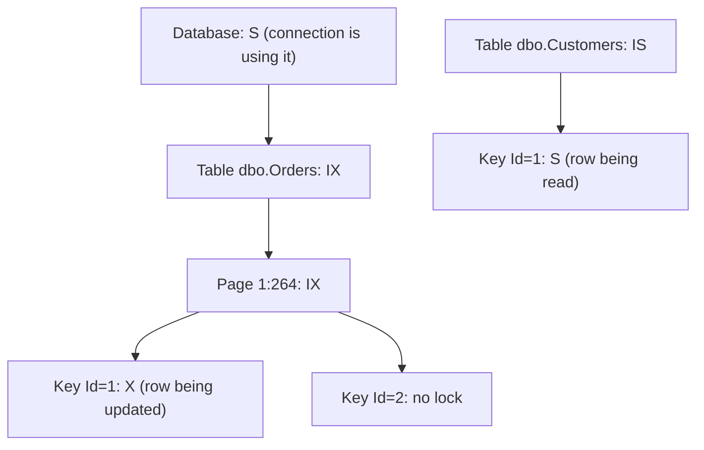
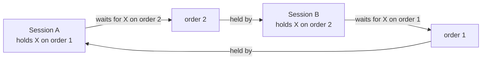
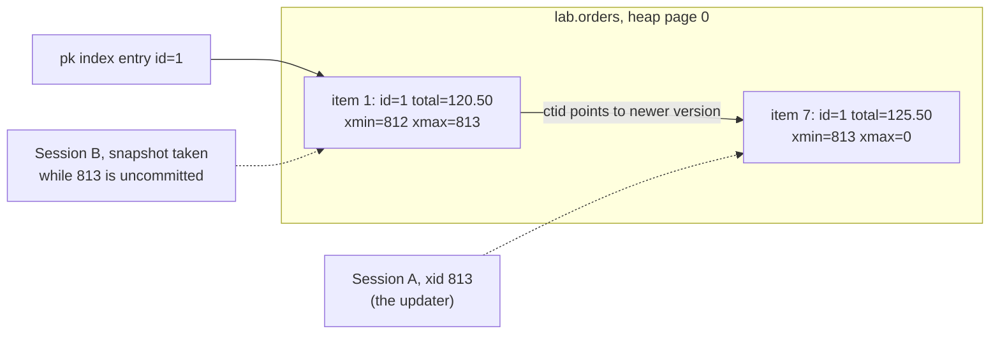
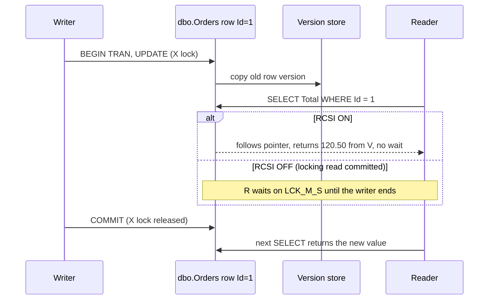

# 10. Concurrency: locks, latches, MVCC

> **Level:** L3 senior (sections 1–2 are L2) | **Part:** I | **Rowlit references read at:** `1d57848` (Rowlit 1.6.3)
> **In one sentence:** Engines keep concurrent transactions apart with locks (wait until the other is done) and with multi-version rows (read an older copy instead of waiting), and every engine mixes the two differently.
> **You will learn:**
> - lock modes (shared, exclusive, update, intent), granularity and escalation, and how to read a compatibility matrix;
> - how lock waits, timeouts, deadlocks and blocking chains arise, and how to read a deadlock report in four engines;
> - how MVCC works in PostgreSQL, SQL Server, Oracle, InnoDB and SQLite, and what it costs (VACUUM, version store, undo);
> - the difference between a latch and a lock;
> - optimistic versus pessimistic concurrency, `FOR UPDATE`, `NOWAIT` and `SKIP LOCKED`.
>
> **Prerequisites:** [9. Transactions, ACID and isolation](09-transactions-and-isolation.md), [6. Storage internals](06-storage-internals.md), [7. Indexes](07-indexes.md).
>
> [فارسی](../../fa/part1/10-concurrency-locking-mvcc.md) · Previous: [9. Transactions, ACID and isolation](09-transactions-and-isolation.md) · Next: [11. WAL, redo/undo, checkpoints, recovery](11-logging-and-recovery.md)

---

## 1. The idea (beginner)

Imagine a library with one copy of each book. If you want to correct a page, you take the book away until you are done;
anyone else who wants to read it has to wait. That is **locking**. Now imagine the library photocopies the page before
you start writing on it. Readers get the photocopy and do not wait; only another person who also wants to *write* on
the same page has to wait. That is **multi-version concurrency control**: writers create a new version of a row and
readers keep reading the old one until the writer commits.

Every relational engine uses locks for writes, because two people must never write the same row at the same time. The
big difference between engines is what *readers* do: in a pure locking engine (SQL Server with default settings, MySQL
`SERIALIZABLE`) a reader may wait for a writer; in an MVCC engine (PostgreSQL, Oracle, InnoDB for plain `SELECT`s, SQL
Server with snapshot options) a reader never waits for a writer. This chapter shows both mechanisms, the problems they
create (deadlocks, blocking, old versions that must be cleaned up) and how to diagnose them.

## 2. How it works (practitioner)

### 2.1 Locks and lock modes

A **[lock](../glossary.md#lock)** is a promise registered with the engine's lock manager: "transaction T uses resource R in
mode M; anyone who needs an incompatible mode must wait". Locks last until the transaction ends (for writes always,
for reads depending on the isolation level, see [9](09-transactions-and-isolation.md#26-the-isolation-levels)).

The basic modes:

- **[Shared lock](../glossary.md#shared-lock)** (S): for reading. Many transactions can hold S on the same row.
- **[Exclusive lock](../glossary.md#exclusive-lock)** (X): for writing. Only one holder; incompatible with every other mode.
- **[Update lock](../glossary.md#update-lock)** (U, SQL Server): taken while an `UPDATE` *searches* for rows to change.
  Compatible with S, but not with another U. It prevents the classic conversion deadlock in which two transactions hold S
  on the same row and both try to upgrade to X.
- **[Intent locks](../glossary.md#intent-lock)** (IS, IX, SIX): placed on the *containers* (table, page) of a row lock, so
  the engine can check "does anyone lock rows of this table?" without scanning every row lock. A transaction that wants
  an X lock on the whole table only has to look for IS/IX locks on the table.

**Figure 10.1 — Lock hierarchy: a row lock implies intent locks on its page and table.**



The **[compatibility matrix](../glossary.md#lock-compatibility)** tells you who waits. This is SQL Server's matrix ("yes" means both can be granted at once):

| Requested ↓ / Held → | IS | IX | S | SIX | U | X |
|---|---|---|---|---|---|---|
| **IS** | yes | yes | yes | yes | yes | no |
| **IX** | yes | yes | no | no | no | no |
| **S** | yes | no | yes | no | yes | no |
| **SIX** | yes | no | no | no | no | no |
| **U** | yes | no | yes | no | no | no |
| **X** | no | no | no | no | no | no |

PostgreSQL has its own vocabulary. At **table level** there are eight modes; the ones you will meet most:

| Mode | Taken by | Conflicts with (summary) |
|---|---|---|
| `ACCESS SHARE` | `SELECT` | only `ACCESS EXCLUSIVE` |
| `ROW SHARE` | `SELECT … FOR UPDATE/SHARE` | `EXCLUSIVE`, `ACCESS EXCLUSIVE` |
| `ROW EXCLUSIVE` | `INSERT`, `UPDATE`, `DELETE`, `MERGE` | `SHARE` and stronger |
| `SHARE UPDATE EXCLUSIVE` | `VACUUM`, `ANALYZE`, `CREATE INDEX CONCURRENTLY` | itself and stronger |
| `SHARE` | `CREATE INDEX` (non-concurrent) | `ROW EXCLUSIVE` and writers |
| `ACCESS EXCLUSIVE` | `DROP`, `TRUNCATE`, most `ALTER TABLE`, `VACUUM FULL` | everything, even `SELECT` |

At **row level** PostgreSQL has `FOR UPDATE`, `FOR NO KEY UPDATE` (what a normal `UPDATE` takes when it does not change
a key column), `FOR SHARE` and `FOR KEY SHARE` (what a foreign-key check takes on the parent row). Row locks are not kept
in the lock manager's memory: they are written into the row itself (its `xmax` field, see [3.2](#32-postgresql-mvcc-in-detail)).
That is why PostgreSQL can lock millions of rows without running out of lock memory, and why it never escalates.

### 2.2 Granularity and lock escalation

Locks can cover a row (SQL Server `RID` or `KEY`), a page, a partition, a table or the whole database. Fine locks give
more concurrency but cost memory and CPU per lock; coarse locks are cheap but block more.

**[Lock escalation](../glossary.md#lock-escalation)** is the engine replacing many fine locks by one coarse lock. SQL Server
tries to escalate when a single statement has acquired about **5,000 locks on one table or index** (or when lock memory
is under pressure), and escalates to the table, or to the partition when the table option is
`LOCK_ESCALATION = AUTO`. A big `DELETE` that escalates to a table X lock suddenly blocks every reader of the table.
Common responses: delete in batches below the threshold, add an index so fewer rows are touched, or
`ALTER TABLE … SET (LOCK_ESCALATION = DISABLE)` with care.

PostgreSQL, Oracle and InnoDB do not escalate row locks: PostgreSQL and Oracle store them in the data block, InnoDB keeps
them in a compact bitmap per page in its lock system.

### 2.3 Lock waits and timeouts

When a request is incompatible with a granted lock, the requester **waits**. By default most engines wait forever (or a
long time), which turns a forgotten transaction into an outage. Set a **[lock timeout](../glossary.md#lock-timeout)** where it matters:

| Engine | Setting | Default | Error on timeout |
|---|---|---|---|
| PostgreSQL | `SET lock_timeout = '5s'` | `0` (wait forever) | `55P03 lock_not_available` |
| SQL Server | `SET LOCK_TIMEOUT 5000` (ms) | `-1` (wait forever) | error 1222 |
| MySQL InnoDB | `innodb_lock_wait_timeout` (s) | 50 | error 1205 (only the statement is rolled back by default) |
| Oracle | `SELECT … FOR UPDATE WAIT 5` / `NOWAIT` | wait forever | `ORA-30006` / `ORA-00054` |
| SQLite | busy timeout (`PRAGMA busy_timeout`) | 0 in the C library; drivers often set one | `SQLITE_BUSY` |

> **In Rowlit:** SQLite connections get a busy timeout from the profile, 30 seconds unless set
> (`engine/src/DbStudio.Providers.Sqlite/SqliteConnections.cs:20`).

A classic PostgreSQL outage shows why `lock_timeout` matters for DDL. A long report holds `ACCESS SHARE` on `orders`. Someone
runs `ALTER TABLE orders ADD COLUMN note text;`, which needs `ACCESS EXCLUSIVE` and waits. Every new `SELECT` on `orders`
now queues *behind the waiting ALTER* (lock requests are granted in order), so the application stalls although the ALTER
itself would take milliseconds. Running DDL with `SET lock_timeout = '2s'` and retrying avoids this.

### 2.4 Deadlocks

A **[deadlock](../glossary.md#deadlock)** is a cycle of waits: A waits for a lock that B holds, while B waits for a lock that
A holds. Neither can proceed, ever. Engines detect the cycle and break it by rolling back one participant, the
**[deadlock victim](../glossary.md#deadlock-victim)**.

**Figure 10.2 — A deadlock: two sessions update orders 1 and 2 in opposite order.**



Reproduce it on the scratch copy from chapter 9 (`lab.orders`):

| Step | Session A | Session B |
|---|---|---|
| 1 | `BEGIN; UPDATE lab.orders SET total = total + 1 WHERE id = 1;` | |
| 2 | | `BEGIN; UPDATE lab.orders SET total = total + 1 WHERE id = 2;` |
| 3 | `UPDATE lab.orders SET total = total + 1 WHERE id = 2;` (waits) | |
| 4 | | `UPDATE lab.orders SET total = total + 1 WHERE id = 1;` → cycle |

PostgreSQL checks for a cycle after a session has waited `deadlock_timeout` (default 1 s) and aborts the session that ran
the check (illustrative output):

```text
ERROR:  deadlock detected
DETAIL:  Process 4242 waits for ShareLock on transaction 816; blocked by process 4240.
Process 4240 waits for ShareLock on transaction 815; blocked by process 4242.
HINT:  See server log for query details.
CONTEXT:  while updating tuple (0,1) in relation "orders"
```

How to read it: "waits for ShareLock on transaction 816" means "waits for transaction 816 to finish", which is how
PostgreSQL waits for a row lock (the row's `xmax` names the holder's transaction). `(0,1)` is the row's physical address
(page 0, item 1). The server log, not the client, contains the statements of both processes. SQLSTATE is `40P01`.

**SQL Server** has a deadlock monitor thread that runs every 5 seconds (more often while it keeps finding deadlocks). It
picks the victim by `SET DEADLOCK_PRIORITY` first and then by the cheapest transaction to roll back, and the victim
receives error 1205: *Transaction (Process ID 53) was deadlocked on lock resources with another process and has been
chosen as the deadlock victim. Rerun the transaction.* The full **[deadlock graph](../glossary.md#deadlock-graph)** is captured by the built-in
`system_health` Extended Events session:

```sql
-- SQL Server: the most recent deadlock graphs from system_health (ring buffer target)
SELECT x.ev.value('@timestamp', 'datetime2') AS at_utc, x.ev.query('(data/value/deadlock)[1]') AS graph
FROM (SELECT CAST(st.target_data AS xml) AS t
      FROM sys.dm_xe_session_targets st
      JOIN sys.dm_xe_sessions s ON s.address = st.event_session_address
      WHERE s.name = N'system_health' AND st.target_name = N'ring_buffer') d
CROSS APPLY d.t.nodes('RingBufferTarget/event[@name="xml_deadlock_report"]') x(ev);
```

A trimmed graph (illustrative output) and how to read it:

```xml
<deadlock>
  <victim-list><victimProcess id="process2" /></victim-list>
  <process-list>
    <process id="process1" spid="53" waitresource="KEY: 5:72057594043236352 (8194443284a0)" lockMode="U">
      <inputbuf>UPDATE dbo.Orders SET Total = Total + 1 WHERE Id = 2</inputbuf></process>
    <process id="process2" spid="54" waitresource="KEY: 5:72057594043236352 (61a06abd401c)" lockMode="U">
      <inputbuf>UPDATE dbo.Orders SET Total = Total + 1 WHERE Id = 1</inputbuf></process>
  </process-list>
  <resource-list>
    <keylock objectname="shop.dbo.Orders" indexname="PK_Orders" mode="X">
      <owner-list><owner id="process2" mode="X" /></owner-list>
      <waiter-list><waiter id="process1" mode="U" requestType="wait" /></waiter-list></keylock>
    <!-- … the second keylock, owned by process1, awaited by process2 … -->
  </resource-list>
</deadlock>
```

Read it as a graph: each `keylock` is an edge "owner holds, waiter wants". `KEY: 5:72057594043236352 (8194443284a0)` is
database id, index partition (hobt) id and a hash of the key. `inputbuf` shows the last batch of each session.

**MySQL InnoDB** detects deadlocks immediately (`innodb_deadlock_detect = ON`) and rolls back the transaction that changed
the fewest rows; the client gets error 1213 *Deadlock found when trying to get lock; try restarting transaction*. The
last deadlock is in `SHOW ENGINE INNODB STATUS` under `LATEST DETECTED DEADLOCK`, with sections
`*** (1) TRANSACTION`, `*** (1) HOLDS THE LOCK(S)`, `*** (1) WAITING FOR THIS LOCK TO BE GRANTED` for each side and
`*** WE ROLL BACK TRANSACTION (2)`. Set `innodb_print_all_deadlocks = ON` to log every one.

**Oracle** raises `ORA-00060: deadlock detected while waiting for resource` in one session and rolls back **only that
session's current statement**; the transaction stays open and the application must roll back or retry. The alert log
points to a trace file with a "Deadlock graph" listing `TX-…` enqueue resources and the SQL.

Prevention matters more than detection:

1. **Touch rows in the same order** everywhere (for example, always by ascending primary key). Figure 10.2 cannot happen
   if both sessions update order 1 first.
2. **Keep transactions short** and do not wait for users or networks inside them.
3. **Index foreign keys and search columns**, so statements lock few rows instead of scanning (and locking) many.
4. **Take the strongest lock first** (`SELECT … FOR UPDATE` before the read-then-write) instead of upgrading S to X.
5. **Retry the victim** automatically; deadlocks are a normal event in a busy OLTP system, not a bug in the engine.

### 2.5 Blocking chains and kill

A **[blocking chain](../glossary.md#blocking-chain)** is a queue of waits: C waits for B, B waits for A, and A is not waiting
for anything; it is just slow or idle in an open transaction. A is the **[head blocker](../glossary.md#head-blocker)**. Killing B or C does nothing;
you must find A. Every engine exposes "who blocks whom":

```sql
-- PostgreSQL: each waiting backend and the pids that block it
SELECT pid, pg_blocking_pids(pid) AS blocked_by, state, wait_event_type, wait_event,
       now() - xact_start AS xact_age, left(query, 60) AS query
FROM pg_stat_activity
WHERE datname = current_database() AND (cardinality(pg_blocking_pids(pid)) > 0 OR state = 'idle in transaction');

-- SQL Server
SELECT r.session_id, r.blocking_session_id, r.wait_type, r.wait_time, t.text
FROM sys.dm_exec_requests r CROSS APPLY sys.dm_exec_sql_text(r.sql_handle) t
WHERE r.blocking_session_id <> 0;

-- Oracle
SELECT sid, serial#, blocking_session, event, seconds_in_wait, sql_id FROM v$session WHERE blocking_session IS NOT NULL;

-- MySQL 8
SELECT * FROM sys.innodb_lock_waits;
```

In PostgreSQL a waiter shows `wait_event_type = 'Lock'` and `wait_event = 'transactionid'` (row lock) or `'relation'`
(table lock). In SQL Server the wait types start with `LCK_M_` followed by the mode: `LCK_M_U` for an `UPDATE` waiting
to find its rows, `LCK_M_S` for a reader blocked by a writer.

To end the head blocker:

| Engine | Cancel the running statement | End the session (rolls back its transaction) |
|---|---|---|
| PostgreSQL | `SELECT pg_cancel_backend(pid)` | `SELECT pg_terminate_backend(pid)` |
| SQL Server | (attention from the client) | `KILL spid` |
| Oracle | `ALTER SYSTEM CANCEL SQL 'sid, serial#'` | `ALTER SYSTEM KILL SESSION 'sid,serial#' IMMEDIATE` |
| MySQL | `KILL QUERY id` | `KILL id` |

Killing a session that changed a lot of data starts a rollback that can take as long as the work itself; the locks stay
until the rollback finishes.

> **In Rowlit:** the Activity view reads these same sources (`pg_blocking_pids` in
> `engine/src/DbStudio.Logs/Providers/PostgreSql/PgLogSource.cs:63`, `blocking_session_id` in
> `engine/src/DbStudio.Logs/Providers/SqlServer/SqlServerLogSql.cs:85`, `BLOCKING_SESSION` in
> `engine/src/DbStudio.Logs/Providers/Oracle/OracleLogSource.cs:61`, `performance_schema.data_lock_waits` in
> `engine/src/DbStudio.Logs/Providers/MySql/MySqlLogSource.cs:47-53`) and its Kill action issues the statements of the
> table above (`PgLogSource.cs:84`, `SqlServerLogSql.cs:107`, `OracleLogSource.cs:70`, `MySqlLogSource.cs:64`). See
> [Part II chapter 21](../part2/21-logs-activity-resources.md).

### 2.6 MVCC: readers do not wait for writers

**[MVCC](../glossary.md#mvcc)** (multi-version concurrency control) keeps several versions of a row. A writer creates a new
version; a reader picks the version that was committed as of its **[snapshot](../glossary.md#snapshot-mvcc)** (the moment its statement or transaction
began, depending on the isolation level). Readers therefore never wait for writers, and writers never wait for readers.
Writers still wait for other writers of the same row.

Where the old versions live is the main design choice, and it explains each engine's maintenance chores:

| Engine | Where the old version is | Who cleans up | The typical problem |
|---|---|---|---|
| PostgreSQL | In the table itself: the old **[tuple version](../glossary.md#tuple-version)** stays in the heap, the new one is a new tuple | **[VACUUM](../glossary.md#vacuum)** / autovacuum | **[Bloat](../glossary.md#bloat)**, transaction id wraparound |
| SQL Server (RCSI / SNAPSHOT) | **[Version store](../glossary.md#version-store)** in `tempdb` (or the persistent version store in the user database with Accelerated Database Recovery) | background cleanup | `tempdb` growth during long transactions |
| Oracle | **[Undo](../glossary.md#undo)** segments; the block holds the newest version | undo is overwritten after `UNDO_RETENTION` | `ORA-01555 snapshot too old` |
| MySQL InnoDB | Undo logs; the clustered index holds the newest version | purge threads | Growing *history list length* |
| SQLite (WAL mode) | The WAL file holds the newer pages; readers keep reading older ones | checkpoint | WAL file growth when readers never let a checkpoint finish |

**Figure 10.3 — PostgreSQL: an UPDATE writes a second tuple; each snapshot picks one.**



You can watch this with system columns (illustrative output, PostgreSQL 17):

```sql
-- Session A
SELECT xmin, xmax, ctid, id, total FROM lab.orders WHERE id = 1;
--  xmin | xmax | ctid  | id | total
--   812 |    0 | (0,1) |  1 | 120.50
BEGIN;
UPDATE lab.orders SET total = 125.50 WHERE id = 1;
SELECT pg_current_xact_id();          -- 813
SELECT xmin, xmax, ctid, total FROM lab.orders WHERE id = 1;
--   813 |    0 | (0,7) | 125.50      -- A sees its own new version
```

```sql
-- Session B, while A has not committed
SELECT xmin, xmax, ctid, total FROM lab.orders WHERE id = 1;
--   812 |  813 | (0,1) | 120.50      -- B sees the old version; xmax shows who is replacing it
```

[`xmin`](../glossary.md#xmin-xmax) is the id of the transaction that created the version, `xmax` the id of the one that deleted or replaced (or
locked) it, and `ctid` the physical address ([6](06-storage-internals.md)). After A commits, B's next statement (READ
COMMITTED) sees `(0,7)`. Version `(0,1)` is now **[dead](../glossary.md#dead-tuple)**: no future snapshot can see it, but it still occupies space until
VACUUM removes it.

**SQL Server** offers two [row-versioning](../glossary.md#row-versioning) options, both off by default in SQL Server 2022:

```sql
-- Use a scratch database: the option needs exclusive access and changes behaviour for every session
CREATE DATABASE lab_rcsi;
ALTER DATABASE lab_rcsi SET READ_COMMITTED_SNAPSHOT ON;    -- RCSI: READ COMMITTED reads versions (statement level)
ALTER DATABASE lab_rcsi SET ALLOW_SNAPSHOT_ISOLATION ON;   -- enables SET TRANSACTION ISOLATION LEVEL SNAPSHOT
-- … when done: DROP DATABASE lab_rcsi;
```

**Figure 10.4 — SQL Server: a READ COMMITTED read during an update, with and without RCSI.**



### 2.7 Optimistic and pessimistic concurrency

These two words describe the *application's* strategy for a read-modify-write, on top of whatever the engine does.

**[Pessimistic concurrency](../glossary.md#pessimistic-concurrency)**: lock what you read because you expect a conflict.

```sql
-- PostgreSQL / Oracle / MySQL 8
BEGIN;
SELECT total FROM lab.orders WHERE id = 1 FOR UPDATE;            -- others wait here
UPDATE lab.orders SET total = 125.50 WHERE id = 1;
COMMIT;

SELECT * FROM lab.orders WHERE id = 1 FOR UPDATE NOWAIT;         -- fail at once instead of waiting
SELECT id FROM lab.orders WHERE status = 'new'
ORDER BY id LIMIT 1 FOR UPDATE SKIP LOCKED;                      -- job queue: take the first row nobody holds
```

```sql
-- SQL Server equivalents
SELECT Total FROM dbo.Orders WITH (UPDLOCK, ROWLOCK) WHERE Id = 1;
SELECT TOP (1) Id FROM dbo.Orders WITH (UPDLOCK, READPAST, ROWLOCK) ORDER BY Id;   -- READPAST ≈ SKIP LOCKED
```

[`SKIP LOCKED`](../glossary.md#skip-locked) (PostgreSQL 9.5+, MySQL 8.0+, Oracle) turns a table into a safe work queue for many workers: each worker
locks a different row and none waits.

**[Optimistic concurrency](../glossary.md#optimistic-concurrency)**: read without locking, and at write time check that the
row has not changed since.

```sql
-- PostgreSQL: a version column
ALTER TABLE lab.orders ADD COLUMN version integer NOT NULL DEFAULT 0;
SELECT total, version FROM lab.orders WHERE id = 1;              -- 120.50, 0
UPDATE lab.orders SET total = 125.50, version = version + 1
WHERE id = 1 AND version = 0;                                    -- 1 row: success; 0 rows: someone else won
```

SQL Server has a built-in type for this: a `rowversion` column changes automatically on every update, and the check is
`WHERE Id = 1 AND RowVer = @readRowVer`. Web APIs expose the same idea as an **ETag** header. Optimistic concurrency fits
interactive editing (a user may keep a form open for minutes, and holding a lock that long is unacceptable);
pessimistic locking fits short, hot, server-side transactions where conflicts are frequent.

## 3. Deep dive (senior)

### 3.1 Latches are not locks

A **[latch](../glossary.md#latch)** is a short-term, in-memory mutual-exclusion primitive that protects a *physical* data
structure (a buffer page, a B-tree node, a hash bucket of the lock manager) for microseconds while a thread reads or
changes it. Locks protect *logical* data (rows, keys, tables) for the length of a transaction.

| | Lock | Latch |
|---|---|---|
| Protects | logical data, until commit | an in-memory structure, for one operation |
| Held for | milliseconds to hours | nano- to microseconds |
| Deadlock handling | detected and broken by the engine | avoided by coding rules (fixed latch order); never detected |
| Visible as | `pg_locks`, `sys.dm_tran_locks`, `data_locks` | wait events: PostgreSQL `LWLock:*`, `BufferContent`; SQL Server `PAGELATCH_*`; Oracle `latch:*`, `cursor: pin S` |

Latch contention is a sign of a physical hot spot. The textbook example is SQL Server's *last-page insert contention*: many
sessions inserting increasing keys (identity, sequence, `getdate()`) all need the same last leaf page of the clustered index,
and they queue on `PAGELATCH_EX`. Fixes include the index option `OPTIMIZE_FOR_SEQUENTIAL_KEY = ON` (SQL Server 2019+),
a non-sequential key, or hash partitioning. Note the difference from `PAGEIOLATCH_*`, which means "waiting for the page to
be *read from disk*": that is an I/O problem, not contention.

### 3.2 PostgreSQL MVCC in detail

**Snapshots.** A snapshot is three things: `xmin` (every transaction id below it is finished), `xmax` (every id at or above
it had not started), and the list of ids in between that were still running. `SELECT pg_current_snapshot();` prints it as
`815:818:815,817`. A tuple version is visible to a snapshot when its `xmin` committed and is "in the past" of the snapshot,
and its `xmax` is empty, aborted, or not yet in the past. Whether a transaction committed or aborted is recorded in the
commit log (`pg_xact`); the first reader that looks it up sets **hint bits** on the tuple, which is why the first `SELECT`
after a big load can *write* pages.

**[HOT updates](../glossary.md#hot-update).** If an update changes no indexed column and the new version fits on the same page, PostgreSQL makes a
*heap-only tuple*: no new index entries, and the index keeps pointing to the start of the chain on the page (Figure 10.3).
HOT is the main reason to leave free space with a lower `fillfactor` on update-heavy tables ([6](06-storage-internals.md)).
`pg_stat_user_tables.n_tup_hot_upd` versus `n_tup_upd` tells you how often it works.

**VACUUM** does four jobs: it removes dead tuples older than the oldest snapshot still in use (the *xmin horizon*) and
records the free space in the free space map; it removes the index entries that pointed to them; it sets
**visibility map** bits for pages where everything is visible to everyone (which makes index-only scans possible,
[7](07-indexes.md)); and it **freezes** old tuples. Plain `VACUUM` does not shrink the file; space is reused in place.
`VACUUM FULL` rewrites the table into a new file and needs `ACCESS EXCLUSIVE` for the whole time.

**[Autovacuum](../glossary.md#autovacuum)** vacuums a table when its dead tuples exceed `autovacuum_vacuum_threshold + autovacuum_vacuum_scale_factor ×
reltuples` (defaults 50 rows + 20 %). On a 100-million-row table that is 20 million dead rows: large hot tables usually
need a per-table lower scale factor (`ALTER TABLE … SET (autovacuum_vacuum_scale_factor = 0.01)`).

**What stops VACUUM:** anything that holds the xmin horizon back. The usual suspects are a session `idle in transaction`,
a long-running query, an abandoned **replication slot** ([12](12-backup-replication-ha.md)), an orphaned prepared
transaction (`pg_prepared_xacts`), and a standby with `hot_standby_feedback = on` running long queries. Bloat grows while
any of these lasts.

```sql
-- PostgreSQL: dead tuples per table and the oldest transactions holding the horizon back
SELECT relname, n_live_tup, n_dead_tup, last_autovacuum FROM pg_stat_user_tables ORDER BY n_dead_tup DESC LIMIT 10;
SELECT pid, state, now() - xact_start AS age, backend_xmin FROM pg_stat_activity
WHERE backend_xmin IS NOT NULL ORDER BY age(backend_xmin) DESC LIMIT 5;
```

**[Transaction id wraparound](../glossary.md#transaction-id-wraparound).** Transaction ids are 32-bit and compared modulo 2^32, so any id is "in the past" for about
2 billion ids and then would appear to be "in the future". VACUUM prevents the disaster by **[freezing](../glossary.md#freezing)** old tuples (marking
them visible to everyone regardless of id). Autovacuum forces an anti-wraparound vacuum when a table's oldest unfrozen id
is older than `autovacuum_freeze_max_age` (default 200 million). If freezing still cannot keep up, PostgreSQL first warns
and finally refuses to assign new transaction ids until the database is vacuumed. Monitor it:

```sql
SELECT datname, age(datfrozenxid) AS xid_age FROM pg_database ORDER BY xid_age DESC;
```

### 3.3 SQL Server row versioning in detail

When RCSI or SNAPSHOT is enabled, every modified row gets a 14-byte versioning tag (a transaction sequence number and a
pointer), and the previous version is copied to the version store before the change. A reader that finds a row newer
than its snapshot follows the pointer chain to the right version.

- **[RCSI](../glossary.md#rcsi)** (read committed snapshot isolation) gives statement-level snapshots at READ COMMITTED. Existing code runs unchanged, but semantics change: code
  that relied on a read *waiting* for a writer (for example "check, then insert" logic) may now read the old value. The
  table hint `WITH (READCOMMITTEDLOCK)` restores the locking read where needed.
- **SNAPSHOT** gives transaction-level snapshots. If the transaction updates a row that another transaction changed
  after the snapshot started, it fails with error 3960 (update conflict). Like PostgreSQL REPEATABLE READ, it allows write
  skew.
- With **Accelerated Database Recovery** (SQL Server 2019+, `ALTER DATABASE … SET ACCELERATED_DATABASE_RECOVERY = ON`)
  versions go to a *persistent version store* inside the user database. This also makes rollback and crash recovery
  nearly instant ([11](11-logging-and-recovery.md)).
- Writers still lock: two writers of the same row still block each other, and `UPDATE` still takes U then X locks.

### 3.4 Oracle: undo, SCN and consistent read

Oracle stamps every commit with a **[System Change Number (SCN)](../glossary.md#scn)**, a database-wide logical clock. A
query remembers the SCN at which it started (statement level at READ COMMITTED, transaction level at SERIALIZABLE). Each
data block carries an *interested transaction list* (ITL) that points to the undo records of transactions that changed
rows in it. When a query reads a block changed after its SCN, Oracle clones the block in the buffer cache and applies undo
records backwards until the clone matches the query's SCN: a **[consistent read](../glossary.md#consistent-read)** (CR)
copy. Readers never take row locks; row locks are just a byte in the row pointing to an ITL slot, so Oracle never
escalates.

The weak point is undo space. If the undo a long query needs has been overwritten, the query fails with
**[`ORA-01555: snapshot too old`](../glossary.md#ora-01555)**. `UNDO_RETENTION` (seconds, default 900) is a target, not a guarantee, unless the undo
tablespace has `RETENTION GUARANTEE` (then writers may fail instead). The same undo makes **flashback query** possible:

```sql
SELECT id, total FROM shop.orders AS OF TIMESTAMP (SYSTIMESTAMP - INTERVAL '5' MINUTE) WHERE id = 1;
```

### 3.5 MySQL InnoDB: undo, read views and next-key locks

Each clustered-index record has hidden columns: `DB_TRX_ID` (last transaction that changed it), `DB_ROLL_PTR` (pointer to
the undo record holding the previous version) and, for tables without a primary key, `DB_ROW_ID`. A consistent read builds a
**[read view](../glossary.md#read-view)** (the list of transactions active at that moment); a record whose `DB_TRX_ID` is not visible to the view is
rebuilt by following `DB_ROLL_PTR` into the undo log. At REPEATABLE READ the read view is created at the first consistent
read of the transaction (or at `START TRANSACTION WITH CONSISTENT SNAPSHOT`); at READ COMMITTED, at each statement.
Secondary-index records have no `DB_TRX_ID`; when the page might contain recent changes, InnoDB has to check the clustered
record, which can make a "covering" secondary index less covering than it looks.

Purge threads remove undo records and delete-marked rows once no read view needs them. The backlog is the
**[history list length](../glossary.md#history-list-length)** in `SHOW ENGINE INNODB STATUS` (section `TRANSACTIONS`); a value that keeps climbing means a long
transaction is holding purge back.

InnoDB locking reads (`FOR UPDATE`, `FOR SHARE`, and the search phase of `UPDATE` / `DELETE`) lock **index records**, and at
REPEATABLE READ they use:

- **record locks** on index entries;
- **[gap locks](../glossary.md#gap-lock)** on the space *between* index entries (they block inserts into the gap, nothing
  else; gap locks never conflict with each other);
- **[next-key locks](../glossary.md#next-key-lock)** = record lock + gap lock on the gap before the record; this is how
  InnoDB prevents phantoms for locking reads;
- **insert intention locks**, a special gap lock taken by `INSERT`, which waits for any gap lock on that gap.

A worked example on the MySQL `shop` seed, which has `KEY ix_orders_customer (customer_id)` and orders with customer ids
1, 1, 2, 3, 4, 4 (index entries are `(customer_id, id)` pairs: (1,1) (1,2) (2,3) (3,4) (4,5) (4,6)). Illustrative output:

```sql
-- Session A (REPEATABLE READ)
START TRANSACTION;
SELECT id FROM orders WHERE customer_id = 2 FOR UPDATE;     -- returns order 3
SELECT index_name, lock_type, lock_mode, lock_data FROM performance_schema.data_locks;
-- NULL                TABLE   IX              NULL
-- ix_orders_customer  RECORD  X               2, 3     ← next-key lock: entry (2,3) plus the gap after (1,2)
-- PRIMARY             RECORD  X,REC_NOT_GAP   3        ← the clustered row of order 3
-- ix_orders_customer  RECORD  X,GAP           3, 4     ← gap between (2,3) and (3,4)
```

Now session B tries three inserts. An order for customer 2 (`(2,7)` falls in the gap before (3,4)) waits. An order for
customer 1 with id 7 (`(1,7)` falls between (1,2) and (2,3), inside the next-key lock) **also waits**, which surprises
most people. An order for customer 3 with id 7 (`(3,7)` falls after (3,4)) goes through. At READ COMMITTED gap locks are
not used for searches, so only the record locks remain and phantoms become possible again.

### 3.6 SQLite: one writer per file

In the default **rollback journal** mode SQLite locks the whole database file through a sequence of states: `SHARED`
(reading; many allowed), `RESERVED` (one connection intends to write; readers may continue), `PENDING` (the writer waits
for readers to leave; no new readers), and `EXCLUSIVE` (writing to the file). Readers and the committing writer exclude
each other.

In **WAL mode** (`PRAGMA journal_mode = WAL`) a writer appends new page versions to the `-wal` file while readers keep
reading the database file plus the part of the WAL that existed when their read transaction started, so readers and the
writer no longer block each other. There is still **one writer at a time**. Two traps:

- Two `BEGIN DEFERRED` transactions that both read and then both try to write: one of them gets `SQLITE_BUSY` at once
  (SQLite does not wait, because waiting would deadlock). In WAL mode a read transaction whose snapshot is older than the
  latest commit cannot be upgraded to a write transaction at all (`SQLITE_BUSY_SNAPSHOT`). Use `BEGIN IMMEDIATE` for any
  transaction that will write.
- A reader that never finishes prevents a checkpoint from completing, so the WAL file keeps growing ([11](11-logging-and-recovery.md)).

### 3.7 ClickHouse and Cassandra

**ClickHouse** has no row locks. An `INSERT` writes a new immutable *part*; a `SELECT` takes a snapshot of the set of parts
that exist when it starts, so readers and writers never block each other. `ALTER TABLE … UPDATE/DELETE` are
**mutations**: asynchronous rewrites of parts, visible in `system.mutations`; lightweight `DELETE FROM` marks rows as
deleted and hides them at once. Concurrency problems in ClickHouse are about too many parts (many small inserts) rather
than locks ([15](15-oltp-vs-olap-columnar.md)).

**Cassandra** has no locks either. Each cell carries a write timestamp and conflicting writes are resolved by
**last-write-wins**; concurrent read-modify-write from two clients simply loses one update unless you use a lightweight
transaction (`UPDATE … IF total = 120.50`), which runs a Paxos round per partition and costs several round trips. Deletes
write *tombstones* ([16](16-nosql-families.md)).

## 4. In each engine

| Topic | PostgreSQL 17 | SQL Server 2022 | Oracle 23ai | MySQL 8 / MariaDB 11 (InnoDB) | SQLite 3.4x | ClickHouse 24 | Cassandra 4/5 |
|---|---|---|---|---|---|---|---|
| Readers wait for writers? | never | yes at locking READ COMMITTED; never with RCSI/SNAPSHOT | never | never for plain `SELECT`; locking reads wait | journal mode: at commit; WAL: never | never | never |
| Old versions kept in | heap (dead tuples) | `tempdb` version store / PVS | undo segments | undo logs | WAL file | old parts until merged | SSTables until compaction |
| Cleanup | (auto)VACUUM | version cleanup task | undo reuse | purge threads | checkpoint | background merges | compaction |
| Row-lock storage | in tuple (`xmax`) | lock manager memory | in block (ITL) | lock system bitmaps | file-level locks only | none | none |
| Escalation | no | yes (≈5,000 locks) | no | no | n/a | n/a | n/a |
| Deadlock detection | after `deadlock_timeout` (1 s) | monitor every 5 s | immediate, statement rolled back | immediate, transaction rolled back | `SQLITE_BUSY` instead | n/a | n/a |
| Who blocks whom | `pg_blocking_pids()`, `pg_locks` | `sys.dm_exec_requests`, `sys.dm_tran_locks` | `v$session.blocking_session` | `sys.innodb_lock_waits`, `performance_schema.data_locks` | — | `system.processes` | — |
| Skip locked rows | `SKIP LOCKED` | `READPAST` | `SKIP LOCKED` | `SKIP LOCKED` (8.0) | — | — | — |

## 5. Exercises

1. Using the SQL Server compatibility matrix, explain why two concurrent `UPDATE dbo.Orders … WHERE Id = 1` statements
   cannot deadlock on that row, while two `SELECT … WITH (HOLDLOCK)` followed by `UPDATE` can.
2. In PostgreSQL, session A runs `BEGIN; SELECT count(*) FROM lab.orders;` and then goes idle. Session B updates every row
   of `lab.orders` ten times and runs `VACUUM lab.orders`. How many dead tuples can VACUUM remove, and why? What changes
   when A commits?
3. Rewrite the deadlock in Figure 10.2 so it cannot happen, without changing the isolation level.
4. A SQL Server reporting query that used to block behind nightly batch updates stops blocking after the DBA enables
   RCSI. Which two new risks should the team check?
5. In the InnoDB example of 3.5, would an insert of an order with customer id 2 and id 7 wait if session A had used
   READ COMMITTED? Why?
6. A job queue table is processed by ten workers using `SELECT … LIMIT 1 FOR UPDATE`. Throughput does not grow beyond one
   worker. Why, and what is the one-word fix?

## Answers

The answer key for all Part I chapters is collected in [18. Answer key and lab setup](18-exercise-answers.md).

<details><summary>Answers to chapter 10</summary>

1. An `UPDATE` takes a U lock while it searches; U is incompatible with U, so the second `UPDATE` waits *before* it holds
   anything on the row, and no cycle forms. With `HOLDLOCK`, both sessions hold S (S is compatible with S), then both
   request X to update; each X request is incompatible with the other's S, so each waits for the other: a conversion
   deadlock.
2. None of the dead tuples created after A's snapshot can be removed: A's snapshot (the xmin horizon) might still need
   them, because VACUUM cannot know which versions A will read. Once A commits, the horizon moves forward and the next
   VACUUM can remove every old version (the original and the nine intermediate ones), leaving only the newest.
3. Make both sessions update rows in the same order, for example `UPDATE lab.orders SET total = total + 1 WHERE id IN
   (1, 2)` in one statement, or lock both rows first in key order: `SELECT id FROM lab.orders WHERE id IN (1,2) ORDER BY id
   FOR UPDATE;`.
4. (a) Semantics: code that relied on blocking reads (check-then-act patterns, queue tables read without locking hints) may
   now read stale committed values; such code needs `READCOMMITTEDLOCK` or `UPDLOCK`. (b) Resources: the version store in
   `tempdb` (or the PVS) grows, especially during long transactions, and each modified row gets the 14-byte versioning tag,
   which can cause page splits.
5. No. At READ COMMITTED InnoDB does not take gap locks for searches; only the record (2,3) and the clustered row of order 3
   are locked. The insert of (2,7) does not touch a locked record, so it goes through, and a repeated locking read in A
   would see a phantom.
6. All workers try to lock the same first row; nine of them wait for the one that holds it. `SKIP LOCKED` lets each worker
   take the first *unlocked* row.

</details>

## Related chapters

- [9. Transactions, ACID and isolation](09-transactions-and-isolation.md) — the guarantees these mechanisms implement.
- [11. WAL, redo/undo, checkpoints, recovery](11-logging-and-recovery.md) — undo, the log, and why recovery needs both.
- [13. Performance tuning](13-performance-tuning.md) — wait statistics, finding lock and latch contention.
- [6. Storage internals](06-storage-internals.md) and [7. Indexes](07-indexes.md) — pages, fill factor, visibility map.
- Part II: [21. Logs & activity, resources and memory](../part2/21-logs-activity-resources.md) — Rowlit's Activity view and Kill.

## Glossary terms introduced here

[lock](../glossary.md#lock) ·
[shared lock](../glossary.md#shared-lock) ·
[exclusive lock](../glossary.md#exclusive-lock) ·
[update lock](../glossary.md#update-lock) ·
[intent lock](../glossary.md#intent-lock) ·
[lock compatibility](../glossary.md#lock-compatibility) ·
[lock escalation](../glossary.md#lock-escalation) ·
[lock timeout](../glossary.md#lock-timeout) ·
[latch](../glossary.md#latch) ·
[deadlock](../glossary.md#deadlock) ·
[deadlock victim](../glossary.md#deadlock-victim) ·
[deadlock graph](../glossary.md#deadlock-graph) ·
[blocking chain](../glossary.md#blocking-chain) ·
[head blocker](../glossary.md#head-blocker) ·
[MVCC](../glossary.md#mvcc) ·
[snapshot](../glossary.md#snapshot-mvcc) ·
[tuple version](../glossary.md#tuple-version) ·
[xmin / xmax](../glossary.md#xmin-xmax) ·
[dead tuple](../glossary.md#dead-tuple) ·
[VACUUM](../glossary.md#vacuum) ·
[autovacuum](../glossary.md#autovacuum) ·
[HOT update](../glossary.md#hot-update) ·
[bloat](../glossary.md#bloat) ·
[transaction id wraparound](../glossary.md#transaction-id-wraparound) ·
[freezing](../glossary.md#freezing) ·
[undo](../glossary.md#undo) ·
[SCN](../glossary.md#scn) ·
[consistent read](../glossary.md#consistent-read) ·
[ORA-01555](../glossary.md#ora-01555) ·
[read view](../glossary.md#read-view) ·
[history list length](../glossary.md#history-list-length) ·
[gap lock](../glossary.md#gap-lock) ·
[next-key lock](../glossary.md#next-key-lock) ·
[row versioning](../glossary.md#row-versioning) ·
[version store](../glossary.md#version-store) ·
[RCSI](../glossary.md#rcsi) ·
[optimistic concurrency](../glossary.md#optimistic-concurrency) ·
[pessimistic concurrency](../glossary.md#pessimistic-concurrency) ·
[SKIP LOCKED](../glossary.md#skip-locked)
