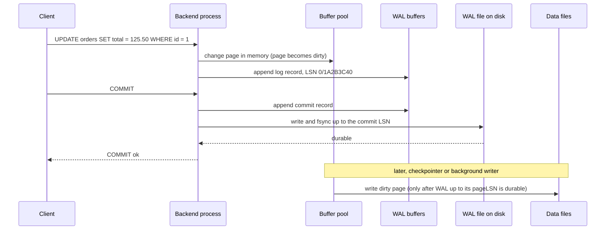
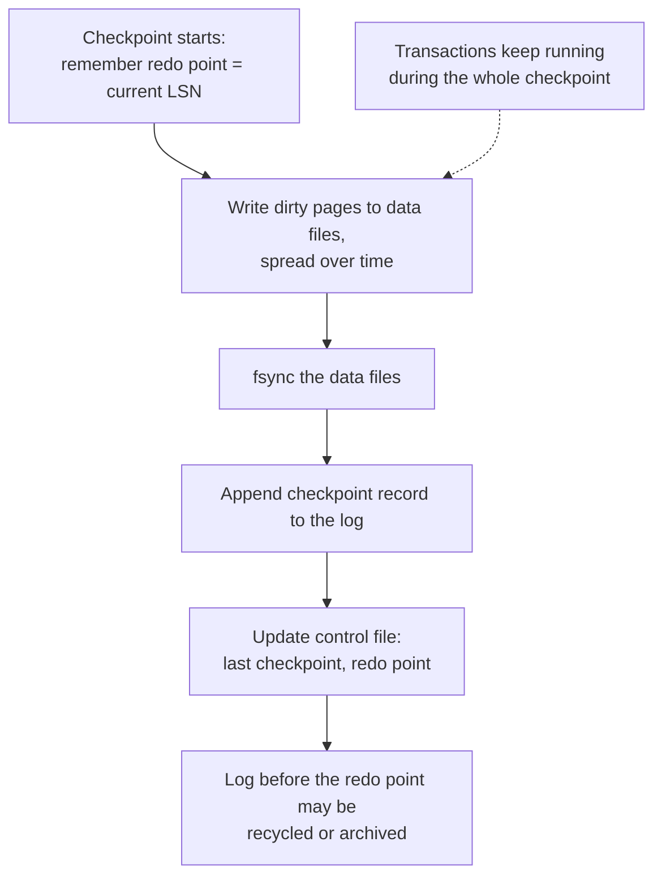
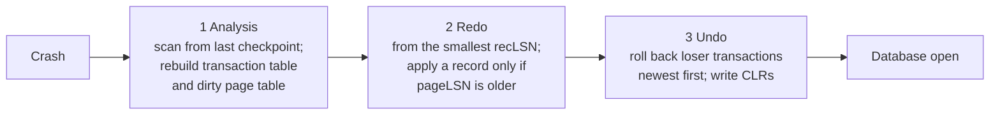

# 11. WAL, redo/undo, checkpoints, recovery

> **Level:** L3 senior (sections 1–2 are L2) | **Part:** I | **Rowlit references read at:** `1d57848` (Rowlit 1.6.3)
> **In one sentence:** An engine makes commits durable by writing a sequential log before it changes data pages, and after a crash it replays and reverses that log to get back to a correct state.
> **You will learn:**
> - the write-ahead logging rule, log records and the log sequence number (LSN);
> - what happens on the disk when you COMMIT, and how group commit makes that fast;
> - what a checkpoint is and why it bounds recovery time;
> - the three phases of ARIES-style crash recovery, and how PostgreSQL, SQL Server, Oracle, InnoDB and SQLite differ;
> - the durability settings that trade safety for speed, torn pages and the doublewrite buffer;
> - why logs grow, and what lets them be truncated.
>
> **Prerequisites:** [6. Storage internals](06-storage-internals.md) (pages, buffer pool, dirty pages), [9. Transactions](09-transactions-and-isolation.md), [10. Concurrency](10-concurrency-locking-mvcc.md) (undo, MVCC).
>
> [فارسی](../../fa/part1/11-logging-and-recovery.md) · Previous: [10. Concurrency: locks, latches, MVCC](10-concurrency-locking-mvcc.md) · Next: [12. Backup, replication, HA](12-backup-replication-ha.md)

---

## 1. The idea (beginner)

A database keeps its tables in pages of 8 or 16 KB scattered over large files. A single `UPDATE` of one order may change
a table page, two index pages and a page of free-space bookkeeping, all in different places on disk. Writing all of them
to disk before saying "committed" would be slow (random writes), and a power cut in the middle would leave some pages
new and some old.

The solution is the same one an accountant uses: first write the intended change as one line in a journal, in order,
then update the ledgers at leisure. The database's journal is the **[write-ahead log](../glossary.md#wal)** (WAL; SQL
Server calls it the *[transaction log](../glossary.md#transaction-log)*, Oracle and MySQL the *redo log*). Appending to the end of one file is fast, and
once the commit line is safely on disk the change can always be rebuilt from the log, even if the data pages were never
written. After a crash the engine runs **[crash recovery](../glossary.md#crash-recovery)**: it reads the log, **redoes** what was committed but not yet in the pages, and **undoes**
what was in the pages but never committed. That is how the "A" and the "D" of ACID ([9](09-transactions-and-isolation.md#21-acid-letter-by-letter)) are kept.

## 2. How it works (practitioner)

### 2.1 The write-ahead rule

The whole technique rests on two rules:

1. **Log before data.** A changed data page may be written to disk only after every log record describing changes to
   that page is on stable storage.
2. **Log before commit.** A transaction counts as committed only when its commit record (and so every record before it)
   is on stable storage.

These rules let the [buffer pool](../glossary.md#buffer-pool) manager be relaxed in two ways, which textbooks call *[steal and no-force](../glossary.md#steal-no-force)*:

- **Steal**: a page changed by an *uncommitted* transaction may be written to disk (for example to free buffer space).
  After a crash such changes must be **[undone](../glossary.md#undo-log)**, so the log (or an undo store) must hold the
  old values.
- **No-force**: pages changed by a *committed* transaction need not be written at commit. After a crash such changes may
  be missing from the data files and must be **[redone](../glossary.md#redo)** from the log, so the log must hold the
  new values.

Almost every disk-based engine is steal / no-force. It gives the best run-time performance and puts all the work into
recovery.

### 2.2 Log records and the LSN

A **[log record](../glossary.md#log-record)** describes one change: which transaction, which page, what changed (physically "bytes 120–128 of page 7 of
file 16410", or logically "insert key 7 into index X"), and a pointer to the previous record of the same transaction.
Every record has a **[log sequence number](../glossary.md#lsn)** (LSN), a monotonically increasing position in the log.
Each data page stores the LSN of the last record applied to it (the *[pageLSN](../glossary.md#pagelsn)*), which is how recovery knows whether a
record has already reached the page.

| Engine | Name of the log | What an LSN looks like | Where to see it |
|---|---|---|---|
| PostgreSQL 17 | WAL, 16 MB segment files in `pg_wal/` | `0/1A2B3C4D` (64-bit byte position) | `SELECT pg_current_wal_lsn();` |
| SQL Server 2022 | transaction log (`.ldf`), divided into [virtual log files](../glossary.md#vlf) (VLFs) | `00000025:00000100:0001` (VLF : block : slot) | `sys.dm_db_log_info`, `fn_dblog` (undocumented) |
| Oracle 23ai | online redo log groups, archived redo logs | SCN (`CURRENT_SCN`) and redo byte address | `SELECT current_scn FROM v$database;` |
| MySQL 8 InnoDB | redo log (`#innodb_redo/` since 8.0.30) | byte count, `Log sequence number 21673456` | `SHOW ENGINE INNODB STATUS` (section `LOG`) |
| SQLite 3.4x | rollback journal or `-wal` file | frame number in the WAL | `PRAGMA wal_checkpoint;` |

You can measure how much log a statement produces. In PostgreSQL (illustrative output):

```sql
EXPLAIN (ANALYZE, WAL, COSTS OFF) UPDATE lab.orders SET total = total + 1 WHERE id = 1;
--  Update on orders (actual time=0.081..0.082 rows=0 loops=1)
--    WAL: records=1 fpi=1 bytes=8279
--    ->  Index Scan using orders_pkey on orders (actual time=0.020..0.022 rows=1 loops=1)
--          Index Cond: (id = 1)
```

`fpi=1` means a **full page image**: this was the first change to that page since the last checkpoint, so PostgreSQL logged
the whole 8 KB page ([3.6](#36-torn-pages-full-page-writes-and-the-doublewrite-buffer)). Run the same update again and the
WAL drops to one small record of about 70 bytes. (`lab.orders` is the scratch copy made in
[chapter 9](09-transactions-and-isolation.md#25-the-anomalies-on-shop).)

### 2.3 The commit path

**Figure 11.1 — What happens between UPDATE and "COMMIT ok" (PostgreSQL names; the pattern is the same everywhere).**



The only synchronous disk operation on the commit path is the **[fsync](../glossary.md#fsync)** of the log (a system call
that returns only when the operating system has pushed the data to the storage device). Data pages are written later in
the background. That is why commit latency depends on the log device and why databases put the log on the fastest,
lowest-latency storage available.

**[Group commit](../glossary.md#group-commit)** makes many commits share one fsync. While one fsync is in progress, other
transactions append their commit records to the buffer; the next fsync makes all of them durable at once. Under load,
throughput goes up while each commit still waits for exactly one flush. PostgreSQL can be told to wait a little to
collect more commits (`commit_delay`, `commit_siblings`; off by default); MySQL groups the binlog and redo flushes of
concurrent transactions automatically.

### 2.4 Checkpoints

If the engine never wrote [dirty pages](../glossary.md#dirty-page), recovery would have to replay the log from the beginning of time. A
**[checkpoint](../glossary.md#checkpoint)** bounds the work: it makes sure that all changes before a certain LSN (the
*[redo point](../glossary.md#redo-point)*) are in the data files, so recovery can start there and older log can be recycled.

**Figure 11.2 — A (fuzzy) checkpoint.**



Modern checkpoints are *[fuzzy](../glossary.md#fuzzy-checkpoint)*: transactions keep running and pages keep changing while the checkpoint writes. Recovery
therefore starts at the redo point remembered at the *start* of the checkpoint, not at the checkpoint record.

The trade-off is between run time and recovery time. Frequent checkpoints mean short recovery but more page writes (and,
in PostgreSQL, more full page images in the WAL). Infrequent ones mean less write amplification but longer recovery.

| Engine | What triggers a checkpoint | Defaults |
|---|---|---|
| PostgreSQL 17 | time or WAL volume, whichever first | `checkpoint_timeout = 5min`, `max_wal_size = 1GB`, `checkpoint_completion_target = 0.9` (spread writes over 90 % of the interval) |
| SQL Server 2022 | *indirect checkpoints* aiming at a recovery time | `TARGET_RECOVERY_TIME = 60 SECONDS` for databases created since SQL Server 2016 |
| Oracle 23ai | incremental checkpoints driven by a recovery target, plus log switches | `FAST_START_MTTR_TARGET` |
| MySQL 8 InnoDB | fuzzy checkpoints as redo space fills | `innodb_redo_log_capacity` (100 MB default since 8.0.30) |
| SQLite (WAL) | when the WAL reaches a page count | `wal_autocheckpoint = 1000` pages |

A PostgreSQL log line such as `checkpoints are occurring too frequently (12 seconds apart)` with the hint to raise
`max_wal_size` means WAL volume, not time, is forcing checkpoints. Since PostgreSQL 15 `log_checkpoints` is on by
default, so every checkpoint logs how many buffers it wrote and how long it took.

### 2.5 Log truncation and log growth

Log space is reused only when nothing needs the old records any more. **[Log truncation](../glossary.md#log-truncation)**
(SQL Server's word; PostgreSQL *recycles* WAL segments) is blocked by whatever still needs the old log:

- **an active transaction** that started before that point (it may need to be undone);
- **a checkpoint** that has not happened yet (the records may still be needed for redo);
- **a log backup** that has not been taken (SQL Server FULL recovery model, [12](12-backup-replication-ha.md));
- **a replica or a replication slot** that has not received the records yet;
- **an archiver** that failed (PostgreSQL `archive_command` returning an error keeps every segment).

SQL Server tells you directly which one it is:

```sql
SELECT name, recovery_model_desc, log_reuse_wait_desc FROM sys.databases WHERE name = N'shop';
-- shop  FULL  LOG_BACKUP          ← nobody has taken a log backup: the log will grow until the disk is full
SELECT * FROM sys.dm_db_log_space_usage;     -- size and used percent of the current database's log
```

Typical values of `log_reuse_wait_desc` are `NOTHING`, `CHECKPOINT`, `LOG_BACKUP`, `ACTIVE_TRANSACTION`, `REPLICATION` and
`AVAILABILITY_REPLICA`. In PostgreSQL the equivalent checks are:

```sql
SELECT slot_name, active, pg_size_pretty(pg_wal_lsn_diff(pg_current_wal_lsn(), restart_lsn)) AS retained
FROM pg_replication_slots;                          -- an inactive slot retains WAL forever (unless max_slot_wal_keep_size is set)
SELECT last_failed_wal, last_failed_time FROM pg_stat_archiver;
```

Shrinking a log file is the wrong first reaction. Find the reason it cannot be reused, fix that, and only then size the
file correctly. In SQL Server, a log that grew in many small steps also ends up with thousands of VLFs, which slows
recovery and log backups; grow it in large fixed increments.

### 2.6 Durability settings

Every engine lets you trade the guarantee "a committed transaction survives a crash" for speed. None of these settings
corrupts the database by itself (except where marked); they decide how many of the **last** commits can be lost.

| Engine | Setting | Safe default | Faster option and its risk |
|---|---|---|---|
| PostgreSQL | `synchronous_commit` | `on` | `off`: COMMIT returns before the WAL flush; a crash can lose the last ≈ 3 × `wal_writer_delay` (default 200 ms) of commits, never corrupts. Can be set per transaction. |
| PostgreSQL | `fsync` | `on` | `off`: **can corrupt the cluster** on an OS crash or power loss. Only for throw-away test data. |
| SQL Server | [delayed durability](../glossary.md#delayed-durability) | `DISABLED` | `ALTER DATABASE … SET DELAYED_DURABILITY = ALLOWED` then `COMMIT WITH (DELAYED_DURABILITY = ON)`: the log buffer is flushed later (when full, or by `sp_flush_log`). |
| Oracle | `COMMIT_WAIT`, `COMMIT_LOGGING` | `WAIT`, `IMMEDIATE` | `COMMIT WRITE BATCH NOWAIT`: commit does not wait for LGWR. |
| MySQL InnoDB | `innodb_flush_log_at_trx_commit` | `1` (write and flush at each commit) | `2`: write to the OS at commit, flush once per second (survives a MySQL crash, not an OS crash); `0`: write and flush once per second. |
| MySQL | `sync_binlog` | `1` | `0` or `N`: the binary log may miss transactions that InnoDB committed, which breaks replicas and point-in-time recovery. |
| SQLite | `PRAGMA synchronous` | `FULL` (2) | `NORMAL` (1) in WAL mode: no corruption, but the last commits may roll back after power loss; `OFF`: corruption possible on power loss. |
| Cassandra | `commitlog_sync` | `periodic`, every 10 s | `batch` / `group` for per-write durability; durability usually comes from replicas instead. |

> **In Rowlit:** Rowlit's own small SQLite stores use WAL mode: the query history
> (`engine/src/DbStudio.Core/Services/HistoryService.cs:67`) and the local history of objects
> (`engine/src/DbStudio.Core/LocalHistory/LocalHistoryService.cs:83`). The generated sample database is seeded in rollback
> journal mode (`engine/src/DbStudio.Core/Sample/SampleDatabase.cs:245`), so no `-wal` file is kept next to it.

## 3. Deep dive (senior)

### 3.1 ARIES-style crash recovery

**[ARIES](../glossary.md#aries)** (Mohan et al., IBM, 1992) is the recovery algorithm most engines follow in spirit. Its
three principles are: write-ahead logging; *repeating history* during redo (replay everything, committed or not, to bring
pages back to the exact state at the crash); and *logging during undo* (every undo action writes a
**[compensation log record](../glossary.md#compensation-log-record)**, CLR, so a crash during recovery never undoes the
same change twice).

**Figure 11.3 — The three phases of ARIES recovery.**



1. **Analysis** reads forward from the last checkpoint, which saved the *transaction table* (active transactions and
   their last LSN) and the *dirty page table* (each dirty page and its *recLSN*, the first record that dirtied it). At the
   end it knows which transactions are **losers** (no commit record) and where redo must start (the smallest recLSN).
2. **Redo** reads forward from that point and re-applies every change whose page has a pageLSN older than the record.
   After redo, the database looks exactly as it did at the moment of the crash, including the uncommitted changes.
3. **Undo** walks the losers' records backwards and reverses them, writing a CLR for each step. A CLR contains
   `undoNextLSN`, the next record to undo, so if the system crashes again during undo, the next recovery continues where
   the last one stopped.

### 3.2 PostgreSQL: recovery is redo only

PostgreSQL follows the WAL rule and runs a redo phase, but it has **no undo phase**. Because of MVCC, an aborted or
crashed transaction's row versions are already invisible: the commit log (`pg_xact`) does not mark the transaction as
committed, so every reader ignores them, and VACUUM removes them later ([10](10-concurrency-locking-mvcc.md#32-postgresql-mvcc-in-detail)).
Recovery therefore only replays WAL from the redo point stored in `pg_control` (`pg_controldata` prints it as
`Latest checkpoint's REDO location`).

Useful tools and facts:

- `pg_waldump` decodes WAL files. A trimmed record (illustrative output):

  ```text
  rmgr: Heap        len (rec/tot): 72/72, tx: 813, lsn: 0/01A2B3C8, prev 0/01A2B390, desc: HOT_UPDATE old_xmax: 813, old_off: 1, new_xmax: 0, new_off: 7, blkref #0: rel 1663/16384/16410 blk 0
  rmgr: Transaction len (rec/tot): 34/34, tx: 813, lsn: 0/01A2B418, prev 0/01A2B3C8, desc: COMMIT 2026-10-28 10:15:02.123456 UTC
  ```

- `wal_level` decides how much is logged: `minimal` (crash recovery only), `replica` (the default; enough for archiving and
  physical standbys) and `logical` (adds what logical decoding needs, [12](12-backup-replication-ha.md)).
- The same WAL stream feeds **archiving** (`archive_mode`, `archive_command` or `archive_library`) and **streaming
  replication**. A base backup plus archived WAL is what makes point-in-time recovery possible
  ([12](12-backup-replication-ha.md#22-point-in-time-recovery)). Recovery, replication and PITR are the same mechanism:
  "replay WAL on top of an older copy of the pages".

### 3.3 SQL Server: the transaction log and its phases

The `.ldf` file is a circular sequence of **VLFs**. SQL Server logs both redo and undo information in the same records.
At startup the error log shows the three ARIES phases literally, for example *Recovery of database 'shop' (5) is 50%
complete … Phase 2 of 3*. The **[recovery model](../glossary.md#recovery-model)** decides when the log can be truncated: `SIMPLE` (at checkpoint),
`FULL` (only after a log backup), `BULK_LOGGED` (like FULL, but bulk operations log only page allocations).

**[Accelerated Database Recovery](../glossary.md#accelerated-database-recovery)** (ADR, SQL Server 2019+) changes the picture: row versions are kept in a persistent
version store inside the database, so undo becomes a *logical revert* (point readers to the old version) that is
practically instant, and the log can be truncated even while a long transaction is open. Long rollbacks and long crash
recoveries are the problems ADR exists to remove.

### 3.4 Oracle: redo, undo, and undo protected by redo

Oracle writes redo into a **log buffer**; the log writer process (LGWR) flushes it at commit, when the buffer is a third
full, and every few seconds. Online redo logs are a ring of at least two **groups** (usually with mirrored members); at a
*log switch*, in [`ARCHIVELOG` mode](../glossary.md#archivelog-mode), the archiver copies the full group to an **archived redo log** before it can be reused.
In `NOARCHIVELOG` mode only crash recovery is possible, not media recovery or PITR.

Undo lives in an undo tablespace, and every change to an undo block is itself protected by redo. So *instance recovery*
(done automatically by SMON after a crash) first rolls forward with redo, which also rebuilds the undo, then opens the
database and rolls back uncommitted transactions using that undo, in the background and on demand ("fast-start
rollback"). *Media recovery* (after losing a data file) restores the file from a backup and applies archived and online
redo to it.

### 3.5 MySQL InnoDB: redo, doublewrite, undo and the binary log

InnoDB writes physical-logical **redo** records into a circular redo log and keeps undo in undo tablespaces (protected by
redo, as in Oracle). After a crash it applies redo, then rolls back incomplete transactions in the background.

MySQL has a second log on top: the **[binary log](../glossary.md#binlog)** (binlog), written by the server layer, used for replication and
point-in-time recovery ([12](12-backup-replication-ha.md)). To keep the two logs in agreement, a commit is an internal
**two-phase commit**: InnoDB *prepares* (redo flushed with a prepare mark), the server writes and syncs the binlog, then
InnoDB commits. On crash recovery a prepared transaction is committed if its binlog event exists and rolled back if not.
This is why `sync_binlog = 1` and `innodb_flush_log_at_trx_commit = 1` belong together.

### 3.6 Torn pages, full-page writes and the doublewrite buffer

A database page (8 KB or 16 KB) is larger than the unit the storage can write atomically (often 4 KB, historically 512
bytes). A power cut during a page write can leave a **[torn page](../glossary.md#torn-page)**: half new, half old. Redo
cannot repair it, because redo records describe changes *to* a page and assume the page itself is intact.

- **PostgreSQL** uses **[full page writes](../glossary.md#full-page-write)** (`full_page_writes = on`): the first change to
  a page after each checkpoint logs the complete page image, so redo can restore the page from the WAL first. This is
  the `fpi` count you saw in 2.2, and the reason WAL volume jumps right after every checkpoint. `wal_compression` reduces
  the cost.
- **InnoDB** uses the **[doublewrite buffer](../glossary.md#doublewrite-buffer)** (`innodb_doublewrite = ON`): pages are
  first written, in a batch, to a dedicated doublewrite area and synced, then written to their real place. After a crash
  a torn page is replaced by its intact copy from the doublewrite area.
- **SQL Server** detects torn pages with `PAGE_VERIFY CHECKSUM` (the default) and reports error 824; it does not repair
  them automatically except from a mirror or availability replica (automatic page repair). Restore from backup is the
  usual repair.
- **Oracle** detects corrupted (including fractured) blocks with block checksums and repairs them with *block media
  recovery* from backups and redo.
- **SQLite** relies on its journal: in rollback mode the journal holds the original page content, in WAL mode the new page
  is complete in the WAL before the checkpoint copies it.

Running with storage that guarantees atomic page writes (some file systems and devices do) is the only case where these
protections can be turned off safely.

### 3.7 SQLite: two journals, two directions

SQLite shows the two basic log designs side by side in one small engine:

- **Rollback [journal](../glossary.md#journal)** (`journal_mode = DELETE`, the default; also `TRUNCATE`, `PERSIST`): before changing a page, SQLite
  copies the **original** page into the `-journal` file and syncs it. Commit = sync the database file, then delete
  (or truncate) the journal. After a crash a "hot" journal is played back to restore the old pages. This is an **undo
  log**.
- **[WAL mode](../glossary.md#wal-mode)** (`journal_mode = WAL`): changed pages are appended to the `-wal` file; the database file is not touched until a
  checkpoint. Commit = append a commit frame and sync the WAL. Readers find the newest version of a page through the
  `-shm` index. After a crash, frames after the last commit frame are ignored. This is a **redo log**, and it is why WAL
  mode allows readers during a write ([10](10-concurrency-locking-mvcc.md#36-sqlite-one-writer-per-file)).

```sql
PRAGMA journal_mode = WAL;            -- persistent: stays set for the database file
PRAGMA synchronous = NORMAL;          -- common pairing with WAL
PRAGMA wal_checkpoint(TRUNCATE);      -- copy WAL into the database and truncate the -wal file
```

### 3.8 Engines without a classic WAL

- **ClickHouse** MergeTree tables write each `INSERT` as a new immutable part (a directory of column files). There is no
  WAL in front of them, and by default parts are not fsynced on insert (MergeTree settings `fsync_after_insert` and
  `fsync_part_directory` are off); durability in production comes from `Replicated*MergeTree` replicas
  ([12](12-backup-replication-ha.md)).
- **Cassandra** appends every write to the **[commitlog](../glossary.md#commitlog)** and to an in-memory memtable, then flushes memtables to SSTables;
  the commitlog is replayed after a crash. With the default `periodic` sync a node can lose up to 10 s of acknowledged
  writes, which replicas cover ([16](16-nosql-families.md)).
- **Snowflake** is a managed service: durability is provided by the cloud object store under its micro-partitions, and
  recovery from user mistakes is **Time Travel** and **Fail-safe** ([12](12-backup-replication-ha.md), [15](15-oltp-vs-olap-columnar.md)).

## 4. In each engine

| Topic | PostgreSQL 17 | SQL Server 2022 | Oracle 23ai | MySQL 8 InnoDB | SQLite 3.4x |
|---|---|---|---|---|---|
| Log | WAL segments (16 MB) | transaction log, VLFs | online + archived redo, undo tablespace | redo log + undo + binlog | rollback journal or WAL |
| Undo at recovery | none (MVCC + commit log) | yes (instant with ADR) | yes, after open | yes, in background | rollback journal is the undo |
| Torn-page protection | full page writes | checksum detection | checksum detection + block media recovery | doublewrite buffer | journal / WAL |
| Checkpoint knob | `checkpoint_timeout`, `max_wal_size` | `TARGET_RECOVERY_TIME` | `FAST_START_MTTR_TARGET` | `innodb_redo_log_capacity` | `wal_autocheckpoint` |
| Commit durability knob | `synchronous_commit` | `DELAYED_DURABILITY` | `COMMIT_WAIT` | `innodb_flush_log_at_trx_commit`, `sync_binlog` | `PRAGMA synchronous` |
| Why the log cannot be reused | slot, archiver, `wal_keep_size` | `log_reuse_wait_desc` | archiver, standby | checkpoint age, binlog expiry | open reader blocks checkpoint |

## 5. Exercises

1. A PostgreSQL server runs a checkpoint at 10:00:00. At 10:03 a transaction commits; at 10:04 the power fails before any
   page it changed was written. Explain step by step how the change survives. Where does recovery start reading the WAL?
2. Why does PostgreSQL write more WAL right after a checkpoint than in the middle of the checkpoint interval? Which setting
   reduces this cost without risking torn pages?
3. A SQL Server database in FULL recovery has a 200 GB log file that keeps growing; `log_reuse_wait_desc` shows
   `LOG_BACKUP`. What is the correct fix, and why is switching to SIMPLE and shrinking not a fix for a production
   database?
4. A team sets `innodb_flush_log_at_trx_commit = 2` and keeps `sync_binlog = 1`. What can they lose if (a) the mysqld
   process crashes, (b) the operating system crashes?
5. Why does PostgreSQL crash recovery need no undo phase, while InnoDB's does?
6. An SQLite application in WAL mode sees its `-wal` file grow to several gigabytes. Name the likely cause and two fixes.

## Answers

The answer key for all Part I chapters is collected in [18. Answer key and lab setup](18-exercise-answers.md).

<details><summary>Answers to chapter 11</summary>

1. At COMMIT the backend flushed the WAL up to the commit record (the WAL rule), so the change is in the WAL even though no
   data page was written. On restart, PostgreSQL reads `pg_control`, finds the redo point of the 10:00 checkpoint, and
   replays every WAL record from there; the record of the 10:03 update is re-applied to the page (whose pageLSN is older),
   and the commit record marks the transaction committed in `pg_xact`. Recovery starts at the **redo point** recorded at
   the start of the 10:00 checkpoint.
2. With `full_page_writes`, the first change to each page after a checkpoint logs the whole page image; right after a
   checkpoint almost every change is a "first change". `wal_compression` (for example `lz4`) shrinks those images; a longer
   checkpoint interval also reduces their number at the cost of longer recovery.
3. Take log backups (and schedule them, for example every 15 minutes); after the next log backup the log space can be
   reused, then resize the file once to a sensible size. Switching to SIMPLE breaks the log backup chain, so
   point-in-time recovery becomes impossible until a new full backup, and shrinking a log that will grow again only adds
   VLF fragmentation and growth stalls.
4. (a) Nothing committed: with `2`, the redo is written to the OS page cache at every commit, and the OS still has it.
   (b) Up to about one second of commits in InnoDB, because the OS cache was lost before the once-per-second flush. Worse,
   the binlog (synced) may now contain transactions that InnoDB lost, so replicas can be ahead of the primary.
5. PostgreSQL never overwrites a row in place: an uncommitted change is a new tuple version that no reader considers
   visible unless the commit log says committed, so it can simply be left for VACUUM. InnoDB updates the clustered index
   record in place and keeps the old version in undo, so after a crash the uncommitted in-place changes must be reversed.
6. A long-running or never-closed read transaction prevents the checkpoint from getting past its snapshot (or the
   application disabled auto-checkpoint). Fixes: end read transactions promptly (and do not keep statements stepping
   forever), and run `PRAGMA wal_checkpoint(TRUNCATE)` at quiet moments or keep `wal_autocheckpoint` enabled.

</details>

## Related chapters

- [9. Transactions, ACID and isolation](09-transactions-and-isolation.md) — atomicity and durability as promises.
- [10. Concurrency: locks, latches, MVCC](10-concurrency-locking-mvcc.md) — undo and versions from the reader's side.
- [12. Backup, replication, HA](12-backup-replication-ha.md) — the same log used for PITR and replication.
- [6. Storage internals](06-storage-internals.md) — pages, the buffer pool and dirty pages.
- [16. NoSQL families](16-nosql-families.md) — the commitlog and LSM trees in Cassandra.

## Glossary terms introduced here

[WAL](../glossary.md#wal) ·
[transaction log](../glossary.md#transaction-log) ·
[redo](../glossary.md#redo) ·
[undo log](../glossary.md#undo-log) ·
[steal / no-force](../glossary.md#steal-no-force) ·
[log record](../glossary.md#log-record) ·
[LSN](../glossary.md#lsn) ·
[pageLSN](../glossary.md#pagelsn) ·
[fsync](../glossary.md#fsync) ·
[group commit](../glossary.md#group-commit) ·
[checkpoint](../glossary.md#checkpoint) ·
[redo point](../glossary.md#redo-point) ·
[fuzzy checkpoint](../glossary.md#fuzzy-checkpoint) ·
[log truncation](../glossary.md#log-truncation) ·
[VLF](../glossary.md#vlf) ·
[recovery model](../glossary.md#recovery-model) ·
[crash recovery](../glossary.md#crash-recovery) ·
[ARIES](../glossary.md#aries) ·
[compensation log record](../glossary.md#compensation-log-record) ·
[full page write](../glossary.md#full-page-write) ·
[torn page](../glossary.md#torn-page) ·
[doublewrite buffer](../glossary.md#doublewrite-buffer) ·
[delayed durability](../glossary.md#delayed-durability) ·
[Accelerated Database Recovery](../glossary.md#accelerated-database-recovery) ·
[ARCHIVELOG mode](../glossary.md#archivelog-mode) ·
[journal](../glossary.md#journal) ·
[WAL mode](../glossary.md#wal-mode)

Used here, defined elsewhere: [binary log](../glossary.md#binlog) (chapter 12), [commitlog](../glossary.md#commitlog)
(chapter 16), [dirty page](../glossary.md#dirty-page) and [buffer pool](../glossary.md#buffer-pool) (chapter 6).
