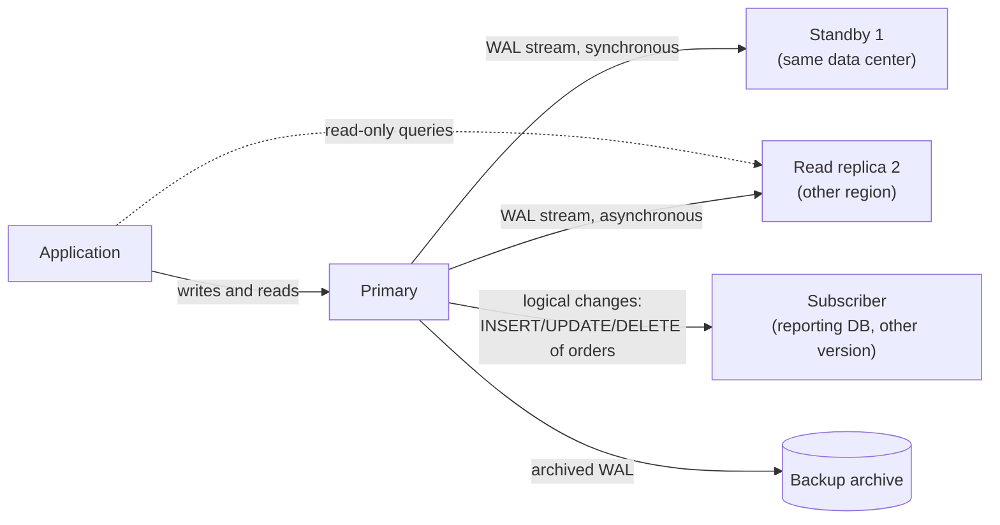
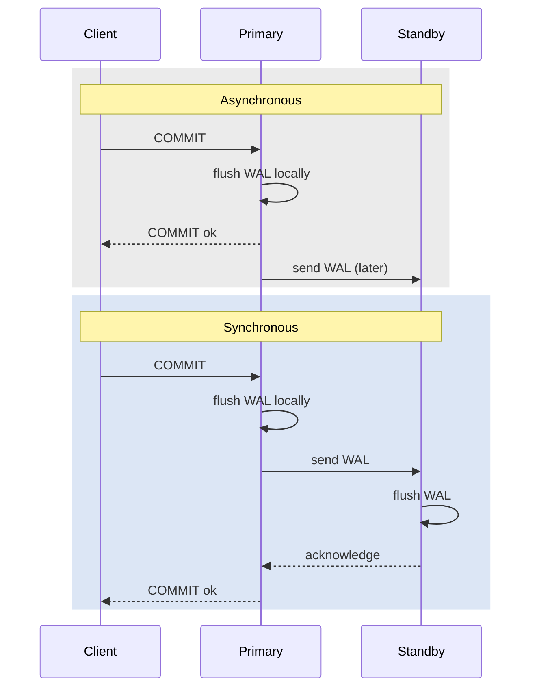
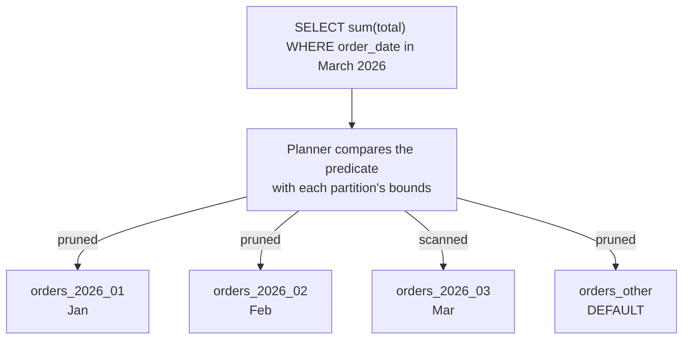
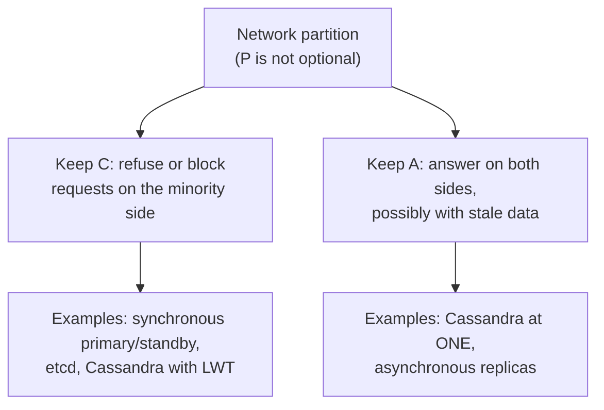

# 12. Backup, PITR, replication, HA, partitioning, sharding

> **Level:** L2 practitioner → L3 senior | **Part:** I | **Rowlit references read at:** `1d57848` (Rowlit 1.6.3)
> **In one sentence:** Backups protect against losing data, replication protects against losing a server, partitioning splits one big table into manageable pieces, and sharding splits one database over many servers; each comes with a precise price in consistency and complexity.
> **You will learn:**
> - backup kinds (full, differential, incremental, log), RPO and RTO, point-in-time recovery and why restore drills matter;
> - physical versus logical replication, synchronous versus asynchronous, failover, split brain and replication lag;
> - table partitioning (range, list, hash) and partition pruning, with a PostgreSQL example on `shop`;
> - sharding: shard keys, rebalancing, cross-shard queries;
> - consensus (Raft), consistency models, CAP and PACELC, and two-phase commit.
>
> **Prerequisites:** [9. Transactions](09-transactions-and-isolation.md), [11. WAL, redo/undo, checkpoints, recovery](11-logging-and-recovery.md).
>
> [فارسی](../../fa/part1/12-backup-replication-ha.md) · Previous: [11. WAL, redo/undo, checkpoints, recovery](11-logging-and-recovery.md) · Next: [13. Performance tuning methodology](13-performance-tuning.md)

---

## 1. The idea (beginner)

Durability ([11](11-logging-and-recovery.md)) protects committed data against a crash of the *process*. It does not help
when the disk dies, when the data centre loses power for a day, or when someone runs `DELETE FROM orders` without a
`WHERE`. For those you need copies: a **[backup](../glossary.md#backup)** is a copy kept aside that you can restore later;
**[replication](../glossary.md#replication)** keeps a live copy on another server that follows every change. They solve
different problems. A replica faithfully replays the accidental `DELETE` within milliseconds, so it is not a backup; a
backup takes hours to restore, so it is not high availability.

When one table or one server becomes too big, you split. **[Partitioning](../glossary.md#table-partitioning)** cuts one
table into pieces inside one database (for example one piece per month), so queries and maintenance touch only the
pieces they need. **[Sharding](../glossary.md#sharding)** spreads the rows over several independent servers, so the
system can grow beyond one machine. As soon as data lives on more than one machine, the network can fail between them,
and you must choose what the system does then: refuse to answer, or answer with possibly old data. That choice is the
subject of the CAP theorem at the end of this chapter.

## 2. How it works (practitioner)

### 2.1 Backups, RPO and RTO

Two numbers define what a backup strategy must achieve:

- **[RPO](../glossary.md#rpo)** (recovery point objective): how much data, measured in time, you may lose. "RPO 5 minutes"
  means after a disaster you must be able to restore everything up to at most 5 minutes before it.
- **[RTO](../glossary.md#rto)** (recovery time objective): how long the restore may take until the system is usable again.

The backup kinds:

| Kind | Contains | Restore needs |
|---|---|---|
| **[Full](../glossary.md#full-backup)** | the whole database | that backup |
| **[Differential](../glossary.md#differential-backup)** | pages changed since the last *full* backup | the full + the latest differential |
| **[Incremental](../glossary.md#incremental-backup)** | pages changed since the last backup of *any* kind | the full + every incremental since, in order |
| **[Log backup](../glossary.md#log-backup)** (WAL archive, archived redo, binlog) | the log records since the previous log backup | a full (plus diffs) + the unbroken chain of log backups |

And the two forms:

- **Physical** backups copy data files or pages (`pg_basebackup`, SQL Server `BACKUP DATABASE`, Oracle RMAN, Percona
  XtraBackup). Fast to restore, same engine version and platform only, always the whole cluster or database.
- **Logical** backups export SQL or rows (`pg_dump`, `mysqldump`, Oracle Data Pump, `.dump` in SQLite). Portable across
  versions, selectable per table, but slow to restore for large databases (indexes are rebuilt) and they capture one
  moment only (no PITR).

Examples on `shop`:

```bash
# PostgreSQL 17: logical dump of one database (custom format) and restore into a new database
pg_dump -h localhost -p 15432 -U shop -Fc -f shop.dump shop
createdb -h localhost -p 15432 -U shop shop_copy && pg_restore -h localhost -p 15432 -U shop -d shop_copy shop.dump

# PostgreSQL 17: physical base backup of the whole cluster, WAL streamed alongside
pg_basebackup -h localhost -p 15432 -U shop -D ./base -Ft -z -X stream -P
```

```sql
-- SQL Server 2022: full, differential and log backups with page checksums
BACKUP DATABASE shop TO DISK = N'/var/opt/mssql/backup/shop_full.bak' WITH COMPRESSION, CHECKSUM;
BACKUP DATABASE shop TO DISK = N'/var/opt/mssql/backup/shop_diff.bak' WITH DIFFERENTIAL, COMPRESSION, CHECKSUM;
BACKUP LOG shop TO DISK = N'/var/opt/mssql/backup/shop_log_1015.trn' WITH COMPRESSION, CHECKSUM;
```

```bash
# MySQL 8: consistent logical dump without locking InnoDB tables, recording the binlog position
mysqldump -h 127.0.0.1 -P <port> -u root -p --single-transaction --routines --triggers --source-data=2 shop > shop.sql
```

```sql
-- SQLite: an online copy that is consistent even while the database is in use
VACUUM INTO 'shop-backup.sqlite';
```

Engine specifics worth knowing: PostgreSQL 17 added **native incremental backups** (`pg_basebackup --incremental`, which
needs `summarize_wal = on`, combined later with `pg_combinebackup`). Oracle RMAN distinguishes level 0 (a full that can
anchor incrementals) and level 1 incrementals (differential by default, `CUMULATIVE` on request). SQL Server `COPY_ONLY`
takes a full backup that does not disturb the differential base. Copying a SQLite file with the operating system while
it is being written can produce a corrupt copy; in WAL mode the `-wal` file holds committed data that is not yet in the
main file.

Systems with their own approach: **ClickHouse** has `BACKUP TABLE shop.orders TO Disk('backups', 'orders.zip')` (or
`S3(...)`) with incremental backups through `SETTINGS base_backup = …`. **Snowflake** keeps old micro-partitions for
**Time Travel** (`SELECT … AT(OFFSET => -300)`, `UNDROP TABLE`, zero-copy `CLONE`; 1 day by default, up to 90 days on
Enterprise edition), followed by 7 days of Fail-safe that only Snowflake support can restore from. **Cassandra** takes
per-node `nodetool snapshot`s (hard links to SSTables) and can keep incremental backups of every flushed SSTable.

### 2.2 Point-in-time recovery

**[Point-in-time recovery](../glossary.md#pitr)** (PITR) restores the database to any moment, for example 10:14:00, one
minute before the accidental `DELETE` at 10:15. It is the WAL replay of chapter 11 on top of an older backup, stopped at
the chosen moment.

PostgreSQL needs a base backup plus continuous WAL archiving:

```ini
# postgresql.conf on the primary
wal_level = replica
archive_mode = on
archive_command = 'test ! -f /archive/%f && cp %p /archive/%f'   # or a tool such as pgBackRest / WAL-G
```

To recover: restore the base backup into an empty data directory, then set the target and create `recovery.signal`:

```ini
# postgresql.conf (or postgresql.auto.conf) of the restored copy
restore_command = 'cp /archive/%f %p'
recovery_target_time = '2026-10-28 10:14:00+00'
recovery_target_action = 'pause'      # default: stop and let you inspect before promoting
```

Start the server; it replays archived WAL up to 10:14:00 and pauses. Check the data with read-only queries, then call
`SELECT pg_wal_replay_resume();` to end recovery and open for writes (with `recovery_target_action = 'pause'` this
promotes the copy). Copy the lost rows back to the production database, or switch over to the restored copy.

SQL Server uses the restore sequence and `STOPAT`:

```sql
RESTORE DATABASE shop_pitr FROM DISK = N'/var/opt/mssql/backup/shop_full.bak'
  WITH MOVE N'shop' TO N'/var/opt/mssql/data/shop_pitr.mdf', MOVE N'shop_log' TO N'/var/opt/mssql/data/shop_pitr.ldf',
       NORECOVERY;
RESTORE LOG shop_pitr FROM DISK = N'/var/opt/mssql/backup/shop_log_1015.trn'
  WITH STOPAT = N'2026-10-28T10:14:00', RECOVERY;
```

(The logical file names `shop` and `shop_log` are the defaults for a database created with `CREATE DATABASE shop`; check
them with `RESTORE FILELISTONLY`.) MySQL replays binary logs from the position recorded in the dump
(`mysqlbinlog --start-position=… --stop-datetime="2026-10-28 10:14:00" binlog.000042 | mysql`). Oracle uses RMAN
(`RUN { SET UNTIL TIME "…"; RESTORE DATABASE; RECOVER DATABASE; }` followed by `ALTER DATABASE OPEN RESETLOGS`) or, if
flashback logging is on, `FLASHBACK DATABASE TO TIMESTAMP …`, which is much faster because it only rewinds changed blocks.

### 2.3 Restore drills

A backup that has never been restored is a hope, not a backup. Common ways backups turn out to be useless: the log chain
has a gap, the archive command silently failed for weeks, the encryption key or certificate was not backed up, the
backup is on the same storage that failed, or the restore takes 14 hours against an RTO of 2. Practice:

- **Restore regularly** to a separate server and run checks (row counts, `DBCC CHECKDB` on SQL Server, `pg_amcheck` on
  PostgreSQL, application smoke tests). Measure the time: that is your real RTO.
- **Verify backup integrity**: `WITH CHECKSUM` plus `RESTORE VERIFYONLY` (SQL Server), `pg_verifybackup` (PostgreSQL),
  `RESTORE VALIDATE` (RMAN).
- **Follow 3-2-1**: three copies, on two different media, one off-site (or immutable in object storage), so ransomware or an
  administrator mistake cannot delete all of them.
- **Monitor the log chain**: alert when a log backup or WAL archive is late, because that directly widens your RPO.

### 2.4 Replication: physical and logical

**Figure 12.1 — A primary with a synchronous standby, an asynchronous replica and a logical subscriber.**



**[Physical replication](../glossary.md#physical-replication)** ships the log itself (WAL, transaction log, redo) and the
replica replays it like a never-ending crash recovery. The replica is a byte-for-byte copy: same engine version, all
databases, indexes and bloat included, usually read-only. Examples: PostgreSQL **[streaming replication](../glossary.md#streaming-replication)**,
SQL Server Always On availability groups and log shipping, Oracle Data Guard physical standby.

**[Logical replication](../glossary.md#logical-replication)** ships row changes ("insert this row into `orders`"). The
subscriber is an independent, writable database, can have other indexes, a different major version, or only some tables.
Examples: PostgreSQL publications and subscriptions, MySQL binlog replication (row format), SQL Server transactional
replication, Oracle GoldenGate. It is how you upgrade with little downtime and how you feed other systems. Its limits:
schema changes (DDL) are usually not replicated automatically (PostgreSQL 17 still does not), sequences need separate
handling, and every table needs a primary key or a replica identity.

```sql
-- PostgreSQL 17 logical replication of two shop tables (publisher needs wal_level = logical)
CREATE PUBLICATION shop_pub FOR TABLE public.orders, public.customers;          -- on the publisher
CREATE SUBSCRIPTION shop_sub CONNECTION 'host=pg-primary dbname=shop user=repl'  -- on the subscriber
  PUBLICATION shop_pub;
```

**[Change data capture](../glossary.md#cdc)** (CDC) is logical replication into something that is not a database: a tool
reads the log (PostgreSQL logical decoding, the MySQL **[binlog](../glossary.md#binlog)**, SQL Server CDC change tables)
and publishes each change as an event, typically to Kafka ([16](16-nosql-families.md)). Debezium is the best-known
open-source example.

PostgreSQL keeps WAL for a replica or subscriber that is behind using a **[replication slot](../glossary.md#replication-slot)**.
A slot whose consumer disappeared retains WAL forever and can fill the disk ([11](11-logging-and-recovery.md#25-log-truncation-and-log-growth));
`max_slot_wal_keep_size` puts a limit on it.

### 2.5 Synchronous or asynchronous

**Figure 12.2 — When does COMMIT return? Asynchronous versus synchronous replication.**



- **Asynchronous** replication adds no latency to commits, but when the primary dies, the transactions that had not yet
  reached the replica are lost if you fail over. The data-loss window is the replication lag.
- **Synchronous** replication makes COMMIT wait for at least one standby to confirm, so a failover to that standby loses
  nothing. The cost is one network round trip per commit, and if no synchronous standby is reachable, commits **wait**
  (PostgreSQL) or the system must be configured to fall back.

PostgreSQL controls *what* the standby must confirm with `synchronous_commit`: `remote_write` (received, written to the
OS), `on` (flushed to disk), `remote_apply` (replayed, so a read on the standby sees the change). `synchronous_standby_names
= 'ANY 1 (s1, s2)'` asks for a quorum of any one of two. SQL Server availability groups have *synchronous-commit* and
*asynchronous-commit* replicas; Oracle Data Guard has the protection modes *Maximum Protection* (synchronous, the primary
stops when no standby confirms), *Maximum Availability* (synchronous, falls back to asynchronous) and *Maximum
Performance* (asynchronous, the default). MySQL replication is asynchronous by default; *semi-synchronous* replication
waits until one replica has *received* (not applied) the events.

### 2.6 Failover, split brain and fencing

**[Failover](../glossary.md#failover)** promotes a replica to primary when the primary fails. *Switchover* is the planned
version (for patching), with no data loss. A failover has three hard parts:

1. **Detecting failure.** A primary that is slow, or unreachable from the monitor only, looks dead. Timeouts that are too
   short cause needless failovers; too long ones extend downtime.
2. **Choosing the new primary**: the most up-to-date replica, ideally a synchronous one.
3. **Making sure the old primary stops.** If the old primary is still alive (for example, only the network between the
   data centres failed) and keeps accepting writes while the new one does too, you have **[split brain](../glossary.md#split-brain)**:
   two primaries, two diverging histories, and no automatic way to merge them.

Split brain is prevented by **quorum** and **[fencing](../glossary.md#fencing)**. Quorum means a node may act as primary
only while it can reach a majority of voters (an odd number of nodes, or a witness/observer in a third location).
Fencing means the cluster actively cuts off the old primary: revoke its storage access, power it off ("STONITH": shoot
the other node in the head), or have it demote itself when it loses its lease. Typical tooling: Patroni (PostgreSQL,
leader lease in etcd/Consul/ZooKeeper), Windows Server Failover Clustering or Pacemaker under SQL Server availability
groups, Oracle Data Guard broker with Fast-Start Failover and an observer, MySQL InnoDB Cluster with MySQL Router.

After a failover, applications must reconnect to the new primary. A listener or virtual IP (SQL Server AG listener), a
multi-host connection string (`host=a,b target_session_attrs=read-write` in libpq / Npgsql), or a proxy hides the change.

### 2.7 Read replicas and replication lag

Replicas can serve read-only traffic. The catch is **[replication lag](../glossary.md#replication-lag)**: the replica is
behind by some milliseconds or, under load, minutes. A user who places an order and is then sent to a replica for "my
orders" may not see it. Strategies:

- read your own recent writes from the primary (for a few seconds after a write, or for that user's session);
- use synchronous apply (`remote_apply`) for the replicas that must be current;
- pass the commit's LSN to the reader and wait until the replica has replayed it.

Measure lag on the primary or the replica:

```sql
-- PostgreSQL: on the primary
SELECT application_name, state, sync_state, write_lag, flush_lag, replay_lag FROM pg_stat_replication;
-- SQL Server: queues of each availability-group database
SELECT database_id, log_send_queue_size, redo_queue_size FROM sys.dm_hadr_database_replica_states;
```

MySQL reports `Seconds_Behind_Source` in `SHOW REPLICA STATUS`; it measures the age of the event being applied, so it can
read 0 while the replica has not even received the latest events.

### 2.8 Table partitioning

**[Table partitioning](../glossary.md#table-partitioning)** splits one logical table into physical pieces by the value of
a **partition key**:

- **range**: by intervals, typically time (`order_date` per month);
- **list**: by discrete values (`country_id IN (1, 2)` in one partition, `3` in another);
- **hash**: by `hash(customer_id) mod N`, to spread rows evenly.

What you gain: **[partition pruning](../glossary.md#partition-pruning)** (the planner skips partitions that cannot
contain matching rows), cheap bulk removal of old data (detach or drop a partition instead of a huge `DELETE`), and
per-partition maintenance (vacuum, index rebuilds, different storage). What you do not automatically gain: speed for
queries that do not filter on the partition key. They now read *every* partition, often slower than one table with a
good index.

A worked example on PostgreSQL 17 in the scratch schema `lab` from [chapter 9](09-transactions-and-isolation.md#25-the-anomalies-on-shop):

```sql
CREATE TABLE lab.orders_p (
  id integer NOT NULL, customer_id integer NOT NULL, order_date timestamptz NOT NULL,
  total numeric(12,2) NOT NULL, status public.order_status NOT NULL DEFAULT 'new',
  PRIMARY KEY (id, order_date)                        -- a unique key must include the partition key
) PARTITION BY RANGE (order_date);
CREATE TABLE lab.orders_2026_01 PARTITION OF lab.orders_p FOR VALUES FROM ('2026-01-01') TO ('2026-02-01');
CREATE TABLE lab.orders_2026_02 PARTITION OF lab.orders_p FOR VALUES FROM ('2026-02-01') TO ('2026-03-01');
CREATE TABLE lab.orders_2026_03 PARTITION OF lab.orders_p FOR VALUES FROM ('2026-03-01') TO ('2026-04-01');
CREATE TABLE lab.orders_other   PARTITION OF lab.orders_p DEFAULT;
INSERT INTO lab.orders_p SELECT id, customer_id, order_date, total, status FROM public.orders;

EXPLAIN (COSTS OFF) SELECT sum(total) FROM lab.orders_p WHERE order_date >= '2026-03-01' AND order_date < '2026-04-01';
```

Illustrative output (the six seed orders fall into January, February and March 2026):

```text
 Aggregate
   ->  Seq Scan on orders_2026_03 orders_p
         Filter: ((order_date >= '2026-03-01 00:00:00+00'::timestamp with time zone) AND (order_date < '2026-04-01 00:00:00+00'::timestamp with time zone))
```

Only `orders_2026_03` is scanned. Remove the `WHERE` clause and the plan becomes an `Append` over all four partitions.

**Figure 12.3 — Partition pruning: the planner compares the predicate with each partition's bounds.**



Pruning happens at planning time for constants and, since PostgreSQL 11, also at **execution time** for parameters and
values from a join (the plan shows `Subplans Removed: N`). It only works when the query compares the partition key itself:
`WHERE date_trunc('month', order_date) = '2026-03-01'` hides the column inside a function and prunes nothing
([13](13-performance-tuning.md#sargable-predicates)).

Rolling old data out is a metadata operation:

```sql
ALTER TABLE lab.orders_p DETACH PARTITION lab.orders_2026_01 CONCURRENTLY;   -- PostgreSQL 14+, no long lock
DROP TABLE lab.orders_2026_01;                                               -- or archive it first
-- … when done with the example:  DROP SCHEMA lab CASCADE;
```

Other engines: **SQL Server** uses a partition function and a partition scheme, and `ALTER TABLE … SWITCH PARTITION` to move
a whole partition in or out instantly (the classic *sliding window*); indexes "aligned" with the partition scheme keep
switching possible. **Oracle** has range, list, hash, interval (automatic new range partitions), reference and composite
partitioning. **MySQL** supports RANGE, LIST, HASH and KEY partitioning; every unique key must include the partitioning
columns, and partitioned InnoDB tables cannot have foreign keys. **ClickHouse** declares `PARTITION BY` on MergeTree
tables; the `shop` seed partitions orders by month with `PARTITION BY toYYYYMM(order_date)`
(`engine/tests/docker/seed-clickhouse.sql:53`), and `ALTER TABLE … DROP PARTITION` removes a month at once. **Snowflake**
partitions every table automatically into micro-partitions and prunes on their min/max metadata; you can only influence
it with a clustering key ([15](15-oltp-vs-olap-columnar.md)). **SQLite** has no partitioning.

### 2.9 Sharding

Sharding places different rows on different servers (**shards**), each a complete database for its subset. A
**[shard key](../glossary.md#shard-key)** decides where a row lives. Choosing it is the most consequential design decision
of a sharded system:

| Strategy | How | Good at | Bad at |
|---|---|---|---|
| Hash | `hash(customer_id) mod N` or a hash ring | even spread of data and load | range queries over the key; adding shards (unless consistent hashing) |
| Range | key intervals (`customer_id` 1–1M on shard 1, …) | range scans, locality | hot spots (all new rows go to the last range) |
| Directory | a lookup table maps key → shard | flexible placement, moving single tenants | the directory is an extra component to keep available |

Rules of thumb: pick a key that appears in almost every query (so a query goes to *one* shard), that keeps rows that are
written together on the same shard (so a transaction stays on one shard), and that has many distinct, evenly used values.
For `shop`, `customer_id` is a natural shard key: a customer's orders, lines and invoices can live together. Cassandra's
`shop` seed shows the same idea: `orders_by_customer` has `PRIMARY KEY ((customer_id), order_date, order_id)`, so all orders of
one customer form one partition on the same replicas (`engine/tests/docker/seed-cassandra.cql:80-87`).

The costs:

- **Cross-shard queries** ("revenue per country") must ask every shard and merge the results (scatter-gather); joins
  between rows on different shards are expensive or unsupported.
- **Cross-shard transactions** need a distributed protocol such as two-phase commit ([3.4](#34-distributed-transactions-and-two-phase-commit)).
- **[Rebalancing](../glossary.md#rebalancing)**: adding a shard means moving data while the system runs. Consistent hashing
  with many virtual nodes (Cassandra's token ring) or many small fixed shards per server (Citus, MongoDB chunks, Vitess)
  keep the moves small.
- **Global uniqueness** (a unique email across all shards) and sequences need extra design (UUIDs, a central allocator).

Products: Citus (PostgreSQL extension), Vitess (MySQL), MongoDB sharded clusters, Cassandra and ClickHouse (`Distributed`
table engine over shards) are sharded by design; SQL Server and plain PostgreSQL have no built-in sharding, so it lives in
the application or a middleware. Shard only when a single, well-tuned server with replicas really cannot carry the load:
partitioning, read replicas and better indexes are much cheaper.

## 3. Deep dive (senior)

### 3.1 Consensus and Raft

Automatic failover and distributed metadata need nodes to agree on one value ("who is the leader in term 7?", "is log
entry 42 committed?") even when some nodes fail or messages are delayed. That is **[consensus](../glossary.md#consensus)**.
Paxos (Lamport) was the first practical algorithm; **[Raft](../glossary.md#raft)** (Ongaro and Ousterhout, 2014) is the
one most systems use today because it is easier to implement correctly.

Raft in five sentences. Time is divided into numbered **terms**; in each term at most one **leader** is elected by a
majority of votes. Clients send commands to the leader, which appends them to its log and replicates them to the
followers. An entry is **committed** once a majority has stored it; committed entries are never lost because any future
leader must have them (a candidate cannot win a vote from a node whose log is more up to date). Followers that hear
nothing from the leader for a randomized election timeout start an election. With 2f + 1 nodes, the system survives f
failures; with 3 nodes, one; with 5 nodes, two.

Where you meet it: etcd and Consul (under Patroni), ClickHouse Keeper (instead of ZooKeeper, under `Replicated*MergeTree`),
Kafka KRaft ([16](16-nosql-families.md)), MongoDB replica-set elections (a Raft-like protocol), CockroachDB and TiDB (one
Raft group per data range). MySQL Group Replication uses a Paxos variant.

### 3.2 Consistency models

A consistency model says which values a read may return when data is replicated. From strongest to weakest:

| Model | Promise | Example |
|---|---|---|
| **[Linearizability](../glossary.md#linearizability)** | Every operation appears to take effect at one instant between its start and end; once a write is acknowledged, every later read returns it. | A single primary read after commit; Cassandra lightweight transactions; etcd. |
| Sequential consistency | All clients see operations in the same order, consistent with each client's own order, but not necessarily real time. | — |
| **[Causal consistency](../glossary.md#causal-consistency)** | If A could have influenced B (B read A's result), everyone sees A before B; unrelated writes may appear in different orders. | MongoDB causally consistent sessions. |
| **[Read-your-writes](../glossary.md#read-your-writes)** | A client always sees its own earlier writes. | Read from the primary after writing. |
| Monotonic reads | A client never sees time go backwards (an older value after a newer one). | Pin a client to one replica. |
| **[Eventual consistency](../glossary.md#eventual-consistency)** | If writes stop, all replicas eventually converge. Nothing is promised about reads in between. | Asynchronous replicas; Cassandra at `ONE`. |

Do not confuse linearizability with **serializability** ([9](09-transactions-and-isolation.md#31-serializability-and-two-ways-to-get-it)):
serializability is about *transactions over many objects* appearing in some serial order (not necessarily real-time
order); linearizability is about *single objects* respecting real time. *Strict serializability* is both, and is what
Spanner and a single-node PostgreSQL at SERIALIZABLE offer.

**Cassandra** makes the model a per-request choice with **consistency levels**. With replication factor RF, a write at
level W waits for W replicas, a read at level R asks R replicas and returns the newest timestamp. If **R + W > RF** the
read set overlaps the write set, so a read sees the latest acknowledged write (this is the **[quorum](../glossary.md#quorum)**
rule; `QUORUM` = ⌊RF/2⌋ + 1, for RF 3 that is 2):

```sql
-- cqlsh
CONSISTENCY QUORUM;                                   -- for this cqlsh session
SELECT order_id, total FROM shop.orders_by_customer WHERE customer_id = 1;
```

The lab keyspace uses `SimpleStrategy` with `replication_factor: 1` (`engine/tests/docker/seed-cassandra.cql:23-25`), so on
the single lab node every level behaves the same; the levels only matter with RF ≥ 3. `LOCAL_QUORUM` counts only replicas in
the local data centre, the usual choice for multi-region clusters. Quorum reads and writes are still not linearizable under
concurrent writes and failures (last-write-wins by timestamp); lightweight transactions are.

### 3.3 CAP and PACELC

The **[CAP theorem](../glossary.md#cap)** (Brewer 2000, proved by Gilbert and Lynch 2002) says: when a network
**partition** separates replicas, a system must give up either **consistency** (in the CAP sense: linearizability) or
**availability** (every request to a working node gets a non-error answer). There is no third way during the partition,
because the two sides cannot talk.

**Figure 12.4 — CAP: during a partition, choose C or A.**



CAP is often misread as "pick two of three". In practice partitions happen whether you like it or not, so the real choice
is C or A *when they happen*. **[PACELC](../glossary.md#pacelc)** (Abadi) completes the picture: if there is a Partition,
choose Availability or Consistency; **E**lse (normal operation) choose **L**atency or **C**onsistency. Synchronous
replication pays latency on every commit to stay consistent; asynchronous replication buys low latency with stale reads and
a data-loss window.

Examples, with the caveat that most systems are configurable:

- A single-primary PostgreSQL or SQL Server with **synchronous** standbys behaves PC/EC: commits wait when no synchronous
  standby confirms, and every commit pays a round trip.
- The same with **asynchronous** replicas behaves PA/EL for reads from replicas, and a failover can lose recent commits.
- Cassandra is PA/EL at `ONE`, and moves towards PC/EC as you raise consistency levels or use lightweight transactions.

### 3.4 Distributed transactions and two-phase commit

When one transaction writes to two databases (two shards, or a database and a message queue), atomicity needs a protocol.
**[Two-phase commit](../glossary.md#two-phase-commit)** (2PC) uses a **coordinator**:

1. **Prepare**: the coordinator asks every participant to prepare. Each one makes the transaction durable but not yet
   visible (it must be able to commit *or* roll back later, even after a crash), keeps its locks, and votes yes or no.
2. **Commit / abort**: if all voted yes, the coordinator logs "commit" and tells everyone to commit; otherwise it tells
   everyone to roll back.

The weak spot: a participant that voted yes and then loses contact with the coordinator is **in doubt**. It may not decide
alone, so it keeps its locks until the coordinator comes back. That blocking is why 2PC is used sparingly.

Engine support: PostgreSQL `PREPARE TRANSACTION 'tx1'` / `COMMIT PREPARED 'tx1'` (disabled by default,
`max_prepared_transactions = 0`; a forgotten prepared transaction holds locks and blocks VACUUM, see
[10](10-concurrency-locking-mvcc.md#32-postgresql-mvcc-in-detail)), MySQL `XA START … XA PREPARE … XA COMMIT`, SQL Server
through the Microsoft Distributed Transaction Coordinator (MSDTC), Oracle distributed transactions over database links
(in-doubt ones appear in `DBA_2PC_PENDING`).

Many modern systems avoid 2PC across services and use a **saga** instead: a sequence of local transactions, each with a
compensating action ("refund payment") that undoes it if a later step fails, often driven by events from an *outbox* table
that is written in the same local transaction as the business change. Sagas trade isolation (others can see intermediate
states) for availability.

### 3.5 What replication does not do

- It does not protect against logical errors: an accidental `DELETE` or a bad migration replicates in milliseconds. Only
  backups, PITR, delayed replicas (PostgreSQL `recovery_min_apply_delay`, MySQL `SOURCE_DELAY`) or Time Travel help.
- It does not make writes scale: every replica applies every write. Writes scale only by sharding.
- It does not remove the need to test failover: connection strings, DNS TTLs, jobs that run only on the primary, logins and
  agent jobs that exist only on the old primary (SQL Server) are the usual surprises.

## 4. In each engine

| Topic | PostgreSQL 17 | SQL Server 2022 | Oracle 23ai | MySQL 8 / MariaDB 11 | SQLite 3.4x | ClickHouse 24 | Snowflake | Cassandra 4/5 |
|---|---|---|---|---|---|---|---|---|
| Physical backup | `pg_basebackup`, pgBackRest | `BACKUP DATABASE` | RMAN | XtraBackup, MySQL Enterprise Backup, CLONE | `VACUUM INTO`, backup API | `BACKUP … TO Disk/S3` | managed | `nodetool snapshot` |
| Logical backup | `pg_dump` | `bcp`, BACPAC | Data Pump | `mysqldump`, MySQL Shell dump | `.dump` | `SELECT … INTO OUTFILE`, `clickhouse-client` | `COPY INTO @stage` | `COPY` (cqlsh) |
| Incremental / log | PG 17 incremental, WAL archive | differential, log backups | level 1, archived redo | binlog | — | `base_backup` | Time Travel, Fail-safe | incremental SSTables |
| PITR | `recovery_target_time` | `STOPAT` | `SET UNTIL TIME`, Flashback Database | `mysqlbinlog --stop-datetime` | — | — | `AT(TIMESTAMP => …)` | — |
| Physical replication | streaming, hot standby | AGs, log shipping | Data Guard | (InnoDB CLONE for seeding) | — | `ReplicatedMergeTree` | database replication | every node is a replica |
| Logical replication / CDC | publications, logical decoding | transactional replication, CDC | GoldenGate, LogMiner | binlog (row), Group Replication | — | — | streams | CDC tables |
| Partitioning | declarative range/list/hash | partition function + scheme | range/list/hash/interval/reference | RANGE/LIST/HASH/KEY | none | `PARTITION BY` | automatic micro-partitions | partition key |
| Sharding | Citus (extension) | none built in | Oracle Sharding | Vitess, NDB | — | `Distributed` engine | managed | built in (token ring) |

## 5. Exercises

1. A shop has a 300 GB SQL Server database, RPO 15 minutes and RTO 2 hours. Design a backup schedule (full, differential,
   log) and list what a restore at 10:14 on a Thursday needs.
2. Explain why a streaming replica is not a backup. Give two mechanisms that do protect against an accidental
   `DELETE FROM orders`.
3. In the partitioning example of 2.8, which partitions does PostgreSQL scan for (a) `WHERE id = 4`, (b) `WHERE order_date
   = '2026-02-11 09:30:00+00'`, (c) `WHERE order_date::date = '2026-02-11'`? Why?
4. A team uses PostgreSQL with one synchronous standby (`synchronous_standby_names = 's1'`). The standby's disk fails. What
   happens to the application's commits, and how would `ANY 1 (s1, s2)` with a second standby change that?
5. A Cassandra cluster has RF = 3. For each pair (W, R) = (ONE, ONE), (QUORUM, QUORUM), (ALL, ONE), say whether a read is
   guaranteed to see the latest acknowledged write, and which choice survives one node being down for both reads and
   writes.
6. Why would `customer_id` be a better shard key than `order_date` for the `shop` orders, and which query becomes harder?

## Answers

The answer key for all Part I chapters is collected in [18. Answer key and lab setup](18-exercise-answers.md).

<details><summary>Answers to chapter 12</summary>

1. For example: full backup every Sunday, differential every night, log backup every 10–15 minutes (RPO), all with
   `CHECKSUM`, copied off the server. A Thursday 10:14 restore needs Sunday's full, Wednesday night's differential, and every
   log backup after that differential up to the one containing 10:14, restored with `NORECOVERY` and the last one with
   `STOPAT = '…10:14'`. Test the timing: if restoring 300 GB plus logs takes over 2 hours, the RTO needs faster storage, more
   frequent differentials or a standby.
2. The replica applies every change, including the `DELETE`, within milliseconds, so it holds the same loss. Protection:
   PITR from a base/full backup plus log/WAL archive to just before the `DELETE`; a delayed replica
   (`recovery_min_apply_delay = '1h'`) from which you copy rows back; on Oracle, Flashback; on Snowflake, Time Travel.
3. (a) All four: `id` is not the partition key, so nothing can be pruned (each partition is probed, ideally through its
   primary-key index). (b) Only `orders_2026_02`: a constant compared with the partition key. (c) All four: the cast hides
   the partition key inside an expression, so the planner cannot compare it with the bounds. Rewrite as
   `order_date >= '2026-02-11' AND order_date < '2026-02-12'`.
4. With a single synchronous standby, commits on the primary **hang** (they wait for a confirmation that never comes)
   until the standby returns or an administrator changes `synchronous_standby_names`. With `ANY 1 (s1, s2)` a commit needs
   any one of the two, so losing one standby does not stop commits.
5. (ONE, ONE): 1 + 1 = 2, not > 3, no guarantee. (QUORUM, QUORUM): 2 + 2 = 4 > 3, guaranteed. (ALL, ONE): 3 + 1 = 4 > 3,
   guaranteed, but writes fail when any node is down. Only (QUORUM, QUORUM) gives the guarantee *and* survives one node
   down for both reads and writes (and (ONE, ONE) survives it without the guarantee).
6. Most queries and transactions are per customer (their orders, lines, invoices), so with `customer_id` they hit one shard
   and stay local; the data spreads evenly. `order_date` would send all new orders to the newest range (a write hot spot).
   With `customer_id`, queries across customers by time ("all orders of March") become scatter-gather over every shard.

</details>

## Related chapters

- [11. WAL, redo/undo, checkpoints, recovery](11-logging-and-recovery.md) — the log that backups, PITR and replication reuse.
- [9. Transactions, ACID and isolation](09-transactions-and-isolation.md) — serializability versus linearizability.
- [13. Performance tuning](13-performance-tuning.md) — partitions and replicas as tuning tools.
- [15. OLTP vs OLAP and columnar engines](15-oltp-vs-olap-columnar.md) — MergeTree partitions, Snowflake micro-partitions and Time Travel.
- [16. NoSQL families](16-nosql-families.md) — replica sets, token rings, Kafka and KRaft.
- Part II: [16. Linked databases and federation](../part2/16-linked-databases-federation.md) — querying several databases at once without sharding.

## Glossary terms introduced here

[backup](../glossary.md#backup) ·
[full backup](../glossary.md#full-backup) ·
[differential backup](../glossary.md#differential-backup) ·
[incremental backup](../glossary.md#incremental-backup) ·
[log backup](../glossary.md#log-backup) ·
[physical backup](../glossary.md#physical-backup) ·
[logical backup](../glossary.md#logical-backup) ·
[RPO](../glossary.md#rpo) ·
[RTO](../glossary.md#rto) ·
[PITR](../glossary.md#pitr) ·
[restore drill](../glossary.md#restore-drill) ·
[replication](../glossary.md#replication) ·
[physical replication](../glossary.md#physical-replication) ·
[logical replication](../glossary.md#logical-replication) ·
[streaming replication](../glossary.md#streaming-replication) ·
[primary / replica](../glossary.md#primary-replica) ·
[synchronous replication](../glossary.md#synchronous-replication) ·
[asynchronous replication](../glossary.md#asynchronous-replication) ·
[replication slot](../glossary.md#replication-slot) ·
[CDC](../glossary.md#cdc) ·
[binlog](../glossary.md#binlog) ·
[failover](../glossary.md#failover) ·
[switchover](../glossary.md#switchover) ·
[split brain](../glossary.md#split-brain) ·
[fencing](../glossary.md#fencing) ·
[replication lag](../glossary.md#replication-lag) ·
[table partitioning](../glossary.md#table-partitioning) ·
[partition key](../glossary.md#partition-key-table) ·
[partition pruning](../glossary.md#partition-pruning) ·
[sharding](../glossary.md#sharding) ·
[shard key](../glossary.md#shard-key) ·
[rebalancing](../glossary.md#rebalancing) ·
[scatter-gather](../glossary.md#scatter-gather) ·
[consensus](../glossary.md#consensus) ·
[Raft](../glossary.md#raft) ·
[linearizability](../glossary.md#linearizability) ·
[causal consistency](../glossary.md#causal-consistency) ·
[read-your-writes](../glossary.md#read-your-writes) ·
[eventual consistency](../glossary.md#eventual-consistency) ·
[quorum](../glossary.md#quorum) ·
[CAP](../glossary.md#cap) ·
[PACELC](../glossary.md#pacelc) ·
[two-phase commit](../glossary.md#two-phase-commit) ·
[saga](../glossary.md#saga)
