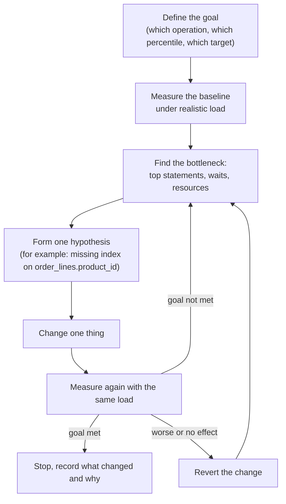
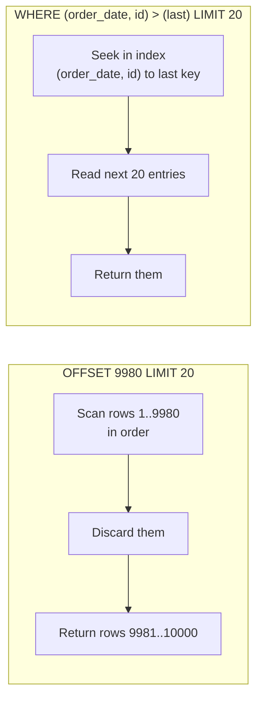

# 13. Performance tuning methodology

> **Level:** L2 practitioner → L3 senior | **Part:** I | **Rowlit references read at:** `1d57848` (Rowlit 1.6.3)
> **In one sentence:** Tuning is a loop of measuring, finding the one bottleneck that matters, changing one thing and measuring again; most wins come from a short list of well-known anti-patterns.
> **You will learn:**
> - a repeatable tuning method, and the difference between latency, throughput and percentiles;
> - where each engine records what it spends time on (`pg_stat_statements`, DMVs and Query Store, AWR/ASH, the slow query log, `system.query_log`, query history);
> - how to read wait statistics;
> - the anti-pattern catalogue: N+1, `SELECT *`, non-SARGable predicates, implicit conversion, `OR`, over-indexing, big transactions and more;
> - batching and bulk load, offset versus keyset pagination, connection pooling and caching;
> - when to stop.
>
> **Prerequisites:** [7. Indexes](07-indexes.md), [8. The query pipeline and the optimizer](08-query-processing.md), [10. Concurrency](10-concurrency-locking-mvcc.md).
>
> [فارسی](../../fa/part1/13-performance-tuning.md) · Previous: [12. Backup, replication, HA](12-backup-replication-ha.md) · Next: [14. Database security](14-security.md)

---

## 1. The idea (beginner)

"The database is slow" is not a problem you can fix; it is a feeling. Tuning starts by turning the feeling into a number
("the order page takes 2.3 s at the 95th percentile, the target is 300 ms") and then finding *where* the time goes. Is
the server busy computing, waiting for the disk, waiting for a lock, or waiting for the application to fetch rows? Is it
one slow query, or the same fast query run ten thousand times? Each answer has a different fix, and fixing the wrong thing
wastes days.

The good news is that most slow systems suffer from the same few mistakes: a missing or unusable index, a query hidden in a
loop, a predicate written so the index cannot be used, a transaction that holds locks too long, or a connection opened for
every request. This chapter gives you a method, the tools each engine provides to measure, and a catalogue of those
mistakes with their fixes, all on the `shop` tables.

## 2. How it works (practitioner)

### 2.1 A method

**Figure 13.1 — The tuning loop.**



Four rules make the loop work:

1. **Define the goal first.** Which user action, which percentile, which target, under what load. Without a target you
   cannot know when to stop.
2. **Measure, do not guess.** Intuition about where time goes is wrong surprisingly often. Measure the whole path:
   application, network, database.
3. **Find the [bottleneck](../glossary.md#bottleneck)** (the one resource or step that limits the whole), and work on it only.
   Speeding up a step that is not the bottleneck changes nothing for the user.
4. **Change one thing at a time** and keep the measurement conditions the same, otherwise you cannot tell which change
   helped.

### 2.2 Latency, throughput and percentiles

- **[Latency](../glossary.md#latency)** is the time one operation takes (milliseconds per query).
- **[Throughput](../glossary.md#throughput)** is how many operations finish per unit of time (queries or transactions per
  second).

They are linked by **Little's law**: *concurrency = throughput × latency*. If each query takes 10 ms and 50 sessions are
busy at once, the system completes at most 5,000 queries per second; to go higher you must cut latency or add parallel
capacity. And they fight each other near saturation: as a resource approaches 100 % utilisation, queues form and latency
grows very fast, long before throughput stops growing. A server at 95 % CPU is not "using its hardware well"; it is
queueing.

Report **[percentiles](../glossary.md#percentile)**, not averages. If 99 requests take 10 ms and one takes 5 s, the average
is 60 ms, which describes nobody. The median (p50) is 10 ms, the p99 is 5 s: one user in a hundred waits five seconds. Tail
latency (p95, p99) is what users remember and what usually reveals locks, cache misses or plan changes.

### 2.3 Where to measure, per engine

Every engine keeps statistics about the statements it runs. Learn the two or three views of your engine by heart.

#### PostgreSQL 17

```sql
-- Needs shared_preload_libraries = 'pg_stat_statements' (server restart) and, once per database:
CREATE EXTENSION IF NOT EXISTS pg_stat_statements;

-- Top statements by total time (normalised: literals become $1, $2 …)
SELECT calls, round(total_exec_time) AS total_ms, round(mean_exec_time, 2) AS mean_ms, rows,
       shared_blks_hit, shared_blks_read, left(query, 80) AS query
FROM pg_stat_statements ORDER BY total_exec_time DESC LIMIT 10;
```

Sort by **total** time first: a 2 ms query called 3 million times a day costs more than a 20 s report run once.
`shared_blks_read` (blocks read from outside shared buffers) against `shared_blks_hit` tells you whether a statement is
I/O-bound. Other sources: `pg_stat_activity` (what runs *now*, and its `wait_event`), `log_min_duration_statement = 500`
(log every statement slower than 500 ms), the `auto_explain` module (log the plans of slow statements), `track_io_timing`
(I/O time in `EXPLAIN (ANALYZE, BUFFERS)`), `pg_stat_user_tables` / `pg_stat_user_indexes` (scans per table and index), and
since PostgreSQL 16 `pg_stat_io`.

> **In Rowlit:** the PostgreSQL log source reads the top statements from `pg_stat_statements`, choosing
> `total_exec_time` or the pre-13 column `total_time` by server version
> (`engine/src/DbStudio.Logs/Providers/PostgreSql/PgLogSource.cs:44-55`). See [Part II chapter 21](../part2/21-logs-activity-resources.md).

#### SQL Server 2022

```sql
-- Top cached statements by total CPU (only plans still in the plan cache)
SELECT TOP (10) qs.execution_count, qs.total_worker_time / 1000 AS cpu_ms, qs.total_elapsed_time / 1000 AS elapsed_ms,
       qs.total_logical_reads, SUBSTRING(t.text, qs.statement_start_offset / 2 + 1, 200) AS statement_text
FROM sys.dm_exec_query_stats qs CROSS APPLY sys.dm_exec_sql_text(qs.sql_handle) t
ORDER BY qs.total_worker_time DESC;

SET STATISTICS IO, TIME ON;     -- per-statement logical reads and CPU/elapsed time in the Messages output
```

**[DMVs](../glossary.md#dmv)** (dynamic management views, `sys.dm_*`) show live and cumulative state; they reset at restart
and forget statements whose plans left the cache. **[Query Store](../glossary.md#query-store)** persists query texts, plans
and runtime statistics inside the database, survives restarts, shows plan changes over time and can force a known good plan.
It is enabled by default for new databases in SQL Server 2022. Extended Events capture individual slow statements, deadlocks
and waits.

#### Oracle 23ai

`V$SQL` (cumulative per cursor: `executions`, `elapsed_time`, `buffer_gets`, `disk_reads`), `V$SESSION` (what each session
waits on now) and `DBMS_XPLAN.DISPLAY_CURSOR(sql_id, NULL, 'ALLSTATS LAST')` for the actual row counts of the last
execution. **[AWR](../glossary.md#awr)** (Automatic Workload Repository) stores hourly snapshots of all statistics, and ASH
(Active Session History) samples every active session every second; both, and the ADDM advisor built on them, require the
Diagnostics Pack licence on Enterprise Edition. Statspack is the free, older equivalent of AWR.

#### MySQL 8 / MariaDB 11

The **[slow query log](../glossary.md#slow-query-log)** (`slow_query_log = ON`, `long_query_time` in seconds, 10 by
default, so set it lower) records every statement slower than the threshold; `pt-query-digest` or `mysqldumpslow` groups it.
`performance_schema.events_statements_summary_by_digest` is the `pg_stat_statements` equivalent, and the `sys` schema has
readable views over it (`sys.statement_analysis`, `sys.statements_with_full_table_scans`). `EXPLAIN ANALYZE` (MySQL 8.0.18+)
runs a statement and shows actual times per plan node.

#### SQLite, ClickHouse, Snowflake, Cassandra

- **SQLite** has no server statistics. Measure in the application or in the CLI (`.timer on`, `.eqp on`), read
  `EXPLAIN QUERY PLAN`, and keep statistics fresh with `ANALYZE` or `PRAGMA optimize`.
- **ClickHouse** logs every query in `system.query_log` with `query_duration_ms`, `read_rows`, `read_bytes`, `memory_usage`
  and `normalized_query_hash` for grouping; `system.processes` shows running queries, `EXPLAIN indexes = 1` shows how many
  parts and granules the primary key and skip indexes eliminated ([15](15-oltp-vs-olap-columnar.md)).
- **Snowflake** exposes `INFORMATION_SCHEMA.QUERY_HISTORY()` (recent days) and `SNOWFLAKE.ACCOUNT_USAGE.QUERY_HISTORY`
  (a year, with some delay), plus the graphical Query Profile. The key columns are partitions scanned versus total (pruning),
  bytes spilled to local or remote storage (the warehouse is too small for the query), and queued time (the warehouse is
  overloaded).
- **Cassandra**: `TRACING ON` in cqlsh shows each step of a request across replicas; `nodetool tablestats` and
  `nodetool tablehistograms` show partition sizes and latencies; warnings about large partitions and tombstones in the log are
  the usual causes of slow reads ([16](16-nosql-families.md)).

### 2.4 Wait statistics

A session is always doing one of two things: running on a CPU, or **waiting** for something. **[Wait
statistics](../glossary.md#wait-statistics)** record what sessions wait on and for how long, which points straight at the
bottleneck.

| What the wait means | PostgreSQL `wait_event` | SQL Server wait type | Oracle event | Usual cause |
|---|---|---|---|---|
| Reading pages from disk | `DataFileRead` | `PAGEIOLATCH_SH` | `db file sequential read` / `scattered read` | Missing index, too little memory, big scans |
| Flushing the log at commit | `WALSync`, `WALWrite` | `WRITELOG` | `log file sync` | Many tiny transactions, slow log device |
| Waiting for a lock | `Lock: transactionid`, `relation` | `LCK_M_*` | `enq: TX - row lock contention` | Long transactions, hot rows ([10](10-concurrency-locking-mvcc.md)) |
| In-memory contention | `LWLock: *`, `BufferContent` | `PAGELATCH_*` | `latch: *`, `buffer busy waits` | Hot pages, last-page inserts |
| The client is not reading results | `ClientWrite` | `ASYNC_NETWORK_IO` | `SQL*Net more data to client` | Application processes rows one by one, or fetches more rows than it uses |
| Parallel query coordination | `BgWorkerShutdown`, parallel events | `CXPACKET`, `CXCONSUMER` | `PX Deq: *` | Usually a symptom; look at the plan |

```sql
-- SQL Server: top waits since the last restart, ignoring benign background waits
SELECT TOP (10) wait_type, waiting_tasks_count, wait_time_ms / 1000 AS wait_s
FROM sys.dm_os_wait_stats
WHERE wait_type NOT IN (N'SLEEP_TASK', N'LAZYWRITER_SLEEP', N'BROKER_TASK_STOP', N'XE_TIMER_EVENT',
                        N'REQUEST_FOR_DEADLOCK_SEARCH', N'SQLTRACE_INCREMENTAL_FLUSH_SLEEP', N'CHECKPOINT_QUEUE')
ORDER BY wait_time_ms DESC;

-- PostgreSQL: what the active sessions wait on right now (sample it several times)
SELECT wait_event_type, wait_event, count(*) FROM pg_stat_activity WHERE state = 'active' GROUP BY 1, 2 ORDER BY 3 DESC;
```

Cumulative waits since restart are blurred by history; compare two snapshots taken a few minutes apart under the problem
load. And waits are a *symptom*: `PAGEIOLATCH_SH` says "we read a lot from disk", the plan says *why*.

### 2.5 The anti-pattern catalogue

Each entry: the symptom, an example on `shop`, the fix.

#### N+1 queries

The application runs one query for a list and then one more query **per item**: 1 + N
**[round trips](../glossary.md#round-trip)** (a request sent to the server and its answer coming back).

```sql
-- 1 query …
SELECT id, name FROM customers;
-- … then, in a loop in the application, N queries
SELECT id, total FROM orders WHERE customer_id = $1;     -- run once per customer
```

Each statement is fast, so nothing appears in the slow log; but at 0.5 ms network round trip, 10,000 customers cost 5 s of
pure waiting. The fix is one set-based query:

```sql
SELECT c.id, c.name, o.id AS order_id, o.total
FROM customers c LEFT JOIN orders o ON o.customer_id = c.id
ORDER BY c.id, o.id;
-- or two queries: the customers, then  SELECT … FROM orders WHERE customer_id = ANY($1)  with all ids at once
```

`pg_stat_statements` (or the SQL Server and MySQL digests) reveals N+1 as a cheap statement with an enormous `calls` count.
It is the most common problem with ORMs ([3.1](#31-orms-and-n1)).

#### SELECT *

`SELECT *` reads and sends every column, including large ones that must be fetched from TOAST or LOB storage
([6](06-storage-internals.md)), and prevents index-only scans: `SELECT customer_id, total FROM orders WHERE customer_id = 4`
can be answered from `ix_orders_customer … INCLUDE (total)` alone (`engine/tests/docker/seed-postgres.sql:56`), while
`SELECT *` must visit the table. It also makes code break silently when columns are added or reordered. Name the columns
you need.

#### SARGable predicates

A predicate is **[SARGable](../glossary.md#sargable)** (from "search argument") when the engine can use an index to find the
matching rows, which requires the indexed column to appear **alone** on one side of the comparison. Wrapping the column in a
function or an expression forces the engine to compute it for every row:

| Not SARGable | SARGable rewrite |
|---|---|
| `WHERE EXTRACT(YEAR FROM order_date) = 2026` | `WHERE order_date >= '2026-01-01' AND order_date < '2027-01-01'` |
| `WHERE order_date::date = '2026-02-11'` | `WHERE order_date >= '2026-02-11' AND order_date < '2026-02-12'` |
| `WHERE total * 1.19 > 100` | `WHERE total > 100 / 1.19` |
| `WHERE lower(email) = 'alice@example.com'` | an expression index `CREATE INDEX ON customers (lower(email))`, or a case-insensitive collation |
| `WHERE coalesce(country_id, 0) = 1` | `WHERE country_id = 1` |
| `WHERE name LIKE '%board'` | no B-tree can help a leading wildcard: a trigram index (`pg_trgm` GIN) or full-text search ([7](07-indexes.md)) |

`LIKE 'Key%'` (a fixed prefix) is SARGable; `LIKE '%key%'` is not.

#### Implicit conversion

When the two sides of a comparison have different types, the engine converts one of them. If it converts the **column**,
the predicate stops being SARGable, although the SQL looks innocent:

- **SQL Server**: a `VARCHAR` column compared with an `NVARCHAR` parameter (what .NET sends for a `string` unless the
  parameter type is set) is converted with `CONVERT_IMPLICIT` on the column side, because `NVARCHAR` has higher type
  precedence. Depending on the collation the result is a scan or a slower range seek; the plan shows a warning. Declare
  parameters with the column's exact type and length.
- **MySQL**: comparing a string column with a number (`WHERE phone = 5551234`) converts every row's string to a number; no
  index use, and `'5551234abc'` matches too. Quote the literal.
- **PostgreSQL** rarely converts silently, but `WHERE id = 4.0` on an `integer` column compares as `numeric` and cannot use
  the integer index. Check with `EXPLAIN` whenever parameters come from a driver.

#### OR across different columns

`WHERE customer_id = 4 OR total > 200` cannot be served by one index. PostgreSQL can combine two indexes with a
`BitmapOr`, SQL Server and MySQL sometimes with an index union or index merge; otherwise the result is a full scan. When
it matters, rewrite as `UNION` (or `UNION ALL` with the second branch excluding rows of the first) so each branch uses its own
index. `OR` on the *same* column (`status = 'new' OR status = 'paid'`) is an `IN` list and is fine.

#### Over-indexing

Every index speeds up some reads and slows down **every** write: each `INSERT` updates every index, each `UPDATE` of an
indexed column too, and in PostgreSQL an index on an updated column prevents HOT updates ([10](10-concurrency-locking-mvcc.md#32-postgresql-mvcc-in-detail)).
Indexes also compete for memory. Find unused ones (and check the replicas too before dropping, since usage statistics are per
server):

```sql
-- PostgreSQL
SELECT relname, indexrelname, idx_scan, pg_size_pretty(pg_relation_size(indexrelid)) AS size
FROM pg_stat_user_indexes WHERE idx_scan = 0 ORDER BY pg_relation_size(indexrelid) DESC;
-- SQL Server: sys.dm_db_index_usage_stats (user_seeks, user_scans, user_lookups versus user_updates)
```

Also look for duplicate indexes and indexes that are a left prefix of another (`(customer_id)` next to `(customer_id,
order_date)`).

#### Missing indexes on foreign keys

Most engines do not index the referencing side of a foreign key automatically (MySQL InnoDB does). Without it, deleting or
updating a parent row scans the child table, and joins from parent to child cannot seek. In the PostgreSQL `shop` seed,
`fk_order_lines_products` references `products(id)` from `order_lines.product_id`
(`engine/tests/docker/seed-postgres.sql:45`), and the only index on `order_lines` is the primary key `(order_id, product_id)`
(line 48), whose leading column is `order_id`. So `DELETE FROM products WHERE id = 4` must scan `order_lines` to check for
references. With seven rows nobody notices; with seventy million it is a lock held for minutes. The fix is
`CREATE INDEX ON order_lines (product_id);`.

#### Big transactions

A single `UPDATE` or `DELETE` of millions of rows holds locks on all of them until commit (and may escalate to a table lock
in SQL Server), produces a burst of WAL that replicas must replay, keeps old versions alive (bloat, version store, undo),
and if it fails, rolls everything back for as long as it ran ([9](09-transactions-and-isolation.md#34-the-cost-of-a-long-transaction)).
Process in chunks, each in its own short transaction, walking the primary key:

```sql
-- PostgreSQL: archive cancelled orders in chunks of 5,000; repeat until it affects 0 rows
WITH batch AS (
  SELECT id FROM orders WHERE status = 'cancelled' ORDER BY id LIMIT 5000 FOR UPDATE SKIP LOCKED
)
DELETE FROM orders o USING batch b WHERE o.id = b.id;
```

#### Row-by-row processing

A loop that fetches a row, computes, and writes it back (a cursor in a stored procedure, or a loop in the application) does
in N statements what one set-based `UPDATE … FROM` or `MERGE` does in one, with N times the round trips, log flushes and
plan executions. SQL people call it RBAR, "row by agonizing row".

#### Smaller items worth a check

- **`COUNT(*)` to test existence**: `SELECT count(*) … > 0` counts every match; `EXISTS (SELECT 1 …)` stops at the first.
- **Unbounded result sets**: a screen shows 50 rows but the query returns 200,000; add a limit and paginate (2.7).
- **`DISTINCT` to hide duplicates** caused by a wrong join; fix the join instead.
- **Scalar functions per row** in the `SELECT` list or `WHERE` (SQL Server user-defined scalar functions were executed row by
  row before scalar UDF inlining in SQL Server 2019).
- **Parameter sniffing** and plan changes: a plan compiled for a rare value reused for a common one ([8](08-query-processing.md)).
- **Stale statistics** after a bulk load: the optimizer estimates 1 row and picks a nested loop for 1 million ([7](07-indexes.md)).

### 2.6 Batching and bulk load

The cost of a write is mostly fixed overhead per statement and per commit (round trip, parse, plan, log flush). Amortise it:

1. **Several rows per statement**: `INSERT INTO order_lines VALUES (1,3,1), (2,4,2), …` instead of one statement per row.
2. **One prepared statement executed in a batch** (JDBC `addBatch`, `NpgsqlBatch`, Oracle array binding).
3. **Many rows per transaction**: one commit per 1,000–10,000 rows instead of per row, which turns thousands of log flushes into
   a few (the `WRITELOG` / `WALSync` waits disappear).
4. **The engine's bulk path**, for large loads:

| Engine | Bulk path |
|---|---|
| PostgreSQL | `COPY orders FROM STDIN (FORMAT csv)` (`\copy` in psql); fastest when indexes are created after the load |
| SQL Server | `BULK INSERT`, `bcp`, `SqlBulkCopy`; minimally logged with `TABLOCK` under the SIMPLE or BULK_LOGGED recovery model |
| Oracle | SQL*Loader direct path, `INSERT /*+ APPEND */ … SELECT`, PL/SQL `FORALL` |
| MySQL | `LOAD DATA [LOCAL] INFILE` |
| ClickHouse | large inserts (many thousands of rows each) or `async_insert = 1`; many tiny inserts create too many parts |
| Snowflake | `COPY INTO table FROM @stage`, with files of roughly 100–250 MB compressed |
| SQLite | one transaction around all inserts (otherwise each insert is its own transaction with its own sync) |

A **[bulk load](../glossary.md#bulk-load)** into a table with many indexes can be faster if you drop the secondary indexes and
recreate them afterwards; measure, because the rebuild also costs time and the table is less protected meanwhile.

### 2.7 Pagination: offset or keyset

The usual way to show page 500 of the orders list:

```sql
SELECT id, order_date, total FROM orders ORDER BY order_date, id LIMIT 20 OFFSET 9980;
```

The engine must produce and **discard** 9,980 rows before it returns 20: page 500 costs 500 times more than page 1. Rows
inserted or deleted between two page requests also make rows appear twice or vanish across pages.

**[Keyset pagination](../glossary.md#keyset-pagination)** (also called the *seek method*) remembers where the previous page
ended and asks for rows after it:

```sql
-- PostgreSQL, MySQL 8, SQLite: row-value comparison
SELECT id, order_date, total FROM orders
WHERE (order_date, id) > ($1, $2)          -- the order_date and id of the last row on the previous page
ORDER BY order_date, id
LIMIT 20;
CREATE INDEX ix_orders_date_id ON orders (order_date, id);   -- makes each page an index range scan
```

```sql
-- SQL Server (no row-value comparison): spell it out
SELECT TOP (20) Id, OrderDate, Total FROM dbo.Orders
WHERE OrderDate > @d OR (OrderDate = @d AND Id > @id)
ORDER BY OrderDate, Id;
```

**Figure 13.2 — Offset reads and throws away rows; keyset seeks to the last key and reads one page.**



Keyset pages cost the same at any depth and stay stable under inserts. The requirements: the sort must be on a unique key
(add `id` as a tie-breaker), there must be an index in the same order, and the user cannot jump directly to "page 500" (only
next / previous, which is what infinite scrolling and most APIs need anyway).

> **In Rowlit:** Data tabs page with `OFFSET`/`FETCH` or `LIMIT`/`OFFSET` (`ui/src/data/sqlgen.ts:465-486`) and always order
> by the key columns (or a pseudo-column such as `rowid`) so the pages are deterministic (`ui/src/data/sqlgen.ts:449-451`).
> See [Part II chapter 13](../part2/13-results-grid-and-data-editing.md).

### 2.8 Connection pooling

Opening a connection is expensive: a TCP handshake, often a TLS handshake ([14](14-security.md)), authentication, and the
server setting up a session (PostgreSQL starts a whole new **process** per connection; SQL Server and MySQL a thread plus
memory). That is several milliseconds to tens of milliseconds, more than many queries take. An application that connects for
every request spends most of its time connecting.

A **[connection pool](../glossary.md#connection-pool)** keeps open connections and lends them out:

- **Client-side pools** live in the driver or the application: ADO.NET (including Npgsql and Microsoft.Data.SqlClient) pools
  by connection string automatically, Java uses HikariCP. `Open()` takes a connection from the pool, `Close()` returns it;
  the driver resets session state on reuse (SQL Server `sp_reset_connection`).
- **Server-side poolers** sit between many clients and the server: PgBouncer and Pgpool-II for PostgreSQL, ProxySQL for
  MySQL, Oracle DRCP, cloud proxies. PgBouncer has three modes: *session* (a server connection per client session), *transaction*
  (a server connection per transaction, the most useful one) and *statement*. Transaction mode breaks everything that lives in
  the session across transactions: `SET` without `LOCAL`, temporary tables, session advisory locks, `LISTEN`, and (before
  PgBouncer 1.21 added support) prepared statements.

**Pool size**: smaller than people expect. A database server with 16 cores cannot run 500 queries at once; it can only switch
between them, with more locks and cache misses. The HikariCP documentation suggests starting from roughly *cores × 2 +
effective disks* connections and measuring. If 2,000 application threads need the database, put a pool of 40 in front and let
them queue in the application, where queueing is cheap.

Why an IDE does **not** pool its editor sessions: an interactive session is stateful. The user runs `SET search_path`, creates
a temp table, opens a transaction in one statement and commits it ten minutes later; returning the connection to a pool between
statements would lose or leak all of that.

> **In Rowlit:** each editor tab owns one physical connection with pooling off "so session state (search_path, SET, temp tables,
> an open transaction) belongs to the tab", while catalog, designer and diagnostics connections are pooled
> (`engine/src/DbStudio.Providers.PostgreSql/PgConnectionStrings.cs:39-43`; SQL Server `engine/src/DbStudio.Providers.SqlServer/SqlServerConnectionStrings.cs:28`;
> SQLite `engine/src/DbStudio.Providers.Sqlite/SqliteConnections.cs:59`). The number of sessions per connection profile is
> capped, 8 by default (`engine/src/DbStudio.Core/Services/SessionManager.cs:171`). See
> [Part II chapter 8](../part2/08-connections-sessions-execution.md).

### 2.9 Caching

The fastest query is the one you do not run. Layers, from the database outwards:

- **The buffer pool** caches pages ([6](06-storage-internals.md)). A high hit ratio is a consequence of a good design, not a goal;
  a query that reads 10 million cached pages is still slow.
- **Result caches in the engine**: Snowflake reuses the result of an identical query for 24 hours if the data has not changed;
  Oracle has `RESULT_CACHE`; MySQL removed its query cache in 8.0 because invalidation serialised writes.
- **Materialized views** store a query's result as a table, refreshed on demand. The PostgreSQL `shop` seed has one,
  `customer_totals` (`engine/tests/docker/seed-postgres.sql:74`); `REFRESH MATERIALIZED VIEW CONCURRENTLY` (with a unique
  index) refreshes it without blocking readers.
- **Application caches** (in-process, or Redis, [16](16-nosql-families.md)) hold computed objects. The hard part is
  invalidation: decide for each cached item how stale it may be, and expire by time when you cannot invalidate by event.

## 3. Deep dive (senior)

### 3.1 ORMs and N+1

Object-relational mappers make N+1 easy because **lazy loading** turns an innocent property access (`customer.Orders`) into a
query. Loading 100 customers and touching each one's orders runs 101 queries. The fixes are the ORM's eager-loading features
(`Include` in Entity Framework, `JOIN FETCH` in JPA, `select_related` / `prefetch_related` in Django), which issue either one
join or one extra query with an `IN` list. Two cautions: joining several collections at once multiplies rows (a cartesian
explosion: 100 customers × 10 orders × 5 lines = 5,000 rows to build 100 objects), so prefer split queries for multiple
collections; and turn on SQL logging in development so you see the statements the ORM really sends.

### 3.2 Schema-level fixes

Some problems cannot be fixed in a query:

- **Data types**: an `id` stored as text, a date stored as a string, `float` for money ([5](05-modelling-and-normalisation.md)).
  Wrong types waste space, defeat indexes through conversions and produce wrong results.
- **Indexes designed for the workload**: composite indexes in the order of equality-then-range columns, covering indexes for hot
  queries, partial indexes for skewed values (`ix_orders_open … WHERE status <> 'cancelled'` in the seed,
  `engine/tests/docker/seed-postgres.sql:57`) ([7](07-indexes.md)).
- **Partitioning** for very large tables with a natural time key ([12](12-backup-replication-ha.md#28-table-partitioning)).
- **Denormalisation** where a join is executed millions of times and the data changes rarely, with a clear owner for keeping the
  copy correct ([5](05-modelling-and-normalisation.md)).
- **Moving analytics off the OLTP database** to a replica or a columnar engine ([15](15-oltp-vs-olap-columnar.md)).

### 3.3 Reading a statement's cost

Before and after each change, measure the *work* a statement does, not only its time (time varies with cache state and load):

- PostgreSQL: `EXPLAIN (ANALYZE, BUFFERS)` → `shared hit` + `read` blocks, actual rows per node versus estimates.
- SQL Server: `SET STATISTICS IO ON` → logical reads per table; actual execution plan → estimated versus actual rows.
- Oracle: `buffer_gets` per execution in `V$SQL`, `A-Rows` versus `E-Rows` in `DISPLAY_CURSOR`.
- MySQL: `EXPLAIN ANALYZE` → actual rows and loops; `Handler_read_*` status counters.

A change that halves logical reads is a real improvement even if a single test run shows no time difference; a change that
makes one test faster while doubling reads probably just hit a warmer cache. Large gaps between estimated and actual rows point
to statistics or to a predicate the optimizer cannot estimate ([8](08-query-processing.md)).

### 3.4 When to stop

Stop when:

- the goal from step 1 is met under realistic load, with some margin;
- the bottleneck has moved outside the database (application CPU, network, an external service): further database work no
  longer changes what users see;
- the next step costs more than it is worth (a rewrite for 3 %, a hardware upgrade cheaper than a week of work);
- the change would make the system markedly harder to understand or operate for a small gain.

Write down what you changed, why, and the before/after numbers. Plans change when data grows, and the next person (or you, in a
year) needs the baseline.

## 4. In each engine

| Need | PostgreSQL 17 | SQL Server 2022 | Oracle 23ai | MySQL 8 / MariaDB 11 | SQLite 3.4x | ClickHouse 24 | Snowflake |
|---|---|---|---|---|---|---|---|
| Top statements | `pg_stat_statements` | Query Store, `sys.dm_exec_query_stats` | AWR, `V$SQL` | `events_statements_summary_by_digest`, `sys.statement_analysis` | application timing | `system.query_log` | `QUERY_HISTORY` |
| Running now | `pg_stat_activity` | `sys.dm_exec_requests` | `V$SESSION`, ASH | `SHOW PROCESSLIST`, `performance_schema.threads` | — | `system.processes` | `QUERY_HISTORY` (running) |
| Waits | `wait_event` | `sys.dm_os_wait_stats`, `sys.dm_exec_session_wait_stats` | `V$SYSTEM_EVENT`, ASH | `performance_schema.events_waits_*` | — | `ProfileEvents` in `query_log` | queued / spilled columns |
| Slow log | `log_min_duration_statement`, `auto_explain` | Extended Events | SQL trace, SQL Monitor | slow query log | — | `query_log` | — |
| Actual plan | `EXPLAIN (ANALYZE, BUFFERS)` | actual execution plan | `DISPLAY_CURSOR … 'ALLSTATS LAST'` | `EXPLAIN ANALYZE` | `EXPLAIN QUERY PLAN` | `EXPLAIN PIPELINE`, `indexes = 1` | Query Profile |
| Bulk load | `COPY` | `BULK INSERT`, `SqlBulkCopy` | SQL*Loader, `APPEND` | `LOAD DATA INFILE` | one transaction | big batches, `async_insert` | `COPY INTO` |
| Pooler | PgBouncer, Pgpool-II | client pool | DRCP, client pool | ProxySQL, client pool | n/a | client pool | client pool |

## 5. Exercises

1. A page shows each of 200 customers with their last order. Monitoring shows 201 statements per page view, each under 1 ms,
   yet the page takes 300 ms. What is going on, and how would you fix it in SQL on `shop`?
2. Rewrite each predicate so an index on the column can be used: (a) `WHERE date_trunc('month', order_date) = '2026-03-01'`,
   (b) `WHERE total + 10 > 200`, (c) `WHERE substring(name, 1, 3) = 'Mon'` on `products`.
3. A .NET application queries a SQL Server table whose `Code` column is `VARCHAR(20)` and indexed, passing the value as a plain
   `string` parameter. The plan shows an index scan and a `CONVERT_IMPLICIT` warning. Explain and fix.
4. Write the keyset query for the *next* page of `orders` sorted by `total DESC, id DESC`, given that the last row of the
   current page had `total = 120.50, id = 1`, for PostgreSQL and for SQL Server. Which index helps?
5. A service runs 400 threads and each opens a new PostgreSQL connection per request. The database server has 8 cores and shows
   high CPU with many short-lived backends. Propose two changes and the order you would make them in.
6. After you add an index, a test query runs in 40 ms instead of 60 ms. Your colleague says that proves the index helps. What do
   you check before believing it?

## Answers

The answer key for all Part I chapters is collected in [18. Answer key and lab setup](18-exercise-answers.md).

<details><summary>Answers to chapter 13</summary>

1. An N+1 pattern: one query for customers, then one query per customer; the time is round trips, not execution. One query:
   `SELECT c.id, c.name, o.id, o.order_date, o.total FROM customers c LEFT JOIN LATERAL (SELECT id, order_date, total FROM
   orders WHERE customer_id = c.id ORDER BY order_date DESC LIMIT 1) o ON true;` (PostgreSQL), or `ROW_NUMBER() OVER (PARTITION
   BY customer_id ORDER BY order_date DESC)` filtered to 1 in any engine.
2. (a) `WHERE order_date >= '2026-03-01' AND order_date < '2026-04-01'`. (b) `WHERE total > 190`. (c) `WHERE name LIKE 'Mon%'`
   (a fixed prefix; in PostgreSQL with a non-C collation the index needs the `text_pattern_ops` operator class for `LIKE`).
3. The parameter is sent as `NVARCHAR`, which has higher precedence than `VARCHAR`, so SQL Server converts the column on every
   row and cannot seek normally. Declare the parameter as `SqlDbType.VarChar` with size 20 (or the matching type in the ORM's
   mapping), so the comparison is `VARCHAR = VARCHAR`.
4. PostgreSQL: `SELECT id, total FROM orders WHERE (total, id) < (120.50, 1) ORDER BY total DESC, id DESC LIMIT 20;`
   SQL Server: `SELECT TOP (20) Id, Total FROM dbo.Orders WHERE Total < 120.50 OR (Total = 120.50 AND Id < 1) ORDER BY Total
   DESC, Id DESC;`. An index on `(total, id)` (scanned backwards) or `(total DESC, id DESC)`.
5. First add pooling: a client-side pool in the service (for example 16–20 connections) so connections are reused and threads
   queue in the application; if many service instances exist, PgBouncer in transaction mode in front of the database. Then, with
   the connection storm gone, measure again and tune the top statements from `pg_stat_statements`.
6. Repeat the measurement several times in both states with the same cache conditions (the second run may simply be warm),
   compare the *work* (`EXPLAIN (ANALYZE, BUFFERS)` blocks, logical reads) and confirm the plan actually uses the index, test with
   realistic data volume and parameter values, and check the write cost the index adds to the workload.

</details>

## Related chapters

- [7. Indexes in depth](07-indexes.md) and [8. The query pipeline and the optimizer](08-query-processing.md) — what a plan can and cannot do.
- [10. Concurrency: locks, latches, MVCC](10-concurrency-locking-mvcc.md) — lock waits and latch contention.
- [11. WAL, redo/undo, checkpoints, recovery](11-logging-and-recovery.md) — commit cost and log flushes.
- [12. Backup, replication, HA](12-backup-replication-ha.md) — partitioning and read replicas.
- [15. OLTP vs OLAP and columnar engines](15-oltp-vs-olap-columnar.md) — when the workload belongs in another engine.
- Part II: [8. Connections, sessions and executing SQL](../part2/08-connections-sessions-execution.md), [21. Logs & activity](../part2/21-logs-activity-resources.md).

## Glossary terms introduced here

[bottleneck](../glossary.md#bottleneck) ·
[latency](../glossary.md#latency) ·
[throughput](../glossary.md#throughput) ·
[Little's law](../glossary.md#littles-law) ·
[percentile](../glossary.md#percentile) ·
[pg_stat_statements](../glossary.md#pg-stat-statements) ·
[DMV](../glossary.md#dmv) ·
[Query Store](../glossary.md#query-store) ·
[AWR](../glossary.md#awr) ·
[slow query log](../glossary.md#slow-query-log) ·
[wait statistics](../glossary.md#wait-statistics) ·
[round trip](../glossary.md#round-trip) ·
[N+1](../glossary.md#n-plus-1) ·
[SARGable](../glossary.md#sargable) ·
[implicit conversion](../glossary.md#implicit-conversion) ·
[over-indexing](../glossary.md#over-indexing) ·
[RBAR](../glossary.md#rbar) ·
[bulk load](../glossary.md#bulk-load) ·
[offset pagination](../glossary.md#offset-pagination) ·
[keyset pagination](../glossary.md#keyset-pagination) ·
[connection pool](../glossary.md#connection-pool) ·
[PgBouncer](../glossary.md#pgbouncer) ·
[lazy loading](../glossary.md#lazy-loading)
