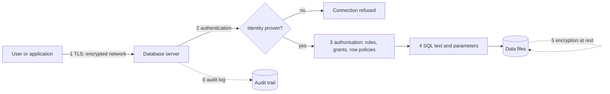
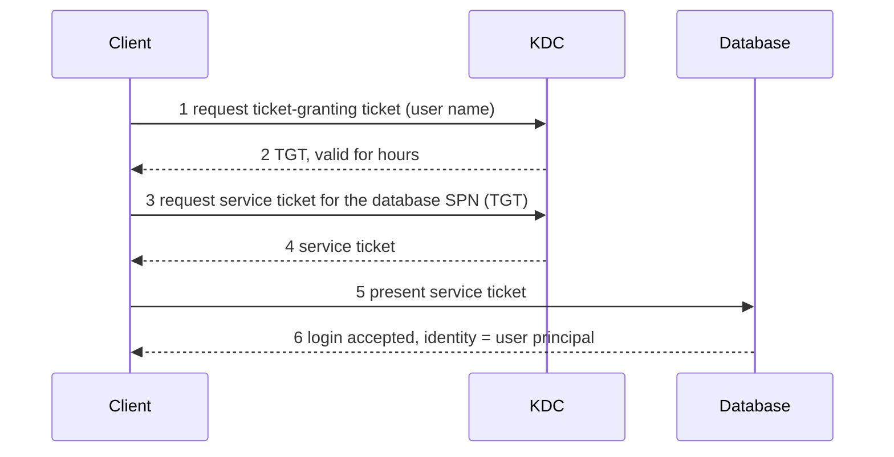
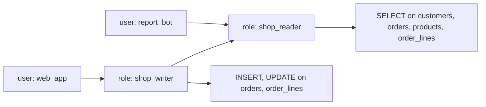
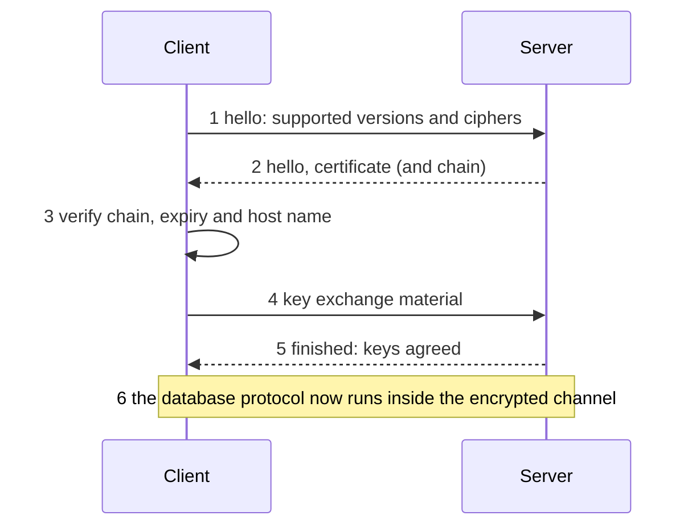
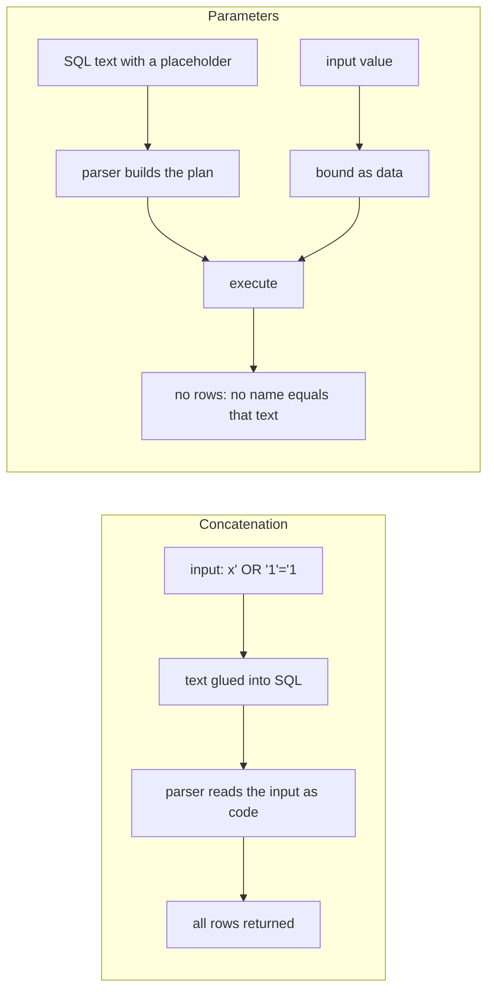

# 14. Database security

> **Level:** L2 practitioner (L3 deep-dive blocks) | **Part:** I | **Rowlit code cited at:** `08528ae`
>
> **In one sentence:** a database is safe when you can prove who connected, limit what they can do, keep the bytes private on the wire and on disk, stop your own code from being turned against you, and keep a record of what happened.
>
> **You will learn:**
>
> - the difference between authentication, authorisation, encryption, injection defence and auditing, and how they stack
> - the authentication methods you will meet: passwords, Kerberos, certificates, key pairs, OAuth and SSO
> - how roles, privileges, `GRANT` and `REVOKE` work, and what least privilege looks like on the `shop` database
> - what row-level security and masking do, with a runnable PostgreSQL example
> - what `Encrypt`, `TrustServerCertificate` and `sslmode` really mean, and which settings still allow a man-in-the-middle
> - how SQL injection happens and why parameters fix it (and what they cannot fix)
>
> **Prerequisites:** [Chapter 1](01-what-is-a-database.md), [Chapter 3](03-sql-basics.md)
>
> **Twin:** [فارسی](../../fa/part1/14-security.md) | **Previous:** [13 Performance tuning](13-performance-tuning.md) | **Next:** [15 OLTP vs OLAP](15-oltp-vs-olap-columnar.md)

> **Examples.** PostgreSQL 17 examples target the `shop` database of the Docker lab (see [chapter 18](18-exercise-answers.md)). The Docker engine was not running when this chapter was written, so every output block below is marked *illustrative output*: it shows what the server prints, but it was written from the documented behaviour, not captured from a run.

## 1. The idea (beginner)

A database holds the things a business cannot afford to lose or leak: customers, orders, invoices, passwords of other systems. Security is not one switch. It is five separate questions, and each one has its own tools:

1. **Who are you?** This is [authentication](../glossary.md#authentication): the server checks a proof of identity (a password, a ticket, a certificate, a signed token).
2. **What may you do?** This is [authorisation](../glossary.md#authorisation): once the server knows who you are, it checks what you are allowed to read, change or create.
3. **Can anyone else listen or steal the disk?** This is encryption in transit (the network) and at rest (the files).
4. **Can your own program be tricked?** This is [SQL injection](../glossary.md#sql-injection): an attacker does not break the database, they persuade your application to send harmful SQL.
5. **What happened?** This is [auditing](../glossary.md#audit): a tamper-resistant record of logins, changes and reads.

No single layer is enough. This idea is called [defence in depth](../glossary.md#defence-in-depth): if a password leaks, authorisation still limits the damage; if authorisation is too wide, auditing shows what was taken. Think of a bank: the door lock (authentication), the key cards that open only some rooms (authorisation), the armoured van (encryption in transit), the vault (encryption at rest), the rule that tellers never copy a customer's words into a command (injection defence) and the cameras (audit).

**Figure 14.1 — Where each defence sits between a user and the data.**



In the `shop` example, the web shop connects as one account, a reporting tool as another, and a human DBA as a third. Each account should be able to do only what its job needs. That is the whole chapter in a sentence; the rest is how each engine spells it.

## 2. How it works (practitioner)

### 2.1 Authentication: proving who you are

The common methods, from the oldest to the most modern:

| Method | The server checks | Typical engines |
|---|---|---|
| Password | a secret that both sides know (stored as a salted hash, not as text) | all of them |
| [Kerberos](../glossary.md#kerberos) / integrated | a ticket issued by a central authority; no password crosses the network | SQL Server (Windows Authentication), PostgreSQL (`gss`, `sspi`), Oracle, ClickHouse |
| Certificate | the client presents a TLS certificate signed by a trusted authority | PostgreSQL (`cert`), MongoDB (X.509), Kafka (mTLS), MySQL, ClickHouse |
| [Key pair](../glossary.md#key-pair-authentication) | the client signs a short-lived token (JWT) with a private key; the server holds the public key | Snowflake |
| [OAuth](../glossary.md#oauth) token | a bearer token issued by an identity provider | Snowflake, Elasticsearch, Kafka (`OAUTHBEARER`) |
| [SSO](../glossary.md#sso) (single sign-on) | the identity provider logs you in, usually in the browser, and hands the database a proof | Snowflake (`externalbrowser`), SQL Server and others through cloud identity |
| API key | a long random string created for one application | Elasticsearch |

**Passwords are never compared as text.** Modern engines use [SCRAM](../glossary.md#scram) (Salted Challenge Response Authentication Mechanism): the server stores a salted, iterated hash; at login both sides prove they know the password by answering a fresh challenge, so the password itself is not sent and a recorded login cannot be replayed. PostgreSQL's default `password_encryption` is `scram-sha-256` since version 14; MongoDB offers `SCRAM-SHA-256` and `SCRAM-SHA-1`; Kafka offers `SCRAM-SHA-256` and `SCRAM-SHA-512`. MySQL 8 defaults to the `caching_sha2_password` plugin, and 8.4 disables the older `mysql_native_password` plugin by default. A password that crosses an unencrypted connection can still be stolen if the method is `PLAIN`, so the method and the transport must be chosen together (see 2.4).

**The server decides which method applies.** PostgreSQL keeps this in a file called [`pg_hba.conf`](../glossary.md#pg-hba-conf) (host-based authentication): each line says "for this database, this user, from this address, require this method":

```text
# TYPE   DATABASE  USER     ADDRESS        METHOD
hostssl  shop      shop     10.0.0.0/8     scram-sha-256
host     all       all      0.0.0.0/0      reject
```

A client cannot pick a weaker method than the server's line allows; it can only fail to connect. SQL Server has *logins* (server level, SQL logins or Windows accounts) and *users* (database level); Oracle has users, plus the special administrative privileges `SYSDBA` and `SYSOPER`.

**Kerberos in four steps.** The password stays on the workstation. The user asks a central **KDC** (key distribution centre) for a *ticket-granting ticket*, uses it to request a *service ticket* for the database's **SPN** (service principal name), and shows that ticket to the database, which can validate it with a key it shares with the KDC.

**Figure 14.2 — Kerberos login to a database (simplified).**



Windows Authentication in SQL Server is this mechanism when the client and server belong to the same domain. On macOS or Linux the same option is called integrated authentication through Kerberos: the connection form of Rowlit labels it "Windows Authentication" on Windows and "Integrated (Kerberos)" elsewhere (`engine/src/DbStudio.Providers.SqlServer/SqlServerConnectionStrings.cs:17-20`).

### 2.2 Authorisation: roles, privileges, GRANT and REVOKE

Authorisation vocabulary is similar across engines:

- A [principal](../glossary.md#principal) is anything that can be granted rights: a user, a group or a [role](../glossary.md#role). A role is a named bundle of privileges; you grant the role to users, so you manage jobs, not people.
- A [privilege](../glossary.md#privilege) is one permission: `SELECT` on a table, `EXECUTE` on a function, `CREATE TABLE` in a schema, `CONNECT` to a database. *Object privileges* apply to one object; *system* (or *server-level*) privileges apply to the whole server.
- `GRANT` adds a privilege, `REVOKE` removes it ([GRANT / REVOKE](../glossary.md#grant-revoke)). `DENY` exists only in SQL Server and beats a `GRANT`.
- **Ownership.** The creator of an object owns it and can do anything with it. Owners and administrators are why the *principle of least privilege* matters: the web application should never connect as the owner of the tables.
- **Schemas as boundaries.** Grant on a whole schema (`GRANT SELECT ON SCHEMA …` in SQL Server, `GRANT USAGE ON SCHEMA` plus table grants in PostgreSQL) instead of table by table, and keep sensitive objects in a schema the broad roles cannot see.
- **PUBLIC.** Every engine has a pseudo-role everybody belongs to. Anything granted to `PUBLIC` is granted to all. Since PostgreSQL 15, `PUBLIC` no longer has `CREATE` on the `public` schema of new databases; older clusters still do unless you revoke it.

The rule of [least privilege](../glossary.md#least-privilege) says: every account gets the smallest set of privileges that lets it do its job. A *read-only user* for a dashboard gets only `SELECT`; the checkout service gets `SELECT`, `INSERT` and `UPDATE` on `orders` and `order_lines` and nothing on `customers.email` it does not need.

**Figure 14.3 — Roles bundle privileges; users receive roles.**



Here `shop_writer` inherits everything `shop_reader` has and adds write rights. A new analyst gets `shop_reader` and nothing else.

#### PostgreSQL — a read-only role on a copy of `shop`

Work in a scratch schema so the sample data is untouched:

```sql
CREATE SCHEMA lab14;
CREATE TABLE lab14.customers AS SELECT * FROM public.customers;
CREATE TABLE lab14.orders    AS SELECT * FROM public.orders;

CREATE ROLE shop_reader NOLOGIN;
GRANT USAGE ON SCHEMA lab14 TO shop_reader;
GRANT SELECT ON ALL TABLES IN SCHEMA lab14 TO shop_reader;

CREATE ROLE report_bot LOGIN PASSWORD 'change-me-in-the-lab';  -- a real password belongs in a secret store
GRANT shop_reader TO report_bot;
```

The Docker lab user is a superuser, so `SET ROLE` lets you act as the limited account without a second connection:

```sql
SET ROLE report_bot;
SELECT count(*) FROM lab14.customers;     -- 5
DELETE FROM lab14.customers;              -- fails
RESET ROLE;
```

Illustrative output:

```text
 count
-------
     5

ERROR:  permission denied for table customers
```

`SET ROLE` only works because the session user is allowed to become `report_bot`; an ordinary user could not do this to a role it was not granted. To restrict *columns*, grant on a column list: `GRANT SELECT (id, name, country_id) ON lab14.customers TO shop_reader;` (and do not grant the whole table) hides `email`.

#### The same idea in the other engines

| Engine | Create an account | Give it read access to the shop data |
|---|---|---|
| PostgreSQL 17 | `CREATE ROLE report_bot LOGIN PASSWORD '…'` | `GRANT SELECT ON ALL TABLES IN SCHEMA public TO report_bot` (plus `USAGE` on the schema) |
| SQL Server 2022 | `CREATE LOGIN report_bot WITH PASSWORD = '…'` in `master`, then `CREATE USER report_bot FOR LOGIN report_bot` in `shop` | `ALTER ROLE db_datareader ADD MEMBER report_bot`, or `GRANT SELECT ON SCHEMA::dbo TO report_bot` |
| Oracle 23 | `CREATE USER report_bot IDENTIFIED BY "…"` and `GRANT CREATE SESSION TO report_bot` | `GRANT SELECT ON shop.customers TO report_bot` for each table (or `GRANT SELECT ANY TABLE`, which is far too broad), usually through a role |
| MySQL 8 / MariaDB 11 | `CREATE USER 'report_bot'@'%' IDENTIFIED BY '…'` (the host part is part of the identity) | `GRANT SELECT ON shop.* TO 'report_bot'@'%'` |
| SQLite | no accounts at all: whoever can open the file can read it | file-system permissions; open the file read-only |
| ClickHouse 24+ | `CREATE USER report_bot IDENTIFIED WITH sha256_password BY '…'` (SQL-driven access control) | `GRANT SELECT ON shop.* TO report_bot` |
| Snowflake | `CREATE USER report_bot …`; roles do the real work | `GRANT USAGE ON DATABASE SHOP`, `GRANT USAGE ON SCHEMA SHOP.PUBLIC`, `GRANT SELECT ON ALL TABLES IN SCHEMA SHOP.PUBLIC TO ROLE reader`, `GRANT USAGE ON WAREHOUSE …`, then `GRANT ROLE reader TO USER report_bot` |
| Cassandra 4/5 | `CREATE ROLE report_bot WITH LOGIN = true AND PASSWORD = '…'` | `GRANT SELECT ON KEYSPACE shop TO report_bot` |

Three traps that appear in this table:

- **SQLite has no authorisation.** Its protection is the operating system. A read-only open mode is the only guard.
- **Cassandra ships with authentication off.** The default `AllowAllAuthenticator` accepts anyone; you must switch to `PasswordAuthenticator` and `CassandraAuthorizer` in `cassandra.yaml` and replace the default `cassandra` superuser before the cluster is exposed.
- **Snowflake needs a warehouse privilege too.** Reading a table also needs `USAGE` on a virtual warehouse that provides the compute (see [chapter 15](15-oltp-vs-olap-columnar.md)).

> **Deep dive (L3): definer's rights and privilege escalation.** A stored routine can run with the rights of its *caller* (invoker's rights) or of its *owner* (definer's rights): `SECURITY DEFINER` in PostgreSQL, `EXECUTE AS OWNER` in SQL Server, the default in Oracle PL/SQL, `SQL SECURITY DEFINER` in MySQL. Definer's rights let you expose a controlled slice of data (a function that returns only the caller's orders) without granting the table. They also let a careless routine become a back door: a `SECURITY DEFINER` function that builds SQL from its arguments runs the attacker's text with the owner's power. Rules that follow: give definer routines a fixed `search_path` in PostgreSQL (otherwise a caller can shadow a function name), validate every argument, and review who may execute them.

### 2.3 Row-level security and column masking

Table grants are all-or-nothing per column. Sometimes the question is *which rows* a user may see, or *how much of a value*.

- **[Row-level security](../glossary.md#row-level-security) (RLS)** adds a predicate that the engine appends to every query on a table. The user cannot remove it, even with ad-hoc SQL.
- **[Data masking](../glossary.md#data-masking)** returns a disguised value (`aXXX@XXXX.com`) to users who lack an "unmask" privilege, while the stored value stays intact.

| Engine | Row-level security | Masking |
|---|---|---|
| PostgreSQL 17 | `ALTER TABLE … ENABLE ROW LEVEL SECURITY`, `CREATE POLICY … USING (…)` | no built-in feature (use views or the `anon` extension) |
| SQL Server 2022 | `CREATE SECURITY POLICY` with an inline table-valued function as a filter/block predicate | Dynamic Data Masking: `ALTER COLUMN … ADD MASKED WITH (FUNCTION = 'email()')`; `UNMASK` permission lifts it |
| Oracle 23 | Virtual Private Database (`DBMS_RLS.ADD_POLICY`) | Data Redaction (`DBMS_REDACT`) |
| MySQL 8 / MariaDB 11 | none; emulate with views over `CURRENT_USER()` | none built in (Enterprise edition has masking functions) |
| SQLite | none | none |
| ClickHouse 24+ | `CREATE ROW POLICY … USING … TO …` | none built in; expose a view |
| Snowflake | row access policies (`CREATE ROW ACCESS POLICY`) | masking policies (`CREATE MASKING POLICY`), also attachable through tags |
| Cassandra 4/5 | none | not verified here; check the release notes of your version |

#### PostgreSQL — each customer sees only their own orders

Continue in the `lab14` schema and add the policy. The application tells the database who is asking with a session setting, here named `app.customer_id`:

```sql
ALTER TABLE lab14.orders ENABLE ROW LEVEL SECURITY;

CREATE POLICY own_orders ON lab14.orders
  FOR SELECT TO shop_reader
  USING (customer_id = current_setting('app.customer_id', true)::int);

SET ROLE report_bot;
SET app.customer_id = '1';
SELECT id, total FROM lab14.orders ORDER BY id;
RESET ROLE;
```

Illustrative output (customer 1, Alice, has orders 1 and 2 in the seed):

```text
 id | total
----+--------
  1 | 120.50
  2 |  19.50
```

Read the rules before trusting RLS:

- With RLS enabled and **no** policy, a non-owner sees **zero** rows (default deny).
- The **table owner** and **superusers** bypass policies, and so does any role with the `BYPASSRLS` attribute. Use `ALTER TABLE … FORCE ROW LEVEL SECURITY` to make the owner obey too.
- `current_setting('app.customer_id', true)` returns `NULL` when the setting is missing, so no row matches. If the setting is an empty string, the `::int` cast raises an error instead; handle both cases in the application.
- A setting is only as trustworthy as the code that sets it. If any user can run `SET app.customer_id = '2'` for themselves, RLS protects nothing. Real systems derive the identity from the authenticated role (`current_user`) or from a signed value the application server sets, never from a client-controlled string.

Clean up when you finish:

```sql
DROP SCHEMA lab14 CASCADE;
DROP OWNED BY shop_reader;      -- removes the grants
DROP ROLE report_bot, shop_reader;
```

> **Deep dive (L3): RLS can leak through side channels.** The optimizer may run a user-supplied function *before* the policy filter if it believes it is cheaper. A function that raises an error containing its argument can then reveal a hidden row. PostgreSQL marks functions that are safe to run early as `LEAKPROOF` (only a superuser can do so) and normally evaluates policy quals first; the lesson is that RLS limits *results*, not *every observable behaviour*. Timing, row counts from unique-constraint errors and error texts are also observable. Treat RLS as one layer, not as a sandbox.

### 2.4 Encryption in transit: TLS

A password or a result set crossing a network is readable by anything on the path unless the connection is encrypted. The standard is [TLS](../glossary.md#tls) (Transport Layer Security, the successor of SSL). A TLS connection gives three things: **confidentiality** (nobody can read), **integrity** (nobody can alter) and, if you ask for it, **authenticity of the server** (you really reached your database and not an impostor).

**Figure 14.4 — A TLS handshake in outline.**



Step 3 is the one people disable. A [certificate](../glossary.md#certificate) is a public key plus an identity (a host name), signed by a [certificate authority](../glossary.md#certificate-authority) (CA) the client trusts. Verifying has two parts: the signature chain must lead to a trusted CA, and the certificate's name must match the host you asked for. If you skip either part, you still get encryption, but you may be talking to an attacker who relays your traffic: a [man-in-the-middle](../glossary.md#man-in-the-middle) attack. **Encryption without verification protects against eavesdropping, not against impersonation.**

Each engine exposes this as a few options. The names differ, the ideas do not:

| Engine / driver option | Values | What they mean |
|---|---|---|
| PostgreSQL `sslmode` | `disable`, `allow`, `prefer`, `require`, `verify-ca`, `verify-full` | `prefer` tries TLS and silently falls back to plain text. `require` encrypts but does not verify the certificate. `verify-ca` checks the chain. `verify-full` checks chain **and** host name. Only `verify-full` stops a man-in-the-middle. |
| SQL Server `Encrypt` | `Optional`, `Mandatory`, `Strict` | `Optional` encrypts only when the server demands it (the login packet is always encrypted). `Mandatory` always encrypts. `Strict` (TDS 8.0, SQL Server 2022) wraps the whole conversation in TLS from the first byte. |
| SQL Server `TrustServerCertificate` | true / false | `true` skips chain and name validation (self-signed certificates work, so does an impostor). |
| MySQL `SslMode` | `None`, `Preferred`, `Required`, `VerifyCA`, `VerifyFull` | same ladder as PostgreSQL |
| Cassandra | `ssl` plus `sslSkipVerify` | on/off, with an option to accept any certificate |
| ClickHouse | HTTP (port 8123) or HTTPS (8443) | `skipCertificateValidation` accepts untrusted certificates |
| MongoDB, Redis, Elasticsearch | `tls`, plus `tlsAllowInvalid` / `tlsSkipVerify` | on/off with an escape hatch |
| Kafka `security.protocol` | `PLAINTEXT`, `SSL`, `SASL_PLAINTEXT`, `SASL_SSL` | the `SASL_*` choices add authentication; only the `*_SSL` ones encrypt |
| Snowflake | HTTPS only | there is no plain-text option |
| Oracle | `PROTOCOL=TCPS` in the connect descriptor, or native network encryption in `sqlnet.ora` | a separate TCPS listener (conventionally port 2484) serves TLS |

The connection forms of Rowlit expose exactly these options, and a few details are worth knowing because they surprise people:

- The SQL Server form defaults `Encrypt` to *Optional* and `Trust server certificate` to *true* (`SqlServerConnectionStrings.cs:22-24`). That is convenient for a laptop and wrong for production: set `Mandatory` or `Strict` and turn trust off.
- The PostgreSQL form defaults `SSL mode` to `prefer` (`PgConnectionStrings.cs:23`). Its code comment states that Npgsql 8+ does not validate certificates in `Require` mode, and that ticking "Trust server certificate" with a `verify-*` mode falls back to `Require` (`PgConnectionStrings.cs:57-60`). Read that as a general rule: *a "trust" checkbox downgrades verification*.
- The ClickHouse HTTPS option "Skip certificate validation" installs a callback that returns true for every certificate (`ChConnections.cs:172`).

> **In Rowlit:** connection options and secret handling are described in Part II, [chapter 8](../part2/08-connections-sessions-execution.md) and [chapter 19](../part2/19-security-and-secrets.md). Rowlit can also reach a database through an SSH tunnel and remembers each SSH host key on first use (`engine/src/DbStudio.Core/Services/Tunnels/SshKnownHosts.cs:3-9`): the same trust-on-first-use idea that `ssh` itself uses, protecting the hop in front of the database.

> **Deep dive (L3): why `PLAIN` over `SASL_PLAINTEXT` is dangerous, and what channel binding adds.** The SASL `PLAIN` mechanism sends the password in clear inside the SASL exchange; only a TLS layer under it makes that safe, which is why Kafka offers `SASL_SSL`. SCRAM avoids sending the password, but a man-in-the-middle can still relay a SCRAM exchange unless the TLS channel is bound to it. *Channel binding* (`scram-sha-256-plus` in PostgreSQL) mixes a fingerprint of the TLS certificate into the proof, so a relay through a different TLS session fails. Together, `verify-full` and a SCRAM variant with channel binding close both doors.

### 2.5 Encryption at rest

Files, backups and replicas contain the same data as the live database. [TDE](../glossary.md#tde) (transparent data encryption) encrypts the data files below the SQL layer, so a stolen disk or backup is unreadable without the key; the database decrypts pages as it reads them, and applications notice nothing.

| Engine | At-rest option |
|---|---|
| SQL Server | TDE: `CREATE DATABASE ENCRYPTION KEY …` then `ALTER DATABASE shop SET ENCRYPTION ON`. *Always Encrypted* encrypts chosen columns on the client so even a DBA cannot read them. |
| Oracle | TDE for tablespaces or columns, with a key in a wallet or HSM (`ADMINISTER KEY MANAGEMENT`) |
| MySQL | InnoDB tablespace encryption with a keyring plugin or component |
| PostgreSQL | no built-in TDE in the community server; use encrypted volumes or file systems, or encrypt single columns with `pgcrypto` |
| SQLite | not built in; commercial or extension builds (SQLCipher, SEE) encrypt the file |
| ClickHouse | encrypted disks (an `encrypted` disk type in the storage configuration) |
| Snowflake | always on, with a managed key hierarchy; customer-managed keys are an add-on |
| Cassandra | the open-source server relies on encrypted disks; table-level TDE was a feature of commercial distributions |
| MongoDB | WiredTiger encryption at rest in the Enterprise edition; otherwise encrypted volumes |

Two rules matter more than the feature list. **The key must live somewhere else** (a key-management service or a hardware security module); an encryption key stored next to the data is decoration. **Backups must be encrypted too**, because the backup is often the easier thing to steal.

### 2.6 SQL injection

[SQL injection](../glossary.md#sql-injection) happens when a program builds SQL by gluing user input into the text. The database cannot tell which part you meant as code and which part came from the user, so the user can change the meaning of the statement.

Here is a search box in a program (JavaScript, but any language behaves the same):

```js
// DANGEROUS: do not do this
const sql = "SELECT id, name FROM customers WHERE name = '" + name + "'";
```

With `name = "Alice"` the text is harmless. With `name = "x' OR '1'='1"` the text becomes:

```sql
SELECT id, name FROM customers WHERE name = 'x' OR '1'='1'
```

The `OR '1'='1'` is always true, so all five customers come back. Worse variants use `UNION SELECT` to read other tables, `--` to comment away the rest of the statement, a semicolon to add a second statement (`; DROP TABLE …` where the driver allows several statements per call) or *second-order* injection, where a harmless-looking value is stored first and later pasted into SQL by a different part of the program.

The fix is the [parameterised query](../glossary.md#parameterised-query) (also called a prepared statement, with [bind variables](../glossary.md#bind-variable)): you send the SQL text with placeholders and the values separately.

**Figure 14.5 — String concatenation merges code and data; parameters keep them apart.**



You can see the principle in plain SQL on PostgreSQL:

```sql
PREPARE by_name(text) AS
  SELECT id, name FROM public.customers WHERE name = $1;

EXECUTE by_name('Alice');
EXECUTE by_name('x'' OR ''1''=''1');   -- the quote marks are now just characters of the value

DEALLOCATE by_name;
```

Illustrative output:

```text
 id | name
----+-------
  1 | Alice
(1 row)

 id | name
----+------
(0 rows)
```

On SQL Server the same lesson reads like this. The first call glues the text and leaks all rows; the second binds `@n` through `sp_executesql`:

```sql
DECLARE @name nvarchar(100) = N'x'' OR 1=1 --';

-- DANGEROUS: dynamic SQL built by concatenation
EXEC (N'SELECT Id, Name FROM dbo.Customers WHERE Name = N''' + @name + N'''');

-- safe: parameters
EXEC sys.sp_executesql
     N'SELECT Id, Name FROM dbo.Customers WHERE Name = @n',
     N'@n nvarchar(100)',
     @n = @name;
```

**How the placeholder reaches the server differs per engine**, and it is worth knowing because it explains behaviours you will notice (chapter 17 lists the placeholder syntax for each dialect):

- PostgreSQL uses the extended protocol: the `Parse` message carries the text with `$1`, the `Bind` message carries the values.
- SQL Server sends a batch through `sp_executesql` with a typed parameter list.
- Oracle binds named variables (`:name`) and can reuse the plan across values.
- MySQL's .NET driver (MySqlConnector, used by Rowlit) interpolates the values into the text *client-side* as escaped literals instead of using a server-side prepared statement (`engine/src/DbStudio.Providers.MySql/Params/MySqlParamBinder.cs:12-16`). That is still safe when the driver escapes correctly, but it shows that "parameterised" is a contract about escaping, not always about a separate wire message.
- ClickHouse has server-side typed parameters written `{name:Type}` (`engine/src/DbStudio.Providers.ClickHouse/Params/ChParamBinder.cs:12-21`).

**What parameters cannot protect:** only *values* can be parameters. A table name, a column name, a sort direction or a keyword cannot. If a screen lets the user choose the sort column, do not paste the user's text into `ORDER BY`; choose from an **allowlist**:

```js
const allowed = { name: "name", date: "order_date", total: "total" };
const column = allowed[req.query.sort] ?? "id";
const sql = `SELECT id, total FROM orders ORDER BY ${column}`;   // only known words reach the text
```

When you must quote an identifier, use the engine's function: `QUOTENAME()` in SQL Server, `format('%I', name)` or `quote_ident()` in PostgreSQL, `DBMS_ASSERT.ENQUOTE_NAME` in Oracle. The quoting rule differs per dialect (chapter 17, section 2.2): square brackets double the closing `]`, double quotes double the `"`, backticks double the backtick.

Other classes follow the same logic. A `LIKE` pattern is a value, but `%` and `_` inside it are wildcards, so escape them if the user should not control them. An `IN (…)` list needs one placeholder per element (or an array parameter in PostgreSQL, a table-valued parameter in SQL Server). NoSQL has its own injection: in MongoDB, a login query built from a JSON body can be bypassed with `{"password": {"$ne": null}}` if the application passes the parsed JSON straight to the driver, and a `$where` clause runs JavaScript; validate types and never splice user text into query documents or CQL strings.

> **Why an IDE asks for parameters.** A database IDE runs *your* SQL, so injection is mostly about the programs you write. But the same mechanism is useful when you test: typing `WHERE id = @id` and supplying a value in a dialog binds the value instead of pasting it into the text, which is exactly what your application should do. Rowlit's parameter binders (one per provider) turn the placeholders of each dialect into the driver's real parameters; see [chapter 8 of Part II](../part2/08-connections-sessions-execution.md).

### 2.7 Auditing

[Auditing](../glossary.md#audit) records who did what and when, in a place the audited person cannot edit. Typical events: successful and failed logins, changes of privileges, DDL (`CREATE`, `ALTER`, `DROP`), access to sensitive tables, and administrator actions.

| Engine | Mechanism |
|---|---|
| PostgreSQL | server settings `log_connections`, `log_disconnections`, `log_statement = 'ddl'`; the `pgaudit` extension for object-level audit |
| SQL Server | `CREATE SERVER AUDIT` plus server or database audit specifications; output to a file, the Windows event log or the application log |
| Oracle | Unified Auditing: `CREATE AUDIT POLICY …` then `AUDIT POLICY …` |
| MySQL / MariaDB | the Enterprise audit plugin, the MariaDB `server_audit` plugin, or the general log (heavy) |
| ClickHouse | `system.query_log` and `system.session_log` tables |
| Snowflake | `SNOWFLAKE.ACCOUNT_USAGE` views such as `LOGIN_HISTORY`, `QUERY_HISTORY` and `ACCESS_HISTORY` |
| Cassandra | audit logging (since 4.0), configured under `audit_logging_options` |
| SQLite | none; log in the application |

A sketch for SQL Server (names are examples; the server audit is created in `master`, the specification in `shop`):

```sql
CREATE SERVER AUDIT shop_audit TO FILE (FILEPATH = '/var/opt/mssql/audit/');
ALTER  SERVER AUDIT shop_audit WITH (STATE = ON);

CREATE DATABASE AUDIT SPECIFICATION shop_customers_read
  FOR SERVER AUDIT shop_audit
  ADD (SELECT ON OBJECT::dbo.Customers BY public)
  WITH (STATE = ON);
```

Three practical rules: audit *less but meaningfully* (logging every `SELECT` drowns the signal and the disk); ship the log **off the database host** so a compromised server cannot erase it; and audit failed logins, because a burst of failures is the first sign of a password-guessing attack.

### 2.8 Secrets on the client side

A database is only as safe as the way clients keep its password. Typical mistakes: a password in a connection string committed to version control, in a screenshot, in a shared spreadsheet or in an environment variable printed by a crash report. Better practice: a vault or secret manager, short-lived credentials (a token or ticket rather than a long-lived password), and tools that store the secret in the operating system's protected store, not in a plain-text configuration file.

> **In Rowlit:** the saved connection list contains no secrets; the password and every other password-typed field are removed before the list is written and stored in an `ISecretStore` (`engine/src/DbStudio.Core/Services/ConnectionStore.cs:9-16`). What that store is on each operating system is the subject of Part II, [chapter 19](../part2/19-security-and-secrets.md).

## 3. Deep dive (senior)

**Threat model first.** Before you pick controls, write down who you defend against and what they can do. A short list for a typical business database:

| Attacker | Capability | Controls that matter most |
|---|---|---|
| Outsider on the internet | can reach an exposed port | do not expose it; TLS `verify-full`; firewall; strong auth |
| Outsider inside the network | can sniff or relay traffic | TLS with verification; channel binding; network segmentation |
| Compromised application | can run the app's SQL | least privilege; RLS; stored routines instead of table grants; no owner account |
| Curious or malicious insider | has a valid account | least privilege; masking; audit; separation of duties |
| Thief of disk or backup | has the files | TDE or disk encryption; encrypted backups; key held elsewhere |

**Separation of duties.** The account that deploys schema changes should not be the account the application uses, and neither should be able to alter the audit settings. SQL Server separates `db_owner`, `db_securityadmin` and `db_ddladmin`; PostgreSQL separates `CREATEROLE`, `CREATEDB` and `SUPERUSER`; Oracle separates the `SYSDBA` and `SYSOPER` administrative privileges from ordinary DBA roles.

**Kerberos delegation and the "double hop".** A client authenticates to a web server with Kerberos, and the web server must then authenticate to the database *as that client*. By default the web server cannot reuse the ticket; the domain must allow constrained delegation for that service. When delegation is not configured, the symptom is a login failure for `NT AUTHORITY\ANONYMOUS LOGON`.

**Why the optimizer matters for security.** Predicates that implement RLS become part of the plan. Statistics on the filtered column therefore decide whether the policy is cheap or turns every query into a scan. Index the column used by the policy, test the plan (see [chapter 8](08-query-processing.md)), and remember that a policy function that is not inlineable (a multi-statement function in SQL Server, a non-`STABLE` function in PostgreSQL) can disable good plans.

**Password hashing, briefly.** A stored credential should be a slow, salted hash (SCRAM uses PBKDF2 with 4096 iterations in PostgreSQL by default; MySQL's `caching_sha2_password` uses SHA-256 with many rounds). The point of slowness is to make offline guessing expensive if the credential table leaks. Old schemes (MD5 in `md5` authentication, `mysql_native_password` with SHA-1) are weaker and are being phased out.

**Encryption does not equal access control.** TDE protects against *file theft*, not against a user who is allowed to `SELECT`. Conversely, a perfect grant model does not protect a copied backup. Both are needed, and neither replaces the other.

## 4. In each engine

| | Authentication | Authorisation model | TLS | Row security / masking | At rest | Audit |
|---|---|---|---|---|---|---|
| **PostgreSQL 17** | SCRAM, `gss`/`sspi`, `cert`, LDAP, peer, `pg_hba.conf` | roles, `GRANT`, ownership, column grants | `sslmode` six values | RLS policies; masking by view | OS/volume encryption, `pgcrypto` | log settings, `pgaudit` |
| **SQL Server 2022** | SQL login, Windows/Kerberos, Entra (Azure AD) | logins, users, roles, `GRANT`/`DENY`, schemas | `Encrypt` Optional/Mandatory/Strict, `TrustServerCertificate` | security policies; Dynamic Data Masking | TDE, Always Encrypted | SQL Server Audit |
| **Oracle 23** | password, Kerberos, OS, certificates, `SYSDBA` role | users, roles, system and object privileges | native network encryption or TCPS | VPD, Data Redaction | TDE | Unified Auditing |
| **MySQL 8 / MariaDB 11** | `caching_sha2_password`, `mysql_native_password`, PAM, LDAP (Enterprise) | users `'name'@'host'`, roles, `GRANT` | `SslMode` five values | views; no native RLS | tablespace encryption | audit plugins |
| **SQLite 3.4x** | none | none (file permissions) | none (no network) | none | extensions only | none |
| **ClickHouse 24+** | password hashes, LDAP, Kerberos, certificates | users, roles, row policies, quotas | HTTPS 8443 | row policies | encrypted disks | `system.query_log`, `system.session_log` |
| **Snowflake** | password, key pair, OAuth, SSO | role hierarchy, `GRANT … TO ROLE` | always TLS | row access and masking policies | always on | `ACCOUNT_USAGE` views |
| **Cassandra 4/5** | `PasswordAuthenticator` (off by default) | roles, `GRANT` on keyspace/table | client and node encryption options | none | disk encryption | audit logging |

And the Rowlit connection forms, which show the real option lists of each driver (all verified in the code):

| Rowlit provider | Authentication choices on the form | TLS choices on the form |
|---|---|---|
| SQL Server | SQL Login, Windows Authentication / Integrated (Kerberos) (`SqlServerConnectionStrings.cs:17-20`) | Encrypt Optional / Mandatory / Strict; trust certificate (`:22-24`) |
| PostgreSQL | user and password | SSL mode six values; trust certificate (`PgConnectionStrings.cs:23-29`) |
| Oracle | user and password; role Normal / SYSDBA / SYSOPER (`OracleConnectionStrings.cs:31`) | none on the form (descriptor text is free) |
| MySQL / MariaDB | user and password; "allow public key retrieval" for RSA key exchange (`MySqlConnectionStrings.cs:30`) | SSL mode five values; CA file (`:22-28`) |
| SQLite | none; read-only file open (`SqliteConnections.cs:49-55`) | not applicable |
| ClickHouse | user and password | HTTP or HTTPS; skip validation (`ChConnections.cs:31-38`) |
| Snowflake | Password, Key pair (JWT), Browser SSO, OAuth token (`SnowflakeConnectionStrings.cs:37-44`) | always HTTPS |
| Cassandra | user and password; Astra secure connect bundle | SSL, skip verify, CA file (`CqlConnectionSettings.cs:53-56`) |
| Redis | ACL user and password | TLS, skip verification (`RedisProvider.cs:35-36`) |
| MongoDB | SCRAM-SHA-256, SCRAM-SHA-1, X.509, PLAIN (LDAP) (`MongoProvider.cs:39-45`) | TLS, CA file, allow invalid (`:46-48`) |
| Kafka | SASL PLAIN, SCRAM-SHA-256, SCRAM-SHA-512, OAUTHBEARER (`KafkaProvider.cs:38-44`) | PLAINTEXT / SSL / SASL_PLAINTEXT / SASL_SSL; client certificate and key (`:31-50`) |
| Elasticsearch | none, basic, API key, bearer token (`EsProvider.cs:31-41`) | skip TLS verification, CA file (`:42-44`) |

## 5. Exercises

1. **Pick the method.** For each case, name the authentication method: (a) a Windows desktop application in a company domain connects to SQL Server without a login prompt; (b) a nightly job in a CI system connects to Snowflake with no human present; (c) an analyst opens a notebook that must sign in through the company identity provider; (d) a microservice talks to a Kafka cluster where every client has its own certificate.
2. **Write the grants.** On the `lab14` copy of `shop`, create a role `support` that can read `customers.id`, `customers.name` and `customers.country_id` and read all of `orders`, but cannot read `customers.email` and cannot modify anything. Test it with `SET ROLE`.
3. **A policy for the sales team.** Write a PostgreSQL row-level policy so that members of a role `sales_eu` see only orders whose customer lives in Germany or France. (Hint: a policy may contain a subquery on `customers` and `countries`.) What happens for a superuser, and how do you make the table owner obey?
4. **Find the flaw.** A page lets users pick a sort order with `ORDER BY ` + `req.query.sort`, and also does `WHERE status = '` + `req.query.status` + `'`. Explain which of the two parts parameters can fix, and fix the other with an allowlist.
5. **Which setting stops a man-in-the-middle?** Rank `sslmode=require`, `verify-ca` and `verify-full` by the attacks they stop. A colleague says "we use `Encrypt=True;TrustServerCertificate=True`, so we are secure". What is missing?
6. **Design an audit.** For the `shop` database, list five events you would audit, say where the log goes, and name one event you would deliberately *not* audit and why.

## Answers

Answers are collected in [chapter 18](18-exercise-answers.md#chapter-14). They are repeated here so the chapter can be read on its own.

<details>
<summary>Show answers</summary>

1. (a) Integrated / Kerberos (Windows Authentication). (b) Key-pair (JWT) authentication, because a private key can sit in the CI secret store and nobody has to type a password or approve a browser prompt. (c) SSO or OAuth through the identity provider. (d) Certificate (mutual TLS) authentication.
2. Example:
   ```sql
   CREATE ROLE support NOLOGIN;
   GRANT USAGE ON SCHEMA lab14 TO support;
   GRANT SELECT (id, name, country_id) ON lab14.customers TO support;
   GRANT SELECT ON lab14.orders TO support;
   ```
   `SET ROLE support; SELECT email FROM lab14.customers;` fails with `permission denied for table customers` (the column is not covered), while `SELECT id, name FROM lab14.customers;` works. Note that `SELECT *` also fails because it includes `email`.
3. ```sql
   ALTER TABLE lab14.orders ENABLE ROW LEVEL SECURITY;
   CREATE POLICY eu_orders ON lab14.orders FOR SELECT TO sales_eu
     USING (customer_id IN (
        SELECT c.id FROM public.customers c
        JOIN public.countries k ON k.id = c.country_id
        WHERE k.name IN ('Germany', 'France')));
   ```
   The role also needs `SELECT` on the tables the subquery reads. Superusers (and `BYPASSRLS` roles) skip policies. `ALTER TABLE lab14.orders FORCE ROW LEVEL SECURITY` makes the table owner obey as well; superusers still bypass.
4. Parameters fix the `status` filter (it is a value): `WHERE status = $1`. They cannot fix `ORDER BY`, because a column name is not a value. Map the user's word to a known column through an allowlist and default to a safe column.
5. `require` stops passive eavesdropping only. `verify-ca` also rejects certificates not signed by a trusted CA. `verify-full` also checks the host name, which stops an attacker who holds a valid certificate for a different host. `TrustServerCertificate=True` turns certificate validation off, so the connection is encrypted but not authenticated; the fix is `Encrypt=Strict` or `Mandatory` with a certificate the client trusts and `TrustServerCertificate=False`.
6. Example: failed and successful logins; `GRANT`/`REVOKE`; DDL; any `SELECT` on `customers` by accounts other than the application; use of administrator accounts. Send the log to a separate collector. Do not audit every `SELECT` on `products`: the data is public, the volume is high and it buries the real signals.

</details>

## Related chapters

- [Chapter 1: What a database is](01-what-is-a-database.md): client, server, connection.
- [Chapter 3: SQL I](03-sql-basics.md): `SELECT` and `GRANT`-free reading.
- [Chapter 8: Query processing](08-query-processing.md): how policy predicates enter the plan.
- [Chapter 12: Backup, replication and HA](12-backup-replication-ha.md): backups and replicas are copies of the data and need the same protection.
- [Chapter 16: NoSQL families](16-nosql-families.md): Redis ACLs, MongoDB roles, Kafka ACLs.
- [Chapter 17: Dialect comparison](17-dialect-comparison.md): placeholder syntax and identifier quoting, which matter for injection defence.
- Part II: [chapter 8 connections](../part2/08-connections-sessions-execution.md) and [chapter 19 security model](../part2/19-security-and-secrets.md).

## Glossary terms introduced here

[authentication](../glossary.md#authentication), [authorisation](../glossary.md#authorisation), [defence in depth](../glossary.md#defence-in-depth), [Kerberos](../glossary.md#kerberos), [key-pair authentication](../glossary.md#key-pair-authentication), [OAuth](../glossary.md#oauth), [SSO](../glossary.md#sso), [SCRAM](../glossary.md#scram), [pg_hba.conf](../glossary.md#pg-hba-conf), [principal](../glossary.md#principal), [role](../glossary.md#role), [privilege](../glossary.md#privilege), [GRANT / REVOKE](../glossary.md#grant-revoke), [least privilege](../glossary.md#least-privilege), [row-level security](../glossary.md#row-level-security), [data masking](../glossary.md#data-masking), [TLS](../glossary.md#tls), [certificate](../glossary.md#certificate), [certificate authority](../glossary.md#certificate-authority), [man-in-the-middle](../glossary.md#man-in-the-middle), [Encrypt / TrustServerCertificate](../glossary.md#encrypt-trustservercertificate), [sslmode](../glossary.md#sslmode), [TDE](../glossary.md#tde), [SQL injection](../glossary.md#sql-injection), [parameterised query](../glossary.md#parameterised-query), [bind variable](../glossary.md#bind-variable), [audit](../glossary.md#audit).
