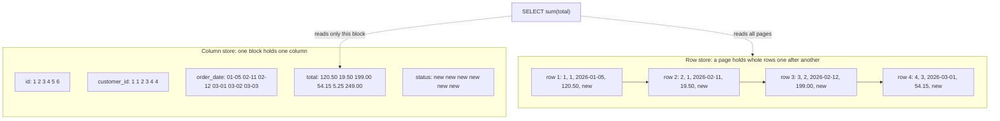
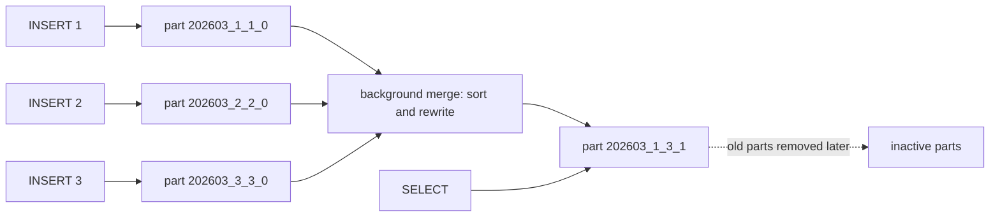
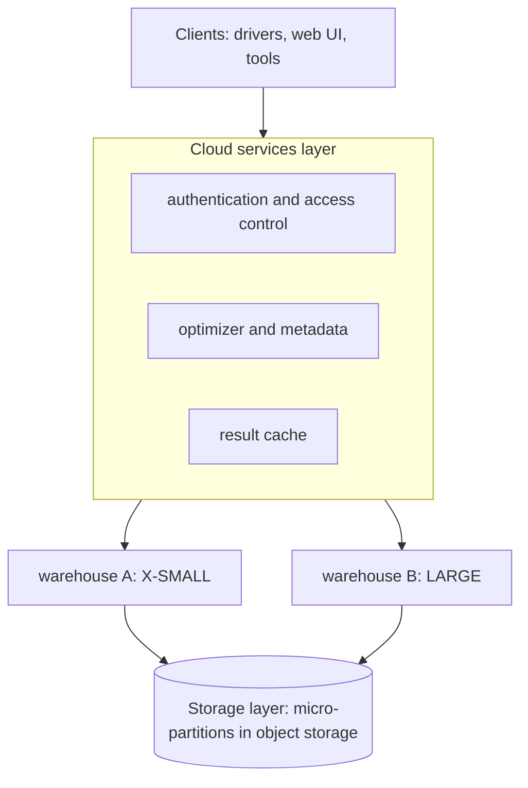
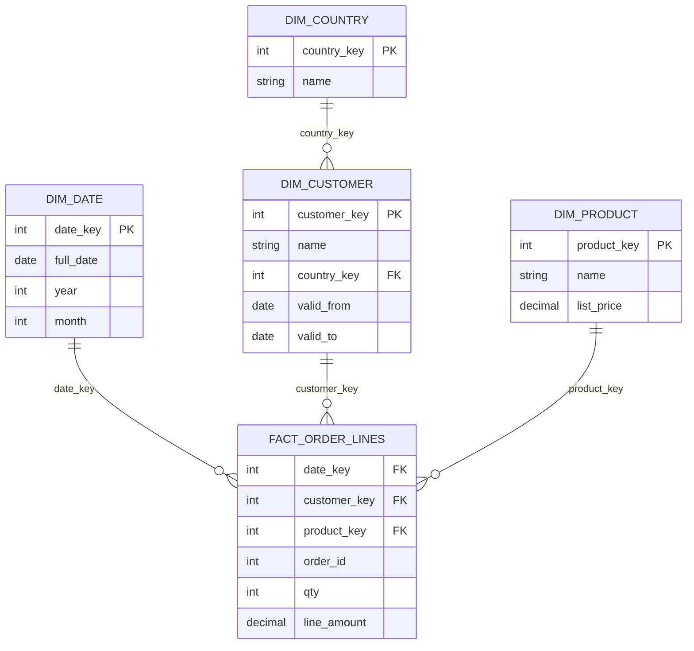

# 15. OLTP vs OLAP and columnar engines

> **Level:** L2 practitioner → L3 senior | **Part:** I | **Rowlit code cited at:** `08528ae`
>
> **In one sentence:** transaction systems read and write a few whole rows very fast, analytic systems scan a few columns of billions of rows, and the two jobs want opposite storage layouts, so engines built for the second job store data column by column.
>
> **You will learn:**
>
> - how OLTP and OLAP workloads differ, and what HTAP tries to do about it
> - why a column store reads less data, compresses better and runs faster on aggregates
> - how compression (run-length, dictionary, delta) and vectorised execution work
> - ClickHouse MergeTree: parts, granules, partitions, merges, mutations, materialized views, dictionaries
> - Snowflake's design: micro-partitions, virtual warehouses, time travel, stages, streams and tasks
> - SQL Server columnstore and batch mode, and how a star schema models analytic data
>
> **Prerequisites:** [Chapter 6 storage internals](06-storage-internals.md), [Chapter 7 indexes](07-indexes.md), [Chapter 9 transactions](09-transactions-and-isolation.md)
>
> **Twin:** [فارسی](../../fa/part1/15-oltp-vs-olap-columnar.md) | **Previous:** [14 Security](14-security.md) | **Next:** [16 NoSQL families](16-nosql-families.md)

> **Examples.** ClickHouse and SQL Server examples use the Docker `shop` databases of [chapter 18](18-exercise-answers.md); Snowflake examples are documentation-only (the lab has no Snowflake account). The Docker engine was not running when this chapter was written, so every output block is marked *illustrative output*: it follows the documented behaviour and was not captured from a run.

## 1. The idea (beginner)

Think of two jobs in a shop.

The **cashier** handles one customer at a time: look up the customer, add an order, change an address. Each task touches a handful of rows and all of their fields, thousands of times a minute, and every task must be correct and quick. This is [OLTP](../glossary.md#oltp) (online transaction processing).

The **analyst** asks questions about the whole business: "what was the revenue per country per month for the last three years?" That question touches every order, but only three of its fields (date, country, total). It runs rarely, may take seconds, and must read a lot of data efficiently. This is [OLAP](../glossary.md#olap) (online analytical processing).

| | OLTP (the cashier) | OLAP (the analyst) |
|---|---|---|
| Typical statement | `INSERT` one order, `SELECT` one customer | `SUM(total)` grouped by month and country |
| Rows touched | few (1 to a few hundred) | millions to billions |
| Columns touched | most of the row | 2 to 5 of possibly 100 |
| Latency goal | milliseconds | seconds to minutes |
| Concurrency | thousands of small transactions | tens of large queries |
| Writes | many small, in place | big batches, mostly append |
| Schema | normalised ([chapter 5](05-modelling-and-normalisation.md)) | star schema or wide denormalised tables |
| Best storage | [row store](../glossary.md#row-store) | [column store](../glossary.md#column-store) |

A **row store** keeps all the fields of a row next to each other on a page (this is what [chapter 6](06-storage-internals.md) described). It is ideal for the cashier: one page read returns the whole customer. A **column store** keeps all the values of one column next to each other, in separate files or blocks. It is ideal for the analyst: summing `total` reads only the `total` column and skips the other 99.

**Figure 15.1 — The same six `orders` rows stored by row and by column.**



(The row-store side shows only the first four of the six seed orders, to keep the picture small. In the PostgreSQL seed every order has the default status `new`.)

The ideas of this chapter all follow from one fact: **in an analytic query, I/O is the bill, and a column store lets you pay only for the columns you use.** Everything else (compression, vectorised execution, the special table engines) makes that advantage larger.

## 2. How it works (practitioner)

### 2.1 Why a column store reads less

Do the arithmetic once. Suppose `orders` has one billion rows and each row, with 20 columns, is about 100 bytes. A row store that must read every page to sum `total` reads about 100 GB. A column store that holds `total` as an 8-byte number reads about 8 GB without compression, and often less than 2 GB after compression (see 2.2). The ratio is 12 to 50 times less I/O for that query. These numbers are an order-of-magnitude illustration, not a benchmark.

The cost shows up on the other side. Fetching one whole row from a column store means visiting 20 files and reassembling the row. Updating one value means rewriting a compressed block. Many small inserts produce many tiny files. This is why column stores prefer large batch inserts, rarely update, and do not replace the OLTP database.

### 2.2 Compression

Column data compresses well because one column holds values of one type, often sorted or repeated. Four basic techniques, shown on the seed `orders`:

- **[Dictionary encoding](../glossary.md#compression-rle-dictionary-delta):** replace each distinct string by a small number. `status` has four possible values (`new`, `paid`, `shipped`, `cancelled`), so each value fits in 2 bits instead of 4 to 9 bytes. ClickHouse calls this type `LowCardinality(String)`, and the shop seed uses it for `orders.status`.
- **Run-length encoding (RLE):** store a value and how many times it repeats. `customer_id` is `1 1 2 3 4 4` in the seed, which becomes `(1,×2) (2,×1) (3,×1) (4,×2)`. A sorted low-cardinality column collapses to a few pairs; `status` in the seed is `(new,×6)`.
- **Delta encoding:** store the first value, then differences. The six order dates in days are `…, +37, +1, +17, +1, +1` (5 January, 11 February, 12 February, 1 March, 2 March, 3 March of 2026). Small numbers need fewer bits than full dates. For regularly spaced timestamps, *delta of delta* stores the change of the change and is often almost all zeros.
- **Bit-packing and general-purpose compression:** after the transforms above, a fast general algorithm (LZ4, ZSTD) squeezes the rest. ClickHouse lets you choose per column: `CODEC(Delta, ZSTD)`; its default is LZ4.

A well-chosen layout reaches ratios of 5 to 10 times on real data, sometimes much more; the exact ratio depends on the data, so measure.

### 2.3 Vectorised execution and late materialisation

The classic executor (the Volcano model of [chapter 8](08-query-processing.md)) asks each operator for **one row** at a time. For a billion rows that is a billion function calls per operator. A **[vectorised](../glossary.md#vectorised-execution)** executor passes **a batch of values of one column** (hundreds to tens of thousands) between operators and processes the batch in a tight loop over an array. This helps in three ways: far fewer function calls, data that fits in the CPU cache, and loops the compiler turns into SIMD instructions (one instruction adds 4 or 8 numbers). ClickHouse processes blocks of about 65,000 rows (the `max_block_size` setting); SQL Server *batch mode* processes batches of roughly 900 rows.

**[Late materialisation](../glossary.md#late-materialisation)** postpones rebuilding rows. A filter `WHERE order_date >= '2026-03-01'` first reads only `order_date`, produces the *positions* of matching rows, and then reads other columns only at those positions. ClickHouse applies this automatically with `PREWHERE`: columns of the filter are read first, and the rest only for the granules that survive.

### 2.4 ClickHouse and the MergeTree family

ClickHouse is an open-source column store built for analytics. Almost every serious table uses an engine of the [MergeTree](../glossary.md#mergetree) family. The `shop` seed for ClickHouse (`engine/tests/docker/seed-clickhouse.sql`) uses it everywhere, so we can read real definitions:

```sql
CREATE TABLE shop.orders
(
    id UInt32,
    customer_id UInt32,
    order_date DateTime('UTC'),
    total Decimal(12, 2),
    status LowCardinality(String) DEFAULT 'new',
    order_month UInt32 MATERIALIZED toYYYYMM(order_date),
    INDEX ix_orders_customer customer_id TYPE minmax GRANULARITY 1,
    CONSTRAINT ck_orders_total CHECK total >= 0
)
ENGINE = MergeTree
PARTITION BY toYYYYMM(order_date)
ORDER BY (id)
TTL order_date + INTERVAL 30 YEAR
SETTINGS index_granularity = 8192;
```

Read it clause by clause.

- `ENGINE = MergeTree` stores data in immutable **[parts](../glossary.md#part)**.
- `ORDER BY (id)` is the **sorting key**: rows inside each part are sorted by it. The *primary key* defaults to the sorting key and is a **sparse index** over it, not a unique constraint.
- `PARTITION BY toYYYYMM(order_date)` splits the table into **[partitions](../glossary.md#partition-clickhouse)**, here one per month. Parts never mix partitions.
- `TTL` deletes (or moves) rows after a time.
- `index_granularity = 8192` sets the **[granule](../glossary.md#granule)** size: the unit of the sparse index, 8,192 rows by default.
- `INDEX … TYPE minmax` is a **skipping index**: for each group of granules it stores the minimum and maximum of a column so the engine can skip groups that cannot match.

**Parts and merges.** Every `INSERT` writes one or more new parts (one per partition touched) and returns. The part is sorted and compressed, and its columns are stored in separate files. A background process then **[merges](../glossary.md#merge)** small parts of the same partition into bigger ones, which keeps the number of parts bounded and the data sorted. Part names show their lineage: `202603_7_7_0` is partition 202603, block range 7 to 7, merge level 0; after merging blocks 7 to 9 it becomes `202603_7_9_1`.

**Figure 15.2 — Inserts create parts; background merges combine them.**



Because every insert creates a part, the rule of ClickHouse is: **insert in large batches** (the documentation recommends at least 1,000 rows per insert, ideally tens of thousands) or enable asynchronous inserts. If parts accumulate faster than merges, the server first delays inserts and finally rejects them with a "too many parts" error.

**The sparse primary index.** The index holds one entry (a *mark*) per granule: the key value of its first row. For one billion rows and 8,192-row granules that is about 122,000 entries, small enough to sit in memory. A query with a condition on the sorting key binary-searches the marks and reads only the granules that can match. It cannot find a single row exactly (it reads a whole granule), which is why ClickHouse is a poor OLTP database. Chapter 7 has the picture of the sparse index.

**Mutations.** There is no in-place update. `ALTER TABLE … UPDATE` and `ALTER TABLE … DELETE` are **[mutations](../glossary.md#mutation)**: the server rewrites every affected part in the background, tracks progress in `system.mutations`, and the statement returns before the work is done. A lightweight `DELETE FROM` instead marks rows as deleted and the data disappears physically at the next merge. Rowlit's ClickHouse session reports a mutation by reading `system.mutations` for exactly this reason (`engine/src/DbStudio.Providers.ClickHouse/ChSession.cs:26-27`, query at `:256`).

ClickHouse also has **no multi-statement transactions**. Each statement applies on its own, which suits large idempotent loads and not shopping carts (`ChSession.cs:25` and `:32-33`).

**The engine family.** The `Replacing`, `Summing`, `Aggregating` and `Collapsing` variants change what happens *when parts merge*:

| Engine | At merge time | Typical use |
|---|---|---|
| `MergeTree` | nothing special | raw facts, logs |
| `ReplacingMergeTree(version)` | rows with the same sorting key collapse to the one with the highest version | "latest state" of an entity; the shop seed uses it for `reviews` |
| `SummingMergeTree` | numeric columns of rows with the same key are summed | pre-aggregated counters; the seed uses it for `daily_sales_agg` |
| `AggregatingMergeTree` | stores partial aggregate states (`-State` functions) and merges them | incremental aggregates |
| `CollapsingMergeTree` | pairs of rows with sign +1 and -1 cancel | change streams with cancellations |
| `Replicated…` prefix | copies each part to other replicas through ClickHouse Keeper | high availability |

The crucial caveat: merges happen **eventually**, so a query can see unmerged duplicates. You must either aggregate again at query time (`sum(...) GROUP BY key`) or force the merged view with `FINAL`.

**Materialized views** in ClickHouse are *insert triggers*. A [materialized view](../glossary.md#materialized-view-clickhouse) runs its `SELECT` on every block inserted into the source table and writes the result to a target table. The seed has one:

```sql
CREATE MATERIALIZED VIEW shop.daily_sales TO shop.daily_sales_agg AS
SELECT toDate(order_date) AS day, count() AS orders, sum(toDecimal128(total, 2)) AS revenue
FROM shop.orders
GROUP BY day;
```

Every insert into `shop.orders` immediately adds a summary row for its block to `daily_sales_agg`, which is a `SummingMergeTree` that folds them together over time. Notice what it does *not* do: it never sees rows that existed before it was created (unless populated), and an `UPDATE` or `DELETE` on `orders` does not reach it.

**[Dictionaries](../glossary.md#dictionary-clickhouse)** are in-memory key-to-attributes tables for fast lookups instead of joins. The seed defines `shop.product_dict` over the `products` table with a `FLAT` layout and a refresh `LIFETIME(MIN 60 MAX 300)`:

```sql
SELECT order_id,
       dictGet('shop.product_dict', 'name', toUInt64(product_id)) AS product,
       qty
FROM shop.order_lines
ORDER BY order_id, product_id;
```

A **[projection](../glossary.md#projection-clickhouse)** is a hidden second copy of a table's data inside each part, sorted or pre-aggregated differently; the optimizer uses it automatically when it fits the query.

#### ClickHouse — watch parts and merges in a scratch table

```sql
CREATE TABLE shop.lab15_events
(
    day    Date,
    kind   LowCardinality(String),
    amount Decimal(12, 2)
)
ENGINE = MergeTree
PARTITION BY toYYYYMM(day)
ORDER BY (kind, day);

INSERT INTO shop.lab15_events VALUES ('2026-03-01', 'sale', 10.00);
INSERT INTO shop.lab15_events VALUES ('2026-03-02', 'sale', 20.00);
INSERT INTO shop.lab15_events VALUES ('2026-03-03', 'refund', -5.00);

SELECT name, rows, level
FROM system.parts
WHERE database = 'shop' AND table = 'lab15_events' AND active
ORDER BY name;
```

Illustrative output (three inserts, three parts in partition `202603`; the block numbers can differ on your server):

```text
┌─name─────────┬─rows─┬─level─┐
│ 202603_1_1_0 │    1 │     0 │
│ 202603_2_2_0 │    1 │     0 │
│ 202603_3_3_0 │    1 │     0 │
└──────────────┴──────┴───────┘
```

Force a merge, look again, and clean up:

```sql
OPTIMIZE TABLE shop.lab15_events FINAL;

SELECT name, rows, level
FROM system.parts
WHERE database = 'shop' AND table = 'lab15_events' AND active;

DROP TABLE shop.lab15_events;
```

Illustrative output after the merge: one active part such as `202603_1_3_1` with `rows = 3` and `level = 1`. (`OPTIMIZE … FINAL` is for demonstrations; do not run it on big tables in production, because it rewrites everything.)

The `ReplacingMergeTree` caveat is easy to see:

```sql
CREATE TABLE shop.lab15_prices
(
    product_id UInt32,
    price      Decimal(10, 2),
    version    UInt32
)
ENGINE = ReplacingMergeTree(version)
ORDER BY product_id;

INSERT INTO shop.lab15_prices VALUES (1, 49.90, 1);
INSERT INTO shop.lab15_prices VALUES (1, 44.90, 2);

SELECT * FROM shop.lab15_prices;          -- may show both rows until a merge
SELECT * FROM shop.lab15_prices FINAL;    -- always one row: version 2, price 44.90

DROP TABLE shop.lab15_prices;
```

#### ClickHouse — see the partition and index filtering

```sql
EXPLAIN indexes = 1
SELECT sum(total) FROM shop.orders WHERE order_date >= '2026-03-01';
```

Illustrative output (trimmed):

```text
ReadFromMergeTree (shop.orders)
Indexes:
  MinMax
    Keys: order_date
    Condition: (order_date in [1772323200, +Inf))
    Parts: 1/3
    Granules: 1/3
  Partition
    Keys: toYYYYMM(order_date)
    Condition: (toYYYYMM(order_date) in [202603, +Inf))
    Parts: 1/3
    Granules: 1/3
  PrimaryKey
    Condition: true
    Parts: 1/1
    Granules: 1/1
```

Read it as: of three parts (one per month), the partition filter keeps one; the primary key cannot help because the query has no condition on `id`. The `Parts: x/y` lines are the thing to look for when tuning. Rowlit's ClickHouse plan reader asks for exactly these index statistics (`engine/src/DbStudio.Providers.ClickHouse/Plans/ChPlanReader.cs:13-18` and the constant at `:22`).

> **Deep dive (L3): write amplification and merge scheduling.** A row written once is rewritten each time its part participates in a merge. If merges combine about *k* similar-size parts, a row is rewritten roughly `log_k(N)` times as its partition grows from one block to *N* blocks; that is the *write amplification* of an LSM-style design (the same idea you will meet again in Cassandra, [chapter 16](16-nosql-families.md)). The server chooses merges that keep part sizes balanced and caps the size of a merged part, so very large partitions stop merging and stay as a handful of big parts. The practical consequences are: prefer fewer, larger inserts; partition by something coarse (month, not day, unless you have a reason) because every partition has its own parts and merges; and never design a workload that updates single rows.

### 2.5 Snowflake

Snowflake is a cloud data warehouse sold as a service. Its design separates three layers that older warehouses bundled together:

1. **Storage.** Tables are cut into **[micro-partitions](../glossary.md#micro-partition)**: immutable, compressed, columnar files holding roughly 50 to 500 MB of uncompressed data each, stored in the cloud provider's object storage. For every micro-partition and column, Snowflake records metadata (minimum, maximum, distinct counts).
2. **Compute.** A **[virtual warehouse](../glossary.md#virtual-warehouse)** is a cluster of compute nodes that you size (`X-SMALL`, `SMALL`, … each size doubles the nodes and the credits per hour), start, suspend and resume independently. Many warehouses can read the same tables at once without competing, because the data lives in the storage layer.
3. **Cloud services.** The "brain": authentication, the metadata store, the optimizer, transaction management, and the query result cache. Metadata operations (`SHOW`, `DESCRIBE`, `GET_DDL`) run here, which is why browsing a Snowflake schema needs no warehouse; Rowlit's catalog reader relies on exactly that so browsing "never resumes a warehouse (no credits)" (`engine/src/DbStudio.Providers.Snowflake/SnowflakeCatalogReader.cs:12-13`).

**Figure 15.3 — Snowflake's three layers.**



**Pruning.** When a query filters on a column, the optimizer compares the filter with the min/max metadata of every micro-partition and reads only the ones that can match. This only works when similar values sit in the same micro-partitions, so data loaded in date order prunes well by date. A **clustering key** (`ALTER TABLE ORDERS CLUSTER BY (TO_DATE(ORDER_DATE))`) tells Snowflake to reorganise data in the background to keep that property.

**Caches and time travel.** An identical query on unchanged data can be answered from the **result cache** without a warehouse. **[Time travel](../glossary.md#time-travel)** keeps old versions of changed or dropped data for a retention period (one day by default; up to 90 days on higher editions), after which a further seven-day *fail-safe* applies for permanent tables. Because micro-partitions are immutable, keeping history costs only the changed files. Zero-copy `CLONE` uses the same mechanism.

Snowflake examples (documentation-only; nothing was executed):

```sql
-- the table as it was five minutes ago
SELECT * FROM ORDERS AT(OFFSET => -60*5);

-- recover a dropped table within the retention period
DROP TABLE ORDERS;
UNDROP TABLE ORDERS;

-- an instant, storage-sharing copy
CREATE TABLE ORDERS_COPY CLONE ORDERS;

-- how well is the table clustered by date?
SELECT SYSTEM$CLUSTERING_INFORMATION('ORDERS', '(TO_DATE(ORDER_DATE))');
```

**Loading and automation.** A **[stage](../glossary.md#stage)** is a named location for files (internal to Snowflake or an external bucket). `COPY INTO` loads from a stage; a **[pipe](../glossary.md#pipe)** (Snowpipe) does it continuously as files arrive. A **[stream](../glossary.md#stream-snowflake)** records the changes (inserts, updates, deletes) made to a table since you last consumed it, a built-in change-data-capture. A **[task](../glossary.md#task-snowflake)** runs a SQL statement on a schedule or when a stream has data. Together they form a small pipeline without any external scheduler:

```sql
CREATE STREAM ORDERS_STREAM ON TABLE ORDERS;

CREATE TASK ORDERS_HISTORY_LOAD
  WAREHOUSE = COMPUTE_WH
  SCHEDULE  = '5 MINUTE'
  WHEN SYSTEM$STREAM_HAS_DATA('ORDERS_STREAM')
AS
  INSERT INTO ORDERS_HISTORY SELECT ID, CUSTOMER_ID, TOTAL, METADATA$ACTION FROM ORDERS_STREAM;

ALTER TASK ORDERS_HISTORY_LOAD RESUME;
```

Snowflake bills compute by the second while a warehouse runs, so the main cost levers are: suspend warehouses quickly (`AUTO_SUSPEND`), size them to the query, prune well, and avoid `SELECT *` over wide tables.

### 2.6 SQL Server columnstore

SQL Server is a row-store database that can also keep a column-store index on the same table. A **[columnstore](../glossary.md#columnstore)** index stores data in **row groups** of up to 1,048,576 rows, each column compressed in its own segment with its minimum and maximum recorded (*segment elimination* skips segments that cannot match). New rows first land in a row-format **delta store** and a background *tuple mover* compresses full groups; bulk loads of at least 102,400 rows compress directly. Operators that read a columnstore run in **batch mode**, the vectorised executor of section 2.3.

#### SQL Server — a clustered columnstore copy of the orders

```sql
SELECT * INTO dbo.OrdersCS FROM dbo.Orders;           -- scratch copy of the shop table
CREATE CLUSTERED COLUMNSTORE INDEX cci_OrdersCS ON dbo.OrdersCS;

SELECT YEAR(OrderDate) AS Y, SUM(Total) AS Revenue
FROM dbo.OrdersCS
GROUP BY YEAR(OrderDate);

DROP TABLE dbo.OrdersCS;
```

With six rows nothing is measurable; the point is the plan. The estimated plan shows a **Columnstore Index Scan** and the operator property *Actual Execution Mode* reads `Batch` (see [chapter 8](08-query-processing.md)). On a table with millions of rows the same query reads only `OrderDate` and `Total` and is typically several times faster than the rowstore plan. A *nonclustered* columnstore index on an OLTP table gives a limited form of HTAP: analytics read the column copy while transactions update the rowstore.

### 2.7 Other engines, HTAP and the embedded option

- **HTAP** (hybrid transactional and analytical processing) means one system serves both jobs, usually by keeping two copies of the data in two layouts and synchronising them: SQL Server (rowstore plus columnstore index), Oracle Database In-Memory (a column copy in memory), TiDB (TiKV rows plus TiFlash columns), Snowflake hybrid tables. The price is extra storage and write cost.
- **PostgreSQL** has no columnar storage in the core server. Extensions and products add it (Citus columnar, Hydra, TimescaleDB compressed chunks), and the `pg_duckdb` extension lets queries use DuckDB's engine. For up to a few hundred gigabytes, plain PostgreSQL with partitioning, BRIN indexes and parallel query is often enough.
- **MySQL** InnoDB is a row store; HeatWave adds an in-memory column engine as a managed service. **MariaDB** offers a separate ColumnStore engine.
- **SQLite** is a row store. For analytics on a file, people use **DuckDB**, an embedded, columnar, vectorised database (think "SQLite for analytics"). Rowlit uses DuckDB as the engine of its linked databases (see Part II, [chapter 16](../part2/16-linked-databases-federation.md)).
- **Cassandra** is called a *wide-column* store, but it is not a column store in the sense of this chapter: it stores rows grouped by partition. See [chapter 16](16-nosql-families.md).

### 2.8 Modelling for analytics: the star schema

Analytic queries are easiest, and fastest, over a **[star schema](../glossary.md#star-schema)**: one large **[fact table](../glossary.md#fact-dimension-table)** at the centre, surrounded by small **dimension tables**.

- A **fact** is an event with numbers you add up (measures): an order line with `qty` and `line_amount`.
- A **dimension** describes the context of facts: who (customer), what (product), when (date), where (country).
- The **grain** is the meaning of one fact row. Decide it first and write it down: *"one row per product per order"*. Every measure and every dimension must be true at that grain.

**Figure 15.4 — A star schema for the shop.**



Here `DIM_COUNTRY` hangs off `DIM_CUSTOMER`: that is a *snowflake schema* (a normalised star; note the name has nothing to do with the Snowflake product). It saves a little space and costs one more join; most warehouses prefer the flat star with `country` copied into the customer dimension.

Four habits belong to this style:

- **Surrogate keys** in dimensions (`customer_key`) instead of the source system's id, so histories do not collide.
- **Slowly changing dimensions.** When a customer moves from Germany to France, type 1 overwrites the row (history lost), type 2 closes the old row (`valid_to`) and inserts a new one (history kept; the `valid_from` / `valid_to` columns above), type 3 keeps the previous value in a second column.
- **Denormalise on purpose.** Joins are the expensive part of OLAP, so the dimension holds `country` as text and not just a key.
- **ELT instead of ETL.** Modern warehouses load raw data first and transform it with SQL inside the warehouse (ELT), instead of transforming in an external tool before loading (ETL).

A **[data warehouse](../glossary.md#data-warehouse)** is a database organised this way and fed from the operational systems. A data *lake* stores raw files (CSV, JSON, Parquet) cheaply in object storage. A **[lakehouse](../glossary.md#lakehouse)** puts a transactional table format (Apache Iceberg, Delta Lake, Apache Hudi) on top of the lake's columnar files (Parquet), so that engines such as Spark, Trino, DuckDB, ClickHouse or Snowflake can query one copy with ACID guarantees.

## 3. Deep dive (senior)

**The cost model of a column scan.** For a filtered aggregate, time is roughly `bytes read after pruning ÷ scan bandwidth` plus decompression and compute. Pruning reduces *bytes read*; compression reduces *bytes per value*; vectorisation raises *values per second*. The three multiply. This is why a well-clustered table on a modest machine can beat a larger machine reading badly laid-out data.

**Why ordering matters more than indexes.** A column store has no B-tree to rescue a bad layout. The sorting key (ClickHouse `ORDER BY`), the clustering key (Snowflake), and the sort order of columnstore loads decide which blocks can be skipped and how well runs compress. Put low-cardinality, frequently filtered columns first in a ClickHouse sorting key: `(kind, day)` lets a filter on `kind` skip most granules and compresses `kind` into a few runs.

**Parquet, the interchange format.** Most open analytic files use Parquet: a file is split into *row groups* (commonly a hundred megabytes or more), each row group stores each column as a *column chunk*, divided into compressed *pages*; a footer holds the schema and per-chunk min/max statistics. It is a column store frozen into a file: engines skip row groups with the footer statistics and read only needed columns. Lakehouse table formats add a log of which files belong to which table version.

**Columnstore delta stores and the tuple mover.** Trickle inserts into a clustered columnstore land in a B-tree delta store, because compressing a few rows would waste a row group. Reads must merge the delta store and the compressed groups; deletes mark rows in a bitmap and only a rebuild reclaims space. Heavy trickle workloads therefore accumulate small row groups and benefit from batching inserts (at least 102,400 rows when you can) and periodic `ALTER INDEX … REORGANIZE`.

**Consistency of a materialized view versus a ClickHouse one.** A classic materialized view (PostgreSQL, Oracle) stores a query result and is refreshed on demand: it is consistent as of the last refresh. A ClickHouse materialized view is incremental, consistent per inserted block, and blind to updates and deletes. Choose by whether your source is append-only.

## 4. In each engine

| Engine | Storage orientation | OLTP fit | OLAP fit | Notable analytic features | Transactions |
|---|---|---|---|---|---|
| PostgreSQL 17 | row (heap) | excellent | good up to hundreds of GB; parallel query, partitioning, BRIN | materialized views (manual refresh); columnar via extensions | full ACID |
| SQL Server 2022 | row, plus optional columnstore | excellent | very good with columnstore | batch mode, partitioning, indexed views | full ACID |
| Oracle 23 | row; optional In-Memory column copy | excellent | very good with options | partitioning, bitmap indexes, materialized views, In-Memory | full ACID |
| MySQL 8 / MariaDB 11 | row (InnoDB) | good | limited (HeatWave or ColumnStore separately) | partitioning, generated columns | ACID (InnoDB) |
| SQLite 3.4x | row (B-tree file) | good for embedded | small data only | window functions, CTEs | ACID, one writer |
| ClickHouse 24+ | column (MergeTree parts) | poor | excellent | sparse index, partitions, materialized views, dictionaries, projections | none (statement-level) |
| Snowflake | column (micro-partitions) | poor (hybrid tables aside) | excellent | pruning, clustering, time travel, streams, tasks, zero-copy clone | ACID, DDL commits implicitly |
| Cassandra 4/5 | partitioned rows (LSM), not columnar | n/a: key-based | poor for scans | secondary indexes, materialized views | none (per-partition atomic batches, lightweight transactions) |

## 5. Exercises

1. **Bytes read.** A table has 2 billion rows and 40 columns of 8 bytes each (320 bytes per row, ignoring overhead). You run `SELECT SUM(total) FROM t`. How much data does a row store read, and how much does a column store read before compression? If compression is 4 to 1, how much does it read after?
2. **Encode by hand.** Encode the column `country_id` = `1,1,1,1,2,2,3,3,3,1` with run-length encoding. Encode the sorted integer ids `1001,1002,1003,1005,1006,1010` with delta encoding. Which technique suits each column, and why?
3. **Design a MergeTree.** A table receives 5 billion web events per month with columns `site`, `ts`, `user_id`, `url`, `status`. Dashboards filter by `site` and a recent time range. Write the `PARTITION BY` and `ORDER BY` clauses and justify them. Why would `PARTITION BY toDate(ts)` for ten years of data be a mistake?
4. **Duplicates that will not go away.** A `ReplacingMergeTree` table shows two rows for the same key in a dashboard. Name two ways to get one row per key, and say what each costs.
5. **Star schema.** For the `shop` database, state the grain of a fact table `fact_orders` (one row per order) and list its measures and dimensions. What breaks if you mix order-level `total` with order-line-level rows in the same fact table?
6. **Snowflake cost.** A dashboard runs `SELECT SUM(TOTAL) FROM ORDERS WHERE ORDER_DATE >= '2026-03-01'` on a 2 TB table loaded in random order, and is slow and expensive. Name three changes and explain how each reduces cost.

## Answers

Answers are collected in [chapter 18](18-exercise-answers.md#chapter-15) and repeated here.

<details>
<summary>Show answers</summary>

1. Row store: it reads every page, about 2 × 10⁹ × 320 B = 640 GB. Column store: only `total`, 2 × 10⁹ × 8 B = 16 GB uncompressed; at 4 to 1 compression about 4 GB. That is 40 times less before compression and 160 times less after.
2. RLE of `1,1,1,1,2,2,3,3,3,1` is `(1,×4) (2,×2) (3,×3) (1,×1)`: four pairs for ten values. Delta of `1001,1002,1003,1005,1006,1010` is the base `1001` followed by `+1,+1,+2,+1,+4`, small numbers that need only a few bits each. RLE suits low-cardinality repeated values (and works best when the column is sorted); delta suits increasing numbers or timestamps.
3. `PARTITION BY toYYYYMM(ts)` and `ORDER BY (site, ts)`. Filtering by site and a recent range then prunes partitions by month and granules by `site` first and time second. Partitioning by day for ten years creates about 3,650 partitions, each with its own parts and merges, which overloads the server with small parts and metadata; partitions are for data management (drop a month), not for query speed.
4. Add `FINAL` to the query (correct but must merge at read time, so it is slower on big tables), or aggregate at query time with `argMax(value, version)` grouped by key (scales better, more verbose). A third option is to run `OPTIMIZE … FINAL` on the partition (expensive and only a one-time fix).
5. Grain: one row per order. Measures: `total`, perhaps `item_count`. Dimensions: date, customer (and through it country), status. Mixing order-level `total` with order-line rows repeats the total on every line, so `SUM(total)` over-counts by the number of lines; a fact table must have one grain.
6. (a) Cluster the table by `TO_DATE(ORDER_DATE)` (or reload it sorted by date) so micro-partitions hold narrow date ranges and the filter prunes most of them. (b) Use a right-sized warehouse with a short `AUTO_SUSPEND`, so you pay for seconds of compute, not idle time. (c) Cache or pre-aggregate: a materialized view or a daily summary table, so the dashboard reads a small table (and repeated identical queries hit the result cache).

</details>

## Related chapters

- [Chapter 5: Modelling and normalisation](05-modelling-and-normalisation.md): the OLTP model that a star schema deliberately relaxes.
- [Chapter 6: Storage internals](06-storage-internals.md): row layout, pages and the buffer pool.
- [Chapter 7: Indexes](07-indexes.md): sparse primary index, skip indexes and columnstore.
- [Chapter 8: Query processing](08-query-processing.md): Volcano versus vectorised execution, batch mode.
- [Chapter 12: Backup, replication and HA](12-backup-replication-ha.md): partitioning, replication and consistency models.
- [Chapter 16: NoSQL families](16-nosql-families.md): the LSM tree behind Cassandra, and why "wide-column" is not "columnar".
- Part II: [chapter 9 relational providers](../part2/09-relational-providers.md), [chapter 15 plans](../part2/15-import-export-plans-er.md), [chapter 16 federation with DuckDB](../part2/16-linked-databases-federation.md).

## Glossary terms introduced here

[OLTP](../glossary.md#oltp), [OLAP](../glossary.md#olap), [HTAP](../glossary.md#htap), [row store](../glossary.md#row-store), [column store](../glossary.md#column-store), [compression (RLE / dictionary / delta)](../glossary.md#compression-rle-dictionary-delta), [vectorised execution](../glossary.md#vectorised-execution), [late materialisation](../glossary.md#late-materialisation), [MergeTree](../glossary.md#mergetree), [part](../glossary.md#part), [granule](../glossary.md#granule), [partition (ClickHouse)](../glossary.md#partition-clickhouse), [merge](../glossary.md#merge), [mutation](../glossary.md#mutation), [materialized view (ClickHouse)](../glossary.md#materialized-view-clickhouse), [dictionary (ClickHouse)](../glossary.md#dictionary-clickhouse), [projection (ClickHouse)](../glossary.md#projection-clickhouse), [micro-partition](../glossary.md#micro-partition), [virtual warehouse](../glossary.md#virtual-warehouse), [time travel](../glossary.md#time-travel), [stage](../glossary.md#stage), [stream (Snowflake)](../glossary.md#stream-snowflake), [task (Snowflake)](../glossary.md#task-snowflake), [pipe](../glossary.md#pipe), [star schema](../glossary.md#star-schema), [fact / dimension table](../glossary.md#fact-dimension-table), [data warehouse](../glossary.md#data-warehouse), [lakehouse](../glossary.md#lakehouse), [columnstore](../glossary.md#columnstore).
