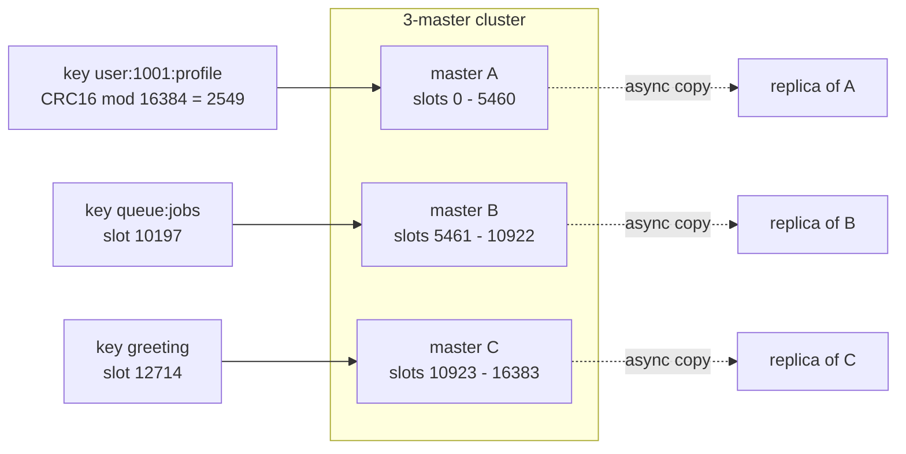
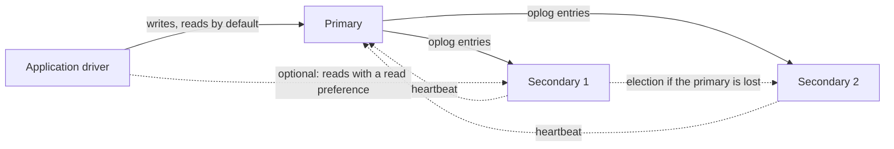
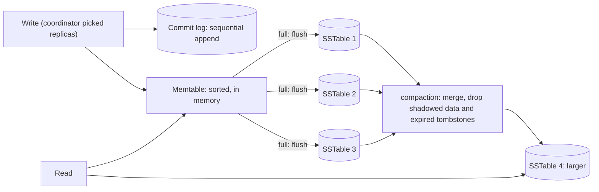
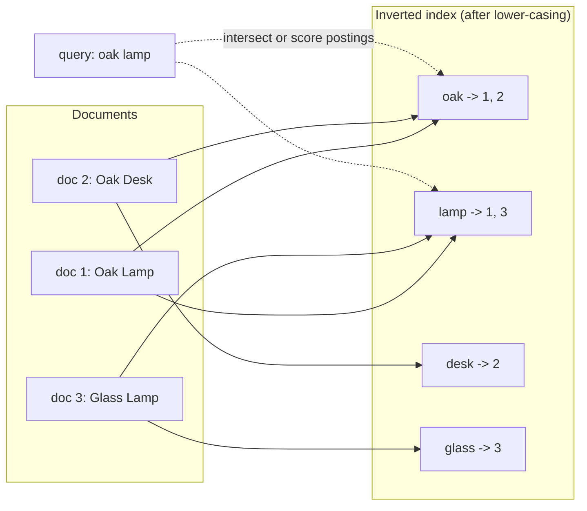
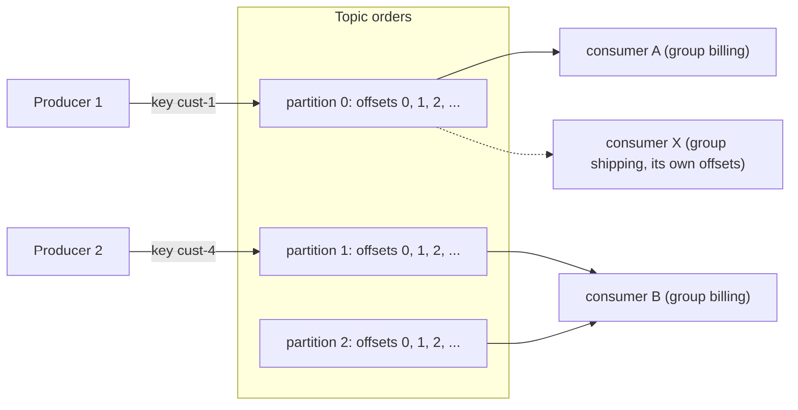

# 16. NoSQL families and their internals

> **Level:** L2 practitioner → L3 senior | **Part:** I | **Rowlit code cited at:** `08528ae`
>
> **In one sentence:** NoSQL systems give up part of the relational contract (fixed schema, joins, or strict transactions) to gain scale, speed or a data model that fits one kind of access pattern, and each of the five families is built around a different internal structure.
>
> **You will learn:**
>
> - the five families (key-value, document, wide-column, search, log) and what each is good at
> - Redis: data types, persistence (RDB and AOF), Sentinel, Cluster hash slots, the RESP protocol
> - MongoDB: BSON, WiredTiger, replica sets and the oplog, indexes, the aggregation pipeline, change streams
> - Cassandra: partition and clustering keys, the token ring, consistency levels, the LSM tree, compaction and tombstones
> - Elasticsearch: the inverted index, analyzers, mappings, shards, Lucene segments and refresh
> - Kafka: topics, partitions, offsets, consumer groups, retention, compaction, KRaft and the Schema Registry
> - what NewSQL adds, and how to choose
>
> **Prerequisites:** [Chapter 7 indexes](07-indexes.md), [Chapter 11 logging and recovery](11-logging-and-recovery.md), [Chapter 12 replication and CAP](12-backup-replication-ha.md), [Chapter 15 columnar engines](15-oltp-vs-olap-columnar.md)
>
> **Twin:** [فارسی](../../fa/part1/16-nosql-families.md) | **Previous:** [15 OLTP vs OLAP](15-oltp-vs-olap-columnar.md) | **Next:** [17 Dialect comparison](17-dialect-comparison.md)

> **Examples.** Commands and queries use the Docker lab seeds (`seed-redis.sh`, `seed-mongo.js`, `seed-cassandra.cql`, `seed-elasticsearch.sh`, `seed-kafka.sh` in `engine/tests/docker/`). The Docker engine was not running when this chapter was written, so every output block is marked *illustrative output*: it follows the documented behaviour and was not captured from a run. Redis hash slots in this chapter were computed with the published CRC16 algorithm.

## 1. The idea (beginner)

"[NoSQL](../glossary.md#nosql)" is a label for a crowd of systems that are not relational databases in the strict sense. Most of them appeared because a relational database on one server could not meet some requirement: more writes per second than one disk can take, data that does not fit a table, a search box that must forgive typos, or an event stream that many programs must replay. Each system dropped something to gain something. The honest summary: **NoSQL is a set of specialised tools, and the choice is made from the access pattern, not from fashion.**

| Family | Data model | Typical question it answers | Examples | In Rowlit |
|---|---|---|---|---|
| [Key-value](../glossary.md#key-value-store) | key → value (often a structure) | "give me the value of this key, fast" | Redis, Valkey, DynamoDB | source kind `KeyValue` |
| [Document](../glossary.md#document-store) | key → nested document (JSON-like) | "give me this order with its items" | MongoDB, Couchbase | source kind `Document` |
| [Wide-column](../glossary.md#wide-column-store) | partition key → sorted rows | "give me the latest events of this customer" at huge scale | Cassandra, ScyllaDB, HBase | a provider with the CQL dialect |
| [Search engine](../glossary.md#search-engine) | documents + inverted index | "find documents about…, ranked by relevance" | Elasticsearch, OpenSearch, Solr | source kind `Search` |
| [Event log](../glossary.md#event-log) | append-only ordered log of events | "tell me everything that happened, in order, and let me replay it" | Kafka, Pulsar, Redpanda | source kind `Stream` |

The "In Rowlit" column comes from the code: the enum `SourceKind { Relational, KeyValue, Document, Stream, Search }` (`engine/src/DbStudio.Core/Models/CoreModels.cs:21`), the `Kind` property of each source provider (`RedisProvider.cs:18`, `MongoProvider.cs:29`, `KafkaProvider.cs:26`, `EsProvider.cs:22`), and Cassandra being a relational-style provider with `Dialect.Cql` (`CassandraProvider.cs`). Part II [chapter 17](../part2/17-sources-redis-mongo.md) and [chapter 18](../part2/18-sources-kafka-elasticsearch.md) describe how Rowlit talks to them.

Three trade-offs run through the whole chapter:

- **Consistency versus availability and latency.** Many systems replicate asynchronously or let you choose how many replicas must agree ([chapter 12](12-backup-replication-ha.md), CAP and PACELC).
- **Flexible schema versus guarantees.** A document store accepts any shape, so the shape lives in your application code instead of in the database.
- **Query power versus scale.** Key-based access scales almost without limit; ad hoc joins and aggregations do not.

## 2. How it works (practitioner)

### 2.1 Key-value: Redis

Redis keeps the whole data set in memory and executes commands on a single thread, so every command is atomic and typically takes microseconds. A key maps to a **value with a type**, not just a blob:

| Type | What it is | Typical use | Example from the seed |
|---|---|---|---|
| string | bytes (text, number, JSON) up to 512 MB | cache, counter (`INCR`), flag | `greeting` = `hello world` |
| hash | field → value map | object with attributes | `user:1001:profile` |
| list | linked list of strings | queue, recent items | `queue:jobs` |
| set | unordered unique strings | tags, membership | `tags` |
| sorted set | unique members ordered by a score | leaderboard, time index | `leaderboard` |
| stream | append-only log with consumer groups | event log, job queue | `events` (group `analytics`) |
| JSON, search, time series | modules shipped in Redis Stack | documents, indexes | `doc:product:1` |
| bitmap, HyperLogLog, geo | special encodings on strings and sorted sets | counting, distinct estimates, nearby search | — |

Commands against the lab seed (`seed-redis.sh`):

```text
127.0.0.1:6379> GET greeting
"hello world"
127.0.0.1:6379> HGETALL user:1001:profile
1) "name"
2) "Alice"
3) "email"
4) "alice@example.com"
5) "tier"
6) "gold"
127.0.0.1:6379> ZREVRANGE leaderboard 0 1 WITHSCORES
1) "carol"
2) "4100"
3) "alice"
4) "3200"
127.0.0.1:6379> TTL session:abc123
(integer) 3587
127.0.0.1:6379> JSON.GET doc:product:1 $.name
"[\"Widget\"]"
```

This is illustrative output: the TTL counts down from 3600 seconds, so it will differ on your run.

**Expiry and eviction.** `EXPIRE` or `SET … EX` gives a key a time to live ([TTL](../glossary.md#ttl)). When memory reaches `maxmemory`, the **eviction policy** decides what happens: `noeviction` (the default: writes fail), `allkeys-lru`, `allkeys-lfu`, `volatile-lru`, `volatile-ttl` and others. A cache wants an `allkeys-*` policy; a primary store wants `noeviction`.

**Persistence.** Memory is lost when the process stops, so Redis can write to disk in two ways:

- **[RDB](../glossary.md#rdb-aof)** is a point-in-time snapshot. Redis forks, and the child writes a compact file while the parent keeps serving. Fast to restore, small, but you lose everything since the last snapshot.
- **AOF** (append-only file) logs every write command. `appendfsync` controls durability: `always` (fsync on each write, slow), `everysec` (default: lose at most about a second), `no` (the operating system decides). The log is periodically rewritten to stay small. This is the same idea as the write-ahead log of [chapter 11](11-logging-and-recovery.md).
- Both together (snapshot plus log) give fast restarts and little loss. Many caches turn both off.

**Replication, Sentinel and Cluster.** Replication is asynchronous: a primary streams its commands to replicas, so a failover can lose the last few writes. **[Sentinel](../glossary.md#sentinel)** is a separate set of watcher processes that monitor a primary, agree by quorum that it is down, promote a replica and tell clients the new address. It gives high availability for a single shard of data. **[Redis Cluster](../glossary.md#redis-cluster)** gives horizontal scale: the key space is divided into **16,384 [hash slots](../glossary.md#hash-slot)**; the slot of a key is `CRC16(key) mod 16384`, and each master owns a range of slots.

**Figure 16.1 — Redis Cluster: a key's hash decides its slot, and the slot decides its node.**



A client that asks the wrong node gets a redirect (`MOVED 9393 10.0.0.2:6379`) and remembers the mapping. A command that touches several keys works only if all keys are in one slot, otherwise the server answers `CROSSSLOT`. To keep related keys together, put a **hash tag** in braces: only the text inside the first `{…}` is hashed, so `{user:1001}:profile` and `{user:1001}:cart` both map to slot 5712 (computed with CRC16). The cluster does not give strong consistency: replication is asynchronous, and a partitioned primary can accept writes that are lost when a replica is promoted. The lab has a three-master cluster profile (`compose.yml`, profile `cluster`).

**Two cautions for production.** `KEYS *` walks the whole key space on the single command thread and blocks everyone; use `SCAN` (a cursor that returns a few keys per call). And one very large key (a list with millions of entries) is a "big key": deleting it blocks, so use `UNLINK`, which frees memory in a background thread.

**The RESP protocol.** Clients and servers speak [RESP](../glossary.md#resp) (REdis Serialization Protocol), a simple text-framed binary-safe protocol. A request is an array of bulk strings; every type has a one-character prefix and lines end with `\r\n`:

| Prefix | Type | Example |
|---|---|---|
| `+` | simple string | `+OK` |
| `-` | error | `-ERR unknown command` |
| `:` | integer | `:1000` |
| `$` | bulk string (length-prefixed) | `$11` then `hello world` |
| `*` | array | `*2` then two elements |

`GET greeting` on the wire (each `\r\n` is shown as a line break) is:

```text
*2
$3
GET
$8
greeting
```

and the reply is `$11\r\nhello world\r\n`. RESP2 is what most tools speak; RESP3 adds maps, sets and push messages. Because the framing is trivial, some operations that must not share a multiplexed connection are done on a raw RESP connection: `MONITOR` (streams every command the server executes), `MULTI`/`EXEC` transactions, `WATCH`, and blocking commands such as `BLPOP`. Rowlit implements a RESP2 reader for exactly these cases (`engine/src/DbStudio.Sources.Redis/RawRedisConnection.cs:10-12` and `:23-27`).

**Transactions and messaging.** `MULTI … EXEC` queues commands and runs them without interleaving, but there is no rollback: a command that fails inside does not undo the others. `WATCH key` makes `EXEC` fail if the key changed, which gives optimistic concurrency. **[Pub/sub](../glossary.md#pub-sub)** (`PUBLISH`, `SUBSCRIBE`) is fire-and-forget: a subscriber that is offline misses the message. **Streams** keep entries, and consumer groups (`XGROUP`, `XREADGROUP`) track which entries each consumer has read, the same model as Kafka in section 2.6.

> **Deep dive (L3): cluster failover and slot migration.** Nodes gossip on a second port (client port plus 10000) and mark a peer as failing when a majority of masters agree it is unreachable. Replicas of the failed master then run an election, and the winner takes its slots. Moving a slot is a live operation: the source marks the slot `MIGRATING`, the target `IMPORTING`, keys move one by one with `MIGRATE`, and a client that asks for a key already moved gets `ASK` (a one-time redirect) instead of `MOVED` (a permanent update of its slot table). Because writes are acknowledged before they reach replicas, `WAIT n timeout` is the tool to ask for replica acknowledgement when you need it.

### 2.2 Document: MongoDB

MongoDB stores **documents** in **collections**. A document is a set of named fields with typed values, nested to any depth, serialised as **[BSON](../glossary.md#bson)** (Binary JSON). BSON adds types JSON lacks: 64-bit and 128-bit decimal numbers (`Decimal128`), dates, binary data and `ObjectId`. The limit is 16 MiB per document.

Every document has a unique **[`_id`](../glossary.md#_id)**; if you do not supply one the driver generates an `ObjectId`: 12 bytes made of a 4-byte timestamp, a 5-byte random value and a 3-byte counter, so ids sort roughly by creation time.

To show BSON types in text, MongoDB defines **[Extended JSON](../glossary.md#extended-json)**. *Relaxed* mode writes numbers and dates the way JSON does. *Canonical* mode keeps every type exact, for example `{"$numberLong": "5550000001"}` for a 64-bit integer and `{"$oid": "c0ffee000000000000000001"}` for an `ObjectId`. Rowlit sends documents to its UI as canonical Extended JSON (`engine/src/DbStudio.Sources.Mongo/Ejson.cs:8-9` and `:22`).

**Modelling: embed or reference.** The seed (`seed-mongo.js`) shows both. An order **embeds** its items (they are always read with the order and never alone), and **references** the customer by id (customers are shared and change independently):

```js
{
  _id: ObjectId("0de2…"),
  customerId: ObjectId("c0ffee…"),     // reference
  status: "paid",
  createdAt: ISODate("2025-03-04T…"),
  items: [                              // embedded: read together, written together
    { sku: "SKU-0007", productId: ObjectId("ab0de0…"), qty: 2, price: 129.9 }
  ],
  total: 259.8
}
```

Embedding turns the "join" into one read and gives single-document atomicity for free; referencing avoids duplication and unbounded growth of a document. The rule of thumb: embed what has a strict "part of" relationship and bounded size; reference what is shared or grows without limit.

**Storage: WiredTiger.** The default storage engine is WiredTiger. It stores each collection and index as a B-tree, compresses collection blocks with snappy by default (zstd or zlib optional) and indexes with prefix compression, uses **document-level concurrency control** with MVCC snapshots (readers do not block writers), keeps an internal cache (by default the larger of 256 MB and half of RAM minus 1 GB), writes a **checkpoint** about every 60 seconds and a write-ahead **journal** in between, so a crash recovers to the last checkpoint plus journal. This is the recovery design of [chapter 11](11-logging-and-recovery.md) in a document database.

**Replica sets.** Production MongoDB runs as a **[replica set](../glossary.md#replica-set)**: one primary accepts writes; secondaries copy them by tailing the primary's **[oplog](../glossary.md#oplog)**, a capped collection (`local.oplog.rs`) that records each change as an idempotent operation. If the primary disappears, the members hold an election (a Raft-like protocol; a heartbeat every 2 seconds and an election timeout of 10 seconds by default) and a secondary becomes primary.

**Figure 16.2 — A MongoDB replica set.**



Durability is chosen per operation by the **write concern**: `w: 1` acknowledges after the primary applied the write, `w: "majority"` waits until most members have it (so it survives an election), and `j: true` also waits for the journal. The **read concern** chooses what you may see (`local`, `majority`, `snapshot`). In recent versions the implicit write concern for most deployments is `majority`, but check your version. **Sharding** splits a collection over several replica sets by a **shard key**, with `mongos` routers and config servers holding the chunk map (see [chapter 12](12-backup-replication-ha.md)).

**Indexes.** MongoDB indexes are B-trees. The seed creates:

```js
db.orders.createIndex({ status: 1, createdAt: -1 });        // compound
db.orders.createIndex({ customerId: 1 });                   // single field
db.customers.createIndex({ email: 1 }, { unique: true });   // unique
db.products.createIndex({ name: 'text', description: 'text' });   // text
db.sessions.createIndex({ lastSeen: 1 }, { expireAfterSeconds: 3600 }); // TTL
```

Other kinds: **multikey** (an index on an array field gets one entry per element, automatic), **wildcard**, **partial**, **hashed**, and geospatial. For compound indexes follow the **ESR rule**: put **E**quality fields first, then the **S**ort field, then **R**ange fields. The query `find({ status: "paid" }).sort({ createdAt: -1 })` is served by `{ status: 1, createdAt: -1 }` with no in-memory sort, because status is an equality and createdAt follows in index order. `explain("executionStats")` shows it: an `IXSCAN` stage and no `SORT` stage.

**Aggregation pipeline.** An **[aggregation pipeline](../glossary.md#aggregation-pipeline)** is an array of stages; each stage transforms the stream of documents the previous one produced:

```js
db.orders.aggregate([
  { $match:  { status: { $in: ["paid", "shipped"] } } },        // filter (can use an index)
  { $group:  { _id: "$status", orders: { $sum: 1 }, revenue: { $sum: "$total" } } },
  { $sort:   { revenue: -1 } }
])
```

Illustrative shape of the result (the counts depend on the seeded random data):

```js
{ _id: "paid",    orders: <n>, revenue: <x> }
{ _id: "shipped", orders: <m>, revenue: <y> }
```

Common stages: `$match`, `$project`, `$group`, `$sort`, `$limit`, `$unwind` (one document per array element), `$lookup` (a left outer join to another collection), `$facet`. Put `$match` and `$sort` first so they can use indexes.

**Change streams, validation and transactions.** A **[change stream](../glossary.md#change-stream)** lets a program subscribe to inserts, updates and deletes of a collection; it is built on the oplog, which is why change streams need a replica set. The lab runs a single-node replica set `rs0` for this reason (`compose.yml`, comment above the `mongo` service). **Schema validation** attaches a `$jsonSchema` to a collection; the seed validates `customers` with level `moderate` and action `warn`, so violations are logged rather than rejected. **Multi-document transactions** exist (replica sets from 4.0, sharded clusters from 4.2) but cost performance; good document design avoids needing them.

> **Deep dive (L3): why oplog entries are idempotent.** An `$inc` is recorded as the resulting `$set`, so applying the same entry twice gives the same state. That makes initial sync, retries after network errors and replication catch-up safe. If a primary fails after acknowledging a `w: 1` write that no secondary received, the old primary on rejoining *rolls back* those operations (it writes them aside to a file) to match the new primary. With `w: "majority"` an acknowledged write cannot be rolled back.

### 2.3 Wide-column: Cassandra

Cassandra (and ScyllaDB, which is compatible) is built to store enormous amounts of data across many machines with no single point of failure and predictable latency for known queries. Its data model looks like SQL tables (queried with **CQL**, Cassandra Query Language) but works differently.

**The primary key is two things.** In `PRIMARY KEY ((customer_id), order_date, order_id)`:

- the **[partition key](../glossary.md#partition-key)** (`customer_id`, the inner parentheses) decides **which nodes** store the row. All rows with the same partition key are stored together on the same replicas.
- the **[clustering key](../glossary.md#clustering-key)** (`order_date`, `order_id`) decides **the order of rows inside the partition**, on disk.

The seed has this table, for the query "the orders of a customer, newest first":

```sql
CREATE TABLE shop.orders_by_customer (
  customer_id int,
  order_date  timestamp,
  order_id    int,
  status      text,
  total       decimal,
  PRIMARY KEY ((customer_id), order_date, order_id)
) WITH CLUSTERING ORDER BY (order_date DESC, order_id ASC);

SELECT order_id, total FROM shop.orders_by_customer WHERE customer_id = 1;
```

Illustrative output (customer 1 has orders 1 and 2; the clustering order puts the newest first):

```text
 order_id | total
----------+--------
        2 |  19.50
        1 | 120.50
```

A second seed table shows a **composite partition key**: `events_by_day` has `PRIMARY KEY ((customer_id, day), event_time)`, so each customer-day is its own partition, which keeps partitions bounded in size. It also has `default_time_to_live = 7776000` (90 days), after which rows expire.

**Model for the queries, not for the data.** CQL has no joins, and a query must name the partition key (a full-table scan is not an ordinary operation). So in Cassandra you write **one table per query**, denormalised, and write the same fact to several tables. The seed header says so: *"one table per query, denormalised"*, with `orders`, `orders_by_customer` and a materialized view `orders_by_status`. Filtering on a non-key column is refused unless you add `ALLOW FILTERING`, which makes the cluster scan; treat that keyword as a warning sign:

```sql
SELECT * FROM shop.orders WHERE total > 100;
-- InvalidRequest: Cannot execute this query as it might involve data filtering and
-- thus may have unpredictable performance. ... use ALLOW FILTERING
```

**The [token ring](../glossary.md#token-ring).** Cassandra hashes the partition key with a partitioner (Murmur3) to a **token** in the range −2⁶³ to 2⁶³−1. Every node owns several slices of this ring (**virtual nodes**; 16 per node in recent defaults, 256 in older versions), so adding a node takes small slices from all others. There is no leader: any node can act as **coordinator** for a request and routes it to the replicas that own the token. The **[replication factor](../glossary.md#replication-factor)** (RF) says how many nodes store each partition. The seed creates its keyspace with `SimpleStrategy` and RF 1 for a single lab node; production uses `NetworkTopologyStrategy` with an RF per data centre, typically 3.

**[Consistency levels](../glossary.md#consistency-level).** For each read and write the client chooses how many replicas must answer before success:

| Level | Replicas that must respond |
|---|---|
| `ONE`, `TWO`, `THREE` | that many |
| `QUORUM` | a majority of all replicas: `floor(RF/2) + 1` |
| `LOCAL_QUORUM` | a majority in the coordinator's data centre |
| `EACH_QUORUM` | a majority in every data centre (writes) |
| `ALL` | every replica |
| `ANY` | writes only: even a stored hint counts |
| `SERIAL`, `LOCAL_SERIAL` | for lightweight transactions (below) |

The strong-consistency rule is **R + W > RF**: if the replicas you read from and the replicas you wrote to must overlap, a read sees the last write. With RF 3, `QUORUM` reads and writes (2 + 2 > 3) are strongly consistent, `ONE` and `ONE` (1 + 1 < 3) are only eventually consistent. Rowlit's connection form defaults to `LOCAL_QUORUM` (`engine/src/DbStudio.Providers.Cassandra/CqlConnectionSettings.cs:21`). This is the "tunable consistency" of [chapter 12](12-backup-replication-ha.md).

**The write path: an LSM tree.** Cassandra never updates data in place. Every write goes to two places: the **[commit log](../glossary.md#commitlog)** (a sequential append-only file, for crash recovery) and the **[memtable](../glossary.md#memtable)** (a sorted in-memory table per Cassandra table). When a memtable is full it is **flushed** to disk as a new immutable **[SSTable](../glossary.md#sstable)** (sorted string table), and the commit log segments it covered can be discarded. This structure is the **[LSM tree](../glossary.md#lsm-tree)** (log-structured merge tree). By default the commit log syncs periodically (every 10 seconds), so a power loss can lose the last seconds on that one node; replication to other nodes is what protects against that.

**Figure 16.3 — The Cassandra write path and compaction.**



An SSTable is a set of files: `Data.db` (the rows), `Index.db` and `Summary.db` (where partitions start), `Filter.db` (a **Bloom filter**: a small structure that answers "this SSTable definitely does not contain the partition" or "it might"), `Statistics.db` and others. A **read** consults the memtable and then, for each SSTable the Bloom filter does not exclude, the index, and merges all fragments, picking for each cell the version with the newest timestamp ("last write wins"). Reads therefore get slower as SSTables pile up, and **[compaction](../glossary.md#compaction)** is the background process that merges SSTables into fewer, larger ones. Strategies: `SizeTieredCompactionStrategy` (default; merges similar-sized files; good for write-heavy loads), `LeveledCompactionStrategy` (small non-overlapping files per level; good for read-heavy loads at the cost of more writes), `TimeWindowCompactionStrategy` (one window per time bucket; for time series with TTL) and, from 5.0, `UnifiedCompactionStrategy`.

**[Tombstones](../glossary.md#tombstone).** Because SSTables are immutable, a delete cannot remove data; it writes a marker, a tombstone, that hides older versions. Tombstones are kept for `gc_grace_seconds` (864,000 s = 10 days by default) so that a replica that was down during the delete still learns about it during repair; only after that can compaction purge them. Expired TTL values also become tombstones. A query that scans many tombstones is slow, and Cassandra warns at 1,000 and fails at 100,000 tombstones per query by default. Rules that follow: avoid deleting individual cells at high rate, do not use a table as a queue, prefer TTL with `TimeWindowCompactionStrategy`, and run **repair** regularly (anti-entropy that compares Merkle trees between replicas).

**Other features, briefly.** Writes to a replica that is down are stored as **hints** by the coordinator for a few hours and replayed (hinted handoff); a read that sees replicas disagree repairs them (read repair). A **lightweight transaction** (`INSERT … IF NOT EXISTS`, `UPDATE … IF col = value`) uses a Paxos round to give compare-and-set, at several times the cost of a normal write. A **batch** (`BEGIN BATCH … APPLY BATCH`) is atomic (all or nothing, eventually) but is *not* isolated and is not a performance tool; use it to keep denormalised tables in step. A **counter** column (`product_views` in the seed) supports increments. **Collections** (`set`, `list`, `map`) and **user-defined types** (the `address` type) live inside a row. For queries off the partition key, Cassandra offers **secondary indexes** (the seed uses a storage-attached index, `USING 'sai'`, from version 5) and **materialized views** (maintained server side, but disabled by default in 5.0, as the seed header notes). Cassandra has no `EXPLAIN`; you turn **tracing** on and read the per-replica events, which is what Rowlit's console does (`CqlSession.cs:37-39`).

> **Deep dive (L3): read amplification and the Bloom filter.** A read touches, in the worst case, one memtable plus every SSTable that might hold the partition. A Bloom filter with *m* bits for *n* keys and *k* hash functions has a false-positive rate of about `(1 − e^(−kn/m))^k`; with 10 bits per key and 7 hashes this is under 1%. The table option `bloom_filter_fp_chance` (default 0.01) sets the target, trading memory for fewer useless disk reads. This is why a tombstone-heavy or overlapping-SSTable workload is slow: Bloom filters say "maybe" more often, and the merge has more fragments to reconcile.

### 2.4 Search: Elasticsearch and OpenSearch

A relational `LIKE '%keyboard%'` scans every row. A search engine answers the same question in milliseconds and ranks the results, because it stores an **[inverted index](../glossary.md#inverted-index)**: a map from each *term* to the list of documents that contain it (the postings list), the reverse of "document → words".

**Figure 16.4 — An inverted index over three documents.**



A query for `oak lamp` looks up both terms, combines the postings and scores each document; document 1 contains both and ranks first. The default scoring function is **BM25**, which rewards rare terms and term frequency and normalises for document length.

**[Analyzers](../glossary.md#analyzer).** Text is cut into terms by an analyzer: character filters, a **tokenizer** (split on word boundaries), and **token filters** (lower-case, remove stop words, stem). The same analyzer runs on documents when indexing and on the query text when searching, which is why `Keyboards` finds `keyboard` if a stemmer is configured. The default `standard` analyzer splits on Unicode word boundaries and lower-cases; for Persian text, Elasticsearch has a `persian` analyzer that also normalises characters and removes Persian stop words, which matters for the Persian names in the seed.

**[Mappings](../glossary.md#mapping).** A mapping declares each field's type, and the type decides how it is indexed. The seed (`seed-elasticsearch.sh`) shows the key distinction:

```json
"name": { "type": "text", "fields": { "keyword": { "type": "keyword", "ignore_above": 256 } } }
```

`text` is analysed and searchable word by word, but cannot be sorted or aggregated on meaningfully; `keyword` is stored as one exact term, used for filters, sorting and aggregations. The multi-field `name.keyword` gives both. Other seed mappings: `date`, `double`, `nested` (the `items` of an order are indexed as hidden separate documents, so a query can match one item's `sku` *and* `qty` together instead of mixing items) and `binary`. If you do not define a mapping, dynamic mapping guesses one from the first value it sees, which is convenient and often wrong.

**Shards, replicas and the cluster.** An index is split into **[shards](../glossary.md#shard-replica-elasticsearch)**, each a self-contained Lucene index; a document goes to shard `hash(_routing) mod number_of_primary_shards` where the routing defaults to the document id. Because of this formula, **the number of primary shards is fixed when the index is created** (a split or shrink operation creates a new index). Each primary shard has zero or more **replica** shards on other nodes, which serve reads and take over if the primary is lost. The seed makes `shop-orders` with two primary shards and no replicas, and `shop-customers` with one. Cluster health reports `green` (all shards allocated), `yellow` (primaries yes, some replicas not: a single node with replicas set to 1 is yellow) or `red` (a primary is missing). Aliases such as `shop-sales` point at one or more indexes so you can swap indexes without changing the application.

**Lucene segments, refresh and the translog.** Inside a shard, Lucene writes **[segments](../glossary.md#segment)**: immutable mini-indexes. New documents are first buffered in memory and appended to the **translog** (the write-ahead log of this world; by default it is fsynced on every request). A **[refresh](../glossary.md#refresh)**, by default every second, turns the buffer into a new searchable segment: this is why Elasticsearch is *near-real-time*, not instant. A **flush** commits segments to disk and truncates the translog. Because segments never change, a delete only marks the document in a bitmap and an update is a delete plus an insert; background **merges** combine segments and finally remove deleted documents, the same pattern as LSM compaction. Fields also get **doc values**, a column-oriented on-disk structure used for sorting and aggregations (compare with [chapter 15](15-oltp-vs-olap-columnar.md)).

**Querying.** The main interface is the JSON **Query DSL**; a SQL layer also exists:

```json
POST shop-customers/_search
{
  "query": { "bool": {
      "must":   [ { "match": { "name": "علی" } } ],
      "filter": [ { "term":  { "tier": "gold" } } ]
  } },
  "aggs": { "by_country": { "terms": { "field": "address.country" } } }
}
```

`must` clauses are scored, `filter` clauses are not scored and are cached; `aggs` computes grouped counts. The SQL form: `POST _sql?format=txt` with `{"query": "SELECT tier, COUNT(*) FROM \"shop-customers\" GROUP BY tier"}`. Both are covered in the Rowlit Elasticsearch module (Part II chapter 18).

**Concurrency control.** Every write returns a `_seq_no` and `_primary_term` ([seq_no / primary_term](../glossary.md#seq-no-primary-term)). Sending them back as `if_seq_no` and `if_primary_term` makes an update succeed only if nobody changed the document in between; otherwise the server answers `409 Conflict`. This is optimistic locking ([chapter 10](10-concurrency-locking-mvcc.md)). OpenSearch is the fork of Elasticsearch 7.10 that AWS and others maintain; the concepts above apply to both.

> **Deep dive (L3): shard sizing and why too many shards hurt.** Every shard costs memory, file handles and a thread of work per search, and a search fans out to one copy of every shard of the indexes it touches. A common guideline is to aim for shards of some tens of gigabytes and to avoid thousands of tiny shards. Time-based data uses one index per period (or data streams) so old data can be dropped by deleting an index, which is far cheaper than deleting documents.

### 2.5 Event log: Kafka

Kafka is a **distributed commit log**. Producers append **events** (records with a key, a value, a timestamp and headers) to a **[topic](../glossary.md#topic)**; consumers read them in order and as many times as they like, because Kafka does not delete an event when it is read. It deletes by **[retention](../glossary.md#retention)**: by age (default 7 days) or size.

- A **[broker](../glossary.md#broker)** is one Kafka server; a cluster has several.
- A topic is split into **[partitions](../glossary.md#partition-kafka)**. A partition is an ordered, append-only sequence of records stored as segment files on disk. **Order is guaranteed only within a partition.**
- The position of a record in its partition is its **[offset](../glossary.md#offset)**, a number that only grows. A consumer remembers "I have read up to offset N".
- A record's **key** chooses its partition: `murmur2(key) mod partitions`. All records with the same key go to the same partition, so they stay in order. Records without a key are spread across partitions.

The seed topic `orders` (`seed-kafka.sh`) has three partitions and 120 JSON records keyed `cust-0` to `cust-6`, so each customer's records are ordered within their partition.

**[Consumer groups](../glossary.md#consumer-group).** Consumers that share a `group.id` split the partitions: each partition is read by **exactly one** consumer of the group at a time. Adding consumers scales reading up to the number of partitions (a 4th consumer on a 3-partition topic would sit idle). Different groups are independent and each has its own offsets, which Kafka stores in an internal topic, `__consumer_offsets`. If a consumer joins or leaves, the group **rebalances**. The **[consumer lag](../glossary.md#consumer-lag)** of a partition is `log end offset − committed offset`: how many records the group has yet to process. The seed sets up two groups on `orders`: `billing`, reset to offset 10 (it is behind, so it shows lag), and `shipping`, at the end (lag 0).

**Figure 16.5 — A topic with three partitions read by a consumer group.**



**Replication and durability.** Each partition has a **leader** and follower replicas on other brokers. The **[ISR](../glossary.md#isr)** (in-sync replicas) is the set of followers that are caught up. A producer with `acks=all` gets an acknowledgement only after every ISR member has the record; combined with `min.insync.replicas=2` and a replication factor of 3, a write survives the loss of any one broker. `acks=1` acknowledges after the leader alone (a leader crash can lose the record); `acks=0` does not wait at all. Producers have been idempotent by default since Kafka 3.0, so a retry does not create a duplicate. **Delivery semantics** follow: at-most-once (commit the offset before processing), at-least-once (commit after processing; duplicates possible, the usual choice) and exactly-once (transactions across read-process-write, within Kafka).

**Compaction.** Besides deletion by age, a topic can use **[log compaction](../glossary.md#log-compaction)** (`cleanup.policy=compact`): Kafka keeps only the **latest record per key**, and a record with a key and a null value (a *tombstone*) eventually removes the key. This turns a topic into a changelog of the current state, like a table. The seed topic `compacted-users` is configured this way.

**Metadata: KRaft.** Older Kafka stored cluster metadata in ZooKeeper. **[KRaft](../glossary.md#kraft)** (Kafka Raft) replaces it with a Raft quorum of controller nodes inside Kafka itself; ZooKeeper support was removed in Kafka 4.0. The lab runs `apache/kafka:3.8.0` in KRaft mode (`compose.yml`, `engine/tests/docker/README.md`).

**[Schema Registry](../glossary.md#schema-registry).** A topic is just bytes, so producers and consumers must agree on the record format as it evolves. The Schema Registry (a separate service) stores versioned schemas, called **subjects**, usually named `<topic>-value`, and enforces a **compatibility** rule (for example `BACKWARD`: new schemas can read old data). Each message carries a 5-byte prefix: a zero byte and the 4-byte schema id; the reader fetches the schema by id and decodes. Supported formats are **Avro** (compact binary with a schema; the usual choice), **Protobuf**, and JSON Schema. The seed registers `payments-avro-value` (Avro) and `events-proto-value` (Protobuf). Part II chapter 18 shows how Rowlit decodes these.

Useful commands in the Kafka container (illustrative):

```bash
kafka-consumer-groups.sh --bootstrap-server localhost:9092 --describe --group billing
# GROUP    TOPIC   PARTITION  CURRENT-OFFSET  LOG-END-OFFSET  LAG
# billing  orders  0          10              <end of p0>     <end of p0 - 10>
# billing  orders  1          10              <end of p1>     <end of p1 - 10>
# billing  orders  2          10              <end of p2>     <end of p2 - 10>
```

> **Deep dive (L3): the high watermark and leader epochs.** Consumers see only records below the **high watermark**: the offset replicated to every ISR member. After a leader failure, a new leader is chosen from the ISR, so no committed record is lost; followers truncate any records beyond the new leader's log, using a **leader epoch** number to find the correct truncation point. `unclean.leader.election.enable` (off by default) would allow an out-of-sync replica to lead, trading durability for availability.

### 2.6 NewSQL and distributed SQL

**NewSQL** (also **[distributed SQL](../glossary.md#newsql)**) systems try to keep SQL and ACID transactions while scaling out like NoSQL. The pattern is the same everywhere: the data is cut into ranges, each range is replicated by a **consensus protocol** (Raft or Paxos, see [chapter 12](12-backup-replication-ha.md)), and a transaction layer coordinates across ranges.

- **Google Spanner** uses synchronised atomic clocks (TrueTime) to give external consistency across continents.
- **CockroachDB** speaks the PostgreSQL wire protocol, divides data into ranges of about 512 MiB, replicates each by Raft and defaults to serializable isolation.
- **TiDB** speaks the MySQL protocol; its storage (TiKV) is Raft-replicated, with a column replica (TiFlash) for analytics (HTAP, [chapter 15](15-oltp-vs-olap-columnar.md)).
- **YugabyteDB** offers a PostgreSQL-compatible layer over a Raft-replicated store.

The price is latency: a commit needs a majority of replicas, so a write that crosses regions pays the round trip. Whether Rowlit's PostgreSQL or MySQL provider can browse such a database through the wire protocol is not verified here; test your own system.

### 2.7 Choosing

| Need | Pick | Because | Watch out for |
|---|---|---|---|
| cache, counters, sessions, leaderboards, rate limits | Redis | microsecond latency, rich types | memory cost, persistence settings |
| flexible nested documents, a typical web backend | MongoDB | document model, rich queries, one-document atomicity | schema discipline, index design |
| huge write volume, known queries, multi-datacentre, always on | Cassandra | no leader, linear scale, tunable consistency | modelling per query, tombstones, no joins |
| full-text search, log analytics, relevance ranking | Elasticsearch / OpenSearch | inverted index, aggregations | not a system of record, shard planning |
| event stream, integration between services, replayable history | Kafka | durable ordered log, many independent consumers | ordering only per partition, operations cost |
| relational model at global scale | NewSQL | SQL plus ACID plus scale | cross-region latency, maturity |
| anything else | a relational database | joins, constraints, transactions, tooling | scale beyond one server needs design |

Real systems are **polyglot**: the order lives in PostgreSQL, its search index in Elasticsearch, its sessions in Redis and its events on Kafka, each store fed from the system of record, usually by a change stream or event log. Keeping them consistent is your job.

## 3. Deep dive (senior)

**One structure, many names.** Three families share the *log plus sorted immutable files plus background merge* idea: Cassandra (commit log, memtable, SSTable, compaction), Elasticsearch (translog, buffer, Lucene segment, merge) and ClickHouse (part, merge; [chapter 15](15-oltp-vs-olap-columnar.md)). Kafka is the log without the merge, and Redis AOF is the log with a rewrite. The reason is physical: sequential appends are fast on disks and SSDs, in-place random updates are slow, and immutable files are easy to cache, copy and compress. The price is the same everywhere: write amplification from merging, read amplification from consulting several files, and space amplification from not-yet-merged old versions. Tuning an LSM system means choosing where to pay.

**Where the guarantees come from.** Compare how each system makes data durable and consistent: Redis (async replication, optional fsync) loses a tail on failover; MongoDB (journal plus `w: majority`) does not lose acknowledged majority writes; Cassandra (RF and quorum) is tunable and eventually consistent by default; Elasticsearch (translog plus primary-backup per shard) can lose data in rare partition cases in older versions and relies on sequence numbers since 6.x; Kafka (ISR plus `acks=all`) does not lose acknowledged records while the ISR is not empty. When a requirement says "no data loss", find the exact setting that provides it in your system, not the family name.

**Consistency and CAP in one table.** Under a network partition: Cassandra at `ONE` stays available on both sides and reconciles later (AP); at `QUORUM` the minority side refuses requests (CP-leaning); MongoDB with `majority` write concern refuses writes on a minority side (CP); Redis Cluster minority masters stop accepting writes after a timeout but may have accepted some before; Kafka rejects `acks=all` writes when fewer than `min.insync.replicas` are in sync. PACELC adds the everyday trade-off: even without a partition, quorum reads cost latency.

## 4. In each engine

Part I keeps Rowlit's details in Part II. Which Rowlit module covers each system:

| System | Family | Rowlit module (Part II) | Connection form highlights |
|---|---|---|---|
| Redis (and Valkey-compatible servers) | key-value | [chapter 17](../part2/17-sources-redis-mongo.md) | standalone / cluster / sentinel, ACL user, TLS (`RedisProvider.cs:30-36`) |
| MongoDB | document | [chapter 17](../part2/17-sources-redis-mongo.md) | URI or fields, auth mechanism, TLS (`MongoProvider.cs:36-48`) |
| Cassandra / ScyllaDB | wide-column | [chapter 9 providers](../part2/09-relational-providers.md) | contact points, local datacenter, consistency, SSL (`CqlConnectionSettings.cs:44-70`) |
| Elasticsearch / OpenSearch | search | [chapter 18](../part2/18-sources-kafka-elasticsearch.md) | node URLs, auth none/basic/API key/bearer (`EsProvider.cs:28-44`) |
| Kafka | event log | [chapter 18](../part2/18-sources-kafka-elasticsearch.md) | bootstrap servers, security protocol, SASL, Schema Registry (`KafkaProvider.cs:28-53`) |

The lab services (`engine/tests/docker/README.md`): Redis Stack 7.4 on port 16379, a 3-master Redis cluster (profile `cluster`), MongoDB 7 as replica set `rs0` on 27018, Kafka 3.8 (KRaft) on 19092 with Schema Registry on 18081 (profile `kafka`), Elasticsearch on 19200 (profile `search`, security off) and Cassandra on 19042 (profile `cassandra`).

## 5. Exercises

1. **Pick the store.** Choose a family for each and say why: (a) a per-user shopping cart that expires after 30 minutes; (b) 2 million sensor readings per second, read back by sensor and day; (c) a product catalogue whose items have very different attributes; (d) a search box over 50 million articles with typo tolerance; (e) an audit trail that three services must consume independently and replay.
2. **Slots and hash tags.** In a Redis Cluster, `MGET user:1001:profile user:1002:profile` returns `CROSSSLOT`, but `MGET {user:1001}:profile {user:1001}:cart` works. Explain why, using the slot numbers 2549, 9393 and 5712 from this chapter.
3. **Model it in Cassandra.** You need two queries: "the latest 10 orders of a customer" and "all orders with status `paid` placed on a given day". Design one table for each: write the `PRIMARY KEY` and the clustering order, and say why one table cannot serve both.
4. **Consistency arithmetic.** With RF = 3, is `write QUORUM + read ONE` strongly consistent? What about `write ONE + read ALL`? What is the minimum that reads and writes must sum to?
5. **Which Mongo index?** For `find({ customerId: X, status: "paid" }).sort({ createdAt: -1 })`, write the best compound index using the ESR rule and explain the order. Would `{ createdAt: -1, customerId: 1, status: 1 }` be as good?
6. **Kafka partitions.** A topic has 6 partitions. A consumer group has 8 consumers. How many are idle? Messages for the same customer must be processed in order: what must the producer do? Group `billing` has committed offset 10 on a partition whose log end offset is 41. What is the lag?

## Answers

Answers are collected in [chapter 18](18-exercise-answers.md#chapter-16) and repeated here.

<details>
<summary>Show answers</summary>

1. (a) Key-value (Redis string or hash with `EXPIRE 1800`): small, temporary, accessed by user key. (b) Wide-column (Cassandra), partition key `(sensor_id, day)` with the timestamp as clustering key; write volume and time-bucketed reads fit. (c) Document store (MongoDB): items of different shapes in one collection. (d) Search engine (Elasticsearch) with an analyzer and fuzzy matching. (e) Event log (Kafka): each service uses its own consumer group, and retention keeps history for replay.
2. The slot of a key is `CRC16(key) mod 16384`. `user:1001:profile` is slot 2549 and `user:1002:profile` is slot 9393; they belong to different masters (2549 in 0–5460, 9393 in 5461–10922 in a three-master split), and a multi-key command needs all keys on one node, hence `CROSSSLOT`. With a hash tag only the text inside `{…}` is hashed, so `{user:1001}:profile` and `{user:1001}:cart` both hash `user:1001`, slot 5712, one node.
3. Latest orders of a customer: `PRIMARY KEY ((customer_id), order_date, order_id)` with `CLUSTERING ORDER BY (order_date DESC, order_id ASC)`; query with `LIMIT 10`. Paid orders per day: `PRIMARY KEY ((status, day), order_date, order_id)` (or `((day), status, order_id)` depending on volume), for example `WHERE status = 'paid' AND day = '2026-03-01'`. A partition key must be named in the query, and the two queries need different partition keys, so a single table cannot give both in one partition read. Write both tables (a logged batch keeps them in step).
4. `QUORUM` write (2) + `ONE` read (1) = 3, which is not greater than RF 3, so a read can miss the last write: not strongly consistent. `ONE` write (1) + `ALL` read (3) = 4 > 3: strongly consistent (but reads fail if any replica is down). The rule is R + W > RF.
5. `{ customerId: 1, status: 1, createdAt: -1 }`: equality fields (`customerId`, `status`) first, then the sort field. The index returns matching entries already ordered by `createdAt`, so there is no in-memory sort. `{ createdAt: -1, customerId: 1, status: 1 }` would have to scan the whole index in date order and test each entry, which is much worse for selective equality conditions.
6. Two consumers are idle (a partition is read by at most one consumer of a group). The producer must give all records for a customer the same key (for example the customer id) so they land in the same partition. Lag = 41 − 10 = 31.

</details>

## Related chapters

- [Chapter 7: Indexes](07-indexes.md): B-trees (MongoDB), inverted indexes, secondary indexes in Cassandra.
- [Chapter 10: Concurrency, locking and MVCC](10-concurrency-locking-mvcc.md): optimistic concurrency, as in Elasticsearch `if_seq_no`.
- [Chapter 11: Logging and recovery](11-logging-and-recovery.md): the write-ahead log idea behind AOF, the journal, the commit log and the translog.
- [Chapter 12: Backup, replication and HA](12-backup-replication-ha.md): CAP, quorum, Raft, sharding and consistency models.
- [Chapter 14: Security](14-security.md): ACLs, SASL and TLS options for these systems.
- [Chapter 15: OLTP vs OLAP](15-oltp-vs-olap-columnar.md): the merge idea in ClickHouse and doc values in Lucene.
- Part II: [chapter 17 Redis and MongoDB](../part2/17-sources-redis-mongo.md), [chapter 18 Kafka and Elasticsearch](../part2/18-sources-kafka-elasticsearch.md).

## Glossary terms introduced here

[NoSQL](../glossary.md#nosql), [key-value store](../glossary.md#key-value-store), [document store](../glossary.md#document-store), [wide-column store](../glossary.md#wide-column-store), [search engine](../glossary.md#search-engine), [event log](../glossary.md#event-log), [BSON](../glossary.md#bson), [Extended JSON](../glossary.md#extended-json), [_id](../glossary.md#_id), [replica set](../glossary.md#replica-set), [oplog](../glossary.md#oplog), [aggregation pipeline](../glossary.md#aggregation-pipeline), [change stream](../glossary.md#change-stream), [partition key](../glossary.md#partition-key), [clustering key](../glossary.md#clustering-key), [token ring](../glossary.md#token-ring), [replication factor](../glossary.md#replication-factor), [consistency level](../glossary.md#consistency-level), [LSM tree](../glossary.md#lsm-tree), [memtable](../glossary.md#memtable), [SSTable](../glossary.md#sstable), [compaction](../glossary.md#compaction), [tombstone](../glossary.md#tombstone), [commitlog](../glossary.md#commitlog), [inverted index](../glossary.md#inverted-index), [analyzer](../glossary.md#analyzer), [mapping](../glossary.md#mapping), [shard / replica (Elasticsearch)](../glossary.md#shard-replica-elasticsearch), [segment](../glossary.md#segment), [refresh](../glossary.md#refresh), [seq_no / primary_term](../glossary.md#seq-no-primary-term), [broker](../glossary.md#broker), [topic](../glossary.md#topic), [partition (Kafka)](../glossary.md#partition-kafka), [offset](../glossary.md#offset), [consumer group](../glossary.md#consumer-group), [consumer lag](../glossary.md#consumer-lag), [ISR](../glossary.md#isr), [retention](../glossary.md#retention), [log compaction](../glossary.md#log-compaction), [KRaft](../glossary.md#kraft), [Schema Registry](../glossary.md#schema-registry), [RESP](../glossary.md#resp), [Sentinel](../glossary.md#sentinel), [Redis Cluster](../glossary.md#redis-cluster), [hash slot](../glossary.md#hash-slot), [RDB / AOF](../glossary.md#rdb-aof), [TTL](../glossary.md#ttl), [pub/sub](../glossary.md#pub-sub), [NewSQL](../glossary.md#newsql), [distributed SQL](../glossary.md#newsql).
