# 1. What a database IDE is, and what Rowlit is

> **Level:** L1 beginner | **Part:** II | **Code read at:** `d2f42ad` (Rowlit 1.7.0)
> [فارسی](../../fa/part2/01-what-is-a-database-ide.md) · Previous: [0. How to read this handbook](../00-how-to-read.md) · Next: [2. A tour of the app](02-tour-of-the-app.md)
>
> **In one sentence:** a database IDE is the program you sit in front of when you work with a database, and Rowlit is
> one that talks to thirteen different systems from one window: nine SQL-style databases, plus Redis, MongoDB, Kafka
> and Elasticsearch.
>
> **You will learn:**
> - the jobs a database client does for you, and which part of Rowlit does each job;
> - the feature map of Rowlit, grouped by the family of system it talks to;
> - which systems are supported, what family each one belongs to, and which driver reaches it;
> - the words *provider* and *source* in the way the Rowlit code uses them;
> - how DbStudio became Rowlit, which names were kept on purpose, and how version numbers and release notes work.
>
> **Prerequisites:** none for the first half. Helpful: [Part I, chapter 1](../part1/01-what-is-a-database.md) (what a database and a DBMS are).

## 1. The idea (beginner)

A database lives on a server (or in a file) and it only understands one kind of message: a request in its own query
language. If you want to look at a table, you have to send `SELECT * FROM customers`, read the reply and make sense of
the rows. Doing this through a bare command-line tool works, but it is slow. You have to remember the names of tables
and columns, you cannot scroll through a million rows, you cannot click a cell to change it, and every system has its
own tool with its own habits.

A **database client** is a program that sits between you and the database and does the boring parts. An **IDE**
(integrated development environment) goes one step further: it puts everything a person needs for a kind of work
into one window. For databases that means a place to type SQL with help from the editor, a tree of everything the
database contains, a grid for results, designers for tables, tools to move data in and out, and views of what the
server itself is doing. Rowlit is a database IDE. Its tagline is "See your data in a better light", and its README
calls it a fast, keyboard-first desktop client for Windows and macOS (`README.md:7-8`).

Rowlit does not store your data and it is not a database. It is a window onto databases that already exist. Everything
it shows is read from a server you connect to, and everything you change is sent back to that server. That is why this
chapter starts with the *jobs* of a client: they explain the shape of the rest of the handbook.

## 2. How it works (practitioner)

### 2.1 The jobs of a database client

Whatever the product, a database client does the same seven jobs. The table says which part of Rowlit does each one and
where this handbook describes it.

| Job | What you want | Rowlit feature | Chapter |
|---|---|---|---|
| Connect | Reach a server safely, remember the settings, keep the password out of plain files | connection dialog, saved connections, SSH tunnel, secret store | [8](08-connections-sessions-execution.md), [19](19-security-and-secrets.md) |
| Discover | See which databases, tables, columns and routines exist | Explorer tree, Objects tab, dependencies, Find in database | [10](10-catalog-and-metadata.md) |
| Write and run SQL | Type a statement and run it, with help | Monaco editor, IntelliSense, formatter, snippets, plans | [11](11-intellisense.md), [12](12-editor-and-formatter.md) |
| Look at and change data | Read result sets, filter, edit a cell, export | results grid, Data tab, pending changes, charts, compare | [13](13-results-grid-and-data-editing.md) |
| Design objects | Create or alter a table, view or procedure | designers, edit consoles, DDL preview, schema compare | [14](14-designers-and-ddl.md) |
| Move data | Import a CSV, export a result, copy tables between servers | Import Wizard, Export dialog, Data transfer, SQL dump | [15](15-import-export-plans-er.md) |
| Operate | See sessions, locks, logs and memory, and stop a runaway query | Logs and activity, Kill, Resources popover | [21](21-logs-activity-resources.md) |

Rowlit adds three jobs that a plain client usually does not do: querying *across* servers with one SQL statement
([linked databases](16-linked-databases-federation.md)), browsing non-SQL systems in the same window ([Redis and
MongoDB](17-sources-redis-mongo.md), [Kafka and Elasticsearch](18-sources-kafka-elasticsearch.md)), and keeping memory
and server connections under control when dozens of tabs are open ([chapter 21](21-logs-activity-resources.md)).

### 2.2 The feature map

The README groups the features under four headings: *Databases*, *Writing SQL*, *Exploring data* and *The app*
(`README.md:27-110`). Figure 1.1 redraws them by the family of system they work on, because the family decides which
tools exist.

**Figure 1.1 — Rowlit's features grouped by family of system.**

```mermaid
flowchart TD
    A["Rowlit window"] --> R["Relational databases<br/>9 providers, SQL"]
    A --> S["Other systems<br/>4 sources, no SQL session"]
    A --> L["Linked databases<br/>one SQL over many connections"]
    A --> C["Common shell"]
    R --> R1["Console: IntelliSense, formatter, plans, parameters"]
    R --> R2["Explorer and Objects tab: tables, views, routines, types"]
    R --> R3["Data tab and results grid: filter, edit, charts, compare"]
    R --> R4["Designers, schema compare, DDL"]
    R --> R5["Import, export, transfer, SQL dump"]
    R --> R6["ER diagram, dependencies, code generation"]
    S --> S1["Redis: keys, values, CLI, Pub/Sub"]
    S --> S2["MongoDB: documents, aggregation, indexes"]
    S --> S3["Kafka: topics, messages, groups"]
    S --> S4["Elasticsearch: indices, query DSL, Dev Tools"]
    L --> L1["Visual builder and federated SQL"]
    L --> L2["Linked views, materialize, native scripts"]
    C --> C1["Command palette and shortcuts"]
    C --> C2["Themes, settings, split editors, detached windows"]
    C --> C3["Logs and activity, resources, updates"]
    C --> C4["SSH tunnels, export and import of connections"]
```

### 2.3 The systems Rowlit talks to

Rowlit's engine has a **provider** for every system. The word has a precise meaning in the code. A *provider* is an
object that knows how to open sessions, run SQL and read the catalog of one kind of **relational** database (it
implements the `IDbProvider` interface). A *source* is the broader word: everything the engine can connect to,
including the four non-relational systems, which implement a different interface (`IDataSourceProvider`) because they
have no SQL session to open. Both interfaces are described in [chapter 3](03-big-picture-architecture.md) and
[chapter 7](07-engine-modules-and-di.md); here only the family matters.

The family is the enum `SourceKind { Relational, KeyValue, Document, Stream, Search }`
(`engine/src/DbStudio.Core/Models/CoreModels.cs:21`). Only relational providers have sessions and a SQL catalog; the
comment above the enum says so. The SQL dialect of a relational provider is a second enum,
`Dialect { TSql, PlSql, Sqlite, PgSql, MySql, ClickHouse, Snowflake, Cql, DuckDb }` (`CoreModels.cs:14`). The last
value belongs to the federation engine, not to a database you connect to.

| System | Provider id | Family (`SourceKind`) | Dialect | .NET driver (see [chapter 9](09-relational-providers.md)) |
|---|---|---|---|---|
| Microsoft SQL Server | `sqlserver` | Relational | `TSql` | Microsoft.Data.SqlClient |
| Oracle | `oracle` | Relational | `PlSql` | ODP.NET (managed) |
| PostgreSQL | `postgresql` | Relational | `PgSql` | Npgsql |
| MySQL | `mysql` | Relational | `MySql` | MySqlConnector |
| MariaDB | `mariadb` | Relational | `MySql` | MySqlConnector |
| SQLite | `sqlite` | Relational | `Sqlite` | Microsoft.Data.Sqlite |
| ClickHouse | `clickhouse` | Relational | `ClickHouse` | ClickHouse.Driver |
| Snowflake | `snowflake` | Relational | `Snowflake` | Snowflake.Data |
| Cassandra / ScyllaDB | `cassandra` | Relational (CQL) | `Cql` | CassandraCSharpDriver |
| Redis | `redis` | KeyValue | none | StackExchange.Redis (plus a raw RESP connection) |
| MongoDB | `mongodb` | Document | none | MongoDB.Driver |
| Kafka | `kafka` | Stream | none | Confluent.Kafka |
| Elasticsearch / OpenSearch | `elasticsearch` | Search | none | plain `HttpClient` |
| Linked databases | `linked` | Relational (read-only) | `DuckDb` | DuckDB.NET over the other providers |

The provider ids are the `Id` property of each provider class, for example `SqlServerProvider.Id`
(`engine/src/DbStudio.Providers.SqlServer/SqlServerProvider.cs:13`) and `RedisProvider.Id`
(`engine/src/DbStudio.Sources.Redis/RedisProvider.cs:16`). Counting products, there are twelve (MySQL and MariaDB are
two ids in one package); counting provider ids that you can create a connection for, there are thirteen, plus the
virtual `linked` provider. The README names the same set (`README.md:16-17`). The driver names are the `PackageReference` entries of the provider
projects' `.csproj` files; [chapter 9](09-relational-providers.md) opens each driver.

Cassandra is listed as "relational (CQL)" because Rowlit gives it a console and a catalog like the SQL systems, even
though Cassandra is a wide-column store (see [Part I, chapter 16](../part1/16-nosql-families.md)). It implements
`IDbProvider` with its own dialect, `Cql`. Chapter 9 shows what that costs: Cassandra has no transactions and no cancel.

**Where the code finds them.** The Host project does not name each provider. `ModuleAssemblies.All` lists one "anchor"
type per feature assembly (`engine/src/DbStudio.Host/ModuleAssemblies.cs:12-32`), and each assembly contains an
`IEngineModule` that registers its provider. Adding a system therefore means adding an assembly and one line there
(see the checklist in [chapter 24](24-build-ci-release-contributing.md)).

### 2.4 What is in the box besides the databases

A few things in the README deserve a name here because later chapters rely on them.

- **The shell.** A single window with a left side panel, a tab area, a results pane and a status bar, driven by a
  command palette and keyboard shortcuts. [Chapter 2](02-tour-of-the-app.md) walks through it.
- **The engine.** A .NET 10 program that Electron starts next to the window. It owns every driver, every connection
  and every file in the data folder. The user interface never loads a driver (`README.md:17-19`).
- **The sample database.** *File > Open the sample database* opens a small "shop" SQLite file (`README.md:314`), so the
  tour needs no server.
- **Things added after 1.6.** SSH tunnels (connect through a jump host), schema compare and sync, data transfer
  between connections and SQL dump, result charts, local history of editors (all in 1.7.0), and export and import of
  connection lists plus pinned and compared results (release notes 1.8.0). [Chapter 2](02-tour-of-the-app.md) says where
  each one appears on screen.

### 2.5 From DbStudio to Rowlit

The product started as **DbStudio** (version 0.1.0, SQL Server, Oracle and SQLite only) and was renamed **Rowlit** in
version 1.2.0 (`docs/release-notes/v1.2.0.md`). The release notes of the rename say what changed for users: the app,
its windows, menus, installer and notifications use the new name, and the data folder moves automatically on first
start.

Some names were **kept on purpose**, because changing them would have broken installed copies or saved data:

| Kept name | Where | Why |
|---|---|---|
| `DbStudio.*` .NET projects, `DbStudio.Engine` assembly | `engine/src/*` | internal; no user sees them (`README.md:172-173`) |
| `dbstudio://` scheme, `window.dbstudio`, IPC channel names | `desktop/`, `ui/src/platform` | internal contract between shell and page |
| `DBSTUDIO_*` environment variables | everywhere | scripts and CI already use them |
| `appId com.dbstudio.desktop` and the NSIS GUID | `desktop/electron-builder.yml:9-13`, `:83-85` | they make Rowlit an in-place upgrade of an installed DbStudio and keep auto-update working; the file says "Never change them" |
| Keychain service name `DbStudio`, DPAPI entropy, AES associated data | secret stores | otherwise passwords saved before the rename could not be read (`KeychainSecretStore.cs`, `SecretStore.cs:30`, `FileSecretStore.cs:28-29`) |

The data folder did change: `%APPDATA%\Rowlit` instead of `%APPDATA%\DbStudio`, with a one-time move done by the shell
(`desktop/src/main/data-dir.ts`, described in [chapter 22](22-desktop-shell.md)). The engine accepts an old `DbStudio`
folder when there is no `Rowlit` folder yet, so saved connections are never lost
(`engine/src/DbStudio.Core/Platform/DataDirectory.cs:19-25`).

### 2.6 A timeline of features

The release notes in `docs/release-notes/` are the feature history. A short version, only to place the chapters of
this handbook in time:

| Version | What arrived |
|---|---|
| 0.1.0 | SQL Server, Oracle, SQLite; IntelliSense; grid; filters; data editing; formatter; designers; plans |
| 0.2.0 | PostgreSQL; Redis, MongoDB, Kafka workspaces; ER diagram; logs and activity |
| 0.2.1 | auto-update; glass title bar |
| 1.0.0 | edit objects with Ctrl+S; Execute procedure dialog |
| 1.1.0 | Objects page; dependencies; split editor and detached windows; themes; Excel export |
| 1.2.0 | renamed Rowlit; Find in database |
| 1.3.0 | saved queries per schema |
| 1.4.0 | MySQL, MariaDB, ClickHouse, Snowflake, Elasticsearch, Cassandra |
| 1.5.0 | Import Wizard; Export with scopes; Types; schema colours; movable results pane; 853 snippets |
| 1.6.0 | linked databases; memory and connection management; custom shortcuts |
| 1.6.1 – 1.6.3 | quality fixes; quit guard and dead-connection recovery; whole-database links |
| 1.7.0 | SSH tunnels; result charts; local history; schema compare; data transfer and SQL dump |
| 1.8.0 | export and import of connections; pin and compare results |

`version.json` at the repository root says `1.7.0`, and `docs/release-notes/v1.8.0.md` already exists at the commit this
chapter was read at, so notes can be written before the version number is bumped. The rule that ties them together is in
[chapter 24](24-build-ci-release-contributing.md).

### 2.7 Version numbers

Rowlit uses [semantic versioning](../glossary.md#semantic-versioning): `MAJOR.MINOR.PATCH`. The single source is
`version.json` (`{"version": "1.7.0"}`). The build scripts read it and inject it into the engine, the UI and the
installer, and `stamp-version.ps1` writes it into the three package files for a release commit (`scripts/build.ps1:33-34`,
`scripts/stamp-version.ps1:23-52`). A release tag is `v<version>`, and the GitHub release body is the file
`docs/release-notes/v<version>.md` (`.github/workflows/release.yml:134`). In practice a new feature raises the minor
number (1.4.0 added six databases) and a fix-only release raises the patch number (1.6.1, 1.6.2, 1.6.3).

## 3. Deep dive (senior)

> **Deep dive (L3): why a *client* with an *engine* instead of one program?**
>
> The obvious design for a desktop database client is one process that loads the drivers and draws the screen. Rowlit
> splits it in three (Electron main, the React page, a .NET engine) for reasons the plan states:
>
> - **Drivers stay out of the page.** The page runs in a sandboxed browser engine; ADO.NET drivers, native libraries
>   (SNI for SQL Server, librdkafka for Kafka, DuckDB) and secrets are .NET things. Keeping them in the engine means the
>   page can be a plain web app that also runs in a browser during development.
> - **A crash in one is not a crash in all.** If the engine dies, Electron offers to restart it and the page reconnects.
>   If a panel throws, an error boundary hides only that panel.
> - **One API for every system.** The page talks to REST and one WebSocket, whatever is behind. Adding Cassandra needed
>   a new provider and a new set of components, not a new transport.
>
> The price is a second process to start, authenticate and supervise. [Chapter 3](03-big-picture-architecture.md) and
> [chapter 22](22-desktop-shell.md) show how that cost is paid.

> **Deep dive (L3): "provider" versus "source" is a real split, not a naming accident.**
>
> A relational provider returns *rows with columns* through a session that can hold a transaction, be cancelled and
> stream results. A Redis server has keys, a Kafka cluster has topics, an Elasticsearch cluster has indices: none fits a
> `SELECT`. Forcing them into `IDbProvider` would have filled the interface with "not supported" members. So the engine
> has two registries, one for relational providers (`ProviderRegistry`) and one for everything (`SourceRegistry`), and the
> user interface asks `providerKind` before it decides whether to draw a console or a workspace. The code that reads the
> two lists is in [chapter 7](07-engine-modules-and-di.md).

## 4. Edge cases and limits

- **Platforms.** Windows 10/11 x64 and macOS 12+ (Apple Silicon and Intel) have installers (`README.md:112-118`). The
  code runs elsewhere (the engine has a Linux data-folder rule and a file secret store) but no Linux package is built,
  and the updater is disabled on Linux (`desktop/src/main/updater.ts:41`).
- **Not code-signed on Windows.** SmartScreen warns on first run. macOS builds are ad-hoc signed unless the build has a
  Developer ID certificate. See [chapter 19](19-security-and-secrets.md) and [chapter 24](24-build-ci-release-contributing.md).
- **What Rowlit is not.** It does not run a database server, it has no cloud account or sync, it has no plugin loading at
  run time (all modules are compiled in; [chapter 7](07-engine-modules-and-di.md)), and it keeps no data on a remote
  service. Everything lives on your machine in the data folder.
- **Support differs by system.** The README lists what each family offers; the "cannot do" lists are in
  [chapter 9](09-relational-providers.md) (for example: Cassandra has no transactions and ClickHouse has no foreign
  keys).- **Connection count.** Thirteen systems are creatable from the connection dialog; `linked` is created from the same
  "new connection" flow but is a virtual connection (see the Welcome cards, `ui/src/components/Onboarding/Welcome.tsx:13-31`).

## 5. How it is tested

This chapter describes the product rather than one mechanism, so its checks are indirect:

- the README feature list is matched by the QA walkthroughs in `docs/qa/*-walkthrough.md`, one per feature area
  ([chapter 23](23-testing-and-qa.md));
- the provider list is exercised by the shared conformance suite, which runs the same tests against every relational
  provider (`engine/tests/DbStudio.Providers.Conformance/ProviderConformanceTests.cs`);
- the Welcome screen's provider cards are covered by `ui/src/components/Onboarding/Onboarding.test.tsx`.

## Related chapters

- [Part I, chapter 1: What a database is](../part1/01-what-is-a-database.md): files versus databases, client/server, the roles.
- [Part I, chapter 17: The eight relational dialects compared](../part1/17-dialect-comparison.md): the differences the providers hide.
- [Part I, chapter 16: NoSQL families](../part1/16-nosql-families.md): what Redis, MongoDB, Cassandra, Elasticsearch and Kafka are.
- [2. A tour of the app](02-tour-of-the-app.md): the screens, with the names the code uses.
- [3. Big-picture architecture](03-big-picture-architecture.md): the three processes.

## Glossary terms introduced here

[IDE](../glossary.md#ide) · [database client](../glossary.md#database-client) · [provider](../glossary.md#provider) · [source](../glossary.md#source) ·
[dialect](../glossary.md#dialect) · [console](../glossary.md#console) · [workspace](../glossary.md#workspace) ·
[release notes](../glossary.md#release-notes) · [semantic versioning](../glossary.md#semantic-versioning) ·
[sidecar](../glossary.md#sidecar) · [engine module](../glossary.md#engine-module)

## Files

| Path | Responsibility |
|---|---|
| `README.md` | feature list, install notes, architecture sketch |
| `version.json` | the single version number |
| `docs/release-notes/*.md` | feature history and the GitHub release bodies |
| `engine/src/DbStudio.Core/Models/CoreModels.cs` | `Dialect` and `SourceKind` enums |
| `engine/src/DbStudio.Host/ModuleAssemblies.cs` | the list of feature assemblies |
| `engine/src/DbStudio.Core/Platform/DataDirectory.cs` | default data folder and the legacy `DbStudio` folder rule |
| `desktop/electron-builder.yml` | names that must never change (appId, NSIS GUID) |
