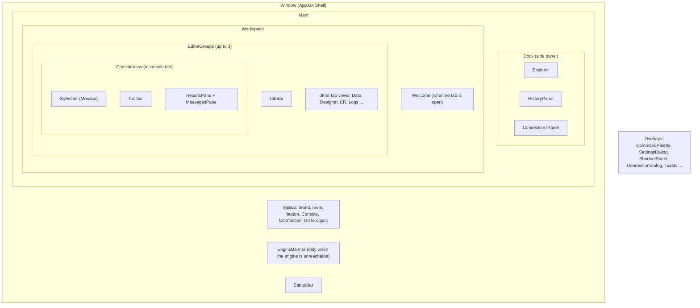
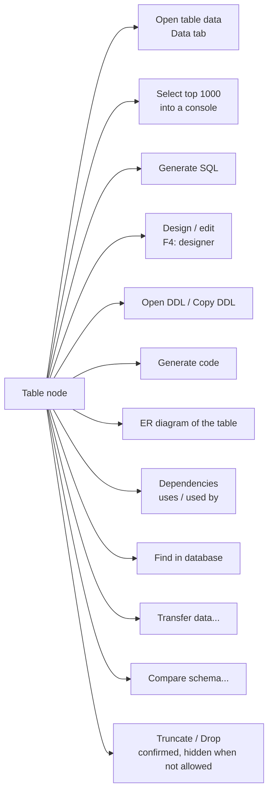

# 2. A tour of the app

> **Level:** L1 beginner | **Part:** II | **Code read at:** `d2f42ad` (Rowlit 1.7.0)
> [فارسی](../../fa/part2/02-tour-of-the-app.md) · Previous: [1. What a database IDE is](01-what-is-a-database-ide.md) · Next: [3. Big-picture architecture](03-big-picture-architecture.md)
>
> **In one sentence:** the Rowlit window is a top bar, a left side panel (Explorer, History, Connections), a tab area
> with up to three editor groups, a status bar and a set of dialogs, and this chapter names every part with the word the
> code uses so you can find it in the source.
>
> **You will learn:**
> - the regions of the window and the component that draws each one;
> - the kinds of tab, and what opens each;
> - what the Explorer tree shows for each family of system, and what a right-click on a table offers;
> - the console, the results pane, the Data tab and the Objects tab;
> - the command palette, "Go to object", the shortcut sheet and the main shortcuts;
> - where the newer features (SSH tunnels, charts, local history, schema compare, data transfer, pinned and compared
>   results, connection export and import) appear on screen.
>
> **Prerequisites:** [1. What a database IDE is](01-what-is-a-database-ide.md). It helps to have Rowlit open on the sample database.

## 1. The idea (beginner)

Open Rowlit and you see five things. At the top, a thin **top bar** with the app name, a button for a new console, a
button for a new connection and a search box that jumps to any object. On the left, a **side panel** with three tabs:
Explorer (a tree of your connections, databases and tables), History (queries you ran) and Connections (what is
connected now). In the middle, the **workspace**: tabs, and under the active tab whatever it shows, most often a SQL
editor with a **results pane** under it. At the bottom, a **status bar** with the connection, the transaction mode, the
cursor position, memory in use and the update status.

Most of the time you do the same loop. Pick a table in the Explorer. Double-click it to read its data, or open a new
console and type SQL. Press Ctrl+Enter. Look at the rows in the grid. Fix a value, or change the query and run it again.
Everything else in the app is a variation of this loop: another kind of tab, another kind of node in the tree.

If you do not remember where something is, you do not need the menu. Press **Ctrl+Shift+P** (the command palette) and
type a word: every action in Rowlit is a registered command ([chapter 20](20-ui-architecture.md)) and the palette
lists them all, with their shortcuts.

## 2. How it works (practitioner)

### 2.1 The regions of the window

`ui/src/App.tsx` is the whole window. The `Shell` component (`App.tsx:81`) renders, from top to bottom, the `TopBar`
(`:116`), the `EngineBanner` (`:118`, a red strip with Retry when the engine cannot be reached), the `Main` area (`:119`)
and the `StatusBar` (`:121`). `Main` (`:242`) is a `Dock` on the left (`:259`) and the `workspace` section that holds
either the `Welcome` page when no tab is open (`:264`) or the `EditorGroups` (`:269`). After those come the overlays:
dialogs, the palette, the toasts and the file-drop overlay.

**Figure 2.1 — The regions of the window and the components behind them.**

Each region carries a `data-region` attribute so the keyboard can move between them: **Alt+1** the Explorer, **Alt+2**
the editor, **Alt+3** the results, and **F6 / Shift+F6** cycle dock, editor, results and status bar
(`ui/src/components/layout/regions.ts:1-9`). The focused region flashes for under a second so you can see where focus
went (`regions.ts:15-20`).

| Region | Component | File | Notes |
|---|---|---|---|
| Top bar | `TopBar` | `components/layout/TopBar.tsx` | On Windows the caption buttons sit inside it; the menu is behind a button (see [chapter 22](22-desktop-shell.md)) |
| Side panel | `Dock` | `components/layout/Dock.tsx` | Tabs Explorer, History, Connections; width `clamp(200px, 22vw, 480px)` unless you drag it (`:15-20`); Ctrl+B hides it |
| Tab strip | `TabBar` | `components/layout/TabBar.tsx` | colour bar of the connection, dirty dot, middle-click closes, drag to reorder, split or detach |
| Editor groups | `EditorGroups` | `components/EditorGroups/EditorGroups.tsx` | up to `MAX_GROUPS = 3` (`store/editorGroups.ts:13`) |
| Console | `ConsoleView` | `components/layout/ConsoleView.tsx` | the editor, its `Toolbar` and the `ResultsPane` |
| Status bar | `StatusBar` | `components/StatusBar/StatusBar.tsx` | see 2.7 |
| Palette | `CommandPalette` | `components/CommandPalette/CommandPalette.tsx` | two modes: objects and commands |
| Settings | `SettingsDialog` | `components/layout/SettingsDialog.tsx` | searchable, grouped cards |
| First screen | `Welcome` | `components/Onboarding/Welcome.tsx` | provider cards, recent connections, sample database |

Behind the top bar the window is draggable on Windows and macOS; the details of the native title bar are in
[chapter 22](22-desktop-shell.md).

### 2.2 The Welcome page

With no tab open, the workspace shows `Welcome` (`Welcome.tsx:35`). On a first start it says "Connect to a database" and
shows one card per provider (SQL Server, Oracle, PostgreSQL, SQLite, Redis, MongoDB, Kafka, and, when the engine
lists them, MySQL, MariaDB, ClickHouse, Snowflake, Elasticsearch, Cassandra, plus Linked databases;
`Welcome.tsx:13-31`). It also offers *Open a SQLite file* and *Try the sample database*. After you have saved
connections it says "Welcome back" and lists the six most recently used ones (`Welcome.tsx:41`). Closing the last tab
brings it back and moves keyboard focus to its first button (`App.tsx:242-257`).

### 2.3 Tabs and what opens them

Every tab is one of three shapes (`ui/src/store/tabs.ts`):

- a **console** (`kind: 'console'`): a SQL editor bound to one connection, one database and (on some systems) one
  default schema; it has its own text, transaction mode and row limit (`tabs.ts:29-64`);
- an **object** tab (`kind: 'object'`): the definition of one table, view or routine, with its dependencies
  (`tabs.ts:66-80`);
- a **view** tab (`kind: 'view'`): everything else. A view tab names a registered component with `view`, and carries
  its own serialisable `state` (`tabs.ts:82-99`). The registry is `registerTabView(view, def)`
  (`components/layout/tabViews.ts:57`); each feature registers its view from its own `commands.ts`.

The registered views are the real list of screens in the app. Grouped by what they are for:

| Screen | View id (file that registers it) | Opens from |
|---|---|---|
| Table data | `data` (`DataTab/commands.ts:246`) | double-click a table; *Open table data* (Ctrl+Alt+D) |
| Objects list | `objectsHome`, `objects` (`ObjectList/commands.ts:92-93`) | the permanent first tab; *Show objects* on a database or schema |
| Table / view / procedure designer | `designer.table`, `designer.view` (`designer/commands.ts:159`) | *New table…*, F4 on an object |
| Code generation | `codegen` (`CodegenPanel/commands.ts:89`) | *Generate code…* (Ctrl+Alt+G) |
| Query plan | `plan` (`PlanView/commands.ts:54`) | *Explain plan* (Ctrl+L, Ctrl+Shift+L) |
| ER diagram | `er.diagram` (`ErDiagram/commands.ts:277`) | Ctrl+Alt+E, `er:` in Go to object |
| Logs and activity | `logs` (`Logs/commands.ts:145`) | Ctrl+Alt+Shift+L |
| Linked database builder | `links.builder` (`Links/commands.ts:267`) | a link connection's *Visual builder* |
| Import wizard | `import.wizard` (`ImportWizard/commands.ts:55`) | *Import data…*, drop a file on the window |
| Search results | `search` (`Search/commands.ts:36`) | *Find in database* (Ctrl+Shift+F), *Open in tab* |
| Multi-run | `multirun` (`MultiRun/commands.ts:7`) | *Run on multiple connections* (Ctrl+Alt+Enter) |
| Routine run result | `routine.run` (`ExecuteRoutine/commands.ts:65`) | *Execute…* on a procedure or function |
| Results in a tab | `results` (`ResultsPane/commands.ts:108`) | the dock menu *Open in a tab* |
| Schema compare | `schema-compare` (`SchemaCompare/commands.ts:28`) | *Compare schema…* |
| Data transfer | `transfer` (`Transfer/commands.ts:37`) | *Transfer data…*, *Dump to SQL file…* |
| Compare of two results | `results-compare` (`ResultsCompare/commands.ts:90`) | *Compare with…* in a result toolbar |
| Local history | `local-history` (`LocalHistory/commands.ts:28`) | Ctrl+Alt+H |
| Snippets manager | `snippets` (`SnippetsSettings/open.ts:12`) | *Manage snippets…* |
| Source workspaces | Redis, Mongo, Kafka, Elasticsearch, Cassandra, ClickHouse, Snowflake views | a source connection's node |
| Welcome | `welcome` (`Onboarding/commands.ts:11`) | *Show welcome screen* in Help |

The exact view-id strings are constants in each feature folder; the file:line is the `registerTabView` call.

Two special tabs deserve a word. The **Objects tab** is `pinned`: the first tab of the first group in the main window,
never closed, moved or detached (`tabs.ts:92-98`, `components/ObjectList/home.ts:1-14`). A detached window never has
one. The **results tab** (`view: 'results'`, `detachable: false`) is the same results pane as under a console, moved into
a tab of its own so it can sit in a split group (`ResultsPane/dock.ts:1-8`).

**Editor groups and windows.** You can drag a tab to the edge of the workspace to split the editor side by side or
stacked (at most three groups), drag it between groups, or drag it out of the window (or choose *Open in new window*) to
get a **detached window** that shares the same engine. A detached window shows only its tabs: no dock, no update wiring
(`App.tsx:88-90`, `desktop/src/main/windows.ts:1-4`). The main window keeps a note of the detached tabs, so after a
restart they come back into the main window ([chapter 22](22-desktop-shell.md)).

### 2.4 The Explorer tree

The Explorer is the first tab of the side panel (`components/Explorer/Explorer.tsx`). Its data is built by `tree.ts` as a
flat list of rows, each with a `kind` (`components/Explorer/tree.ts:14-18`):

| Row kind | Looks like | Notes |
|---|---|---|
| `cfolder` | a folder you made for connections | connections can be put in folders |
| `connection` | a database server, coloured by the connection colour | a lock shows read-only; "via user@host" shows an SSH tunnel |
| `database` | a database of a server | hidden for single-level systems (SQLite, ClickHouse database is the schema) |
| `schema` | a schema with a colour dot if you set one | |
| `folder` | *Tables*, *Views*, *Procedures*, *Functions*, *Triggers*, *Sequences*, *Types*, … | labels from `objectTypeLabel` per dialect |
| `object` | one table, view, routine; expands to columns | column rows show type and "not null" |
| `qfolder` / `query` | the schema's **Queries** folder and a saved query in it | Ctrl+S in a console saves here |
| `sfolder` / `sysType` | SQL Server's read-only *System Data Types* | |
| `source` | a node of a non-relational system (Redis db, Mongo collection, Kafka topic …) | each source module supplies its own nodes |
| `status` | "Loading…", "Still connecting…" with Cancel, an error with Retry | the lazy loading made visible |

Schemas load lazily: expanding a node asks the engine for just that part of the catalog ([chapter 10](10-catalog-and-metadata.md)).
The filter box at the top is a fuzzy match over the schemas that are already loaded. A filled dot next to a connection
means it holds server resources; a dim dot means only cached metadata (see [chapter 21](21-logs-activity-resources.md)).

A **linked database** (a connection of the virtual `linked` provider) appears in the same tree under "Linked databases".

**Figure 2.2 — What a right-click on a table offers.** The menu is defined once, as data, in `CONTEXT_MENUS['explorer.table']`
(`commands/menuModel.ts:229`), and feature modules append to it with `extendContextMenu`.

The same node on a *view* swaps designer for "edit as script"; on a *procedure or function* the first entry is
**Execute…** (the parameter form); on a *connection* the entries are *Open console*, *Edit*, *Duplicate*, *Refresh
catalog*, *Close connection*, *ER diagram*, *Logs & activity* and *Delete* (`menuModel.ts:201-208`). Redis, Mongo and
Kafka connections have their own menus (`explorer.sourceConnection` and the `explorer.redis.*`, `explorer.mongo.*`,
`explorer.kafka.*` menus).

### 2.5 The console, its toolbar and the results pane

A **console** is the tab where you type SQL. `ConsoleView` (`layout/ConsoleView.tsx`) stacks three things: the Monaco
**editor** (`data-region="editor"`, line 243), a **splitter**, and the **results host** (`data-region="results"`, line
318); the `Toolbar` is rendered inside it (line 327).

The **toolbar** (`components/Toolbar/Toolbar.tsx`) holds, from left to right and collapsing into a "…" menu when the
window is narrow (`OverflowToolbar`):

- **Run** (with a menu: run script, execute for a routine, save), **Cancel** while a statement runs, **Save** with a dot
  when there is unsaved text;
- **Run on…** (several connections at once, `run.multi`);
- the **connection** pill (colour, name, a lock for read-only), the **database** (or schema) switcher and, on systems that
  have one, the **schema** pill;
- a **transaction mode** switch, *Auto-commit* or *Manual transaction*; in manual mode, **Commit** and **Rollback** and a
  "pending" pill when the session has uncommitted changes (`Toolbar.tsx:350-384`);
- **Explain** (estimated, with a menu for actual), **Format**, **Generate code**, **Compare** (in an "Edit:" console);
- **Max rows** (500, 1000, 10000, 100000 or unlimited; `Toolbar.tsx:MAX_ROWS_OPTIONS`);
- a button that shows or hides the results.

The **results pane** (`components/ResultsPane/ResultsPane.tsx`) has one tab per result set (*Result 1*, *Result 2* …)
and a **Messages** tab (`ResultsPane.tsx:165`) for server messages, row counts, warnings and errors
(`MessagesPane`). Above the grid is a per-result toolbar: server filter and quick filter, record view, copy and export,
*Generate code for this query*, **Pin**, **Compare with…**, and the **Grid | Chart | split** switch. Under the grid a
strip shows Count, Sum, Avg, Min and Max of the selected cells ([chapter 13](13-results-grid-and-data-editing.md)). The
pane can be docked **below, on the right or on the left** of the editor, or opened in a tab of its own (the pane
header's dock menu, the View menu, or the palette; `ResultsPane/dock.ts:1-8`). Ctrl+R shows or hides it and
Ctrl+Shift+R maximises it. "Edit:" consoles (F4 on a procedure, function, view or trigger) start with the pane closed and
show the outcome of Ctrl+S as a toast.

### 2.6 The Data tab and the Objects tab

The **Data tab** shows one table. Unlike a console, it does not run your SQL: the engine pages the rows from the server
as you scroll, and the tab has its own toolbar with Import, Export and the Grid | Chart switch. If the table has a key, cells
are editable; changed rows turn into a *pending changes* bar with an SQL preview, and Ctrl+S sends them in one transaction
([chapter 13](13-results-grid-and-data-editing.md)). A table without a key falls back to the row id where the dialect
has one.

The **Objects tab** is the first tab and follows the Explorer selection live. Select a connection and it shows its
databases or schemas as cards; select a schema and it lists tables (or views, procedures, functions when you pick
that folder) with filters, search, counts, and sizes, in a list, card or small-icon view; select an object and a side
panel shows what it uses and what uses it. It never steals focus (`ObjectList/home.ts:1-14`). It can be turned off in
Settings › General.

### 2.7 The status bar

`StatusBar.tsx` shows, left to right: the WebSocket state dot (connected, reconnecting, down); a "connected" counter that
opens the Connections panel; the active tab's connection and database (click to change); the server version; the
transaction state (*Auto-commit*, *Manual tx*, *Manual tx · pending*); a *Disconnected (idle)* notice with a **Reconnect**
button when the session was released to save resources; then on the right the elapsed time of the last run, the cursor
`Ln, Col`, the dialect name, the **memory** item that opens the Resources popover, the **update chip**, and a keyboard
button that opens the shortcut sheet (`StatusBar.tsx:62-132`). Cassandra adds its own item. Details of memory and
resources are in [chapter 21](21-logs-activity-resources.md); update status in [chapter 22](22-desktop-shell.md).

### 2.8 Command palette, Go to object and the shortcut sheet

**Ctrl+P** opens the palette in *objects* mode: type part of a table, view or column name, across every open connection.
Typed prefixes narrow it: `t:` tables, `v:` views, `p:` procedures, `f:` functions, `c:` columns, `q:` saved queries,
`k:` Redis keys, `coll:` Mongo collections, `er:` open the ER diagram of the table (`CommandPalette/objectIndex.ts:36-49`,
`CommandPalette.tsx:280`). Start the text with `>` to switch to *commands* mode. **Ctrl+Shift+P** opens it directly in
commands mode. Enter opens a table's data or a routine's editor; the palette scores matches fuzzily (`paletteScore.ts`).

**F1** (or Ctrl+K Ctrl+S) opens the **shortcut sheet**: the complete, searchable, current list of commands and keys, where
you can record your own shortcut for any command and pick a preset (JetBrains/DataGrip, VS Code/Azure Data Studio, SSMS).
The sheet always shows what is really bound; the README table below is the default set.

| Action | Shortcut (⌘ instead of Ctrl on macOS) |
|---|---|
| Run statement at cursor / selection | Ctrl+Enter |
| Run script · Cancel | F5 · Shift+F5 |
| New console · New connection | Ctrl+N · Ctrl+Shift+N |
| Open file · Save · Save as | Ctrl+O · Ctrl+S · Ctrl+Shift+S |
| Close tab · Reopen closed tab | Ctrl+W · Ctrl+Shift+T |
| Next tab · tab by number | Ctrl+Tab · Ctrl+1…9 |
| Command palette · Go to object | Ctrl+Shift+P · Ctrl+P |
| Toggle side panel · results · maximise results | Ctrl+B · Ctrl+R · Ctrl+Shift+R |
| Query history | Ctrl+Shift+H |
| Go to definition | F12 or Ctrl+click |
| Completion · parameter hints | Ctrl+Space · Ctrl+Shift+Space |
| Change connection · change database | Ctrl+Shift+K · Ctrl+Shift+D |
| Run on multiple connections | Ctrl+Alt+Enter |
| Find in database | Ctrl+Shift+F |
| ER diagram · Logs and activity | Ctrl+Alt+E · Ctrl+Alt+Shift+L |
| Local history · Pin result | Ctrl+Alt+H · Ctrl+Alt+K |
| Zoom in/out/reset | Ctrl+= · Ctrl+- · Ctrl+0 |
| Settings · Shortcuts | Ctrl+, · F1 |

(`README.md:340-373` for the first rows; the last three from `menuModel.ts` and the command definitions
`ResultsCompare/commands.ts:51`, `LocalHistory/commands.ts:13`.) Ctrl+Enter and F5 belong to the editor; the menu shows
them without registering them so they never fire twice (`README.md:372-373`).

### 2.9 Where the newer features appear

These features arrived in 1.7.0 and 1.8.0 (release notes). They reuse the screens above, so a table is the quickest map.

| Feature | Where you meet it | Engine side | UI side |
|---|---|---|---|
| **SSH tunnel** | a collapsed *SSH tunnel* section in the connection dialog (host, port, user, password or key file, keep-alives); *Test connection* says which hop failed; the Explorer tooltip and the Connections panel say "via user@host" | `Core/Services/Tunnels/*` | `ConnectionDialog`, `ConnectionsPanel.tsx:156` |
| **Result charts** | the **Grid / Chart / split** switch in every result toolbar and Data tab; palette *Toggle chart view of the results*, *Export chart…* | none (the chart is drawn in the page) | `components/Charts/*` |
| **Local history** | **Ctrl+Alt+H**, *Edit › Local history…*, the tab and editor context menus | `Core/LocalHistory/*`, `local-history.db` | `components/LocalHistory/*` |
| **Schema compare** | right-click a database, schema or connection › *Compare schema…*; *Database › Compare schema…* | `Core/SchemaCompare/*` | `components/SchemaCompare/*` |
| **Data transfer / SQL dump** | right-click tables, a schema or a connection › *Transfer data…*, *Dump to SQL file…*; *Database › Transfer data…* | `Core/Transfer/*` | `components/Transfer/*` |
| **Pin / compare results** | a pin button on each result tab (Ctrl+Alt+K), **Compare with…** in the result toolbar | none (both results are in the page) | `components/ResultsCompare/*` |
| **Export / import connections** | *File › Export connections…*, *Import connections…*; right-click a connection folder › *Export connections…* | `Core/Services/Portability/*` | `components/ConnectionsPanel/*` |

Where these features are explained in depth: SSH tunnels and connection portability in [chapter 19](19-security-and-secrets.md) (they
handle secrets), schema compare and data transfer next to the designers and importers in
[chapter 14](14-designers-and-ddl.md) and [chapter 15](15-import-export-plans-er.md), charts, pinning and comparing next to the
grid in [chapter 13](13-results-grid-and-data-editing.md), local history with the editor in
[chapter 12](12-editor-and-formatter.md). The engine and UI parts of the 1.7.0 and 1.8.0 features were written after
those chapters and are summarised in the chapter they belong to; where a chapter does not describe one yet, this table is
the pointer to the files.

### 2.10 A few workflows, step by step

| Goal | Steps |
|---|---|
| Run the first query | Welcome › *Try the sample database*; a console opens; type `SELECT * FROM Customers;`; Ctrl+Enter |
| Read a whole table | Explorer › expand the connection › *Tables* › double-click; the Data tab opens and pages as you scroll |
| Edit a value | In a Data tab double-click a cell, type, Enter; a *pending changes* bar appears; Ctrl+S saves |
| Fix a procedure | Explorer › right-click › *Design / edit* (F4); edit the script; Ctrl+S saves the whole object; *Compare* shows the server version |
| See what a query will do | Ctrl+L (estimated plan), or Ctrl+Shift+L (actual plan, runs the statement) |
| Keep an old result | After the run click the pin on the result tab, change the query, run again; use *Compare with…* |
| Find a column everywhere | Ctrl+Shift+F, type the name; scope follows the Explorer selection |
| Stop a runaway session | Ctrl+Alt+Shift+L › Activity › Kill, type the session id to confirm |

## 3. Deep dive (senior)

> **Deep dive (L3): the layout is data, the actions are commands.**
>
> Three structural choices make the tour above possible, and they explain why you can find every action in three places
> (menu, palette, shortcut) with the same wording:
>
> 1. **Menus are a table.** `MENUS` and `CONTEXT_MENUS` in `commands/menuModel.ts` are plain data. The native Electron menu
>    (`desktop/src/main/menu.ts`) and the in-app menu of the browser build are both generated from the same list, so the
>    two cannot disagree. A feature adds an entry with `extendContextMenu(menuId, entries)`, usually from its own lazy
>    `commands.ts`, which is how Transfer and Schema compare appear on tables and connections without editing `Explorer`.
> 2. **Screens are registered, not imported.** `registerTabView` keeps the shell free of imports of the heavy screens
>    (designer, ER diagram, chart panel). A view is loaded the first time its tab opens, which is how the initial bundle
>    stays small ([chapter 20](20-ui-architecture.md), bundle budget).
> 3. **Regions are marked in the DOM.** `data-region` and `data-command-scope` attributes let one global key handler
>    resolve a shortcut from the element that has focus, so the same key can mean different things in the editor, the grid
>    and the Explorer.
>
> The cost is indirection: to find what a menu item does you read its command id in `menuModel.ts`, then the command in a
> `commands.ts`, then its `run` function.

## 4. Edge cases and limits

- **Up to three editor groups**, at most 50 tabs and 20 windows can be moved to or opened as detached windows
  (`store/editorGroups.ts:13`, `desktop/src/main/windows-core.ts:14-24`).
- **Dock width** is clamped to 200–480 px (`store/ui.ts:88-89`); double-click the splitter to go back to automatic width.
- **Zoom** goes from 60 % to 200 % in 10 % steps (`app/zoom.ts:8-9`).
- **Max rows** defaults come from settings; "unlimited" is a menu choice and a console can still run out of memory on
  huge results, which is why background results are released ([chapter 21](21-logs-activity-resources.md)).
- **Items are hidden, not only greyed,** when they cannot apply: for example *Truncate* and *Drop* use `hideDisabled`
  (`menuModel.ts:235`), and Compare schema is not offered on Redis, Mongo or Kafka rows (`docs/qa/schema-compare-walkthrough.md`).
- **Browser build.** In a plain browser (development) there is no native menu; the top bar shows an in-app menu button
  built from the same model (`TopBar.tsx:20-35`). Features that need Electron (file dialogs through the bridge, detached
  windows, updates) are absent or reduced ([chapter 4](04-development-setup.md)).

## 5. How it is tested

- Shell and regions: `components/layout/shell.test.tsx`, `consoleNavigation.test.tsx`, `commandMenu.test.tsx`.
- Dock, Explorer and tree: `components/Explorer/Explorer.test.tsx`, `tree.test.ts`, `objectsEntry.test.tsx`.
- Welcome and tips: `components/Onboarding/Onboarding.test.tsx`.
- Palette: `components/CommandPalette/*.test.*` (scoring and prefixes).
- Result pane and dock: `ResultsPane/resultsPane.test.tsx`, `dock.test.tsx`, `maximize.test.tsx`.
- New features: `ResultsCompare/__tests__`, `Charts/*.test.tsx`, `LocalHistory/__tests__`, `ConnectionsPanel/__tests__/portability.test.tsx`.
- Manual scripts: `docs/qa/*-walkthrough.md`, one per feature ([chapter 23](23-testing-and-qa.md)).

## Related chapters

- [Part I, chapter 3: SQL basics](../part1/03-sql-basics.md): the statements you will type into the console.
- [3. Big-picture architecture](03-big-picture-architecture.md): what happens when you press Ctrl+Enter.
- [10. Catalog and the Explorer](10-catalog-and-metadata.md), [13. Results grid](13-results-grid-and-data-editing.md),
  [20. UI architecture](20-ui-architecture.md): the code behind the regions.

## Glossary terms introduced here

[Explorer](../glossary.md#explorer) · [Objects tab](../glossary.md#objects-tab) · [Data tab](../glossary.md#data-tab) ·
[console](../glossary.md#console) · [results pane](../glossary.md#results-pane) · [dock](../glossary.md#dock) ·
[command palette](../glossary.md#command-palette) · [shortcut sheet](../glossary.md#shortcut-sheet) ·
[status bar](../glossary.md#status-bar) · [toast](../glossary.md#toast) · [editor group](../glossary.md#editor-group) ·
[detached window](../glossary.md#detached-window) · [welcome screen](../glossary.md#welcome-screen) ·
[tab kind](../glossary.md#tab-kind) · [SSH tunnel](../glossary.md#ssh-tunnel) · [pinned result](../glossary.md#pinned-result) ·
[schema compare](../glossary.md#schema-compare) · [data transfer](../glossary.md#data-transfer) · [local history](../glossary.md#local-history)

## Files

| Path | Responsibility |
|---|---|
| `ui/src/App.tsx` | the window: top bar, main, status bar, overlays |
| `ui/src/components/layout/*` | `Dock`, `TabBar`, `TopBar`, `ConsoleView`, `SettingsDialog`, `tabViews.ts`, `regions.ts` |
| `ui/src/components/EditorGroups/*` | split groups, tab drag and drop |
| `ui/src/components/Explorer/*` | the tree (`tree.ts`) and its view |
| `ui/src/components/ObjectList/*` | the Objects tab and the object list |
| `ui/src/components/Toolbar/*`, `ResultsPane/*`, `MessagesPane/*` | console toolbar, results |
| `ui/src/components/StatusBar/*` | status bar items |
| `ui/src/components/CommandPalette/*`, `Shortcuts/*` | palette and shortcut sheet |
| `ui/src/commands/menuModel.ts` | menus as data |
| `ui/src/store/tabs.ts`, `editorGroups.ts`, `ui.ts` | tab, group and layout state |
