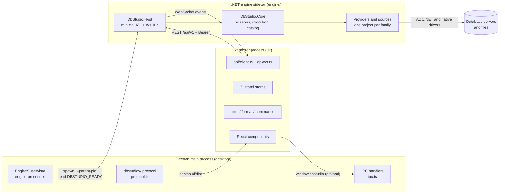
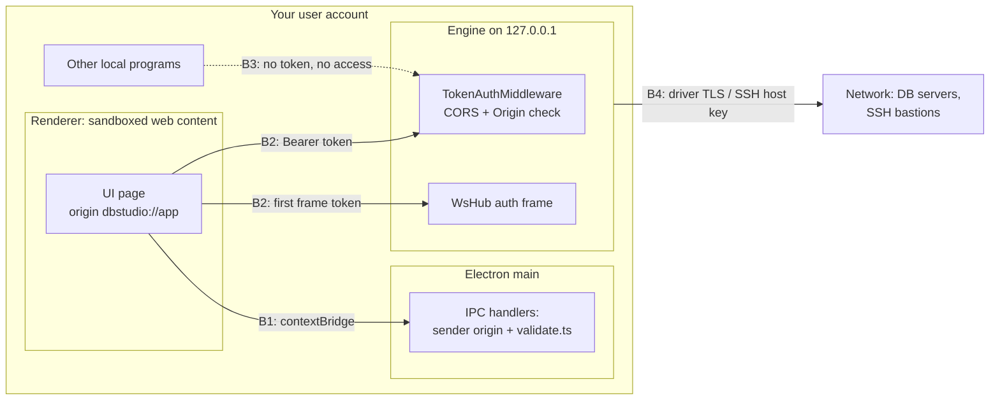
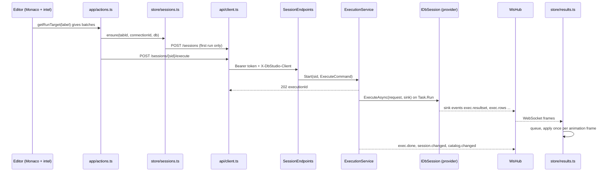
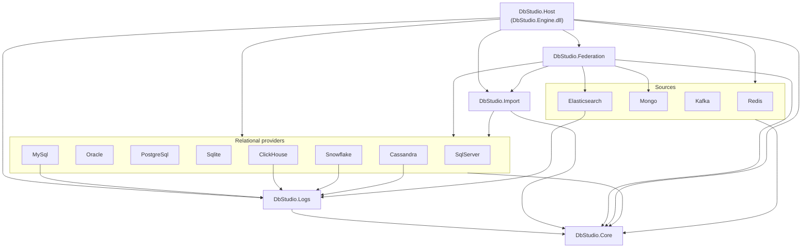
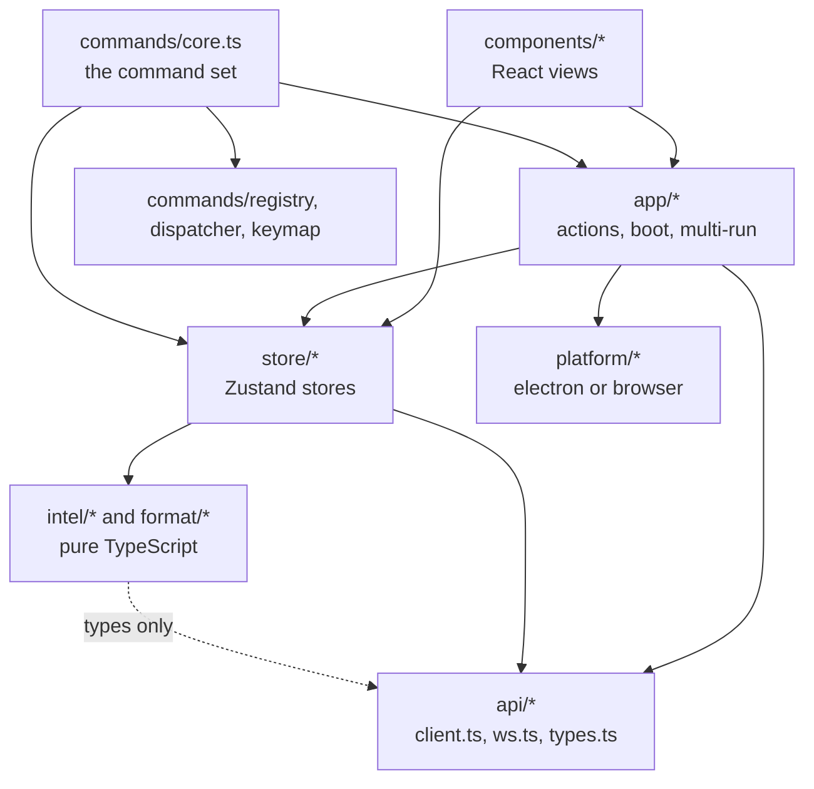

# 3. Big-picture architecture

> **Level:** L1 beginner → L3 senior | **Part:** II | **Code read at:** `08528ae` (Rowlit 1.6.3)
> [فارسی](../../fa/part2/03-big-picture-architecture.md) · Previous: [2. A tour of the app](02-tour-of-the-app.md) · Next: [4. Running it from source](04-development-setup.md)
>
> **In one sentence:** Rowlit is three cooperating programs (an Electron shell, a React user interface and a .NET
> engine that owns every database driver) which talk over local HTTP and one WebSocket, and the engine inside is a
> layered set of projects with interface seams at the provider boundary.
>
> **You will learn:**
> - which three processes make up Rowlit, what each one is allowed to do and why they are separate;
> - where the trust boundaries are and what protects each one;
> - what happens, step by step and file by file, when you press Ctrl+Enter;
> - how the repository and the engine projects are laid out, and which way the dependencies point;
> - what "layered", "clean", "hexagonal" and "onion" architecture mean, and how honestly each word fits Rowlit.
>
> **Prerequisites:** [1. What a database IDE is](01-what-is-a-database-ide.md), [2. A tour of the app](02-tour-of-the-app.md).
> Helpful: [I-01 What a database is](../part1/01-what-is-a-database.md).

## 1. The idea (beginner)

When you use Rowlit you see one window. Behind it, three separate programs run at the same time. The first is the
**desktop shell**, built with Electron, which draws the window frame, the native menu and the file dialogs. The second
is the **user interface**, a web page written in React that shows the editor, the explorer tree and the results grid.
The third is the **engine**, a .NET program with no window at all. Only the engine talks to databases. The user
interface asks the engine for things ("run this query", "list the tables of `shop`") and the engine answers. A
[process](../glossary.md#process) (a running program with its own memory, which the operating system keeps apart from
other programs) cannot read another process's memory, so the three talk by sending messages: the shell and the web page
use Electron's IPC channel, and the web page and the engine use HTTP and a WebSocket on the local machine only.

Why split one application into three programs? Database drivers are big, native and sometimes crash. Keeping them in
their own process means a driver failure cannot take the window down; the shell notices the engine died and offers to
restart it. It also means the user interface never needs a driver: the same web page runs in Electron and in a normal
browser during development. Inside the engine, the code is organised in layers: a core that knows the general rules
(sessions, execution, catalogs, errors), one project per database family that knows the details of one driver, and a
thin host that turns everything into HTTP endpoints. The rest of this chapter walks through these pieces, follows one
query end to end, and ends with an honest comparison against the architecture names you will meet in books.

## 2. How it works (practitioner)

### 2.1 The three processes

The M1 plan states the rule in one line: "The UI never touches a database driver; the engine never touches the DOM"
(`docs/PLAN.md:26`). Figure 3.1 redraws the ASCII picture of `README.md:136-163` with today's providers.

**Figure 3.1 — The three processes of Rowlit and how they talk.**

Each process has one job.

- The **[main process](../glossary.md#main-process)** (Electron's Node.js process that owns windows and native APIs) starts
  the engine, waits for its handshake and serves the built UI from a private scheme. `EngineSupervisor` spawns the engine
  with `--parent-pid <pid>` (and `--dev` when the UI comes from Vite) (`desktop/src/main/engine-process.ts:134`, `:149`),
  then reads stdout until it sees the line `DBSTUDIO_READY {"port":…,"token":"…"}` (`engine-process.ts:15`,
  `:207-221`). It gives up after 15 s for a packaged engine, 180 s for `dotnet run` (`engine-process.ts:46-48`).
  The UI is served from `dbstudio://app`, a scheme registered as privileged before the app is ready
  (`desktop/src/main/protocol.ts:44`). Chapter [22](22-desktop-shell.md) covers the shell.
- The **[renderer](../glossary.md#renderer)** (the Chromium process that draws a web page) runs the React app. It is
  sandboxed: `contextIsolation: true`, `sandbox: true`, `nodeIntegration: false` (`desktop/src/main/window.ts:160-163`).
  Its only door to the shell is `window.dbstudio`, which the [preload](../glossary.md#preload) script (a small script that
  runs before the page, with access to Electron's bridge) publishes with `contextBridge.exposeInMainWorld`
  (`desktop/src/preload/preload.ts:120`). In a plain browser that object does not exist and `getPlatform()` picks the
  browser adapter instead (`ui/src/platform/index.ts:12-13`).
- The **engine** is a [sidecar](../glossary.md#sidecar) (a helper process started and owned by the main application,
  living and dying with it). It is an ASP.NET Core application bound to `127.0.0.1` on a port the operating system
  chooses (`engine/src/DbStudio.Host/Program.cs:74`; the shell passes no `--port`, so `EngineOptions.Port` stays 0,
  `engine/src/DbStudio.Host/EngineOptions.cs:42`). It prints exactly one line on stdout, the READY line
  (`Program.cs:191-199`). Chapter [5](05-engine-host-and-api.md) walks through its start-up.

Three reasons for the split, all from the plan and the code:

1. **Drivers stay out of the UI.** ODP.NET, SqlClient (with its native SNI library), librdkafka, DuckDB and the Snowflake
   native core are .NET or native libraries; a browser page cannot load them (`docs/PLAN.md:20`). The engine can.
2. **Crash isolation.** If the engine dies, the shell shows a restart dialog and the UI reconnects with the new port
   and token (`README.md:171`). A renderer crash does not kill open database sessions either; they belong to the engine.
3. **One UI for two hosts.** "The UI is identical in Electron and in a plain browser; only the `platform` adapter
   differs" (`docs/PLAN.md:26`). Development, the mock mode and UI tests all run the same React code in a browser
   (chapter [4](04-development-setup.md)).

### 2.2 Trust boundaries

A [trust boundary](../glossary.md#trust-boundary) is a line in a system where data or calls cross from a less trusted
side to a more trusted side, so something must check them. Rowlit has four. Figure 3.2 marks them.

**Figure 3.2 — Trust boundaries and what guards each one.**

- **B1, renderer → main.** The renderer is untrusted web content. It can only call the functions the preload exposes,
  and every IPC handler checks the sender's origin and validates its arguments (`desktop/src/main/ipc.ts`,
  `validate.ts`; chapter [19](19-security-and-secrets.md)).
- **B2, renderer → engine.** Every request under `/api` needs `Authorization: Bearer <token>`
  (`engine/src/DbStudio.Host/Infrastructure/Middleware.cs:85-104`); the WebSocket proves itself with a first frame
  `{"type":"auth","token":…}` instead, because a browser cannot put headers on a WebSocket
  ([chapter 6](06-websocket-protocol.md)). The token is a [bearer token](../glossary.md#bearer-token) (whoever holds it
  is trusted): 32 random bytes, base64url (`EngineOptions.cs:78-79`), handed to the shell on stdout and to the page
  through `window.dbstudio`, never in a URL (decision D-6, `docs/PLAN.md:626`). [CORS](../glossary.md#cors) (the browser
  rule that decides which web origins may call a server) allows only `dbstudio://app`, plus Vite's localhost origins
  in `--dev` (`EngineOptions.cs:21-38`).
- **B3, other local programs → engine.** The engine listens on [loopback](../glossary.md#loopback) (the
  `127.0.0.1` interface that never leaves the machine), so nothing on the network reaches it. Programs running as you
  on the same machine can reach the port, but without the token they get `401 UNAUTHORIZED`. This is the real
  limit of the model: it keeps out other users and remote hosts, not malware running as you (chapter [19](19-security-and-secrets.md)).
- **B4, engine → network.** The engine is the only process that leaves the machine. Driver encryption (TLS, `Encrypt`,
  `sslmode`) and, since the SSH tunnel work, an SSH hop with host-key checking protect this edge
  (`engine/src/DbStudio.Core/Services/Tunnels/SshKnownHosts.cs`; chapter [8](08-connections-sessions-execution.md#22-ssh-tunnels)).

Secrets follow the same lines. Saved passwords live only in the engine's [secret store](../glossary.md#secret-store)
(DPAPI on Windows, the login Keychain on macOS, an AES-GCM file elsewhere), selected by
`SecretStoreFactory.Create` (`Program.cs:91`). `GET /connections` returns `hasPassword`, never the password
(`docs/PLAN.md:223`).

### 2.3 One Ctrl+Enter, end to end

The plan lists five steps for "Ctrl+Enter" (`docs/PLAN.md:55-60`). Here they are as the code does them today, with the
files you would open to follow along. Figure 3.3 shows the same flow.

**Figure 3.3 — Ctrl+Enter from keystroke to grid.**

1. **The editor decides what to run.** The keystroke runs a registered command; the command calls `runActive`, which asks
   the editor for its run target (`ui/src/app/actions.ts:201-246`). The editor's `run-target.ts` asks the IntelliSense
   library for the statement under the cursor (`ui/src/editor/run-target.ts:36`). The UI is the single source of truth
   for statement and batch boundaries (decision D-2, `docs/PLAN.md:622`): the engine runs exactly the batches it
   receives, each with its line and column in the document.
2. **The UI checks, then sends.** `runInTab` refuses a second run in the same console, asks before a destructive
   statement (unless the connection is read-only, where the engine decides), asks for parameter values, records a
   local execution in the results store and makes sure the tab has a session (`actions.ts:115-169`). Then it posts
   `POST /api/v1/sessions/{sid}/execute` (`actions.ts:171-175`). The typed client adds `Authorization: Bearer …` and
   `X-DbStudio-Client` to every call (`ui/src/api/client.ts:99`).
3. **The engine accepts and starts.** The endpoint validates the body, picks the default `maxRows` from settings and
   normalises the label (`engine/src/DbStudio.Host/Endpoints/SessionEndpoints.cs:116-126`). `ExecutionService.Start`
   validates the batches, enforces the read-only guard and bound parameters, reserves the session (409
   `SESSION_BUSY` if it is already running) and starts `RunAsync` on the thread pool
   (`engine/src/DbStudio.Core/Services/ExecutionService.cs:83-101`). The HTTP answer is `202 { executionId }` at
   once; results never travel in the HTTP response.
4. **The provider streams through a sink.** `RunAsync` publishes `exec.started`, reopens the connection if it was
   released or broken, and calls `IDbSession.ExecuteAsync(request, sink)` (`ExecutionService.cs:146-165`). The provider
   reports every result set, row batch, message and error through the [sink](../glossary.md#sink) (an object that
   receives a stream of callbacks; here `EventExecutionSink`, `ExecutionService.cs:235-306`), which publishes each one
   as a WebSocket event. On the UI side `boot.ts` routes every `exec.*` event into the results store
   (`ui/src/app/boot.ts:112`), which queues them and applies them once per animation frame
   (`ui/src/store/results.ts:44`, `:129`). The grid repaints from the store.
5. **After the run.** `RunAsync` publishes `exec.done` with `txOpen` and `session.changed`
   (`ExecutionService.cs:186-191`), asks the statement classifier whether any successful batch was DDL and, if so,
   invalidates the catalog (`ExecutionService.cs:193`, `:197-215`); `CatalogService` reloads the schema and publishes
   `catalog.changed` (`engine/src/DbStudio.Core/Catalog/CatalogService.cs:429`, `:496`), which the UI applies to its
   catalog store (`boot.ts:129`) so IntelliSense sees the new table. Finally the run is written to history
   (`ExecutionService.cs:194`).

Chapter [8](08-connections-sessions-execution.md) follows steps 3–5 in depth; chapter [6](06-websocket-protocol.md)
explains the events; chapter [13](13-results-grid-and-data-editing.md) the grid.

### 2.4 The repository layout

| Folder | What lives there | Read first |
|---|---|---|
| `engine/src/DbStudio.Core` | Contracts (`Providers/`), models, and every provider-independent service: sessions, execution, catalog, results, history, settings, secrets, streams, jobs, resources, designer, export, search, schema compare, SSH tunnels | `Providers/IDbProvider.cs`, `Services/SessionManager.cs` |
| `engine/src/DbStudio.Host` | `Program.cs` (the composition root), middleware, REST endpoint groups, `Ws/WsHub.cs`, DTOs | `Program.cs` |
| `engine/src/DbStudio.Providers.*` | One project per relational family: SqlServer, Oracle, PostgreSql, Sqlite, MySql (MySQL and MariaDB), ClickHouse, Snowflake, Cassandra | the `*Provider.cs` and `*Session.cs` of each |
| `engine/src/DbStudio.Sources.*` | Non-relational families: Redis, Mongo, Kafka, Elasticsearch | the `*Module.cs` of each |
| `engine/src/DbStudio.Logs` | Server logs and activity per provider, engine log, log tail streams | `LogsModule.cs` |
| `engine/src/DbStudio.Import` | Import Wizard engine (file row sources, target writers) | `ImportModule.cs` |
| `engine/src/DbStudio.Federation` | Linked databases: DuckDB federation, fetchers, push-down | `FederationModule.cs` |
| `engine/tests/*` | xUnit projects per engine project, the shared conformance suite, Docker samples, smoke scripts | `DbStudio.Providers.Conformance/` |
| `ui/src` | React app: `api/`, `store/`, `app/`, `components/`, and framework-free `intel/`, `format/`, `commands/` (registry), `designer/` logic | `main.tsx`, `App.tsx`, `app/boot.ts` |
| `desktop/src` | Electron `main/`, `preload/`, `shared/channels.ts` | `main/main.ts`, `main/engine-process.ts` |
| `scripts/`, `.github/` | `dev.ps1`, `build.ps1`, `build.sh`, version stamping, CI and release workflows | chapter [24](24-build-ci-release-contributing.md) |
| `docs/` | Plans with decision tables (`PLAN*.md`), work-package notes, QA walkthroughs, release notes | `docs/PLAN.md` |

### 2.5 Layers inside the engine

The engine is a set of .NET projects. Figure 3.4 draws their `ProjectReference`s exactly as the `.csproj` files list
them. An arrow means "references", so the arrow points from the user of code to the code it uses.

**Figure 3.4 — Engine project references (from the csproj files).**

Sources: `engine/src/DbStudio.Host/DbStudio.Host.csproj:20-38`, `DbStudio.Federation.csproj:25-38`,
`DbStudio.Import.csproj:16-23`, each provider csproj (for example `DbStudio.Providers.MySql.csproj:16-17`). Two details
the picture simplifies: `Import` references seven of the eight relational providers (not Cassandra), and `Federation`
references all eight plus Mongo and Elasticsearch.

Read it as three layers:

1. **Core** (`DbStudio.Core`) at the bottom. It has **no** `ProjectReference` at all (`DbStudio.Core.csproj:9-19`): it
   cannot see any provider. It defines the contracts (`IDbProvider`, `IDbSession`, `ICatalogReader`, `IExecutionSink`,
   `IDataSourceProvider`, `IEngineModule`, the keyed feature interfaces) and implements every service that works the
   same for all databases.
2. **Families and features** in the middle: providers, sources, logs, import, federation. Each implements Core's
   contracts for one family or adds one feature. Most of them only know Core (and `Logs` for their log sources). The
   two exceptions on purpose are `Import` and `Federation`, which reuse concrete providers to read and write rows.
3. **Host** on top. `DbStudio.Host` references everything, wires it together in `Program.cs` and turns services into
   HTTP routes. Its assembly is called `DbStudio.Engine` and is published as `Rowlit.Engine.exe`
   (`DbStudio.Host.csproj:7-9`).

This is a [layered architecture](../glossary.md#layered-architecture) (code organised in levels where each level uses only
the levels below it). How the Host finds the modules of the middle layer without naming them in `Program.cs` is the
subject of chapter [7](07-engine-modules-and-di.md).

### 2.6 Layers inside the UI

The UI has no project files to enforce layering, so the rule is a convention. Figure 3.5 sketches the import directions
that hold in the code.

**Figure 3.5 — UI folders and the direction of their imports.**

What a search of the imports shows at `08528ae`:

- `ui/src/intel/**` (39 non-test files) and `ui/src/format/**` (15 files) import neither React, nor a store, nor a
  component. `intel` imports only types from `api/types.ts` and a few helpers from `lib/` (for example
  `ui/src/intel/complete/completer.ts:2`, `:11`). That is why the IntelliSense tests run in a Node environment without a
  DOM (`ui/vitest.intel.config.ts`, chapter [11](11-intellisense.md)).
- `ui/src/api/**` imports no store, no component and no React: it is the transport layer.
- The command machinery (`commands/registry.ts`, `dispatcher.ts`, `keymap.ts`) imports only its own siblings
  (`registry.ts:14-15`, `dispatcher.ts:9-11`). The *command set* in `commands/core.ts`, which registers the concrete
  commands, imports stores and components (`commands/core.ts:13-33`); it is glue, not domain code.
- `store/*` imports React in one place, `store/consoleSchema.ts:2` (a `useMemo` hook), and an `app/` helper there
  (`consoleSchema.ts:4`). So the store layer is not perfectly free of the layers above it.

Chapter [20](20-ui-architecture.md) covers the UI architecture in full.

### 2.7 The vocabulary

The words used in this handbook for Rowlit's structure, each with the place it is real:

- **[Module](../glossary.md#module)** — a unit of code with one purpose and a clear interface. In the engine the word has a
  precise meaning: a class implementing `IEngineModule` that registers one feature package's services and routes
  (`engine/src/DbStudio.Core/Providers/IDataSourceProvider.cs:50-55`). There are 17 of them (chapter [7](07-engine-modules-and-di.md)).
- **[Composition root](../glossary.md#composition-root)** — the single place where an application builds its object graph
  and wires implementations to interfaces. Rowlit has one per feature package (its `IEngineModule`) plus the Host's
  `Program.cs`.
- **Provider** — Rowlit's name for the code that adapts one database family to Core's contracts
  (`IDbProvider` for relational, `IDataSourceProvider` for the others). In textbook terms a provider is an
  [adapter](../glossary.md#adapter) (code that converts one interface into the one a client expects).
- **[Sidecar](../glossary.md#sidecar)** — the engine process next to the shell.
- **[Separation of concerns](../glossary.md#separation-of-concerns)** — each part handles one kind of problem: drivers in
  the engine, pixels in the renderer, OS integration in the main process.

## 3. Deep dive (senior)

### 3.1 Three architecture names, defined

Books and conference talks use several names for "keep the business rules independent of the tools". They overlap a
lot, so it helps to define them precisely before comparing.

**[Clean architecture](../glossary.md#clean-architecture).** Robert C. Martin's name (2012) for a set of concentric
circles: entities (enterprise rules) in the middle, then use cases (application rules), then interface adapters
(controllers, presenters, gateways), then frameworks and drivers (web framework, database, UI) outside. Its one
binding rule is the [dependency rule](../glossary.md#dependency-rule): source-code dependencies point only inward; an
inner circle never names anything declared in an outer circle, not a class, not a function, not a data format.

To make that possible when control flows outward (a use case must save something to a database), clean architecture
uses [dependency inversion](../glossary.md#dependency-inversion): the inner circle declares an interface it needs, and the
outer circle implements it. The framework becomes a detail plugged in at the edge. Data crossing a boundary is passed as
simple structures that belong to the inner circle.

**[Hexagonal architecture](../glossary.md#hexagonal-architecture), or [ports and adapters](../glossary.md#ports-and-adapters).**
Alistair Cockburn's older name (2005) for the same intuition, drawn as a hexagon to show that there is no "top" or
"bottom". The application core talks to the world only through **ports**: interfaces owned by the core. *Driving*
(primary) ports are what the outside calls into (an API that runs a query); *driven* (secondary) ports are what the core
calls out to (a store, a message bus, a database). **Adapters** sit outside and translate: an HTTP adapter turns requests
into calls on a driving port; a SQL adapter implements a driven port with a real driver.

The test of a hexagonal design is substitution: you can run the core with a test adapter on every port (a fake database,
a script instead of a UI) and nothing inside changes.

**[Onion architecture](../glossary.md#onion-architecture).** Jeffrey Palermo's name (2008), again concentric layers:
domain model, domain services, application services, and an outer ring of infrastructure, UI and tests. It stresses that
the database is not the centre (a reaction to classic layering where everything depends on the data-access layer) and
that infrastructure depends on the core, never the reverse.

All three are refinements of [layered architecture](../glossary.md#layered-architecture) plus dependency inversion. The
classic layered style (presentation → business → data access) lets the business layer depend on the data layer; the
three "ring" styles turn that one arrow around.

### 3.2 How Rowlit compares, honestly

Rowlit's documents never use these names (a search of `docs/` finds no "clean architecture", "hexagonal" or "onion";
the plan speaks of a "provider abstraction", `docs/PLAN.md:90`, and of engine modules, `docs/PLAN-M2.md` D4). The
closest honest description is: **a layered engine with interface seams at the provider boundary, which resembles ports
and adapters at that boundary, without the naming and without the strict dependency inversion of a full clean
architecture.** The table holds the evidence for both halves of that sentence.

| Principle | Where Rowlit follows it | Where it does not |
|---|---|---|
| Core does not depend on drivers | `DbStudio.Core.csproj` has no `ProjectReference` (`:9-19`); every provider references Core, never the reverse | Core itself references `Microsoft.Data.Sqlite` (history, sample database, local history; `DbStudio.Core.csproj:10`) and `SSH.NET` (tunnels; `:13`) |
| Driven ports owned by the core | `IDbProvider`, `IDbSession`, `ICatalogReader`, `IExecutionSink`, `IDataSourceProvider`, `ISecretStore`, `ITunnelResolver` are declared in Core and implemented outside or at the edge | Some adapters live *inside* Core: `AdoSessionBase` (an ADO.NET base class, `Core/Services/AdoSessionBase.cs`), `SshTunnelService`, the three secret stores, `HistoryService` over SQLite |
| Core free of the delivery framework | No controllers, no HTTP types in the services; the Host owns DTOs (`Host/Contracts/Api.cs:7-8`) | Core has `FrameworkReference Microsoft.AspNetCore.App` (`DbStudio.Core.csproj:16-19`) because `IEngineModule.MapEndpoints` takes a `RouteGroupBuilder` (`IDataSourceProvider.cs:50-55`); Core's own modules map routes (`Core/Queries/QueriesModule.cs:25-65`). The M1 plan had promised "no ASP.NET refs" in Core (`docs/PLAN.md:73`); M2 decision D4 changed that |
| Core free of database specifics | Per-dialect traits are data, not branches spread everywhere: `DialectInfo` (`Core/Models/DialectInfo.cs:8-63`) | Core knows all nine dialects by name (`Dialect` enum, `CoreModels.cs:14`), has per-dialect blocks in `StatementClassifier` and `SearchSql`, and `TunnelTargets` switches on provider ids to rewrite host and port (`Core/Services/Tunnels/TunnelTargets.cs:30-46`) |
| Substitutable adapters (hexagonal test) | Every relational provider passes the same `ProviderConformanceTests<TFixture>` suite; Mongo and Kafka sit behind gateway seams with fakes; the UI runs against MSW mocks or a fake engine | The engine is not run "headless" against fake providers as a whole; tests construct real services with SQLite or Docker |
| Entities and use cases in the middle | Services like `ExecutionService` and `SessionManager` are the use cases | There is no separate entity layer: Rowlit's "domain" is database tooling, so the models are mostly DTO-like records (`ConnectionProfile`, `ColumnInfo`) shared with the wire format |

Two remarks put the table in perspective.

First, the deviations are mostly **deliberate trade-offs** recorded in decisions, not accidents. D4 accepted ASP.NET in
Core so each package can own its routes without editing `Program.cs` (`docs/PLAN-M2.md:12`). `DialectInfo`'s own
comment says traits moved there "so a new dialect never edits the tokenizer" (`DialectInfo.cs:5-6`): the team chose
data-driven dialect knowledge in Core over a full plug-in seam for lexing. `IDbProvider` is "frozen by docs/PLAN.md
section 2.2" (`IDbProvider.cs:7`), and later capabilities were added as *keyed services* next to it rather than as new
members (`ProviderFeatures.cs:8-11`), which keeps the port stable.

Second, the provider boundary really is a port in Cockburn's sense. `ITunnelResolver` is a textbook example: Core
declares what it needs ("turn a profile into the profile a driver should open"), one adapter implements it today, and
the comment names the next adapter that would plug into the same port, an HTTP/SOCKS proxy resolver
(`Core/Services/Tunnels/ITunnelResolver.cs:5-9`).

### 3.3 Dependency rules that do hold

These rules are true at `08528ae` and are worth keeping when you change the code:

1. **Core references no provider, no source and no feature package.** The compiler enforces it: Core has no project
   references.
2. **Providers do not reference each other.** Each provider csproj references only Core (and Logs for the newer ones).
   Two providers that look alike share code through Core's `AdoSessionBase`, never through each other.
3. **Only the Host, Import and Federation see concrete providers.** The rest of the engine reaches a provider through
   `ProviderRegistry`, `SourceRegistry` or a keyed service, by id.
4. **The UI's language services are framework-free.** `intel` and `format` import no React, no store and no DOM type;
   the command registry and dispatcher import only their siblings.
5. **The renderer never loads a driver and the engine never renders.** No `.NET` code produces HTML for the UI; the UI
   has no database client library.

[Dependency inversion](../glossary.md#dependency-inversion), the "D" of [SOLID](../glossary.md#solid) (five object-oriented
design principles: single responsibility, open/closed, Liskov substitution, interface segregation, dependency inversion),
is applied where it matters most: at the driver edge. It is not applied everywhere; for instance `ExecutionService`
takes the concrete `SessionManager`, `ResultStore`, `HistoryService` and `CatalogService`
(`ExecutionService.cs:68-69`), which is fine because they are all in the same layer.

### 3.4 Monolith, modular monolith, microservices

A [monolith](../glossary.md#monolith) is one deployable program; [microservices](../glossary.md#microservices) are many small
programs, each deployed and scaled on its own, talking over a network. The engine is a **[modular monolith](../glossary.md#modular-monolith)** (a monolith whose code is cut into modules
with explicit boundaries): one
process (`Rowlit.Engine`) whose code is split into modules with explicit seams, all compiled in and discovered at start
(no plugin loading at run time; chapter [7](07-engine-modules-and-di.md)). There is no message broker inside Rowlit,
no service mesh and no server component: everything runs on the user's machine. The WebSocket hub is an in-process
fan-out, not a bus.

Is the three-process design "microservices"? No. The processes are split for isolation and platform reasons, not for
independent deployment: the shell, the UI and the engine ship together in one installer with one version stamped from
`version.json` (chapter [24](24-build-ci-release-contributing.md)).

### 3.5 Why a sidecar and not a native module

The alternatives the plan rules out implicitly are worth naming. A Node.js native addon or `edge-js` bridge would load
.NET into Electron's main process: one crash would take the window down, and the browser development mode would have
no engine. A remote server would add accounts and network security for what is a single-user desktop tool. The sidecar
costs one process start (bounded by the 15 s READY timeout), one local port and one token, and buys crash isolation, a browser mode and a clean language boundary. The supervisor kills the
whole process tree on exit and the engine watches its parent (`--parent-pid`, `ParentWatchdog`), so a crashed shell
does not leave an orphan engine running (chapter [5](05-engine-host-and-api.md#28-the-parent-watchdog-and-shutdown)).

## 4. Edge cases and limits

- **No plugins at run time.** Every module is compiled into the engine and found by reflection over referenced
  assemblies (`Core/Services/EngineModules.cs:6-12`). Adding a database means a new project and a new anchor in
  `Host/ModuleAssemblies.cs`, then a new build.
- **Engine restart loses session state.** Sessions, open transactions, result stores and streams live in engine
  memory. After a restart the UI reconnects with the new port and token, but open transactions are gone (the server
  rolled them back when the socket closed).
- **One user, one machine.** The token protects against other users and remote hosts, not against programs running as
  the same user. Browser development mode uses the fixed token `dev-token` (`EngineOptions.cs:13`, `:73`); never expose a
  `--dev` engine beyond your machine.
- **The layering is a convention in places.** Nothing stops a future change from making Core import a provider-specific
  idea through a string switch (`TunnelTargets` already does). Reviews and the work-package ownership rules
  (`docs/wp-notes/README.md:7-28`) are the guard, not the compiler.
- **Store layer leaks.** `store/consoleSchema.ts` imports React and an `app/` helper; treat it as an exception, not a
  pattern.

## 5. How it is tested

Architecture is tested through its seams rather than by a single test:

- **Provider seam.** Every relational provider's test project runs the shared abstract suite
  `ProviderConformanceTests<TFixture>` in `engine/tests/DbStudio.Providers.Conformance/` (Cassandra re-implements its
  subset, `docs/wp-notes/wp0.md:13-14`). See chapter [9](09-relational-providers.md#5-how-it-is-tested).
- **Module seam.** Each feature package's tests call `EngineModules.Discover(typeof(XModule).Assembly)` and check what
  the module registers (for example `engine/tests/DbStudio.Sources.Redis.Tests/RedisModuleTests.cs`,
  `engine/tests/DbStudio.Logs.Tests/LogsModuleTests.cs`).
- **Process seam.** `engine/tests/smoke/smoke.mjs` drives a running engine over REST and WebSocket with the dev token;
  CI's "Engine native smoke" step starts the *published* engine binary, waits for `DBSTUDIO_READY` and calls the API, so a
  native library that fails to load fails the build (`scripts/ci/kafka-native-smoke.mjs:2-19`). The desktop tests run
  the shell against `desktop/test/fake-engine.mjs`, which speaks the READY handshake without .NET.
- **UI seams.** The UI tests run against MSW handlers and a fake socket (`ui/src/mocks/*`), and `intel` has its own Node
  test configuration (`ui/vitest.intel.config.ts`). Chapter [23](23-testing-and-qa.md) lists every layer.

## Related chapters

- [5. The engine host](05-engine-host-and-api.md) — start-up, middleware, endpoints, errors.
- [6. The WebSocket protocol](06-websocket-protocol.md) — the event side of figure 3.3.
- [7. Engine modules and DI](07-engine-modules-and-di.md) — how the middle layer is wired.
- [8. Connections, sessions and execution](08-connections-sessions-execution.md) — steps 3–5 of Ctrl+Enter in depth.
- [9. Relational providers](09-relational-providers.md) — the adapters behind the provider port.
- [19. Security model](19-security-and-secrets.md) — the trust boundaries in depth.
- [20. UI architecture](20-ui-architecture.md) and [22. The Electron shell](22-desktop-shell.md).

## Glossary terms introduced here

[process](../glossary.md#process) · [sidecar](../glossary.md#sidecar) · [main process](../glossary.md#main-process) ·
[renderer](../glossary.md#renderer) · [preload](../glossary.md#preload) · [trust boundary](../glossary.md#trust-boundary) ·
[bearer token](../glossary.md#bearer-token) · [loopback](../glossary.md#loopback) · [CORS](../glossary.md#cors) ·
[secret store](../glossary.md#secret-store) · [sink](../glossary.md#sink) ·
[layered architecture](../glossary.md#layered-architecture) · [clean architecture](../glossary.md#clean-architecture) ·
[hexagonal architecture](../glossary.md#hexagonal-architecture) · [ports and adapters](../glossary.md#ports-and-adapters) ·
[onion architecture](../glossary.md#onion-architecture) · [dependency rule](../glossary.md#dependency-rule) ·
[dependency inversion](../glossary.md#dependency-inversion) · [composition root](../glossary.md#composition-root) ·
[module](../glossary.md#module) · [adapter](../glossary.md#adapter) · [separation of concerns](../glossary.md#separation-of-concerns) ·
[SOLID](../glossary.md#solid) · [monolith](../glossary.md#monolith) · [modular monolith](../glossary.md#modular-monolith) ·
[microservices](../glossary.md#microservices)

## Files

| Path | Responsibility |
|---|---|
| `README.md` ("Architecture") | The three-process picture and the security summary |
| `docs/PLAN.md` §1–2, §7 | Architecture overview, Ctrl+Enter flow, decisions D-1 … D-15 |
| `desktop/src/main/engine-process.ts` | Spawns the engine, parses `DBSTUDIO_READY`, restarts it |
| `desktop/src/main/window.ts`, `desktop/src/preload/preload.ts` | Sandboxed renderer, the `window.dbstudio` bridge |
| `ui/src/main.tsx`, `ui/src/app/boot.ts` | UI start, routing of engine events into stores |
| `ui/src/app/actions.ts` | The run path (`runActive`, `runInTab`) |
| `ui/src/api/client.ts`, `ui/src/api/ws.ts` | REST client with the token, the one WebSocket |
| `engine/src/DbStudio.Host/Program.cs` | The engine's composition root and pipeline |
| `engine/src/DbStudio.Host/ModuleAssemblies.cs` | Anchors of the module assemblies |
| `engine/src/DbStudio.Core/Providers/*.cs` | The provider ports |
| `engine/src/DbStudio.Core/Services/ExecutionService.cs` | Steps 3–5 of a run |
| `engine/src/*/*.csproj` | The project graph of figure 3.4 |
