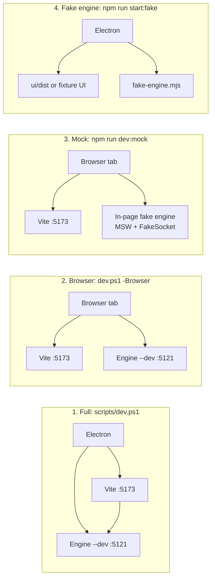

# 4. Running Rowlit from source

> **Level:** L1 beginner | **Part:** II | **Code read at:** `d2f42ad` (Rowlit 1.7.0)
> [فارسی](../../fa/part2/04-development-setup.md) · Previous: [3. Big-picture architecture](03-big-picture-architecture.md) · Next: [5. The engine host](05-engine-host-and-api.md)
>
> **In one sentence:** you can run Rowlit from source in four shapes (everything, browser only, browser with a fake
> engine in the page, or Electron with a fake engine), and each shape exists to remove one heavy dependency from the
> loop you are working on.
>
> **You will learn:**
> - what to install, and what `scripts/dev.ps1` starts and stops for you;
> - how to run the engine, the UI and Electron one at a time;
> - what mock mode and the fake engine are, and when each one is the right tool;
> - how to start the Docker sample servers and where their passwords are;
> - where Rowlit keeps its data on disk and which environment variables change its behaviour.
>
> **Prerequisites:** [3. Big-picture architecture](03-big-picture-architecture.md) (the three processes). A terminal, Git, and willingness to install .NET and Node.

## 1. The idea (beginner)

Rowlit is three programs working together: the .NET **engine**, the React **page** and the Electron **shell**
([chapter 3](03-big-picture-architecture.md)). Starting all three by hand every time you change a button would be
tedious, and you do not always need all three. If you are fixing a colour you need only the page. If you are fixing a
query path you need the engine and a browser. If you are testing what happens when the engine crashes you need Electron
and an engine that you can make crash on purpose.

So the repository gives you several ways in. The default is one command, `./scripts/dev.ps1`, that starts the engine,
the Vite dev server (hot reload for the page) and Electron, and stops them all when you press Ctrl+C. The others
trade completeness for speed. All commands in this chapter run from the repository root unless a `cd` is shown, and the
scripts are written for Windows PowerShell; the underlying commands (`dotnet`, `npm`) are the same on macOS.

## 2. How it works (practitioner)

### 2.1 What to install

`README.md:186-187` lists the prerequisites: Windows 10/11 x64 (or macOS 12+ for macOS builds), the **.NET SDK 10**,
**Node.js 24** with npm, and optionally **Docker Desktop** for the sample databases. The engine targets `net10.0`
(`engine/Directory.Build.props`), and CI uses Node 24 (`.github/workflows/ci.yml:46-52`). Nothing else is needed:
the first run of `dev.ps1` runs `npm install` for you in `ui/` and `desktop/` when `node_modules` is missing
(`scripts/dev.ps1:62-68`).

### 2.2 The four development shapes

**Figure 4.1 — Four ways to run Rowlit from source.**



| Shape | Command | You need | Good for |
|---|---|---|---|
| 1. Full | `./scripts/dev.ps1` | .NET, Node | working on anything that crosses processes; the real app |
| 2. Browser | `./scripts/dev.ps1 -Browser` | .NET, Node, a browser | UI plus real engine, with browser DevTools |
| 3. Mock | `cd ui; npm run dev:mock` | Node only | UI work with no .NET, no databases |
| 4. Fake engine | `cd desktop; npm run start:fake` | Node, Electron | shell lifecycle: crash, restart, quit |

### 2.3 `scripts/dev.ps1`, step by step

The script (`scripts/dev.ps1`, 136 lines) takes `-EnginePort 5121`, `-Token dev-token`, `-VitePort 5173`, `-Browser` and
`-EngineTimeoutSec 240` (`:18-24`). It then:

1. checks that `dotnet` and `npm.cmd` are on `PATH`, and that neither port is already listening (`:70-77`); a busy
   port is an error, not a surprise;
2. starts the engine with `dotnet run --project engine/src/DbStudio.Host --no-launch-profile -- --dev --port 5121 --token dev-token --parent-pid <script pid>`
   (`:84-86`);
3. installs UI dependencies if needed, then starts Vite with `npm run dev -- --port 5173 --strictPort` and the
   environment variables `VITE_ENGINE_URL` and `VITE_ENGINE_TOKEN` (`:90-97`);
4. waits until `GET http://127.0.0.1:5121/api/v1/health` answers with the bearer token (any HTTP answer counts as up),
   then until Vite answers (`:99-102`, the helper at `:40-60`); a process that exits before it is ready aborts the script
   with its exit code;
5. with `-Browser` it stops here and tells you to open `http://localhost:5173` (`:104-108`);
6. otherwise builds `desktop/` (`npm run build`: type-check plus esbuild bundle) and starts Electron with
   `DBSTUDIO_DEV_URL`, `DBSTUDIO_ENGINE_URL` and `DBSTUDIO_ENGINE_TOKEN` set, so the shell loads the page from Vite and
   *attaches* to the engine you already started instead of spawning its own (`:110-125`);
7. loops until Electron exits (or the engine or Vite dies), and in the `finally` block kills every process tree it
   started with `taskkill /T /F` (`:133-136`, `Stop-Tree` at `:34-38`).

Page edits hot-reload (HMR, hot module replacement). Edits to `desktop/src` need a restart of the script, because main and
preload are bundled once (`scripts/dev.ps1:11`).

`--parent-pid` is why a Ctrl+C that skips the `finally` still does not leave the engine running: the engine watches that
process id and exits when it disappears ([chapter 5](05-engine-host-and-api.md)).

### 2.4 Running the pieces alone

**The engine alone.** `README.md:201-203`:

```powershell
dotnet run --project engine/src/DbStudio.Host -- --dev --port 5121 --token dev-token
curl -H "Authorization: Bearer dev-token" http://127.0.0.1:5121/api/v1/health
```

The flags are parsed by `EngineOptions.Parse` (`engine/src/DbStudio.Host/EngineOptions.cs:40-75`): `--port N` (0 or absent
means a random free port), `--token T`, `--dev`, `--parent-pid P`. Unknown flags are ignored so launchers can add their
own. `--dev` does three things: it defaults the token to `dev-token` (`:13`, `:73`), it allows the CORS origin
`http://localhost:5173` and any `http://localhost:<port>` (`:21-38`), and it sends console logs to stderr. Without
`--dev` the engine picks a random port and a random 32-byte token and prints them in the single stdout line
`DBSTUDIO_READY {"port":...,"token":"..."}` (`Program.cs:196`), which is how Electron learns them. The token is
base64url without padding (`EngineOptions.cs:78-79`).

**The UI alone** against that engine (`README.md:205-207`):

```powershell
cd ui; $env:VITE_ENGINE_URL='http://127.0.0.1:5121'; $env:VITE_ENGINE_TOKEN='dev-token'; npm run dev
```

In a browser there is no Electron preload, so the page reads those two variables itself; if they are missing it
falls back to `http://127.0.0.1:5121` and `dev-token` (`ui/src/platform/browser.ts:5-12`). That is why a plain
`npm run dev` works against an engine started with the README command. The Vite config pins port 5173 with
`strictPort` and uses relative asset URLs (`base: './'`) because the production build is served from `dbstudio://app/`
(`ui/vite.config.ts:9-11`).

**Electron alone.** `cd desktop; npm start` builds main and preload, then runs `electron .`. With no environment
variables the shell has to find an engine, and `resolveEngineLaunch` (`desktop/src/main/engine-process.ts:126-205`) tries
these in order:

1. `DBSTUDIO_ENGINE_URL` + `DBSTUDIO_ENGINE_TOKEN`: attach to a running loopback engine, spawn nothing;
2. `DBSTUDIO_ENGINE_CMD`: a full command line to spawn (this is how the fake engine is used);
3. `DBSTUDIO_ENGINE_PATH`: a prebuilt exe such as `engine/publish/Rowlit.Engine.exe`;
4. in a packaged app: `resources/engine/Rowlit.Engine(.exe)`;
5. otherwise `dotnet run --project engine/src/DbStudio.Host --no-launch-profile -- --parent-pid <pid>`, with a READY timeout of
   180 s instead of 15 s because `dotnet run` compiles first (`:46-48`).

`npm start` also needs the UI to be built (`ui/dist`) unless `DBSTUDIO_DEV_URL` points at Vite; the shell serves
`DBSTUDIO_UI_DIR` or `ui/dist` from `dbstudio://app` (`desktop/src/main/paths.ts:59-63`).

### 2.5 Mock mode

`npm run dev:mock` is `vite --mode mock` (`ui/package.json`). In `main.tsx`, when `import.meta.env.MODE === 'mock'`, the
page starts an in-browser fake engine before React renders (`ui/src/main.tsx:16-19`). Two pieces make it work
(`ui/src/mocks/browser.ts`):

- **MSW handlers** (Mock Service Worker, used here without a service worker): `window.fetch` is wrapped so that any
  request whose path starts with `/__mock/` is answered in the page by `getResponse(handlers, request)`; other requests
  go to the real network (`browser.ts:28-35`). The handlers live in `mocks/handlers.ts`, `mocks/m15/*`, `mocks/m2/*`.
- **`FakeSocket`**: a WebSocket stand-in wired to the mock engine's event bus (`mocks/fakeSocket.ts`), installed with
  `engineSocket.setSocketFactory(...)` (`browser.ts:26`).

The page's engine endpoint in mock mode is `${location.origin}/__mock` with token `mock-token`
(`platform/browser.ts:7`). The engine behind it is `MockEngine` with 60 ms of simulated latency and 500-row frames
(`browser.ts:15`). Providers added later bring a **mock pack** each (`mocks/packs/index.ts`: MySQL, ClickHouse, Snowflake,
Cassandra, Elasticsearch, linked), so a mock connection exists for every database. Add `?fresh` to the URL to start
as a first-time user (no connections, empty workspace; `browser.ts:17-25`).

Mock mode is not a test of the engine. It is a fast way to see the page, with data shaped like the real thing. Component
tests reuse the same mocks ([chapter 23](23-testing-and-qa.md)). Limits: there is no real SQL execution, so results come
from fixtures, and features that call the Electron bridge (native dialogs, detached windows, updates) behave as in the
browser.

### 2.6 The fake engine

`desktop/test/fake-engine.mjs` is a tiny Node program that imitates only the engine's *outside*: it prints the exact
`DBSTUDIO_READY` line, answers `GET /api/v1/health` with Bearer auth and CORS for `dbstudio://app` (and
`http://localhost:5173` with `--dev`), exits when `--parent-pid` disappears, and returns 404 for everything else
(`fake-engine.mjs:1-70`). Its test flags make failures reproducible: `--ready-delay MS`, `--never-ready`,
`--exit-before-ready`, `--exit-after MS` (exit code 7 after READY: the crash path), `--spawn-child` (to check that the
whole process tree is killed) and `--noisy` (log noise before READY, like `dotnet run`) (`:5-12`).

`npm run start:fake` runs `desktop/test/run-with-fake-engine.mjs`: it sets `DBSTUDIO_ENGINE_CMD` to
`node fake-engine.mjs <extra args>`, chooses `ui/dist` when it has been built or the tiny `test/fixture-ui` otherwise, and
starts Electron. Extra arguments reach the fake engine, so

```powershell
cd desktop; npm run start:fake -- --exit-after 5000
```

shows the "The Rowlit engine stopped unexpectedly" dialog five seconds after start, which is how the restart path is
developed by hand. The same fake engine drives the automated desktop tests ([chapter 23](23-testing-and-qa.md)).

### 2.7 The Docker sample servers

The page needs databases to talk to. SQLite needs nothing: *File > Open the sample database* opens a small shop file. For
everything else, `engine/tests/docker/compose.yml` (compose project `dbstudio-it`) starts seeded servers that hold the
"shop" data used in Part I and by the integration tests (`README.md:312-338`):

```powershell
docker compose -f engine/tests/docker/compose.yml up -d                     # SQL Server, Oracle, PostgreSQL, Redis, MongoDB, MySQL, MariaDB, ClickHouse
docker compose -f engine/tests/docker/compose.yml --profile kafka up -d     # + Kafka and Schema Registry
```

Services behind a profile start only when you ask: `cluster` (Redis cluster), `kafka`, `search` (Elasticsearch),
`cassandra` and `ssh` (a bastion to test SSH tunnels), as the `profiles:` lines of the compose file show. Defaults used
when you connect (the README publishes the first six; the others come from the compose file's environment and ports):

| Server | Connect Rowlit to | Credentials |
|---|---|---|
| SQL Server 2022 | `localhost,14333`, database `shop` | `sa` / `DbStudio_Dev_2026!` |
| Oracle 23 Free | `localhost:15211`, service `FREEPDB1` | `shop` / `shop` |
| PostgreSQL 17 | `localhost:15432`, database `shop` | `shop` / `shop` |
| Redis Stack 7.4 | `localhost:16379` (RedisInsight on `:18001`) | none |
| MongoDB 7 (replica set) | `mongodb://localhost:27018/?directConnection=true` | none |
| Kafka 3.8 (KRaft) | `localhost:19092`, Schema Registry `http://localhost:18081` | none |
| MySQL 8.4 | `localhost:13306`, database `shop` | `shop` / `shop` |
| MariaDB 11 | `localhost:13307` | `shop` / `shop` (`MARIADB_USER`, `MARIADB_PASSWORD` default in the compose file) |
| ClickHouse 24.8 | HTTP `localhost:18123`, native `localhost:19000`, database `shop` | `shop` / `shop` |
| Elasticsearch 8.15 (profile `search`) | `http://localhost:19200`, security off | none |
| Cassandra 5 (profile `cassandra`) | `localhost:19042` | none |
| SSH bastion (profile `ssh`) | `localhost:12222` | `rowlit` / `rowlit` |

These are the only passwords this handbook quotes: they are the throw-away credentials of local test containers, published
in the README. The ports come from `${NAME_PORT:-default}` expressions in the compose file, so an environment variable can
move them. The Docker README (`engine/tests/docker/README.md`) lists the seed files and the environment variables the
integration tests read (`DBSTUDIO_PG_HOST`, `DBSTUDIO_REDIS_HOST`, …). Stop with
`docker compose -f engine/tests/docker/compose.yml down -v`. Part I's lab chapter,
[18. Answer key and lab](../part1/18-exercise-answers.md), uses the same servers.

### 2.8 Where data lives and what the environment variables do

The **data folder** is `%APPDATA%\Rowlit` on Windows, `~/Library/Application Support/Rowlit` on macOS and
`$XDG_CONFIG_HOME/Rowlit` (default `~/.config/Rowlit`) on Linux; `DBSTUDIO_DATA_DIR` overrides it
(`engine/src/DbStudio.Core/Platform/DataDirectory.cs:3-25`, `README.md:377-378`). The desktop shell resolves it first and passes it to the engine
through the same variable, so both always use one folder (`desktop/src/main/main.ts:48-49`). Inside:

| File or folder | Holds |
|---|---|
| `connections.json`, `settings.json`, `history.db` | saved connections (without passwords), settings, query history |
| `filters.json`, `diagrams.json` | saved data filters, ER layouts |
| `workspace.json` | open tabs and unsaved editor text |
| `secrets.dat` / `secrets.aes.json` + `secrets.key` / macOS Keychain | saved passwords ([chapter 19](19-security-and-secrets.md)) |
| `local-history.db` | editor snapshots ([chapter 12](12-editor-and-formatter.md)) |
| `ssh-known-hosts.json` | trusted SSH host keys |
| `logs/` | `engine-*.log`, `engine-process.log` |
| `electron/` | Chromium profile and window state |

To experiment without touching your real data, point the variable at a scratch folder:
`$env:DBSTUDIO_DATA_DIR = "$env:TEMP\rowlit-dev"`. The tests do exactly this.

The environment variables that matter, from `README.md:225-237` and the code that reads them:

| Variable | Effect |
|---|---|
| `DBSTUDIO_DEV_URL` | the shell loads the page from this `localhost` URL (Vite) instead of `dbstudio://app`; anything but a loopback `http(s)` URL is ignored (`main.ts:31-42`) |
| `DBSTUDIO_ENGINE_URL` + `DBSTUDIO_ENGINE_TOKEN` | attach to a running engine |
| `DBSTUDIO_ENGINE_CMD` | full command line used to start the engine (for example the fake engine) |
| `DBSTUDIO_ENGINE_PATH` | path to a prebuilt engine exe |
| `DBSTUDIO_ENGINE_EXE` | exe name inside `resources/engine` |
| `DBSTUDIO_ENGINE_TIMEOUT_MS` | READY handshake timeout (default 15 s; 180 s for `dotnet run`) |
| `DBSTUDIO_UI_DIR` | folder served at `dbstudio://app` |
| `DBSTUDIO_DATA_DIR` | data folder, for shell and engine |
| `DBSTUDIO_SECRET_STORE` | `dpapi`, `keychain`, `file` or `memory` |
| `DBSTUDIO_DISABLE_UPDATES=1` | never check for updates (`desktop/src/main/updater.ts:40`) |
| `DBSTUDIO_SMOKE=1` | run the Electron self-test and exit (used by the desktop test) |
| `DBSTUDIO_IT=0` / `1` | skip or force the Docker integration tests |

Logs: *Help › Open Logs Folder* opens `<data folder>\logs`; the engine writes `engine-<date>.log` (rolling daily, ten files kept;
`Program.cs:58`) and the shell writes `engine-process.log` with the engine's stdout and stderr.

### 2.9 The playground

In a development build only, opening `http://localhost:5173/#/playground` shows a lazy IntelliSense playground
(`ui/src/App.tsx:50-58`, `import.meta.env.DEV`). It exists to try the completion engine on fixture catalogs without a
connection ([chapter 11](11-intellisense.md)). It is absent from production builds.

## 3. Deep dive (senior)

> **Deep dive (L3): why a fake engine at all, and why both a mock and a fake?**
>
> They fake different boundaries. **Mock mode** replaces the *HTTP and WebSocket layer* inside the page, so the UI can be
> developed and tested with no process outside the browser; its data is rich (schemas, rows, plans) because the UI needs
> it. The **fake engine** replaces the *process*: it is as small as it can be (a handshake and a health route) because the
> thing under test is the Electron lifecycle, which cares about stdout lines, exit codes and process trees, not about SQL.
> Keeping them separate avoids a fake that is both too thin for UI work and too fat to read in a lifecycle test.
>
> **Attach versus spawn.** `dev.ps1` starts the engine itself and tells Electron to *attach*. This is deliberate: restarting
> Electron (to pick up `desktop/src` changes) does not restart the engine, so a long `dotnet run` build is paid once. The
> price is that the "engine crashed" dialog does not exist in this mode, because the supervisor does not own the process
> (`EngineSupervisor.isExternal`, `engine-process.ts:505`); use `start:fake` or `npm start` to exercise that path.
>
> **Why port 5121 and 5173 are fixed.** The dev engine allows CORS only for `localhost` origins in `--dev`
> (`EngineOptions.IsOriginAllowed`), and the Content-Security-Policy of the dev page allows `http://127.0.0.1:*` and
> `localhost:*` for `connect-src` (`desktop/src/main/csp.ts:14-16`). A random port would still pass CORS but would
> make the token and URL harder to put into the two `VITE_*` variables.

## 4. Edge cases and limits

- **Ports in use.** `dev.ps1` refuses to start (`:73-77`). Pass `-EnginePort` or `-VitePort`, or stop the other program. Vite is
  started with `--strictPort`, so it will not silently pick another port.
- **First engine start is slow.** `dotnet run` builds the solution; the script waits up to `-EngineTimeoutSec` (240 s by default).
- **A zombie engine.** If a previous run was killed brutally, an engine may still hold port 5121. Its `--parent-pid` watchdog
  should end it, but if you started the engine by hand without that flag it runs until you stop it.
- **Dev engine uses a fixed token.** `dev-token` is for loopback development only. Never expose a dev engine to a network.
- **macOS.** Use the `dotnet`, `npm` commands directly (`dev.ps1` is PowerShell and Windows-oriented; its `Get-NetTCPConnection` and `taskkill` calls do not exist on macOS).
- **Docker is optional.** Without it the integration tests are skipped, not failed ([chapter 23](23-testing-and-qa.md)). If Docker Desktop is
  unresponsive, restart it yourself; the handbook never asks a tool to do so.

## 5. How it is tested

- `desktop/test/engine-process.test.mjs` starts the fake engine in many modes (ready delay, never ready, crash, process tree) and
  checks the supervisor.
- `desktop/test/smoke.test.mjs` runs the real Electron app against the fake engine with `DBSTUDIO_SMOKE=1`.
- `ui/src/platform/*` and `ui/src/mocks/*` are exercised by every UI test that renders a connected screen.
- `desktop/test/platform.test.mjs` covers `resolveEngineLaunch`-style decisions per OS.

## Related chapters

- [3. Big-picture architecture](03-big-picture-architecture.md): the three processes you are starting here.
- [5. The engine host](05-engine-host-and-api.md): `--dev`, `--parent-pid` and the READY line in depth.
- [22. The desktop shell](22-desktop-shell.md): `resolveEngineLaunch` and the supervisor.
- [23. Testing and QA](23-testing-and-qa.md): how the mocks and the fake engine are used in tests.
- [Part I, chapter 18: Answer key and lab](../part1/18-exercise-answers.md): the same Docker servers.

## Glossary terms introduced here

[Vite](../glossary.md#vite) · [HMR](../glossary.md#hmr) · [MSW](../glossary.md#msw) · [mock](../glossary.md#mock) ·
[fake engine](../glossary.md#fake-engine) · [dev token](../glossary.md#dev-token) · [data folder](../glossary.md#data-folder) ·
[environment variable](../glossary.md#environment-variable) · [Docker Compose](../glossary.md#docker-compose) ·
[Testcontainers](../glossary.md#testcontainers) · [npm script](../glossary.md#npm-script) · [dotnet run](../glossary.md#dotnet-run) ·
[loopback](../glossary.md#loopback) · [bearer token](../glossary.md#bearer-token)

## Files

| Path | Responsibility |
|---|---|
| `scripts/dev.ps1` | start and stop engine, Vite and Electron |
| `ui/vite.config.ts`, `ui/package.json` | dev server config, `dev` and `dev:mock` scripts |
| `ui/src/main.tsx`, `ui/src/platform/browser.ts` | mode switch, engine endpoint in the browser |
| `ui/src/mocks/*` | MSW handlers, `FakeSocket`, mock packs |
| `desktop/package.json` | `start`, `start:fake`, `test` scripts |
| `desktop/test/fake-engine.mjs`, `run-with-fake-engine.mjs` | the fake engine and its launcher |
| `desktop/src/main/engine-process.ts` | `resolveEngineLaunch` |
| `engine/src/DbStudio.Host/EngineOptions.cs` | engine command line |
| `engine/tests/docker/compose.yml`, `README.md` | sample servers |
