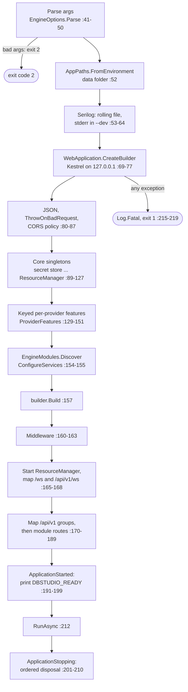
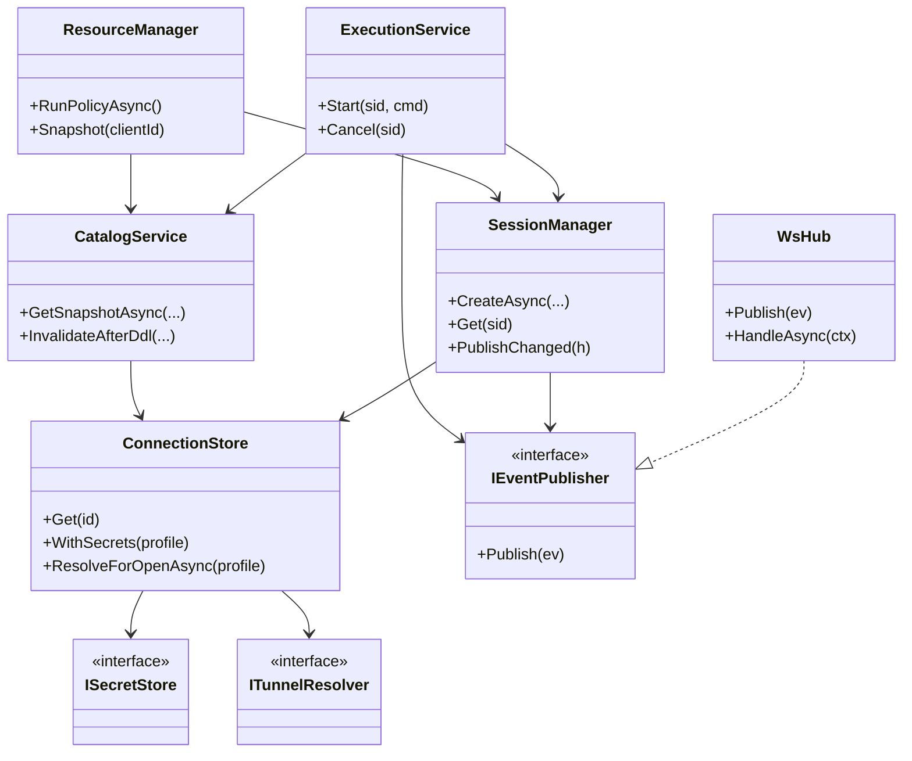
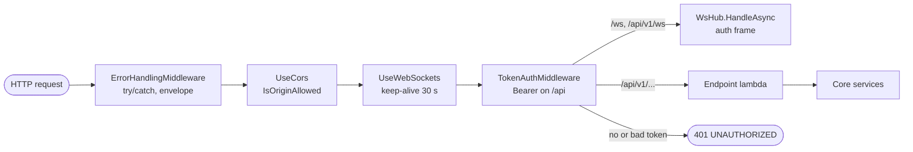
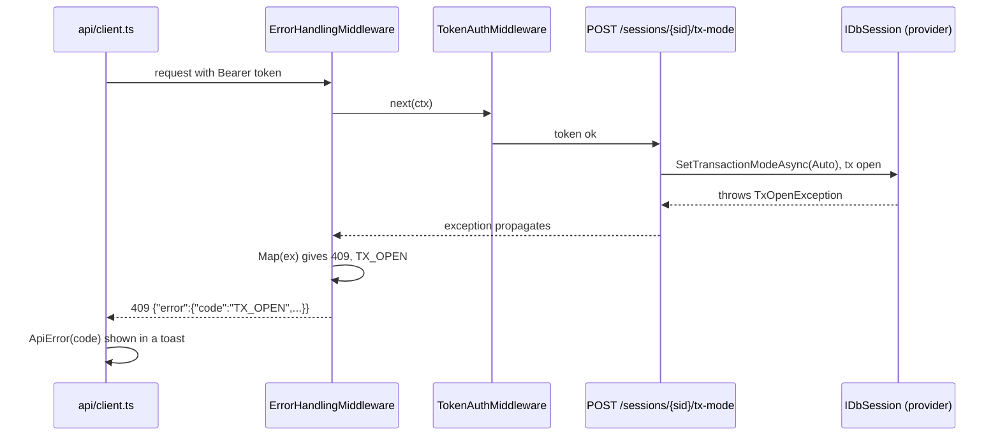

# 5. The engine host: startup, REST API, errors

> **Level:** L2 practitioner → L3 senior | **Part:** II | **Code read at:** `08528ae` (Rowlit 1.6.3)
> [فارسی](../../fa/part2/05-engine-host-and-api.md) · Previous: [4. Running it from source](04-development-setup.md) · Next: [6. The WebSocket event protocol](06-websocket-protocol.md)
>
> **In one sentence:** `DbStudio.Host/Program.cs` is a 225-line ASP.NET Core minimal-API program that parses four
> command-line flags, sets up logging and a loopback-only Kestrel server, registers every engine service as a
> singleton, installs four middlewares, maps the REST routes and the WebSocket, prints one READY line and shuts the
> services down in a fixed order.
>
> **You will learn:**
> - every step of the engine's start-up, in the order the code runs it;
> - how dependency injection, keyed services and modules are registered, and why almost everything is a singleton;
> - the middleware pipeline and what each middleware protects;
> - the REST route map, including the routes that feature modules add;
> - the error envelope, every error code and how an exception becomes an HTTP status;
> - how the engine notices that Electron is gone and how it shuts down.
>
> **Prerequisites:** [3. Big-picture architecture](03-big-picture-architecture.md). Helpful: some C# and HTTP.

## 1. The idea (beginner)

The engine is a small web server that only your own machine can reach. When Electron starts it, the engine reads its
command line, opens a log file, starts listening on `127.0.0.1` on a free port, and prints one line that tells Electron
the port and a secret token. From then on the user interface sends it ordinary HTTP requests such as
`GET /api/v1/connections` or `POST /api/v1/sessions/{id}/execute`, each carrying the token, and gets JSON back. Long
results come over a separate WebSocket (chapter [6](06-websocket-protocol.md)).

Inside, the program is a list of *services*: one object that manages sessions, one that runs queries, one that caches
catalogs, and so on. A technique called [dependency injection](../glossary.md#dependency-injection) (a container builds
each object and hands it the other objects it needs, so classes do not create their dependencies themselves) wires
them together once at start-up. Every request passes through a short chain of checks (errors, CORS, WebSocket, token)
before it reaches the code for its route. When something fails, the answer always has the same shape,
`{"error":{"code","message","detail"}}`, so the UI can show a precise message. When Electron exits, the engine notices
and shuts down cleanly: it rolls back open transactions and closes every connection.

## 2. How it works (practitioner)

### 2.1 Start-up at a glance

Figure 5.1 is the whole of `Program.cs` as a flowchart. Each box names the lines that implement it.

**Figure 5.1 — Engine start-up sequence (`engine/src/DbStudio.Host/Program.cs`).**



The process returns `2` for invalid arguments (`Program.cs:46-50`), `1` when start-up throws (`:215-219`) and `0` after a
normal shutdown (`:212-213`). The `finally` block flushes Serilog in every case (`:221-224`).

### 2.2 The command line: `EngineOptions`

`EngineOptions.Parse` (`engine/src/DbStudio.Host/EngineOptions.cs:40-75`) understands four flags, each also in the
`--name=value` form (`:66-68`):

| Flag | Effect | Default |
|---|---|---|
| `--port N` | Port to listen on; 0 means "let the OS choose" (`:52-55`) | 0 (the shell never passes it) |
| `--token T` | The bearer token every request must carry (`:56-58`) | 32 random bytes, base64url without padding (`:78-79`) |
| `--dev` | Development mode: fixed token, extra CORS origins, console logging (`:59-61`) | off |
| `--parent-pid P` | Exit when process P ends (`:62-64`) | none |

Two details matter. Unknown arguments are ignored on purpose, "so launchers can add their own" (`:69`). An empty or
whitespace token is replaced: by `dev-token` in `--dev` (`EngineOptions.DevToken`, `:13`), by a fresh random token
otherwise (`:73`). `IsOriginAllowed` (`:29-38`) is the single origin rule used by both CORS and the WebSocket upgrade:
`dbstudio://app` always; in `--dev` also `http://localhost:5173`, `http://127.0.0.1:5173`, and any
`http://localhost:<port>` or `http://127.0.0.1:<port>` origin with no path, query or user info, so Vite may run on
another port.

The program also refuses to hand its own arguments to ASP.NET's configuration system: the builder gets `Args = []`
(`Program.cs:68-69`), because `--dev` without a value would confuse the command-line configuration provider.

### 2.3 The data folder

`AppPaths.FromEnvironment()` (`Program.cs:52`; `engine/src/DbStudio.Core/Services/Infrastructure.cs:11-30`) resolves the
folder that holds `connections.json`, `secrets.dat`, `settings.json`, `history.db` and `logs/`. The resolution itself is
`DataDirectory.Resolve` (`engine/src/DbStudio.Core/Platform/DataDirectory.cs:44-59`), a pure function so it can be
unit-tested for every OS from any OS:

1. `DBSTUDIO_DATA_DIR`, when set, wins (`:48-49`). The desktop app always sets it (`:11-12`).
2. Otherwise the per-OS parent (`:62-79`): Roaming AppData on Windows, `~/Library/Application Support` on macOS,
   `$XDG_CONFIG_HOME` (only if absolute) or `~/.config` elsewhere, plus the folder name `Rowlit` (`:22`).
3. If `Rowlit` does not exist but the pre-1.2 folder `DbStudio` does, that legacy folder is used (`:53-57`), so an engine
   started on its own never "loses" saved connections before the desktop app has migrated the folder.

The OS comes from `HostPlatform.Current` (`engine/src/DbStudio.Core/Platform/HostPlatform.cs:13-19`); FreeBSD and others
are treated like Linux. File writes in the folder are atomic: write a temp file next to the target, flush to disk, then
`File.Move(…, overwrite: true)` (`Infrastructure.cs:33-59`).

### 2.4 Logging with Serilog

[Serilog](../glossary.md#serilog) is a [structured logging](../glossary.md#structured-logging) library (each log event keeps
its named values, such as `{Port}`, as data, not only as text). The configuration (`Program.cs:53-64`):

- minimum level `Information`; `Microsoft.AspNetCore` at `Warning` so request logs do not flood the file;
  `Microsoft.Hosting.Lifetime` at `Information`;
- one file sink, `logs/engine-<date>.log`, rolling daily, keeping 10 files, with the template
  `{Timestamp:yyyy-MM-dd HH:mm:ss.fff zzz} [{Level:u3}] {SourceContext}: {Message:lj}` (`:58-59`);
- in `--dev`: minimum `Debug` and a console sink that writes *every* level to **stderr**
  (`standardErrorFromLevel: LogEventLevel.Verbose`, `:60-63`).

Why stderr? Because stdout is a protocol channel: it carries exactly one line, the READY line (`Program.cs:39`), and
`EngineSupervisor` parses stdout looking for it (`desktop/src/main/engine-process.ts:207-221`). ASP.NET's own logging
providers are removed (`builder.Logging.ClearProviders()`, `:70`) and replaced by Serilog (`:71`), so every
`ILogger<T>` in the engine writes through Serilog. The Logs view can show this file as the "engine log"
(`EngineLogSource`, chapter [21](21-logs-activity-resources.md)).

### 2.5 Kestrel and the builder

[Kestrel](../glossary.md#kestrel) is ASP.NET Core's built-in HTTP server. The engine configures it in three lines
(`Program.cs:72-77`): listen on `IPAddress.Loopback` only, at `options.Port`; cap request bodies at **64 MB**
(`MaxRequestBodySize = 64L * 1024 * 1024`, enough for a large script or an import upload); and do not send a `Server`
header. The content root is the executable's folder (`AppContext.BaseDirectory`, `:69`), not the current directory,
because the shell may start the engine from anywhere.

The app is an [ASP.NET Core](../glossary.md#asp-net-core) (Microsoft's web framework for .NET)
[minimal API](../glossary.md#minimal-api): each [endpoint](../glossary.md#endpoint) (one HTTP method plus path, and the
code that answers it) is a lambda registered with `MapGet` / `MapPost` on a [route group](../glossary.md#route-group) (a prefix such as `/api/v1/sessions` shared by several
endpoints), with parameters bound from the route, the query, the JSON body and the DI container by type. There are no
controllers.

### 2.6 Service registrations, in order

All registrations happen before `builder.Build()` (`Program.cs:157`). They come in four blocks.

**Block 1 — the core singletons** (`Program.cs:89-127`). Every DI registration has a
[service lifetime](../glossary.md#service-lifetime) (how long one instance lives: singleton, scoped per request, or
transient per resolution). A [singleton](../glossary.md#singleton) (one instance for the whole process lifetime) is the
natural lifetime for an engine whose state *is* the session table, the caches and the
open streams:

| Line | Service | Why it is here |
|---|---|---|
| 89-90 | `EngineOptions`, `AppPaths` | configuration as plain objects |
| 91 | `ISecretStore` via `SecretStoreFactory.Create` | DPAPI, Keychain or AES file, chosen per OS (chapter [19](19-security-and-secrets.md)) |
| 92-95 | four `IDbProvider`s: SQL Server, Oracle, SQLite, PostgreSQL | the M1/M2 providers are registered directly; newer ones come from modules (block 4) |
| 96, 98 | `ProviderRegistry`, `SourceRegistry` | look up providers by id (chapter [7](07-engine-modules-and-di.md)) |
| 100-102 | `SshTunnelService` and `ITunnelResolver` (same instance) | SSH tunnels, with known hosts in the data folder (chapter [8](08-connections-sessions-execution.md#22-ssh-tunnels)) |
| 103-104 | `ConnectionStore(...).UseTunnels(resolver)` | every driver open resolves secrets and tunnels through it |
| 105-108 | `SettingsService`, `HistoryService`, `ResultStore`, `ClientPresence` | settings file, `history.db`, latest results per session, live UI clients |
| 109-110 | `WsHub` and `IEventPublisher` (same instance) | the hub *is* the publisher every service uses to emit events |
| 111-121 | `SessionManager`, `SourceClientManager`, `StreamManager`, `JobManager`, `CatalogService`, `ExecutionService`, `ExportService` | the engine's use cases |
| 123-126 | `ResourceManager` | idle release, limits, memory pressure (chapter [21](21-logs-activity-resources.md)) |
| 127 | `ParentWatchdog` (hosted service) | exits with the parent (section 2.8) |

Several registrations use a factory lambda instead of `AddSingleton<T>()`. That is how the Host passes arguments the
container cannot guess: `SourceClientManager` gets `reapInterval: Timeout.InfiniteTimeSpan` because `ResourceManager`
drives its idle reaper (`:112-114`), and `StreamManager` gets a lookup function
`kind => sp.GetKeyedService<IStreamFactory>(kind)` (`:115-117`) so it resolves stream factories lazily by kind.

**Block 2 — keyed per-provider features** (`Program.cs:129-147`). A [keyed service](../glossary.md#keyed-service) is a
DI registration with a key (here a provider id such as `"sqlserver"`), resolved with `GetKeyedService<T>(key)`. The M1.5
plan chose this so `IDbProvider` would not grow: DDL scripters, designer databases, plan readers and parameter binders
for the four built-in providers are registered under their ids (`:130-146`), and `ProviderFeatures.FromServices`
(`:147`) looks them up at call time (`engine/src/DbStudio.Core/Services/ProviderFeatures.cs:32-46`). The comment on
`:142` still calls the PostgreSQL features "M2-0 stubs that throw NotSupportedException until PG-A implements them";
that comment is stale: `PgDdlScripter` and the other PostgreSQL features are full implementations today
(`engine/src/DbStudio.Providers.PostgreSql/Designer/PgDdlScripter.cs`, 385 lines).

**Block 3 — more Core services** (`Program.cs:148-151`): `FilterStore`, `DesignerService`, `DescribeService`,
`SampleDatabase`.

**Block 4 — modules** (`Program.cs:153-155`). `EngineModules.Discover(ModuleAssemblies.All)` finds every
`IEngineModule`, and each one's `ConfigureServices(services)` runs against the same collection. MySQL, ClickHouse,
Snowflake, Cassandra, the sources, logs, import and federation all register here. After `Build()` the Host logs the
module list (`:158`). Chapter [7](07-engine-modules-and-di.md) explains discovery.

Figure 5.2 shows the main services and who depends on whom (constructor parameters as registered in `Program.cs`).

**Figure 5.2 — Core services and their main dependencies.**



### 2.7 The middleware pipeline

[Middleware](../glossary.md#middleware) is a chain of components that each see a request on the way in and the response
on the way out. Rowlit installs four, in this order (`Program.cs:160-163`); figure 5.3 shows the path of a request.

**Figure 5.3 — Middleware pipeline of the engine host.**



1. **`ErrorHandlingMiddleware`** (`engine/src/DbStudio.Host/Infrastructure/Middleware.cs:28-55`) is first, so it wraps
   everything after it. It catches any exception and writes the error envelope (section 2.12). It also fills empty
   `404` and `405` responses with an envelope (code `NOT_FOUND`), but never for a WebSocket request (`:35-42`). An
   `OperationCanceledException` raised because the client went away is swallowed silently (`:44-47`).
2. **`UseCors`** (`Program.cs:161`) applies the default policy built at `:82-87`: origins by `IsOriginAllowed`, any
   header, any method, exposed headers `ETag` and `Content-Disposition` (the UI reads the catalog ETag and download
   file names), and a preflight cache of one hour. A [preflight](../glossary.md#preflight) is the `OPTIONS` request a
   browser sends before a cross-origin call with custom headers.
3. **`UseWebSockets`** (`Program.cs:162`) turns upgrade requests into sockets, with a protocol-level keep-alive ping
   every 30 s.
4. **`TokenAuthMiddleware`** (`Middleware.cs:85-104`) requires `Authorization: Bearer <token>` on every path that starts
   with `/api`, except `OPTIONS` preflights and the two WebSocket paths, which authenticate with their first frame
   (`:92`, `:101`). The comparison uses `CryptographicOperations.FixedTimeEquals` (`:103`), so the time it takes does
   not reveal how many leading characters were right. A missing or wrong token gets `401 UNAUTHORIZED` with the
   envelope (`:98`).

Order matters. Because the error middleware is outermost, even a failure inside CORS or the token check returns an
envelope. Because the token check comes after CORS, preflights (which carry no token by design) are answered by CORS
and pass the token check (`HttpMethods.IsOptions`, `:92`).

### 2.8 The parent watchdog and shutdown

**The watchdog.** `ParentWatchdog` (`engine/src/DbStudio.Host/Infrastructure/ParentWatchdog.cs:6-58`) is a
[hosted service](../glossary.md#hosted-service) (a `BackgroundService` the host starts with the app and stops with it).
With `--parent-pid P` it:

- stops the app at once if P is not running (`:14-21`);
- otherwise awaits `parent.WaitForExitAsync` (`:28`); some parents deny the access rights that call needs, so on
  `InvalidOperationException` or `Win32Exception` it falls back to polling `Process.GetProcessById` once per second
  (`:30-34`);
- when the parent exits, logs "Parent process {Pid} exited; shutting down" and calls `StopApplication()` (`:41-43`).

This is the safety net for the case the shell cannot handle itself: Electron crashing or being killed. In a normal quit
the supervisor kills the engine's process tree (chapter [22](22-desktop-shell.md)).

**The shutdown order.** When the host stops, the `ApplicationStopping` callback (`Program.cs:201-210`) disposes the
stateful services one after another, each with its own bounded wait:

| Order | Service | Wait | What disposal does |
|---|---|---|---|
| 1 | `ResourceManager` | 2 s | stops the policy timer so it does not release sessions mid-shutdown |
| 2 | `SessionManager` | 10 s | "Roll back open transactions and close tab connections" (`:204`) |
| 3 | `StreamManager` | 5 s | ends streams with reason `shutdown` (`:206`) |
| 4 | `JobManager` | 5 s | cancels running jobs |
| 5 | `SourceClientManager` | 5 s | closes Redis, Mongo, Kafka and Elasticsearch clients |

Sessions get the longest wait because rolling back a transaction is a server round trip per session. The waits are
`.Wait(TimeSpan)` calls, so a stuck dispose cannot hang the shutdown for more than its budget; the worst case adds
27 s to the stop. A [graceful shutdown](../glossary.md#graceful-shutdown) (stopping new work, finishing or cancelling
current work, releasing resources, then exiting) is the goal; the budgets keep it bounded.

### 2.9 The READY line and `/health`

When Kestrel has bound its port, the `ApplicationStarted` callback (`Program.cs:191-199`) reads the actual address from
`IServerAddressesFeature` (the port is only known now when `--port 0` was used), serialises `{ port, token }` and
writes `DBSTUDIO_READY {"port":…,"token":"…"}` to stdout, then flushes. This one line is the whole handshake with the
shell; the supervisor parses it with `parseReadyLine` and rejects anything malformed
(`desktop/src/main/engine-process.ts:207-221`). The log file gets the same event without the token
(`Program.cs:198`).

`GET /api/v1/health`, the engine's [health check](../glossary.md#health-check) (a cheap endpoint that only says
"I am up"), returns `{ status: "ok", version, pid, dev }` (`engine/src/DbStudio.Host/Endpoints/MetaEndpoints.cs:11-12`;
`Contracts/Api.cs:10`). Note that it is under `/api`, so it needs the token like everything else. The smoke test checks
both facts: a request without the token gets 401, `/health` with it gets 200 (`engine/tests/smoke/smoke.mjs:78-80`).

### 2.10 The route map

All REST routes live under one group, `app.MapGroup("/api/v1")` (`Program.cs:170`). The Host's own endpoint files
add their groups in a fixed chain (`:171-188`); then every module's `MapEndpoints(api)` adds its own (`:189`).

| Extension (file) | Prefix | What it serves |
|---|---|---|
| `MapMeta` (`MetaEndpoints.cs`) | `/health`, `/providers`, `/settings`, `/sql/format` | health, provider list with form specs, settings get/patch; `/sql/format` answers 400 `NOT_SUPPORTED` because formatting runs in the UI (`MetaEndpoints.cs:27-28`) |
| `MapConnections` | `/connections` | CRUD and `POST /connections/test` |
| `MapCatalog` | `/connections/{id}/catalog` | databases, schemas, snapshot with ETag/304, object, DDL, errors, system types, synonym, refresh |
| `MapObjects` | `/connections/{id}/catalog/objects`, `/dependencies` | object list, uses / used by |
| `MapSessions` | `/sessions` | create, list, close, database, schema, tx-mode, reconnect, commit, rollback, execute, cancel |
| `MapExecutions` | `/executions/{xid}/resultsets/{rs}`, `/export` | rows replay, full cell, export of a result set, streamed query export |
| `MapHistory`, `MapSql` | `/history`, `/sql/diagnostics` | history search, pin, delete; server diagnostics |
| `MapFilters`, `MapDescribe`, `MapPlans`, `MapDesigner`, `MapSampleDb` | `/filters`, `/sessions/{sid}/describe`, `/sessions/{sid}/explain`, `/connections/{id}/designer`, `/sample-db` | M1.5 features |
| `MapStreams` | `/streams`, `/jobs` | open (202 `{streamId}`), pause, resume, close; list and cancel jobs |
| `MapSources` | `/sources` | non-relational clients: list, open, close |
| `MapResources` | `/resources`, `/connections/{id}/resources`, `/connections/{id}/close` | status-bar data, memory reports, trim, close |
| Modules | `/links`, `/redis/{cid}`, `/mongo/{cid}`, `/kafka/{cid}`, `/es/{cid}`, `/logs/{cid}`, `/connections/{cid}/import`, `/connections/{cid}/queries`, `/connections/{cid}/er/layouts`, `/local-history`, `/schema-compare`, `/clickhouse/{cid}`, `/snowflake/{cid}`, `/snowflake/sessions/{sid}`, `/cassandra` | feature packages (chapter [7](07-engine-modules-and-di.md)) |

The WebSocket handler is mapped twice, at `/ws` and `/api/v1/ws` (`Program.cs:166-168`); chapter
[6](06-websocket-protocol.md) explains why the UI tries the second first.

**The client header.** Every UI request carries `X-DbStudio-Client: <uuid>` (`ui/src/api/client.ts:99`), read by
`HttpContext.ClientId()` (`engine/src/DbStudio.Host/Infrastructure/ClientIdentity.cs:9-16`) and normalised by
`ClientPresence.Normalize`: trimmed, at most 128 printable ASCII characters, else null
(`engine/src/DbStudio.Core/Services/ClientPresence.cs:12`, `:23-33`). It is how the engine knows which window owns a
session (`SessionEndpoints.Touch` claims the session for the caller, `SessionEndpoints.cs:137-143`) or a stream
(`StreamEndpoints.cs:24`). `ClientPresence` counts each client's live WebSockets and raises `ClientGone` when the last
one closes (`ClientPresence.cs:35-62`), which lets the session and stream managers clean up after a window that
disappeared (chapter [8](08-connections-sessions-execution.md)).

### 2.11 JSON conventions

`CoreJson.Configure` (`engine/src/DbStudio.Core/Services/CoreJson.cs:18-29`) is applied to the minimal-API serializer
(`Program.cs:80`) and used directly by the hub, the error envelope and the engine's own files, so there is one
convention everywhere:

- Web defaults, property names in **[camelCase](../glossary.md#camelcase)** (`connectionId`, first word lower-case,
  later words capitalised), case-insensitive reading;
- dictionary keys kept verbatim (`DictionaryKeyPolicy = null`), so connection `props` keys such as `ssh.host` and
  settings keys survive round trips;
- `NumberHandling.Strict`: a number in quotes is a validation error, not silently accepted;
- enums as camelCase strings, never integers (`allowIntegerValues: false`);
- two custom converters run first: `Dialect` as `tsql | plsql | sqlite | pgsql | mysql | clickhouse | snowflake | cql |
  duckdb` (`:31-57`, `:81-90`) and `SourceKind` as `relational | keyvalue | document | stream | search` (`:59-77`,
  `:93-102`). Plain camelCase would have produced `tSql` and `keyValue`.

Request and response shapes are [DTOs](../glossary.md#dto) (data transfer objects: plain records that only carry data)
in `engine/src/DbStudio.Host/Contracts/{Api,M15,M2}.cs`, mirrored by `ui/src/api/types.ts` (`Api.cs:7-8`). Together
they form the API [contract](../glossary.md#contract) (the agreed shape of requests, responses and events that both
sides code against). Responses
that are already plain Core models (`ConnectionProfile`, `SessionInfo`, `ObjectDetails`…) are serialised directly.

### 2.12 The error envelope and error codes

Every non-2xx answer has the same body, written by `ErrorEnvelope` (`Middleware.cs:11-25`):

```json
{ "error": { "code": "TX_OPEN", "message": "A transaction is open. Commit or roll back first.", "detail": null } }
```

Services raise failures as `EngineException(status, code, message, detail)`
(`engine/src/DbStudio.Core/Services/ExecutionContracts.cs:21-44`), with factories for the common cases (`NotFound`,
`Validation`, `SourceUnavailable`, `StreamLimit`, `Privilege`, `ReadOnly`). Other exception types are mapped by
`ErrorHandlingMiddleware.Map` (`Middleware.cs:57-81`). The table merges both, with the status codes the code actually
uses (a search of every `new EngineException(<status>, <code>` in `engine/src`):

| Code | Status | Raised when |
|---|---|---|
| `UNAUTHORIZED` | 401 | missing or wrong bearer token (`Middleware.cs:98`) |
| `NOT_FOUND` | 404 (409 for a disposed session) | unknown id, unknown route or method (`Middleware.cs:38-41`); `ObjectDisposedException` → 409 "The session is closed." (`:73`) |
| `VALIDATION` | 400 | bad body or argument, `BadHttpRequestException`, `JsonException`, `ArgumentException` (`:64-65`, `:71`) |
| `SESSION_BUSY` | 409 | a statement is already running on the session (`:60`; `ExecutionService.cs:92-93`) |
| `SESSION_BROKEN` | 409 | the session's connection broke (`:61`) |
| `SESSION_LIMIT` | 429 | more sessions than `maxSessionsPerProfile` (`engine/src/DbStudio.Core/Services/SessionManager.cs:229`) |
| `TX_OPEN` | 409 | the action would end or need to end an open transaction (`:62`) |
| `READ_ONLY` | 403 | a write on a read-only connection (`ExecutionContracts.cs:42-43`; chapter [8](08-connections-sessions-execution.md)) |
| `PRIVILEGE` | 403 | the server denied a system view; `detail.needs` names the grant (`ExecutionContracts.cs:39`) |
| `NOT_SUPPORTED` | 400 (501 in three places) | `NotSupportedException` (`:63`), a provider without a feature (`ProviderFeatures.cs:52-53`) |
| `PROVIDER_ERROR` | 422 (also 400/409/500/504) | a `DbException` with `detail.providerCode` and `detail.sqlState` (`:68`); Oracle, `Microsoft.Data.*` and Cassandra driver exceptions (`:74-79`); `TimeoutException` → 504 (`:72`) |
| `SERVER_UNREACHABLE` | 503 | `ConnectionGuard.IsBrokenConnection` recognises a dead socket or a deadline (`:67`) |
| `SSH_TUNNEL` | 503 | the SSH hop failed; `detail.hop = "ssh"` (`engine/src/DbStudio.Core/Services/Tunnels/SshTunnelService.cs:456`) |
| `SOURCE_UNAVAILABLE` | 503 | a Redis/Mongo/Kafka/ES client cannot connect (`ExecutionContracts.cs:33`) |
| `STREAM_LIMIT` | 429 | too many open streams for the client (`ExecutionContracts.cs:36`) |
| `RESOURCE_BUSY` | 409 | closing a connection would roll back a transaction or cancel running work (chapter [21](21-logs-activity-resources.md)) |
| `GROUP_ACTIVE` | 409 | Kafka: the consumer group has active members |
| `DDL_FAILED` | 409 | designer apply failed (`engine/src/DbStudio.Core/Designer/DesignerContracts.cs:67`) |
| `BIND_VARS_UNSUPPORTED`, `CANCELLED` | — | execution error codes that appear inside `exec.error` events rather than as HTTP statuses (`ExecutionContracts.cs:51-52`) |
| `ENGINE_ERROR` | 500 | anything else: a bug (`Middleware.cs:80`), logged at `Error` with the stack trace (`:51`) |

Figure 5.4 follows one failing request.

**Figure 5.4 — A request that fails becomes an envelope.**



On the UI side `api/client.ts` turns any non-2xx answer into an `ApiError` carrying `code`, and code paths branch on it,
for example `isApiError(e, 'READ_ONLY')` to offer the read-only override (`ui/src/app/actions.ts:178-184`).

## 3. Deep dive (senior)

### 3.1 Minimal API instead of controllers

ASP.NET Core offers two styles: MVC controllers (classes with action methods, attribute routing, filters, model
binding through the MVC pipeline) and minimal APIs (lambdas mapped on route groups, binding by parameter type). Rowlit
uses only the second. The reasons visible in the code:

- **Composition by modules.** `IEngineModule.MapEndpoints(RouteGroupBuilder api)` hands each module the `/api/v1` group
  (`engine/src/DbStudio.Core/Providers/IDataSourceProvider.cs:50-55`). A module adds routes with a few `MapGet` calls on
  that group; with controllers it would need application parts and assembly scanning configured in the Host.
- **Small surface.** Most endpoints are three to ten lines that validate, call one service and return a Core model or a
  DTO (for example `SessionEndpoints.cs:116-126`). The logic lives in Core, which keeps endpoints thin and testable
  through the services.
- **Explicit responses.** Endpoints return `Results.Json(…, CoreJson.Options, statusCode: …)` when they need a status
  such as 202 (`SessionEndpoints.cs:125`), `Results.Bytes` for the pre-serialised catalog snapshot with its ETag
  (`CatalogEndpoints.cs:32-41`), and plain objects otherwise.

The cost is that cross-cutting behaviour (errors, auth) has to be middleware, not MVC filters; Rowlit already wants it
that way, since the WebSocket must be covered too.

### 3.2 `ThrowOnBadRequest` and binding errors

By default, when a minimal-API endpoint cannot bind a parameter (malformed JSON, a string where an `int` was expected),
the framework answers 400 with an empty body and logs at debug level. `RouteHandlerOptions.ThrowOnBadRequest = true`
(`Program.cs:81`) makes it throw `BadHttpRequestException` instead. The error middleware maps that to `400 VALIDATION`
with the inner message (`Middleware.cs:64`), so a client sending a bad body still gets the standard envelope and a
useful text. Note how many endpoints take their body as nullable (`ExecuteRequestDto? req`) and check for `null`
themselves (`SessionEndpoints.cs:118`): an empty body then produces a precise `VALIDATION` message with a `field`
detail rather than a generic binding error.

### 3.3 Why Core references ASP.NET Core

The M1 plan said Core would have "no ASP.NET refs" (`docs/PLAN.md:73`). The code differs: `DbStudio.Core.csproj` has
`<FrameworkReference Include="Microsoft.AspNetCore.App" />` with the comment "IEngineModule maps minimal-API endpoints
(RouteGroupBuilder) and registers services" (`DbStudio.Core.csproj:16-19`). Decision D4 of the M2 plan introduced
modules (`docs/PLAN-M2.md:12`), and the module interface has to live in Core because every feature project references
Core but not the Host. The only ASP.NET types Core uses in its contracts are `IServiceCollection` and
`RouteGroupBuilder` (`IDataSourceProvider.cs:2-3`); Core's own modules (`DiagramsModule`, `QueriesModule`,
`SearchModule`, `LocalHistoryModule`, `SchemaCompareModule`) map routes, but Core's services (`SessionManager`,
`ExecutionService`, `CatalogService`) take no HTTP types. Chapter [3](03-big-picture-architecture.md#32-how-rowlit-compares-honestly)
discusses what that means for the "clean architecture" comparison.

### 3.4 Designing the exception map

`Map` is a C# `switch` expression over the exception (`Middleware.cs:57-81`), and its order is significant:

1. `EngineException` first: services that know the right status and code always win.
2. Engine-specific exceptions (`SessionBusyException`, `SessionBrokenException`, `TxOpenException`) next, so they keep
   their codes even though they derive from `InvalidOperationException`.
3. Framework input errors (`NotSupportedException`, `BadHttpRequestException`, `JsonException`).
4. `ConnectionGuard.IsBrokenConnection(ex)` **before** `DbException`. A dead socket inside a driver often surfaces as a
   `DbException` subclass; checking connectivity first turns it into `503 SERVER_UNREACHABLE` ("Server not reachable:
   …") instead of a `422` that would look like a mistake in the user's SQL (`:66-67`).
5. `DbException` → `422 PROVIDER_ERROR`, with `providerCode` and `sqlState` in `detail` so the UI can show them
   (`:68`).
6. Namespace tests for drivers whose exceptions do not derive from `DbException` (`Oracle.*`, `Microsoft.Data.*`) and
   for Cassandra, where `NoHostAvailableException` becomes 503 (`:74-79`). Matching by namespace string avoids a Host
   reference to the Cassandra driver.
7. The fallback `500 ENGINE_ERROR` (`:80`), the only case logged at `Error` with the stack (`:51`).

Only failures of the *request* reach this map. A SQL error inside a batch is not an HTTP failure: the provider reports it
through `IExecutionSink.Error` and it travels as an `exec.error` event while the `execute` call has long returned 202
(`engine/src/DbStudio.Core/Providers/IDbProvider.cs:97-102`).

### 3.5 Singletons and thread safety

Every service is a singleton, and minimal-API requests run concurrently on the thread pool, so every service must be
thread-safe. The code meets that with concurrent collections and small locks, for example `ClientPresence` guards two
dictionaries with one `lock` and raises its event outside the lock (`ClientPresence.cs:15-62`), and
`ExecutionService.Start` reserves a session with an atomic `TryReserve` before starting work
(`ExecutionService.cs:92-93`). There are no scoped services (no per-request state), which is why DI scopes play no
role here. [`CancellationToken`](../glossary.md#cancellationtoken)s flow from the request into service calls (`ct` in most
endpoint signatures), so a request the client abandons stops its server work; long-running work such as an execution
deliberately does **not** use the request token, because it must outlive the 202 response
(`ExecutionService.cs:97`, `:165` passes `CancellationToken.None`). [`TimeProvider`](../glossary.md#timeprovider) is
injected in a few classes (for example `ClientPresence`, `:9`, `:14`) so tests can move time forward.

### 3.6 Drift between comments and code

Reading the host closely shows three small inconsistencies worth knowing, so you are not misled:

- the PostgreSQL "stubs" comment (`Program.cs:142`), stale as shown in section 2.6;
- `MetaEndpoints.cs:14-15` says `/providers` lists "sqlserver, oracle, postgresql, sqlite, redis, mongodb, kafka"; the real
  list and order come from `SourceRegistry.DisplayOrder`, which has 14 ids including the Batch 3 providers and `linked`
  (`engine/src/DbStudio.Core/Services/SourceRegistry.cs:18-19`);
- `/sql/format` still answers "SQL formatting is planned for M2." (`MetaEndpoints.cs:27-28`) although the formatter has
  shipped, in the UI (`ui/src/format`, chapter [12](12-editor-and-formatter.md)).

## 4. Edge cases and limits

- **`--port` taken.** With an explicit port that is in use, Kestrel throws at start; the catch block logs it as fatal and
  exits 1 (`Program.cs:215-219`). The shell never passes `--port`, so packaged builds do not hit this.
- **Non-numeric flag values.** `--port abc` throws `FormatException`, caught as invalid arguments: exit 2 with
  "Invalid arguments: …" on stderr (`Program.cs:46-50`).
- **Body too large.** Requests above 64 MB fail in Kestrel before reaching an endpoint.
- **Response already started.** If an exception happens after the response began streaming (an export, for example),
  `ErrorEnvelope.WriteAsync` does nothing (`Middleware.cs:15`): the client sees a truncated response rather than a
  corrupted one.
- **Client went away.** An `OperationCanceledException` caused by `RequestAborted` is swallowed (`Middleware.cs:44-47`);
  nothing is logged as an error.
- **Shutdown budget.** A dispose that does not finish within its wait is abandoned (section 2.8). Sessions that could not
  roll back in 10 s are closed by the process exit; the server then rolls back on its side when the socket drops.
- **`/health` needs the token.** Monitoring tools must send it like the UI.
- **CORS in `--dev`.** Any `http://localhost:<port>` origin is accepted. A malicious local web page served from
  localhost could therefore call a `--dev` engine *if* it knew the token, and in `--dev` the token is the public
  `dev-token`. Use `--dev` only for development.

## 5. How it is tested

- **End-to-end smoke.** `engine/tests/smoke/smoke.mjs` (driven by `run-smoke.ps1`, which starts an engine with a temp data
  folder) checks the 401 without a token, `/health`, `/providers`, `/settings`, the WebSocket `auth.ok` and ping/pong,
  then a full SQLite round trip: connection, test, catalog, session, execute → 202, the ordered `exec.*` events, wire
  values, `catalog.changed`, rows replay, cell fetch and export (`smoke.mjs:78-150`).
- **Published-binary smoke in CI.** `scripts/ci/kafka-native-smoke.mjs` starts the published `Rowlit.Engine` with
  `--dev --port 0`, waits for `DBSTUDIO_READY`, and calls `/providers`, `/kafka/library`, `/connections/test` and
  `/links/engine`, so a native library that fails to load in the single-file publish fails the build (`:2-19`).
- **Desktop side of the handshake.** The shell's tests run against `desktop/test/fake-engine.mjs`, which prints a READY
  line and serves a fake API; `parseReadyLine` rejects malformed lines (chapter [22](22-desktop-shell.md)).
- **Endpoints inside modules.** There is no separate Host test project. Endpoint tests build a small host with
  `Microsoft.AspNetCore.TestHost` (referenced by `engine/tests/DbStudio.Core.Tests/DbStudio.Core.Tests.csproj`), for
  example `engine/tests/DbStudio.Core.Tests/Queries/SavedQueryEndpointTests.cs`.
- **Pure pieces.** `DataDirectory.Resolve` is written as a pure function for per-OS unit tests
  (`DataDirectory.cs:34-35`; `engine/tests/DbStudio.Core.Tests/Platform/`).
- **Not covered by a dedicated unit test, as far as the search shows:** `EngineOptions.Parse`, `ErrorHandlingMiddleware.Map`
  and `TokenAuthMiddleware` (the smoke test covers the 401 path only).

## Related chapters

- [3. Big-picture architecture](03-big-picture-architecture.md) — where the host sits.
- [6. The WebSocket protocol](06-websocket-protocol.md) — `/ws`, the auth frame, events.
- [7. Engine modules and DI](07-engine-modules-and-di.md) — block 4 of the registrations in depth.
- [8. Connections, sessions and execution](08-connections-sessions-execution.md) — what the session and execute routes do.
- [19. Security model](19-security-and-secrets.md) — token, CORS, origins, secrets.
- [21. Logs, activity and resources](21-logs-activity-resources.md) — the engine log, `ResourceManager`.
- [22. The Electron shell](22-desktop-shell.md) — the other side of the READY handshake.

## Glossary terms introduced here

[ASP.NET Core](../glossary.md#asp-net-core) · [minimal API](../glossary.md#minimal-api) · [Kestrel](../glossary.md#kestrel) ·
[middleware](../glossary.md#middleware) · [endpoint](../glossary.md#endpoint) · [route group](../glossary.md#route-group) ·
[dependency injection](../glossary.md#dependency-injection) · [singleton](../glossary.md#singleton) ·
[service lifetime](../glossary.md#service-lifetime) · [keyed service](../glossary.md#keyed-service) ·
[hosted service](../glossary.md#hosted-service) · [Serilog](../glossary.md#serilog) ·
[structured logging](../glossary.md#structured-logging) · [CORS](../glossary.md#cors) · [preflight](../glossary.md#preflight) ·
[camelCase](../glossary.md#camelcase) · [DTO](../glossary.md#dto) · [contract](../glossary.md#contract) ·
[health check](../glossary.md#health-check) · [graceful shutdown](../glossary.md#graceful-shutdown) ·
[CancellationToken](../glossary.md#cancellationtoken) · [TimeProvider](../glossary.md#timeprovider) ·
[error envelope](../glossary.md#error-envelope) · [error code](../glossary.md#error-code) ·
[parent watchdog](../glossary.md#parent-watchdog) · [DBSTUDIO_READY](../glossary.md#dbstudio-ready) ·
[data folder](../glossary.md#data-folder) · [client id](../glossary.md#client-id) · [client presence](../glossary.md#client-presence)

## Files

| Path | Responsibility |
|---|---|
| `engine/src/DbStudio.Host/Program.cs` | Start-up, DI, middleware order, route map, READY line, shutdown order |
| `engine/src/DbStudio.Host/EngineOptions.cs` | Command line, token generation, allowed origins |
| `engine/src/DbStudio.Host/Infrastructure/Middleware.cs` | `ErrorEnvelope`, `ErrorHandlingMiddleware.Map`, `TokenAuthMiddleware` |
| `engine/src/DbStudio.Host/Infrastructure/ParentWatchdog.cs` | Exit with the parent process |
| `engine/src/DbStudio.Host/Infrastructure/ClientIdentity.cs` | `X-DbStudio-Client` → client id |
| `engine/src/DbStudio.Host/Endpoints/*.cs` | REST route groups |
| `engine/src/DbStudio.Host/Contracts/{Api,M15,M2}.cs` | Request/response DTOs |
| `engine/src/DbStudio.Core/Services/ExecutionContracts.cs` | `EngineException`, `ErrorCodes` |
| `engine/src/DbStudio.Core/Services/CoreJson.cs` | JSON conventions and converters |
| `engine/src/DbStudio.Core/Services/Infrastructure.cs` | `AppPaths`, `AtomicFile`, `Ids` |
| `engine/src/DbStudio.Core/Platform/{DataDirectory,HostPlatform}.cs` | Data folder resolution, OS detection |
| `engine/src/DbStudio.Core/Services/ClientPresence.cs` | Live UI clients |
| `engine/tests/smoke/smoke.mjs`, `scripts/ci/kafka-native-smoke.mjs` | End-to-end and published-binary smoke tests |
