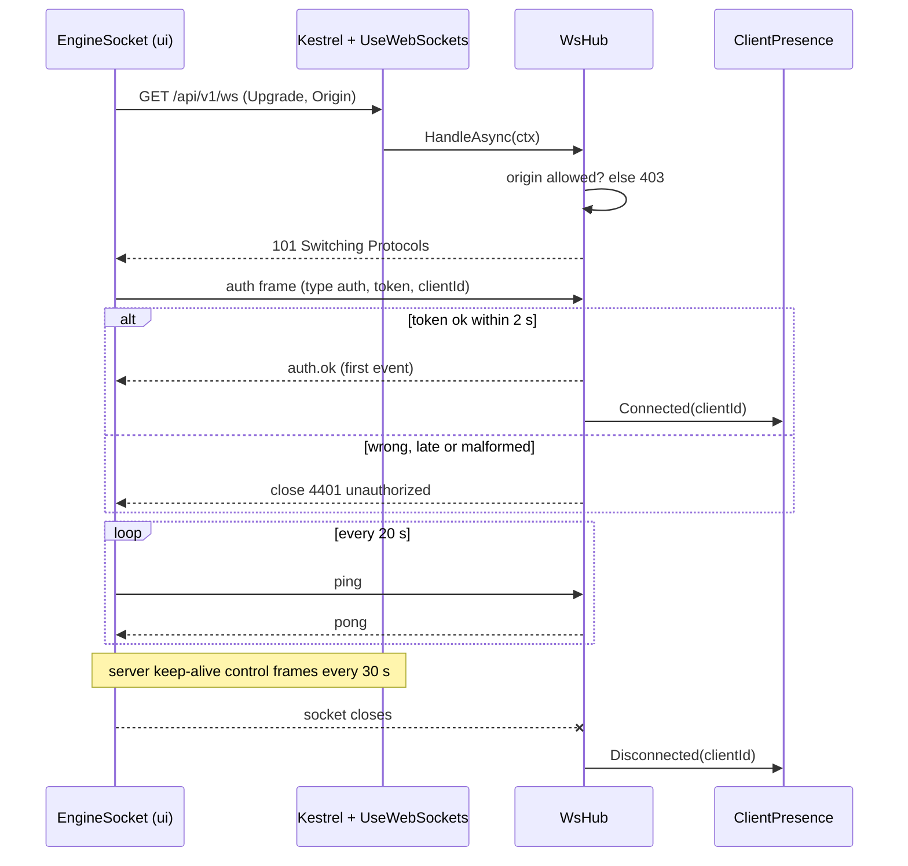
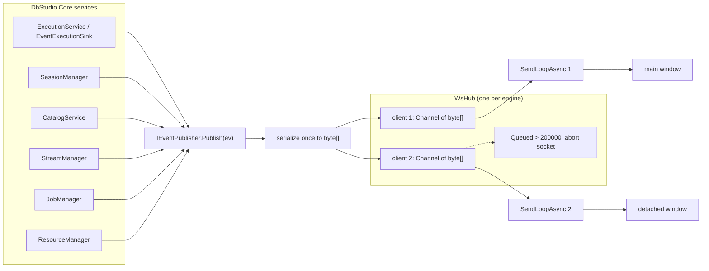
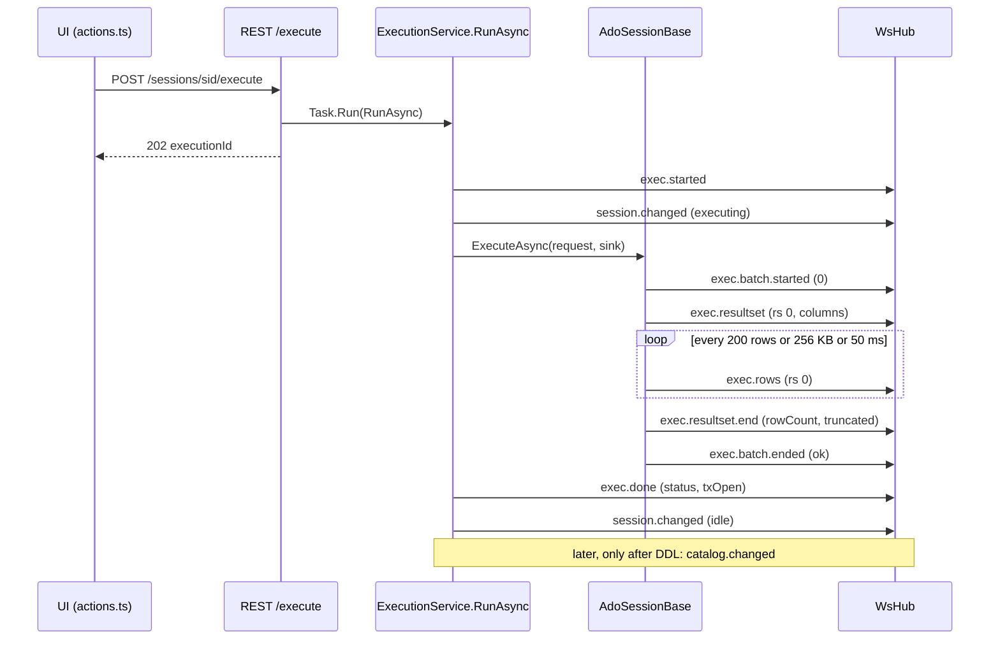
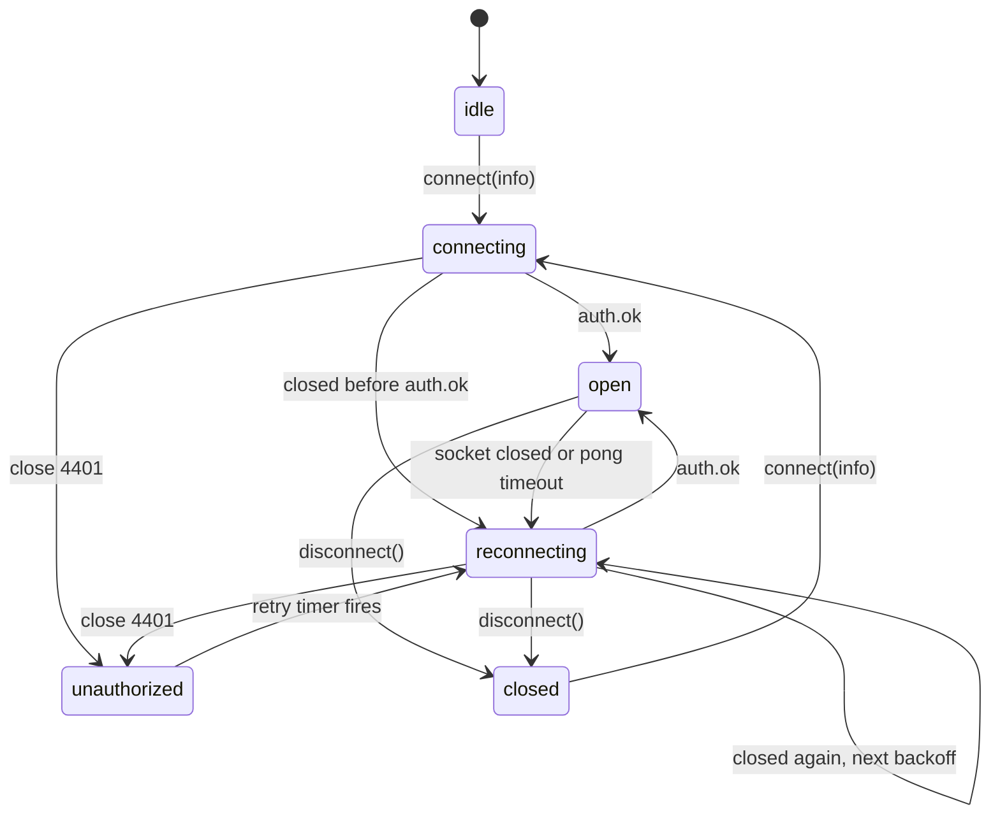
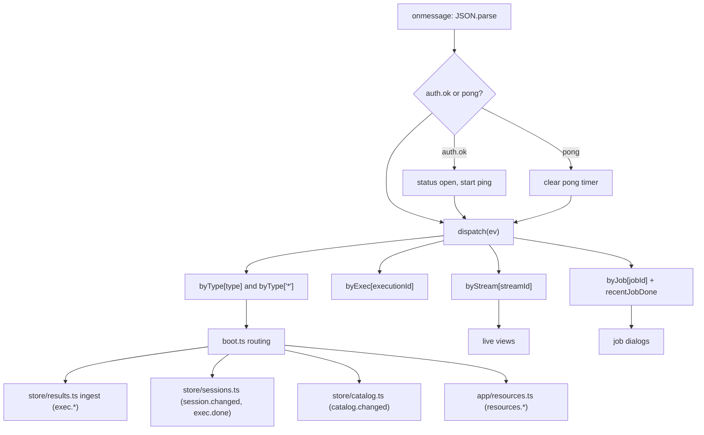
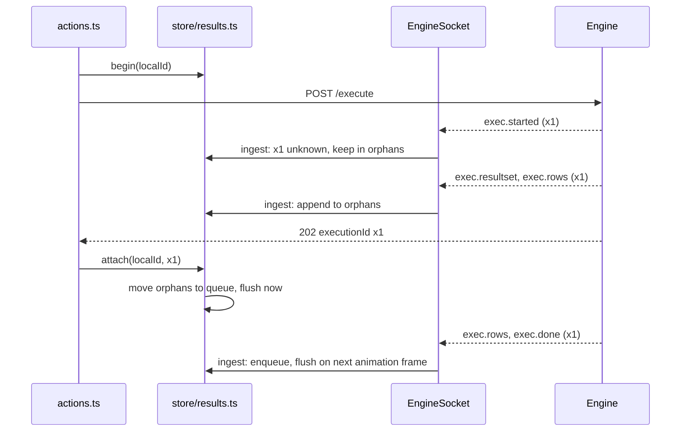

# 6. The WebSocket event protocol

> **Level:** L2 practitioner → L3 senior | **Part:** II | **Code read at:** `08528ae` (Rowlit 1.6.3)
> [فارسی](../../fa/part2/06-websocket-protocol.md) · Previous: [5. The engine host](05-engine-host-and-api.md) · Next: [7. Engine modules and DI](07-engine-modules-and-di.md)
>
> **In one sentence:** the engine pushes everything that happens over time (rows of a running query, session changes, stream items, job progress) to the UI as small JSON events on one authenticated WebSocket per window, and the UI routes each event to the store that needs it.
>
> **You will learn:**
> - why Rowlit uses exactly one WebSocket per UI window and REST for every command (decision D-6);
> - how a socket is opened, authenticated with a first frame and kept alive;
> - how the hub fans one event out to every client, and what it does with a client that stops reading;
> - the full catalogue of event types, who sends each one and who listens;
> - the exact order of events for one query, and where rows are batched;
> - how the UI's `EngineSocket` reconnects, routes events and survives the race between an event and the REST answer.
>
> **Prerequisites:** [3. Big-picture architecture](03-big-picture-architecture.md), [5. The engine host](05-engine-host-and-api.md). Helpful: [8. Connections, sessions and execution](08-connections-sessions-execution.md).

## 1. The idea (beginner)

Most of what the UI asks the engine is a simple question with one answer: "list my connections", "give me the columns of this table". For that, Rowlit uses plain HTTP requests (REST, see [chapter 5](05-engine-host-and-api.md)). But some answers arrive bit by bit and over a long time. A query can return a hundred thousand rows; a Kafka topic keeps producing messages; an import reports progress every few seconds. Asking "anything new?" again and again would be slow and wasteful. So the engine keeps one line open to each UI window and *pushes* news down that line the moment it happens. That line is a [WebSocket](../glossary.md#websocket) (a long-lived, two-way connection that starts as an HTTP request and then carries independent messages in both directions).

Every piece of news is an [event](../glossary.md#event) (a small JSON object with a `type` such as `exec.rows` and a timestamp `ts`), sent as one WebSocket [frame](../glossary.md#frame) (one message on the socket). Many different conversations share the same line: rows of the query in tab 1, rows of the query in tab 2, a log tail, a job. This sharing is called [multiplexing](../glossary.md#multiplexing) (several logical channels over one physical connection). Each event carries an id (`executionId`, `streamId`, `jobId`, `sessionId`, `connectionId`) so the UI can deliver it to the right place, the way a post office sorts letters by address.

The rest of this chapter follows the line from both ends: the engine side, a class called `WsHub`, and the UI side, a class called `EngineSocket`.

## 2. How it works (practitioner)

### 2.1 Why one socket

The decision is recorded in the M1 plan as **D-6**: "Single WebSocket per UI instance, multiplexed by `executionId`/`sessionId`; REST for all commands; token via header / first WS frame, never in URLs" (`docs/PLAN.md:626`). Three consequences follow from it.

1. **Commands go over REST, news over the socket.** The UI never asks the engine to *do* something through the socket. Running a query is `POST /api/v1/sessions/{sid}/execute`, which answers at once with an `executionId`; the results then flow as `exec.*` events (`docs/PLAN.md:57-58`). The only frames a client may send are `auth` and `ping` (`ui/src/api/types.ts:459`), and the hub ignores every other `type` (`engine/src/DbStudio.Host/Ws/WsHub.cs:160-169`).
2. **One socket per window, not per query.** Opening a socket per execution would cost a TCP handshake, an HTTP upgrade and an authentication per query, and would multiply the moving parts on reconnect. With one socket the UI has one connection state to show in the status bar (`ui/src/components/StatusBar/StatusBar.tsx:24-27`) and one reconnect loop.
3. **The token never appears in a URL.** URLs end up in logs and browser history. REST calls carry `Authorization: Bearer <token>`; the WebSocket API in browsers cannot set that header, so the socket authenticates with its first message instead (section 2.2).

The engine maps the same handler on two paths, `/ws` and `/api/v1/ws` (`engine/src/DbStudio.Host/Program.cs:166-168`). The UI tries `/api/v1/ws` first and falls back to `/ws` (`ui/src/api/ws.ts:22-23`). Both paths are excluded from the bearer-token middleware, because the socket does its own authentication (`engine/src/DbStudio.Host/Infrastructure/Middleware.cs:92`, `:101`).

### 2.2 The handshake: upgrade, origin check, auth frame

A WebSocket starts life as an ordinary HTTP `GET` with an `Upgrade: websocket` header. The ASP.NET Core [middleware](../glossary.md#middleware) `UseWebSockets` (`Program.cs:162`) turns such a request into a socket, and `WsHub.HandleAsync` takes over (`WsHub.cs:66-111`):

1. A request that is not an upgrade gets `400` "WebSocket upgrade expected." (`WsHub.cs:68-73`).
2. If the request carries an `Origin` header, it must be an allowed [origin](../glossary.md#origin) (the scheme + host + port of the page that opened the socket), or the answer is `403` (`WsHub.cs:74-79`). The allowed set is the same as for [CORS](../glossary.md#cors): `dbstudio://app` always, plus `http://localhost:5173` / `http://127.0.0.1:5173` and any `http://localhost:<port>` in `--dev` mode (`engine/src/DbStudio.Host/EngineOptions.cs:20-38`). A request *without* an `Origin` header (a non-browser client such as a test tool) passes this check; it still needs the token.
3. The socket is accepted, and the hub waits for the **auth frame** for at most **2 seconds** (`WsHub.cs:116-117`). The [auth frame](../glossary.md#auth-frame) is `{"type":"auth","token":"…","clientId":"…"}`; it may be at most 16 KB (`WsHub.cs:120`).
4. The token is compared with `CryptographicOperations.FixedTimeEquals` (`WsHub.cs:126`), a comparison whose run time does not depend on how many leading characters match, so an attacker cannot guess the token byte by byte from timing.
5. On success the optional `clientId` is normalised (`ClientPresence.Normalize`: printable ASCII, at most 128 characters, `engine/src/DbStudio.Core/Services/ClientPresence.cs:12`, `:23-33`). The hub then queues `auth.ok` for the new client **before** registering it for broadcasts (`WsHub.cs:86-88`), so `auth.ok` is always the first event a client receives.
6. On any failure (timeout, bad JSON, wrong token, a frame that is too large) the hub closes the socket with the custom close code **4401** and reason `unauthorized` (`WsHub.cs:20`, `:139-151`). If even the close fails, it aborts the socket.

```csharp
// engine/src/DbStudio.Host/Ws/WsHub.cs:116-131
timeout.CancelAfter(TimeSpan.FromSeconds(2));
var frame = await ReceiveTextAsync(socket, 16 * 1024, timeout.Token);
if (frame is not null)
{
    using var doc = JsonDocument.Parse(frame);
    if (doc.RootElement.TryGetProperty("type", out var t) && t.GetString() == "auth"
        && doc.RootElement.TryGetProperty("token", out var tok) && tok.ValueKind == JsonValueKind.String
        && CryptographicOperations.FixedTimeEquals(Encoding.UTF8.GetBytes(tok.GetString()!), _token))
    {
        var clientId = /* "clientId" normalized by ClientPresence.Normalize, or null */;
        return (true, clientId);
    }
}
```

The `clientId` names the UI window, not the socket. The UI creates it once per page and keeps it in `sessionStorage`, so a page reload keeps the same id (`ui/src/api/clientId.ts:1-4`, `:18-36`); the same id goes into the `X-DbStudio-Client` header of every REST call (`engine/src/DbStudio.Host/Infrastructure/ClientIdentity.cs:11-15`). While at least one socket of a client is open, [client presence](../glossary.md#client-presence) counts that client as live (`ClientPresence.cs:35-62`). Sessions and streams owned by a client that has been gone longer than `connections.orphanGraceSeconds` (default 90 s, `engine/src/DbStudio.Core/Services/SessionManager.cs:174`) are closed; [chapter 8](08-connections-sessions-execution.md) covers sessions, section 2.7 below covers streams.

**Figure 6.1 — Opening, authenticating and keeping the socket alive.**



### 2.3 Keeping the line alive: ping, pong and keep-alive

There are two independent heartbeats.

- **Application ping.** After `auth.ok`, the UI sends `{"type":"ping"}` every 20 s (`ui/src/api/ws.ts:25`, `:231-242`). The hub answers each one with a `pong` event (`WsHub.cs:164`). If no `pong` arrives within 10 s (`ws.ts:26`), the UI assumes a half-open connection (the TCP link is dead but neither side has noticed) and closes the socket itself with code 4000 and reason `pong timeout` (`ws.ts:236-240`), which starts a reconnect. A pong timer is armed only when none is pending, so a slow engine does not stack timers (`ws.ts:235`).
- **Protocol [keep-alive](../glossary.md#keep-alive).** The host configures `UseWebSockets` with `KeepAliveInterval = 30 s` (`Program.cs:162`). This makes the .NET WebSocket send control frames on its own, which keeps idle connections from being dropped by anything in between. According to the .NET documentation these are unsolicited pong control frames when no keep-alive timeout is configured, as here; that detail is framework behaviour and was not verified in this repository. They are invisible to the UI code.

So dead-peer detection is the UI's job. The engine notices a dead client only when a send or a receive fails, which then removes the client (section 2.4).

### 2.4 Publish, fan-out and the per-client queue

Every service in Core that has news calls one method on one interface:

```csharp
// engine/src/DbStudio.Core/Services/Events.cs:7-11
public interface IEventPublisher
{
    /// Queues the event for every authenticated client. Never blocks; ordering per publisher thread is preserved.
    void Publish(EngineEvent ev);
}
```

Core does not know about WebSockets; the Host registers `WsHub` as the implementation (`Program.cs:109-110`). Tests use a `NullEventPublisher` or a recording fake instead (`Events.cs:109-113`, `engine/tests/DbStudio.Core.Tests/M2/SourceFrameworkTests.cs:104`). This is the [WebSocket hub](../glossary.md#websocket-hub): one object that knows every connected client and performs the [fan-out](../glossary.md#fan-out) (delivering one event to many receivers).

```csharp
// engine/src/DbStudio.Host/Ws/WsHub.cs:37-64
public void Publish(EngineEvent ev)
{
    if (_clients.IsEmpty) return;
    byte[] payload = JsonSerializer.SerializeToUtf8Bytes(ev, ev.GetType(), CoreJson.Options); // once
    foreach (var c in _clients.Values) Enqueue(c, payload);
}
private void Enqueue(Client c, byte[] payload)
{
    if (Interlocked.Increment(ref c.Queued) > MaxQueuedFrames)   // 200_000
    {
        c.Queue.Writer.TryComplete();  // a client that stopped reading must not exhaust memory
        c.Socket.Abort();
        return;
    }
    c.Queue.Writer.TryWrite(payload);
}
```

What happens, step by step:

1. **No clients, no work.** With no window connected, `Publish` returns before serialising (`WsHub.cs:39`). The event is simply lost; the hub keeps no history.
2. **Serialise once.** The event is turned into UTF-8 JSON bytes once, with its runtime type so that the fields of the concrete record are included, and with the engine's JSON conventions (camelCase names, enums as camelCase strings, `Dialect` as wire tokens: `engine/src/DbStudio.Core/Services/CoreJson.cs:20-27`). The same `byte[]` is shared by every client.
3. **One queue per client.** Each client owns an unbounded [channel](../glossary.md#channel) (`System.Threading.Channels.Channel<byte[]>`, an in-memory producer/consumer queue) created with `SingleReader = true` (`WsHub.cs:29-35`). `Publish` only writes to these queues, so it never waits for a network send.
4. **One send loop per client.** `SendLoopAsync` reads the queue in order and sends each payload as one complete text message (`endOfMessage: true`) (`WsHub.cs:177-185`). A slow client delays only its own loop.
5. **The overflow rule.** A counter `Queued` tracks how many frames wait in a client's queue: incremented on enqueue, decremented when the send loop takes a frame (`WsHub.cs:55`, `:181`). When it passes `MaxQueuedFrames` = **200 000** (`WsHub.cs:21`), the hub logs "WebSocket client {Id} is not reading; disconnecting", completes the queue and aborts the socket (`WsHub.cs:55-61`). The abort makes the receive loop fail, and its `finally` block removes the client, completes the queue, cancels the send loop and reports the disconnect to `ClientPresence` (`WsHub.cs:102-110`). The UI sees an abnormal close and reconnects (section 2.8). The frames that were still queued are dropped with the queue.

The count of [queued frames](../glossary.md#queued-frames) is therefore the only [back-pressure](../glossary.md#back-pressure) mechanism of the hub, and it does not slow anyone down: it removes the consumer that cannot keep up. Section 3.4 discusses what that means.

**Figure 6.4 — Fan-out from services through the hub to per-client queues.**



The receive side is small. `ReceiveLoopAsync` reads text messages of at most 64 KB (`WsHub.cs:158`), answers `ping` with `pong`, and ignores malformed JSON (`WsHub.cs:160-169`). A larger message raises "Frame too large." and ends the connection (`WsHub.cs:197`). When the client starts a normal close, the hub answers with close code 1000 and reason `bye` (`WsHub.cs:171-174`).

### 2.5 The event catalogue

Every event is a C# `record` deriving from `EngineEvent`, which puts `type` and `ts` first in the JSON (`[JsonPropertyOrder(-2)]` and `(-1)`), with `ts` an ISO UTC timestamp with milliseconds (`Events.cs:14-20`). The UI mirrors the set as a TypeScript union `WsEvent` (`ui/src/api/types.ts:407-452`); `WsEventOf<'exec.rows'>` extracts one member (`types.ts:454-455`). The table lists every `type` string defined in `Events.cs`, the payload fields (camelCase on the wire), every place that publishes it, and its main consumers in the UI.

| `type` | Payload fields | Published by | Consumed by |
|---|---|---|---|
| `auth.ok` | none | `WsHub.cs:87` | `ws.ts:215-219` (status `open`, start ping) |
| `pong` | none | `WsHub.cs:164` | `ws.ts:220-223` (clear pong timer) |
| `exec.started` | `executionId, sessionId, batchCount` | `ExecutionService.cs:154`, `ExecutionService.Explain.cs:53` | `resultsReducer.ts:155-160` |
| `exec.batch.started` | `executionId, batchIndex` | `ExecutionService.cs:248` (sink) | `resultsReducer.ts:161-164` |
| `exec.resultset` | `executionId, resultSetId, batchIndex, columns[]` | `ExecutionService.cs:255` | `resultsReducer.ts:165-177` |
| `exec.rows` | `executionId, resultSetId, rows[][]` | `ExecutionService.cs:262` | `resultsReducer.ts:178-185` |
| `exec.resultset.end` | `executionId, resultSetId, rowCount, truncated, elapsedMs` | `ExecutionService.cs:270` | `resultsReducer.ts:186-195` |
| `exec.affected` | `executionId, batchIndex, count, statementKind` | `ExecutionService.cs:276` | `resultsReducer.ts:196-202` |
| `exec.message` | `executionId, batchIndex, severity, text, line, code, source` | `ExecutionService.cs:161`, `:282`; `ExecutionService.Explain.cs:57`, `:70` | `resultsReducer.ts:203-209` |
| `exec.error` | `executionId, batchIndex, code, message, line, col, detail` | `ExecutionService.cs:293` | `resultsReducer.ts:210-216` |
| `exec.batch.ended` | `executionId, batchIndex, elapsedMs, status` | `ExecutionService.cs:300` | `resultsReducer.ts:217-219` |
| `exec.diagnostics` | `executionId, diagnostics[]` | `ExecutionService.cs:306` | `resultsReducer.ts:220-222` |
| `exec.plan` | `executionId, dialect, mode, root, raw, rawFormat, warnings[]` | `ExecutionService.Explain.cs:74` | `components/PlanView/explain.ts:123` |
| `exec.done` | `executionId, sessionId, status, elapsedMs, resultSets, rowsAffected, txOpen, outParams?` | `ExecutionService.cs:187`, `ExecutionService.Explain.cs:102` | `resultsReducer.ts:223-266`, `app/boot.ts:114-121` |
| `session.changed` | `sessionId, state, txOpen, database, txMode, schema, searchPath, released, releasedReason?, hasTempObjects` | `SessionManager.cs:404` (`PublishChanged`), `:554` (closed) | `app/boot.ts:122-128` |
| `catalog.changed` | `connectionId, database, schemas[], version` | `CatalogService.cs:394` (refresh), `:496` (after DDL) | `app/boot.ts:129` → `store/catalog.ts` |
| `export.progress` | `exportId, rows` | `ExportService.cs:203`, `:225` | `components/Export/serverExport.ts:40-43` |
| `export.done` | `exportId, path, rows, status, error` | `ExportService.cs:160` | `components/Export/serverExport.ts:44-47` |
| `engine.log` | `level, message` | record defined (`Events.cs:90`); no publisher found in `engine/src` | `app/boot.ts:135-137` (toast on `error`) |
| `stream.data` | `streamId, items[], seq` | `StreamManager.cs:408` | `onStream` subscribers (Kafka, Redis, Mongo, Logs, ES, Search) |
| `stream.state` | `streamId, state, reason, dropped` | `StreamManager.cs:254`, `:361`, `:382` | `onStream` subscribers |
| `source.client` | `connectionId, state` (`open`, `closed`, `broken`) | `SourceClientManager.cs:128`, `:224` | `app/boot.ts:134` |
| `job.progress` | `jobId, kind, done, total, message` | `JobManager.cs:45` | `onJob` subscribers |
| `job.done` | `jobId, kind, status, error, result` | `JobManager.cs:119` | `onJob` subscribers, `recentJobDone` |
| `resources.released` | `connectionId, connectionName, reason, sessions, sourceClient` | `ResourceManager.cs:323`, `:390` | `app/resources.ts:222` |
| `resources.pressure` | `level, usedBytes, limitBytes` | `ResourceManager.cs:260` | `app/resources.ts:223` |

(`ExecutionService.cs`, `ExecutionService.Explain.cs`, `SessionManager.cs`, `StreamManager.cs`, `JobManager.cs`, `ResourceManager.cs`, `SourceClientManager.cs` live in `engine/src/DbStudio.Core/Services/`; `CatalogService.cs` in `Core/Catalog/`; `ExportService.cs` in `Core/Export/`; UI paths are under `ui/src/`.)

Three remarks on the table:

- **The plan and the code differ slightly.** `docs/PLAN.md` §3.6 lists `exec.done` without `sessionId` and `session.changed` without the schema and resource fields (`docs/PLAN.md:293-313`). The code adds `sessionId` to `exec.done` (`Events.cs:40`), `outParams` for OUT parameters (`Events.cs:43-45`), `schema` and `searchPath` (`Events.cs:56-59`), and `released`, `releasedReason`, `hasTempObjects` (`Events.cs:61-69`). The code wins.
- **`engine.log` is declared but not sent.** The record exists on both sides and the UI listens for it, but a search of `engine/src` finds no `Publish(new EngineLogEvent…)`. The engine log reaches the UI through the Logs feature instead (a `logs.tail` stream on connection id `engine`, `StreamManager.cs:159-160`; see [chapter 21](21-logs-activity-resources.md)).
- **Enum values are camelCase strings.** `status` is `"ok" | "error" | "cancelled"`, `severity` is `"info" | "warning" | "error"`, `source` is `"server" | "dbmsOutput" | "engine"` (`engine/src/DbStudio.Core/Models/CoreModels.cs:31-34`, `CoreJson.cs:27`).

### 2.6 The order of one execution's events

Take one Ctrl+Enter on `SELECT * FROM shop.orders` in a console. Before any event, `ExecutionService.Execute` validates the request, reserves the session, creates the [execution id](../glossary.md#execution-id) (`Ids.New("x")`), starts `RunAsync` on the thread pool **and only then** returns `202 { executionId }` (`engine/src/DbStudio.Core/Services/ExecutionService.cs:91-99`). The first events can therefore reach the UI before the HTTP answer does; section 2.9 shows how the UI copes.

`RunAsync` publishes `exec.started` and a `session.changed` (state `executing`) (`ExecutionService.cs:154-155`). If the session's connection had been released or had broken, reopening it adds an `exec.message` with batch index 0 (`ExecutionService.cs:157-161`). Then the provider session runs the batches (`ExecutionService.cs:163-165`). For the ADO.NET providers the loop lives in `AdoSessionBase` ([chapter 9](09-relational-providers.md)): per batch `exec.batch.started` (`engine/src/DbStudio.Core/Services/AdoSessionBase.cs:1011`), then per result set `exec.resultset`, any number of `exec.rows`, `exec.resultset.end` (`AdoSessionBase.cs:1251-1290`), then `exec.affected` / `exec.message` / `exec.error` as they occur, and finally `exec.batch.ended` (`AdoSessionBase.cs:1082`). When all batches are done, the execution publishes `exec.done` and another `session.changed` (state `idle`, `txOpen` updated) (`ExecutionService.cs:186-191`). Only after that does it classify the batches for DDL; if a table was created or altered, the catalog reloads the affected schemas in the background and publishes `catalog.changed` later (`ExecutionService.cs:193`, `:197-215`; `engine/src/DbStudio.Core/Catalog/CatalogService.cs:429-444`, `:496`).

**Figure 6.2 — Events of one execution with one batch and one result set.**



**Where rows are batched.** The M1 plan says rows travel "batched … 200 rows or 256 KB per frame, flush ≥ every 50 ms" (`docs/PLAN.md:58`). In the code the batching is not in the hub or in `ExecutionService`; it is a private `RowBuffer` inside `AdoSessionBase` with three overridable limits:

```csharp
// engine/src/DbStudio.Core/Services/AdoSessionBase.cs:204-211, 1481-1487
protected virtual int RowBatchSize => 200;                                      // rows per exec.rows
protected virtual TimeSpan RowFlushInterval => TimeSpan.FromMilliseconds(50);   // max age of pending rows
protected virtual int RowBatchMaxBytes => 256 * 1024;                           // approximate payload
// …
_rows.Add(row);
foreach (var v in row) _bytes += ValueConverter.EstimateSize(v) / 2; // rough JSON size of the value
if (_rows.Count >= maxRows || _bytes >= maxBytes || Stopwatch.GetElapsedTime(_lastFlush) >= maxAge)
    await FlushAsync().ConfigureAwait(false);
```

Two details differ from the plan's wording. First, the 50 ms age is only checked when the *next* row arrives (`AdoSessionBase.cs:1485`); there is no timer. If a server sends one row and then thinks for ten seconds, that row waits in the buffer until the next row, the end of the result set (`AdoSessionBase.cs:1281-1285`) or a message. Second, the byte size is an estimate: `EstimateSize` measures the in-memory size of the wire value (two bytes per UTF-16 character plus overhead, `engine/src/DbStudio.Core/Services/ValueConverter.cs:158-165`), halved as a rough JSON size. The non-ADO Cassandra session has its own chunking of 200 rows per send (`engine/src/DbStudio.Providers.Cassandra/CqlSession.cs:18-19`, `:980`).

**Ordering of messages and rows.** Drivers raise some messages from event handlers, for example SQL Server's `InfoMessage`. `AdoSessionBase.EmitMessageAsync` and its siblings flush pending rows before they forward the message (`AdoSessionBase.cs:96-98`, `:646-652`), so a `PRINT` between two `SELECT`s appears after the rows of the first one.

### 2.7 Session, catalog, stream, job, export and resource events

**`session.changed`** is published by `SessionManager.PublishChanged` (`SessionManager.cs:401-410`), which copies the session's public state into the event. It fires around every execution (`ExecutionService.cs:155`, `:191`), after REST actions on a session such as commit, rollback, changing the database or the transaction mode (`engine/src/DbStudio.Host/Endpoints/SessionEndpoints.cs:21`, `:49`, `:77`, `:87`, `:104`, `:112`), on release and reopen (`SessionManager.cs:456`, `:534`, `:595`, `:651`) and on close (`SessionManager.cs:554`). The UI applies it to `store/sessions.ts`, moves the tab to a new database if the session's database changed, and schedules a refresh of the engine-wide counts 400 ms later (`ui/src/app/boot.ts:122-128`).

**`catalog.changed`** tells the UI that a schema snapshot has a new `version`. It is sent after an explicit refresh (`CatalogService.cs:377-397`) and after the background reload that follows DDL (`CatalogService.cs:446-498`). The UI store refetches the named schemas ([chapter 10](10-catalog-and-metadata.md)).

**Streams** (`stream.data`, `stream.state`) carry long-running feeds such as a Kafka tail or a Redis `MONITOR`. They are created over REST (`POST /streams` returns a `streamId`, decision D3 in `docs/PLAN-M2.md:11`). The `StreamManager` protects the socket with a second, bounded queue per stream:

- items go into a bounded channel with `FullMode = DropOldest`; every dropped item increments a counter (`engine/src/DbStudio.Core/Services/StreamManager.cs:484-486`). The capacity is the setting `streams.maxQueuedItems`, default 50 000 (`StreamManager.cs:155`, `:293-299`);
- a flush loop turns the queue into `stream.data` batches of at most 200 items, at the latest 100 ms after the first item of a batch (`StreamManager.cs:122-125`, `:366-414`). Each batch carries a [sequence number](../glossary.md#sequence-number) `seq` that increases by one per batch of that stream (`StreamManager.cs:406`, `Events.cs:94-95`);
- while items are being dropped, a `stream.state` with state `open` and the running `dropped` total is sent at most once per second (`StreamManager.cs:136-137`, `:374-383`). These [dropped items](../glossary.md#dropped-items) are shown by views such as the Kafka, Redis and Logs panels;
- pause and resume publish `stream.state` `paused` / `open` (`StreamManager.cs:243-257`). While paused, items are dropped unless the stream can pause its source (`StreamManager.cs:512-520`);
- the end is a `stream.state` with state `ended` or `error` and a reason: `closed`, `client-gone`, `source-closed`, `source-broken`, `shutdown`, `completed`, or the exception message (`StreamManager.cs:146-151`, `:340-361`). `client-gone` happens when the owning UI client has been away longer than the orphan grace period (`StreamManager.cs:431-453`);
- limits: 8 open streams per UI client and 64 engine-wide, beyond which `POST /streams` fails with `429 STREAM_LIMIT` (`StreamManager.cs:126-131`, `:156-157`).

**Jobs** (`job.progress`, `job.done`) are long operations started over REST that answer `202 { jobId }` immediately (`engine/src/DbStudio.Core/Services/JobManager.cs:49-75`). `JobContext.Report` publishes at most one `job.progress` per 100 ms unless `force` is set (`JobManager.cs:36-46`), which is the [throttling](../glossary.md#throttling) the M2 plan describes as "~10 per second". `job.done` carries `status` (`ok`, `cancelled`, `error`), the error text and the result serialised with the engine's JSON conventions (`JobManager.cs:95-120`).

**Exports** (`export.progress`, `export.done`): a server-side export of a fresh query publishes progress at most every 500 ms, once more at the end, and then `export.done` with the file path and status (`engine/src/DbStudio.Core/Export/ExportService.cs:160`, `:195-205`, `:219-226`).

**Resources** (`resources.pressure`, `resources.released`): the `ResourceManager` publishes the memory level only when it changes (`engine/src/DbStudio.Core/Services/ResourceManager.cs:255-261`) and, per connection, how many sessions it released for being idle or under pressure (`ResourceManager.cs:310-323`) or for the open-connections limit (`ResourceManager.cs:390`). The UI shows toasts for `pressure` and `limit` (`Events.cs:72-78`; [chapter 21](21-logs-activity-resources.md)).

**Source clients** (`source.client`): when a Redis, MongoDB, Kafka or Elasticsearch client opens, closes or breaks (`engine/src/DbStudio.Core/Services/SourceClientManager.cs:128`, `:224`), the Connections panel and status bar update their dots (`ui/src/app/boot.ts:134`).

### 2.8 The UI side: `EngineSocket`

`ui/src/api/ws.ts` defines one class, `EngineSocket`, and exports one instance, `engineSocket` (`ws.ts:28`, `:290`). Each renderer page (the main window, each detached window, a browser tab) therefore has its own socket.

**Status machine.** The socket's state is a `WsStatus`: `idle | connecting | open | reconnecting | unauthorized | closed` (`ws.ts:17`). The status bar shows it as "Engine connected", "Engine: reconnecting…" and so on (`StatusBar.tsx:24-27`, `:64-65`).

**Figure 6.3 — `WsStatus` transitions of `EngineSocket`.**



**Connecting.** `connect(info)` stores the base URL and token, resets the attempt counter, tears down any old socket and calls `open()` (`ws.ts:56-62`). `open()` turns `http` into `ws`, picks the current path, and sets the status to `connecting` on the first attempt or `reconnecting` on later ones (`ws.ts:169-174`). In `onopen` it sends the auth frame with `uiClientId()` (`ws.ts:184-187`). On `auth.ok` it marks the socket authenticated, resets the attempts, sets `open` and starts the ping timer (`ws.ts:215-219`). Every message, including `auth.ok` and `pong`, is then dispatched to subscribers (`ws.ts:224`). Malformed JSON is ignored (`ws.ts:209-214`).

**[Reconnect](../glossary.md#reconnect) and [backoff](../glossary.md#backoff).** When a socket closes, `onclose` clears the timers and decides (`ws.ts:192-205`):

- code **4401**: status `unauthorized`, then a retry (`ws.ts:197-200`);
- closed without ever opening: maybe the path is wrong, so the next attempt uses the other path (`ws.ts:202-203`);
- otherwise: a retry.

`scheduleReconnect` waits `BACKOFF_MS[attempt]` from the list **250, 500, 1000, 2000, 4000, 8000 ms**, capped at the last value, plus a random jitter of up to 25 % of that value, so that several windows do not reconnect at the same instant (`ws.ts:24`, `:244-255`). If the socket that closed had been authenticated, the attempt counter starts again at 0, so the first retry after a working connection is fast (`ws.ts:246`).

**Handler maps.** Subscribers register in four maps (`ws.ts:32-35`):

| API | Map key | Typical user |
|---|---|---|
| `on(type, fn)` / `onAny(fn)` | event `type`, or `'*'` | `app/boot.ts:111-137` routing into stores |
| `onExecution(executionId, fn)` | `executionId` | one-off executions |
| `onStream(streamId, fn)` | `streamId` | live views (Kafka tail, Redis monitor, Mongo change stream, Logs, ES tasks, Find in database) |
| `onJob(jobId, fn)` | `jobId` | job dialogs (Redis analysis, Mongo import, materialize, schema compare, import wizard) |

Each call returns an unsubscribe function; empty sets are removed (`ws.ts:148-161`). This is a [subscription](../glossary.md#subscription) in the UI only: the engine sends every event to every client, and the filtering happens in `dispatch` (`ws.ts:125-146`). Each handler runs inside `safe()`, so one failing handler logs an error and does not stop the others (`ws.ts:282-288`).

**`recentJobDone`.** A job can finish before its `202 { jobId }` reaches the code that wants to subscribe. `dispatch` keeps the last 50 `job.done` events (`ws.ts:139-142`), and `onJob` replays a matching one once, in a microtask, so the caller has time to store its unsubscribe function first (`ws.ts:94-105`).

**Engine restart.** In the desktop app the engine can crash and be restarted by the Electron supervisor with a new port and token. `app/boot.ts` reconnects the socket with the new info, clears the session store, resets source clients, and calls `endAllStreams('engine-restarted')`, which dispatches a synthetic `stream.state` `ended` to every stream subscriber (`ui/src/app/boot.ts:188-198`, `ws.ts:111-117`).

**Figure 6.5 — How an incoming event is routed in the UI.**



### 2.9 The results store: orphans and per-frame batching

`app/boot.ts` sends every `exec.*` event to `useResults.getState().ingest(ev)` (`ui/src/app/boot.ts:111-113`). The results store ([Zustand](../glossary.md#zustand) store `ui/src/store/results.ts`) solves two problems.

**Events that arrive before the executionId is known.** The UI creates an execution with a *local* id before it calls `POST /execute`, and attaches the engine's `executionId` when the `202` arrives (`ui/src/app/actions.ts:161-176`). Because the engine starts running before it answers (section 2.6), `exec.started` and even rows can arrive first. `ingest` looks the executionId up in `xidToLocal`; if it is unknown, the event goes into an `orphans` map (`results.ts:37-39`, `:105-119`). `attach` then moves the orphans into the queue and flushes at once (`results.ts:86-97`). Orphans older than 30 s are pruned each time a new orphan arrives (`results.ts:117-118`), which covers events of executions that belong to another window.

**Figure 6.6 — The race between the first events and the `202` answer.**



**[Animation-frame batching](../glossary.md#animation-frame-batching).** A fast query can deliver hundreds of `exec.rows` frames per second. Updating React state for each one would re-render the results pane hundreds of times. Instead, `enqueue` appends events to a per-execution queue and schedules a single `flush` with `requestAnimationFrame` (or a 16 ms timer where that does not exist) (`results.ts:40-63`). `flush` applies all queued events of each execution in one call to `applyEvents` and commits the new state with one `set` (`results.ts:121-140`). The comment states the goal: "100k-row streams cost one React update per frame, not one per WS message" (`results.ts:9-13`). `applyEvents` appends rows to a `ChunkedList` without copying existing rows and copies each wrapper array at most once per call (`ui/src/store/resultsReducer.ts:121-185`). When the first result set appears while the Messages view is active, `flush` switches the tab to that result set (`results.ts:131-136`).

## 3. Deep dive (senior)

### 3.1 Ordering guarantees

What the code guarantees, from the bottom up:

- **Per client, the socket is FIFO.** One channel per client, one reader (`SingleReader = true`), one send loop, each payload sent as one complete message (`WsHub.cs:33`, `:177-185`). Frames leave in the order they were enqueued.
- **Per publisher thread, enqueue order is call order.** `Publish` enqueues synchronously into every client's channel before it returns (`WsHub.cs:50`), which is what the interface promises: "ordering per publisher thread is preserved" (`Events.cs:9`).
- **Per execution, events are sequential.** `RunAsync` and `AdoSessionBase` await each sink call in turn (`ExecutionService.cs:146-195`, `AdoSessionBase.cs:1006-1084`), so the `exec.*` events of one execution form one logical sequence even if the continuations hop between thread-pool threads. Driver callbacks such as `InfoMessage` flush rows first (`AdoSessionBase.cs:646-652`).

What is *not* guaranteed:

- **No global order across publishers.** A `session.changed` from a REST thread and an `exec.rows` from an execution thread can interleave in either order. Two concurrent `Publish` calls could even reach two clients in different orders, because each call loops over the clients on its own. The UI does not depend on a cross-family order; each store only needs the order within its own key.
- **No delivery to clients that join late.** A client registered after a `Publish` call has started iterating may or may not see that event (`_clients` is a `ConcurrentDictionary`, whose enumeration does not lock). Events published before the client authenticated are never delivered.
- **No sequence numbers on `exec.*` events.** Only `stream.data` carries `seq` (`Events.cs:94-95`). The UI does not compare `seq` values to detect gaps (as far as a search of `ui/src/components` shows); it relies on the `dropped` counter that the engine reports.

### 3.2 Why a `Channel<byte[]>` per client

The hub must never block a producer: an execution thread that waited for a network send would hold a database connection open for nothing. A `Channel<T>` decouples the two sides. `TryWrite` on an unbounded channel always succeeds immediately; the per-client `SendLoopAsync` awaits `ReadAllAsync` and `SendAsync` (`WsHub.cs:177-185`). `SingleReader = true` lets the channel use a cheaper internal implementation, and it matches the WebSocket rule that only one send may be in progress at a time on a socket.

Why not a bounded channel with `DropOldest`, as streams use? Dropping arbitrary frames from an execution would corrupt the result: a missing `exec.resultset` makes every later `exec.rows` for it meaningless (the reducer ignores rows of unknown result sets, `resultsReducer.ts:178-180`). For executions, losing the whole connection, which the UI can detect and report, is safer than silently losing some frames. Streams can drop items because each item is self-contained and the drop is counted and reported.

The 200 000 limit is enforced with `Interlocked.Increment` and `Interlocked.Decrement` on a plain `int` (`WsHub.cs:34`, `:55`, `:181`), not with the channel's own count, because an unbounded channel does not expose a cheap count of waiting items in all implementations. The check is approximate under concurrency (several publishers may pass the limit at once), which does not matter for a safety valve.

### 3.3 Serialise once, send many

`JsonSerializer.SerializeToUtf8Bytes(ev, ev.GetType(), CoreJson.Options)` runs once per event, and the resulting array is shared by every client queue (`WsHub.cs:43-50`). With a main window and two detached windows, an `exec.rows` frame of 200 rows costs one serialisation and three references, not three serialisations. Serialising with `ev.GetType()` instead of the static type `EngineEvent` is what makes the fields of the concrete record (`rows`, `columns`, `seq`, …) appear in the JSON. The `byte[]` is never modified after creation, so sharing it between the send loops is safe without locks. A serialisation failure is logged and the event is dropped for everyone (`WsHub.cs:45-49`); it does not throw into the service that published it.

### 3.4 Back-pressure: who slows down

Classic [back-pressure](../glossary.md#back-pressure) propagates "slow down" from a slow consumer to the producer. The hub deliberately does not do that: `Publish` "never blocks" (`Events.cs:9`). The producers are bounded elsewhere instead:

- an execution produces at most `MaxRows` rows per result set (default 10 000 per `docs/PLAN.md:164`; the setting and limits are covered in [chapter 8](08-connections-sessions-execution.md));
- a stream is bounded by its own drop-oldest queue (section 2.7);
- jobs and exports throttle their progress events (100 ms and 500 ms).

The hub's own limit counts **frames, not bytes**. A frame can be a 30-byte `pong` or an `exec.rows` of up to about 256 KB (by the row buffer's estimate). In theory a stalled client with unlimited `MaxRows` could make a large amount of memory wait in its queue before the 200 000-frame limit triggers. In practice the client is on the same machine over loopback and reads quickly, and each payload is shared between clients rather than copied. This is the author's analysis of the constants, not a documented decision.

### 3.5 What is lost on reconnect and how the UI recovers

The hub has no replay buffer, no per-client history and no resume token. Everything published while a window had no authenticated socket is gone for that window. The UI recovers per feature:

- **Sessions.** When the status returns to `open` after having been open before, `boot.ts` calls `reattachSessions(false)`, which reloads `GET /sessions` and re-adopts the sessions of open tabs (`ui/src/app/boot.ts:49-58`, `:102-107`). Source clients are refreshed on every `open` (`boot.ts:109`).
- **Data tabs and server exports** treat a socket that becomes `reconnecting`, `closed` or `unauthorized` as fatal for the operation in progress: the Data tab runner rejects with "Connection to the engine was lost — retry" and code `ENGINE_DISCONNECTED` (`ui/src/components/DataTab/runner.ts:43-44`, `:117-121`), and the export dialog finishes with "Connection to the engine was lost; the export may still be running." (`ui/src/components/Export/serverExport.ts:48-53`).
- **Streams** keep running in the engine if the window comes back within the orphan grace period (`StreamManager.cs:431-443`), and their subscribers keep receiving `stream.data` after the reconnect; items sent during the gap are lost without being counted as `dropped`. After an engine restart every stream ends with a synthetic `engine-restarted` state (`ws.ts:111-117`).
- **Console executions.** No code path was found that repairs a console execution whose `exec.*` events were lost during a reconnect. The rows still exist in the engine's [result store](../glossary.md#result-store) and can be paged with `GET /executions/{xid}/resultsets/{rs}/rows` (`ui/src/api/client.ts:244`), which is how released results are reloaded ([chapter 13](13-results-grid-and-data-editing.md)). Whether the UI ever shows such an execution as finished without `exec.done` was not verified.

### 3.6 Orphan events and several windows

Because the hub broadcasts, every window receives the `exec.*` events of every other window. The results store cannot tell "an event for my execution whose `202` has not arrived yet" from "an event for another window's execution", so both go into `orphans`. Events that never get attached are pruned after 30 s (`results.ts:117-118`); since pruning only runs when another orphan arrives, a few stale entries can stay in memory while a window is quiet. The Data tab runner uses its own early buffer with the same idea: it collects `exec.*` events while it does not yet know its executionId, then applies only those that match (`ui/src/components/DataTab/runner.ts:110-115`).

Broadcasting also means every window can see the rows of every other window's queries. All windows belong to the same user on the same machine and all of them hold the token, so this is not a new exposure; it is still worth knowing when reasoning about memory use with many detached windows.

### 3.7 Alternatives: SSE, long polling, SignalR (author's comparison)

Rowlit's documents do not discuss alternatives to a raw WebSocket (a search of `docs/` for SignalR or Server-Sent Events finds nothing), so this section is the author's comparison, checked against the constraints the code and D-6 impose.

- **Server-Sent Events (SSE)** (a one-way stream of text events over a normal HTTP response) would fit the direction of traffic, since the server does all the talking. But the browser's `EventSource` API cannot set an `Authorization` header, so the token would have to go into the URL or a cookie, which D-6 rules out ("never in URLs"). Browsers also limit HTTP/1.1 connections per origin to about six, and every open `EventSource` uses one. The WebSocket API cannot set headers either; Rowlit solves that with the auth frame, which needs a client-to-server message that SSE does not have.
- **Long polling** (the client sends a request that the server holds until news exists, then immediately sends the next one) works everywhere but adds a full HTTP round trip per batch, makes ordering across requests the client's problem, and would multiply requests during a 100 000-row stream.
- **ASP.NET Core SignalR** (a framework that adds hubs, method invocation, groups, automatic reconnect and transport fallback on top of WebSockets) would provide much of what `WsHub` and `EngineSocket` implement by hand. It would also add a negotiation request, its own message framing and a client library in the renderer bundle, which is held to a size budget (`docs/PLAN-M2.md:18`, D10). Rowlit needs only one-way broadcast plus `ping`, and about 200 lines on each side implement that; nothing in the repository says why SignalR was not chosen.

## 4. Edge cases and limits

**Limits and timings (all from constants):**

| What | Value | Where |
|---|---|---|
| Auth frame deadline | 2 s | `WsHub.cs:117` |
| Max auth frame size | 16 KB | `WsHub.cs:120` |
| Max later client frame | 64 KB | `WsHub.cs:158` |
| Queued frames per client before disconnect | 200 000 | `WsHub.cs:21` |
| Server keep-alive interval | 30 s | `Program.cs:162` |
| UI ping interval / pong timeout | 20 s / 10 s | `ws.ts:25-26` |
| UI backoff list (+ up to 25 % jitter) | 250, 500, 1000, 2000, 4000, 8000 ms | `ws.ts:24`, `:248` |
| Rows per `exec.rows` / max age / approx. bytes | 200 / 50 ms (checked on next row) / 256 KB | `AdoSessionBase.cs:204-211`, `:1485` |
| Cassandra rows per send | 200 | `CqlSession.cs:980` |
| Stream batch / flush / queue / drop report | 200 items / 100 ms / 50 000 items / 1 s | `StreamManager.cs:122-137`, `:155` |
| Streams per client / engine-wide | 8 / 64 | `StreamManager.cs:156-157` |
| Job progress throttle | 100 ms | `JobManager.cs:43` |
| Export progress throttle | 500 ms | `ExportService.cs:200` |
| `recentJobDone` size | 50 | `ws.ts:141` |
| Orphan execution events kept | 30 s | `results.ts:118` |
| Client id max length | 128 printable ASCII | `ClientPresence.cs:12`, `:23-33` |
| Orphan grace for sessions and streams | 90 s default (`connections.orphanGraceSeconds`) | `SessionManager.cs:174` |

**Status and close codes:**

| Code | Who | Meaning |
|---|---|---|
| HTTP 400 | engine | request on `/ws` is not a WebSocket upgrade (`WsHub.cs:68-73`) |
| HTTP 403 | engine | `Origin` header present and not allowed (`WsHub.cs:74-79`) |
| 4401 `unauthorized` | engine | no valid auth frame within 2 s (`WsHub.cs:20`, `:144`) |
| 4000 `pong timeout` | UI | no `pong` 10 s after a `ping` (`ws.ts:239`) |
| 1000 `reconnect` | UI | old socket torn down by `connect()` / `disconnect()` (`ws.ts:274`) |
| 1000 `bye` | engine | answer to a close started by the client (`WsHub.cs:173`) |
| abort (1006 on the client) | engine | client queue passed 200 000 frames (`WsHub.cs:60`) |

**Other edge cases worth knowing:**

- **Wrong token loops fast.** After a 4401, `onclose` calls `scheduleReconnect(true)`, which resets the attempt counter (`ws.ts:197-200`, `:246`). A window with a wrong token therefore retries roughly every 250–312 ms and does not back off. In practice the token only changes when the engine restarts, and then `boot.ts` calls `connect()` with the new one.
- **Path rotation.** If a socket closes without ever opening, the next attempt uses the other path (`ws.ts:202-203`). Against the real engine both paths work (`Program.cs:167-168`), so this matters only for proxies or other test hosts.
- **Client frames other than `ping` are ignored.** There is no server-side subscribe or unsubscribe; sending `{"type":"subscribe"}` does nothing (`WsHub.cs:163-164`).
- **Events with no listeners are still sent.** The engine cannot know which window cares, so it sends everything to everyone. The cost is one more reference per client per event.
- **Shutdown.** When the engine stops, the host disposes resources, sessions, streams (which publish `stream.state` `ended` / `shutdown`), jobs and source clients in that order (`Program.cs:201-209`); the sockets close when Kestrel stops. The UI then shows `reconnecting` until the engine is back.
- **`engine.log`** is in both contracts but has no publisher (section 2.5).

## 5. How it is tested

- **UI socket logic.** `ui/src/api/ws.m2.test.ts` drives `EngineSocket.dispatch` directly: stream events reach only the subscribers of their `streamId`; unsubscribed handlers stop receiving; `endAllStreams` notifies the remaining subscribers with `engine-restarted`; job events route by `jobId` while type subscriptions still work; a fast `job.done` is replayed once, asynchronously, and not at all if the caller unsubscribes first (`ws.m2.test.ts:8-60`).
- **The whole pipe without an engine.** `ui/src/mocks/fakeSocket.ts` implements `SocketLike` on top of the mock engine: it checks the auth frame, closes with 4401 on a bad token, answers `ping` with `pong`, and forwards the mock engine's events (`fakeSocket.ts:6-51`). `EngineSocket.setSocketFactory` plugs it in (`ws.ts:52-54`). `ui/src/app/run.test.ts` uses it to stream a 150 000-row result into chunked storage, check truncation, error lines, destructive confirmation, transactions and cancel through REST + WebSocket + stores (`run.test.ts:14`, `:27-30`, `:41-119`).
- **Reducer.** `ui/src/store/resultsReducer.test.ts` covers building result sets and messages from an event stream, structural sharing, cancellation without `exec.resultset.end`, rows for unknown result sets, and appending 100 000+ rows quickly without copying (`resultsReducer.test.ts:20-100`).
- **Lost socket.** `ui/src/components/DataTab/runner.test.ts` checks that a Data tab query rejects with "connection lost" when the WebSocket drops mid-statement, fails fast when it is already down, and times out with a cancel (`runner.test.ts:15-44`).
- **Engine-side producers.** `engine/tests/DbStudio.Core.Tests/M2/SourceFrameworkTests.cs` uses a recording publisher that can block `stream.data` "to simulate a slow WebSocket" (`:104`, `:181`) and tests batching by count and time with a monotonic `seq`, drop-oldest with the reported `dropped` count, pause, orphan close after the grace period, stream limits, error endings, source-client events and job progress / result / cancel (`:137-485`). `engine/tests/DbStudio.Core.Tests/B1/B1EngineTests.cs` tests `ClientPresence` and id normalisation (`:485-545`).
- **Not covered.** No test in `engine/tests` or `desktop/test` references `WsHub`: the auth deadline, the 4401 close, the origin check and the 200 000-frame disconnect are not exercised by automated tests (a search for `WsHub` finds no test). They are exercised by every manual run of the app.

## Related chapters

- [3. Big-picture architecture](03-big-picture-architecture.md): where the socket sits between the processes.
- [5. The engine host](05-engine-host-and-api.md): `Program.cs`, the middleware order and the token.
- [8. Connections, sessions and execution](08-connections-sessions-execution.md): what produces the `exec.*` and `session.changed` events.
- [9. Relational providers](09-relational-providers.md): `AdoSessionBase` and the row buffer.
- [10. Catalog and metadata](10-catalog-and-metadata.md): what the UI does with `catalog.changed`.
- [13. Results grid and data editing](13-results-grid-and-data-editing.md): what happens to the rows after the store.
- [17. Sources I: Redis and MongoDB](17-sources-redis-mongo.md), [18. Sources II](18-sources-kafka-elasticsearch.md): stream and job users.
- [19. Security and secrets](19-security-and-secrets.md): the token, origins and the threat model.
- [21. Logs, activity and resources](21-logs-activity-resources.md): `resources.*` events and the engine log stream.

## Glossary terms introduced here

[WebSocket](../glossary.md#websocket) · [frame](../glossary.md#frame) · [event](../glossary.md#event) · [event types](../glossary.md#event-types) · [multiplexing](../glossary.md#multiplexing) · [fan-out](../glossary.md#fan-out) · [WebSocket hub](../glossary.md#websocket-hub) · [auth frame](../glossary.md#auth-frame) · [queued frames](../glossary.md#queued-frames) · [back-pressure](../glossary.md#back-pressure) · [channel](../glossary.md#channel) · [keep-alive](../glossary.md#keep-alive) · [ping/pong](../glossary.md#ping-pong) · [backoff](../glossary.md#backoff) · [reconnect](../glossary.md#reconnect) · [subscription](../glossary.md#subscription) · [sequence number](../glossary.md#sequence-number) · [dropped items](../glossary.md#dropped-items) · [animation-frame batching](../glossary.md#animation-frame-batching)

Linked, owned elsewhere: [middleware](../glossary.md#middleware) · [origin](../glossary.md#origin) · [CORS](../glossary.md#cors) · [client presence](../glossary.md#client-presence) · [execution id](../glossary.md#execution-id) · [result store](../glossary.md#result-store) · [throttling](../glossary.md#throttling) · [Zustand](../glossary.md#zustand)

## Files

| Path | Responsibility |
|---|---|
| `engine/src/DbStudio.Host/Ws/WsHub.cs` | The hub: upgrade, origin check, auth frame, per-client queues, send/receive loops, overflow disconnect |
| `engine/src/DbStudio.Host/Program.cs` | `UseWebSockets` keep-alive, `/ws` and `/api/v1/ws` mapping, `IEventPublisher` registration |
| `engine/src/DbStudio.Host/Infrastructure/Middleware.cs` | Bearer-token middleware that skips the socket paths |
| `engine/src/DbStudio.Host/EngineOptions.cs` | Allowed origins for CORS and WebSocket upgrades |
| `engine/src/DbStudio.Host/Infrastructure/ClientIdentity.cs` | `X-DbStudio-Client` header |
| `engine/src/DbStudio.Core/Services/Events.cs` | `IEventPublisher`, `EngineEvent` and every event record |
| `engine/src/DbStudio.Core/Services/ClientPresence.cs` | Which UI clients have a live socket; `ClientGone` |
| `engine/src/DbStudio.Core/Services/ExecutionService.cs` | `exec.*` events through `EventExecutionSink`; order around an execution |
| `engine/src/DbStudio.Core/Services/ExecutionService.Explain.cs` | `exec.plan` and the explain execution events |
| `engine/src/DbStudio.Core/Services/AdoSessionBase.cs` | `RowBuffer`: 200 rows / 50 ms / 256 KB batching; message ordering |
| `engine/src/DbStudio.Core/Services/StreamManager.cs` | Bounded drop-oldest stream queues, `stream.data` batching, `stream.state` |
| `engine/src/DbStudio.Core/Services/JobManager.cs` | `job.progress` throttling and `job.done` |
| `ui/src/api/ws.ts` | `EngineSocket`: status machine, auth, ping, backoff, handler maps, `recentJobDone` |
| `ui/src/api/types.ts` | `WsEvent` union and `WsClientFrame` |
| `ui/src/api/clientId.ts` | The window's client id |
| `ui/src/app/boot.ts` | Routes events into stores; reconnect and engine-restart handling |
| `ui/src/store/results.ts` | Orphan buffering, per-execution queues, animation-frame flush |
| `ui/src/store/resultsReducer.ts` | `applyEvents`: the execution state machine on the UI side |
| `ui/src/mocks/fakeSocket.ts` | Socket stand-in for tests and mock mode |
