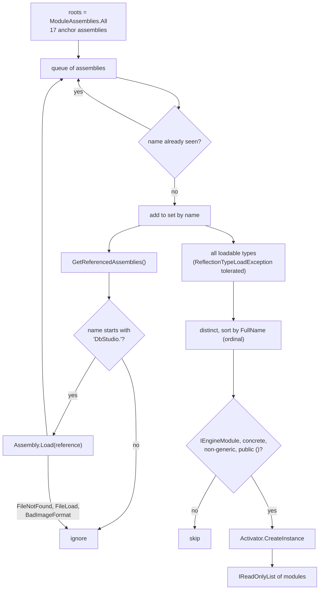
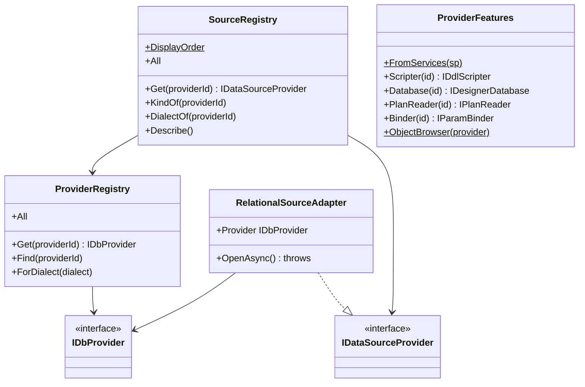

# 7. Engine modules, DI and keyed features

> **Level:** L3 senior | **Part:** II | **Code read at:** `08528ae` (Rowlit 1.6.3)
> [فارسی](../../fa/part2/07-engine-modules-and-di.md) · Previous: [6. The WebSocket event protocol](06-websocket-protocol.md) · Next: [8. Connections, sessions and executing SQL](08-connections-sessions-execution.md)
>
> **In one sentence:** every feature package of the engine has one composition-root class implementing
> `IEngineModule`; the Host finds all of them by reflection at start-up, lets each register its services (often as keyed
> singletons under a provider id or a stream kind) and map its routes, and the registries and `ProviderFeatures` look
> those services up by id when a request needs them.
>
> **You will learn:**
> - what a composition root is and why Rowlit has one per package;
> - exactly how `EngineModules.Discover` walks assemblies, and why `ModuleAssemblies.cs` lists "anchor" types;
> - how keyed services, registries and `ProviderFeatures` turn a provider id into the right implementation;
> - what each of the 17 modules registers;
> - the four ways a capability is attached to a provider, and when to use which;
> - the work-package ownership rules (`// WP-MY begin … end`) and why this is not a plugin system.
>
> **Prerequisites:** [5. The engine host](05-engine-host-and-api.md) (sections 2.6 and 2.10). Helpful: basic .NET
> dependency injection.

## 1. The idea (beginner)

Imagine building a kitchen from modules: a sink unit, an oven unit, a fridge unit. Each module arrives with its own
plumbing and wiring already inside; the installer only has to slot it in and connect it to the main pipes. Rowlit's
engine works the same way. The Redis support, the Kafka support, the MySQL provider, the linked-database feature: each
is a separate project, and each contains one small class that says "here are my services, and here are my web
routes". When the engine starts, it looks through its own building blocks, finds every such class, and asks each one to
plug itself in.

This keeps `Program.cs`, the engine's main file, from becoming a list of hundreds of lines that every team must edit.
A team adding ClickHouse support writes code only inside the ClickHouse project. The engine then needs a way to pick
"the ClickHouse version" of a feature when a ClickHouse connection asks for it, say an explain plan. For that the
services are registered with a *key*, the provider id `"clickhouse"`, and looked up by that key at the moment of use.

## 2. How it works (practitioner)

### 2.1 Composition roots and `IEngineModule`

A [composition root](../glossary.md#composition-root) is the one place where an application creates its objects and
connects implementations to the interfaces other code depends on. Classic advice is "one per application, as close to
the entry point as possible". Rowlit keeps that for the Host (`Program.cs`) and adds one composition root **per feature
package**, so a package's wiring lives next to its code. The contract is two methods
(`engine/src/DbStudio.Core/Providers/IDataSourceProvider.cs:45-55`):

```csharp
// engine/src/DbStudio.Core/Providers/IDataSourceProvider.cs:50-55
public interface IEngineModule
{
    void ConfigureServices(IServiceCollection services);

    void MapEndpoints(RouteGroupBuilder api);
}
```

`ConfigureServices` runs **before** `builder.Build()`, while the service collection can still be changed;
`MapEndpoints` runs **after**, on the `/api/v1` group (`engine/src/DbStudio.Host/Program.cs:154-155`, `:189`). A
[module](../glossary.md#module) in this chapter always means a class implementing this interface. Decision D4 of the M2
plan introduced it: modules are "discovered by reflection over the Host's referenced assemblies (no trimming is used).
Each package adds its own module class in its own project; `Program.cs` is edited once (M2-0)" (`docs/PLAN-M2.md:12`).

### 2.2 Discovery: the walk

`EngineModules.Discover(params Assembly[] roots)` (`engine/src/DbStudio.Core/Services/EngineModules.cs:21-53`) does
two things. Figure 7.1 shows them.

**Figure 7.1 — How `EngineModules.Discover` finds and orders the modules.**



1. **Collect assemblies.** A breadth-first walk starts at the roots and follows every referenced assembly whose name
   starts with `"DbStudio."` (`EngineModules.AssemblyPrefix`, `:15`, `:30-33`). Each assembly is visited once, keyed
   by its simple name, case-insensitively (`:23`, `:29`). A reference that cannot be loaded ("an optional reference that
   is not deployed") is skipped rather than failing start-up (`:38-41`). An [assembly](../glossary.md#assembly) is a
   compiled .NET library or executable (`DbStudio.Core.dll`); [reflection](../glossary.md#reflection) is the runtime API
   that inspects assemblies and their types.
2. **Instantiate modules.** All loadable types of all collected assemblies are taken (a `ReflectionTypeLoadException`
   yields the types that did load, `:55-65`), de-duplicated and **sorted by full type name with ordinal comparison**
   (`:46`). Every type that implements `IEngineModule`, is not abstract, not an interface, has no open generic
   parameters and has a public parameterless constructor is created with `Activator.CreateInstance` (`:48-50`).

The order is deterministic, which matters for registrations that depend on "who registered first". At `08528ae` the
sort gives:

| # | Module | Project |
|---|---|---|
| 1 | `DbStudio.Core.Diagrams.DiagramsModule` | Core |
| 2 | `DbStudio.Core.LocalHistory.LocalHistoryModule` | Core |
| 3 | `DbStudio.Core.Queries.QueriesModule` | Core |
| 4 | `DbStudio.Core.SchemaCompare.SchemaCompareModule` | Core |
| 5 | `DbStudio.Core.Search.SearchModule` | Core |
| 6 | `DbStudio.Federation.FederationModule` | Federation |
| 7 | `DbStudio.Host.Endpoints.DiagramEndpoints` | Host |
| 8 | `DbStudio.Import.ImportModule` | Import |
| 9 | `DbStudio.Logs.LogsModule` | Logs |
| 10 | `DbStudio.Providers.Cassandra.CassandraModule` | Cassandra |
| 11 | `DbStudio.Providers.ClickHouse.ClickHouseModule` | ClickHouse |
| 12 | `DbStudio.Providers.MySql.MySqlModule` | MySql |
| 13 | `DbStudio.Providers.Snowflake.SnowflakeModule` | Snowflake |
| 14 | `DbStudio.Sources.Elasticsearch.ElasticsearchModule` | Elasticsearch |
| 15 | `DbStudio.Sources.Kafka.KafkaModule` | Kafka |
| 16 | `DbStudio.Sources.Mongo.MongoModule` | Mongo |
| 17 | `DbStudio.Sources.Redis.RedisModule` | Redis |

The engine log prints the same list at start-up as "Engine modules: …" (`Program.cs:158`), which is the quickest way to
check that a new module was found.

### 2.3 Why anchors exist

If the Host already references every project (`engine/src/DbStudio.Host/DbStudio.Host.csproj:20-38`), why does
`ModuleAssemblies.cs` list one type per assembly?

```csharp
// engine/src/DbStudio.Host/ModuleAssemblies.cs:12-20
public static Assembly[] All { get; } =
[
    typeof(ModuleAssemblies).Assembly,
    typeof(Core.Services.EngineModules).Assembly,                 // Core (e.g. M2-ER DiagramsModule)
    typeof(Providers.PostgreSql.PostgreSqlProvider).Assembly,     // PG-A (Logs/ sources by M2-L)
    typeof(Sources.Redis.RedisModule).Assembly,                   // M2-R
    typeof(Sources.Mongo.MongoModule).Assembly,                   // M2-M
    // …
];
```

Because a `ProjectReference` is not the same as a reference in the compiled assembly. The C# compiler writes an
assembly reference into `DbStudio.Engine.dll`'s metadata only for assemblies whose types the Host's code actually
uses. A feature project that the Host never names in code (the Redis package is only reached through its module) would
be copied to the output folder but would **not** appear in `GetReferencedAssemblies()`, so the walk would never find it.
The file's own comment says so: "One anchor type per feature assembly keeps the compile-time reference (the compiler
drops references to assemblies whose types are never used)" (`ModuleAssemblies.cs:5-9`). An
[anchor type](../glossary.md#anchor-type) is that one `typeof(...)` per assembly.

Two consequences follow. A new module class in a project that is *already* anchored (Core's `DiagramsModule`,
`QueriesModule`, `SearchModule`…) needs no Host change at all (`EngineModules.cs:10-11`). A new *project* needs one
line in `ModuleAssemblies.cs` and one `ProjectReference` in the Host csproj, both of which are frozen files that only
the foundation work package edits (`docs/wp-notes/README.md:20-24`).

### 2.4 Keyed services

.NET 8 added [keyed DI](../glossary.md#keyed-service): a registration carries a key, and a consumer resolves
`GetKeyedService<T>(key)` (or `GetRequiredKeyedService`). Rowlit uses two kinds of keys:

- **provider ids** (`"sqlserver"`, `"mysql"`, `"clickhouse"`…) for per-provider features: `IDdlScripter`,
  `IDesignerDatabase`, `IPlanReader`, `IParamBinder`, `ILogSource`, `IActivitySource` and, in federation,
  `ISourceFetcher`;
- **stream kinds** (`"redis.monitor"`, `"kafka.tail"`, `"mongo.changes"`, `"es.tasks"`, `"db.search"`, the log tail
  and activity poll kinds) for `IStreamFactory`.

The built-in providers register their keyed features in `Program.cs:129-146`; module providers register theirs in
`ConfigureServices`, for example MySQL's loop over its two ids:

```csharp
// engine/src/DbStudio.Providers.MySql/MySqlModule.cs:28-40
services.AddSingleton<IDbProvider, MySqlProvider>();
services.AddSingleton<IDbProvider, MariaDbProvider>();
foreach (var id in ProviderIds)                       // ["mysql", "mariadb"]
{
    services.AddKeyedSingleton<IDdlScripter>(id, (_, _) => new MySqlDdlScripter(id));
    services.AddKeyedSingleton<IDesignerDatabase>(id, (_, _) => new MySqlDesignerDatabase(id));
    services.AddKeyedSingleton<IPlanReader>(id, (_, _) => new MySqlPlanReader(id));
    services.AddKeyedSingleton<IParamBinder>(id, MySqlParamBinder.Instance);
    services.AddKeyedSingleton(id, (sp, _) => new MySqlLogSource(sp.GetRequiredService<ISqlRunnerFactory>(), id));
    services.AddKeyedSingleton<ILogSource>(id, (sp, key) => sp.GetRequiredKeyedService<MySqlLogSource>(key));
    services.AddKeyedSingleton<IActivitySource>(id, (sp, key) => sp.GetRequiredKeyedService<MySqlLogSource>(key));
}
```

Two patterns are visible. One class can serve two keys with the id passed in (`new MySqlDdlScripter(id)`), so MariaDB
and MySQL share code but keep separate instances. And one object can be exposed under two interfaces by registering
the concrete keyed type once and forwarding (`ILogSource` and `IActivitySource` both resolve the same
`MySqlLogSource`).

### 2.5 Registries and `ProviderFeatures`

Three lookup objects turn an id into code, each an instance of the [registry pattern](../glossary.md#registry-pattern) (one object that maps keys to implementations so callers never construct them). Figure 7.2 shows them with the interfaces they hand out.

**Figure 7.2 — Registries and keyed features.**



- **`ProviderRegistry`** (`engine/src/DbStudio.Core/Services/ProviderRegistry.cs:7-25`) takes
  `IEnumerable<IDbProvider>`, i.e. every relational provider registered by `Program.cs` *and* by modules, into a
  case-insensitive dictionary. `Get` throws `400 VALIDATION` "Unknown provider" for an unknown id (`:19-20`). If two
  providers share an id the first wins silently (`TryAdd`, `:14`).
- **`SourceRegistry`** (`engine/src/DbStudio.Core/Services/SourceRegistry.cs:15-68`) is the M2 view of *every* provider
  (decision D1, `docs/PLAN-M2.md:9`): it wraps each relational provider in a `RelationalSourceAdapter` (`:27`, `:74-87`)
  and adds the `IDataSourceProvider`s of the source modules. "A relational provider id always wins; a module must not
  shadow it" (`:30-31`). `Describe()` produces `GET /providers` in the fixed `DisplayOrder` of 14 ids (`:18-19`,
  `:57-58`), unknown ids after them. The adapter's `OpenAsync` throws on purpose, because relational connections use
  tab sessions, not shared source clients (`:85-86`).
- **`ProviderFeatures`** (`engine/src/DbStudio.Core/Services/ProviderFeatures.cs:12-54`), built with
  `ProviderFeatures.FromServices(sp)` (`Program.cs:147`), resolves the four M1.5 keyed features **at call time**
  (`:32-38`). A missing feature becomes `400 NOT_SUPPORTED` "The provider 'x' does not support the table designer"
  (`:43-45`, `:52-53`); a missing binder is allowed (`Binder` returns null, `:46`). A second constructor takes plain
  lists for tests (`:19-30`).

Late lookup is what makes registration order irrelevant for these features: the WP0 notes say so explicitly,
"`ProviderRegistry`/`SourceRegistry` resolve `IEnumerable<IDbProvider>`/`IEnumerable<IDataSourceProvider>` after all
modules ran, `ProviderFeatures` and `LogService` look keyed services up at call time, so registration order does not
matter" (`docs/wp-notes/wp0.md:63-65`).

### 2.6 A tour of the 17 modules

| Module | `ConfigureServices` registers | `MapEndpoints` maps |
|---|---|---|
| `DiagramsModule` (Core) | `DiagramStore` (`Core/Diagrams/DiagramsModule.cs:14`) | nothing; the Host's `DiagramEndpoints` module owns the routes (`:8-10`) |
| `DiagramEndpoints` (Host) | nothing | `/connections/{cid}/er/layouts` list, upsert, delete (`Host/Endpoints/DiagramEndpoints.cs:20-37`) |
| `LocalHistoryModule` (Core) | `LocalHistoryService` | `/local-history` |
| `QueriesModule` (Core) | `SavedQueryStore` | `/connections/{cid}/queries` CRUD + duplicate (`Core/Queries/QueriesModule.cs:23-65`) |
| `SchemaCompareModule` (Core) | `SchemaCompareService` | `/schema-compare` |
| `SearchModule` (Core) | `DatabaseSearchService`, keyed `IStreamFactory` `"db.search"` (`Core/Search/SearchModule.cs:20-25`) | nothing: Find in database runs as a stream via `POST /streams` (`:11-14`) |
| `FederationModule` | `DuckDbEngineFactory`, `LinkRuntime`, `IDbProvider` `LinkedProvider`, keyed `IParamBinder` for `linked`, keyed `ISourceFetcher` per relational id, Mongo, Elasticsearch and files; `LinkedViewStore`, `MaterializeService` (`Federation/FederationModule.cs:21-41`) | `/links/engine` and the link routes (`:43-54`) |
| `ImportModule` | `ImportService` | `/connections/{cid}/import` |
| `LogsModule` | `EngineLogSource`, `ISqlRunnerFactory`, gateway seams for Redis/Mongo/Kafka (all `TryAdd`), log sources keyed for `sqlserver`, `oracle`, `postgresql`, `redis`, `mongodb`, `kafka`; `LogService`; stream factories for log tail and activity poll (`Logs/LogsModule.cs:25-55`) | `/logs/{cid}` (`:70`) |
| `CassandraModule` | `CqlClusterPool`, `CassandraProvider` (also as `IDbProvider`), keyed scripter and designer database, and a keyed **transient** `IPlanReader` whose factory throws `NOT_SUPPORTED` (`Providers.Cassandra/CassandraModule.cs:20-29`) | `/cassandra` |
| `ClickHouseModule` | one `ClickHouseProvider` instance shared as itself and as `IDbProvider`, keyed scripter, designer database, plan reader, binder, log/activity source, `ChAdminService` (`Providers.ClickHouse/ClickHouseModule.cs:25-38`) | `/clickhouse/{cid}` (parts, mutations, merges) |
| `MySqlModule` | `MySqlProvider` and `MariaDbProvider`, keyed features for both ids (`Providers.MySql/MySqlModule.cs:26-41`) | nothing: "everything MySQL-specific goes through the shared relational APIs" (`:19-20`, `:45`) |
| `SnowflakeModule` | `SnowflakeSecrets`, `ISnowflakeGatewayFactory`, `SnowflakeProvider` (also as `IDbProvider`), keyed features, log/activity source (`Providers.Snowflake/SnowflakeModule.cs:41-57`) | `/snowflake/{cid}` (warehouses, roles, objects) and `/snowflake/sessions/{sid}` (context, use) (`:26-35`) |
| `ElasticsearchModule` | `IDataSourceProvider` `EsProvider`, eight services, keyed stream `"es.tasks"` | `/es/{cid}` |
| `KafkaModule` | `IDataSourceProvider` `KafkaProvider`, seven services, keyed streams `"kafka.tail"`, `"kafka.fetch"` (`Sources.Kafka/KafkaModule.cs:16-34`) | `/kafka/{cid}` |
| `MongoModule` | `IDataSourceProvider` `MongoProvider`, ten services, keyed stream `"mongo.changes"` (`Sources.Mongo/MongoModule.cs:16-36`) | `/mongo/{cid}` |
| `RedisModule` | `IDataSourceProvider` `RedisProvider`, five services, keyed streams `"redis.monitor"`, `"redis.subscribe"` (`Sources.Redis/RedisModule.cs:17-27`) | `/redis/{cid}` |

The four M1/M2 relational providers (SQL Server, Oracle, SQLite, PostgreSQL) have no module of their own; they predate
D4 and are registered in `Program.cs:92-95`, `:129-146`. Their log sources live in the Logs project and are registered
by `LogsModule` (`LogsModule.cs:38-49`). SQLite has none: "its Logs tab shows the engine log only" (`:19-20`).

## 3. Deep dive (senior)

### 3.1 Four ways to attach a capability to a provider

`IDbProvider` is frozen: "Contract frozen by docs/PLAN.md section 2.2: change the plan before changing this file"
(`engine/src/DbStudio.Core/Providers/IDbProvider.cs:5-8`). Yet providers gained a designer, plans, parameters, logs,
object lists, search and tunnels after M1. The code shows four techniques, each with a reason.

1. **Additive [default interface members](../glossary.md#default-interface-member).** C# lets an interface member have a body. `IDbProvider.ClearPooledConnections`
   defaults to doing nothing (`IDbProvider.cs:38-44`); `IDbSession` has defaults for `SchemaMode`, `CurrentSchema`,
   `SearchPath`, `RefreshSchemaAsync`, `ChangeSchemaAsync`, `LostTransaction` and `FindUnboundParameter`
   (`IDbProvider.cs:70-119`), each marked "Additive". Use this for small behaviour every provider has in some form.
2. **Keyed services by provider id.** Larger features with their own classes and dependencies (designer, plans, binder,
   logs, fetchers) are separate interfaces registered under the id and looked up by `ProviderFeatures` or `LogService`.
   The provider class does not even know they exist. Use this when the feature has its own lifetime or dependencies, or
   when a provider may lack it.
3. **[Role interfaces](../glossary.md#role-interface) discovered by cast** (small interfaces a class implements to announce one capability). `IObjectBrowserProvider` and `IDatabaseSearchProvider` are implemented by
   the provider class itself, and callers test for them:
   `provider as IObjectBrowserProvider ?? throw NotSupported(...)` (`ProviderFeatures.cs:49-50`),
   `providers.Find(profile.ProviderId) as IDatabaseSearchProvider` (`engine/src/DbStudio.Core/Search/DatabaseSearchService.cs:57`).
   The WP0 notes prescribe this for Batch 3 providers "as PostgreSQL does" (`docs/wp-notes/wp0.md:65-66`). Use this
   when the capability needs the provider's private connection logic.
4. **Optional sink interfaces.** `IExecutionDiagnosticsSink` extends the execution sink for providers that produce
   server diagnostics during a run; providers call `AdoSessionBase.EmitDiagnosticsAsync` instead of testing for it
   themselves (`engine/src/DbStudio.Core/Services/ExecutionContracts.cs:5-14`).

This is [interface segregation](../glossary.md#solid) in practice: no provider is forced to implement a designer it
does not have, and the "cannot do" answer is uniform (`400 NOT_SUPPORTED`).

### 3.2 Tricks worth recognising

- **A keyed factory that throws.** Cassandra has no explain plan. Instead of leaving the key unregistered (which would
  give the generic "does not support explain plans"), it registers a keyed *transient* whose factory throws an
  `EngineException` with Cassandra's own message pointing to tracing (`CassandraModule.cs:15-16`, `:27-28`). The shared
  explain endpoint then returns that message unchanged; the transient lifetime states that nothing is meant to be
  cached.
- **Breaking a construction cycle with late lookup.** `ConnectionStore` depends on `SourceRegistry`, which depends on
  `ProviderRegistry`, which needs every `IDbProvider`, including `SnowflakeProvider`, which needs secrets from the
  `ConnectionStore`. Snowflake breaks the cycle with a lambda that resolves the store only when a secret is read:
  `new SnowflakeSecrets((id, key) => sp.GetService<ConnectionStore>()?.GetSecret(id, key))`, with the comment
  "ConnectionStore depends on the provider registry, which depends on us" (`SnowflakeModule.cs:43-44`).
- **Sharing one instance.** ClickHouse creates its provider with `new` during registration so the designer database can
  hold the same instance (`ClickHouseModule.cs:27-31`). Snowflake and Cassandra achieve the same by registering the
  concrete type and forwarding `IDbProvider` to it (`SnowflakeModule.cs:46-47`, `CassandraModule.cs:23-24`). Without the
  forward, `AddSingleton<IDbProvider, X>()` plus `AddSingleton<X>()` would create two instances.
- **`TryAdd` for seams.** `LogsModule` registers its gateways with `TryAddSingleton` so "an integrator may register
  adapters over the M2-R/M/K clients first" (`LogsModule.cs:19-21`, `:27-36`); `FederationModule` does the same for its
  engine factory and runtime (`FederationModule.cs:25-28`), which lets tests pre-register a fake. Because modules run
  in type-name order and `Program.cs` runs before all of them, "first" is predictable. `AddSingleton` on the other hand
  *appends*; for a non-keyed single-service resolve, the **last** registration wins, while `IEnumerable<T>` sees all.
- **Static `AddServices` for tests.** Mongo and Kafka split "everything but the provider" into a public static method
  so tests can register a provider over a fake gateway and reuse the rest (`MongoModule.cs:22-36`,
  `KafkaModule.cs:22-34`).

### 3.3 Reflection cost, trimming and single-file

Discovery runs once at start-up. It loads the 17 `DbStudio.*` assemblies (all of which the engine needs anyway) and enumerates their types once; there is no reflection per request. The design depends on two build choices:

- **No [trimming](../glossary.md#trimming).** The IL trimmer removes code it cannot prove is used; types created only through
  `Activator.CreateInstance` would be removed. The engine is not trimmed ("the engine is not trimmed, so reflection is
  safe", `EngineModules.cs:8-9`; no `PublishTrimmed` in any project or build script).
- **Single-file publish works.** `scripts/build.ps1` publishes a self-contained single file (`-p:PublishSingleFile=true`,
  `scripts/build.ps1:74-77`). Assemblies bundled in a single file still load by name through `Assembly.Load`, and
  `GetReferencedAssemblies` reads metadata, not files, so the walk behaves the same. The CI native smoke test exercises
  exactly this published binary (chapter [5](05-engine-host-and-api.md#5-how-it-is-tested)).

`ReflectionTypeLoadException` is tolerated (`EngineModules.cs:61-64`) because a type that references a missing
optional dependency would otherwise make the whole assembly's `GetTypes()` throw.

### 3.4 Why this is not a plugin system

A [plugin system](../glossary.md#plugin-system) loads code that was not known at build time: a folder of DLLs scanned at run time, isolation through
`AssemblyLoadContext`, versioned plugin contracts. Rowlit has none of that. Every module assembly is referenced by the
Host project, compiled and published together, and found only by following references from compiled-in anchors. There
is no plugin folder, no load context and no contract versioning; `IDbProvider` is frozen by the plan, not by a version
number. What reflection buys is **decoupled authorship**, not run-time extensibility: a work package can add a module
without editing `Program.cs`. The M1 plan already said "No plugin loading in M1" (`docs/PLAN.md:88`), and nothing since
added it.

### 3.5 Work packages and ownership blocks

Batch 3 (MySQL/MariaDB, ClickHouse, Snowflake, Elasticsearch, Cassandra) and the linked-databases work were built by
parallel [work packages](../glossary.md#work-package) (WPs: units of work given to one team or agent, each with its own files). The ownership rules are in `docs/wp-notes/README.md`:

- **R1**: a WP creates files only under its own paths and edits shared files only inside [ownership blocks](../glossary.md#ownership-block) labelled for it,
  `// WP-MY begin … // WP-MY end`, "never touch a line outside your block, not even whitespace" (`:9-19`).
- **R2**: a list of frozen files, including `Program.cs`, `Host.csproj`, `ModuleAssemblies.cs` and Core outside the
  labelled blocks (`:20-24`).
- **R3**: a change needed elsewhere is written as a request with a proposed diff in the WP's notes, with a local [stub](../glossary.md#stub) (placeholder code that stands in until the real change lands)
  marked `TODO(WP<XX>-shared)` (`:30-53`).
- **R4**: the test and bundle-size gates before hand-in (`:25-28`).

The blocks are still in the code. At `08528ae` there are 17–18 blocks each for `WP-MY`, `WP-CH`, `WP-SF` and `WP-CS`
across 9–10 files, and blocks for the link packages (`LINKS-WP0`, `LINKS-WPA`, `LINKS-WPB`, `LINKS-WPD`); for example
the per-dialect classification hooks in `engine/src/DbStudio.Core/Sql/StatementClassifier.cs:258` and the two labelled
halves of `FederationModule.ConfigureServices` (`FederationModule.cs:23-40`). The module mechanism is what makes R1
practical: a provider package's composition root is its own file, so most of its wiring never touches a shared file.

## 4. Edge cases and limits

- **A module class without a public parameterless constructor is silently skipped** (`EngineModules.cs:49`). If your new
  module needs dependencies, take them from the `IServiceProvider` inside factory lambdas, as the existing modules do.
- **A forgotten anchor means a silently missing feature.** If a new project is not in `ModuleAssemblies.All` and nothing
  else references it in code, its module is never found; the only symptom is a shorter "Engine modules:" log line.
- **Duplicate provider ids.** `ProviderRegistry` keeps the first; `SourceRegistry` lets a relational id win over a
  source id and writes a debug line (`SourceRegistry.cs:30-31`). There is no start-up error.
- **Order-sensitive registrations.** Keyed lookups and `IEnumerable` are order-insensitive; a plain
  `GetRequiredService<T>()` for a type registered twice returns the last registration. Use `TryAdd` when a module
  provides a default that others may replace.
- **Modules cannot run code after `Build()` except mapping routes.** There is no "OnStarted" hook in `IEngineModule`; a
  module that needs a background loop registers a hosted service or a timer inside one of its singletons.
- **Endpoint ownership is not enforced.** Two modules could map the same route; ASP.NET would report an ambiguous match
  at request time, not at start-up.

## 5. How it is tested

- **Module discovery per package.** Most feature test projects discover their own module and assert what it registers,
  for example `engine/tests/DbStudio.Sources.Redis.Tests/RedisModuleTests.cs`,
  `engine/tests/DbStudio.Sources.Kafka.Tests/KafkaModuleTests.cs`, `engine/tests/DbStudio.Sources.Mongo.Tests/MongoModuleTests.cs`,
  `engine/tests/DbStudio.Logs.Tests/LogsModuleTests.cs`, and the `SmokeTests.cs` of the ClickHouse, Snowflake, Cassandra
  and Elasticsearch projects (each calls `EngineModules.Discover(typeof(XModule).Assembly)`).
- **Wiring a service container the way the Host does.** `LogServiceTests` runs every discovered module's
  `ConfigureServices` into a fresh collection (`engine/tests/DbStudio.Logs.Tests/LogServiceTests.cs`);
  `CassandraIntegrationTests` resolves `ProviderFeatures.FromServices(sp)` against such a container.
- **Registries with hand-built providers.** `engine/tests/DbStudio.Core.Tests/M2/SourceFrameworkTests.cs` builds a
  `SourceRegistry` from a `ProviderRegistry` and a fake Redis provider; the `ProviderFeatures` list constructor serves
  designer and schema-compare tests (`engine/tests/DbStudio.Core.Tests/M15/M15ServiceTests.cs`,
  `engine/tests/DbStudio.SchemaCompare.Tests/CompareEnv.cs`).
- **The published binary.** CI's native smoke checks that `/providers` lists the M2 and Batch 3 providers from the real
  published engine (`scripts/ci/kafka-native-smoke.mjs:6`), which fails if a module was not discovered in the
  single-file build.

## Related chapters

- [3. Big-picture architecture](03-big-picture-architecture.md) — the layers the modules sit in.
- [5. The engine host](05-engine-host-and-api.md) — where `Discover` is called and what `Program.cs` registers itself.
- [9. Relational providers](09-relational-providers.md) — what each provider's keyed features do.
- [16. Linked databases](16-linked-databases-federation.md) — the federation module in depth.
- [17. Sources I](17-sources-redis-mongo.md) and [18. Sources II](18-sources-kafka-elasticsearch.md) — the source modules.
- [21. Logs, activity and resources](21-logs-activity-resources.md) — `LogsModule`, log sources.
- [24. Build, CI, release and contributing](24-build-ci-release-contributing.md) — how to add a provider.

## Glossary terms introduced here

[composition root](../glossary.md#composition-root) · [module](../glossary.md#module) · [engine module](../glossary.md#engine-module) ·
[assembly](../glossary.md#assembly) · [reflection](../glossary.md#reflection) · [anchor type](../glossary.md#anchor-type) ·
[keyed service](../glossary.md#keyed-service) · [registry pattern](../glossary.md#registry-pattern) ·
[provider registry](../glossary.md#provider-registry) · [source registry](../glossary.md#source-registry) ·
[provider features](../glossary.md#provider-features) · [role interface](../glossary.md#role-interface) ·
[default interface member](../glossary.md#default-interface-member) · [trimming](../glossary.md#trimming) ·
[plugin system](../glossary.md#plugin-system) · [work package (WP)](../glossary.md#work-package) ·
[ownership block](../glossary.md#ownership-block) · [R1–R4 rules](../glossary.md#r1-r4-rules) · [stub](../glossary.md#stub)

## Files

| Path | Responsibility |
|---|---|
| `engine/src/DbStudio.Core/Providers/IDataSourceProvider.cs` | `IEngineModule`, `IDataSourceProvider`, `IDataSourceClient` |
| `engine/src/DbStudio.Core/Services/EngineModules.cs` | The discovery walk |
| `engine/src/DbStudio.Host/ModuleAssemblies.cs` | Anchor types, one per module assembly |
| `engine/src/DbStudio.Core/Services/ProviderRegistry.cs` | Relational providers by id and dialect |
| `engine/src/DbStudio.Core/Services/SourceRegistry.cs` | Every provider, display order, `RelationalSourceAdapter` |
| `engine/src/DbStudio.Core/Services/ProviderFeatures.cs` | Keyed designer / plan / binder lookup, `NOT_SUPPORTED` |
| `engine/src/*/…Module.cs` | The 17 composition roots |
| `docs/PLAN-M2.md` (D1, D4) | Decisions behind two provider families and modules |
| `docs/wp-notes/README.md`, `docs/wp-notes/wp0.md` | Ownership rules R1–R4, what each WP found |
