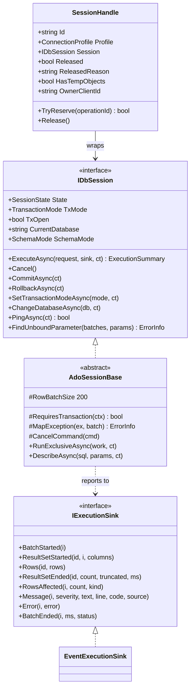
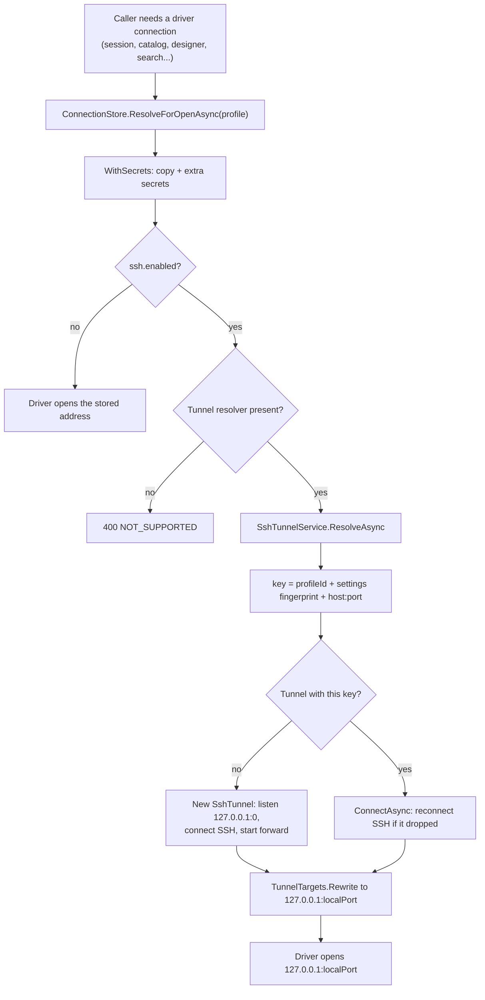
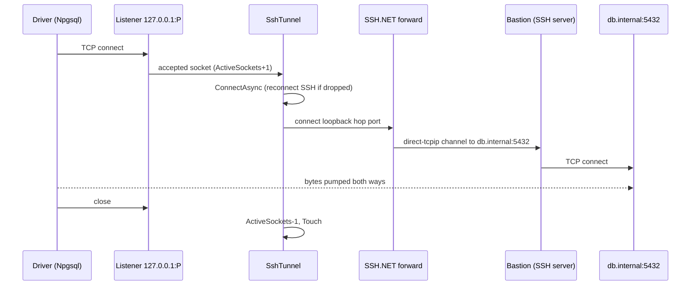
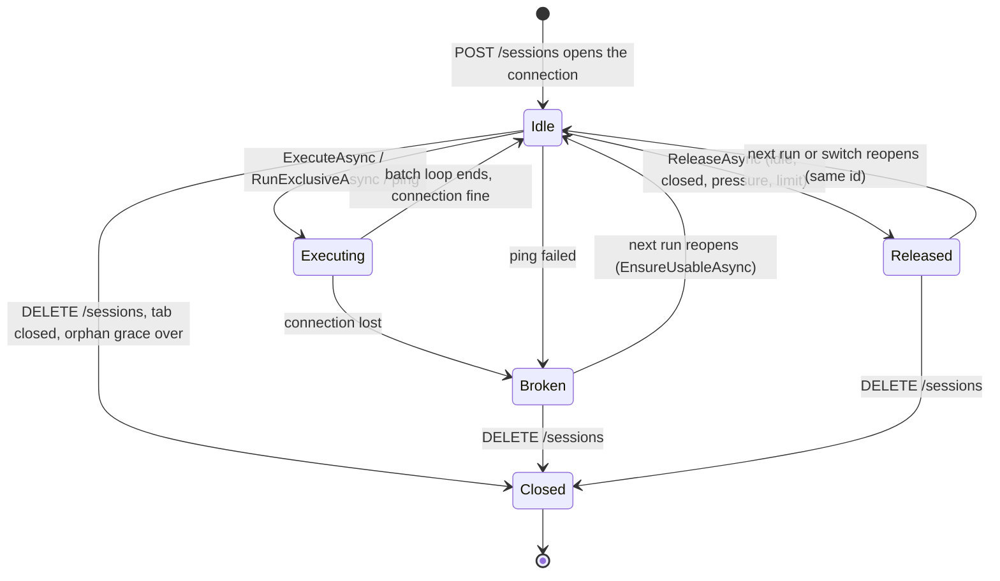
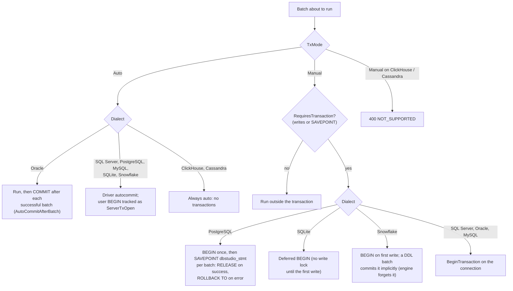
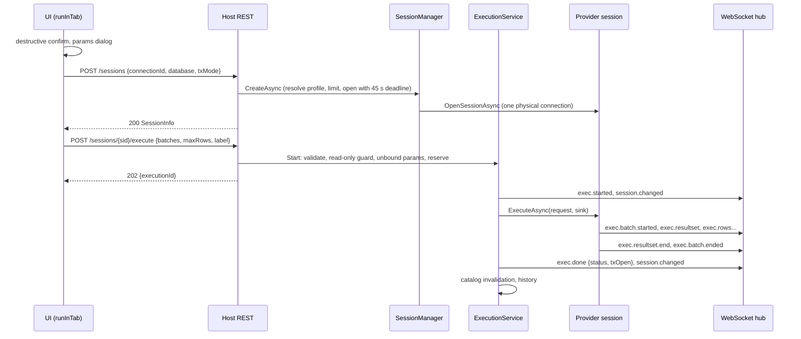
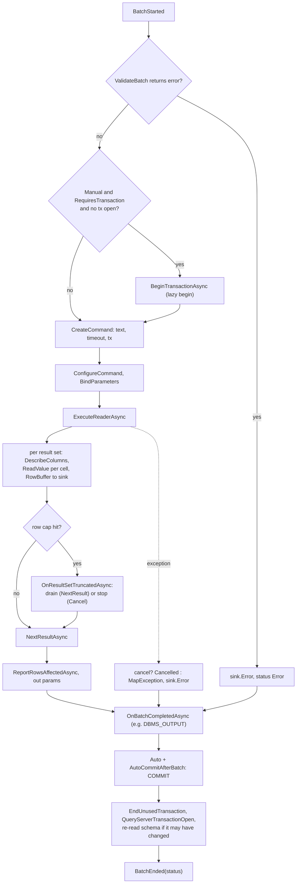
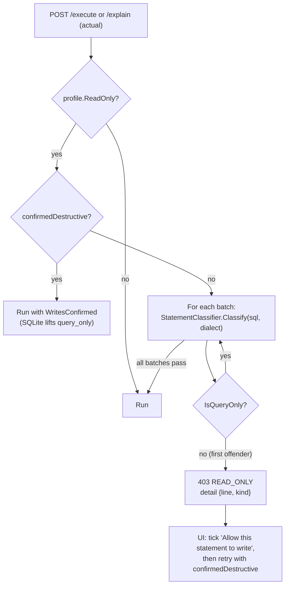

# 8. Connections, sessions and executing SQL

> **Level:** L2 practitioner → L3 senior | **Part:** II | **Code read at:** `08528ae` (Rowlit 1.6.3; SSH tunnels from the 1.7.0 work on main)
> [فارسی](../../fa/part2/08-connections-sessions-execution.md) · Previous: [7. Engine modules, DI and keyed features](07-engine-modules-and-di.md) · Next: [9. Relational providers one by one](09-relational-providers.md)
>
> **In one sentence:** a saved connection profile becomes, through the connection store and (optionally) an SSH tunnel, one dedicated database connection per editor tab, and every Ctrl+Enter travels through a read-only guard, a busy check and a shared execution loop that streams rows back as events.
>
> **You will learn:**
> - what a connection profile is, how the generic connection dialog is driven by a form spec, and where secrets go;
> - how an SSH tunnel is opened, shared, verified and torn down, and which providers can use one;
> - what a session is in Rowlit, why it owns one physical connection with pooling off, and how it is released, broken and reopened;
> - how transactions behave in each dialect, and how the engine knows a transaction is open;
> - the execution pipeline from `POST /execute` to `exec.done`, including row batching, the row cap, cancel and errors;
> - the read-only guard, the statement classifier, history, multi-run, query parameters and describe.
>
> **Prerequisites:** [3. Big-picture architecture](03-big-picture-architecture.md), [5. The engine host](05-engine-host-and-api.md), [6. The WebSocket protocol](06-websocket-protocol.md); for theory, [I-09 Transactions and isolation](../part1/09-transactions-and-isolation.md).

---

## 1. The idea (beginner)

When you use a database client, three things happen before you see a single row. First the client needs to know *where* the server is and *how* to log in: that is a saved **[connection profile](../glossary.md#connection-profile)** (a named record with the server address, user, options and a reference to the password). Second, the client opens a **[connection](../glossary.md#connection)** (a live network conversation with the server that has its own state: current database, open transaction, session settings). Third, it sends your SQL over that connection and reads back what the server answers: result rows, "3 rows affected", warnings, errors.

Rowlit splits those jobs between the UI and the engine. The UI never talks to the database itself. It asks the engine to create a **[session](../glossary.md#session)** (Rowlit's word for "one editor tab's private connection to the server"), then sends `POST /sessions/{id}/execute` with the statements to run. The engine runs them on that tab's connection and pushes the results back as small WebSocket events, so the grid fills while the query is still running. If the connection is marked **[read-only](../glossary.md#read-only-connection)**, the engine refuses anything that would change data unless you explicitly confirm it. If the server sits behind a gateway machine, the engine can reach it through an **[SSH tunnel](../glossary.md#ssh-tunnel)** (an encrypted pipe through an SSH server that forwards a local port to the database).

---

## 2. How it works (practitioner)

### 2.1 Connection profiles, form specs and the connection store

**The profile.** `ConnectionProfile` (`engine/src/DbStudio.Core/Models/CoreModels.cs:37-80`) holds an `Id`, `Name`, `ProviderId` (one of the fourteen ids listed at `CoreModels.cs:41`: `sqlserver`, `oracle`, `sqlite`, `postgresql`, `mysql`, `mariadb`, `clickhouse`, `snowflake`, `cassandra`, `redis`, `mongodb`, `kafka`, `elasticsearch`, `linked`), a `Color`, a `Folder`, the `ReadOnly` flag, `SavePassword`, timestamps and a free bag `Props` keyed by form-field keys (`CoreModels.cs:52`). The comment above `Props` (`CoreModels.cs:46-51`) documents the SSH keys every tunnel-capable provider shares. Typed readers `GetString`, `GetBool`, `GetInt` and `GetList` (`CoreModels.cs:58-79`) tolerate both JSON types and strings, because a value may come from the UI as `"true"` or `true`.

**The form spec.** No provider has a hand-written connection dialog. Each relational provider exposes `IDbProvider.FormSpec` (`engine/src/DbStudio.Core/Providers/IDbProvider.cs:17`), a **[form spec](../glossary.md#form-spec)** (a list of field descriptions the UI renders generically). A `FormField` (`CoreModels.cs:89-101`) has a `Key`, `Label`, a `Type` (`text | password | number | bool | select | file | list | note`, `CoreModels.cs:85`), `Required`, `Placeholder`, `Default`, `Options`, `VisibleWhen` (show the field only when other fields have given values, for example `{ "auth": "sql" }`), `FileFilter`, `Help` and, new with SSH, `Section` (fields with a section render in their own collapsible block). The UI dialog `ui/src/components/ConnectionDialog/ConnectionDialog.tsx` groups visible fields by section (`ConnectionDialog.tsx:45-55`) and renders the main block first, then each section collapsed unless in use (`ConnectionDialog.tsx:151-154`, `:367-381`).

**The store.** `ConnectionStore` (`engine/src/DbStudio.Core/Services/ConnectionStore.cs:19`) keeps the profiles in `connections.json` in the data folder. Its rules:

- **Secrets never reach the file.** Every prop whose form field has type `password` is stripped before saving (`StripSecrets`, `ConnectionStore.cs:331-335`, called from `Clone`, `:315-329`). The main secret travels as `password` and is stored in the **[secret store](../glossary.md#secret-store)** under the profile id (`Create`, `:166`). Other password-typed fields (Kafka `saslPassword`, the SSH `sshPassword` and `sshPassphrase`) go to the secret store under `<profileId>#<fieldKey>` (`SecretKey`, `:47`). For those extra secrets a non-empty prop replaces the stored value, a JSON `null` clears it and an empty or missing prop keeps it (`ExtraSecrets`, `:278-294`).
- **Presenting a profile** sets `HasPassword` from the secret store and never returns a secret (`Present`, `:249-257`).
- **Validation** checks the name, the provider, every visible required non-password field, and the SSH settings (`Validate`, `:233-244`; `VisibleFor`, `:246-247`; `ValidateTunnel`, `:145-150`). A tunnel the provider cannot carry is rejected at save time, with the reason.
- **Writes are atomic** (`AtomicFile.WriteAllText`, `:356-360`); a corrupt file is copied to `connections.json.corrupt` and the store starts empty instead of crashing (`:347-351`).
- **Update semantics for the main password** (`Update`, `:171-205`): `null` keeps it, `""` clears it, any other value replaces it; if `SavePassword` changed, the secret moves between disk and memory.

**From stored profile to driver profile.** Two methods turn a stored profile into what a driver may open:

- `WithSecrets(profile)` (`:74-97`) returns a runtime copy with the extra password-typed props filled back in from the secret store. Values already present in the copy win (a passphrase typed in the test dialog).
- `ResolveForOpenAsync(profile)` (`:115-121`) is `WithSecrets` plus, when `ssh.enabled` is set, a call to the tunnel resolver that rewrites the server address to the local end of the tunnel. A synchronous `ResolveForOpen` (`:127-131`) blocks on the SSH handshake for synchronous call sites, and `CurrentForOpen` (`:137-142`) returns the rewritten profile only if its tunnel is already open (used when clearing pools and by diagnostics that must never open a tunnel while you type, `engine/src/DbStudio.Host/Endpoints/HistoryAndSqlEndpoints.cs:80-81`).

"Every code path that opens a driver connection goes through this" (`ConnectionStore.cs:112`) is enforced by a test, `engine/tests/DbStudio.Core.Tests/Tunnels/ConnectionOpenCallSitesTests.cs`, which scans the whole engine source for files that call `WithSecrets(` or `GetPassword(` without `ResolveForOpen`/`CurrentForOpen` and fails unless the file is on a short allow-list with a reason. The call sites today include the session manager, the catalog service, the designer, search, import, logs, linked databases, materialize and the ClickHouse and Cassandra endpoint groups (grep `// WP-SSH` under `engine/src`).

**Testing a connection.** `POST /connections/test` (`engine/src/DbStudio.Host/Endpoints/ConnectionEndpoints.cs:52-80`) dispatches through the `SourceRegistry`, so relational and non-relational profiles test the same way. For a saved profile it restores the extra secrets and, if asked, the stored password (`:58-64`). It gives the test a deadline of `connectTimeout + 15` seconds clamped to 5–300 (`:66`), or at least 135 s for Snowflake browser single sign-on (`:68`). With SSH enabled it hands over to `TunnelConnectionTest` (`:71`, section 2.2).

**Editing and deleting.** `PUT /connections/{id}` updates the profile, forgets the cached catalog and closes the non-relational source client; open sessions keep their connection until closed (`ConnectionEndpoints.cs:23-30`). `DELETE /connections/{id}` refuses with `409 TX_OPEN` while one of its sessions has an open transaction unless `force=true` (`SessionManager.EnsureNoOpenTransactions`, `engine/src/DbStudio.Core/Services/SessionManager.cs:331-340`), then closes sessions, streams, source clients, the SSH tunnels, the catalog, saved filters, diagrams and saved queries of that connection (`ConnectionEndpoints.cs:33-49`).

**Figure 8.1 — The session contract: what a provider implements and what the engine adds.**

The contract itself is in `IDbProvider.cs:47-133`; `AdoSessionBase` is in `engine/src/DbStudio.Core/Services/AdoSessionBase.cs:102`; `SessionHandle` and `SessionManager` are in `SessionManager.cs:31-148` and `:154`; `EventExecutionSink` is at the end of `ExecutionService.cs:235-309`.

### 2.2 SSH tunnels

**What an SSH tunnel is.** Many production databases are not reachable from a laptop. They live on a private network, and the only door is one hardened machine, a **[jump host or bastion](../glossary.md#jump-host)** (a server whose job is to accept SSH logins from outside and let them reach the inside). SSH can do **[local port forwarding](../glossary.md#local-port-forwarding)**: the client listens on a local port, and every byte written there is carried through the encrypted SSH connection; the SSH server then opens a TCP connection to the real database (`direct-tcpip` channel) and relays the bytes. The database driver thinks it is talking to `127.0.0.1:<port>`; in reality it is talking to `db.internal:5432` through the bastion. This is what `ssh -L 15432:db.internal:5432 user@bastion` does on the command line, and what Rowlit does in-process with the managed SSH.NET library (`engine/src/DbStudio.Core/DbStudio.Core.csproj:12-13`).

**The form block.** A provider adds the SSH block with one line, `SshFormFields.Append(spec, help)` (`engine/src/DbStudio.Core/Services/Tunnels/SshFormFields.cs:48`); for example PostgreSQL at `engine/src/DbStudio.Providers.PostgreSql/PostgreSqlProvider.cs:34`. The fields (`SshFormFields.cs:30-45`), all in section `ssh`:

| Key | Label | Type | Notes |
|---|---|---|---|
| `ssh.enabled` | Use SSH tunnel | bool | default false; the provider's help text sits under the switch |
| `ssh.host` | SSH host | text | required when enabled |
| `ssh.port` | SSH port | number | default 22 (`DefaultPort`, `:21`) |
| `ssh.user` | SSH user | text | required |
| `ssh.auth` | SSH authentication | select | `password` (default) or `key` |
| `sshPassword` | SSH password | password | only for `password`; goes to the secret store |
| `ssh.keyPath` | Private key file | file | only for `key`; OpenSSH (ed25519, ECDSA, RSA) or PEM; PuTTY `.ppk` not supported |
| `sshPassphrase` | Key passphrase | password | only for `key`; empty when the key is not encrypted |
| `ssh.keepAlive` | Send keep-alives | bool | default true; every 30 s |

Because `sshPassword` and `sshPassphrase` are password-typed, the connection store strips them from `connections.json` and keeps them as extra secrets, exactly like any other password field (`SshFormFields.cs:9-10`). A provider that cannot be tunnelled shows a read-only `note` field instead of the block (`WithUnsupportedNote`, `SshFormFields.cs:54-55`; Kafka at `engine/src/DbStudio.Sources.Kafka/KafkaProvider.cs:27`).

**Reading the settings.** `SshSettings.From(profile)` (`engine/src/DbStudio.Core/Services/Tunnels/SshSettings.cs:39-68`) validates and normalises: host and user are required, the port must be 1–65535, auth must be `password` or `key`, a key path loses surrounding quotes (Windows "Copy as path" adds them) and a leading `~` expands to the user profile folder (`:54-56`). The connect timeout is the profile's `connectTimeout`, default 15 s, clamped to 1–120 (`:67`). `Label` is `user@host` or `user@host:port` and is what the UI shows as "via …" (`:23`). `Fingerprint` is a 16-hex-digit SHA-256 prefix over every SSH setting **including the secrets** (`:29-36`): a tunnel is reused only while the settings it was opened with still hold.

**Where the database is, per provider.** `TunnelTargets.Target(profile)` (`engine/src/DbStudio.Core/Services/Tunnels/TunnelTargets.cs:30-47`) reads the database address from each provider's own form keys, and `Rewrite(profile, host, port)` (`:50-88`) returns a copy pointed at `127.0.0.1:<local port>` (`LocalHost`, `:25`). Pure functions over the form keys mean each provider keeps building its connection string as before. A configuration that one forwarded port cannot carry throws `400 NOT_SUPPORTED` with `detail.field = "ssh.enabled"` and `detail.hop = "ssh"` (`Unsupported`, `:27-28`).

| Provider | Target read from | Rewrite | Refused (reason in the error) |
|---|---|---|---|
| PostgreSQL, MySQL, MariaDB | `host`, `port` (5432 / 3306) | `host`, `port` | several hosts (`a,b`), a Unix socket path (`:108-115`) |
| SQL Server | `server` (`host`, `host,port`, `tcp:host`) | `server = "127.0.0.1,<port>"` | other protocols (`np:`), a named instance without a port (the SQL Server Browser on UDP 1434 cannot be forwarded), LocalDB (`:124-152`) |
| Oracle | `host`, `port` (1521), Basic type only | `host`, `port` | TNS alias or connect descriptor (`:154-160`) |
| ClickHouse | `host` (may be a URL), `port`, `protocol` | `host`, `port`, **pins `protocol`** because it is otherwise inferred from the port (8443 = https) (`:67-72`, `:162-177`) | — |
| Cassandra | one contact point, `port` (9042) | `contactPoints`, `port`, removes `host` | several contact points, an Astra secure bundle (`:179-190`) |
| Redis | `host`, `port` (6379), standalone | `host`, `port` | Cluster and Sentinel (they hand out node addresses) (`:192-200`) |
| MongoDB | a `mongodb://` URI with one host | rewrites the URI and forces `directConnection=true`, dropping `replicaSet=` (`:203-214`) | `mongodb+srv://`, several hosts (`:216-240`) |
| Elasticsearch | one node URL | rewrites the URL (`:242-258`) | several URLs |
| Kafka | — | — | always: brokers advertise their own addresses (`:44`) |
| SQLite, Snowflake, linked, others | — | — | not in `Supported` (`:19-22`): SQLite is a local file, Snowflake an HTTPS cloud service (`ConnectionOpenCallSitesTests.cs` notes it) |

**Figure 8.2 — From a saved profile to the profile a driver opens.**

**The tunnel service.** `SshTunnelService` (`engine/src/DbStudio.Core/Services/Tunnels/SshTunnelService.cs:25`) is a singleton registered in the host (`engine/src/DbStudio.Host/Program.cs:99-104`), with its known-hosts file, as the single `ITunnelResolver` (`engine/src/DbStudio.Core/Services/Tunnels/ITunnelResolver.cs:10-27`), and plugged into the connection store with `UseTunnels`. Its model (`SshTunnelService.cs:12-24`):

- **One tunnel per (connection, SSH settings, database endpoint).** The key is `profileId|fingerprint|host:port` (`:166`). `ResolveAsync` (`:54-97`) looks the key up; if it is missing it takes a gate, creates a new `SshTunnel`, connects it and stores it; if it exists it calls `ConnectAsync` again so that a dropped SSH session reconnects now and the caller gets the SSH error instead of a confusing driver timeout (`:92-93`).
- **A fixed local port.** The `SshTunnel` constructor binds a listener on `127.0.0.1` port 0 (the OS picks a free port) with a backlog of 128 and starts an accept loop (`:202-207`). The port never changes for the tunnel's life, so driver pools and long-lived clients (Redis, MongoDB) keep a valid address even when the SSH session drops: the next accepted socket simply reconnects it (`:17-18`, `ServeAsync` at `:296-329` calls `ConnectAsync` first).
- **Two hops inside the process.** SSH.NET's `ForwardedPortLocal` listens on its own loopback port (`:241`); each socket accepted on Rowlit's listener connects to that port and the two sockets are pumped in both directions with an 80 KB buffer (`PumpAsync`/`CopyAsync`, `:331-351`). The extra listener exists so that Rowlit controls the stable port and counts sockets. A copy that ends normally half-closes the other side; an error closes both (`:338-351`).
- **Sharing.** Every driver connection of the profile uses the same tunnel: the tab sessions, the pooled catalog connections, the designer's connections, source clients. The tunnel counts active sockets (`ActiveSockets`, `:215`).
- **Closing.** A sweeper runs every 30 s (`:45-46`). It closes a tunnel that has had no socket for `IdleTimeout` (default 10 minutes, `DefaultIdleTimeout`, `:27`) and a **superseded** tunnel (the profile now has a newer one because its settings were edited) as soon as its sockets are gone (`SweepAsync`, `:141-155`). The comment notes how this cooperates with resource policies: when the [resource manager](../glossary.md#resource-manager) clears idle pools, their sockets close and the tunnel follows (`:19-21`). Deleting a connection closes its tunnels at once (`CloseAsync`, `:131-138`; `ConnectionEndpoints.cs:43`).
- **Keep-alive.** With `ssh.keepAlive` the SSH client sends a keep-alive every 30 s (`KeepAliveInterval`, `:28`, applied at `:383`) so idle firewalls and NAT gateways do not drop the tunnel.

**Authentication.** `SshConnector.ConnectAsync` (`:379-410`) builds an SSH.NET `ConnectionInfo` with the timeout and the methods from `AuthMethods` (`:412-443`):

- **Password:** both `password` and `keyboard-interactive` methods are offered, and every keyboard-interactive prompt is answered with the password (`:436-442`), because many servers only allow the second form.
- **Private key:** the file must exist; an encrypted key without a passphrase gives "enter its passphrase" with `detail.field = sshPassphrase`; a PuTTY `.ppk` file is recognised by its first line and the error explains how to export it as OpenSSH with PuTTYgen; any other read failure says "wrong passphrase, or a format other than OpenSSH/PEM" (`:414-434`).

**Host keys: trust on first use.** An SSH server proves its identity with a host key. `SshKnownHosts` (`engine/src/DbStudio.Core/Services/Tunnels/SshKnownHosts.cs`) implements **[trust on first use](../glossary.md#trust-on-first-use)** in `ssh-known-hosts.json` in the data folder (`:20`): the first connection to `[host]:port` (`Key`, `:28`) remembers the key algorithm and its SHA-256 **[host key fingerprint](../glossary.md#host-key-fingerprint)**; a later connection that presents a different key is refused (`Check`, `:31-48`). The SSH.NET `HostKeyReceived` handler sets `CanTrust = false` only for `Changed` (`SshTunnelService.cs:386-392`), and the error names both fingerprints, warns that this "can mean someone is intercepting the connection" and tells you which file to edit if the server was reinstalled (`:404-407`). `Forget` removes an entry (`SshKnownHosts.cs:55-63`); as far as the code read shows, no REST endpoint calls it yet, so removing an entry means editing the JSON file, which is what the error message says.

**Errors.** Every SSH-hop failure becomes `503 SSH_TUNNEL` with `detail = { hop: "ssh", reason, via, field }` (`SshConnector.Error`, `:455-456`; code in `ErrorCodes.SshTunnel`, `engine/src/DbStudio.Core/Services/ExecutionContracts.cs:59-60`). `Map` (`:445-453`) gives the reasons: `auth` (authentication failed), `unreachable` (socket error), `timeout` (no answer within the connect timeout; the overall wait is the timeout plus 5 s, `:394`), `hostKey`, `key`, and the generic `ssh`. When the SSH server itself cannot reach the database, SSH.NET reports it on the forward; the tunnel keeps it as `LastForwardError` (`:219-220`, `:242`, `:314`) and the driver only sees its socket close.

**Test connection through a tunnel.** `TunnelConnectionTest.RunAsync` (`engine/src/DbStudio.Core/Services/Tunnels/TunnelConnectionTest.cs:14-49`) opens a **private, ephemeral** tunnel (`OpenEphemeralAsync`, `SshTunnelService.cs:113-129`: not stored, closed with the lease), runs the provider's `TestAsync` against the rewritten profile, and labels the result with `Hop` and `Via` (`CoreModels.cs:107-109`): an `EngineException` before the database is reached is `hop: "ssh"`; a failed database test is `hop: "db"`, and if the SSH server reported a forward error the detail becomes "The SSH server user@bastion could not reach db:5432: …" (`TunnelConnectionTest.cs:36-38`). The dialog shows "SSH connection failed (via …)" or "Connection failed behind the SSH tunnel (via …)" and, on success, "Connected in N ms via SSH user@bastion" (`ConnectionDialog.tsx:449-471`). Because the test tunnel is private, testing never disturbs the shared tunnel that open tabs are using.

**Figure 8.3 — One driver connection through the tunnel.**

**Security notes.** The tunnel endpoint listens on loopback only (`SshTunnelService.cs:203`), like the engine itself; other machines cannot use it. Anything running as the same user on the same machine could connect to that port while the tunnel is open, exactly as with `ssh -L`; the database login still applies. SSH passwords and passphrases are encrypted by the secret store and never written to `connections.json`. Host-key pinning protects against a changed key, but the very first connection trusts whatever key it sees; check the fingerprint in `ssh-known-hosts.json` against what your administrator publishes if that matters. See [19. Security model and secrets](19-security-and-secrets.md).

### 2.3 Sessions

**One tab, one session, one physical connection.** A session in Rowlit is the engine-side object behind one editor tab (and behind each target of a multi-run, each data tab, and so on). `SessionManager` "owns all tab sessions: one physical connection each, idle ping every 60 s, transparent reopen of broken sessions when no transaction was open, rollback on close" (`SessionManager.cs:150-153`). A **[physical connection](../glossary.md#physical-connection)** is one real socket to the server with its own server-side state. The plan's decision D-1 reads "One physical connection per editor tab, pooling disabled; separate pooled catalog connections per profile" (`docs/PLAN.md` §7), and `IDbProvider.OpenSessionAsync` documents it: "Opens one dedicated physical connection (pooling disabled) owned by an editor tab" (`IDbProvider.cs:22-23`). Section 3.1 explains why.

**The handle.** The provider returns an `IDbSession`; the manager wraps it in a **[session handle](../glossary.md#session-handle)** (`SessionHandle`, `SessionManager.cs:31-148`) that adds the bookkeeping the provider should not care about:

- `TryReserve(operationId)` / `Release()` — the **[busy](../glossary.md#busy)** flag (an `Interlocked` compare-and-swap, `:84-103`). An execution, an export, a describe, the idle ping and a resource release all reserve the handle. `IsRunning` excludes the ping and the release (`:123`).
- `LastActivity` — the end of the last execution or export; the idle ping does not count (`:56`, `:99`).
- `Released`, `ReleasedReason` (`idle | closed | pressure | limit`), `RememberedSchema` — the session's connection was closed to free resources but its id stays valid (`:63-78`).
- `HasTempObjects` — the session created a temporary object, so reopening would lose it (`:72`).
- `TabId`, `Label` — the tab and title from the last run's `source` (`:111-112`), used in messages like "Console 1 (open transaction)".
- `OwnerClientId` and `Orphan` — which UI window owns the session and whether that window still has a live WebSocket (`:115-120`).

`ToInfo()` (`:131-140`) is the wire shape `SessionInfo` (`:10-28`): ids, server info, database, `txMode`, `txOpen`, `state`, dialect, `executingSince`, tab and label, `orphan`, `schema`, `searchPath`, `schemaMode`, `released`, `releasedReason`, `hasTempObjects`. `WireState()` (`:143-147`) reports a released session as `idle` (its id is usable) and a reserved idle session as `executing`.

**Creating a session.** `POST /sessions` (`engine/src/DbStudio.Host/Endpoints/SessionEndpoints.cs:16-23`) calls `SessionManager.CreateAsync(connectionId, database, txMode, captureServerOutput, clientId)` (`SessionManager.cs:210-247`):

1. Resolve the profile for opening (secrets and tunnel, `:213`).
2. Ask the resource manager to make room (`NotifyBeforeConnectAsync`, `:218`; the hook releases the least recently used idle connection when `maxOpenConnections`, default 20, is reached — `engine/src/DbStudio.Core/Services/ResourceManager.cs:40`, `:187`).
3. Under a per-profile semaphore, count open sessions; at or above `connections.maxSessionsPerProfile` (default 8, `DefaultMaxSessionsPerProfile`, `:171`; 0 = unlimited) throw `429 SESSION_LIMIT` with advice (`:226-231`).
4. Open the provider session with a deadline: `OpenTimeout` is 45 s (`:250`), enforced by `ConnectionGuard.BoundedAsync`, which disposes a connection that opens after the deadline (`:256-258`). A server that accepts the socket but never answers cannot leave the tab on "Loading…".
5. Store the handle with its owner client id (the `X-DbStudio-Client` header, `engine/src/DbStudio.Host/Infrastructure/ClientIdentity.cs:11-15`) and update the profile's `LastUsedAt` (`:233-244`).

**Lazy creation in the UI.** The UI does not open a session when you open a tab. `useSessions.ensure(tabId, connectionId, database, txMode, schema)` (`ui/src/store/sessions.ts:161-206`) runs on the first action that needs one (a run, a data page, a save). If the tab already has a live session on the same connection, it is reused; a database change is sent with `POST /sessions/{id}/database`, falling back silently when the provider reports `NOT_SUPPORTED`. Concurrent `ensure` calls of one tab share one pending promise (`creating`, `:77`, `:178-179`), and `cancelPending` aborts a session that is still opening (`:155-159`). A new session that should start in a remembered schema gets `POST /sessions/{id}/schema` right after creation (`:186-195`).

**Idle ping and broken sessions.** A timer pings every 60 s by default (`SessionManager.cs:202-203`). `PingIdleAsync` (`:631-659`) first closes orphans, then for each session that is not released, not reserved, idle and inactive for at least 30 s (`:641`), reserves it as `"ping"`, runs the provider ping with a 15 s timeout (`:643`), and, when the session turned `Broken`, publishes `session.changed`. The default ping is `SELECT 1` (`AdoSessionBase.PingSql`, `AdoSessionBase.cs:217`; Oracle overrides it). `AdoSessionBase.PingAsync` treats "busy" as "alive" and marks the session broken on a connection failure or any `DbException` (`:866-882`).

A **[broken session](../glossary.md#broken-session)** is one whose connection died. The next execution calls `EnsureUsableAsync` (`SessionManager.cs:568-599`): it disposes the old connection, opens a new one with the same database and transaction mode, swaps it in under the same id and publishes `session.changed`. If a transaction was open (`TxOpen`, or `LostTransaction` remembered from the break, `IDbSession.cs:113`), the reconnect still happens but the call throws `409 SESSION_BROKEN` "The connection was lost; the open transaction was rolled back by the server. The session has been reconnected." (`:596-597`); otherwise the run continues with the warning "The connection was lost and has been reopened." (`:598`).

**Released sessions.** A **[released session](../glossary.md#released-session)** is one whose connection the engine closed on purpose to save resources (`ReleaseAsync`, `:423-458`). The automatic policy of the resource manager releases a session only when it is idle, not reserved, has no open transaction and no temporary objects (`ResourceManager.IsReleasable`, `ResourceManager.cs:308-309`), after `IdleSessionMinutes` (default 15, `:39`) or sooner under memory pressure; Close connection / Close database releases with reason `closed`. Before closing, `ReleaseAsync` remembers the current database, transaction mode and (for `SchemaMode.Session`) the current schema (`SessionManager.cs:435-437`). The next execution reopens transparently with an info message such as "Reconnected: the session had been closed after being idle." (`ReopenedMessage`, `:479-485`; `ExecutionService.cs:158-161` uses severity Info for a released session and Warning for a broken one). Database, schema, transaction-mode and reconnect calls reopen first (`ReopenIfReleasedAsync`, `:464-476`; used throughout `SessionEndpoints.cs:39`, `:75`, `:85`, `:96`). `docs/resources.md` "Releasing a session" lists what a reopen cannot restore (session `SET` options, variables), which is why the automatic policies never touch sessions with transactions or temp objects. Details of the policies are in [21. Logs & activity, resources and memory](21-logs-activity-resources.md).

**Orphans.** A UI window identifies itself with a client id, sent in the WebSocket auth frame and on every REST call. `ClientPresence` (`engine/src/DbStudio.Core/Services/ClientPresence.cs:9-76`) counts live sockets per client; ids are normalised to at most 128 printable ASCII characters (`:12`, `:23-33`). When a client's last socket closes it raises `ClientGone` (`:44-62`). The session manager then waits `connections.orphanGraceSeconds` (default 90, `SessionManager.cs:174`; 0 = never) and closes, with rollback, every session whose owner has been gone longer than that (`OnClientGone`, `:342-362`; `CloseOrphansAsync`, `:369-394`). An **[orphan session](../glossary.md#orphan-session)** survives a page reload because the UI keeps its client id in `sessionStorage` and re-adopts its own sessions (`ui/src/store/sessions.ts:80-127`). Every REST call that touches a session makes the caller its owner (`SessionEndpoints.Touch`, `:138-143`).

**Closing.** `DELETE /sessions/{sid}` with an open transaction requires `force=true` (`409 TX_OPEN` otherwise, `SessionManager.cs:541-542`). `CloseAsync` cancels, disposes (which rolls back), drops the stored results and publishes `session.changed` with state `closed` (`:538-555`). `AdoSessionBase.DisposeAsync` waits up to 10 s for a running execution after cancelling it, then rolls back any open transaction before closing the connection (`AdoSessionBase.cs:1437-1467`).

**Figure 8.4 — Session states (provider state plus the engine's released flag).**

`Idle`, `Executing`, `Broken` and `Closed` are `SessionState` (`CoreModels.cs:22`); `Released` is not a provider state but the handle's flag, reported as `released: true` with `state: idle` on the wire.

**Switching database and schema.** `POST /sessions/{sid}/database` (`SessionEndpoints.cs:35-51`) calls the provider's `ChangeDatabaseAsync` (`USE` on SQL Server, `ALTER SESSION SET CURRENT_SCHEMA` on Oracle, per `IDbSession.cs:67`). PostgreSQL connections are bound to one database, so the provider throws `NotSupportedException` and, per decision D-PG6 (`docs/PLAN-PG.md`), the endpoint reopens the session in place with `ReopenWithDatabaseAsync` (`SessionManager.cs:606-629`): same session id, new connection, `409 TX_OPEN` with an open transaction, and the current connection stays if the new open fails. The default schema has three modes (`SchemaMode`, `CoreModels.cs:25-30`): `None` (single-level providers: the database switcher already is the schema), `ReadOnly` (SQL Server: the login's default schema, no per-session change) and `Session` (PostgreSQL `search_path`, Oracle `CURRENT_SCHEMA`, Snowflake `USE SCHEMA`). `GET /sessions/{sid}/schema` reads it from the server, returning the last known value while an execution runs (`SessionEndpoints.cs:54-70`).

### 2.4 Transactions per dialect

**Two modes.** `TransactionMode` is `Auto` or `Manual` (`CoreModels.cs:23`). In **Auto**, the driver's autocommit applies: every statement commits on its own. In **Manual**, the engine opens a transaction and keeps it open until you press Commit or Roll back. The rule from `docs/PLAN.md` §2.3 is "engine calls `BeginTransaction()` before the first statement after mode switch or after the last commit/rollback; every command gets `cmd.Transaction = tx`." The code refines "first statement" into a **lazy begin** (`AdoSessionBase.ExecuteBatchCoreAsync`, `AdoSessionBase.cs:1126-1132`): in Manual mode, a transaction is begun only before a batch that `RequiresTransaction` (`:259-260`), which is every batch except pure queries, session statements (`SET`, `USE`, `PRAGMA`) and transaction control — unless the batch sets a savepoint. So a SELECT-only run neither opens a transaction nor holds read locks until commit, and a user-typed `BEGIN`/`COMMIT` runs as typed.

**How the engine knows a transaction is open.** `TxOpen` is true when the engine-owned `Transaction` is not null or when `ServerTxOpen` is set (`AdoSessionBase.cs:146`, `:184`). `ServerTxOpen` covers transactions the engine did not start (a user-typed `BEGIN TRAN` in Auto mode). After every batch the base asks the provider `QueryServerTransactionOpenAsync` (`:1056-1064`); SQL Server answers with `SELECT @@TRANCOUNT` (`engine/src/DbStudio.Providers.SqlServer/SqlServerSession.cs:253-256`), SQLite with `sqlite3_get_autocommit` (`engine/src/DbStudio.Providers.Sqlite/SqliteSession.cs:82`). The value travels in `exec.done.txOpen` (`ExecutionService.cs:187`) and `session.changed`, which drives the toolbar's pending-transaction badge.

**Switching modes.** `SetTransactionModeAsync` (`AdoSessionBase.cs:738-752`): Auto→Manual takes effect with the next statement; Manual→Auto with an open transaction throws `TxOpenException` (`IDbProvider.cs:176`), which the host maps to `409 TX_OPEN`. Commit and Rollback run inside the session's exclusive section; a connection failure during them records the lost transaction and marks the session broken (`:754-792`).

**Cleaning up empty transactions.** If the engine began a transaction for a batch whose single DML/DDL/SAVEPOINT statement failed or was cancelled and changed no rows, the base rolls that transaction back so the tab does not show a pending transaction for nothing (`EndUnusedTransactionAsync`, `:1100-1116`).

**Figure 8.5 — Transaction rules per dialect.**

The rules, with their sources:

- **Oracle** has no autocommit distinction in the driver, so in Auto mode the session commits after every successful batch (`AutoCommitAfterBatch => true`, `engine/src/DbStudio.Providers.Oracle/OracleSession.cs:42`; the base calls `CommitAfterBatchAsync` at `AdoSessionBase.cs:1038-1049`). DDL commits implicitly in Oracle anyway.
- **PostgreSQL**, decision D-PG3: "Manual transaction mode uses a savepoint per statement (`SAVEPOINT dbstudio_stmt` before, `RELEASE` on success, `ROLLBACK TO` on error/cancel). The transaction never enters the `25P02` aborted state; the user keeps earlier work and sees an engine message." (`docs/PLAN-PG.md`; code at `engine/src/DbStudio.Providers.PostgreSql/PgSession.cs:22`, `:30`, `:121`, `:312-321`). This is the **[savepoint per statement](../glossary.md#savepoint-per-statement)** pattern. PostgreSQL's `SET search_path` is transactional, so the session re-reads the schema after commit or rollback (`SchemaIsTransactional => true`, `PgSession.cs:472`; `AdoSessionBase.cs:760`).
- **SQLite** begins a *deferred* transaction so it takes no write lock until the first write, which is friendlier to other processes using the file (`SqliteSession.cs:92-94`).
- **Snowflake** commits an open transaction before running DDL and runs the DDL in its own transaction; the session forgets its transaction afterwards and tells the user (`engine/src/DbStudio.Providers.Snowflake/SnowflakeSession.cs:23-25`, `:34`, `:146-148`). A DDL-only batch does not begin the engine transaction (`:70-72`). Snowflake has no savepoints (the conformance fixture sets `SupportsSavepoints => false`, `engine/tests/DbStudio.Providers.Snowflake.Tests/LiveTests.cs:63`).
- **ClickHouse** "has no multi-statement transactions" — Manual mode and `BeginTransactionAsync` throw `400 NOT_SUPPORTED` (`engine/src/DbStudio.Providers.ClickHouse/ChSession.cs:32-33`, `:62-70`). **Cassandra** likewise: the session is always auto, `BEGIN/COMMIT/ROLLBACK` are rejected with an explanation, and `CommitAsync`/`RollbackAsync` are no-ops (`engine/src/DbStudio.Providers.Cassandra/CqlSession.cs:22-23`, `:88-92`).
- **Savepoints from the grid.** The data-grid editor wraps its changes in `SAVEPOINT; DML; RELEASE`. Outside a transaction that would commit behind the user's back (SQLite's `SAVEPOINT` opens its own transaction that `RELEASE` commits; SQL Server raises Msg 628; Oracle auto-commits), so `RequiresTransaction` also returns true for a savepoint (`AdoSessionBase.cs:250-258`, `HasSavepoint` at `engine/src/DbStudio.Core/Sql/StatementClassifier.cs:61`).

The theory of transactions, isolation levels and savepoints is in [I-09](../part1/09-transactions-and-isolation.md).

### 2.5 The execution pipeline

**The request.** The UI splits the editor into statements or batches itself (decision D-2: "UI owns statement/batch splitting; engine executes the batches it is given", `docs/PLAN.md` §7; the splitter is described in [11. IntelliSense](11-intellisense.md)). A **[batch](../glossary.md#batch)** is "one unit sent to the server. T-SQL: a GO-delimited batch. Oracle/SQLite: a single statement" (`SqlBatch`, `engine/src/DbStudio.Core/Models/ExecutionModels.cs:19-20`), carrying its document `Line` and `Col` so errors can be mapped back. A **[statement](../glossary.md#statement)** is one SQL command; a **[script](../glossary.md#script)** is the whole editor text. `POST /sessions/{sid}/execute` (`SessionEndpoints.cs:116-126`) takes `batches`, `maxRows` (default `settings.results.maxRows`, 10 000, `engine/src/DbStudio.Core/Services/SettingsService.cs:36`, `:295`), `stopOnError` (default true), `label`, `confirmedDestructive`, `source { tabId, title }`, `params` and `skipHistory`, and answers `202 { executionId, startedAt }`.

**Labels.** An **[execution label](../glossary.md#execution-label)** says why a run happened: `statement`, `selection`, `script`, `filter`, `data`, `multi`, `explain` (`ExecLabels.All`, `engine/src/DbStudio.Core/Services/ExecutionService.cs:42-48`). An unknown label becomes `statement` (`SessionEndpoints.cs:121`). Labels end up in history and let providers adapt (Cassandra rewrites `data`/`filter` grid statements to CQL, `CqlSession.cs:24-26`).

**`ExecutionService.Start`** (`ExecutionService.cs:83-101`) does everything that can fail **synchronously**, so the HTTP response carries the error:

1. Find the session (404 if unknown).
2. Validate the command: at least one batch, `maxRows ≥ 0`, no empty batch, positions ≥ 1 (`Validate`, `:111-121`).
3. Validate parameter values (`ParamValues.Validate`, section 2.9).
4. Enforce read-only (`ReadOnlyGuard.Enforce`, section 2.6): `403 READ_ONLY`.
5. Enforce bound parameters: `400 VALIDATION` "Missing value for parameter @id" with line and column (`EnforceBoundParameters`, `:134-138`).
6. Reserve the handle with a new **[execution id](../glossary.md#execution-id)** (`x…`); if it is already reserved, `409 SESSION_BUSY` (`:91-93`).
7. Record start time, tab and title; start `RunAsync` on the thread pool; keep the task in `_running` until it ends (`:95-100`).

**`RunAsync`** (`:146-195`) is the background half:

1. Begin a result store entry and create an `EventExecutionSink` (`:149-150`).
2. Publish `exec.started` and `session.changed` (`:154-155`).
3. `EnsureUsableAsync`: reopen a released or broken session, with an info or warning message (`:157-161`).
4. Build the provider `ExecuteRequest` (`ExecutionModels.cs:10-17`) — including `WritesConfirmed` only when the profile is read-only and the user confirmed (`:163-164`) — and call `IDbSession.ExecuteAsync`.
5. Exceptions are turned into an `exec.error` on batch 0 with an engine code (`SESSION_BUSY`, `SESSION_BROKEN`, `ENGINE_ERROR`, or the `EngineException` code) and an error summary (`:167-179`). Provider errors inside a batch are not exceptions: they arrive through `sink.Error` (contract at `IDbProvider.cs:97-102`).
6. Always: mark the stored execution complete and release the handle (`:180-184`).
7. Publish `exec.done` (status, elapsed ms, result-set count, rows affected, `txOpen`, out parameters) and `session.changed` (`:186-191`).
8. Invalidate the catalog for successful DDL batches and set `HasTempObjects` when a temporary object was created (`InvalidateCatalog`, `:197-215`); the UI then receives `catalog.changed` ([10. Catalog and metadata](10-catalog-and-metadata.md)).
9. Record history unless `skipHistory` (`:194`, section 2.7).

**The sink.** The **[sink](../glossary.md#sink)** is the observer the provider reports to (`IExecutionSink`, `IDbProvider.cs:123-133`). `EventExecutionSink` (`ExecutionService.cs:235-309`) does two things with every call: it stores result-set columns and rows in the result store (`store.Start`, `store.AddRows`, `store.End`), and it publishes the matching WebSocket event (`exec.batch.started`, `exec.resultset`, `exec.rows`, `exec.resultset.end`, `exec.affected`, `exec.message`, `exec.error`, `exec.batch.ended`, `exec.diagnostics`; types in `engine/src/DbStudio.Core/Services/Events.cs:25-54`). It also remembers each batch's status (for catalog invalidation), the first error message and total rows (for history), and rewrites lock-wait errors (`SQLITE_BUSY`/`SQLITE_LOCKED`) to name the sessions that hold the lock, for example "Database is locked by another session: Console 1 (open transaction). Commit or roll back there, then run again." (`DescribeError`, `:141-144`; `LockWait`, `engine/src/DbStudio.Core/Services/LockWait.cs:8-23`; `SessionManager.DescribeLockHolders`, `SessionManager.cs:295-313`, which qualifies holders as "from an earlier window" or "in another window").

**Figure 8.6 — The first run of a tab: session creation, then execution.**

**The shared loop: `AdoSessionBase`.** Seven of the eight relational providers subclass `AdoSessionBase` (`AdoSessionBase.cs:102`), the common `IDbSession` over one **[ADO.NET](../glossary.md#ado-net)** `DbConnection`; Cassandra implements `IDbSession` directly on its driver (`CqlSession.cs:30`). The base "owns the execution loop: Idle/Executing state machine with busy check, manual/auto transactions, one `ExecuteReader` per batch, result sets with MaxRows truncation, rows batched to the sink, rows affected, errors with document-absolute lines, StopOnError, cancellation and timing" (`:79-85`). Providers override protected hooks; the order is documented at `:86-94` and drawn in Figure 8.7.

`ExecuteAsync` (`:921-944`) flips the state from Idle to Executing with a compare-and-swap (`SessionBusyException`, `SessionBrokenException` or `ObjectDisposedException` otherwise), creates a linked cancellation source, and runs `RunExecutionAsync` on `Task.Run` so synchronous drivers such as `Microsoft.Data.Sqlite` never block the caller (`:97-99`). `RunExecutionAsync` (`:946-1004`) wraps the sink in a `CountingSink` that numbers result sets and sums rows affected (`:1501-1529`), calls `OnExecutionStartingAsync`, loops over the batches — stopping on cancel, on an error when `StopOnError`, or when the connection broke (`:961-975`) — computes the `ExecutionSummary` (`ExecutionModels.cs:41-42`), calls `OnExecutionCompletedAsync`, and in `finally` returns the state to Idle or Broken and forgets a transaction the break destroyed (`:989-1003`).

**Figure 8.7 — Hook order for one batch in `AdoSessionBase`.**

The per-batch state is a `BatchContext` (`:14-77`): index, batch, request, sink, dialect, token, the command, the exception, the status, the result-set count, `RecordsAffected`, a lazily computed `Classification`, a free `Items` bag for provider hooks, bound parameters, and the flags `CompletedDespiteCancel` and `BeganTransaction`.

**Columns and values.** `DescribeColumns` (`:397-443`) uses `GetColumnSchema()` when available for nullability, size, precision, scale, base table, base schema and key flag, and falls back to name and type. Each column gets a `Kind` from `ValueConverter.KindFor` (`int | float | decimal | string | bool | date | time | datetime | datetimeoffset | guid | binary | json | xml | cursor | other`, `ExecutionModels.cs:22`) that tells the grid how to render it. `ReadValue` (`:447-448`) turns each cell into a **[wire value](../glossary.md#wire-value)** (section 3.5).

**Row batching.** Rows go to the sink in batches: every `RowBatchSize` rows (200, `:205`), every `RowFlushInterval` (50 ms, `:208`) or when the estimated payload reaches `RowBatchMaxBytes` (256 KB, `:211`), whichever comes first (`RowBuffer`, `:1475-1498`). Messages, rows-affected counts and errors flush pending rows first so the UI sees them in order (`EmitMessageAsync` and friends, `:645-715`). This matches `docs/PLAN.md` §1 step 3 ("200 rows or 256 KB per frame, flush ≥ every 50 ms").

**Rows affected and messages.** After the reader closes, `ReportRowsAffectedAsync` (`:468-476`) emits `RecordsAffected` only for batches that contain DML or unknown statements (some drivers report stale counts for DDL). SQL Server overrides this and emits per-statement counts from `StatementCompleted` instead. Server messages (SQL Server `InfoMessage`, Oracle `DBMS_OUTPUT`) are forwarded with `MessageSource.Server` or `DbmsOutput`; engine-generated notes use `MessageSource.Engine` (`CoreModels.cs:32`). Server-side compile diagnostics (Oracle `ALL_ERRORS`) travel as `exec.diagnostics` through the optional `IExecutionDiagnosticsSink` (`ExecutionContracts.cs:11-14`). Provider details are in [9. Relational providers](09-relational-providers.md).

**Errors.** `MapException` (`:496-505`) turns a driver exception into `ErrorInfo` (`ExecutionModels.cs:36-38`): `Code` is the SQLSTATE or the provider error number as a string ("207", "ORA-00942", "SQLITE_ERROR"), and `Line` is **absolute to the editor document**. Helpers convert batch-relative driver lines (`ToDocumentLine`, `ToDocumentCol`, `:633-636`) or fall back to the first code line of the batch, skipping blank lines and comments (`FirstCodeLine`, `:639-643`).

### 2.6 Read-only guard and the statement classifier

**Why in the engine.** Decision D-13: "Destructive-statement guard (classifier-based) is on by default and bypassable per connection; read-only connections are enforced in the engine, not just the UI." (`docs/PLAN.md` §7). A UI check alone could be bypassed by any other caller of the local API.

**The guard.** `ReadOnlyGuard.Enforce(h, batches, confirmedDestructive)` (`engine/src/DbStudio.Core/Services/ReadOnlyGuard.cs:16-25`) returns at once when the profile is not read-only or the user confirmed; otherwise it classifies each batch and throws `403 READ_ONLY` for the first one that is not query-only, with `detail = { line, kind }` and a message such as "The connection 'Prod' is read-only: DELETE is not allowed." (`Refusal`, `:43-50`). The same guard protects explain in actual mode (`ExecutionService.Explain.cs:28`). Query exports are stricter: `EnforceExportQuery` (`:31-41`) accepts only a single query, with no override, answering `403 READ_ONLY` on read-only connections and `400 VALIDATION` otherwise. When the user did confirm on a read-only profile, `WritesConfirmed` reaches the provider, and SQLite lifts its `PRAGMA query_only` guard for that run (`ExecutionModels.cs:8-9`).

**Figure 8.8 — Read-only guard decision.**

**The classifier.** `StatementClassifier` (`engine/src/DbStudio.Core/Sql/StatementClassifier.cs:79`) is "heuristic by design: it looks at leading keywords and a handful of structural tokens, never a full parse" (`:74-78`). It runs over `SqlTokenizer` tokens (comments and whitespace skipped; never throws, `engine/src/DbStudio.Core/Sql/SqlTokenizer.cs:31-35`) and `SplitStatements` (`:318`). Each statement gets a **category** (`StatementClassifier.cs:5-22`):

| Category | Examples |
|---|---|
| `Query` | SELECT, WITH…SELECT, VALUES, EXPLAIN, read-only PRAGMA |
| `Dml` | INSERT, UPDATE, DELETE, MERGE, REPLACE |
| `Ddl` | CREATE, ALTER, DROP, TRUNCATE, RENAME, COMMENT, ATTACH, DETACH, SELECT INTO |
| `Transaction` | BEGIN TRAN, COMMIT, ROLLBACK, SAVEPOINT, RELEASE |
| `Session` | SET, USE, DECLARE (T-SQL), PRINT, WAITFOR, PRAGMA with a value |
| `Block` | PL/SQL anonymous block, T-SQL control flow |
| `Other` | EXEC, CALL, GRANT, REVOKE, VACUUM, ANALYZE |

A batch is **query-only** when every statement is Query, Session or Transaction **and no write keyword appears anywhere** in the batch outside strings, comments and quoted names (`IsQueryOnly`, `:56-57`). The write keywords are listed at `:82-87` (INSERT, UPDATE, DELETE, MERGE, CREATE, ALTER, DROP, TRUNCATE, GRANT, REVOKE, DENY, EXEC, EXECUTE, CALL, UPSERT, ATTACH, DETACH, VACUUM, REINDEX, BACKUP, RESTORE, DBCC, BULK, KILL, RENAME, SHUTDOWN, RECONFIGURE). This catches `SELECT … ; DELETE …` in one statement as well as `WITH x AS (DELETE …)`. `REPLACE` counts only as a statement head because it is a common function name (`:121-122`); `SELECT INTO` counts as a write on T-SQL and PostgreSQL (`:123`). SQLite `PRAGMA name = value` and function-style pragmas outside a read-only list are `Other` (`ClassifyPragma`, `:567-578`; list at `:89-94`).

Dialect-specific heads run first (MySQL, ClickHouse, Snowflake, CQL, DuckDB, `:141-150`). For DuckDB, the dialect of linked databases, `FROM`-first queries, `DESCRIBE`, `SUMMARIZE`, `SHOW` and `PIVOT` are queries, while `ATTACH`, `INSTALL`, `LOAD`, `COPY`, `EXPORT`, `IMPORT` and `CHECKPOINT` "reach outside the session and are never queries, so the read-only guard stops them" (`ClassifyDuckDb`, `:545-564`).

The classifier serves four consumers (`:75-77`): the read-only guard, the rows-affected statement kind, history and **catalog invalidation**. For DDL it extracts a `DdlTarget(Action, ObjectType, Database, Schema, Name, Scope)` (`:39`) with a **[DDL scope](../glossary.md#ddl-scope)** of `Object`, `Database` (the list of schemas or attached databases changes) or `Temporary` (no catalog change) (`:25-33`). Temporary objects are detected from `TEMP`/`TEMPORARY`/`GLOBAL` modifiers, T-SQL `#names` and SQLite's `temp.` schema (`:682-685`), and from `SELECT … INTO #t` (`:738`); this is what sets `HasTempObjects` (`ExecutionService.cs:208`).

**Destructive statements in the UI.** A **[destructive statement](../glossary.md#destructive-statement)** is "DELETE/UPDATE without WHERE, DROP, TRUNCATE" (`StatementClassification.IsDestructive`, `StatementClassifier.cs:43-47`). The UI checks this before sending (setting `confirmDestructive`, on by default): `findDestructive` (`ui/src/lib/classify.ts:139`) lists findings by line, skipping bodies of `CREATE PROCEDURE/TRIGGER/…` that do not execute now, and `runInTab` asks "Run destructive statement?" listing them (`ui/src/app/actions.ts:138-153`). On a read-only connection the engine is the guard: the UI receives `READ_ONLY` and shows a confirm dialog whose danger button only enables after ticking "Allow this statement to write to <name>", with Cancel focused (`askReadOnlyOverride`, `actions.ts:98-113`; retry at `:178-183`). `confirmedDestructive` is "only ever set from an explicit confirmation … never implied" (`actions.ts:77-81`).

### 2.7 History

**[History](../glossary.md#history)** is a log of every execution, owned by the engine so Electron and browser mode share it (decision D-9). `HistoryService` (`engine/src/DbStudio.Core/Services/HistoryService.cs:33-37`) writes to `history.db`, an SQLite database opened with `Pooling = false` (`:46-51`) in WAL mode with a `history` table and an index on `(connection_id, id)` (`:66-83`). If the SQLite build has FTS5, it adds a full-text index `history_fts` kept in sync by three triggers; otherwise search falls back to `LIKE` (`:84-104`). One row per execution stores connection, database, SQL, start time, duration, status (`ok`, `error`, `cancelled`), rows affected, result rows, first error, label and `pinned` (`HistoryEntry`, `:9-21`).

`ExecutionService.RecordHistoryAsync` (`ExecutionService.cs:217-230`) joins multiple batches with the dialect's separator (`\nGO\n` for T-SQL, `\n/\n` for PL/SQL, `;\n` otherwise, `:221`). Explain runs are recorded with label `explain` (`ExecutionService.Explain.cs:119-120`). A run with `skipHistory` (UI describe probes, `COUNT` queries) is not recorded (`ExecutionService.cs:17`, `:194`). The REST surface (`HistoryAndSqlEndpoints.cs:8-39`) supports search with `connectionId`, `q` (every word must match; prefix match with FTS5), paging by `before`, filters `status=ok,error`, `from`, `to`, `pinned=true` (`ParseFilter`, `:42-52`), a limit clamped to 1–5 000 (`HistoryService.cs:155`), pin/unpin with a partial `PUT`, delete one, and clear. **Clearing keeps [pinned](../glossary.md#pinned) entries** (`DELETE FROM history WHERE pinned = 0`, `HistoryService.cs:246-247`). The UI side is `ui/src/store/history.ts` (filters `when`, `statuses`, connections, pinned-only) and `ui/src/components/HistoryPanel/HistoryPanel.tsx`.

### 2.8 Multi-run

**[Multi-run](../glossary.md#multi-run)** runs the same batches on several connections at once (`ui/src/app/multiRun.ts:1-3`). It is purely a UI composition of the normal pieces: each target gets its own session under a synthetic tab id `<multiTab>::<connectionId>` (`targetTabId`, `:36`), its own execution in the results store and its own history entry with label `multi` (`runOne`, `:50-78`; the target sessions start in `auto` mode, `:66`). Results are shown grouped by connection in a `multirun` view tab (`components/MultiRun/MultiRunView.tsx`). The destructive guard asks once for all targets; read-only targets are listed as "skipped (read-only)" and never written unless the user ticks "Allow writes on read-only targets: …" (`planTargets`, `:80-110`). A `SESSION_LIMIT` on one target offers to close idle sessions of that connection (`:76`).

### 2.9 Query parameters

A **[query parameter](../glossary.md#query-parameter)** is a placeholder in the SQL (`@id`, `:id`, `$1`, `?`) whose value is sent separately from the text, so the server never parses user data as SQL (see [I-14 Database security](../part1/14-security.md) on injection).

**The UI.** Before sending, `runInTab` calls `resolveParams` (`actions.ts:155-157`; `ui/src/components/ParamsDialog/ParamsDialog.tsx:157-180`). It loads the dialect's lexer if needed, detects placeholders (`components/ParamsDialog/detect.ts:57`), seeds each row with the last value used for that name on that connection (MRU of 10, persisted in `settings.ui.paramHistory`, `ui/src/store/params.ts:31-48`), a kind inferred from the catalog or guessed from the name, and opens the Parameters dialog unless the tab chose "Don't ask again" and every value is remembered.

**The wire form.** `QueryParam(Name, Kind, Value, Direction, Size)` (`engine/src/DbStudio.Core/Params/QueryParam.cs:17-29`): `Name` without prefix (`id` for `@id`; a numeric name is positional), `Kind` one of `int, string, decimal, float, bool, date, datetime, datetimeoffset, time, guid, binary, null, refcursor` (`:34-44`), `Direction` `in | out | inout` (a `refcursor` is always out), `Size` for out strings and binaries (default 4 000, `ParamBinder.cs:143`). `ParamValues.Validate` (`:75-97`) rejects unknown kinds, duplicate names and unparsable values with `400 VALIDATION` naming the field. `ToClr` (`:104-162`) converts JSON values: integers outside the `long` range and decimals that `System.Decimal` cannot hold exactly become an **[exact decimal](../glossary.md#exact-decimal)** (`ExactDecimal`, `engine/src/DbStudio.Core/Params/ExactDecimal.cs:6-16`; at most 20 000 digits so a written exponent cannot explode) that each provider binds to its own big-number type; binary accepts base64 or `0x` hex (`:165-175`).

**Binding.** A **[param binder](../glossary.md#param-binder)** (`IParamBinder`, `engine/src/DbStudio.Core/Params/ParamBinder.cs:38-50`) is a keyed service per provider id that finds placeholders and binds parameters to a command. `ParamBinderBase.Bind` (`:78-117`) binds named placeholders by bare name, case-insensitively; unnamed `?` placeholders consume positional parameters in order **across the batches of one execution** (`ParamBindCursor`, `:29-32`); parameters a statement does not reference are skipped, so one request can carry the parameters of all its statements. Dialect specifics (PostgreSQL rewriting every placeholder to `$n`, decision D-PG4; SQLite rewriting `?` to `?n`) live in each provider's binder ([9. Relational providers](09-relational-providers.md)).

**Unbound parameters.** For dialects whose placeholders are unambiguous (`RejectUnboundParameters`: SQLite and PostgreSQL, `SqliteSession.cs:61`, `PgSession.cs:62`), a placeholder without a value fails the whole run **before anything executes** with `400 VALIDATION` "Missing value for parameter @x" and the document line and column (`AdoSessionBase.FindUnboundParameter`, `:304-313`, called from `ExecutionService.EnforceBoundParameters`). T-SQL is excluded because an `@name` may be a procedure parameter or an `EXEC` argument name (`:262-267`). Out and inout values come back in `exec.done.outParams` (`OutParamValue`, `QueryParam.cs:32`; `CollectOutputs`, `AdoSessionBase.cs:1296-1308`); REF CURSOR outs are streamed as extra result sets.

### 2.10 Describe and the explain entry

**[Describe](../glossary.md#describe)** returns the columns a query *would* produce without running it. `POST /sessions/{sid}/describe` (`engine/src/DbStudio.Host/Endpoints/DescribeEndpoints.cs:14-18`) calls `DescribeService.DescribeAsync` (`engine/src/DbStudio.Core/Params/DescribeService.cs:22-92`), which accepts only a single SELECT, reopens the session if needed, reserves it, and calls `AdoSessionBase.DescribeAsync` (`AdoSessionBase.cs:1367-1399`). That runs inside `RunExclusiveAsync` (`:1323-1360`) — the session's exclusive section for provider work other than executions — with `CommandBehavior.SchemaOnly | KeyInfo` (`:384`), binding every unknown placeholder to NULL. The service then decides whether the result is **editable**: exactly one base table, its key columns present, all primary-key columns present according to the catalog, and the connection not read-only; otherwise it returns warnings such as "Not editable: the result combines several tables." (`DescribeService.cs:49-90`). Describe feeds the view designer's column preview, code generation and the editability of result sets.

**Explain.** `POST /sessions/{sid}/explain` starts `ExecutionService.StartExplain` (`ExecutionService.Explain.cs:18-41`): it validates the mode (`estimated` or `actual`), applies the read-only guard in actual mode only, requires an `AdoSessionBase`, reserves the session and runs the provider's plan reader as one execution with label `explain` (`exec.started … exec.plan, exec.done`). The reader's cleanup statements always run, and a failed cleanup becomes a warning "Could not restore the session after the plan" (`:67-72`). Plan readers and the plan view are covered in [15. Import, export, plans and ER diagrams](15-import-export-plans-er.md).

### 2.11 The UI side

- **`ui/src/store/connections.ts`** keeps the profile list and `touch`, and `dialectOf`/`getConnection` used everywhere.
- **`ui/src/store/sessions.ts`** keeps `sessions` by id and `byTab`; `ensure` (lazy creation), `commit`, `rollback`, `setTxMode`, `changeDatabase`, `changeSchema`, `reconnect`, `close`, `closeConnection`, `applyChanged` for `session.changed`, `markReleased`, `applyDone` for `exec.done`, `adopt` after a reload, `orphans` and `foreign` (sessions another live window uses, listed read-only) (`:18-68`, `:120-127`). `lastTxEnd` lets subscribers react to a commit or rollback.
- **`ui/src/app/actions.ts` `runInTab`** (`:115-194`) is the run path: an "Edit:" console may be applied atomically through the designer instead (`:118-120`, `ui/src/designer/editRun.ts:42`); refuse a second run while one is running (`:132-136`); destructive confirmation; parameters; `useResults.begin` with a local id so the results pane opens at once (`:159-166`); `ensure`; `api.execute`; then `attach(localId, executionId)` so the events streaming in over the WebSocket find their execution ([6. The WebSocket protocol](06-websocket-protocol.md), [13. Results grid](13-results-grid-and-data-editing.md)). Errors: `READ_ONLY` → override dialog and retry; `SESSION_LIMIT` → toast offering to close idle sessions and retry; `SESSION_BUSY` → hint.
- **`ui/src/components/ConnectionDialog/`** renders the form spec, the SSH section with its "via user@host" summary when collapsed (`ConnectionDialog.tsx:367-381`, `ui/src/lib/sshTunnel.ts:7-16`), and test results with the failing hop. `connectionHints.ts` turns common driver errors into advice.
- **`ui/src/components/Toolbar/`** shows the connection, database and schema pickers, the transaction mode and the pending-transaction badge; **`ConnectionsPanel/`** lists active connections and sessions; **`ParamsDialog/`**, **`MultiRun/`** and **`HistoryPanel/`** are the dialogs and panels of sections 2.7–2.9.

---

## 3. Deep dive (senior)

### 3.1 Why `Pooling=false` for sessions and pooling for catalogs

**[Connection pooling](../glossary.md#connection-pooling)** keeps closed connections open behind the scenes and hands them to the next `Open()` with the same connection string. That is ideal for web servers and wrong for an IDE tab. A tab's connection carries state that the user created and expects to keep: `SET` options, `#temp` tables, `ALTER SESSION` settings, the `DBMS_OUTPUT` buffer, the current database after `USE`, `search_path`, an open transaction. PLAN §2.3: sessions open "with pooling disabled (`Pooling=false` for SqlClient/ODP) so that session state … is owned by the tab". With pooling on, closing a tab would return a dirty connection to the pool (drivers reset some state, not all), and a reopen could silently land on a different physical connection. So every provider builds two kinds of connection strings: `pooling: false` for sessions and `pooling: true` for catalog readers (for example `engine/src/DbStudio.Providers.MySql/MySqlProvider.cs:42` and `:65` versus `MySqlCatalogReader.cs:32`; Oracle at `OracleProvider.cs:15`, `:37`; PostgreSQL's builder at `PgConnectionStrings.cs:40-69`; SQLite always `Pooling = false`, `SqliteConnections.cs:59`). Catalog loading "uses a separate, short-lived 'catalog' connection per connection profile (pooled), never the tab session, so catalog refreshes never block or get blocked by a running query" (PLAN §2.3). Those pools are cleared by `IDbProvider.ClearPooledConnections` when a connection closes or its metadata goes idle (`IDbProvider.cs:38-44`), which also lets an SSH tunnel's sockets close.

### 3.2 The busy flag, concurrency and two levels of locking

There are two independent guards, and both matter.

1. **The handle reservation** (`SessionHandle.TryReserve`, `SessionManager.cs:84-94`) is an `Interlocked.CompareExchange` on an int. It lets `ExecutionService.Start` answer `409 SESSION_BUSY` **synchronously** in the HTTP response, before any background task exists. It also double-checks the provider state: if the session is already `Executing` (for example a describe running through `RunExclusiveAsync`), the reservation is undone. The reservation also serialises the engine's own work on the session: the idle ping (`"ping"`), resource release (`"release"`), reopen (`"reopen"`) and describe (`"d…"`) all reserve it, which is why the ping and the release can never race with a user's run.
2. **The provider state machine** (`AdoSessionBase._state`, CAS Idle→Executing in `ExecuteAsync`, `EnterExclusive`, `PingAsync` and `RunExclusiveAsync`, `AdoSessionBase.cs:884-900`, `:921-931`, `:1323-1332`) protects the `DbConnection` itself, which ADO.NET does not allow to be used by two commands at once (`MultipleActiveResultSets=false` on SQL Server, PLAN §2.5). It distinguishes "busy" from "broken" from "closed" and returns to Idle only "if nobody marked the session broken meanwhile" (`ExitExclusive`, `:896-900`).

Inside the base, `_cancelLock` guards the pair "current command / cancellation source" (`:111-113`, `:904-917`, `:1138-1142`) so a cancel arriving between batches cannot be lost: the next batch checks `_cancelRequested` under the same lock before executing. `CreateAsync` uses a per-profile `SemaphoreSlim` so that counting sessions and adding one is atomic against concurrent creates (`SessionManager.cs:220-243`), and `PingIdleAsync` uses an `Interlocked` flag so two timer ticks never overlap (`:633`).

### 3.3 Cancel, per driver

**[Cancel](../glossary.md#cancel)** is `POST /sessions/{sid}/cancel` → `ExecutionService.Cancel` (`ExecutionService.cs:103-109`) → `IDbSession.Cancel()`. In `AdoSessionBase.Cancel` (`:904-917`) the session sets `_cancelRequested`, cancels the execution's token and calls `CancelCommand` on the in-flight command. "Thread-safe, no-op when idle" (`IDbProvider.cs:104`). What actually stops the server differs:

| Provider | `CancelCommand` | Recognised as cancel (`IsCancellationException`) |
|---|---|---|
| SQL Server | default `DbCommand.Cancel()`: SqlClient sends an **attention** packet (PLAN §2.3) | "Operation cancelled by user" (`SqlServerSession.cs:262`) |
| Oracle | default `OracleCommand.Cancel()` | ORA-01013 (`OracleSession.cs:324`) |
| PostgreSQL | cancels the running `NpgsqlBatch` if any, else the command (`PgSession.cs:419-428`); Npgsql sends a cancel request on a new connection | SQLSTATE 57014 (`PgSession.cs:414-417`) |
| SQLite | `sqlite3_interrupt` on the connection handle, plus cutting the command timeout to 1 s to break the driver's busy-retry loop (`SqliteSession.cs:63-73`) | SQLITE_INTERRUPT, or a lock wait the cancel cut short (`:76-79`) |
| MySQL/MariaDB | `KILL QUERY` on a side connection (MySqlConnector) (`MySqlSession.cs:22`, `:408`) | error 1317 and timeouts (`MySqlErrors.cs:26`, `MySqlSession.cs:404`) |
| ClickHouse | aborts the HTTP request and runs `KILL QUERY WHERE query_id = '…' SYNC` on a side connection (`ChSession.cs:20`, `:286-306`) | `ChSession.cs:280` |
| Snowflake | `command.Cancel()`, then after 3 s cancels by query id from a side connection if the statement still runs (`SnowflakeSession.cs:184-195`) | `SnowflakeErrors.IsCancellation` (`:181-182`) |
| Cassandra | cancels the token, which stops the driver's paging (`CqlSession.cs:137-144`); whether the coordinator stops a running statement is not verified | — |

The hard part is the **late cancel**: a cancel that arrives after the statement already finished. If the base reported such a batch as Cancelled, the user would believe an auto-committed `UPDATE` did not happen. So the base tracks `completed` (every result consumed, reader closed) and reports a completed batch as Ok with the warning "Cancel arrived after the statement completed; its changes were committed." or "…are part of the open transaction" (`CompletedDespiteCancel`, `AdoSessionBase.cs:66-72`; `:1165-1166`, `:1190-1196`; `LateCancelMessage`, `:1087-1094`). For the same reason `NextResultAsync` is called **without** a token: "a cancelled token makes NextResultAsync throw without asking the driver, which would label a statement that already ran (and auto-committed) as cancelled" (`:1153-1155`). When a multi-statement batch is cut short, the statements that finished keep their effect, and `ReportCancelledAsync` says how many rows they changed and whether those changes are committed or pending (`:1231-1241`). PLAN §2.3 adds: in Manual mode a cancel leaves the transaction as-is ("user decides"); in Auto mode on SQL Server a cancelled batch is rolled back by the server.

### 3.4 `MaxRows`, truncation and drain

**[`MaxRows`](../glossary.md#maxrows)** is the row cap per result set (0 = unlimited, `ExecutionModels.cs:5`). `ReadResultSetAsync` (`AdoSessionBase.cs:1251-1290`) reads with `ReadAsync`; when it has sent `maxRows` rows and the reader still has one more, it marks the set **[truncated](../glossary.md#truncation)** (`:1270-1274`) and calls `OnResultSetTruncatedAsync`. The base answer is "continue with `NextResult()`" — the **[drain](../glossary.md#drain)** — because later result sets of the same batch must still be read and SQL Server needs the remaining rows read off the wire (`:450-456`). A provider may answer "stop": the base then cancels the command and **swallows the resulting cancellation error** (`SuppressErrors`, `:1157-1161`, `:1186-1189`). SQL Server and MySQL stop when the batch is a single query, which cannot produce more result sets (`SqlServerSession.cs:219-225`; `MySqlSession.cs:283`).

The plan said: "if the truncated set is the last one in the batch, the engine calls `Cancel()` instead" (PLAN §2.4). The code decides per provider and uses "single-query batch" as the test, since it cannot know in advance that a set is the last one. `exec.resultset.end` carries `truncated: true`, and the store records it, so the grid can say "first 10 000 rows". To get every row, export runs a fresh streaming execution straight to a file (`POST /export`, decision D-3).

### 3.5 Wire values

A **[wire value](../glossary.md#wire-value)** is the JSON form of a cell. The browser's JSON numbers are IEEE doubles, which silently corrupt large integers and decimals, so `ValueConverter.ToWire` (`engine/src/DbStudio.Core/Services/ValueConverter.cs:41-99`) applies decision D-4 ("Decimal/NUMBER and big int64 travel as strings; dates as ISO strings without zone conversion; binary/long text truncated with on-demand cell fetch"):

- `long`/`ulong` stay numbers only within ±2^53 (`MaxSafeInteger = 9_007_199_254_740_992`, `:31`, `:59-62`); `decimal` and `BigInteger` are always strings (`:70-73`).
- `float` round-trips through its shortest text so `0.1f` is sent as `0.1` (`:65-67`); NaN and infinities become strings.
- Dates have fixed formats without zone conversion (`:33-36`).
- `byte[]` becomes `{"$bin": "<base64 of the first 8 KB>", "len": N}` (`BinaryValue`, `engine/src/DbStudio.Core/Services/WireValues.cs:10-25`; `MaxBinaryPreviewBytes = 8 * 1024`, `ValueConverter.cs:28`).
- Strings longer than 32 K UTF-16 characters become `{"$trunc": "<first 32 K>", "len": N}`, never splitting a surrogate pair (`TruncatedValue`, `WireValues.cs:31-47`; `MaxStringChars`, `ValueConverter.cs:25`).
- An Oracle REF CURSOR column is `{"$cursor": true}` (`CursorValue`, `WireValues.cs:50-58`).

The trick is that `BinaryValue` and `TruncatedValue` keep the **full** value in a `[JsonIgnore]` property (`WireValues.cs:21`, `:44`). The WebSocket gets the preview; the result store keeps the full value; `GET /executions/{xid}/resultsets/{rs}/cell?row&col` returns it without re-running the query (**[cell fetch](../glossary.md#cell-fetch)**, `SessionEndpoints.cs:156-164`; `ValueConverter.FullValue`).

### 3.6 The result store

The **[result store](../glossary.md#result-store)** (`ResultStore`, `engine/src/DbStudio.Core/Services/ResultStore.cs:12`) "keeps the (capped) rows of the latest execution per session for row replay, full-cell fetch and re-export" (`:6-11`). `Begin` drops the session's previous execution (`:62-69`); `ReleaseSession` frees it on close (`:78-81`). `AddRows` estimates bytes (32 per row plus `EstimateSize` per value) and calls `Reserve`, which evicts the least recently used **other** executions until the total fits the cap (default 256 MB, `DefaultCapBytes`, `:14`; set from `resources.resultCacheMb`). If the running execution alone exceeds the cap, it stops storing rows and its result sets become `Partial` — the grid still received every row over the WebSocket, but paging, cell fetch and "export loaded rows" are limited to what was stored (`:88-105`, `:154-167`). `Trim` (`:43-59`) is the resource manager's hook: drop completed executions not read for a while (default 30 minutes, `ResourcePolicy.ResultCacheMinutes`, `ResourceManager.cs:34`) and shrink to a target under pressure. `GET …/rows?offset&limit` pages from the store (limit default 1 000, max 100 000, `SessionEndpoints.cs:149-154`).

### 3.7 Released versus broken, and what a reopen restores

Both states end with the same id on a new connection, but they differ in intent and in what the user is told:

| | Released | Broken |
|---|---|---|
| Cause | engine closed it on purpose (idle, closed, pressure, limit) | connection died (network, server restart) |
| Allowed when | no transaction, not running, no temp objects (automatic); explicit Close may force with rollback | any time |
| Wire | `released: true`, `releasedReason`, `state: idle` | `state: broken` |
| Next run | reopens quietly, info message (`ExecutionService.cs:161`) | reopens with a warning; `409 SESSION_BROKEN` if a transaction was lost |
| Restores | database, transaction mode, default schema (when it differs) | database and transaction mode |

The reopen of a released session (`ReopenReleasedAsync`, `SessionManager.cs:501-535`) re-resolves the profile — so an SSH tunnel is reopened or reconnected — opens with the remembered `Options`, re-applies the transaction mode if the provider ignored it on open, and calls `ChangeSchemaAsync` only when the new connection started on another schema, avoiding a round trip otherwise. A failure is `409 SESSION_BROKEN` "The session was closed to free resources and could not be reopened: …" (`:513`). What cannot be restored — `SET` options, variables, temp tables — is exactly why `IsReleasable` refuses sessions that may hold them.

### 3.8 `RunExclusiveAsync`: one door for non-execution work

Describe and explain need the session's connection but are not normal executions. `RunExclusiveAsync` (`AdoSessionBase.cs:1310-1360`) gives provider-level work the same guarantees as an execution: state CAS to Executing (so runs and commits are rejected meanwhile), a cancellable token, `Cancel` reaching "the command created last through the scope" (`SessionScope.CreateCommand`, `:1414-1419`), the open manual transaction assigned to every command, work on the thread pool, and the same broken-connection bookkeeping in `finally`. `EnterDirectMode` (`:378`) lets SQL Server turn off `FireInfoMessageEventOnUserErrors` so driver errors throw instead of arriving as messages.

---

## 4. Edge cases and limits

**Limits and timeouts (all from constants).**

| What | Value | Where |
|---|---|---|
| Sessions per profile | 8 (`connections.maxSessionsPerProfile`, 0 = unlimited) | `SessionManager.cs:171` |
| Session open deadline | 45 s | `SessionManager.cs:250` |
| Idle ping | every 60 s, sessions idle ≥ 30 s, 15 s timeout | `SessionManager.cs:202`, `:641`, `:643` |
| Orphan grace | 90 s (`connections.orphanGraceSeconds`, 0 = forever) | `SessionManager.cs:174` |
| Idle release | 15 min (shorter under pressure) | `ResourceManager.cs:39` |
| Open connections | 20 | `ResourceManager.cs:40` |
| Default row cap | 10 000 (`results.maxRows`) | `SettingsService.cs:36` |
| Row frame | 200 rows / 50 ms / 256 KB | `AdoSessionBase.cs:205-211` |
| Command timeout | 0 = infinite, `commandTimeout` prop overrides | `AdoSessionBase.cs:191-202` |
| Dispose waits for a running execution | 10 s | `AdoSessionBase.cs:1444` |
| Result store cap | 256 MB | `ResultStore.cs:14` |
| Text / binary preview | 32 K chars / 8 KB | `ValueConverter.cs:25`, `:28` |
| Exact decimal | 20 000 digits | `ExactDecimal.cs:16` |
| Client id | 128 printable ASCII chars | `ClientPresence.cs:12` |
| Test connection deadline | `connectTimeout + 15` s, 5–300 (SSO ≥ 135) | `ConnectionEndpoints.cs:66-68` |
| SSH connect timeout | `connectTimeout` (15) clamped 1–120, +5 s overall | `SshSettings.cs:67`, `SshTunnelService.cs:394` |
| SSH tunnel idle close | 10 min, swept every 30 s | `SshTunnelService.cs:27`, `:45` |
| SSH keep-alive | 30 s | `SshTunnelService.cs:28` |
| History page | 1–5 000 (default 200) | `HistoryService.cs:155` |

**Error codes you will meet in this chapter** (`ErrorCodes`, `ExecutionContracts.cs:47-61`; the envelope is described in [5. The engine host](05-engine-host-and-api.md)):

| Code | Status | When |
|---|---|---|
| `VALIDATION` | 400 | bad request body, empty batch, bad parameter value, missing parameter value, invalid SSH settings |
| `NOT_SUPPORTED` | 400 | manual mode on ClickHouse/Cassandra, parameters on a provider without a binder, a tunnel the provider cannot carry, explain/describe on a non-ADO session |
| `READ_ONLY` | 403 | non-query on a read-only connection without confirmation; any non-single-query export there |
| `NOT_FOUND` | 404 | unknown connection, session, history entry, result set, row or column |
| `SESSION_BUSY` | 409 | the session is reserved (another run, export, describe, reopen) |
| `TX_OPEN` | 409 | Manual→Auto, closing, deleting the connection or switching a PostgreSQL database with an open transaction |
| `SESSION_BROKEN` | 409 | reconnect failed, or succeeded after the server rolled back an open transaction |
| `SESSION_LIMIT` | 429 | per-profile session limit reached (string literal at `SessionManager.cs:229`, not in `ErrorCodes`) |
| `SSH_TUNNEL` | 503 | the SSH hop failed; `detail.hop = "ssh"`, `detail.reason` |
| `ENGINE_ERROR` | — | an unexpected exception during a run, reported as `exec.error` |

**Edge cases worth knowing.**

- A run against a released session pays the reconnect cost (and an SSH reconnect if the tunnel dropped) inside the execution; the info message makes the delay explainable.
- A batch that loses its connection with a transaction open is reported as an error in that batch with "your open transaction was rolled back by the server and its uncommitted changes are gone" (`AdoSessionBase.cs:1069-1076`).
- Two Rowlit windows can use the same engine. A session another live window owns is "foreign": listed read-only, never adopted, closed or released from this window (`ui/src/store/sessions.ts:120-127`).
- Editing a profile does not move open sessions to the new settings (`ConnectionEndpoints.cs:27`); an edited SSH block opens a new tunnel on the next open while the old one lives until its sockets close.
- Diagnostics while typing never open an SSH tunnel; for a tunnelled connection whose tunnel is closed they run offline (`HistoryAndSqlEndpoints.cs:80-81`).
- The classifier is heuristic. A vendor-specific write hidden behind an unlisted keyword inside a procedure call is caught only because `EXEC`/`CALL` are themselves write keywords; a read-only connection therefore also refuses calls to read-only procedures unless confirmed.
- SSH: PuTTY `.ppk` keys, Kafka, Redis Cluster/Sentinel, `mongodb+srv://`, SQL Server named instances without a port, Oracle TNS aliases, several hosts or contact points, SQLite and Snowflake cannot be tunnelled, and the message says why. Only one SSH hop is supported (no chained jump hosts, as far as the code shows), and the first host key is trusted without a prompt.

---

## 5. How it is tested

- **Conformance suite** — `engine/tests/DbStudio.Providers.Conformance/ProviderConformanceTests.cs` runs the same tests against every relational provider: test connection, open/dispose, streaming columns and rows, decimal kind, multiple batches and result sets, `Execute_MaxRows_TruncatesAndContinues`, rows affected, document-absolute error lines, `StopOnError`, `Execute_WhileBusy_Throws`, `Cancel_LongRunningQuery_ReturnsQuicklyAndSessionStaysUsable`, `Cancel_WhenIdle_IsNoOp`, manual commit and rollback, the grid's savepoint pattern with nothing open, and `SwitchToAuto_WithOpenTransaction_Throws` (`:64-589`). Provider fixtures switch capabilities off with `SupportsTransactions`, `SupportsSavepoints`, `SupportsCancel` (`ProviderFixture.cs:44-59`; ClickHouse and Cassandra set `SupportsTransactions => false`, Snowflake `SupportsSavepoints => false`). See [23. Testing and QA](23-testing-and-qa.md).
- **SSH tunnels** — `engine/tests/DbStudio.Core.Tests/Tunnels/` runs a real SSH server in the test process (`InProcessSshServer.cs`, Microsoft.DevTunnels.Ssh, accepting password and public-key logins and forwarding `direct-tcpip`). `SshTunnelServiceTests.cs` covers: bytes carried and the tunnel reused; concurrent sockets counted and idle tunnels closed; a dropped SSH session reconnecting on the same local port; edited settings opening a new tunnel while the old one is swept; wrong password and unreachable server as SSH-hop errors; a changed host key refused; PEM and encrypted OpenSSH keys; the ephemeral test lease closing; the test reporting the failing hop; and the store keeping SSH secrets out of the file while resolving through the tunnel (`:64-291`). `TunnelTargetsTests.cs` covers the per-provider target and rewrite rules, and `ConnectionOpenCallSitesTests.cs` guards that every driver open resolves the profile.
- **Engine services** — `engine/tests/DbStudio.Core.Tests/ServiceTests.cs`, `B1/B1EngineTests.cs` (with `SessionDouble.cs`, a fake `IDbSession`), `M15/M15ServiceTests.cs`, `Resources/ResourceManagerTests.cs` and `Resources/DeadConnectionTests.cs` cover the session manager, orphans, release and reopen, read-only guard, lock-holder messages and the 45 s open deadline. `StatementClassifierTests.cs`, `ValueConverterTests.cs` and `Params/ExactDecimalTests.cs` cover the classifier, wire values and exact decimals.
- **UI** — `ui/src/app/actions.test.ts`, `run.test.ts`, `sessions.test.ts`, `multiRun.test.ts`, `editRun.test.ts`, `ui/src/components/ConnectionDialog/ConnectionDialog.test.tsx`, `connectionHints.test.ts`, `ui/src/components/ParamsDialog/*.test.ts*` (placeholder detection per dialect) and `ui/src/components/Toolbar/Toolbar.test.tsx` run under vitest with MSW mocks.

---

## Related chapters

- [5. The engine host: startup, REST API, errors](05-engine-host-and-api.md) — the error envelope and how `EngineException` becomes a status.
- [6. The WebSocket event protocol](06-websocket-protocol.md) — how `exec.*` and `session.changed` reach the UI.
- [9. Relational providers one by one](09-relational-providers.md) — every provider's overrides of the hooks shown here.
- [10. Catalog and metadata](10-catalog-and-metadata.md) — catalog connections, `catalog.changed` after DDL.
- [13. The results grid and data editing](13-results-grid-and-data-editing.md) — what the UI does with the rows.
- [19. Security model and secrets](19-security-and-secrets.md) — secret stores, read-only enforcement, SSH security.
- [21. Logs & activity, resources and memory](21-logs-activity-resources.md) — release policies and pressure levels.
- Part I: [I-09 Transactions and isolation](../part1/09-transactions-and-isolation.md), [I-14 Database security](../part1/14-security.md), [I-17 The dialects compared](../part1/17-dialect-comparison.md).

## Glossary terms introduced here

[connection profile](../glossary.md#connection-profile) · [form spec](../glossary.md#form-spec) · [connection store](../glossary.md#connection-store) · [secret store](../glossary.md#secret-store) · [SSH tunnel](../glossary.md#ssh-tunnel) · [jump host / bastion](../glossary.md#jump-host) · [local port forwarding](../glossary.md#local-port-forwarding) · [known hosts](../glossary.md#known-hosts) · [host key fingerprint](../glossary.md#host-key-fingerprint) · [trust on first use](../glossary.md#trust-on-first-use) · [tunnel resolver](../glossary.md#tunnel-resolver) · [session](../glossary.md#session) · [session handle](../glossary.md#session-handle) · [physical connection](../glossary.md#physical-connection) · [connection pooling](../glossary.md#connection-pooling) · [transaction mode](../glossary.md#transaction-mode) · [TxOpen](../glossary.md#txopen) · [savepoint per statement](../glossary.md#savepoint-per-statement) · [lazy begin](../glossary.md#lazy-begin) · [schema mode](../glossary.md#schema-mode) · [busy](../glossary.md#busy) · [idle ping](../glossary.md#idle-ping) · [broken session](../glossary.md#broken-session) · [released session](../glossary.md#released-session) · [release reason](../glossary.md#release-reason) · [orphan session](../glossary.md#orphan-session) · [client presence](../glossary.md#client-presence) · [batch](../glossary.md#batch) · [statement](../glossary.md#statement) · [script](../glossary.md#script) · [execution id](../glossary.md#execution-id) · [execution label](../glossary.md#execution-label) · [sink](../glossary.md#sink) · [MaxRows](../glossary.md#maxrows) · [truncation](../glossary.md#truncation) · [drain](../glossary.md#drain) · [cancel / attention](../glossary.md#cancel) · [late cancel](../glossary.md#late-cancel) · [read-only connection](../glossary.md#read-only-connection) · [destructive statement](../glossary.md#destructive-statement) · [statement classifier](../glossary.md#statement-classifier) · [DDL scope](../glossary.md#ddl-scope) · [temp objects](../glossary.md#temp-objects) · [lock wait](../glossary.md#lock-wait) · [history](../glossary.md#history) · [pinned](../glossary.md#pinned) · [multi-run](../glossary.md#multi-run) · [query parameter](../glossary.md#query-parameter) · [bind](../glossary.md#bind) · [param binder](../glossary.md#param-binder) · [unbound parameter](../glossary.md#unbound-parameter) · [exact decimal](../glossary.md#exact-decimal) · [describe](../glossary.md#describe) · [wire value](../glossary.md#wire-value) · [result store](../glossary.md#result-store) · [cell fetch](../glossary.md#cell-fetch)

Linked, owned elsewhere: [ADO.NET](../glossary.md#ado-net) (II-09), [resource manager](../glossary.md#resource-manager) (II-21), [connection](../glossary.md#connection) (I-01).

## Files

| Path | Responsibility |
|---|---|
| `engine/src/DbStudio.Core/Models/CoreModels.cs` | `ConnectionProfile`, `FormField`, `SessionOptions`, `TestConnectionResult`, session/transaction enums, `SchemaMode` |
| `engine/src/DbStudio.Core/Models/ExecutionModels.cs` | `ExecuteRequest`, `SqlBatch`, `ColumnInfo`, `ErrorInfo`, `ExecutionSummary` |
| `engine/src/DbStudio.Core/Providers/IDbProvider.cs` | `IDbProvider`, `IDbSession`, `IExecutionSink`, `ICatalogReader`, busy/tx exceptions |
| `engine/src/DbStudio.Core/Services/ConnectionStore.cs` | profiles in `connections.json`, secrets stripping, `WithSecrets`, `ResolveForOpen(Async)`, `CurrentForOpen` |
| `engine/src/DbStudio.Core/Services/Tunnels/*.cs` | SSH: resolver contract, form block, settings, known hosts, tunnel service, per-provider targets, tunnel test |
| `engine/src/DbStudio.Core/Services/SessionManager.cs` | `SessionHandle`, create/limit/open deadline, ping, orphans, release/reopen, broken reopen, database reopen, close |
| `engine/src/DbStudio.Core/Services/AdoSessionBase.cs` | the shared execution loop, hooks, transactions, cancel, row batching, describe, exclusive section |
| `engine/src/DbStudio.Core/Services/ExecutionService.cs`, `ExecutionService.Explain.cs` | start/validate/guard/reserve, background run, `EventExecutionSink`, catalog invalidation, history, explain |
| `engine/src/DbStudio.Core/Services/ExecutionContracts.cs` | `EngineException`, `ErrorCodes`, `SessionBrokenException`, diagnostics sink |
| `engine/src/DbStudio.Core/Services/ReadOnlyGuard.cs`, `Sql/StatementClassifier.cs`, `Sql/SqlTokenizer.cs` | read-only enforcement, classification, tokenizing and splitting |
| `engine/src/DbStudio.Core/Services/HistoryService.cs` | `history.db`, FTS5 search, pin, clear |
| `engine/src/DbStudio.Core/Services/ClientPresence.cs`, `LockWait.cs` | live UI clients; lock-wait wording |
| `engine/src/DbStudio.Core/Services/ValueConverter.cs`, `WireValues.cs`, `ResultStore.cs` | wire values, previews with full values, latest-execution store |
| `engine/src/DbStudio.Core/Params/*.cs` | `QueryParam`, `ParamValues`, `ExactDecimal`, `IParamBinder`/`ParamBinderBase`, `DescribeService` |
| `engine/src/DbStudio.Host/Endpoints/ConnectionEndpoints.cs`, `SessionEndpoints.cs`, `HistoryAndSqlEndpoints.cs`, `DescribeEndpoints.cs` | REST surface of this chapter |
| `ui/src/store/sessions.ts`, `connections.ts`, `params.ts`, `history.ts` | UI state for sessions, profiles, parameter MRU, history filters |
| `ui/src/app/actions.ts`, `multiRun.ts`, `ui/src/designer/editRun.ts` | run path, read-only override, multi-run, atomic edit apply |
| `ui/src/components/ConnectionDialog/`, `Toolbar/`, `ConnectionsPanel/`, `ParamsDialog/`, `MultiRun/`, `HistoryPanel/` | dialogs and panels; `ui/src/lib/sshTunnel.ts`, `ui/src/lib/classify.ts` helpers |
| `engine/tests/DbStudio.Providers.Conformance/`, `engine/tests/DbStudio.Core.Tests/Tunnels/` | conformance suite; SSH tests with an in-process SSH server |
