# 9. Relational providers one by one

> **Level:** L3 senior | **Part:** II | **Code read at:** `08528ae` (Rowlit 1.6.3)
> [فارسی](../../fa/part2/09-relational-providers.md) · Previous: [8. Connections, sessions and executing SQL](08-connections-sessions-execution.md) · Next: [10. Catalog, metadata cache and the explorer](10-catalog-and-metadata.md)
>
> **In one sentence:** eight engine families (SQL Server, Oracle, PostgreSQL, SQLite, MySQL/MariaDB, ClickHouse,
> Snowflake, Cassandra/ScyllaDB) plug into one frozen contract, `IDbProvider` + `IDbSession` + `ICatalogReader`, seven of
> them through the shared ADO.NET base class `AdoSessionBase`, and each one translates its driver's habits (messages,
> transactions, cancel, error positions, value types, catalog SQL) into the same events and models.
>
> **You will learn:**
> - every member of the provider contract and what Core expects from it;
> - how `AdoSessionBase` runs a batch and which hooks a provider overrides;
> - for each provider: the driver, the connection string, what happens at session open, how execution, messages,
>   transactions and cancel work, the catalog SQL, DDL, diagnostics, plans and parameters;
> - what each provider cannot do, and why;
> - how the eight providers are held to one standard by a shared conformance test suite.
>
> **Prerequisites:** [7. Engine modules and DI](07-engine-modules-and-di.md), [8. Connections, sessions and executing
> SQL](08-connections-sessions-execution.md). Helpful: [I-17 The eight relational dialects](../part1/17-dialect-comparison.md).

## 1. The idea (beginner)

Every database speaks its own dialect and has its own client library. SQL Server prints messages with `PRINT`,
Oracle hides them in a server-side buffer, PostgreSQL aborts a whole transaction after one error, ClickHouse talks HTTP,
Cassandra has no transactions at all. A database IDE has to hide these differences behind one way of working: you type
SQL, press Ctrl+Enter, rows stream into the grid, messages appear in the Messages pane, errors point at the right line.

Rowlit does this with a **provider**: one project per database family that implements the same small set of
[interfaces](../glossary.md#interface) (a list of methods a class promises to have). The rest of the engine only ever
talks to those interfaces. Most providers sit on [ADO.NET](../glossary.md#ado-net), .NET's standard database API
(`DbConnection`, `DbCommand`, `DbDataReader`), so they share a base class that already knows how to run a batch, stream
rows, cap them and report errors; each provider only overrides what is different about its engine. This chapter first
explains the shared contract and the base class, then walks through the eight providers one by one.

## 2. How it works (practitioner)

### 2.1 The contract, member by member

The contract lives in `engine/src/DbStudio.Core/Providers/IDbProvider.cs` and is "frozen by docs/PLAN.md section 2.2:
change the plan before changing this file" (`IDbProvider.cs:5-8`). Figure 9.1 shows the four interfaces and the shared
base. Everything added after M1 was added *additively* (default interface members) or *beside* the contract (keyed
services, role interfaces; chapter [7](07-engine-modules-and-di.md#31-four-ways-to-attach-a-capability-to-a-provider)).

**Figure 9.1 — The relational provider contract.**

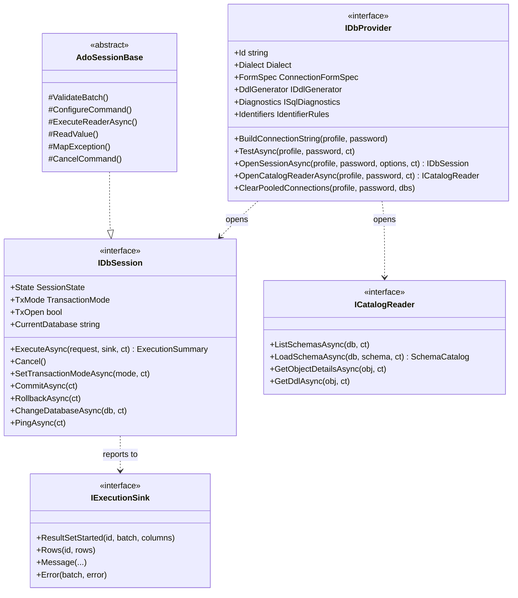

**`IDbProvider`** (`IDbProvider.cs:9-45`) is a stateless singleton, one per family:

| Member | What Core expects |
|---|---|
| `Id`, `DisplayName`, `Dialect` | The id is the key of every registry and keyed service (`"sqlserver"`, `"oracle"`, `"postgresql"`, `"sqlite"`, `"mysql"`, `"mariadb"`, `"clickhouse"`, `"snowflake"`, `"cassandra"`); the dialect drives the tokenizer, classifier and UI language (`Dialect` enum, `engine/src/DbStudio.Core/Models/CoreModels.cs:14`). |
| `FormSpec` | The fields of the generic connection dialog: key, label, type (`text`, `password`, `number`, `bool`, `select`, `file`, `list`, `note`), `VisibleWhen`, `Section` (`CoreModels.cs:82-101`). Password-typed fields are never saved in the profile (chapter [8](08-connections-sessions-execution.md)). |
| `BuildConnectionString` | The driver's connection string from a profile; for engines without one (ClickHouse, Cassandra) a password-free description used in diagnostics. |
| `TestAsync` | Connect, read `ServerInfo`, disconnect; failures are *returned* in `TestConnectionResult`, not thrown (`IDataSourceProvider.cs:23`). |
| `OpenSessionAsync` | "Opens one dedicated physical connection (pooling disabled) owned by an editor tab" (`IDbProvider.cs:22-23`). |
| `OpenCatalogReaderAsync` | "A short-lived connection used only for catalog/metadata reads (pooling allowed)" (`IDbProvider.cs:25-29`). |
| `DdlGenerator` | `CREATE TABLE` text from catalog metadata, for engines that store no table definition (`IDbProvider.cs:162-166`). |
| `Diagnostics` | Server-side syntax checks while typing, or `null` (`IDbProvider.cs:33-34`, `:168-173`). |
| `Identifiers` | Quote characters, case folding and reserved words (section 2.2). |
| `ClearPooledConnections` | Additive: close the idle pooled catalog connections of a profile; default no-op (`IDbProvider.cs:38-44`). |

**`IDbSession`** (`IDbProvider.cs:47-120`) is one physical connection owned by one tab. Its state machine is
`Idle | Executing | Broken | Closed` (`SessionState`, `CoreModels.cs:22`). The key method is
`ExecuteAsync(ExecuteRequest, IExecutionSink, CancellationToken)`: run every batch in order, report through the sink,
throw `SessionBusyException` when not idle; "provider errors inside a batch are reported via sink.Error (not thrown);
only infrastructure failures throw" (`IDbProvider.cs:97-102`). The request carries the batches (`SqlBatch(Sql, Line,
Col)`, 1-based document positions), `MaxRows` (0 = unlimited), `StopOnError`, `CaptureServerOutput`, the execution label,
bind values and `WritesConfirmed` (`engine/src/DbStudio.Core/Models/ExecutionModels.cs:5-20`). `Cancel()` must be
thread-safe and a no-op when idle (`IDbProvider.cs:104-105`). The schema members (`SchemaMode`, `CurrentSchema`,
`SearchPath`, `RefreshSchemaAsync`, `ChangeSchemaAsync`) and `LostTransaction`, `FindUnboundParameter` are additive
defaults (`IDbProvider.cs:70-119`).

**`IExecutionSink`** (`IDbProvider.cs:122-133`) is the [observer](../glossary.md#observer) the session reports to:
`BatchStarted`, `ResultSetStarted(columns)`, `Rows`, `ResultSetEnded(rowCount, truncated)`, `RowsAffected`, `Message`,
`Error`, `BatchEnded(status)`. Rows are already [wire values](../glossary.md#wire-value). Errors carry `ErrorInfo(Code,
Message, Line, Col, State, Detail, ProviderCode)`, where `Code` is "provider error number as string ('207',
'ORA-00942', 'SQLITE_ERROR') or an engine code" and `Line` is "absolute to the editor document (provider adds
batch.Line - 1)" (`ExecutionModels.cs:36-38`). The engine's implementation forwards each call as a WebSocket event
(chapter [6](06-websocket-protocol.md)).

**`ICatalogReader`** (`IDbProvider.cs:135-160`) reads metadata over its own connection: databases, schemas, default
schema, `LoadSchemaAsync` ("all objects, columns, keys, FKs (both directions), parameters, synonyms and package members
of one schema"), object details, DDL, Oracle compile errors, Oracle public synonyms and SQL Server system types. How the
results are cached is chapter [10](10-catalog-and-metadata.md).

### 2.2 Identifier rules and dialect traits

[Identifier rules](../glossary.md#identifier-rules) tell the UI and the engine how to quote a name and how the server
treats unquoted names: `IdentifierRules(QuoteOpen, QuoteClose, CaseFolding, ReservedWords)` with folding `"upper"`,
`"lower"` or `"preserve"` (`CoreModels.cs:113-118`). [Case folding](../glossary.md#case-folding) is what the server does
to an unquoted name: Oracle reads `orders` as `ORDERS`, PostgreSQL reads `Orders` as `orders`.

| Provider | Quotes | Folding | Database level | Fallback schema |
|---|---|---|---|---|
| SQL Server | `[` `]` | preserve | yes | `dbo` |
| Oracle | `"` | upper | no (schema = "database") | — |
| PostgreSQL | `"` | lower | yes | `public` |
| SQLite | `"` | preserve | no (attached files are schemas) | `main` |
| MySQL / MariaDB | `` ` `` | preserve | no (database = schema) | — |
| ClickHouse | `` ` `` | preserve | no (database = schema) | `default` |
| Snowflake | `"` | upper | yes | `PUBLIC` |
| Cassandra | `"` | lower | no (keyspace = schema) | — |

Sources: each provider's `Identifiers` (cited in its section 3.x) and `DialectInfo` (`engine/src/DbStudio.Core/Models/DialectInfo.cs:8-63`).
[Dialect info](../glossary.md#dialect-info) is a static table of traits that Core switches read instead of comparing
dialects one by one: `HasDatabases` (SQL Server, PostgreSQL, Snowflake; `:11`), `SchemaIsDatabase` (Oracle, MySQL,
ClickHouse, CQL: "ListSchemasAsync lists databases and ChangeDatabaseAsync is USE x"; `:13-17`), the fallback schema
(`:20-33`), and lexer traits: nested block comments (`:36`), backtick identifiers (`:39`), `#` line comments (`:42`),
backslash escapes in strings (`:45`), dollar-quoted strings (`:48`) and `//` comments (`:51`). The WP0 comment explains why
they live here: "so a new dialect never edits the tokenizer" (`:5-6`). Part I chapter
[I-17](../part1/17-dialect-comparison.md) compares the dialects from the user's side.

### 2.3 The shared ADO base

`AdoSessionBase` (`engine/src/DbStudio.Core/Services/AdoSessionBase.cs`, about 1 500 lines) is the "common `IDbSession`
implementation over one ADO.NET `DbConnection`". It "owns the execution loop: Idle/Executing state machine with busy
check, manual/auto transactions, one `ExecuteReader` per batch, result sets with MaxRows truncation, rows batched to the
sink, rows affected, errors with document-absolute lines, StopOnError, cancellation and timing" (`AdoSessionBase.cs:80-84`).
Seven of the eight providers derive from it (SQL Server, Oracle, PostgreSQL, SQLite, MySQL, ClickHouse, Snowflake), and so
does the linked-database `FederatedSession` (`engine/src/DbStudio.Federation/Provider/FederatedSession.cs:27`). Cassandra
implements `IDbSession` itself (section 3.8). Figure 9.2 shows one execution.

**Figure 9.2 — How `AdoSessionBase` runs one execution, and where providers hook in.**

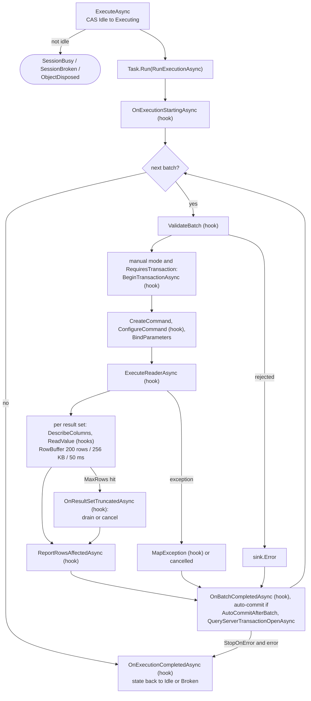

The pieces a provider writer must understand:

- **The state machine.** `ExecuteAsync` moves the session from Idle to Executing with one
  `Interlocked.CompareExchange`; a session that is not idle throws `SessionBrokenException`, `ObjectDisposedException`
  or `SessionBusyException` (`AdoSessionBase.cs:921-931`). The whole run happens in `Task.Run`, "so synchronous drivers
  (Microsoft.Data.Sqlite) never block the caller" (`:98-99`, `:941`). When the run ends the state goes back to Idle, or to
  Broken if the connection broke (`:1000-1002`).
- **The batch loop.** One `BatchContext` per batch; a cancelled batch ends the execution, an error ends it only with
  `StopOnError` (`:961-975`). Each batch emits `BatchStarted` … `BatchEnded` around the work (`:1011`, `:1082`).
- **Lazy transactions.** In manual mode the base begins the engine transaction only when `RequiresTransaction` says the
  batch needs one: "queries and session statements run outside the transaction; a user-typed BEGIN/COMMIT/ROLLBACK is the
  server's. A SAVEPOINT / SAVE TRANSACTION does begin it" (`:1126-1132`, `:259`). A transaction begun for a single
  DML/DDL statement that failed or was cancelled and changed nothing is rolled back again, "so the session does not
  report a pending transaction (and SQLite releases its locks)" (`:1096-1116`).
- **Reading result sets.** For each result set the base calls `DescribeColumns`, then reads rows with `ReadValue`
  until `MaxRows`; rows go through a private `RowBuffer` that flushes every `RowBatchSize` (200) rows,
  `RowBatchMaxBytes` (256 KB) or `RowFlushInterval` (50 ms) (`:205-211`, `:1251-1290`, `:1475-1499`). When the cap is hit
  it reports `truncated` and asks `OnResultSetTruncatedAsync` whether to continue; a provider that answers false makes the
  base cancel the command instead of draining (`:1270-1274`, `:1288`, `:1157-1161`).
- **Not trusting a cancelled token.** `NextResultAsync` is called *without* the token: "a cancelled token makes
  NextResultAsync throw without asking the driver, which would label a statement that already ran (and auto-committed) as
  cancelled. CancelCommand aborts what still runs" (`:1153-1155`). A batch that completed although a cancel was requested
  is reported as Ok with a warning that says where its changes went (`:1051-1052`, `:1086-1094`).
- **Errors.** Any driver exception goes through `MapException(ex, batch)` to an `ErrorInfo`; the provider's mapping turns
  driver codes and positions into document lines (`:496`, `:1203-1211`). Lines are converted with `ToDocumentLine` /
  `ToDocumentCol` (`:633-636`).
- **After the batch.** `OnBatchCompletedAsync` (Oracle's `ALL_ERRORS`, MySQL's transaction end detection…), an automatic
  commit when `AutoCommitAfterBatch` is true (Oracle), `QueryServerTransactionOpenAsync` to follow user-typed
  transactions (SQL Server `@@TRANCOUNT`, PostgreSQL `transaction_timestamp()`, MariaDB `@@in_transaction`), and a schema
  re-read when `SchemaMayChange` (`:1024-1068`).
- **Messages keep their order.** `EmitMessageAsync` and friends flush pending rows first, so a `PRINT` between two
  `SELECT`s appears between their rows (`:96-97`, `:646-716`).
- **Exclusive side work.** `RunExclusiveAsync` lets other features run work on the session's connection (describe,
  explain helpers, Snowflake `USE`) under the same busy flag, so it can never interleave with a running batch
  (`:1323-1366`).

The table lists the hooks with their defaults and who overrides them.

| Hook (line) | Default | Overridden by (examples) |
|---|---|---|
| `ValidateBatch` (`:234`) | accept | Oracle (`Prepare`, bind check), PostgreSQL (`COPY` refusal), MySQL (`LOAD DATA LOCAL`) |
| `ConfigureCommand` (`:240`) | nothing | SQL Server (`StatementCompleted`), Oracle (`BindByName`, fetch sizes), ClickHouse (server row cap) |
| `ExecuteReaderAsync` (`:390`) | `cmd.ExecuteReaderAsync` | PostgreSQL (`NpgsqlBatch`), MySQL (`MySqlStatementReader`), ClickHouse (`ChBatchReader`), Snowflake (multi-statement) |
| `ReadValue` (`:447`) | `ValueConverter` | all, for exact decimals, dates, engine types |
| `OnResultSetTruncatedAsync` (`:456`) | continue (drain) | SQL Server, MySQL (cancel instead of drain) |
| `ReportRowsAffectedAsync` (`:468`) | `RecordsAffected` once | SQL Server (per statement), PostgreSQL (per batch command), ClickHouse (`written_rows`) |
| `MapException` (`:496`) | generic | all |
| `AutoCommitAfterBatch` (`:214`) | false | Oracle |
| `QueryServerTransactionOpenAsync` (`:528`) | unknown | SQL Server, PostgreSQL, SQLite, MySQL, Snowflake |
| `CancelCommand` (`:594`) | `command.Cancel()` | PostgreSQL (`NpgsqlBatch.Cancel`), SQLite (interrupt + timeout), ClickHouse (abort + `KILL QUERY`), Snowflake (+ `SYSTEM$CANCEL_QUERY`) |
| `ChangeDatabaseCoreAsync` (`:616`) | `NotSupportedException` | SQL Server (`USE`), Oracle (`CURRENT_SCHEMA`), MySQL, ClickHouse |
| `ParamBinder` / `RejectUnboundParameters` (`:267-270`) | none / false | every provider with parameters; PostgreSQL rejects unbound |
| `EnterDirectMode` (`:378`) | none | SQL Server (errors as exceptions) |

### 2.4 How a provider is wired

The four M1/M2 providers (SQL Server, Oracle, SQLite, PostgreSQL) are registered directly in `Program.cs:92-95`, with
their keyed scripters, designer databases, plan readers and parameter binders at `Program.cs:129-146`. The four Batch 3
providers each have an `IEngineModule` that does the same from inside its own project (MySQL `MySqlModule.cs:26-41`,
ClickHouse `ClickHouseModule.cs:25-38`, Snowflake `SnowflakeModule.cs:41-57`, Cassandra `CassandraModule.cs:20-29`). Every
provider class implements `IObjectBrowserProvider` and `IDatabaseSearchProvider` as role interfaces
(`SqlServerProvider.cs:11`, `OracleProvider.cs:10`, `PostgreSqlProvider.cs:16`, `SqliteProvider.cs:11`,
`MySqlProvider.cs:15` on the shared MySQL/MariaDB base, `ClickHouseProvider.cs:14`, `SnowflakeProvider.cs:17`,
`CassandraProvider.cs:14`). Logs and
activity sources live in `DbStudio.Logs` and are keyed by provider id (chapter [21](21-logs-activity-resources.md)). Chapter
[7](07-engine-modules-and-di.md) explains the mechanism; chapter [24](24-build-ci-release-contributing.md) is the
checklist for adding a ninth provider.

## 3. Deep dive (senior): the providers one by one

Each section follows the same order: files and registration, driver and connection, the session (what it overrides),
catalog, DDL and the keyed features, errors and identifiers, and "what it cannot do". The figures are file-to-responsibility
maps; arrows mean "uses".

### 3.1 SQL Server

SQL Server was the first provider Rowlit had, and it is still the one that sets the bar: the behaviour of SQL Server
Management Studio (SSMS) is the reference the code keeps quoting. The provider lives in
`engine/src/DbStudio.Providers.SqlServer` and is registered directly in the host, not through an engine module:
`services.AddSingleton<IDbProvider, SqlServerProvider>()` (`engine/src/DbStudio.Host/Program.cs:92`), with its keyed
features (scripter, designer database, plan reader, parameter binder) added by id `"sqlserver"` a few lines later
(`engine/src/DbStudio.Host/Program.cs:130-139`).

**Figure 9.3 — SQL Server provider: files and what each one does.**

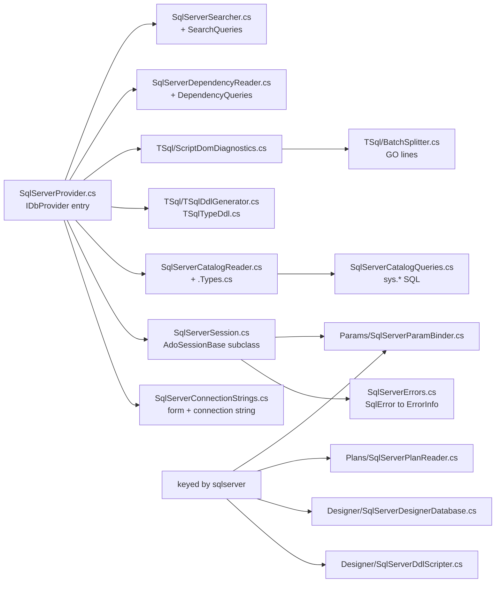

#### Driver and connection

The [driver](../glossary.md#driver) (the library that speaks the server's network protocol) is
[Microsoft.Data.SqlClient](../glossary.md#microsoft-data-sqlclient) 7.1.1, plus
`Microsoft.SqlServer.TransactSql.ScriptDom` 180.140.0 for parsing
(`engine/src/DbStudio.Providers.SqlServer/DbStudio.Providers.SqlServer.csproj:8-11`). The csproj also pins
`System.Security.Cryptography.Pkcs` 10.0.13 because SqlClient 7.1.1 pulls a vulnerable version (comment `code-06`, line 9);
that is the NuGet audit at work (see [chapter 19](19-security-and-secrets.md)).

The connection dialog is described by a `ConnectionFormSpec` (the generic form the UI renders, see
[chapter 8](08-connections-sessions-execution.md)): `server`, `auth` (`sql` or `windows`), `user`, `password`,
`database`, `encrypt` (`optional` / `mandatory` / `strict`), `trustServerCertificate` and `connectTimeout`
(`engine/src/DbStudio.Providers.SqlServer/SqlServerConnectionStrings.cs:14-26`). On macOS and Linux the `windows` option is
labelled "Integrated (Kerberos)" (line 18), and the README says it needs a Kerberos ticket from `kinit`
(`README.md:130-132`). The provider appends the SSH tunnel fields to this form with
`SshFormFields.Append(...)` and a hint that a named instance needs its port (`SqlServerProvider.cs:16`).

`SqlServerConnectionStrings.Build` turns the profile into a [connection string](../glossary.md#connection-string) (the
`key=value;` text a driver reads) with `SqlConnectionStringBuilder` (`SqlServerConnectionStrings.cs:29-72`). Decisions
worth knowing:

- `ApplicationName = "Rowlit"` (line 10), so a DBA sees Rowlit in `sys.dm_exec_sessions`.
- `MultipleActiveResultSets = false` and `Pooling` set by the caller (lines 40-41). Sessions pass `pooling: false`
  (`SqlServerProvider.cs:36-37`); catalog, dependency and search connections pass `true` (lines 81, 104, 119). Why the
  session is unpooled is the subject of [connection pooling](../glossary.md#connection-pooling) in chapter 8: every `SET`,
  temp table and transaction must belong to one tab.
- `ConnectRetryInterval = 1` (line 46). The comment explains it: the driver's default retries a failed first connect after
  10 s, so a mistyped database name took 11 s to report. `TestAsync` goes further and sets `ConnectRetryCount = 0`
  (`SqlServerProvider.cs:46`) so "Test" answers at once.
- `windows` or `integrated` set `IntegratedSecurity = true`; `sql` sets user and password (lines 52-67).

`OpenSessionAsync` overrides `InitialCatalog` with the database the tab asked for, opens the connection, reads
`@@VERSION`, `SERVERPROPERTY('ProductVersion')`, `@@SERVERNAME`, `SUSER_SNAME()` and `DB_NAME()` into `ServerInfo`
(`SqlServerProvider.cs:58-77`, query at `SqlServerCatalogQueries.cs:26-27`) and lets the session read its default schema
(`InitializeSchemaAsync`, line 69). On any failure the connection is disposed before the exception leaves.

`ClearPooledConnections` builds the pooled connection string and calls `SqlConnection.ClearPool`
(`SqlServerProvider.cs:22-33`); the resource manager calls it when a connection is closed or its metadata went idle (the
contract comment at `engine/src/DbStudio.Core/Providers/IDbProvider.cs:38-44`).

**SSH tunnels.** The provider itself does nothing special: `ConnectionStore.ResolveForOpen` rewrites the profile before the
provider sees it (chapter 8). The SQL Server specifics are in Core: `TunnelTargets.SqlServer` parses `host`, `host,port`,
`tcp:host` and `host\instance,port`, refuses a named instance without a port ("found through the SQL Server Browser
(UDP 1434), which an SSH tunnel cannot carry"), LocalDB and non-TCP protocols
(`engine/src/DbStudio.Core/Services/Tunnels/TunnelTargets.cs:124-152`), and the rewrite writes
`server = "127.0.0.1,<local port>"` (line 65).

#### The session: what it overrides

`SqlServerSession` extends `AdoSessionBase` (see [section 2.3](#23-the-shared-ado-base)) and changes how messages,
row counts and cancellation are observed. Each batch the UI sends (one `GO`-delimited block, decision D-2 in
`docs/PLAN.md:622`) runs as one `SqlCommand`.

**Messages and errors through `InfoMessage`.** The constructor sets `FireInfoMessageEventOnUserErrors = true` and
subscribes to [`InfoMessage`](../glossary.md#infomessage) (the driver event that carries `PRINT` output and server
messages) (`SqlServerSession.cs:39-40`). With that flag, errors of severity 11 and higher inside a batch arrive as events
instead of exceptions, so the batch keeps running like it does in SSMS (`docs/PLAN.md:170`). `OnInfoMessage`
(`SqlServerSession.cs:325-358`) sorts each `SqlError`: severity `>= 11` is an error (`SqlServerErrors.cs:18`), counted in the
batch context and emitted with `EmitError`; anything lower (PRINT, `RAISERROR(...,10,...)`, "Changed database context")
becomes an info message with a document line. Errors caused by Rowlit's own cancel are not reported as batch errors; when
the user cancelled, the code records that the server acknowledged the attention (lines 344-347). After the batch,
`OnBatchCompletedAsync` turns an "Ok" batch with counted errors into "Error" (lines 234-235).

**Line numbers.** SQL Server reports a line relative to the batch, or relative to a stored procedure the batch called.
`SqlServerErrors.DocumentLine` adds `batch.Line - 1`, but only when the error has no procedure name or the batch itself
creates that module; otherwise the line is unknown and left out (`SqlServerErrors.cs:24-29`, `BatchDefinesModule` at
65-78). Each error gets an SSMS-style header `Msg 207, Level 16, State 1, Procedure p, Line 3` in `Detail`
(lines 41-47). A thrown `SqlException` with several errors keeps the most severe one as the message and lists the rest
(lines 50-63).

**Rows affected per statement.** The base class would report `RecordsAffected` once per batch. SQL Server overrides
`ReportRowsAffectedAsync` to do nothing (`SqlServerSession.cs:230`) and instead hooks `SqlCommand.StatementCompleted` in
`ConfigureCommand` (lines 62-70). `OnStatementCompleted` (lines 364-375) skips the DONE token that belongs to a SELECT
(its count is already the result set's row count) and labels each DML count with its statement kind when the batch has
no procedure calls or control flow (`StatementKindFor`, lines 378-385). `SET NOCOUNT ON` therefore works naturally: no
DONE counts arrive.

**Editable results.** A plain SELECT does not tell the client which table a column came from, so the grid could not edit
console results. Before a batch that is a single parameterless query without `#` temp tables, the session calls
`sys.sp_describe_first_result_set` with `@browse_information_mode = 1` (`SqlServerSession.cs:81-88`, `97-108`). The
call is wrapped in `TRY/CATCH` and skipped under `XACT_ABORT` (`@@OPTIONS & 16384`), because a failing describe would
doom the user's transaction. The answer fills `Table`, `Schema` and `IsKey` of the first result set's columns, but not for
columns of another database (lines 139-151). The comment explains why `CommandBehavior.KeyInfo` was not used: its
`SET NO_BROWSETABLE ON/OFF` wrapper leaks into the session on cancel. For the describe endpoint (which does use
`SchemaOnly | KeyInfo`) the text gets a trailing newline so a final `-- comment` cannot swallow the driver's `SET FMTONLY OFF`
(`PrepareDescribeSql`, line 158), and the hidden key columns SQL Server appends are cut off (lines 167-183).

**Values.** `ReadValue` reads `decimal`/`numeric` as `SqlDecimal` text, because `decimal(38,x)` can exceed
`System.Decimal`; `money` stays numeric (`SqlServerSession.cs:201-203`). `date` columns become `DateOnly`. CLR types
(`hierarchyid`, `geography`, `geometry`) need `Microsoft.SqlServer.Types`, which Rowlit does not ship, so on a cast or load
error the raw bytes are sent as a binary wire value (lines 207-216).

**Transactions.** Manual mode is the base class's `BeginTransaction`. What SQL Server adds is detection of a user-typed
`BEGIN TRAN` in auto mode, or a `COMMIT` typed inside a manual transaction: after each batch it asks `SELECT @@TRANCOUNT`
(`QueryServerTransactionOpenAsync`, lines 253-259), and the toolbar badge follows the server.

**Cancel.** The base `CancelCommand` calls `SqlCommand.Cancel()` (`AdoSessionBase.cs:594`), which sends a TDS
[attention](../glossary.md#attention) signal. Two details are SQL Server's own. First, because errors arrive as messages,
"Operation cancelled by user" does not end the reader with an exception, so the status is decided from the acknowledgement
captured in `OnInfoMessage`: acknowledged means the server aborted the batch; no acknowledgement means the batch finished
before the attention arrived, so its changes stand and the base's "Ok + warning" is kept (lines 236-245). Second, when a
single-query batch hits `MaxRows`, `OnResultSetTruncatedAsync` returns `false` and marks the context "stopping", so the base
cancels the command instead of draining rows off the wire (lines 219-227); the resulting cancel errors are swallowed.

**Database and schema.** `ChangeDatabaseCoreAsync` runs `USE [db]`, then verifies with `SELECT DB_NAME()`; because errors
outside a batch also arrive as `InfoMessage`, it collects them in a temporary list and reports the first one in a 422
`PROVIDER_ERROR` when the switch did not happen (`SqlServerSession.cs:292-315`). A `USE` typed inside a batch is picked
up from `SqlConnection.Database` after the batch (lines 246-248). The default schema is `SchemaMode.ReadOnly`
(line 275): SQL Server has no per-session schema, only the login's default schema in the current database, read with
`SELECT SCHEMA_NAME()` and re-read after batches containing `USE`, `EXECUTE AS` or `REVERT` (lines 277-290).

**Direct mode.** Describe and explain helpers want real exceptions, not messages, so `EnterDirectMode` switches
`FireInfoMessageEventOnUserErrors` off and returns a disposable that turns it back on (lines 50-60).

#### Batches and diagnostics

The UI splits the editor text on `GO` (chapter 11). The engine has its own `TSql/BatchSplitter` only for diagnostics
(`BatchSplitter.cs:10-13`): it recognises a whole line matching `^\s*GO(?:\s+(?<n>\d+))?\s*(?:--.*)?$` outside strings,
`[bracketed]` identifiers and nested block comments, records `GO N` as a repeat count, and keeps each segment's start line
and offset (lines 16-97).

`ScriptDomDiagnostics` (engine name `scriptdom`) parses each segment with
[ScriptDom](../glossary.md#scriptdom), Microsoft's T-SQL parser library. It picks the highest `TSqlNNNParser` class in the
loaded assembly by reflection, starting from `TSql160Parser` and accepting only types with a `(bool)` constructor
(`ScriptDomDiagnostics.cs:62-78`), and creates it with `initialQuotedIdentifiers: true` (lines 56-60). This follows the
plan text "try `TSql170Parser` via reflection first" (`docs/PLAN.md:170`) in a more general form: a newer ScriptDom
package is used without a code change. Parse errors are mapped to absolute document lines (`batch.StartLine + e.Line - 1`)
and the end column is the end of the offending token (lines 36-51, `TokenEnd` 90-115). Codes come out as `SQL<number>`.
ScriptDom only checks syntax: an unknown table is not reported (that needs the server).

#### Catalog

`SqlServerCatalogReader` runs on a short-lived pooled connection and switches databases with `USE [db]` on that
connection; the pool resets the database when the connection is returned (`SqlServerCatalogReader.cs:9-12`,
`UseAsync` at 291-295). All schema-scoped queries take `@sid` and live in `SqlServerCatalogQueries`; the class comment says
the unit tests parse every string with ScriptDom (`SqlServerCatalogQueries.cs:3-6`). Two excerpts show the style.

```csharp
// engine/src/DbStudio.Providers.SqlServer/SqlServerCatalogQueries.cs:13-20
public const string SchemaFilter =
    "s.name NOT IN ('sys','INFORMATION_SCHEMA') AND ((s.name<>'guest' AND s.principal_id NOT IN (SELECT principal_id FROM sys.database_principals WHERE type='R')) " +
    "OR EXISTS (SELECT 1 FROM sys.objects xo WHERE xo.schema_id=s.schema_id AND xo.is_ms_shipped=0))";
public const string ObjectTypeList = "'U','V','P','PC','FN','IF','TF','FS','FT','SN','SO','TR'";
public const string Databases =
    "SELECT name FROM sys.databases WHERE state_desc='ONLINE' AND HAS_DBACCESS(name)=1 ORDER BY name";
```

The schema filter is a refinement of the plan's version (`docs/PLAN.md:178`): role-owned schemas such as `db_owner` are
hidden **unless they hold objects**, because old databases often keep their tables in a schema created with
`AUTHORIZATION db_owner` (comment at lines 9-12).

```csharp
// engine/src/DbStudio.Providers.SqlServer/SqlServerCatalogQueries.cs:62-76 (trimmed)
"SELECT fk.object_id AS fk_id, fk.name AS fk_name, ... po.name AS parent_table, pc.name AS parent_column, " +
"... ro.name AS ref_table, rc.name AS ref_column, fkc.constraint_column_id AS ordinal, fk.is_disabled, fk.is_not_trusted " +
"FROM sys.foreign_keys fk JOIN sys.foreign_key_columns fkc ON fkc.constraint_object_id=fk.object_id " +
"LEFT JOIN sys.objects po ON po.object_id=fk.parent_object_id ... " +
"WHERE po.schema_id=@sid OR ro.schema_id=@sid ORDER BY fk.object_id, fkc.constraint_column_id";
```

Foreign keys are read in **both directions** (outgoing and incoming) so the JOIN completer in the editor also sees tables
that point at the current schema. The `LEFT` joins exist because a referenced table the login cannot see yields `NULL`
names, which the reader reports instead of producing an edge to an empty name (comment, lines 55-61).

Other details: the version check `IsSqlServer2005OrOlder` switches the user-type query to a variant without table types
(`SqlServerCatalogReader.cs:81-82`, 391-392); `ListSystemTypesAsync` returns the built-in types for the explorer's
"System Data Types" folder (`SqlServerCatalogReader.Types.cs:218`); DDL for views, procedures, functions and triggers is
the stored `sys.sql_modules.definition` (`SqlServerCatalogQueries.cs:177-178`), with a comment line when the module is
encrypted, while tables, synonyms and sequences are generated (`SqlServerCatalogReader.cs:216-246`).

#### DDL, designer, plans, parameters, dependencies, search

- **DDL generator.** SQL Server tables have no stored definition, so `TSqlDdlGenerator` writes `CREATE TABLE` from a
  `SqlServerTableDefinition` (columns with identity seed/increment, computed and persisted columns, collation, indexes with
  `INCLUDE` and filters, foreign keys with referential actions, checks) (`TSql/TSqlDdlGenerator.cs:7-57`). `TSqlTypeDdl`
  writes alias, CLR, table and XML schema collection types (`TSql/TSqlTypeDdl.cs:5-47`).
- **Designer scripter** (`IDdlScripter`, keyed `"sqlserver"`). All statements run in one transaction; `CREATE TABLE` uses
  named constraints (`PK_`, `DF_`, `UQ_`, `FK_`, `CK_`); alters use `ADD`, `ALTER COLUMN` and `sp_rename`; default constraints
  are dropped before `ALTER`/`DROP COLUMN`; comments are `MS_Description` extended properties
  (`Designer/SqlServerDdlScripter.cs:7-13`). Two senior-level rules: SQL Server refuses `ALTER COLUMN` on a column used by an
  index, key, check or computed column (errors 5074/4922), so the scripter drops and recreates the unchanged dependents
  around the alter, except for a pure widening of `varchar`/`nvarchar`/`varbinary`, which is allowed under an index
  (lines 224-230). Changing identity needs a full rebuild like SSMS (new table, `SET IDENTITY_INSERT`, copy, rename,
  recreate keys, indexes, triggers, permissions); the rebuild is refused with a validation error when dependents are
  unknown or storage the model cannot hold exists (columnstore, partitioning, compression, CDC...) (lines 335-344).
  `CREATE OR ALTER` is used for views only from 13.0.4001 (SQL Server 2016 SP1) (lines 642-647).
- **Designer database** reads table models from `sys.columns`, `sys.identity_columns`, `sys.computed_columns`,
  `sys.default_constraints`, `sys.indexes`, `sys.foreign_keys`, `sys.check_constraints` and applies in one transaction on a
  dedicated unpooled connection with server errors raised as exceptions (`Designer/SqlServerDesignerDatabase.cs:9-13`).
  Details are in [chapter 14](14-designers-and-ddl.md).
- **Plan reader.** Estimated plan = `SET SHOWPLAN_XML ON` (nothing runs); actual = `SET STATISTICS XML ON` (the statement runs
  and the trailing showplan result sets are captured); `RelOp` elements become plan nodes with costs, predicates, warnings and
  missing-index hints (`Plans/SqlServerPlanReader.cs:10-15`). See [chapter 15](15-import-export-plans-er.md).
- **Parameter binder.** `@name` placeholders that are not `DECLARE`d in the same batch become parameters, and SqlClient sends
  the batch through `sp_executesql`; positional `?` is rejected (`Params/SqlServerParamBinder.cs:11-16`).
- **Dependency reader.** `sys.sql_expression_dependencies` in both directions plus foreign keys and triggers, written as
  plain joins that run on SQL Server 2008+ at compatibility level 100 (`SqlServerDependencyQueries.cs:3-27`).
- **Searcher** ("Find in database"): names, columns and module bodies from `sys.objects`, `sys.columns`, `sys.sql_modules`,
  with an optional `LIKE` prefilter; no `STRING_AGG` or `CONCAT` so it runs on 2005+ (`SqlServerSearchQueries.cs:6-33`).
- **Logs and activity** for SQL Server live in `DbStudio.Logs` (`SqlServerLogSource`, keyed `"sqlserver"` at
  `engine/src/DbStudio.Logs/LogsModule.cs:44`); see [chapter 21](21-logs-activity-resources.md).

#### Errors and identifiers

`TestAsync` and the connection endpoints map failures with `ToProviderError`: code `PROVIDER_ERROR`, the SQL Server error
number as `ProviderCode`, the SSMS header as `Detail`, and the noisy `(Parameter 'profile')` suffix removed from argument
errors (`SqlServerProvider.cs:146-156`). Inside a batch, errors keep the SQL Server number as `Code`
(`SqlServerErrors.cs:31-38`). [Identifier rules](../glossary.md#identifier-rules): `[` `]` quotes, `"preserve"` case and the
reserved word list (`SqlServerProvider.cs:19`); `DialectInfo` gives T-SQL a database level, nested block comments and the
fallback schema `dbo` (`engine/src/DbStudio.Core/Models/DialectInfo.cs:11,22,36`).

#### Packaging

SqlClient on Windows uses a [native library](../glossary.md#native-library) called
[SNI](../glossary.md#sni) (SQL Server Network Interface). The Windows build publishes the engine as a self-contained
single file with `IncludeNativeLibrariesForSelfExtract`, so SNI and SQLite's `e_sqlite3` are bundled inside the exe and
[self-extracted](../glossary.md#self-extract) at start (`scripts/build.ps1:67-77`, risk R2 in `docs/PLAN.md:608`). Chapter 24
covers the macOS build.

#### What it cannot do

The SQL Server fixture overrides none of the `Supports*` flags of the conformance suite
(`engine/tests/DbStudio.Providers.SqlServer.Tests/SqlServerFixture.cs:109`), so transactions, savepoints, foreign keys,
identity, DML row counts and cancel are all exercised. Limits come from the code instead:

- No Microsoft Entra (Azure AD) authentication: only `sql` and `windows`/`integrated` (`SqlServerConnectionStrings.cs:51-67`).
  The plan listed `entra-interactive` for M2 (`docs/PLAN.md:170`); it is not in the code.
- CLR type values (`geography`, `hierarchyid`...) arrive as bytes, not text (`SqlServerSession.cs:211-216`).
- ScriptDom diagnostics are syntax only.
- No per-session default schema (`SchemaMode.ReadOnly`).
- Through an SSH tunnel: no named instance without a port, no LocalDB, no `np:`/`lpc:` protocols (`TunnelTargets.cs:124-152`).
- Identity rebuilds are refused for tables with storage features the model does not hold (see the scripter above).

### 3.2 Oracle

Oracle is the provider with the most "translation" work: Oracle has no batches, keeps every session in an implicit
transaction, reports errors without offsets, and prints PL/SQL output into a server-side buffer. All of that is handled in
`engine/src/DbStudio.Providers.Oracle`. Like SQL Server it is registered in `Program.cs` directly (line 93) with keyed
features under `"oracle"` (lines 131-140).

**Figure 9.4 — Oracle provider: files and what each one does.**

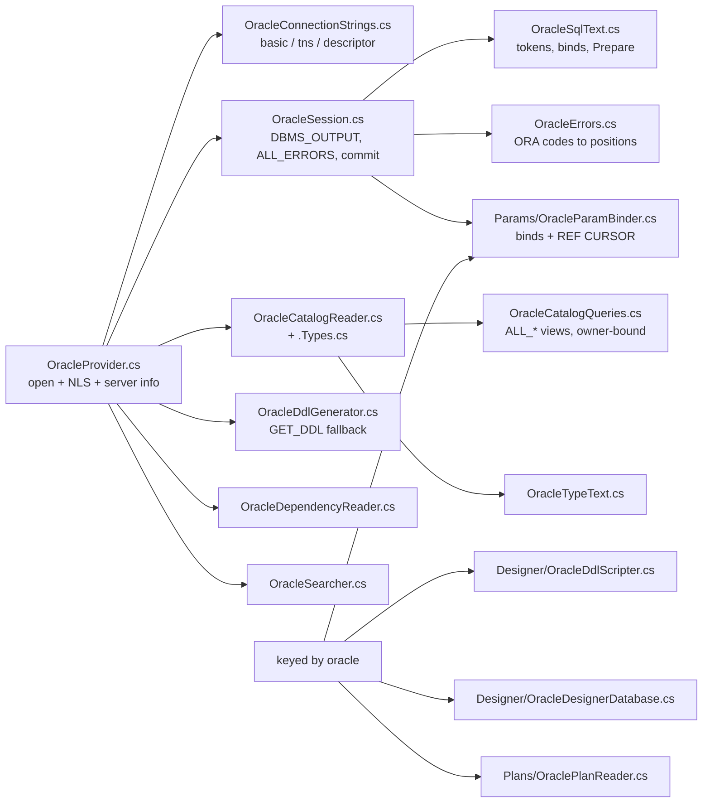

#### Driver and connection

The driver is [ODP.NET](../glossary.md#odp-net) managed, package `Oracle.ManagedDataAccess.Core` 23.26.301
(`engine/src/DbStudio.Providers.Oracle/DbStudio.Providers.Oracle.csproj:8`). "Managed" means pure .NET: no Oracle Instant
Client is installed. The same `Pkcs` pin as SQL Server applies (line 10).

The form offers three connection types (`OracleConnectionStrings.cs:15-34`): **basic** (host, port 1521, service name or
SID), **TNS alias** (resolved through `tnsnames.ora` in `TNS_ADMIN`) and a full **connect descriptor**. Then user,
password, a role (`normal`, `SYSDBA`, `SYSOPER`) and `extraSchemas`, the schemas loaded eagerly besides the current one.
`DataSource` builds a `(DESCRIPTION=(ADDRESS=(PROTOCOL=TCP)(HOST=..)(PORT=..))(CONNECT_DATA=(SERVICE_NAME=..)))` string for
basic mode (lines 37-69). `Build` sets `Pooling`, `StatementCacheSize = 0` and the connect timeout, and maps the role to
`DBAPrivilege` (lines 72-95). User names and passwords with characters outside `[A-Za-z0-9_$#]` are double-quoted for the
server, unless they already contain a quote (lines 97-110), a detail that makes passwords like `p@ss` work.

`OpenSessionAsync` (`OracleProvider.cs:101-131`) shows everything an Oracle session gets at start:

```csharp
// engine/src/DbStudio.Providers.Oracle/OracleProvider.cs:107-121 (trimmed)
await conn.OpenAsync(ct);
conn.ModuleName = "Rowlit";
conn.ClientInfo = "Rowlit session " + options.SessionId;
await ExecAsync(conn, $"ALTER SESSION SET NLS_DATE_FORMAT = {Literal(profile.GetString("nlsDateFormat") ?? DefaultNlsDateFormat)}", ct);
await ExecAsync(conn, $"ALTER SESSION SET NLS_TIMESTAMP_FORMAT = {...}", ct);
await ExecAsync(conn, $"ALTER SESSION SET NLS_TIMESTAMP_TZ_FORMAT = {...}", ct);
if (!string.IsNullOrWhiteSpace(options.Database))
    await ExecAsync(conn, "ALTER SESSION SET CURRENT_SCHEMA = " + OracleSqlText.Quote(schema), ct);
if (options.CaptureServerOutput)
    await ExecAsync(conn, "BEGIN DBMS_OUTPUT.ENABLE(NULL); END;", ct);
```

`ModuleName`/`ClientInfo` make Rowlit sessions visible in `V$SESSION`. The [NLS](../glossary.md#nls) (National Language
Support) formats default to `YYYY-MM-DD HH24:MI:SS`, `...SS.FF` and `...SS.FF TZH:TZM` (lines 52-54); the first two can be
overridden per profile (`nlsDateFormat`, `nlsTimestampFormat`). The tab's "database" is, for Oracle, its current schema,
which is why `options.Database` becomes `CURRENT_SCHEMA` (`DialectInfo.SchemaIsDatabase`,
`engine/src/DbStudio.Core/Models/DialectInfo.cs:17`). `ReadServerInfoAsync` reads the banner from `V$VERSION`, falls back to
`PRODUCT_COMPONENT_VERSION` and finally to the driver's version string when neither view is visible, plus session user,
current schema, `DB_NAME` and `SERVER_HOST` (`OracleProvider.cs:154-185`).

**SSH tunnels.** Only the basic connection type can be tunnelled, because a TNS alias or descriptor can name other
addresses (`TunnelTargets.cs:154-160`); the form hint says so (`OracleProvider.cs:59`).

#### The session: one statement per batch

Oracle has no batch concept on the wire, so each batch from the UI is one statement (D-2). `ValidateBatch` normalises it
with `OracleSqlText.Prepare` (`OracleSession.cs:54-57`), which trims whitespace, drops a trailing SQL\*Plus `/` line,
removes the trailing semicolon from plain SQL (ODP.NET raises ORA-00911 otherwise) but keeps it for PL/SQL, and rewrites
`EXEC proc(...)` to `BEGIN proc(...); END;` (`OracleSqlText.cs:155-200`). The offset of the executed text inside the
original is kept, because every error position must be mapped back through it.

`ConfigureCommand` sets `BindByName = true` (always, per `docs/PLAN.md:172`), the prepared text, unlimited
`InitialLONGFetchSize`/`InitialLOBFetchSize`, and `FetchSize` = 1 MB per round trip (`OracleSession.cs:21`, `102-110`).

**[Bind variables](../glossary.md#bind-variable).** `OracleSqlText.FindBindVariables` finds `:name` and `:1` outside
strings, comments and quoted identifiers, and ignores trigger bodies where `:NEW`/`:OLD` are correlation names
(`OracleSqlText.cs:122-139`). A bind without a typed parameter value fails the batch up front with code
`BIND_VARS_UNSUPPORTED`, positioned on the first missing bind and suggesting "Run with parameters (Ctrl+Alt+P)"
(`OracleSession.cs:60-71`). That code is a leftover name from M1, when binds were not supported at all
(`docs/PLAN.md:172`); since M1.5 the `OracleParamBinder` binds typed values by name (`Params/OracleParamBinder.cs:10-17`).

**[REF CURSOR](../glossary.md#ref-cursor).** A `refcursor` parameter is bound as an output `OracleDbType.RefCursor`. After
execution, `OnParametersAvailableAsync` streams every cursor the reader did not already return as an extra result set
(`OracleSession.cs:78-88`). A REF CURSOR that appears as a **column** value is sent as the wire marker `{"$cursor":true}`
(`CursorValue.Instance`, lines 201 and 228); it is not expanded.

**[DBMS_OUTPUT](../glossary.md#dbms-output).** `DBMS_OUTPUT.PUT_LINE` writes into a buffer on the server; nothing is sent to
the client unless the client asks. Figure 9.5 shows how Rowlit asks.

**Figure 9.5 — Oracle `DBMS_OUTPUT` capture after each batch.**

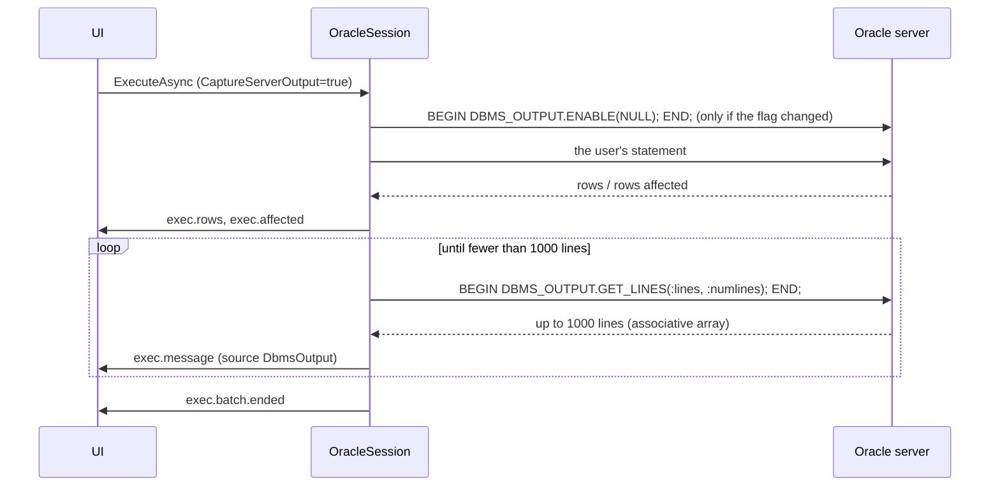

The session remembers whether output is enabled; `OnExecutionStartingAsync` sends `ENABLE(NULL)` or `DISABLE` only when the
request's `CaptureServerOutput` differs (`OracleSession.cs:46-52`). After every batch, `PumpDbmsOutputAsync` binds
`:lines` as a PL/SQL associative array of 1000 `VARCHAR2` elements of 32 767 bytes and `:numlines` as in/out, and loops
while a full chunk came back (lines 406-433, constants at 23-24). Each line is emitted with `MessageSource.DbmsOutput`, so
the Messages pane can show it apart from server messages. `EmitMessageAsync` flushes pending rows first, so output and rows
keep their order (`AdoSessionBase.cs:96-100`).

**Compile errors from [ALL_ERRORS](../glossary.md#all-errors).** `CREATE PROCEDURE` with a mistake does not fail in
Oracle; it "succeeds with compilation errors" (ORA-24344) and leaves the errors in the `ALL_ERRORS` view. After a batch,
`OnBatchCompletedAsync` checks whether the statement created a PL/SQL unit (`OracleSqlText.FindCreatedUnit` recognises
`CREATE [OR REPLACE] [EDITIONABLE] PROCEDURE/FUNCTION/PACKAGE [BODY]/TRIGGER/TYPE [BODY]/VIEW`) and whether it succeeded or
raised 24344 (`OracleSession.cs:307-321`). If so, `ReportCompileErrorsAsync` queries
`SELECT line, position, text, attribute, type FROM all_errors WHERE owner=:owner AND name=:name AND type=:type ORDER BY sequence`
(`OracleCatalogQueries.cs:156-157`) and, for each row, emits an error or a warning message and a diagnostic
(`OracleSession.cs:451-493`). The positions need a correction: `ALL_SOURCE` line 1 starts at the object-type keyword,
because `CREATE [OR REPLACE]` is not stored, so `OracleErrors.MapCompileError` maps lines relative to that keyword's offset
(`OracleErrors.cs:128-139`). The diagnostics travel as an `exec.diagnostics` event and become Monaco markers
([chapter 11](11-intellisense.md)). The batch status becomes "Error" with an engine message "... was created with compilation
errors" (lines 486-492).

**Auto mode is "commit after each batch".** Oracle is always inside an implicit transaction (DML stays uncommitted until a
`COMMIT`). In Rowlit's auto mode, `AutoCommitAfterBatch => true` makes the base class commit after each successful batch
(`OracleSession.cs:42`, `docs/PLAN.md:159`); `CommitAfterBatchAsync` skips the round trip for plain queries
(lines 300-305). Oracle DDL commits implicitly anyway; that is also why the designer cannot apply as one transaction (below).

**Error positions without offsets.** ODP.NET reports no character offset, so `OracleErrors.Map` guesses in a fixed order
(`OracleErrors.cs:72-110`): for ORA-06550 (PL/SQL compile error in an anonymous block) it parses "line N, column M";
for a run-time error inside a block it uses the last `ORA-06512: at line N` frame; otherwise it looks for a quoted name
(`"NO_SUCH_TABLE"`) or "identifier 'X' must be declared" and finds that identifier's first occurrence in the executed text;
if nothing matches, the statement's first token. Positions are skipped when the text was rewritten (`EXEC`), since the
line numbers would not match. `CleanMessage` also splits off the 23ai `https://docs.oracle.com/error-help/...` link into
`Detail` (lines 47-54). Codes are written `ORA-00942` (line 12).

**Values.** ODP.NET names a `NUMBER(p,s)` column after the CLR type it would convert to ("Single" for p ≤ 7, "Double" for
p ≤ 15), which would make an exact number look like a float. `OdpTypes` maps those names back to `NUMBER` and the decimal
kind, and `ReadValue` reads them as `OracleDecimal` text (`OracleSession.cs:113-152`, `205-209`). `TIMESTAMP(7..9)` and
`TIMESTAMP WITH TIME ZONE` are built from `OracleTimeStamp`/`OracleTimeStampTZ` to keep nanoseconds (lines 210-221), 23ai
`VECTOR` values print as `[1,2.5,3]` (lines 234-235, 278-295), and object/collection columns that ODP.NET cannot
materialise (ORA-50071) show a placeholder like `(SHOP.ADDRESS_T)` instead of failing the query (lines 247-264).

**Cancel.** The base `OracleCommand.Cancel()` sends a TNS break; ORA-01013 marks the cancellation
(`OracleSession.cs:324-325`). The conformance fixture records a lesson from Docker Desktop: when port forwarding drops
out-of-band data, a sleeping session (`DBMS_SESSION.SLEEP`) only sees the break when the sleep ends, while a running
statement stops in milliseconds, so the cancel test uses a CPU-bound cartesian count
(`engine/tests/DbStudio.Providers.Conformance/ProviderFixture.cs:62-74`).

**Schema.** `SchemaMode.Session` (line 356): the current schema is the session's "database". `ChangeDatabaseCoreAsync` runs
`ALTER SESSION SET CURRENT_SCHEMA` and retries in upper case on ORA-01435 when the user typed an unquoted name in lower case
(lines 335-350). A user-typed `ALTER SESSION SET CURRENT_SCHEMA` is detected after the batch and the schema re-read
(lines 319-320).

#### Catalog

All catalog SQL is in `OracleCatalogQueries`, and the class states the **owner-bind rule**: every query over an `ALL_*` view
binds an owner (`:owner` or a correlated owner column) so the data dictionary is never scanned across schemas; unit tests
enforce it (`OracleCatalogQueries.cs:3-6`, `All` dictionary at 199-215, test `OracleCatalogQueryTests.cs`). The rule comes
from the plan's "never query `ALL_CONS_COLUMNS`/`ALL_TAB_COLUMNS` without an OWNER predicate" (`docs/PLAN.md:192`), because
dictionary views without an owner predicate are very slow on large databases.

```csharp
// engine/src/DbStudio.Providers.Oracle/OracleCatalogQueries.cs:40-43
public const string Objects =
    "SELECT object_name, object_type, object_id, status, last_ddl_time FROM all_objects " +
    "WHERE owner=:owner AND object_type IN (" + ObjectTypeList + ") AND object_name NOT LIKE 'BIN$%' AND generated='N' " +
    "AND (object_type<>'TABLE' OR object_name NOT IN (SELECT mview_name FROM all_mviews WHERE owner=:owner))";
```

Recycle-bin objects (`BIN$`), system-generated objects and the container tables of materialized views are excluded. Version
differences are handled by catching the error and running a fallback: ORA-00904 on `ORACLE_MAINTAINED` (11g) switches
the schema list to a hard-coded list of Oracle-maintained accounts (`OracleCatalogReader.cs:40-47`,
`OracleCatalogQueries.cs:11-27`); ORA-00904 on `IDENTITY_COLUMN` (pre-12c) uses a query without it (lines 72-80). Oracle
has no database level: `ListDatabasesAsync` returns an empty list (`OracleCatalogReader.cs:31`).

`LoadSchemaAsync` reads objects, table and column comments, columns, identity `GENERATED ALWAYS` flags (so the grid never
writes them), constraints, referenced keys (in `IN` lists of at most 1000 binds, `OracleCatalogQueries.cs:71-76`), procedures
and package members from `ALL_PROCEDURES`, arguments from `ALL_ARGUMENTS`, private synonyms, and object/collection types
(`OracleCatalogReader.cs:57-117`). [Synonyms](../glossary.md#synonym) owned by `PUBLIC` are resolved lazily, one name at a
time, when the editor meets an unknown identifier (`ResolvePublicSynonymAsync`, lines 318-330), because loading every
public synonym would mean tens of thousands of rows.

**DDL** is `DBMS_METADATA.GET_DDL` after four session transforms (`SQLTERMINATOR`, `PRETTY`, no segment attributes, no
storage) (`OracleCatalogQueries.cs:163-171`, `OracleCatalogReader.cs:281-296`). When it fails (ORA-31603: not found or no
privilege) the reader falls back to the dictionary views: `ALL_SOURCE` for code, `ALL_VIEWS` for views, and the
`OracleDdlGenerator` for tables (`OracleCatalogReader.cs:298-302`, `OracleDdlGenerator.cs:7-10`). `GetCompileErrorsAsync`
serves the compile errors of an existing object for the explorer (lines 305-316).

#### Designer, plans, dependencies, search

- **Designer scripter.** Not transactional: every Oracle DDL statement commits, so apply runs statements in order and stops
  at the first error. It writes `GENERATED ... AS IDENTITY`, `ADD`/`MODIFY`/`DROP COLUMN`, `RENAME`, named constraints with
  `ON DELETE CASCADE / SET NULL` (`ON UPDATE` does not exist and is ignored with a warning), indexes and `COMMENT ON`;
  names are folded to upper case unless mixed case (`Designer/OracleDdlScripter.cs:8-14`). The designer database says the
  request's transactional flag cannot apply (`Designer/OracleDesignerDatabase.cs:10-14`).
- **Plan reader.** Estimated: `EXPLAIN PLAN SET STATEMENT_ID = ... FOR`, a structured read of `PLAN_TABLE` plus
  `DBMS_XPLAN.DISPLAY` text, then the rows are deleted. Actual: the statement runs with `STATISTICS_LEVEL = ALL` and a tag
  comment, its cursor is found in `V$SQL`, the tree comes from `V$SQL_PLAN_STATISTICS_ALL` with
  `DBMS_XPLAN.DISPLAY_CURSOR(..., 'ALLSTATS LAST')`. Without access to the `V$` views the estimated plan comes back with a
  warning (`Plans/OraclePlanReader.cs:11-17`).
- **Dependency reader.** Oracle tracks PL/SQL dependencies itself, so `ALL_DEPENDENCIES` is used directly, plus foreign keys
  and triggers; references to `SYS` and `PUBLIC` are left out as noise (`OracleDependencyReader.cs:8-12`,
  `OracleDependencyQueries.cs:3-7`).
- **Searcher.** `ALL_OBJECTS`, `ALL_TAB_COLUMNS`, `ALL_SOURCE` line by line, and `ALL_VIEWS`/`ALL_MVIEWS`, whose `LONG`
  text cannot be compared in SQL and is matched in the engine (`OracleSearchQueries.cs:6-11`).
- **Logs and activity**: `OracleLogSource` in `DbStudio.Logs` (`LogsModule.cs:45`).

#### Errors and identifiers

Connection failures become `PROVIDER_ERROR` with the ORA number as `ProviderCode` and `ORA-NNNNN` in `Detail`
(`OracleProvider.cs:187-192`). Identifiers: `"` quotes and `"upper"` [case folding](../glossary.md#case-folding)
(`OracleProvider.cs:65`): an unquoted `orders` means `ORDERS`. `Diagnostics` is `null` (lines 62-63): decision D-5 deferred
Oracle server-side validation (`docs/PLAN.md:625`), and the code has not added it since; Oracle editors rely on the
client-side checks and on `ALL_ERRORS` after `CREATE`.

#### What it cannot do

The Oracle fixture overrides no `Supports*` flag (`engine/tests/DbStudio.Providers.Oracle.Tests/OracleFixture.cs:134`). From
the code and fixture:

- One statement per batch; a batch with two result sets is not possible without `DBMS_SQL.RETURN_RESULT`, so the
  multi-result-set conformance test is skipped for Oracle (`ProviderFixture.cs:76-81`).
- No server-side diagnostics while typing (`Diagnostics => null`).
- The designer cannot apply atomically (Oracle DDL commits).
- REF CURSOR **columns** are not expanded (only REF CURSOR out parameters are).
- Through SSH: only the basic connection type.
- The actual plan needs `V$` view access; without it you get the estimated plan and a warning.

### 3.3 PostgreSQL

PostgreSQL arrived in M2 and has its own decision table, `docs/PLAN-PG.md` (D-PG1 ... D-PG11). The provider in
`engine/src/DbStudio.Providers.PostgreSql` is registered in `Program.cs` (line 95) with keyed features under
`"postgresql"` (lines 143-146). The id is `postgresql` and the dialect wire token is `pgsql` (D-PG1).

**Figure 9.6 — PostgreSQL provider: files and what each one does.**

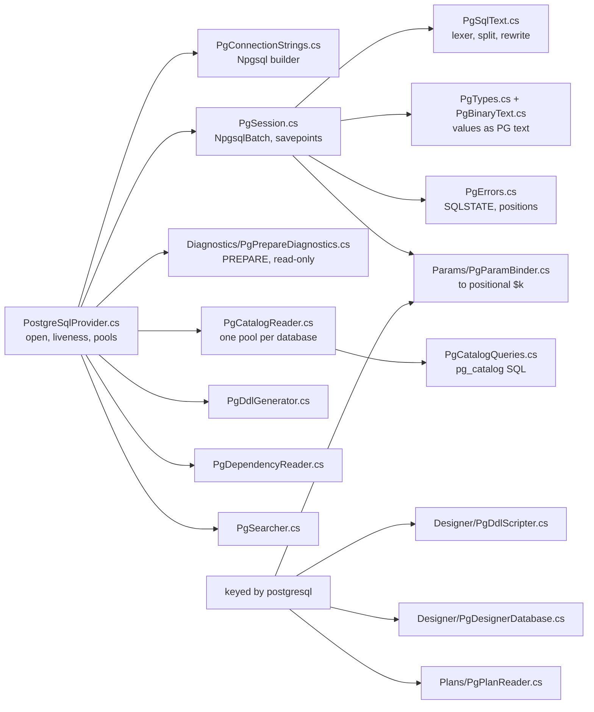

#### Driver and connection

The driver is [Npgsql](../glossary.md#npgsql) 9.0.5
(`engine/src/DbStudio.Providers.PostgreSql/DbStudio.Providers.PostgreSql.csproj:15`), used as plain `NpgsqlConnection`
without `NpgsqlDataSource` (D-PG2). Process-wide, `PgDriver.EnsureInitialized` calls
`GlobalTypeMapper.EnableUnmappedTypes()` once, so enums and user-defined ranges that Npgsql has no mapping for read as text
instead of failing the result set (`PostgreSqlProvider.cs:178-190`).

The form: host, port 5432, database, user, password, `sslMode` (disable ... verify-full), `trustServerCertificate`,
`searchPath`, `applicationName` (default "Rowlit"), connect timeout and free-form server `options`
(`PgConnectionStrings.cs:16-37`). The builder (lines 49-85) sets `IncludeErrorDetail = true`, `Multiplexing = false`,
`KeepAlive = 30`, `Enlist = false`; "trust server certificate" downgrades `verify-ca`/`verify-full` to `Require`, because
Npgsql 8+ does not validate certificates in `Require` (lines 58-60); a profile `searchPath` becomes the connection's
`SearchPath` (lines 79-80). A **read-only profile** adds the server option `-c default_transaction_read_only=on`
(lines 14 and 82), so the server itself refuses writes even if the engine's [read-only guard](08-connections-sessions-execution.md)
missed one. PostgreSQL connections are bound to one database, so `Build` accepts a database override (line 45).

`OpenCatalogReaderAsync` adds a liveness check: Npgsql hands out an idle pooled connection without testing it, and after a
server restart (Docker) the first real query would hang. The provider runs `SELECT 1` bounded by `LivenessTimeout` (10 s)
through `ConnectionGuard.BoundedAsync`; on a broken connection it clears the pools and tries once more
(`PostgreSqlProvider.cs:107-138`). `ClearPooledConnections` clears one pool per cached database (application name
"Rowlit catalog") plus the diagnostics pool ("Rowlit diagnostics") (lines 40-66).

**SSH tunnels.** The form gets the SSH fields (`PostgreSqlProvider.cs:34`); `TunnelTargets.HostPort` rejects a host list
with commas and a Unix socket path, since one forwarded TCP port can carry neither (`TunnelTargets.cs:108-115`). PostgreSQL
is the provider with a live tunnel test: `PgSshTunnelTests` runs PostgreSQL through a real OpenSSH bastion from the compose
`ssh` profile (`engine/tests/DbStudio.Providers.PostgreSql.Tests/PgSshTunnelTests.cs:8-13`).

#### The session: a batch is an `NpgsqlBatch`

`PgSession` (`PgSession.cs:13-27`) is the most elaborate override of the base class.

**Statements inside one batch.** A batch from the UI can contain several statements (`SELECT 1; SELECT 2`). The session splits
it with PostgreSQL's own lexical rules (`PgSqlText.Split`), which the shared Core tokenizer does not fully know: dollar-quoted
bodies `$$...$$` and `$tag$...$tag$`, `E'...'` strings with backslash escapes, `U&'...'`, nested block comments, `[`/`]` as
array subscripts and `?` as a jsonb operator (`PgSqlText.cs:29-36`). It then sends **one `NpgsqlBatch` with one batch command
per statement** (`PgSession.cs:156-171`). All result sets come back in order, and like `psql -c` the statements of one
batch share an implicit transaction in auto mode (line 18).

**Positional parameters.** PostgreSQL's wire protocol only knows `$1, $2, ...`. Decision D-PG4: the binder rewrites every
placeholder (`$n`, `:name`, `@name`) to positional `$k` and binds unnamed `NpgsqlParameter`s; `?` is never a placeholder
because it is the jsonb key-exists operator; strings and nulls bind as `NpgsqlDbType.Unknown` so the server infers the type as
it would for a quoted literal (`Params/PgParamBinder.cs:9-16`). Since each batch command is its own statement, the session
then **renumbers** the global `$k` of each statement to `$1..$m` in order of first appearance (`Renumber`, lines 213-235)
and copies the matching parameters (lines 133-154). Unbound placeholders are rejected up front
(`RejectUnboundParameters => true`, line 62), because PostgreSQL placeholders are unambiguous.

One more trick: a `NULL` or string parameter in a place that gives no type (`SELECT $1`, `$1 IS NULL`) fails with SQLSTATE
42P18 "could not determine data type". Nothing ran, so the session retypes that parameter as `text` and sends the batch
again, at most 16 times, but only when a retry is safe: in autocommit outside a user transaction, or inside the statement
savepoint, which is rolled back first (lines 173-181, `CanRetry` 193-194, `TypeIndeterminateAsText` 197-209).

**Error positions** are mapped back through two layers: the per-statement renumbering and the placeholder rewrite
(`MapServerPosition`, lines 451-463). The result is a document line and column on the exact token the server pointed at. The
error code is the [SQLSTATE](../glossary.md#sqlstate) (five-character standard error code, e.g. `42P01` undefined table) and
`Detail` joins DETAIL, HINT, CONTEXT, internal QUERY and CONSTRAINT lines in psql style (`PgErrors.cs:19-55`).

**[Savepoint per statement](../glossary.md#savepoint-per-statement) (D-PG3).** In PostgreSQL, one failing statement inside a
transaction puts the whole transaction into the "aborted" state (SQLSTATE 25P02): every later statement fails until
`ROLLBACK`. That is hostile in a console. Decision D-PG3 (`docs/PLAN-PG.md:11`): in manual mode, every batch runs inside
`SAVEPOINT dbstudio_stmt`; on success it is released, on error or cancel the session rolls back to it and releases it, so the
transaction stays usable with the earlier work intact, and the user gets the engine message "Statement rolled back to its
savepoint; the transaction stays open with the previous statements intact" (`PgSession.cs:30-32`, `117-124`, `305-325`).
The savepoint is not placed around batches that contain the user's own transaction statements, because releasing it would
also release savepoints they create (line 119). The engine transaction itself begins lazily: queries, session and
transaction statements run without it; the first write or `SAVEPOINT` begins it (`RequiresTransaction`, lines 76-82).
Savepoints in general are explained in [chapter I-09](../part1/09-transactions-and-isolation.md).

**User-typed transactions in auto mode.** If the user types `BEGIN`, the server is in a transaction block although Rowlit's
mode is auto. Only batches with transaction control, `CALL` or `DO` can change that, so only after those the session asks
the server: it reads `transaction_timestamp()` twice; equal values mean a block is open, and an aborted block (25P02) counts as
open (`QueryServerTransactionOpenAsync`, lines 383-405). The comment notes why `statement_timestamp()` could not be used:
with the extended protocol it is refreshed per message. A user `COMMIT`/`ROLLBACK`/`END` inside a manual transaction
makes the session forget its own transaction object (lines 326-332).

**Rows affected** are reported per statement from each `NpgsqlBatchCommand` (`INSERT`, `UPDATE`, `DELETE`, `MERGE`, `COPY`,
`CREATE TABLE AS`) (lines 273-292).

**Notices.** `RAISE NOTICE`, `WARNING` and `INFO` arrive through Npgsql's `Notice` event and become messages with DETAIL,
HINT and CONTEXT lines; when the batch has one statement the server position is mapped to a document line
(`OnNotice`, lines 562-575; severity mapping in `PgErrors.cs:67-74`).

**Rejected statements.** `COPY ... FROM STDIN` / `TO STDOUT` need a client data stream; the driver would leave the connection
in COPY mode, so `ValidateBatch` refuses them with `NOT_SUPPORTED` before they are sent (`PgSession.cs:90-108`).

**Types created in the session.** Npgsql reads the type catalog once per connection string, so a type created in the session
would read as "(unsupported type ...)". After a successful `CREATE/ALTER/DROP TYPE/DOMAIN/EXTENSION` the session calls
`ReloadTypesAsync` (lines 334-353; QA round finding 7 in `docs/qa/round-postgresql.md`).

**Values.** `PgTypes` maps type names to wire kinds and renders values as PostgreSQL itself prints them: arrays as array
literals, intervals in PostgreSQL text form, `timestamptz` with `+00:00` (`PgTypes.cs:11-16`). For values the CLR mapping
cannot carry without loss, `PgBinaryText` decodes the **binary** wire value directly into PostgreSQL's text form: arrays with
`NULL` elements, composites and records, numerics beyond `decimal` and `NaN`/`±Infinity`, infinite or out-of-range dates,
inet masks, MAC addresses and ranges (`PgBinaryText.cs:11-18`). `timetz` prints like the server (`10:20:30+05`, not
`+05:00`) (`PgBinaryText.cs:191-192`). Named composite types still show a placeholder that says how to view the value
(`"col"::text`, `PgTypes.cs:170`); the QA round explains why that one stays (finding 13).

**Cancel.** `CancelCommand` calls `NpgsqlBatch.Cancel()` on the current batch, falling back to the command
(`PgSession.cs:419-428`); Npgsql sends PostgreSQL's out-of-band cancel request (how Npgsql opens it is driver internals, not
verified here). SQLSTATE 57014 marks the cancellation (lines 414-417). Connection-loss states (57P01-57P03 and class 08) mark
the session as broken (lines 430-432, `PgErrors.cs:77-78`).

**Database and schema.** `ChangeDatabaseCoreAsync` throws `NotSupportedException` (lines 551-552). Decision D-PG6: the
endpoint then **reopens the session in place** on the new database, same session id, with 409 `TX_OPEN` when a transaction is
open (`docs/PLAN-PG.md:14`; session reopen is in chapter 8). The default schema is `SchemaMode.Session` driven by
[`search_path`](../glossary.md#search-path), the list of schemas PostgreSQL searches for unqualified names
(line 469). `ReadSchemaCoreAsync` reads `current_schema()`, `current_schemas(false)` and the startup `search_path`
(lines 482-490). `ChangeSchemaCoreAsync` checks the schema exists, then sends
`SET search_path TO "<schema>", <the startup entries without a second copy>`; `null` sends `RESET search_path`
(lines 492-528). Because `SET` is transactional in PostgreSQL, `SchemaIsTransactional => true` makes the base re-read the
schema after commit and rollback (line 472). A regex decides which batches may have changed the schema (`search_path`,
`SET SCHEMA`, `set_config`, `RESET`, `DISCARD`, `ROLLBACK`, `SET ROLE`, `CALL`, `DO`...) (lines 474-480).

#### Prepare diagnostics

**Figure 9.7 — PostgreSQL [prepare diagnostics](../glossary.md#prepare-diagnostics) for one statement.**

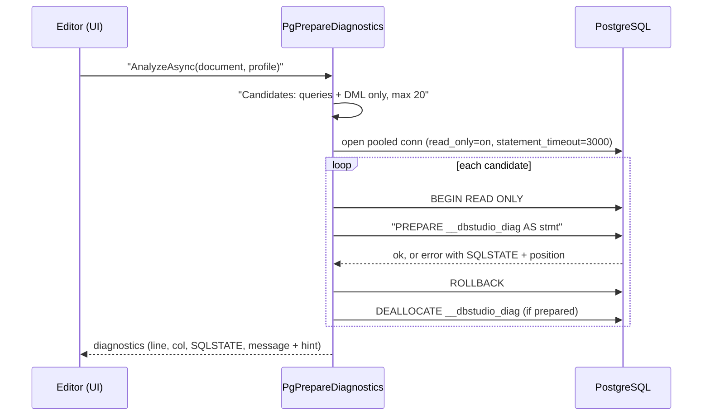

Decision D-PG5 (`docs/PLAN-PG.md:13`): `PREPARE` parses, resolves names, type-checks and plans a statement **without
executing it**. `PgPrepareDiagnostics` (engine name `pg-prepare`) uses that to find "relation does not exist" or type errors
while the user types (`Diagnostics/PgPrepareDiagnostics.cs:8-15`). Safety comes in layers: only single `SELECT`/`VALUES`/
`TABLE`/`INSERT`/`UPDATE`/`DELETE`/`MERGE` statements are candidates (DDL, `DO`, `CALL`, `COPY`, `EXPLAIN`, `SET`/`SHOW`,
transaction control and `SELECT ... INTO` are never sent) (lines 44-56); at most 20 per call (line 18); the pooled
connection runs with `-c default_transaction_read_only=on -c statement_timeout=3000`, application name
"Rowlit diagnostics", connect timeout at most 10 s (lines 59-66); every `PREPARE` is inside `BEGIN READ ONLY` and always
rolled back (lines 88-119). States 42P18, 42P08 (indeterminate or ambiguous parameter types), 25006 (read-only) and
57014 (timeout) are not reported (line 23). An error's server position is mapped through the placeholder rewrite to the
token in the document (lines 124-143). Diagnostics are best effort: if the connection cannot be opened, the result is empty
and the editor keeps its client-side checks (lines 79-86).

#### Catalog

`PgCatalogReader` keeps **one pooled connection per database** (application name "Rowlit catalog"), opened lazily
(`PgCatalogReader.cs:9-13`, `ConnectionFor` at 39-44). `pg_catalog` and `information_schema` are never listed (D-PG9:
the UI ships a static JSON of the most used system views instead), partitions are hidden behind their partitioned parent,
and foreign and partitioned tables count as tables. Queries bind positional `$1` (usually a schema or object oid) and cast
`name` columns to `text` (`PgCatalogQueries.cs:3-7`); PostgreSQL 12+ is assumed (`prokind`, `relispartition`,
`attgenerated`).

```csharp
// engine/src/DbStudio.Providers.PostgreSql/PgCatalogQueries.cs:24-28
public const string Schemas =
    "SELECT n.oid, n.nspname::text, array_position(array_remove(current_schemas(true), 'pg_catalog'::name), n.nspname) - 1 AS sp, " +
    "((SELECT count(*) FROM pg_class c WHERE c.relnamespace = n.oid AND c.relkind IN ('r','p','v','m','f') AND NOT c.relispartition) " +
    "+ (SELECT count(*) FROM pg_proc p WHERE p.pronamespace = n.oid))::int AS object_count " +
    "FROM pg_namespace n WHERE n.nspname NOT LIKE 'pg\\_%' AND n.nspname <> 'information_schema' ORDER BY n.nspname";
```

Each schema carries its position on the search path, which the UI uses to resolve unqualified names in the same order the
server does (D-PG7). Routines that belong to an extension (`pg_depend.deptype = 'e'`, e.g. postgres_fdw or PostGIS) or are
constructors of a range type (`deptype = 'i'`) get a group, and the explorer shows them in a collapsed sub-folder such as
"Extension postgres_fdw" (`RoutineGroup`, lines 84-93; QA finding 16). Unquoted names fold to **lower** case
(`IdentifierRules('"', '"', "lower", ...)`, `PostgreSqlProvider.cs:37`).

**DDL** is generated from the catalog: tables with identity/generated columns, constraints from `pg_get_constraintdef`,
partition keys, non-constraint indexes from `pg_get_indexdef`, triggers and `COMMENT ON`; views and materialized views from
`pg_get_viewdef`; functions from `pg_get_functiondef` (`PgDdlGenerator.cs:52-56`, `PgCatalogQueries.cs:219`).

#### Designer, plans, dependencies, search

- **Designer scripter.** PostgreSQL DDL is transactional and no change needs a table rebuild. Alters run in a fixed order
  (renames, drops, adds, types, nullability, defaults, identity, constraints, indexes, comments) and column/constraint
  sub-commands are combined into one `ALTER TABLE ... a, b, c` so the table is rewritten at most once
  (`Designer/PgDdlScripter.cs:7-14`).
- **Plan reader** (D-PG8). Estimated: `EXPLAIN (FORMAT JSON, VERBOSE, COSTS)`; on PostgreSQL 16+ a statement with
  placeholders and no values uses `GENERIC_PLAN true`, older servers plan with `NULL` values. Actual:
  `EXPLAIN (ANALYZE, BUFFERS, VERBOSE, COSTS, TIMING, FORMAT JSON)`; for a read-only query the statement also runs once
  normally so its rows are delivered (a warning says it ran twice), any other statement only runs under `EXPLAIN ANALYZE`
  and its rows are not returned (`Plans/PgPlanReader.cs:11-62`).
- **Dependency reader.** Views through `pg_rewrite` → `pg_depend`; PL/pgSQL and SQL routine bodies are not tracked by
  `pg_depend` (except `BEGIN ATOMIC` bodies), so their text is scanned for known relation and routine names
  (`PgDependencyReader.cs:8-13`).
- **Searcher** runs over the catalog reader's per-database pools, with data queries in a read-only transaction
  (`PgSearcher.cs:9-12`).
- **Logs and activity**: `PgLogSource` in `DbStudio.Logs` (`LogsModule.cs:46`).

#### What it cannot do

The PostgreSQL fixture overrides no `Supports*` flag (`engine/tests/DbStudio.Providers.PostgreSql.Tests/PgFixture.cs:110`).
From the code:

- No database switch on a connection: a database change reopens the session (D-PG6).
- No `COPY ... FROM STDIN / TO STDOUT` in the console (`PgSession.cs:90-108`).
- No REF CURSOR or OUT binds: OUT values come back as a result row (`PgParamBinder.cs:15`, 182-183).
- Named composite types show a placeholder instead of the value (driver limitation, QA finding 13).
- Prepare diagnostics only cover queries and DML, 20 statements per document.
- Through SSH: one host, no Unix socket.

### 3.4 SQLite

SQLite is the only embedded engine: there is no server, the "connection" is a file handle inside the engine process. That
changes the questions: there is nothing to tunnel, cancel must interrupt a library call on another thread, and "the server's
locks" are file locks other programs can hold. The provider is in `engine/src/DbStudio.Providers.Sqlite`, registered in
`Program.cs` (line 94) with keyed features under `"sqlite"` (lines 132-141).

**Figure 9.8 — SQLite provider: files and what each one does.**

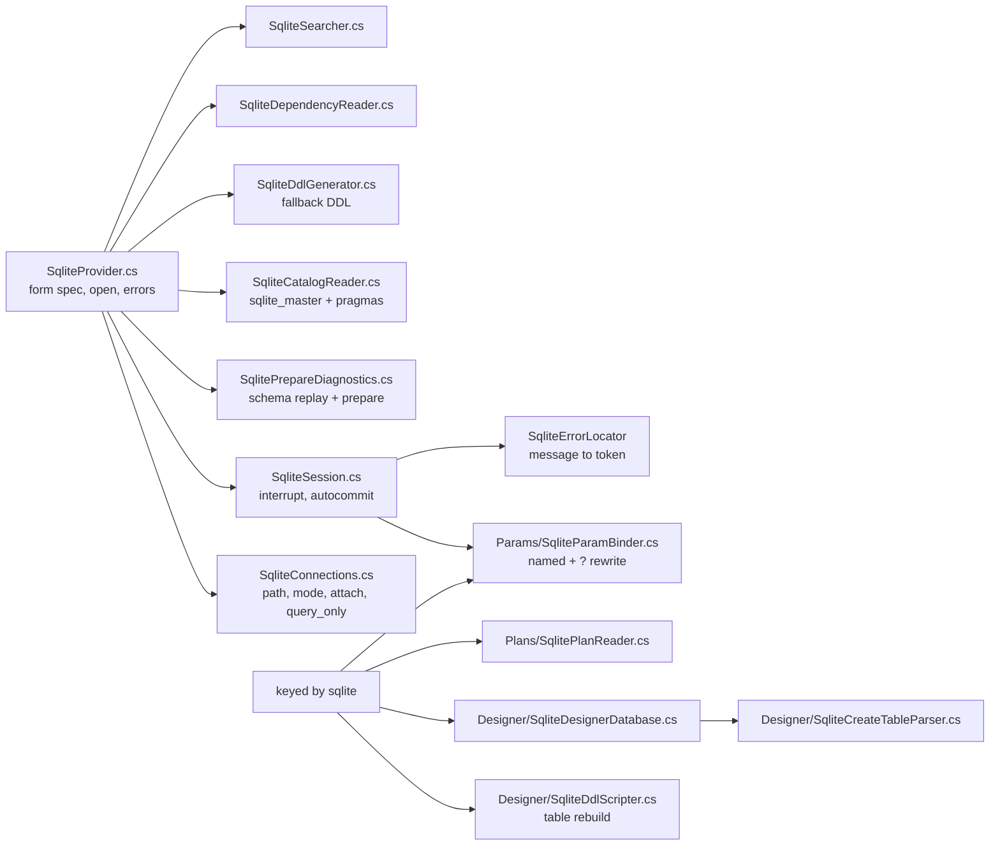

#### Driver and connection

The driver is [Microsoft.Data.Sqlite](../glossary.md#microsoft-data-sqlite) 10.0.13
(`engine/src/DbStudio.Providers.Sqlite/DbStudio.Providers.Sqlite.csproj:8`); its native `e_sqlite3` library is bundled in the
Windows single-file build next to SNI (`scripts/build.ps1:67-68`).

The form has four fields: the database `path` (a file picker, or `:memory:` for a private in-memory database), `readOnly`,
`createIfMissing` and `attach`, a list of `name=path` entries attached to every session and to the explorer
(`SqliteProvider.cs:38-47`). There are no SSH fields, and `sqlite` is not in `TunnelTargets.Supported`
(`TunnelTargets.cs:19-22`): a local file has no port to forward.

`SqliteConnections.BuildConnectionString` (`SqliteConnections.cs:45-63`) resolves the path (environment variables expanded,
made absolute, lines 11-15), chooses the open mode (`Memory`, `ReadOnly`, `ReadWriteCreate` or `ReadWrite`), turns
foreign keys on by default (`foreignKeys` prop, line 58), sets `Pooling = false` ("one physical connection per tab; also keeps
the file unlocked once closed", line 59) and `DefaultTimeout` to the busy timeout, 30 s by default and at least 1 s because
0 means "forever" to the driver (line 20).

`OpenAsync` (lines 89-132) validates before opening: a folder is not a database file, a read-only or not-create file must
exist, and create-if-missing creates the file but not its folder, which it says explicitly instead of the driver's "unable
to open database file". After opening it runs `ATTACH DATABASE $path AS "name"` for every
[attached database](../glossary.md#attached-database) (an extra database file opened on the same connection under a schema
name) (lines 109-118).

**Read-only, two ways.** A read-only profile opens the file with `Mode=ReadOnly` (the driver refuses every write) for catalog,
search and diagnostics connections. A **tab session** is different: it opens read-write and switches
`PRAGMA query_only = ON` (lines 39-44, 84-86, 119-124). The reason is the "Run with writes" override of the read-only guard
(chapter 8): `SqliteSession.OnExecutionStartingAsync` lifts `query_only` for one execution whose request has
`WritesConfirmed`, and `OnExecutionCompletedAsync` puts it back (`SqliteSession.cs:34-49`). A file opened with
`Mode=ReadOnly` could not do that.

`TestAsync` also runs `SELECT count(*) FROM sqlite_master`, so a file that is not a database fails at test time with
"file is not a database" (`SqliteProvider.cs:62-67`). `ServerInfo` is `SQLite <sqlite_version()>`, the file name as the
server and `main` as the database (lines 97-104).

#### The session

Microsoft.Data.Sqlite is synchronous under the hood; the base class runs every execution on a thread-pool thread, so the
engine's request thread never blocks (`SqliteSession.cs:13-16`, `AdoSessionBase.cs:98-99`).

**Cancel** is the subtle part. `CancelCommand` calls `sqlite3_interrupt` on the connection handle (safe from any thread),
**and** cuts the command timeout to 1 s (`SqliteSession.cs:63-73`). The second step exists because of the driver's
busy-retry loop: when another process holds a lock, the driver retries the statement until `CommandTimeout`, each retry resets
the statement and clears the interrupt, so the interrupt alone is lost; the driver re-reads `CommandTimeout` on every retry,
so 1 s makes it give up with `SQLITE_BUSY` (`SqliteConnections.cs:25-33`). `SQLITE_INTERRUPT` (9), or a lock error after a
requested cancel, is reported as a cancellation (`SqliteSession.cs:75-79`).

**Transactions.** Manual mode uses a **deferred** `BEGIN` (no write lock until the first write), which is friendlier to
other processes using the file (lines 92-94). A user-typed `BEGIN` in any mode is tracked with
`sqlite3_get_autocommit`, which is 0 while a transaction is open (lines 81-90).

**Locks.** `SQLITE_BUSY` (5) and `SQLITE_LOCKED` (6) are mapped to the shared lock-wait message from Core and a detail that
says how long the connection waited (its busy timeout) (`SqliteSession.cs:117-123`, `SqliteConnections.cs:17-23`).

**Errors without positions.** SQLite reports no offsets, so `SqliteErrorLocator.Locate` reads the message: `near "X": syntax
error`, `no such table/column/function...: X`, `... already exists`, `ambiguous column name`, `has no column named`,
`incomplete input` (end of the text), and finds the token in the batch (`SqliteSession.cs:147-186`). Codes are the primary
result code names (`SQLITE_ERROR`, `SQLITE_CONSTRAINT`...) with the extended code in `Detail`
(`SqliteConnections.cs:139-149`, `SqliteSession.cs:124-134`). `SQLITE_NOTADB` (26) and `SQLITE_CORRUPT` (11) mark the session
broken (lines 143-144).

**Values.** Booleans are stored as integers; a column declared `BOOLEAN` is sent as `true`/`false` (lines 108-115). An
unnamed `?` that the binder rewrote to `@__p1` would name the result column "@__p1"; it is renamed back to "?"
(lines 96-106).

**Parameters.** Named `:x`, `@x`, `$x` and numbered `?NNN` bind by name; unnamed `?` become `@__p1`, `@__p2` ... (a numbered
`?1` would share SQLite's slot 1 with the first named parameter) and consume positional values in order. Decimals bind as
`REAL` when exactly representable, else `TEXT`; dates, times and GUIDs as ISO `TEXT` (`Params/SqliteParamBinder.cs:12-19`).

**Database.** SQLite has no database to switch: `ChangeDatabaseCoreAsync` is the base default, which throws
`NotSupportedException` (`AdoSessionBase.cs:615-617`); `CurrentDatabase` is always `main` (`SqliteSession.cs:31`).

#### Prepare diagnostics: what the code really does

`SqlitePrepareDiagnostics` (engine name `sqlite-prepare`) compiles each statement with `sqlite3_prepare`, which reports
"syntax error" and "no such table" without executing (`SqlitePrepareDiagnostics.cs:8-14`). The plan described a different
algorithm: "the engine binary-searches by preparing prefixes of each statement" (`docs/PLAN.md:174`). **The code does not
bisect prefixes.** It splits the document into statements with the Core `SqlTokenizer`, prepares each statement whole, and
locates the error token from the message with `SqliteErrorLocator` (lines 27-90). What it adds instead is safety and
context:

1. **Nothing touches the user's file.** A private `:memory:` database is created (line 34). The schema (tables, views,
   indexes, triggers) of the profile's file and its attached databases is **replayed** into it from `sqlite_master.sql`,
   opening the source read-only (`TryReplaySchema`, lines 98-156; attached schemas are re-created as attached in-memory
   databases and `CREATE` statements qualified with `QualifyCreate`, 159-171).
2. **DDL in the document is executed on the copy**, so a later statement sees the table an earlier `CREATE TABLE` made
   (lines 49-53). `ATTACH`/`DETACH` are skipped.
3. **No profile, no false alarms.** Without a schema, "no such table/column/view/index/trigger" messages are dropped
   because they would be noise (lines 66, 92-95).
4. At most 2000 statements per call (line 17).

#### Catalog

There is no database level; the schemas are the attached databases from `PRAGMA database_list`, `temp` excluded
(`SqliteCatalogReader.cs:11-14`, 150-163). Objects come from `sqlite_master`, the table that stores every object's
`CREATE` text (lines 184-185); columns for all tables in one query through `pragma_table_xinfo`, whose `hidden` column
marks hidden virtual-table columns and generated columns:

```csharp
// engine/src/DbStudio.Providers.Sqlite/SqliteCatalogReader.cs:192-194
private const string ColumnsSelect =
    "SELECT m.name, p.cid, p.name, p.type, p.\"notnull\", p.dflt_value, p.pk, p.hidden FROM {0}.sqlite_master m " +
    "JOIN pragma_table_xinfo(m.name, $schema) p WHERE m.type IN ('table','view') AND m.name NOT LIKE 'sqlite\\_%' ESCAPE '\\'";
```

If one broken view (referencing a dropped table) makes this bulk query fail, the reader falls back to one query per object
(lines 203-209). [`WITHOUT ROWID`](../glossary.md#without-rowid) and [`STRICT`](../glossary.md#strict) table options are
parsed from the stored `CREATE` text (regex at lines 145-146). The row estimate uses `sqlite_stat1` when present, else
`max(_rowid_)` (lines 398-408), using the [rowid](../glossary.md#rowid), the hidden 64-bit key of an ordinary SQLite table.
Shadow tables of FTS and R-tree virtual tables (`_data`, `_idx`, `_content`...) are recognised and kept out of the way
(line 419). DDL is the stored `sqlite_master.sql`; `SqliteDdlGenerator` is only the fallback for objects without stored SQL
(`SqliteDdlGenerator.cs:7-10`).

#### Designer, plans, dependencies, search, sample database

- **Designer scripter.** Native `ALTER TABLE` only for what SQLite supports: `RENAME TO`, `RENAME COLUMN` (3.25+),
  `ADD COLUMN` (no PK/UNIQUE, constant default, appended at the end), `DROP COLUMN` (3.35+, unreferenced), plus indexes.
  Everything else uses the documented table rebuild: foreign keys off, new table, copy, drop, rename, recreate indexes,
  triggers and dependent views, `PRAGMA foreign_key_check`, foreign keys on; all inside one transaction with the PRAGMAs
  outside it (`Designer/SqliteDdlScripter.cs:8-14`, `Designer/SqliteDesignerDatabase.cs:10-15`). What the pragmas do not
  report (constraint names, CHECK text, AUTOINCREMENT, COLLATE, generated expressions, WITHOUT ROWID, STRICT) is parsed
  from the stored `CREATE TABLE` (`Designer/SqliteCreateTableParser.cs:6-9`).
- **Plan reader.** `EXPLAIN QUERY PLAN` rows (`id`, `parent`, `detail`) become a tree; "actual" runs the statement first, but
  SQLite has no runtime statistics, so the tree is the same (`Plans/SqlitePlanReader.cs:9-12`).
- **Dependency reader.** SQLite records no dependencies of views and triggers, so their `sqlite_master.sql` is tokenized and
  identifiers are matched against the schema's table and view names; foreign keys come from `PRAGMA foreign_key_list`
  (`SqliteDependencyReader.cs:10-14`).
- **Searcher.** The catalog is small, so names and code are matched in the engine without a SQL prefilter, on a `query_only`
  connection; `REGEXP` is .NET's regex (`SqliteSearcher.cs:11-15`).
- **Logs and activity**: none. `LogsModule` registers no SQLite source (`LogsModule.cs:44-49`), so the Logs tab shows only the
  engine log.
- **Sample database.** "Try the sample database" builds a deterministic SQLite `shop` database under
  `<data dir>/sample/shop.sqlite` (24 countries, 300 customers, 60 products, 1500 orders, plus a view, indexes, checks and
  triggers) and a profile named "Sample: Shop" (`engine/src/DbStudio.Core/Sample/SampleDatabase.cs:12-21`). It is a Core
  feature that uses the SQLite provider, not part of the provider.

#### What it cannot do

The SQLite fixture overrides no `Supports*` flag (`engine/tests/DbStudio.Providers.Sqlite.Tests/SqliteFixture.cs:10`). From
the code:

- No SSH tunnel (a local file) and no database switch (`main` only; other files are attached).
- No server messages exist; rows affected come from the driver.
- No logs or activity view.
- No runtime plan statistics.
- Positions of runtime errors are best effort (message parsing, no offsets from SQLite).
- Many table changes require the full rebuild, which the designer scripts but which takes time on big tables.

### 3.5 MySQL and MariaDB

MySQL and MariaDB are two branches of the same family: MariaDB started as a fork of MySQL and still speaks the same
wire protocol, so one driver and one dialect serve both. Rowlit ships them as **two provider ids in one package**:
`mysql` and `mariadb` are two small classes over one shared base, and the server flavour is detected again on every
connection. A beginner can read this section as "how a MySQL console works"; a senior will find the places where
MySQL and MariaDB behave differently and how the provider hides that.

**Figure 9.9 — MySQL / MariaDB package: file to responsibility.**

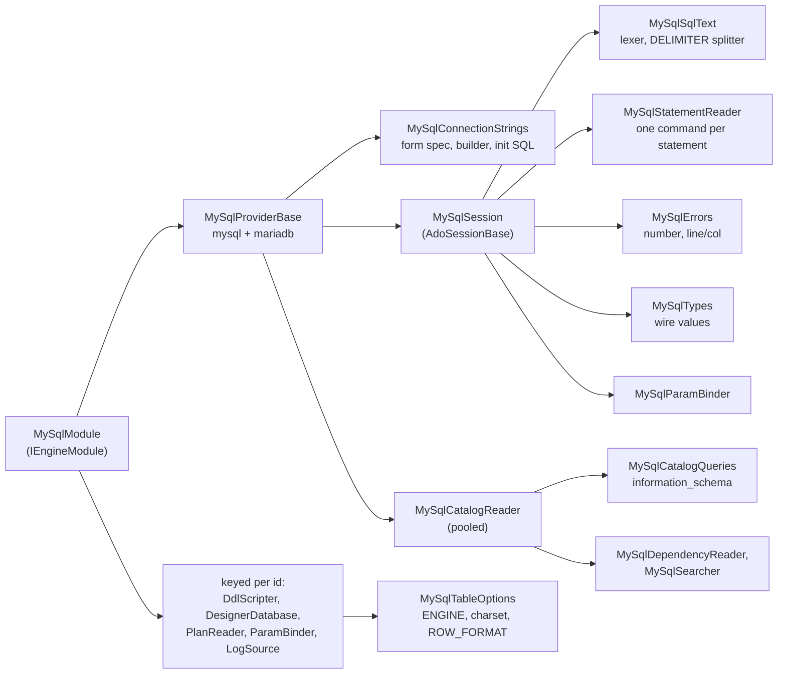

#### Package and registration

The project references Core, `DbStudio.Logs` and one NuGet package, [MySqlConnector](../glossary.md#mysqlconnector)
2.4.0 (an MIT-licensed, fully asynchronous ADO.NET driver for MySQL-protocol servers)
(`engine/src/DbStudio.Providers.MySql/DbStudio.Providers.MySql.csproj:21`). No native libraries are involved
(`docs/wp-notes/WP-MY.md:524`).

`MySqlModule` is the package's [engine module](../glossary.md#engine-module), found by reflection like every other
(see [chapter 7](07-engine-modules-and-di.md)). It registers both providers as `IDbProvider` singletons and then loops
over the two ids, registering under each id a keyed `IDdlScripter`, `IDesignerDatabase`, `IPlanReader`,
`IParamBinder` and one `MySqlLogSource` that serves as both `ILogSource` and `IActivitySource`
(`engine/src/DbStudio.Providers.MySql/MySqlModule.cs:24-41`). `MapEndpoints` is empty on purpose: "No MySQL-specific
endpoints" (`MySqlModule.cs:43-46`); everything goes through the shared relational routes.

The two providers differ only in `Id` and `DisplayName` (`engine/src/DbStudio.Providers.MySql/MySqlProvider.cs:104-115`).
The base class fixes the shared traits: `Dialect.MySql` for both, `Diagnostics => null` (no server-side syntax check),
and `IdentifierRules('`', '`', "preserve", MySqlReservedWords.All)` (`MySqlProvider.cs:19-23`). Because the flavour is
read from the server, "a 'mysql' profile pointing at a MariaDB server still works" (`MySqlProvider.cs:11-14`).

#### Connection strings and opening a session

`MySqlConnectionStrings.FormSpec` is the generic connection dialog for this family: host, port 3306, database, user,
password, SSL mode (none / preferred / required / verify CA / verify full), CA file, *Allow public key retrieval*,
character set (default `utf8mb4`), connect timeout (default 15 s), compression and *Session variables*
(`engine/src/DbStudio.Providers.MySql/MySqlConnectionStrings.cs:10-37`). The provider appends the shared SSH block with
`SshFormFields.Append(...)` (`MySqlProvider.cs:20`), so MySQL and MariaDB connections can go through an
[SSH tunnel](../glossary.md#ssh-tunnel). The tunnel needs one TCP host: `TunnelTargets` refuses a comma-separated host
list or a Unix socket path and otherwise rewrites `host`/`port` to the local forward
(`engine/src/DbStudio.Core/Services/Tunnels/TunnelTargets.cs:36,56-63,108-115`). The tunnel itself is explained in
[chapter 8](08-connections-sessions-execution.md).

The builder is where most driver decisions live:

```csharp
// engine/src/DbStudio.Providers.MySql/MySqlConnectionStrings.cs:55-77
var b = new MySqlConnectionStringBuilder
{
    Server = host, Port = (uint)port, Pooling = pooling,
    DefaultCommandTimeout = 0,
    AllowUserVariables = true,
    AllowLoadLocalInfile = false,
    UseAffectedRows = true,
    TreatTinyAsBoolean = false,
    ConvertZeroDateTime = true,
    GuidFormat = MySqlGuidFormat.None,
    // Cancel sends KILL QUERY on a side connection; give it a few seconds …
    CancellationTimeout = 5,
    IgnoreCommandTransaction = true,
    Keepalive = 30,
};
```

Each line has a reason. `Pooling = false` for sessions because "session state, USE, user variables and transactions
belong to the tab"; catalog, designer and search connections are pooled (`MySqlConnectionStrings.cs:39-45`).
`AllowUserVariables` lets `@x` reach the server as a user variable instead of a missing parameter.
`AllowLoadLocalInfile = false` means the server can never ask the engine to upload a client file.
`TreatTinyAsBoolean = false` keeps `TINYINT(1)` a number. `GuidFormat = None` is a recorded deviation: with `Char36`
"every CHAR(36) column is read as a Guid and a non-GUID value in one fails the whole result set"
(`docs/wp-notes/WP-MY.md:82-83`).

*Session variables* are parsed by `ParseServerVariables`: `name=value` pairs, split on commas outside quotes and
parentheses, names must be identifiers, values may not contain `;` (`MySqlConnectionStrings.cs:102-134`). They run as
one `SET SESSION …` right after the connection opens; a read-only profile adds `SET SESSION TRANSACTION READ ONLY` on
session connections (`MySqlConnectionStrings.cs:137-144`). So read-only is enforced twice: by Core's
[read-only guard](../glossary.md#read-only-guard) and by the server itself.

`OpenSessionAsync` opens an unpooled connection on the tab's database, runs those init statements, then
`SELECT VERSION(), @@version_comment, CURRENT_USER(), DATABASE(), CONNECTION_ID()` in one round trip
(`MySqlProvider.cs:62-78`, `engine/src/DbStudio.Providers.MySql/MySqlDb.cs:133-139`). `MySqlFlavor.From` decides MariaDB
when "MariaDB" appears in the version or the comment, and handles the old MariaDB protocol prefix `5.5.5-`
(`MySqlDb.cs:13-19`, `engine/src/DbStudio.Providers.MySql/MySqlSqlText.cs:500-509`). The flavour object answers the
version questions the rest of the package asks: CHECK constraints (MySQL 8.0.16+, MariaDB 10.2+), `EXPLAIN ANALYZE`
(MySQL 8.0.18+), view usage tables (MySQL 8.0.13+), sequences (MariaDB 10.3+) (`MySqlDb.cs:29-38`). `ServerInfo.ProductVersion`
gets a `-MariaDB` suffix so version-dependent readers such as the plan reader can tell the flavour apart
(`MySqlProvider.cs:96-99`).

#### Executing a batch: DELIMITER and the statement reader

`MySqlSession` derives from `AdoSessionBase` (see [section 2.3](#23-the-shared-ado-base)) and overrides the hooks it
needs. The interesting one is `ExecuteReaderAsync`.

A MySQL script often contains [DELIMITER](../glossary.md#delimiter) lines. `DELIMITER $$` is not SQL: it is a command of
the `mysql` command-line client that changes the statement terminator, so a stored procedure body full of `;` can be
sent as one statement. The server would reject the line. `MySqlSqlText.Split` therefore behaves like the client: a
`DELIMITER xx` at the start of a line switches the terminator and produces no statement; with the default `;`,
stored-program bodies (`CREATE … PROCEDURE | FUNCTION | TRIGGER | EVENT`, `BEGIN NOT ATOMIC`, labelled blocks and the
MariaDB top-level `IF / CASE / LOOP / WHILE / REPEAT`) stay whole; `\G` and `\g` also end a statement
(`MySqlSqlText.cs:222-249,257-278,292-294,359-384`). The nesting rules are careful: `IF(` as a function and
`IF [NOT] EXISTS` do not open a block, and `END IF` closes what it names rather than an extra level
(`MySqlSqlText.cs:311-339`).

Then each statement is sent **as its own command**. MySqlConnector can send a multi-statement text, but the plan's
`MySqlBatch` path was dropped: "MySqlConnector 2.4.0 does not set `DbException.BatchCommand` and
`MySqlBatchCommand.RecordsAffected` stays 0" (`docs/wp-notes/WP-MY.md:84-85`). (The class comment at
`engine/src/DbStudio.Providers.MySql/MySqlSession.cs:15-17` still mentions `MySqlBatch`; the code below does not use it.)
`MySqlStatementReader` is a `DbDataReader` that wraps the statements of one batch: when one statement's result sets are
exhausted it records the rows affected, runs an after-statement hook and executes the next statement lazily
(`engine/src/DbStudio.Providers.MySql/MySqlStatementReader.cs:8-13,47-67`). To the shared base it looks like one reader
with many result sets, so streaming, `MaxRows` and the sink work unchanged. Its `Index` always names the statement that
is running or failed, so an error maps to the right line.

```csharp
// engine/src/DbStudio.Providers.MySql/MySqlSession.cs:137-155
async Task<MySqlDataReader> Execute(int index, CancellationToken token)
{
    context.Items[IndexKey] = index;
    await ClearStaleDiagnosticsAsync(list[index], token).ConfigureAwait(false);
    MySqlCommand c;
    if (index == 0) c = cmd;
    else
    {
        c = (MySqlCommand)CreateCommand(list[index].SentText);
        foreach (MySqlParameter p in cmd.Parameters) c.Parameters.Add(p.Clone());
    }
    c.CommandText = list[index].SentText;
    _running = c;
    return await c.ExecuteReaderAsync(CommandBehavior.Default, token).ConfigureAwait(false);
}
```

Two edge cases are handled before that: a batch with only comments or DELIMITER lines is sent as `DO 0`, because the
server would answer "Query was empty" (`MySqlSession.cs:117-123`), and `LOAD DATA LOCAL INFILE` is refused up front
with `NOT_SUPPORTED` (`MySqlSession.cs:91-105`).

#### Messages, warnings and errors

MySqlConnector 2.4.0 never fires `InfoMessage` and does not expose warning counts, so after **every** statement the
reader runs `SHOW WARNINGS`, "like MySQL Workbench" (`MySqlSession.cs:190-213`, `docs/wp-notes/WP-MY.md:86-88`). Levels
map to Error / Info (Note) / Warning, and the result goes to the sink as server messages. The cost is one extra round
trip per statement, with a documented side effect: `ROW_COUNT()` and `FOUND_ROWS()` in a *later* batch describe
`SHOW WARNINGS`, not your statement (`MySqlSession.cs:193-194`). Note 1003 after `EXPLAIN` (the optimizer's rewritten
query) is skipped as noise (`MySqlSession.cs:219-220`).

MariaDB adds a twist: it clears its diagnostics area only for statements that use tables, so a `SELECT 1` after a
failed statement would report the old error again. When MariaDB left diagnostics behind, the session runs a cheap
`SELECT 1 FROM information_schema.ENGINES LIMIT 0` before the next statement, unless that statement reads diagnostics
itself (`SHOW`, `GET`, `DESCRIBE`) (`MySqlSession.cs:160-187`).

Errors become `ErrorInfo` with the server error number as the code (for example `1146`), `SQLSTATE …` in the detail,
and a document position. `MySqlErrors.Locate` finds the position from "near '…' at line N" (it searches the first 40
characters of the quoted text on that line), from "at line N", or from the name in "Unknown column 'x'" /
"Table 'x'" messages (`engine/src/DbStudio.Providers.MySql/MySqlErrors.cs:44-99`). Connection loss is recognised by
error numbers 1053, 1152, 1153, 1927, 2006, 2013, 4031 or an inner socket/IO error (`MySqlErrors.cs:16-24`); a failing
`POST /connections/test` answers `PROVIDER_ERROR` with the socket cause appended to MySQL's vague "Unable to connect"
(`MySqlErrors.cs:123-139`).

#### Transactions

MySQL commits implicitly before and after DDL, so a transaction "begun for it would end at once". In manual mode the
session therefore starts the engine transaction only for writes or `SAVEPOINT`, never for queries, DDL or
`LOCK/UNLOCK TABLES` (`MySqlSession.cs:73-83,356-357`). After a batch, `EndsTransaction` checks whether the user's
`COMMIT`/`ROLLBACK`, a `START TRANSACTION` (which commits the previous one) or an implicitly committing statement ended
the engine transaction; if DDL did, the console gets a warning that MySQL committed it
(`MySqlSession.cs:27-28,328-340,360-371`).

Whether a transaction is open on the server after the batch is answered differently per flavour: MariaDB has
`SELECT @@in_transaction`; MySQL "has no unprivileged equivalent", so the transaction statements of the batch decide
(`MySqlSession.cs:373-402`). The consequence is a known gap: on MySQL "a procedure that starts a transaction internally
is not detected" (`docs/wp-notes/WP-MY.md:544-545`).

#### Cancel with KILL QUERY

A MySQL server cannot be interrupted on the connection that runs the query. MySqlConnector's `Cancel()` opens a
**side connection** and sends [KILL QUERY](../glossary.md#kill-query) *connection-id*, which stops the statement but
keeps the session (`MySqlSession.cs:407-412`). `CancellationTimeout = 5` bounds how long the driver waits for that.
Error 1317 ("Query execution was interrupted"), 3024 (`max_execution_time`) and MariaDB's 1969 count as cancellation
(`MySqlErrors.cs:26-29`).

Two details show how much care cancel needs. First, `KILL QUERY` on `SELECT SLEEP(60)` makes the sleep return 1
instead of failing; a read-only batch that "completed" after a cancel is therefore reported as Cancelled
(`MySqlSession.cs:313-320`). Second, when a single query hits the row cap the session does not drain the remaining rows:
`OnResultSetTruncatedAsync` returns false so the base cancels the server instead (`MySqlSession.cs:283-290`).

#### Types and wire values

`MySqlTypes.KindFor` maps the reported type to a [column kind](../glossary.md#cell-kind): spatial and `VECTOR` →
binary, `BIT` → string, `YEAR` → int, `ENUM`/`SET` → string, `JSON` → json, `DATE` → date, `TIME` → time
(`engine/src/DbStudio.Providers.MySql/MySqlTypes.cs:34-55`). `ReadValue` then applies MySQL's rules: `DECIMAL` is read
with `GetMySqlDecimal` and sent as exact text (so `DECIMAL(65,30)` survives); a zero date (`0000-00-00`) becomes NULL
plus one warning per batch; `BIT(n)` becomes a zero-padded bit string; geometry drops the 4-byte SRID prefix and is sent
as WKB binary; `TIME` is printed as MySQL prints it (`838:59:59`, `-01:02:03.5`) instead of .NET's `34.22:59:59`
(`MySqlTypes.cs:58-153`). Large unsigned integers follow the shared [wire value](../glossary.md#wire-value) rule (beyond
2^53 as text).

#### Parameters

`MySqlParamBinder` accepts three placeholder styles: `:name` (rewritten to `@name`), `?` (rewritten to `@__p…`) and
`@name`, which is bound **only if a value with that name was given**, otherwise it stays a user variable
(`engine/src/DbStudio.Providers.MySql/Params/MySqlParamBinder.cs:11-17`). The values are interpolated client-side by
MySqlConnector as escaped literals. OUT and INOUT parameters of `CALL` are user variables: the session runs `SET @p = …`
before the statement and `SELECT @p` after it (`MySqlSession.cs:222-255`).

#### Catalog over information_schema

`MySqlCatalogReader` runs over one **pooled** connection with the application name "Rowlit catalog"
(`engine/src/DbStudio.Providers.MySql/MySqlCatalogReader.cs:30-46`). MySQL is single-level
(`DialectInfo.SchemaIsDatabase(Dialect.MySql)` is true, `engine/src/DbStudio.Core/Models/DialectInfo.cs:17`): a MySQL
"database" plays the role of a schema, `ListDatabasesAsync` returns nothing and the explorer's schemas are the server's
databases (`MySqlCatalogReader.cs:9-13,59-64`). Every query is a constant in `MySqlCatalogQueries`, filtered by `@p0`
(the database) and hiding the system databases:

```csharp
// engine/src/DbStudio.Providers.MySql/MySqlCatalogQueries.cs:10-22
public const string SystemSchemas = "'mysql','sys','performance_schema','information_schema'";
public const string Schemas =
    "SELECT s.SCHEMA_NAME, (SELECT COUNT(*) FROM information_schema.TABLES t WHERE t.TABLE_SCHEMA = s.SCHEMA_NAME) " +
    "FROM information_schema.SCHEMATA s WHERE s.SCHEMA_NAME NOT IN (" + SystemSchemas + ") ORDER BY s.SCHEMA_NAME";
public const string Columns =
    "SELECT TABLE_NAME, COLUMN_NAME, COLUMN_TYPE, IS_NULLABLE, COLUMN_KEY, EXTRA, COLUMN_COMMENT, ORDINAL_POSITION, " +
    "COLUMN_DEFAULT, DATA_TYPE, GENERATION_EXPRESSION, CHARACTER_SET_NAME, COLLATION_NAME " +
    "FROM information_schema.COLUMNS WHERE TABLE_SCHEMA = @p0 ORDER BY TABLE_NAME, ORDINAL_POSITION";
```

`LoadSchemaAsync` reads tables, columns, key columns, routines, parameters, triggers and events, and the databases that
reference this one through foreign keys (`MySqlCatalogReader.cs:80-104`). Events, which MySQL schedules like cron jobs,
appear as `proc` objects with the comment "event" (`docs/wp-notes/WP-MY.md:50-52`); a server that denies the EVENTS
table simply yields none (`MySqlCatalogReader.cs:97-103`). DDL text comes from `SHOW CREATE TABLE | VIEW | PROCEDURE |
FUNCTION | TRIGGER | EVENT | SEQUENCE` (`docs/wp-notes/WP-MY.md:53`). Find in database, dependencies and the object
list reuse the same pooled reader (`MySqlProvider.cs:83-90`).

#### DDL, the designer and table options

`MySqlDdlScripter` scripts CREATE TABLE with inline keys, indexes (DESC and prefix lengths `col(10)`), CHECK, FOREIGN
KEY, `AUTO_INCREMENT`, VIRTUAL/STORED generated columns and comments; an ALTER runs `RENAME TABLE` first, then
`DROP FOREIGN KEY`s, then one `ALTER TABLE` with drops, `CHANGE`/`MODIFY COLUMN` (with `FIRST`/`AFTER`), adds, keys,
checks and the comment, and finally `ADD FOREIGN KEY`s (`engine/src/DbStudio.Providers.MySql/Designer/MySqlDdlScripter.cs:7-16`).
Its feature flags say `TransactionalDdl: false`, and every script carries the warning that "statements that ran before
a failure stay applied" (`MySqlDdlScripter.cs:21-22,61-63`). The designer itself is the subject of
[chapter 14](14-designers-and-ddl.md).

Table options are where the WP note is out of date. The note lists ENGINE, CHARSET and ROW_FORMAT as "preserved by
ALTERs but not editable" (`docs/wp-notes/WP-MY.md:542-543`), but the code now has `MySqlTableOptions` (QA round-mysql
#10): ENGINE, default character set, collation, ROW_FORMAT and the AUTO_INCREMENT start travel in
`TableOptions.Extra`; `MySqlDesignerDatabase` reads them from `information_schema.TABLES`, values are validated as
plain words (they are written unquoted), and an ALTER emits only what changed, with warnings such as "Changing the
storage engine … rebuilds the table" and "existing columns keep theirs" for a charset change
(`engine/src/DbStudio.Providers.MySql/Designer/MySqlTableOptions.cs:7-130`,
`engine/src/DbStudio.Providers.MySql/Designer/MySqlDesignerDatabase.cs:148`). Partitions remain outside the model.

#### Plans

`MySqlPlanReader` picks the statement by flavour: estimated plans are `EXPLAIN FORMAT=JSON`; actual plans are
`EXPLAIN ANALYZE` (TREE text) on MySQL 8.0.18+, `ANALYZE FORMAT=JSON` on MariaDB, and the estimated JSON with a warning
on older MySQL (`engine/src/DbStudio.Providers.MySql/Plans/MySqlPlanReader.cs:12-63`). Both actual forms execute the
statement and discard its rows, so a single read-only query runs **twice** (once for its rows, once for the plan) and the
user is told so (`MySqlPlanReader.cs:21,41-46`). Estimated plans without parameter values bind NULL, which for
`col = :p` on a key makes MySQL answer "Impossible WHERE" (`docs/wp-notes/WP-MY.md:91-92`). Plans in the UI are covered
in [chapter 15](15-import-export-plans-er.md).

#### Logs, activity and search

The keyed `MySqlLogSource` lives in `engine/src/DbStudio.Logs/Providers/MySql/MySqlLogSource.cs`: the error log from
`performance_schema.error_log` (MySQL 8.0.22+), the general and slow logs when `log_output` includes TABLE, InnoDB
status, and an activity view from the processlist and lock waits with `KILL` / `KILL QUERY`
(`docs/wp-notes/WP-MY.md:66-69`). See [chapter 21](21-logs-activity-resources.md).

#### Identifier rules and dialect traits

Identifiers are quoted with backticks and always quoted by `MySqlSqlText.Quote` ("MySQL has many reserved words and case
rules") (`MySqlSqlText.cs:476-477`). The folding value is `"preserve"`; the plan had said "insensitive", "which is not a
value any reader knows" (`docs/wp-notes/WP-MY.md:89-90`). The Core lexer traits for `Dialect.MySql` are backtick
identifiers, `#` line comments and backslash escapes inside strings (`DialectInfo.cs:39,42,45`).

That last trait is where [NO_BACKSLASH_ESCAPES](../glossary.md#no-backslash-escapes) matters. In MySQL's default
`sql_mode`, `'a\'b'` is a string with a quote in it; with `NO_BACKSLASH_ESCAPES` the backslash is an ordinary character.
The engine's literal builder doubles backslashes "(backslash escapes are on unless NO_BACKSLASH_ESCAPES)"
(`MySqlSqlText.cs:486-487`), and both lexers assume escapes are on. Nothing in the provider reads the session's
`sql_mode`; a session started with `NO_BACKSLASH_ESCAPES` (or `ANSI_QUOTES`, the example in the *Session variables*
placeholder) is therefore lexed with the default rules. As far as the code shows, no test covers that combination
(not verified). The WP-MY note records the same gap for `"…"` under `ANSI_QUOTES` (`docs/wp-notes/WP-MY.md:509-510`).

#### What MySQL / MariaDB cannot do in Rowlit

- No server syntax diagnostics before running (`Diagnostics => null`, `MySqlProvider.cs:22`).
- DDL is not transactional: a failing designer script leaves the earlier statements applied.
- `LOAD DATA LOCAL INFILE` is refused; use the Import Wizard or a server-side file.
- MySQL (not MariaDB) transaction state is inferred from the typed statements.
- Every statement costs one extra `SHOW WARNINGS` round trip, and `ROW_COUNT()` in a later batch is distorted.
- FULLTEXT, SPATIAL and functional indexes are shown but not editable; partitions are not modelled.
- MariaDB's error log is file-only, so the error-log source is unavailable there (`docs/wp-notes/WP-MY.md:547`).
- The conformance fixture keeps every `Supports*` flag at its default `true`: transactions, savepoints, foreign keys,
  identity, DML counts and cancel are all exercised (`engine/tests/DbStudio.Providers.MySql.Tests/MySqlFixture.cs:141-182`).

### 3.6 ClickHouse

ClickHouse is a column-oriented analytical database (see [Part I chapter 15](../part1/15-oltp-vs-olap-columnar.md)).
For Rowlit the important differences are not in the SQL but in the **transport and the semantics**: Rowlit talks to
ClickHouse over its HTTP interface, every statement is one HTTP request, there are no multi-statement transactions,
and `UPDATE`/`DELETE` are background *mutations*. The provider still fits the `IDbProvider` contract and still derives
from `AdoSessionBase`, which says something about how flexible that base is.

**Figure 9.10 — ClickHouse package: file to responsibility.**

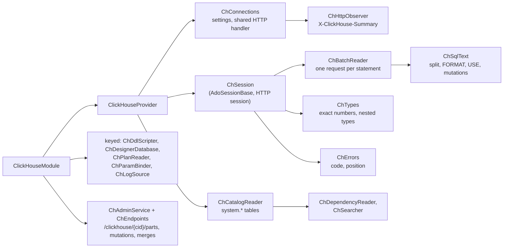

#### Package and registration

The driver is [ClickHouse.Driver](../glossary.md#clickhouse-driver) 1.5.0, "official ClickHouse Inc. client, MIT,
DbConnection over HTTP" (`engine/src/DbStudio.Providers.ClickHouse/DbStudio.Providers.ClickHouse.csproj:3,21`).
`ClickHouseModule` creates one provider instance, registers it both as itself and as `IDbProvider`, adds the keyed
designer, plan, parameter and log/activity services under `"clickhouse"`, registers `ChAdminService`, and maps
module endpoints with `api.MapClickHouse()` (`engine/src/DbStudio.Providers.ClickHouse/ClickHouseModule.cs:21-41`).
The provider exposes a `Handler` property, a test seam: an `HttpMessageHandler` standing in for the server
(`engine/src/DbStudio.Providers.ClickHouse/ClickHouseProvider.cs:16-17`).

#### Connections: HTTP, a shared handler and an observer

The form has host, port (8123 HTTP / 8443 HTTPS), protocol, database (`default`), user (`default`), password,
compression, *Skip certificate validation* (HTTPS only), connect timeout (15 s), session timeout (3600 s), free-form
server *Settings* and a command timeout (`engine/src/DbStudio.Providers.ClickHouse/ChConnections.cs:19-48`). A pasted URL
such as `https://abc.clickhouse.cloud:8443` is accepted as the host (`ChConnections.cs:59-77`). The protocol is the
profile's choice, or inferred from port 8443/443 (`ChConnections.cs:51-57`). That inference is why the SSH tunnel code
pins the protocol before it rewrites the port: "it is otherwise inferred from the port (8443 = https), which is now a
random local one" (`TunnelTargets.cs:67-72`).

The engine supplies its own `HttpClient` to the driver instead of letting the driver create one. One
`SocketsHttpHandler` is shared per (certificate policy, connect timeout) for the process lifetime, with a 30 s idle
timeout, a 5 min connection lifetime and up to 64 connections per server (`ChConnections.cs:154-175`). Each connection
wraps it in a `ChHttpObserver`, a `DelegatingHandler` that records the `X-ClickHouse-Summary` response header per
`query_id` (bounded to 256 entries) (`ChConnections.cs:240-268`). That header is the only reliable source of "rows
written": the WP note says the driver's `QueryStats` "stays null over HTTP" (`docs/wp-notes/WP-CH.md:95-97`). The request
timeout is infinite, because analytical queries may run long (`ChConnections.cs:177-183`).

`Settings(...)` builds the driver settings and contains two decisions worth knowing:

```csharp
// engine/src/DbStudio.Providers.ClickHouse/ChConnections.cs:128-141
// The driver's JSON/variant modes send settings that servers before 24.10 reject (UNKNOWN_SETTING):
// JSON columns are read as text instead.
JsonReadMode = JsonReadMode.None,
JsonWriteMode = JsonWriteMode.None,
ApplicationInfo = new Dictionary<string, string> { ["Rowlit"] = "1" },
};
foreach (var (k, v) in ParseSettings(profile.GetString("settings"))) settings.CustomSettings[k] = v;
if (sessionId is not null)
{
    var timeout = Math.Clamp(profile.GetInt("sessionTimeout", DefaultSessionTimeout), 1, 86_400);
    settings.CustomSettings["session_timeout"] = timeout.ToString(CultureInfo.InvariantCulture);
}
// A read-only query is cancelled on the server as soon as its HTTP connection closes (cancel, row cap).
settings.CustomSettings.TryAdd("cancel_http_readonly_queries_on_client_close", "1");
```

#### Sessions are HTTP sessions

HTTP is stateless, but a console needs state: `SET` values and temporary tables must survive between statements.
ClickHouse solves that with an [HTTP session](../glossary.md#http-session): every request that carries the same
`session_id` shares server-side state, and the server serialises requests of one session. `OpenSessionAsync` generates
`"rowlit-" + Guid` as the session id (`ClickHouseProvider.cs:48-63`). The catalog, designer, object browser and search use
**sessionless** requests over the shared pool (`ClickHouseProvider.cs:9-13,65-72`). `BuildConnectionString` returns a
password-free description such as `http://default@host:8123/default` for diagnostics, because there is no real
connection string (`ChConnections.cs:146-147`).

The HTTP interface accepts exactly one statement per request ("Multi-statements are not allowed"), so `ChSqlText.Split`
cuts a batch at depth-0 semicolons with the shared tokenizer, and `ChBatchReader` runs each statement as its own
command with its own `query_id`, lazily, as the base reads result sets (`engine/src/DbStudio.Providers.ClickHouse/ChSqlText.cs:20-66`,
`engine/src/DbStudio.Providers.ClickHouse/ChBatchReader.cs:11-17`). The splitter knows three ClickHouse habits:

- `INSERT INTO t FORMAT CSV <data>` keeps the rest of the batch as its inline data, semicolons included
  (`ChSqlText.cs:45-52`).
- A trailing `FORMAT JSONEachRow` (or any of the ~60 output formats) on a query is **removed**, because the driver asks
  for its own wire format and a user format "would make the response unreadable"; the console gets an info message
  that the format was ignored (`ChSqlText.cs:56-62,68-80`, `engine/src/DbStudio.Providers.ClickHouse/ChSession.cs:238-240`).
- `USE db` is recorded; since the driver sends the database with every request, the session calls `ChangeDatabase`
  after it (`ChSession.cs:139-148`, `docs/wp-notes/WP-CH.md:98-99`).

The per-statement command also sets the row cap on the server side. For a single `SELECT`/`WITH` with a cap the
session sends `max_result_rows = cap + 1` and `result_overflow_mode = 'break'`, so ClickHouse stops producing rows
instead of streaming millions that the grid would drop (`ChSession.cs:103-120`). A command timeout becomes
`max_execution_time` (`ChSession.cs:109-110`). If a request finds the HTTP session still locked (error 373) by a statement
being killed, it is retried up to 20 times with 100 ms pauses (`ChSession.cs:122-137`).

#### No transactions, and what "rows affected" means

ClickHouse has no multi-statement transactions. The session is constructed with `TxMode = Auto`, `TxOpen` is always
false, and switching to manual mode throws `400 NOT_SUPPORTED` with "every statement is applied on its own. Use
auto-commit mode." (`ChSession.cs:32-33,48,61-74`). The UI hides the transaction toggle for this dialect
(`docs/wp-notes/WP-CS.md:11`).

Rows affected are reported only where ClickHouse can tell: an `INSERT` reports `written_rows` from the response summary
(`ChSession.cs:217-224`). `ALTER TABLE … UPDATE/DELETE` and lightweight `DELETE` are
[mutations](../glossary.md#mutation): they are accepted at once and rewritten in the background. After such a batch the
session reads the newest row of `system.mutations` for that table and prints "submitted (n part(s) to rewrite);
ClickHouse applies it in the background", "finished" or "is failing: …" (`ChSession.cs:242-276`). That is also why the
conformance fixture sets `ReportsDmlRowCounts => false` (`engine/tests/DbStudio.Providers.ClickHouse.Tests/ChFixture.cs:119-122`).

#### Cancel: abort plus KILL QUERY

Aborting the HTTP request is not enough: "the server keeps running the query (and keeps the HTTP session locked)"
(`docs/wp-notes/WP-CH.md:100-102`). `CancelCommand` therefore does two things. It aborts the current request, and on a
user cancel it starts `KILL QUERY WHERE query_id = '…' SYNC` on a lazily opened **side connection outside the HTTP
session**, guarded by a semaphore and a 10 s timeout (`ChSession.cs:285-315`). The query id is parsed as a GUID before it
is put in the SQL text, so nothing user-controlled reaches that statement (`ChSession.cs:300`). For a row-cap stop of a
read-only query no kill is needed: `cancel_http_readonly_queries_on_client_close = 1` stops the server when the
connection closes (`ChSession.cs:291`). `OnBatchCompletedAsync` waits up to 10 s for the kill and reports a failure as a
warning (`ChSession.cs:229-236`). `IsConnectionBroken` always answers false: there is no long-lived socket that could
break (`ChSession.cs:319`).

#### Exact numbers and nested types

`ChTypes` unwraps `Nullable(…)`, `LowCardinality(…)` and `SimpleAggregateFunction(f, T)` before deciding a kind
(`engine/src/DbStudio.Providers.ClickHouse/ChTypes.cs:28-43`). The value rules keep big numbers exact:
`ClickHouseDecimal` and `BigInteger` (Int128, UInt256 …) are converted with their own `ToString`, never through
`double` (`ChTypes.cs:166-170`). `Array`, `Map`, `Tuple`, `Nested` and the geo types become compact JSON text in which big
integers and decimals are written as **raw JSON numbers** with all digits, `Date` and `DateTime` elements are told apart
by the column type (the driver hands both out as `DateTime`), and non-ASCII text stays readable (Persian values are not
escaped to `\uXXXX`) (`ChTypes.cs:158-161,178-240`). `FixedString` loses its trailing NULs (`ChTypes.cs:154-157`).

#### Parameters

ClickHouse has real server-side query parameters written `{name:Type}`. `ChParamBinder` binds those with the declared
type, and rewrites the console conventions `:name` and `@name` into `{name:Type}` with a type derived from the value
(int → Int64, decimal → `Decimal(38, s)`, date → Date, datetime → `DateTime64(6)`, null → `Nullable(String)`). `?` is
never a placeholder, because it is the ternary operator (`engine/src/DbStudio.Providers.ClickHouse/Params/ChParamBinder.cs:18-24`).
Unbound placeholders are not rejected up front, so a parametrised view definition `CREATE VIEW … {p:Type}` can be run
(`ChSession.cs:80-81`).

#### Catalog over system tables

ClickHouse is single-level like MySQL: the explorer's schemas are databases from `system.databases` minus `system` and
the two `INFORMATION_SCHEMA` spellings (`engine/src/DbStudio.Providers.ClickHouse/ChCatalogReader.cs:13,17-22`). Tables of
every engine are `table`, `View` is `view`, `MaterializedView` is `mview`, dictionaries are `type` objects with the
comment "Dictionary …", SQL user-defined functions (global in ClickHouse) are `func` objects in the connection's default
database, and the `.inner*` storage tables of materialized views are hidden (`ChCatalogReader.cs:71-78`). Every value is
a typed `{p:String}` parameter:

```sql
-- engine/src/DbStudio.Providers.ClickHouse/ChCatalogReader.cs:24-29
SELECT name, engine, comment, primary_key, sorting_key, partition_key, sampling_key, engine_full
FROM system.tables
WHERE database = {db:String} AND NOT is_temporary AND NOT startsWith(name, '.inner')
ORDER BY name
```

The primary key reported to the shared model is the table's `PRIMARY KEY` (a prefix of `ORDER BY`); "ClickHouse has
no foreign keys and no auto-increment" (`ChCatalogReader.cs:76-77`), so the fixture turns off `SupportsForeignKeys` and
`SupportsIdentity` (`ChFixture.cs:119-122`).

#### The MergeTree designer

A ClickHouse table is defined as much by its engine clause as by its columns. A
[MergeTree](../glossary.md#mergetree) table needs `ORDER BY`, and may have `PARTITION BY`, `PRIMARY KEY`, `SAMPLE BY`,
`TTL` and `SETTINGS`. `ChEngineOptions` carries these in `TableOptions.Extra`, a Core slot added for this provider
(R3-1) and later reused by MySQL and Snowflake (`engine/src/DbStudio.Providers.ClickHouse/Designer/ChDdlScripter.cs:6-40`,
`docs/wp-notes/WP-CH.md:7`). `ChDesignerDatabase` fills them from `system.tables`
(`engine/src/DbStudio.Providers.ClickHouse/Designer/ChDesignerDatabase.cs:128,140`). The scripter creates columns
(`Nullable(T)` for nullable ones, DEFAULT / MATERIALIZED / ALIAS, comments), skipping indices (`INDEX n expr TYPE minmax
GRANULARITY 1` by default), CHECK constraints and the engine clauses; ALTER supports column changes, `MATERIALIZE INDEX`
for existing data, `MODIFY ORDER BY` (new columns only), `MODIFY TTL` and `MODIFY SETTING`; it warns that ClickHouse has
no foreign keys, unique constraints or auto-increment (`ChDdlScripter.cs:42-49`). Applying a bare `CREATE TABLE t (…)`
appends `ENGINE = MergeTree ORDER BY tuple()` (`docs/wp-notes/WP-CH.md:119-120`).

#### Plans, the query log and the admin views

`ChPlanReader` asks for `EXPLAIN json = 1, indexes = 1, description = 1`. With `indexes = 1` the `ReadFromMergeTree`
nodes show how the primary key, partition pruning and skip indexes reduced the parts and granules read; for queries,
`EXPLAIN PIPELINE` is attached to the root as text (`engine/src/DbStudio.Providers.ClickHouse/Plans/ChPlanReader.cs:12-39`).
An actual plan runs the statement normally and then adds the server's own counters from `system.query_log` for the last
non-EXPLAIN query id of the session; when the log has not been flushed yet, a warning says only the estimate is shown
(`ChPlanReader.cs:22-23,62-67`, `ChSession.cs:163-168`).

The module endpoints under `/clickhouse/{cid}` expose what a ClickHouse operator watches: parts and partitions of a
table from `system.parts` (up to 20,000 rows), mutations from `system.mutations` with `KILL MUTATION`, running merges
from `system.merges`, `OPTIMIZE` and `DROP/DETACH PARTITION` (`engine/src/DbStudio.Providers.ClickHouse/Endpoints/ChEndpoints.cs:36-76,218-224`).
The write actions answer `403 READ_ONLY` on read-only connections (`ChEndpoints.cs:98`), and every call resolves the
profile through `ConnectionStore.ResolveForOpenAsync`, so they also go through an SSH tunnel (`ChEndpoints.cs:83`).
`ChLogSource` offers `query_log`, `text_log`, `part_log`, error counters and activity
(`engine/src/DbStudio.Logs/Providers/ClickHouse/ChLogSource.cs:165-171`).

#### Errors and identifiers

`ChErrors.Map` uses the server's error number as the code (`"60"` for UNKNOWN_TABLE), removes the
"Code: N. DB::Exception:" prefix and the "(version …)" suffix, moves the "Expected one of: …" list of syntax errors to
the detail, and maps "failed at position N" (bytes, 1-based, in the statement sent) to the document line and column
(`engine/src/DbStudio.Providers.ClickHouse/ChErrors.cs:11-21`). Identifiers are case-sensitive (`"preserve"`) and quoted
with backticks (`ClickHouseProvider.cs:26-27`); the UI keeps function names like `arrayJoin` and types like `UInt32` in
their case when formatting, because the server rejects `ARRAYJOIN` (`docs/wp-notes/WP-CH.md:136-140`).

#### What ClickHouse cannot do in Rowlit

- No manual transactions, savepoints, foreign keys or identity columns (fixture flags, `ChFixture.cs:119-122`).
- No row counts for UPDATE/DELETE (mutations); INSERT counts come from the HTTP summary only.
- No server syntax diagnostics before running (`Diagnostics => null`, `ClickHouseProvider.cs:24`).
- A user `FORMAT` clause on a query is ignored; use Export for other formats.
- JSON columns are read as text (driver JSON modes are off for pre-24.10 servers).
- On 24.8 a parametrised view inside a scalar subquery fails with ACCESS_DENIED (server bug, `docs/wp-notes/WP-CH.md:105`).

### 3.7 Snowflake

Snowflake is a cloud data warehouse: storage and compute are separate, and compute comes as
[warehouses](../glossary.md#warehouse) (clusters you pay for while they run). Three consequences shape the provider.
Every login is a server session with a current warehouse, [role](../glossary.md#role-snowflake), database and schema
that the user switches all the time. Browsing must not wake a warehouse, because that costs money. And there are four
ways to log in. Snowflake is two-level like PostgreSQL (database → schema) (`DialectInfo.cs:11`).

**Figure 9.11 — Snowflake package: file to responsibility.**

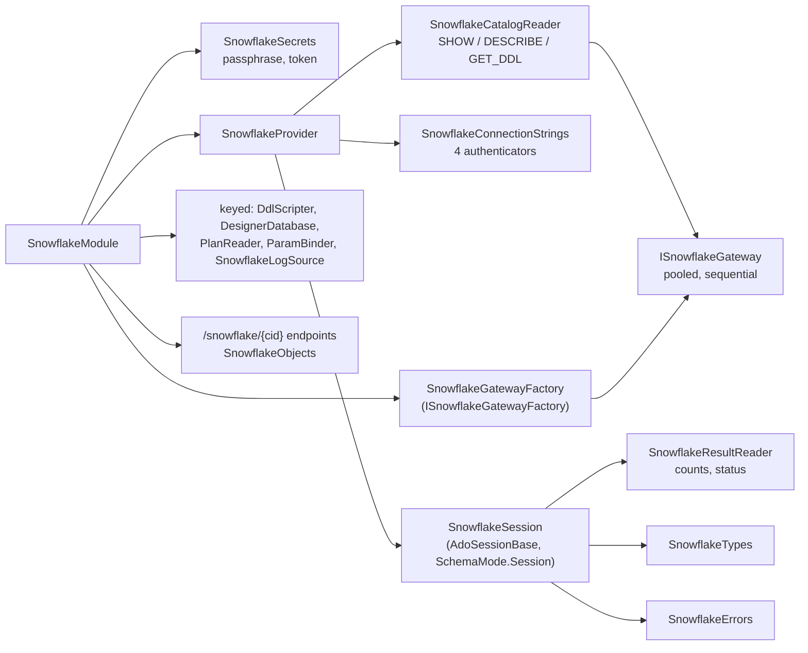

#### Package, driver and native libraries

The driver is [Snowflake.Data](../glossary.md#snowflake-data) 6.4.0
(`engine/src/DbStudio.Providers.Snowflake/DbStudio.Providers.Snowflake.csproj:22`). WP-SF moved from the planned 4.8.0
because 5.0 dropped log4net, 6.x targets net10.0, upgrades its storage SDKs and fixes JWT retries and cancel behaviour;
NuGet audit is clean (`docs/wp-notes/WP-SF.md:45-51`). The driver brings two
[native libraries](../glossary.md#native-library): `sf_mini_core` (a telemetry probe the driver loads and survives
without) and `Mono.Unix` (file permission checks on macOS/Linux). On Windows `sf_mini_core.dll` is bundled into the
single-file engine and extracted at start; on macOS `libsf_mini_core.dylib` and `libMono.Unix.dylib` sit next to the
apphost and are signed with the app (`DbStudio.Providers.Snowflake.csproj:3-5`, `docs/wp-notes/WP-SF.md:81-99`). The whole
driver adds about 5.9 MiB to the published engine (`docs/wp-notes/WP-SF.md:73-75`). Build packaging is in
[chapter 24](24-build-ci-release-contributing.md).

Driver-wide settings are applied once in `SnowflakeDriver.EnsureInitialized`: an **in-memory credential manager**, so
browser-SSO and MFA tokens "stay in memory: nothing is written to the user's credential store or home folder"
(`engine/src/DbStudio.Providers.Snowflake/Gateway/SnowflakeGateway.cs:10-20`). Client telemetry is turned off in every
connection string with `CLIENT_TELEMETRY_ENABLED=false` (`engine/src/DbStudio.Providers.Snowflake/SnowflakeConnectionStrings.cs:175-176`).

#### Registration and the secrets problem

`SnowflakeModule` registers `SnowflakeSecrets`, the gateway factory, the provider (as itself and as `IDbProvider`), the
keyed designer, plan, parameter and log services, and the module endpoints
(`engine/src/DbStudio.Providers.Snowflake/SnowflakeModule.cs:41-57`). `SnowflakeSecrets` exists because a Snowflake
profile has extra password-typed fields (`privateKeyPassphrase`, `token`) that the connection store strips when it saves
the profile (`docs/PLAN-M2.md` D12). The shared services restore them with `ConnectionStore.WithSecrets`; the module
endpoints read the stored profile themselves, so `SnowflakeSecrets.Hydrate` fills the missing props from the secret
store at call time (`engine/src/DbStudio.Providers.Snowflake/SnowflakeSecrets.cs:6-39`). The lookup is a lambda over
`sp.GetService<ConnectionStore>()` because "ConnectionStore depends on the provider registry, which depends on us": a
constructor dependency would be a cycle (`SnowflakeModule.cs:43-44`).

#### Four authenticators

`SnowflakeAuth` names the four `authenticator=` values: `snowflake` (password), `snowflake_jwt` (key pair),
`externalbrowser` (browser SSO) and `oauth` (`SnowflakeConnectionStrings.cs:9-15`). The form shows only the fields of
the chosen method through `VisibleWhen` (`SnowflakeConnectionStrings.cs:32-63`). `Build` validates each method's required
fields, and keeps secrets out of the connection string wherever the driver offers a `SecureString` property: the
password and the OAuth token travel as `conn.Password` / `conn.Token`; only the key passphrase, which has no such
property, is written into the string, and it is masked in every printed copy (`SnowflakeConnectionStrings.cs:108-187`,
`SnowflakeGateway.cs:23-39`). Browser SSO adds `client_store_temporary_credential=true`, so with
`ALLOW_ID_TOKEN = TRUE` on the account one browser round trip serves the whole engine run (`SnowflakeConnectionStrings.cs:142-148`).
Names in `db`, `schema`, `warehouse` and `role` are written as typed, because the driver itself treats `"…"` as
identifier quoting; a name with `;` is refused with advice to `USE` it after connecting
(`SnowflakeConnectionStrings.cs:189-201`).

Snowflake connections cannot use an SSH tunnel: `snowflake` is not in `TunnelTargets.Supported`, and the provider's
form spec does not append the SSH block (`TunnelTargets.cs:19-22,45`, `engine/src/DbStudio.Providers.Snowflake/SnowflakeProvider.cs:35`).
The SSH walkthrough lists Snowflake under "Not available" (`docs/qa/ssh-tunnel-walkthrough.md:39`). The code gives no
reason; presumably the driver's HTTPS endpoints (login, query and stage hosts) cannot be carried by one forwarded port
(not verified).

#### Two kinds of connection: sessions and gateways

Tab sessions use dedicated unpooled connections (`poolingEnabled=false`), because "USE, variables, an open transaction"
belong to the tab; catalog, object browser, search, designer reads and module endpoints use pooled
[gateway](../glossary.md#gateway) connections (`SnowflakeProvider.cs:11-16`, `SnowflakeConnectionStrings.cs:17-22,174`).
`ISnowflakeGateway` is a small seam (`QueryAsync`, `ExecuteAsync`) over one pooled `SnowflakeDbConnection` that runs
statements one at a time behind a `SemaphoreSlim` (`SnowflakeGateway.cs:60-116`). Tests replace it with
`SnowflakeGatewayFake`, which replays recorded JSON fixtures, so almost all Snowflake tests run without an account.
`ClearPooledConnections` clears the driver pool for the profile's pooled connection string
(`SnowflakeProvider.cs:44-59`).

`OpenSessionAsync` has one subtle step. The connection string can carry only an unquoted, upper-cased database name, so
when the tab asks for a database that differs from the profile's (for example `MyDb`, a case-sensitive name listed by the
explorer), the session logs in and then runs `USE DATABASE`, trying the stored spelling first
(`SnowflakeProvider.cs:77-103`, `engine/src/DbStudio.Providers.Snowflake/SnowflakeSession.cs:219-242`).

#### Executing: multi-statement requests and bookkeeping results

The console normally sends one statement per batch, but a batch with several statements is sent as one
**multi-statement request**: the session adds the parameter `MULTI_STATEMENT_COUNT = 0` and the driver returns each
result in order (`SnowflakeSession.cs:79-96`). `SnowflakeResultReader` then cleans Snowflake's result habits: DML returns
a bookkeeping result set ("number of rows inserted"), which becomes rows affected instead of a grid; DDL, `USE` and
`GRANT` return a one-column `status` result ("Table T successfully created."), which becomes an info message
(`engine/src/DbStudio.Providers.Snowflake/SnowflakeResultReader.cs:11-13`, `SnowflakeSession.cs:114-135`). After each batch the
session also reads the driver's tracked database and remembers the [query id](../glossary.md#query-id) of the last
statement, which the plan reader and the history link need (`SnowflakeSession.cs:98-106,137-144`).

#### Transactions without savepoints

Auto mode is autocommit. In manual mode the engine transaction (`BEGIN`) starts on the first write; DDL-only batches do
not start one, because Snowflake runs DDL in its own transaction (`SnowflakeSession.cs:70-77`). When DDL runs while the
engine transaction is open, Snowflake commits that transaction first; the session forgets its transaction and warns
"the earlier changes are committed" (`SnowflakeSession.cs:33-34,146-153`). A user-typed `BEGIN`/`COMMIT`, a `CALL` or a
scripting block is checked afterwards with `SELECT CURRENT_TRANSACTION()` (`SnowflakeSession.cs:166-179`). Snowflake has
no savepoints, so the live fixture sets `SupportsSavepoints => false` and the grid's edit-savepoint tests skip
(`engine/tests/DbStudio.Providers.Snowflake.Tests/LiveTests.cs:56-63`, `engine/tests/DbStudio.Providers.Conformance/ProviderFixture.cs:46-47`).

#### Cancel

`CancelCommand` first calls the driver's `Cancel()`, which aborts the current request. Because "a statement that keeps
running on the server (an async child job, a stuck abort)" may survive that, it schedules a fallback: after 3 s, if the
same command is still running, it runs `SELECT SYSTEM$CANCEL_QUERY('<query id>')` on a side gateway connection
(`SnowflakeSession.cs:184-203`).

#### Warehouse, role, database and schema switching

`SnowflakeSession` reports `SchemaMode.Session`: it tracks `CURRENT_SCHEMA()` and can change it with `USE SCHEMA`
(`SnowflakeSession.cs:246-286`). A regular expression decides which batches may change the schema (`USE`, `CREATE …
SCHEMA|DATABASE`, `CALL`, `EXECUTE`, `BEGIN`), so the base re-reads it only when needed (`SnowflakeSession.cs:250-257`).
The module adds two session routes: `GET /snowflake/sessions/{sid}/context` returns warehouse, role, database, schema,
secondary roles and the server session id, and `POST /snowflake/sessions/{sid}/use {kind, name}` runs `USE WAREHOUSE | ROLE
| DATABASE | SCHEMA` on the tab's session, then publishes `session.changed` (`SnowflakeModule.cs:123-135`,
`SnowflakeSession.cs:288-335`, `engine/src/DbStudio.Core/Services/SessionManager.cs:401-404`). Both run through
`RunExclusiveAsync`, the base's helper that marks an idle session Executing and runs side work on its own connection,
so a `USE` can never interleave with a running batch (`AdoSessionBase.cs:1323-1327`, see
[section 2.3](#23-the-shared-ado-base)). Each console keeps its own context
(`docs/qa/snowflake-walkthrough.md:47`).

#### Catalog browsing without waking a warehouse

This is the provider's key design decision. Information-schema views would need a running warehouse, so the catalog
reader uses only `SHOW` and `DESCRIBE` commands and `GET_DDL`, which run in Snowflake's cloud services layer: "browsing
never resumes a warehouse (no credits)" (`engine/src/DbStudio.Providers.Snowflake/SnowflakeCatalogReader.cs:11-19`). Names
are always fully quoted, so one connection can browse every database:

```csharp
// engine/src/DbStudio.Providers.Snowflake/SnowflakeSql.cs:99-109
public const string ShowDatabases = "SHOW DATABASES";
public static string ShowSchemas(string database) => $"SHOW SCHEMAS IN DATABASE {AlwaysQuote(database)}";
public static string ShowTables(string? database, string schema) => $"SHOW TABLES IN SCHEMA {SchemaPath(database, schema)}";
public static string ShowColumns(string? database, string schema) => $"SHOW COLUMNS IN SCHEMA {SchemaPath(database, schema)}";
public static string ShowPrimaryKeys(string? database, string schema) => $"SHOW PRIMARY KEYS IN SCHEMA {SchemaPath(database, schema)}";
public static string ShowImportedKeys(string? database, string schema) => $"SHOW IMPORTED KEYS IN SCHEMA {SchemaPath(database, schema)}";
public static string ShowProcedures(string? database, string schema) => $"SHOW USER PROCEDURES IN SCHEMA {SchemaPath(database, schema)}";
public static string ShowFunctions(string? database, string schema) => $"SHOW USER FUNCTIONS IN SCHEMA {SchemaPath(database, schema)}";
public static string ShowSequences(string? database, string schema) => $"SHOW SEQUENCES IN SCHEMA {SchemaPath(database, schema)}";
```

The mapping is: tables of every kind (transient, temporary, dynamic, external, hybrid, Iceberg) → `table`, views →
`view`, materialized views → `mview`, procedures → `proc`, functions → `func` / `tablefunc`, sequences → `sequence`;
`INFORMATION_SCHEMA` is hidden (`SnowflakeCatalogReader.cs:15-19,84-92`). A `SHOW` that the role may not run returns an
empty set instead of failing the whole schema (`SnowflakeCatalogReader.cs:98-113`). Database names are resolved
carefully: a name that differs from its upper-case fold is looked up among the listed databases, so `sales_raw` (stored
lower case) and `shop` (typed, folds to `SHOP`) both work (`SnowflakeCatalogReader.cs:60-74`). DDL comes from
[GET_DDL](../glossary.md#get-ddl), with the argument types appended for overloadable routines
(`SnowflakeSql.cs:123-131`).

Stages, streams, tasks, pipes, file formats, dynamic tables and alerts are not explorer objects; the module's
`/snowflake/{cid}/objects` endpoint lists them with `SHOW <KIND> IN SCHEMA`, returns their DDL, and runs the actions
`ALTER TASK … RESUME|SUSPEND`, `EXECUTE TASK`, dynamic-table suspend/resume and `ALTER PIPE … REFRESH`
(`engine/src/DbStudio.Providers.Snowflake/Module/SnowflakeObjects.cs:31-43,207-223`). `/warehouses` lists warehouses and
can `RESUME IF SUSPENDED` or `SUSPEND` them; both writes refuse with `403 READ_ONLY` on read-only connections, and a
connection that cannot open answers `503 SOURCE_UNAVAILABLE` (`SnowflakeModule.cs:63-76,145-159,180-183`,
`SnowflakeObjects.cs:84-85`).

#### Plans, operator statistics and query history

An estimated plan is `EXPLAIN USING JSON`, "compiled in the cloud services layer, nothing runs, no warehouse"; unbound
placeholders are explained with NULL binds (`engine/src/DbStudio.Providers.Snowflake/Plans/SnowflakePlanReader.cs:11-50`).
An actual plan runs the statement normally, then reads `GET_QUERY_OPERATOR_STATS('<query id>')` on the same session:
operator tree, output rows, each operator's share of execution time, pruning, spilling and network statistics
(`SnowflakePlanReader.cs:55-71`, `docs/wp-notes/WP-SF.md:65-66`). Query history comes from `SnowflakeLogSource`, which
reads `INFORMATION_SCHEMA.QUERY_HISTORY` (last 7 days, at most 10,000 rows) and also offers warehouse load, login history
and an activity view whose Kill is `SYSTEM$CANCEL_QUERY` (`engine/src/DbStudio.Logs/Providers/Snowflake/SnowflakeLogSource.cs:20,77`,
`docs/qa/snowflake-walkthrough.md:61`). Unlike the catalog, these INFORMATION_SCHEMA table functions need a warehouse and a
current database; without them the sources are listed as unavailable with the fix (`docs/wp-notes/WP-SF.md:186-187`).

#### Types, parameters, errors and identifiers

`NUMBER(p, 0)` is an int kind for every precision (Snowflake's default integer is `NUMBER(38,0)`; values beyond ±2^53
travel as exact strings), `NUMBER(p, s>0)` and `DECFLOAT` are decimals, `TIMESTAMP_NTZ` is a datetime, `TIMESTAMP_LTZ/TZ`
are datetime offsets, and `VARIANT`, `OBJECT`, `ARRAY`, `MAP`, the geo types and `VECTOR` are JSON
(`engine/src/DbStudio.Providers.Snowflake/SnowflakeTypes.cs:10-20`, `docs/wp-notes/WP-SF.md:52-53`).
`SnowflakeParamBinder` recognises `:name`, `:1` and `?`, and never `$1` (a staged-file column), `@stage` or a VARIANT path
`v:name`; bound placeholders become numeric binds `:1 … :n`, unbound ones stay as typed (Snowflake Scripting variables),
and there are no OUT binds (`engine/src/DbStudio.Providers.Snowflake/Params/SnowflakeParamBinder.cs:12-18`). Errors use the
vendor code zero-padded as Snowflake prints it (`001003`), the message without the driver's wrapper, the position from
"line N at position P" (P is 0-based) and the query id in the detail
(`engine/src/DbStudio.Providers.Snowflake/SnowflakeErrors.cs:11-68`). Identifiers are quoted with `"` and fold to upper
case (`SnowflakeProvider.cs:38`).

#### What Snowflake cannot do in Rowlit

- No savepoints; DDL commits an open transaction; designer DDL is not transactional and stops at the first error.
- No SSH tunnel.
- `SHOW COLUMNS IN SCHEMA` returns at most 10,000 rows, so very wide schemas load partially; routine overloads collapse to
  one catalog entry (`docs/wp-notes/WP-SF.md:184-185`).
- Query history, warehouse load and login history need a warehouse and a current database.
- The designer can only widen columns (`SET DATA TYPE`), maps one clustered index to `CLUSTER BY`, and ignores other
  indexes, checks and computed columns with warnings
  (`engine/src/DbStudio.Providers.Snowflake/Designer/SnowflakeDdlScripter.cs:7-19`).
- No server syntax diagnostics before running (`Diagnostics => null`, `SnowflakeProvider.cs:37`).
- Verification depth: the WP note says no live account was available and every server answer was a recorded or
  handwritten fixture (`docs/wp-notes/WP-SF.md:181-183`). The live suite exists (`LiveTests.cs`) but runs only with
  `DBSTUDIO_SF_*` variables; this chapter has not seen a live run (not verified).

### 3.8 Cassandra and ScyllaDB

Cassandra is a wide-column NoSQL database (see [Part I chapter 16](../part1/16-nosql-families.md)), and ScyllaDB is a
compatible re-implementation. It is not relational: no joins, no foreign keys, no multi-statement transactions. Yet
Rowlit treats it as a **relational provider**, because CQL looks like SQL, data comes back as rows and columns, and a
console, an explorer and a grid are exactly what a Cassandra user wants. The WP-CS plan calls this decision D3
(`engine/src/DbStudio.Providers.Cassandra/CassandraProvider.cs:9-13`). The price is that this provider implements
`IDbSession` **directly on the driver, without ADO.NET and without `AdoSessionBase`**, so it re-implements the execution
loop that the other seven providers inherit.

**Figure 9.12 — Cassandra package: file to responsibility.**

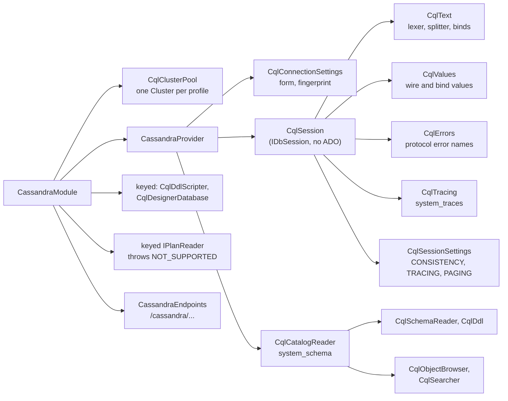

#### Package and registration

The driver is [CassandraCSharpDriver](../glossary.md#cassandracsharpdriver) 3.22.1 (the DataStax C# driver); the project
also pins `Newtonsoft.Json` 13.0.3 because the driver depends on a vulnerable 9.0.1 (NuGet audit)
(`engine/src/DbStudio.Providers.Cassandra/DbStudio.Providers.Cassandra.csproj:21-23`). `CassandraModule` registers the
cluster pool, the provider, the keyed designer services, the module endpoints, and one unusual registration: a keyed
`IPlanReader` whose factory **throws** `400 NOT_SUPPORTED` "Cassandra has no EXPLAIN. Turn on tracing …". The shared
explain endpoint resolves the keyed reader, so it answers with this provider's message "without a Core change"
(`engine/src/DbStudio.Providers.Cassandra/CassandraModule.cs:18-29`, `docs/wp-notes/WP-CS.md:46-49`). There is no keyed
`IParamBinder` (the session binds itself) and no log or activity source.

#### Connection settings and the cluster pool

CQL has no connection strings. `CqlConnectionSettings` parses the profile: contact points (one or more nodes,
`host:port` accepted), port 9042, local datacenter, keyspace, user/password, SSL with an optional CA file and
*Skip certificate verification*, default [consistency level](../glossary.md#consistency-level) `LOCAL_QUORUM`, serial
consistency `SERIAL`, page size 1000 (max 10,000), connect timeout 10 s, request timeout 30 s, a DataStax Astra secure
connect bundle, and *Show system keyspaces* (`engine/src/DbStudio.Providers.Cassandra/CqlConnectionSettings.cs:16-115`).
`BuildConnectionString` returns a password-free description such as
`cql://localhost:9042;keyspace=shop;consistency=LOCAL_QUORUM` (`CqlConnectionSettings.cs:161-172`).

A driver `Cluster` is expensive: it holds the control connection, the node list and the schema metadata. So
`CqlClusterPool` keeps **one cluster per profile**, keyed by the profile id plus a SHA-256 *fingerprint* of every
connection-level value and the password; a changed setting or password yields a new key and a new cluster
(`engine/src/DbStudio.Providers.Cassandra/CqlClusterPool.cs:10-16,79-116`, `CqlConnectionSettings.cs:146-159`). Users take
a reference-counted `Lease`. Every console gets **its own** driver `ISession` on the shared cluster, so `USE ks` stays with
the tab; catalog, designer and search share one keyspace-less session that never runs `USE`
(`CqlClusterPool.cs:53-76`). A timer sweeps every minute and shuts down clusters unused for 5 minutes
(`CqlClusterPool.cs:21,27,196-203`). The builder sets the application name "Rowlit", socket and query timeouts,
consistency and page size defaults, and an exponential reconnection policy from 1 s to 60 s (`CqlClusterPool.cs:119-157`).
Acquire failures become engine errors: no reachable host → `503 PROVIDER_ERROR`, bad credentials → `401 PROVIDER_ERROR`
(`CassandraProvider.cs:103-117`).

SSH tunnels work with one contact point only: the form's SSH help says "the driver talks to that node only", and
`TunnelTargets` refuses several contact points or an Astra bundle, then rewrites `contactPoints` to the local forward
(`CassandraProvider.cs:25`, `TunnelTargets.cs:73-77,179-190`).

`ReadServerInfoAsync` reads `system.local` and tells the products apart: DataStax Enterprise by `dse_version`,
ScyllaDB by a successful `SELECT version FROM system.versions` (`CassandraProvider.cs:129-158`). ScyllaDB detection was
not tested against a live ScyllaDB (`docs/wp-notes/WP-CS.md:200-201`).

#### The session: its own execution loop

`CqlSession` implements the state machine itself: `Enter()` moves Idle → Executing with `Interlocked.CompareExchange` and
throws `SessionBusyException` or `SessionBrokenException` otherwise; `ExecuteAsync` runs the work on the thread pool with a
linked cancellation token (`engine/src/DbStudio.Providers.Cassandra/CqlSession.cs:124-162`). Batches are split by
`CqlText` into CQL statements: `--`, `//` and `/* */` comments, `$$…$$` function bodies, and
`BEGIN [UNLOGGED|COUNTER] BATCH … APPLY BATCH` kept whole (`engine/src/DbStudio.Providers.Cassandra/CqlText.cs:34-39`).
A failing statement ends its batch; a connection loss marks the session Broken (`CqlSession.cs:208-240`).

Rows are fetched with driver **paging** instead of a data reader. The statement gets the console's consistency, serial
consistency and page size, `SetAutoPage(false)`, and tracing if enabled; the loop reads one page, streams its rows, and
continues with the page's [paging state](../glossary.md#paging-state) until the row cap or the last page
(`CqlSession.cs:446-540`):

```csharp
// engine/src/DbStudio.Providers.Cassandra/CqlSession.cs:451-456,510-521
stmt.SetConsistencyLevel(Settings.Consistency);
stmt.SetSerialConsistencyLevel(Settings.SerialConsistency);
stmt.SetPageSize(pageSize);
stmt.SetAutoPage(false);
if (tracing) stmt.EnableTracing();
// …
var state = rs.PagingState;
if (state is null) break;
// …
run.Token.ThrowIfCancellationRequested();
stmt.SetPagingState(state);
rs = await _session.ExecuteAsync(stmt).WaitAsync(run.Token).ConfigureAwait(false);
```

Rows go to the sink in frames of 200, the same size `AdoSessionBase` uses, but written by the session's own
`ResultWriter` (`CqlSession.cs:976-980`, `engine/src/DbStudio.Core/Services/AdoSessionBase.cs:204-205`). The page size per
round trip (1000 by default) and the frame size to the UI (200) are independent (`docs/wp-notes/WP-CS.md:106`). Server
warnings become messages, a missing schema agreement after DDL becomes a warning, and a lightweight transaction that was
not applied gets a hint to look at `[applied]` (`CqlSession.cs:300-306,535-537,555-559`).

#### cqlsh commands in the console

Users come from [cqlsh](../glossary.md#cqlsh), the Cassandra shell, and type its commands without thinking. The session
handles them before CQL: `CONSISTENCY [level]`, `SERIAL CONSISTENCY [level]`, `TRACING ON|OFF`, `PAGING ON|OFF|n`, `SHOW
VERSION|HOST|SESSION <id>`; `COPY` answers NOT_SUPPORTED with advice to use Export; `SOURCE`, `CAPTURE`, `EXPAND` and the
like are acknowledged as ignored (`CqlSession.cs:246-294`). The settings live in `CqlSessionSettings`, one per console,
thread-safe; `PAGING OFF` means the maximum page size 10,000 and `PAGING ON` returns to the profile's size
(`engine/src/DbStudio.Providers.Cassandra/CqlSessionSettings.cs:5-57`, `CqlSession.cs:266-278`). `DESCRIBE` runs on the
server (Cassandra 4.0+); on older servers, where it is a cqlsh feature, the session emulates `DESCRIBE KEYSPACES | TABLES |
KEYSPACE | TABLE | TYPE | MATERIALIZED VIEW` from the schema metadata and generated DDL (`CqlSession.cs:372-429`).

#### No transactions, no EXPLAIN: tracing instead

`SetTransactionModeAsync(Manual)` and the statements `BEGIN` (other than `BEGIN BATCH`), `START`, `COMMIT`, `ROLLBACK`,
`SAVEPOINT` answer `400 NOT_SUPPORTED` with a short lesson: "every statement is applied (and durable) on its own. For
atomic writes use BEGIN BATCH … APPLY BATCH (atomic per partition), for compare-and-set use lightweight transactions"
(`CqlSession.cs:32-35,88-92,288-290`).

What replaces EXPLAIN is [tracing](../glossary.md#tracing-cql). With `TRACING ON` each statement asks the coordinator to
record its work in `system_traces`; the session then fetches the trace and shows it as an extra result set and a message
(Figure 9.13).

**Figure 9.13 — Tracing one CQL statement.**

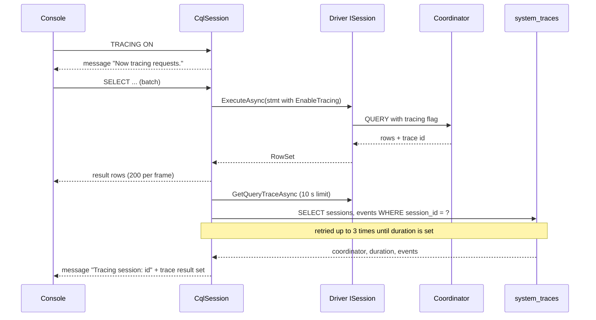

`CqlTracing.ReadAsync` retries because "the coordinator has not written it (yet)": up to the given attempts, with
growing pauses, until `duration` is set (`engine/src/DbStudio.Providers.Cassandra/CqlTracing.cs:12-37`). The session keeps the
last 50 trace summaries for the trace view (`CqlSession.cs:42,561-588`), and the module serves them under
`/cassandra/sessions/{sid}/traces` and `/cassandra/{cid}/traces/{traceId}`
(`engine/src/DbStudio.Providers.Cassandra/Endpoints/CassandraEndpoints.cs:70-77`).

#### Cancel

`Cancel()` cancels the linked token (`CqlSession.cs:137-144`). Every await on the driver uses `WaitAsync(run.Token)`, so the
paging loop stops at once; WP-CS measured cancel under 2 s (`docs/wp-notes/WP-CS.md:40-41`). But the CQL protocol has no
cancel message, so a request already sent keeps running on the coordinator; the warning says so honestly: "A write that
already reached the coordinator may still be applied." (`CqlSession.cs:220-225`). The fixture keeps `SupportsCancel` at
its default `true`, because what the test measures (the console is free again quickly) holds
(`engine/tests/DbStudio.Providers.Cassandra.Tests/CassandraBackend.cs:133-147`).

#### Parameters

Bind markers are `?`, `:name` and the UI-generated `@name` (rewritten to `?`) (`CqlText.cs:31-32`). The session prepares the
statement (cached per keyspace and text, cleared above 500 entries), converts each value to the marker's CQL type, and
binds it; collections, tuples, UDTs, vectors and decimals with more digits than `System.Decimal` are inlined as CQL
literals instead, because the driver needs CLR mappings to bind them (`CqlSession.cs:607-682`). A missing value fails
with `VALIDATION` "Missing value for parameter :name" (`CqlSession.cs:620-628`).

#### Values

`CqlValues` maps uuid/timeuuid to guid, timestamp to a UTC datetime offset, date/time/duration/inet to text, varint and
decimal exactly, blob to binary, and collections, tuples, [UDTs](../glossary.md#udt) and vectors to JSON text. UDT
values arrive as raw bytes because the driver has no CLR mapping for them; `CqlValues.Decode` reads the CQL binary format
with the column's type metadata (`engine/src/DbStudio.Providers.Cassandra/CqlValues.cs:16-21`).

#### Catalog over system_schema

[Keyspaces](../glossary.md#keyspace) are the schema level (single-level, `DialectInfo.cs:17`); system keyspaces are listed
only with *Show system keyspaces* (`engine/src/DbStudio.Providers.Cassandra/CqlCatalogReader.cs:60-68`). Objects are
tables, materialized views (`mview`), UDTs (`type`) and functions/aggregates (`func`). Because the generic model has no
place for Cassandra's key roles, columns carry them in the comment: "partition key", "partition key (1 of 2)", "clustering
key ASC|DESC", "static"; `IsPk` marks partition and clustering columns (`CqlCatalogReader.cs:7-12`). The reads are plain
`system_schema` queries per keyspace (`engine/src/DbStudio.Providers.Cassandra/CqlSchema.cs:144-211`), for example:

```sql
-- engine/src/DbStudio.Providers.Cassandra/CqlSchema.cs:147,160
SELECT * FROM system_schema.columns WHERE keyspace_name = ?
SELECT * FROM system_schema.tables WHERE keyspace_name = ?
```

Views, types, functions, aggregates, indexes and triggers use `TryRowsAsync`, which tolerates servers without those
tables (`CqlSchema.cs:174-211`). DDL comes from server `DESCRIBE` on 4.0+ and is generated by `CqlDdl` otherwise
(`docs/wp-notes/WP-CS.md:66`). Find in database searches names, columns (including UDT fields), UDF bodies and view
definitions, but not table data, because "CQL cannot filter non-key columns without an index"
(`docs/qa/cassandra-walkthrough.md:43`).

#### Editing by primary key in the grid

The data grid generates generic SQL (`LIMIT n OFFSET m`, `ORDER BY`, `UPDATE … WHERE`), and CQL accepts little of it.
Instead of changing the UI's SQL generator, the session adapts statements whose label is `data` or `filter`
(`CqlSession.cs:25-27`, `docs/wp-notes/WP-CS.md:50-58`):

- `LIMIT n OFFSET m` becomes a page of size n resumed from the cached paging state of offset m, so sequential pages cost
  one round trip (states cached up to 64) (`CqlSession.cs:458-469,524-531`).
- `ORDER BY` is dropped, filters get `ALLOW FILTERING`, OR-ed key lookups are split into one query per alternative and
  merged, and distinct values are counted in the engine over at most 100,000 rows (`CqlSession.cs:43,781-905`).
- An INSERT gets `IF NOT EXISTS` (a duplicate key becomes `409 AlreadyExists`) and optionally `USING TTL` from the
  console's insert TTL (`CqlSession.cs:908-930`).
- UPDATE/DELETE keep the primary-key conditions in `WHERE` and move the "verify unchanged" conditions on other columns
  into a [lightweight transaction](../glossary.md#lightweight-transaction) `IF …`; a plain UPDATE gets `IF EXISTS` to
  "never resurrect a row someone deleted meanwhile"; a not-applied result reports 0 rows, which the grid shows as a
  conflict (`CqlSession.cs:932-974`).

The grid side of this, including submitting without a transaction, is in
[chapter 13](13-results-grid-and-data-editing.md).

#### Designer, cluster view and errors

`CqlDdlScripter` maps CQL concepts onto the generic table model until the designer gets CQL panels: primary-key columns
in order; a unique constraint named `partition_key` for the partition key; an index named `clustering_order` for the
clustering order; a column comment `static` for STATIC; check constraints as table options (`default_time_to_live`,
`compaction`). A changed primary key, a renamed table or a changed column type cannot be altered and fail validation with
an explanation (`engine/src/DbStudio.Providers.Cassandra/Designer/CqlDdlScripter.cs:7-22`). The module's
`/cassandra/{cid}/cluster` endpoint shows nodes and datacenters from `system.local` and the peers tables with schema
agreement, `/clients` the connected clients (Cassandra 4.0+), and `/keyspaces/{ks}/tables/{name}` the keys and storage
info of a table (`CassandraEndpoints.cs:33-104`, `docs/wp-notes/WP-CS.md:77-79`). Errors use the native protocol error names
that cqlsh shows (`SyntaxError`, `Invalid`, `Unavailable`, `ReadTimeout`, …) with the protocol number as the provider code;
consistency failures carry the level and replica counts in the detail ("Consistency LOCAL_QUORUM needs 2 replica(s), 1
alive") (`engine/src/DbStudio.Providers.Cassandra/CqlErrors.cs:10-56`). Identifiers are quoted with `"` and fold to lower
case (`CassandraProvider.cs:28`).

#### What Cassandra cannot do in Rowlit

- No transactions, savepoints or EXPLAIN (tracing instead); no foreign keys and no identity
  (`CassandraBackend.cs:145-147`).
- Cancel frees the console but cannot stop a request already at the coordinator.
- No `COPY`, no data search, no log or activity source, no server syntax diagnostics.
- Designer: no change of primary key, column type or table name; DDL is not transactional.
- The 3.22 driver negotiates native protocol v4 at most with Cassandra 5 (`docs/wp-notes/WP-CS.md:107`).
- The Cassandra tests do not derive from the shared conformance suite; `CassandraIntegrationTests` re-implements the
  applicable subset (`docs/wp-notes/WP-CS.md:92-100`).


## 4. Edge cases and limits

The matrix summarises sections 3.1–3.8. "Server diagnostics" means checks while typing (`IDbProvider.Diagnostics`);
"Base" says whether the session derives from `AdoSessionBase`.

| Provider id | Driver | Base | Transactions | Savepoints | Cancel mechanism | Statements per batch | Server diagnostics | Plans (estimated / actual) | Designer DDL atomic | Placeholders | SSH tunnel |
|---|---|---|---|---|---|---|---|---|---|---|---|
| `sqlserver` | Microsoft.Data.SqlClient 7.1.1 | yes | yes | yes | TDS attention (`SqlCommand.Cancel`) | `GO` batch as one `SqlCommand` | ScriptDom (syntax) | `SHOWPLAN_XML` / `STATISTICS XML` | yes | `@name` | yes (TCP, port needed for a named instance) |
| `oracle` | ODP.NET managed 23.26.301 | yes | implicit; auto = commit after batch | yes | TNS break (`OracleCommand.Cancel`) | one statement | none (`ALL_ERRORS` after `CREATE`) | `EXPLAIN PLAN` / `V$SQL_PLAN_STATISTICS_ALL` | no | `:name`, `:1`, REF CURSOR out | basic type only |
| `postgresql` | Npgsql 9.0.5 | yes | yes, savepoint per statement (D-PG3) | yes | cancel request (`NpgsqlBatch.Cancel`) | split into one `NpgsqlBatch` | `pg-prepare` (queries + DML) | `EXPLAIN (FORMAT JSON)` / `EXPLAIN ANALYZE` | yes | `$n`, `:name`, `@name` → `$k` | yes (one host) |
| `sqlite` | Microsoft.Data.Sqlite 10.0.13 | yes | yes (deferred `BEGIN`) | yes | `sqlite3_interrupt` + 1 s timeout | several | `sqlite-prepare` (schema replay) | `EXPLAIN QUERY PLAN` (no runtime stats) | yes (rebuild in a transaction) | `:x`, `@x`, `$x`, `?NNN`, `?` | no |
| `mysql`, `mariadb` | MySqlConnector 2.4.0 | yes | yes (DDL commits implicitly) | yes | `KILL QUERY` on a side connection | `DELIMITER`-aware split, one command each | none | `EXPLAIN FORMAT=JSON` / `EXPLAIN ANALYZE` or `ANALYZE FORMAT=JSON` | no | `:name`, `?`, `@name` | yes (one host) |
| `clickhouse` | ClickHouse.Driver 1.5.0 (HTTP) | yes | no | no | abort + `KILL QUERY … SYNC` | one HTTP request each | none | `EXPLAIN json=1, indexes=1` / + `system.query_log` | no | `{name:Type}`, `:name`, `@name` | yes |
| `snowflake` | Snowflake.Data 6.4.0 | yes | yes (DDL commits an open one) | no | driver cancel + `SYSTEM$CANCEL_QUERY` after 3 s | multi-statement request | none | `EXPLAIN USING JSON` / `GET_QUERY_OPERATOR_STATS` | no | `:name`, `:1`, `?` | no |
| `cassandra` | CassandraCSharpDriver 3.22.1 | no (own `IDbSession`) | no | no | token cancel; a sent request keeps running | CQL splitter, `BEGIN BATCH` kept whole | none | `NOT_SUPPORTED` (use tracing) | no | `?`, `:name`, `@name` | one contact point |

Limits that cut across providers:

- **One physical connection per tab, unpooled.** Every session is a dedicated connection (`IDbProvider.cs:22-23`); the
  per-profile session limit and idle release are chapter [8](08-connections-sessions-execution.md) and chapter
  [21](21-logs-activity-resources.md).
- **Positions are best effort where the driver gives none.** Oracle, SQLite and MySQL locate errors by parsing messages
  (sections 3.2, 3.4, 3.5). A wrong guess points at the statement's first token rather than nowhere.
- **No server diagnostics for five families.** Only SQL Server, PostgreSQL and SQLite implement `ISqlDiagnostics`; the
  others rely on the UI's soft diagnostics (chapter [11](11-intellisense.md)).
- **Error codes.** Inside an execution, errors keep the provider's own code (`207`, `ORA-00942`, `42P01`,
  `SQLITE_ERROR`, `1146`, `60`, `001003`, `SyntaxError`) in `exec.error`; on REST calls (test connection, catalog) driver
  failures become `PROVIDER_ERROR` with `detail.providerCode`, and dead connections become `SERVER_UNREACHABLE`
  (chapter [5](05-engine-host-and-api.md#212-the-error-envelope-and-error-codes)).
- **The contract is frozen.** A capability one engine lacks is answered with `400 NOT_SUPPORTED` from `ProviderFeatures`
  or from the provider itself, never by a missing method (chapter [7](07-engine-modules-and-di.md)).

## 5. How it is tested

- **The shared conformance suite.** `engine/tests/DbStudio.Providers.Conformance/ProviderConformanceTests.cs` is an
  abstract xUnit class every relational test project derives from with its own fixture (for example
  `engine/tests/DbStudio.Providers.SqlServer.Tests/SqlServerConformanceTests.cs:6`,
  `engine/tests/DbStudio.Providers.Oracle.Tests/OracleConformanceTests.cs:6`,
  `engine/tests/DbStudio.Providers.PostgreSql.Tests/PgFixture.cs:149`,
  `engine/tests/DbStudio.Providers.Sqlite.Tests/SqliteFixture.cs:71`,
  `engine/tests/DbStudio.Providers.MySql.Tests/MySqlFixture.cs:185`,
  `engine/tests/DbStudio.Providers.ClickHouse.Tests/ChIntegrationTests.cs:24`,
  `engine/tests/DbStudio.Providers.Snowflake.Tests/LiveTests.cs:90`). Its tests cover test connection (success and
  failure), session open and dispose, streaming columns and rows, decimal kinds, several batches and several result sets
  per batch, `MaxRows` truncation, rows affected, document-absolute error lines, `StopOnError`, busy sessions, cancel of a
  long query and cancel when idle, manual commit and rollback, edit savepoints, switching to auto with an open
  transaction, the `shop` catalog (schemas, tables, columns, keys, foreign keys, views, details, DDL) and export.
- **Fixture flags say what an engine cannot do.** `ProviderFixture` has `SupportsTransactions`, `SupportsSavepoints`,
  `SupportsForeignKeys`, `SupportsIdentity`, `ReportsDmlRowCounts` and `SupportsCancel`, all `true` by default
  (`engine/tests/DbStudio.Providers.Conformance/ProviderFixture.cs:44-59`). Only three fixtures override any:
  ClickHouse (transactions, foreign keys, identity, DML counts; `ChFixture.cs:119-122`), Snowflake (savepoints;
  `LiveTests.cs:63`) and the Cassandra backend (transactions, foreign keys, identity; `CassandraBackend.cs:145-147`).
- **Designer conformance.** `engine/tests/DbStudio.Providers.Conformance/M15/M15ConformanceTests.cs` with shared
  `DesignerCases` and goldens, derived per provider (`SqlServerM15Tests.cs:446`, `OracleM15Tests.cs:320`,
  `PgM15Tests.cs:271`, `MySqlM15Tests.cs:252`, `SqliteDesignerTests.cs:571`).
- **Real servers.** The integration suites run against the Docker `shop` servers of `engine/tests/docker/compose.yml` or
  Testcontainers and skip (not fail) when Docker is not there or `DBSTUDIO_IT=0`; SQLite always runs against files.
  PostgreSQL also tests a real SSH bastion (`PgSshTunnelTests.cs:8-13`).
- **Engines without a lab server.** Snowflake's tests run over `SnowflakeGatewayFake` with recorded JSON; the live suite
  needs `DBSTUDIO_SF_*` variables (section 3.7). Cassandra re-implements the applicable conformance subset in
  `CassandraIntegrationTests` (`docs/wp-notes/WP-CS.md:92-100`).
- **Query text checks.** SQL Server's catalog strings are parsed with ScriptDom in unit tests
  (`SqlServerCatalogQueries.cs:3-6`); Oracle's owner-bind rule is enforced by `OracleCatalogQueryTests.cs`.
- **QA walkthroughs.** `docs/qa/*-walkthrough.md` per engine and the `round-*.md` reports (findings cited above, for
  example `docs/qa/round-postgresql.md`). Chapter [23](23-testing-and-qa.md) covers the whole test strategy.

## Related chapters

- [7. Engine modules and DI](07-engine-modules-and-di.md) — how providers and their keyed features are registered.
- [8. Connections, sessions and executing SQL](08-connections-sessions-execution.md) — what Core does around `ExecuteAsync`.
- [10. Catalog and metadata](10-catalog-and-metadata.md) — how `ICatalogReader` results are cached and shown.
- [11. IntelliSense](11-intellisense.md) — client-side splitting, soft diagnostics and server diagnostics markers.
- [14. Designers and DDL](14-designers-and-ddl.md) and [15. Import, export, plans and ER](15-import-export-plans-er.md).
- [16. Linked databases](16-linked-databases-federation.md) — the ninth `IDbProvider`, `linked`.
- Part I: [I-08 Query processing](../part1/08-query-processing.md), [I-09 Transactions](../part1/09-transactions-and-isolation.md),
  [I-15 OLAP and columnar](../part1/15-oltp-vs-olap-columnar.md), [I-16 NoSQL families](../part1/16-nosql-families.md),
  [I-17 Dialects](../part1/17-dialect-comparison.md).

## Glossary terms introduced here

[ADO.NET](../glossary.md#ado-net) · [interface](../glossary.md#interface) · [observer](../glossary.md#observer) ·
[identifier rules](../glossary.md#identifier-rules) · [case folding](../glossary.md#case-folding) ·
[dialect info](../glossary.md#dialect-info) · [driver](../glossary.md#driver) · [connection string](../glossary.md#connection-string) ·
[connection pooling](../glossary.md#connection-pooling) · [Microsoft.Data.SqlClient](../glossary.md#microsoft-data-sqlclient) ·
[InfoMessage](../glossary.md#infomessage) · [attention](../glossary.md#attention) · [ScriptDom](../glossary.md#scriptdom) ·
[native library](../glossary.md#native-library) · [SNI](../glossary.md#sni) · [self-extract](../glossary.md#self-extract) ·
[ODP.NET](../glossary.md#odp-net) · [NLS](../glossary.md#nls) · [bind variable](../glossary.md#bind-variable) ·
[REF CURSOR](../glossary.md#ref-cursor) · [DBMS_OUTPUT](../glossary.md#dbms-output) · [ALL_ERRORS](../glossary.md#all-errors) ·
[synonym](../glossary.md#synonym) · [Npgsql](../glossary.md#npgsql) · [SQLSTATE](../glossary.md#sqlstate) ·
[savepoint per statement](../glossary.md#savepoint-per-statement) · [search_path](../glossary.md#search-path) ·
[prepare diagnostics](../glossary.md#prepare-diagnostics) · [Microsoft.Data.Sqlite](../glossary.md#microsoft-data-sqlite) ·
[attached database](../glossary.md#attached-database) · [rowid](../glossary.md#rowid) · [WITHOUT ROWID](../glossary.md#without-rowid) ·
[STRICT](../glossary.md#strict) · [MySqlConnector](../glossary.md#mysqlconnector) · [DELIMITER](../glossary.md#delimiter) ·
[KILL QUERY](../glossary.md#kill-query) · [NO_BACKSLASH_ESCAPES](../glossary.md#no-backslash-escapes) ·
[ClickHouse.Driver](../glossary.md#clickhouse-driver) · [HTTP session](../glossary.md#http-session) · [mutation](../glossary.md#mutation) ·
[MergeTree](../glossary.md#mergetree) · [Snowflake.Data](../glossary.md#snowflake-data) · [warehouse](../glossary.md#warehouse) ·
[role (Snowflake)](../glossary.md#role-snowflake) · [gateway](../glossary.md#gateway) · [query id](../glossary.md#query-id) ·
[GET_DDL](../glossary.md#get-ddl) · [CassandraCSharpDriver](../glossary.md#cassandracsharpdriver) ·
[consistency level](../glossary.md#consistency-level) · [paging state](../glossary.md#paging-state) · [cqlsh](../glossary.md#cqlsh) ·
[tracing (CQL)](../glossary.md#tracing-cql) · [UDT](../glossary.md#udt) · [keyspace](../glossary.md#keyspace) ·
[lightweight transaction](../glossary.md#lightweight-transaction)

## Files

| Path | Responsibility |
|---|---|
| `engine/src/DbStudio.Core/Providers/IDbProvider.cs` | The frozen relational contract |
| `engine/src/DbStudio.Core/Models/{CoreModels,ExecutionModels,DialectInfo}.cs` | Profiles, form specs, identifier rules, requests, errors, dialect traits |
| `engine/src/DbStudio.Core/Services/AdoSessionBase.cs` | The shared ADO.NET execution loop and its hooks |
| `engine/src/DbStudio.Core/Services/Tunnels/TunnelTargets.cs` | Per-provider host/port rewrite for SSH tunnels |
| `engine/src/DbStudio.Providers.SqlServer/` | `SqlServerProvider`, `SqlServerSession`, `SqlServerCatalogQueries`, `TSql/*` (ScriptDom, `GO` splitter, DDL), `Designer/`, `Plans/`, `Params/` |
| `engine/src/DbStudio.Providers.Oracle/` | `OracleProvider`, `OracleSession` (DBMS_OUTPUT, ALL_ERRORS), `OracleSqlText`, `OracleErrors`, `OracleCatalogQueries` |
| `engine/src/DbStudio.Providers.PostgreSql/` | `PostgreSqlProvider`, `PgSession` (NpgsqlBatch, savepoints), `PgSqlText`, `PgBinaryText`, `Diagnostics/PgPrepareDiagnostics` |
| `engine/src/DbStudio.Providers.Sqlite/` | `SqliteProvider`, `SqliteConnections`, `SqliteSession`, `SqlitePrepareDiagnostics`, `Designer/SqliteDdlScripter` (rebuild) |
| `engine/src/DbStudio.Providers.MySql/` | `MySqlModule`, `MySqlProvider` (two ids), `MySqlSession`, `MySqlStatementReader`, `MySqlSqlText` (DELIMITER) |
| `engine/src/DbStudio.Providers.ClickHouse/` | `ClickHouseModule`, `ChConnections` (HTTP handler), `ChSession`, `ChBatchReader`, `ChTypes`, `Endpoints/ChEndpoints` |
| `engine/src/DbStudio.Providers.Snowflake/` | `SnowflakeModule`, `SnowflakeConnectionStrings` (4 authenticators), `SnowflakeSession`, `SnowflakeCatalogReader` (SHOW only), `Gateway/` |
| `engine/src/DbStudio.Providers.Cassandra/` | `CassandraModule`, `CqlClusterPool`, `CqlSession` (own loop, cqlsh commands), `CqlTracing`, `CqlCatalogReader` |
| `engine/tests/DbStudio.Providers.Conformance/` | `ProviderConformanceTests`, `ProviderFixture` flags, `ShopSchema`, `M15/` designer cases |
| `docs/PLAN.md` §2.2–2.6, `docs/PLAN-PG.md`, `docs/wp-notes/WP-{MY,CH,SF,CS}.md` | The decisions quoted in this chapter |
