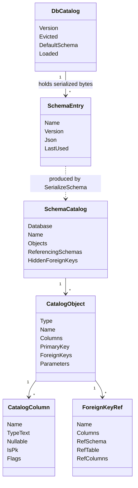
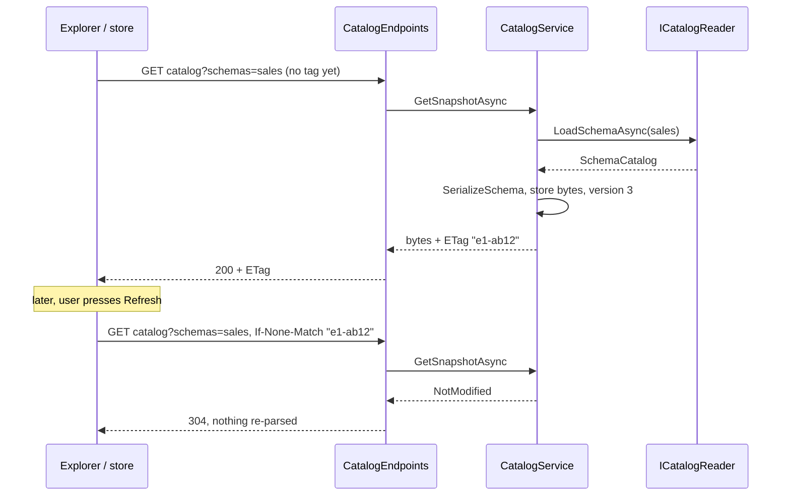
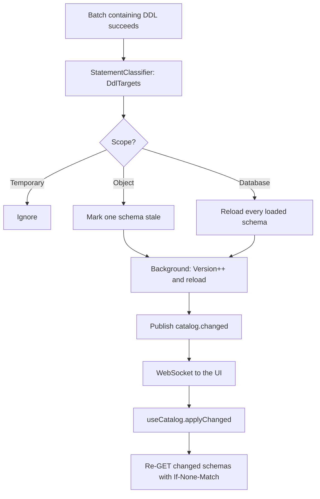
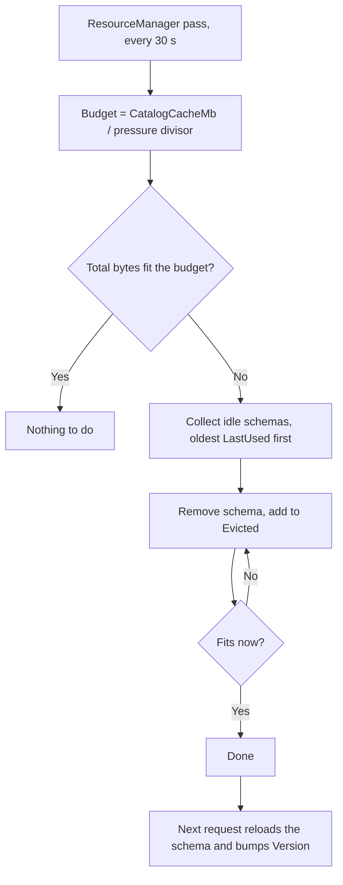

# 10. Catalog, metadata cache and the explorer

> **Level:** L2 practitioner → L3 senior | **Part:** II | **Code read at:** `a61f3d1` (Rowlit 1.6.3; the tree also holds the result charts and local history that `docs/release-notes/v1.7.0.md` announces)
> **Language:** English | [فارسی](../../fa/part2/10-catalog-and-metadata.md) | Previous: [09. Relational providers](./09-relational-providers.md) | Next: [11. IntelliSense](./11-intellisense.md)
> **In one sentence:** the engine reads a database's structure once, keeps it as a compact, versioned snapshot, and the UI shows it as the explorer tree, the Objects tab, the dependency lists and the search.
> **You will learn:**
> - what "the catalog" is and what one snapshot holds;
> - how `CatalogService` loads schemas lazily, tags them with an ETag and answers `304 Not Modified`;
> - what happens to the cache when you run `CREATE TABLE`, and how a dead connection is detected;
> - how the UI store, the explorer tree, the filter, the Objects tab, "Find in database", saved queries and scope colours are built on top;
> - the numbers that limit all of it, each with its source line.
> **Prerequisites:** [03. Big-picture architecture](./03-big-picture-architecture.md), [08. Connections, sessions and executing SQL](./08-connections-sessions-execution.md). Part I background: [I-17 dialect comparison](../part1/17-dialect-comparison.md) (where each engine keeps its system catalog).

## 1. The idea (beginner)

Every database describes itself. Besides your data, a server keeps tables that list its own tables, columns, keys, views and procedures. That self-description is called the **[catalog](../glossary.md#catalog)** (or *metadata*). In PostgreSQL you read it from `pg_catalog` and `information_schema`; in SQL Server from `sys.*`; in Oracle from `ALL_*` views; in SQLite from `sqlite_master`. A database IDE is mostly a good viewer of this catalog: the tree on the left, the autocomplete in the editor, the ER diagram and the "Design table" screen all start from it.

Asking the server for the catalog is slow compared with a keystroke. A big SQL Server or Oracle instance can have tens of thousands of objects, and each question costs several round trips. Rowlit therefore does three things. It loads the catalog **lazily**, one schema at a time, only when you open that part of the tree. It keeps what it loaded in a **cache** in the engine, in a compact form, so a second window or a second query does not ask the server again. And it tags every cached piece with a version, so the UI can say "I already have version 7, send it only if it changed" and the engine can answer with an empty `304 Not Modified`.

When you change the structure yourself (`CREATE TABLE`, `ALTER`, `DROP`), the engine notices, throws away the affected schema, reloads it in the background and pushes a `catalog.changed` event. The explorer then refreshes that one node without collapsing anything. This chapter follows that loop from the server's system tables to the pixels of the tree, and then covers the neighbours that share the same data: the Objects tab, dependencies, "Find in database", saved queries and colour tags.

## 2. How it works (practitioner)

### 2.1 What a snapshot contains

The provider's `ICatalogReader` returns rich C# records (`engine/src/DbStudio.Core/Models/CatalogModels.cs`). A **schema** is a `SchemaCatalog(Database, Name, Objects)` (`CatalogModels.cs:17`); each object is a `CatalogObject` with a type token from `ObjectTypes` (`CatalogModels.cs:9-11`): `table`, `view`, `mview`, `proc`, `func`, `tablefunc`, `synonym`, `sequence`, `package`, `type`, `trigger`.

A table carries `Columns` (`CatalogColumn(Name, TypeText, Nullable, IsPk, Flags, Comment)`), `PrimaryKey`, and outgoing `ForeignKeys`. The `Flags` bits are documented at `CatalogModels.cs:75`: `1` identity/auto-increment, `2` computed/generated, `4` hidden, `8` never written by DML (an Oracle `GENERATED ALWAYS` identity). Routines carry `Parameters`; synonyms a `Target`; Oracle packages `Members`; Oracle objects a `Status` (`VALID`/`INVALID`); type objects a `Kind` and `BaseType`; PostgreSQL routines owned by an extension a `Group`. A schema also reports `ReferencingSchemas` (other schemas whose tables point into this one) and `HiddenForeignKeys` (keys left out because the login cannot see the referenced table) (`CatalogModels.cs:17-24`).

**Figure 10.1 — The catalog model and where the cache holds it.**



The provider's object graph is **not** what the cache keeps. Right after `LoadSchemaAsync` returns, `CatalogService` serialises it once with `CatalogWire.SerializeSchema` and stores only the bytes (`CatalogService.cs:327`, `SchemaEntry(Name, Version, Json, ObjectCount)` at `CatalogService.cs:86`). That is decision D-10 of `docs/PLAN.md` (line 630): "compact array-based catalog JSON ... to keep 100k-column snapshots under ~10 MB".

The wire format (`CatalogWire.cs:8-13`) drops empty members and writes columns as tuples:

| Key | Meaning |
|---|---|
| `t`, `n` | object type token, name |
| `cm` | comment (only when non-empty) |
| `c` | columns: `[name, type, nullable 0/1, isPk 0/1, flags, comment-or-null]` |
| `pk` | primary key column names |
| `fk` | foreign keys: `{n, cols, rs, rt, rcols, dis?, nt?}` (`dis` disabled, `nt` not trusted: SQL Server) |
| `p` | routine parameters: `[name, type, direction, hasDefault]` |
| `target`, `members` | synonym target, package members |
| `st`, `k`, `bt`, `g` | Oracle status, type kind, type base text, extension group |

An illustrative snapshot of one schema, shaped exactly as `ComposeSnapshot` and `WriteObject` write it (hand-built from the code, not captured from a server):

```json
{
  "connectionId": "c_shop", "dialect": "pgsql", "database": "shop",
  "defaultSchema": "public", "version": 3,
  "databases": ["postgres", "shop"], "searchPath": ["public"],
  "schemas": [ { "name": "public", "version": 3, "objects": [
    { "t": "table", "n": "orders",
      "c": [["id","bigint",0,1,1,null], ["customer_id","bigint",0,0,0,null], ["total","numeric(12,2)",1,0,0,null]],
      "pk": ["id"],
      "fk": [{ "n": "orders_customer_id_fkey", "cols": ["customer_id"], "rs": "public", "rt": "customers", "rcols": ["id"] }] }
  ] } ]
}
```

`ComposeSnapshot` (`CatalogWire.cs:46-74`) does not re-serialise any object: it writes the header and splices each schema's stored bytes in with `WriteRawValue`. A response for three schemas is therefore a few string copies, not a JSON pass over thousands of columns.

### 2.2 Cache layout and the lazy load

`CatalogService` is a singleton (`CatalogService.cs:41`). It keeps `ConcurrentDictionary<string, ConnectionCatalog>` keyed by connection id (`CatalogService.cs:47`). Under a connection sit databases, and under a database the loaded schemas (`CatalogService.cs:65-90`):

- `ConnectionCatalog` has a `Gate` (`SemaphoreSlim(1,1)`), `LastUsed`, the `Databases` dictionary, the cached database list and the current database.
- `DbCatalog` has a `Version` (an integer), `DefaultSchema`, `SchemaList`, `Loaded` (schema name to `SchemaEntry`) and `Evicted` (names dropped for memory).
- `SchemaEntry` has the serialised bytes and a `LastUsed` stamp.

The database key is the database name where the dialect has a database level (`DialectInfo.HasDatabases`: SQL Server, PostgreSQL ...), and the empty string for engines without one (Oracle, SQLite) (`CatalogService.cs:39`, `DbAsync` at `CatalogService.cs:189-208`).

Three questions drive the lazy load, each its own endpoint: *which databases exist* (`GetDatabasesAsync`), *which schemas exist in one database* (`GetSchemasAsync`, which also tells the UI which ones are already `Loaded`), and *give me the objects of these schemas* (`GetSnapshotAsync`, `?schemas=a,b`, default schema when none are named) (`CatalogService.cs:220-313`, `CatalogEndpoints.cs:23-41`). Only the third reads object detail, and it reads **only the schemas asked for**.

### 2.3 Versions, ETag, `304`

`GetSnapshotAsync` loads whatever requested schema is missing, then computes an ETag (`CatalogService.cs:332-338`): a SHA-256 of `connectionId | database | db.Version | name:version for each requested schema`, cut to 8 bytes of hex and prefixed with a random **epoch** chosen at engine start (`_epoch`, `CatalogService.cs:48`). If the request's `If-None-Match` header matches (`ETagMatches` accepts `*`, weak `W/` tags and comma lists, `CatalogService.cs:340-349`), the service returns `NotModified` without composing JSON, and the endpoint answers `304` with `Cache-Control: no-cache` (`CatalogEndpoints.cs:32-41`).

The epoch matters: after an engine restart all versions restart from 1, so without a fresh epoch an old tag from the previous run could match a different cache. With it, the first request after a restart always gets a full `200`.

**Figure 10.2 — Expanding a schema node in the explorer.**



### 2.4 Invalidation after DDL

`ExecutionService` classifies every successful batch with `StatementClassifier` and, if any statement is DDL, calls `CatalogService.InvalidateAfterDdl` (`ExecutionService.cs:200-211`; the designer does the same after an apply, `DesignerService.cs:179-197`). `DdlScope` (`StatementClassifier.cs:25-33`) says how wide the damage is: `Object` (one object in one schema), `Database` (`CREATE SCHEMA`, `DROP USER`, `ATTACH`: the list of schemas changes) or `Temporary` (ignored).

`InvalidateAfterDdl` filters out temporary targets and starts a background task (`CatalogService.cs:429-444`). `InvalidateCoreAsync` (`CatalogService.cs:446-505`) works out, per database, which loaded schemas to reload: the schema named in the statement, else the session's current schema (Oracle, MySQL, ClickHouse, Cassandra where the schema is the database), `main` for SQLite, otherwise the default schema. A schema that was never loaded is skipped; there is nothing cached to be wrong. Then `ReloadAsync` bumps `db.Version`, removes and reloads each schema, and `CatalogChangedEvent(connectionId, database, schemas, version)` is published for each database (`CatalogService.cs:404-422`, `Events.cs:83`).

**Figure 10.3 — From `CREATE TABLE` to a refreshed explorer.**



A manual refresh follows the same road. `POST /connections/{id}/catalog/refresh` calls `RefreshAsync`, which clears the cached database list and default schema, reloads the named schemas (or every loaded one), and publishes `catalog.changed` too (`CatalogService.cs:377-402`, `CatalogEndpoints.cs:71-72`).

### 2.5 Deadlines and dead connections

A server can disappear without a reset (Docker restarted, a NAT dropped the mapping), leaving the driver blocked on a socket for minutes. The catalog never trusts the driver to notice. `ConnectionGuard.BoundedAsync` runs each operation with a deadline: it cancels the token, and the caller **stops waiting** at the deadline even if the driver ignores the token (`ConnectionGuard.cs:31-56`). The deadlines are `CatalogTimeouts`: **15 s** `Probe` (a liveness check made when a reader opens), **30 s** `Quick` (database and schema lists), **5 min** `Load` (snapshots, object details, DDL) (`CatalogService.cs:29-32`).

`WithReaderAsync` wraps every catalog call (`CatalogService.cs:138-159`). If the attempt times out or fails with a broken-connection error (`IsBrokenConnection`: socket error, timeout, end of stream, optionally a bare `IOException`, `ConnectionGuard.cs:83-93`), it calls the provider's `ClearPooledConnections` and runs **once more** on fresh connections. A second failure becomes `503 SERVER_UNREACHABLE` ("Server not reachable: ...", `ConnectionGuard.cs:105-106`). A user cancel is never retried (`CatalogService.cs:151`).

### 2.6 Memory: one gate per connection, an LRU budget, retired versions

Each connection's `Gate` serialises catalog calls on that connection, so two expansions cannot load the same schema twice. The cache has a byte budget: `ResourceManager` calls `Trim(budget, minIdle)` every policy pass with `CatalogCacheMb` (default **128**, `ResourceManager.cs:32`) divided by 1, 2 or 4 for memory pressure levels normal, high and critical, and idle thresholds of 10 min, 2 min or 0 (`ResourceManager.cs:269-270`). `Trim` sums `Json.Length` of every loaded schema, picks candidates idle long enough, sorts by `LastUsed`, and evicts oldest first until it fits, skipping connections whose gate is busy (`CatalogService.cs:581-623`). Evicted names go to `db.Evicted`.

**Figure 10.4 — Eviction.**



When an evicted schema is requested again, the service removes it from `Evicted` and **bumps `db.Version`** (`CatalogService.cs:289-291`). That is deliberate: the reload may differ from what the UI kept, so the ETag must change. The same reasoning drives `_retiredVersions` (`CatalogService.cs:52`): when a whole database cache is forgotten (`Forget`, `ForgetDatabase`, "Close database"), its last version is remembered, and a later `DbCatalog` starts at `last + 1` (`CatalogService.cs:204`, `Retire` at `CatalogService.cs:516-517`). A version number is never reused, so a stale ETag cannot match new content.

### 2.7 The REST surface

| Route (under `/api/connections/{id}/catalog`) | Returns | Source |
|---|---|---|
| `GET /databases` | database names + current | `CatalogEndpoints.cs:23-27` |
| `GET /schemas?database=` | schemas with `loaded`, object count, PostgreSQL `searchPathIndex` | `CatalogEndpoints.cs:29-30` |
| `GET ?database=&schemas=a,b` | snapshot JSON or `304` | `CatalogEndpoints.cs:32-41` |
| `GET /object`, `/ddl`, `/errors` | object details, stored DDL, Oracle compile errors | `CatalogEndpoints.cs:43-53` |
| `GET /systemtypes` | built-in types (SQL Server only; empty elsewhere) | `CatalogEndpoints.cs:55-57` |
| `GET /synonym?name=` | one Oracle PUBLIC synonym on demand, or 404 | `CatalogEndpoints.cs:59-69` |
| `POST /refresh` | reload and bump version | `CatalogEndpoints.cs:71-72` |
| `GET /objects`, `/dependencies` | Objects-tab list, dependency graph | `ObjectsEndpoints.cs:24-41` |

Details, DDL, compile errors and the dependency lists bypass the snapshot cache: `ReadAsync` opens a short-lived reader, runs one call under the same deadline and retry (`CatalogService.cs:352-357`). The unknown-type guard (`KnownTypes`) answers `400 VALIDATION` for a type token that is not in `ObjectTypes` (`CatalogEndpoints.cs:79-85`). Errors come back in the standard envelope described in [05. The engine host and API](./05-engine-host-and-api.md).

### 2.8 The UI cache: `store/catalog.ts`

`useCatalog` (`ui/src/store/catalog.ts:188`) is a [Zustand](../glossary.md#zustand-store) store with two maps: `conns` (per connection: the database list and its status) and `dbs` (per `connectionId` + database, key built by `dbKey`, `catalog.ts:62`). A `DbCatalog` (`catalog.ts:23-49`) holds the schema list, `loaded` (schema name to parsed `CatalogSchema`), per-schema `schemaStatus` (`idle | loading | ready | error`), `etags` per schema, the dialect, default schema, `searchPath`, and a merged **`snapshot`** of every loaded schema (`buildSnapshot`, `catalog.ts:72-88`). That merged object keeps a stable identity until a schema changes, so IntelliSense (chapter [11](./11-intellisense.md)) only rebuilds its index when the data really changed.

Behaviour you can see in the explorer comes from a few flags:

- **First load versus revalidation.** A list or schema that is already shown is never replaced by a spinner. `loadSchema` checks `shown` and, when true, sets `revalidating[schema]` and keeps the old objects until the response swaps them in; a `304` changes nothing (`catalog.ts:378-421`). Only a first load shows "Loading objects...".
- **Slow loads can be cancelled.** `track()` starts a timer; after `SLOW_LOAD_MS` = **15 000 ms** the row says "Still connecting..." or "Still loading objects..." and offers Cancel, which aborts the request through an `AbortController` (`catalog.ts:52`, `catalog.ts:172-185`, `cancelLoad` at `catalog.ts:306-313`).
- **De-duplicated requests.** `once(key, fn)` shares one in-flight promise per key (`catalog.ts:163-170`).
- **ETag memory.** After a single-schema load the store keeps the response ETag in `etags[schema]`; a forced reload (`loadSchema(..., force)`) sends it back (`catalog.ts:399-403`).
- **Closed marks.** "Close connection" and "Close database" ([chapter 21](./21-logs-activity-resources.md)) forget the cache and set `closed[...]`; nothing may reload a closed catalog on its own (explorer lazy loads, data tabs, IntelliSense, `catalog.changed`). Only an explicit user action calls `reopen` (`catalog.ts:99-110`, `isCatalogClosed` at `catalog.ts:141`, `applyChanged` skips closed ones at `catalog.ts:459`).
- **Reacting to the engine.** `applyChanged(ev)` finds the cache entries for `ev.connectionId`/`ev.database` (SQLite sends `null` while the UI keys it as `main`, handled in `cachedEntries`, `catalog.ts:237-245`) and reloads the schema list and every changed loaded schema with `force`. The socket is wired in `app/boot.ts:129`. `revalidate()` is the same flow started by the UI after it saved an object (`catalog.ts:438-455`).
- **UI-side LRU.** `evict({ budgetBytes, minIdleMs, inUse })` drops whole database entries by a rough size estimate (`estimateCatalogBytes`, `catalog.ts:154-161`), never one in use or loading; the policy that calls it is described in [chapter 21](./21-logs-activity-resources.md).
- **Other databases of the server.** A T-SQL or Snowflake console can complete `Other.dbo.Orders`. `foreignCatalogInputs` turns the other cached databases into IntelliSense input, and `requestForeignCatalog` loads the schema list or one schema in the background after an 80 ms coalescing delay (`FOREIGN_REQUEST_DELAY_MS`, `catalog.ts:574-596`).

`store/consoleSchema.ts` (45 lines) answers a narrower question for a console tab: which default schema do the toolbar, the schema picker and IntelliSense use? It combines the tab's chosen schema, the schema the server reported for the session, the mode (`none | ReadOnly | Session` from `lib/schemaScope.ts`) and the catalog's default, so SQL Server's *editor-only* schema differs from PostgreSQL's real `search_path`.

`preloadCatalog(connectionId, database)` (`ui/src/app/actions.ts:389-397`) is the usual "warm it up" call. It skips non-relational sources, **reopens** a closed connection (every caller is a user action: connect, switch database, open a tab), loads the database list and then `ensureDefault`, which fetches the default schema and the schema list so IntelliSense can offer other schemas and lazy-load one when you type `schema.`.

### 2.9 The explorer tree

The explorer is a pure function from state to rows plus a thin virtualised list. `buildTree(input)` (`ui/src/components/Explorer/tree.ts:191`) takes connections, the `conns`/`dbs` maps, the set of expanded node ids, the filter text, type chips, saved queries and system types, and returns a flat `TreeRow[]`. Nodes have stable string ids built by `nodeId` (`tree.ts:60-79`): `c:<conn>`, `d:<conn>:<db>`, `s:<conn>:<db>:<schema>`, `f:...:<type>` for a type folder, `o:...:<name>` for an object, `sq:<conn>:<id>` for a saved query. The ids are React keys and the persisted expansion state (`localStorage` key `dbstudio.explorer.expanded.v1`, `explorerStore.ts:7`).

Walk through `buildFull`:

1. Connections may sit in named **folders**; folders sort alphabetically, connections by name (`tree.ts:211-231`).
2. An expanded relational connection shows `Connecting...` until its database list is ready, or the error with Retry. A provider with no database level (Oracle) or SQLite's lone `main` skips straight to the schemas (`tree.ts:237-269`). Non-relational connections delegate to their **source module** (`addSourceChildren`, `tree.ts:97-108`; chapters [17](./17-sources-redis-mongo.md) and [18](./18-sources-kafka-elasticsearch.md)).
3. Schemas sort with the default first. A database with exactly one schema hides that level (`singleSchema`, `tree.ts:164-167`). SQL Server adds a read-only **System Data Types** group (`addSystemTypes`, `tree.ts:303-339`).
4. Under a schema, objects are grouped by type in a fixed order (`OBJECT_TYPE_ORDER`). Routines that the catalog lists once per overload (PostgreSQL, numbered SQL Server procedures) appear once per name (`groupObjects`, `tree.ts:176-189`). The Types folder splits into per-kind sub-folders when two or more kinds exist (`addTypeObjects`, `tree.ts:378-405`), and routines owned by an extension go into a collapsed sub-folder (`addRoutineObjects`, `tree.ts:412-435`). Every schema also gets a **Queries** folder when saved queries are loaded (`addQueries`, `tree.ts:438-454`).
5. A table or view expands to its columns, skipping hidden ones (`flags & 4`); a column row shows the type and `not null`, and the row carries `pk`/`fk` markers (`tree.ts:469-493`).

**The type chips** (Tables, Views, Procs, Funcs, Other) narrow the types shown. `Other` covers sequences, synonyms, types, triggers and the Queries folders. One global chip set applies to every connection, with an optional per-connection override (`explorerStore.ts:10-60`, `CHIP_TYPES` at `tree.ts:111-117`).

**The lazy-load driver** is a React effect, not the tree builder. `useLazyLoads` (`Explorer.tsx:44-93`) walks the expanded ids and calls `loadDatabases`, `loadSchemas` or `loadSchema` for any expanded node whose data is missing. It never retries an error by itself and skips closed catalogs. This is why the builder stays pure and testable (`tree.test.ts`).

**Filtering.** With text in the filter box, `buildFiltered` replaces the tree by a flat list of matching objects with their ancestors, all expanded (`tree.ts:516-626`). Matching uses `fuzzyMatchLower` (`ui/src/lib/fuzzy.ts:39`), a "speed-search" matcher: exact match scores 1000, a prefix hit 900 minus length, a contiguous hit on a word start 800 minus length and offset, then a greedy subsequence that rewards word starts (underscore, dot, space, hyphen, slash, camelCase humps) and contiguous runs. Positions come back so the row can highlight the matched letters. Only **loaded** schemas are searched: for each unloaded schema the tree shows a "Load schema X to search it" row (at most 4, then "N more schemas are not loaded"), and a connection shows at most **500** hits ("N more - refine the filter") (`MAX_HITS_PER_CONNECTION`, `MAX_LOAD_HINTS`, `tree.ts:512-513`). The "also match columns" switch adds column names to the haystack.

**Windowing.** The list renders only visible rows: row height `ROW_H = 24`, plus 10 rows of overscan above and below (`Explorer.tsx:38`, `Explorer.tsx:285-286`). Keyboard navigation (arrows, Home/End, PageUp/PageDown, Left/Right to collapse and expand, Enter, Delete, the context-menu key) and reveal-in-tree all work on the flat array (`Explorer.tsx:324-350`). The expanded set is persisted (the last 500 ids, `explorerStore.ts:141`).

**Menus and activation.** `contextMenuIdOf(row)` picks a menu id (`explorer.table`, `explorer.view`, `explorer.routine`, `explorer.type`, `explorer.container`, `explorer.queries`, `explorer.savedQuery`, `explorer.link` for linked databases ...) (`Explorer.tsx:149-167`). The menu contents come from the central menu model; providers add entries with `extendContextMenu` ([chapter 20](./20-ui-architecture.md)). Double-click or Enter runs `activateRow`: tables and views open their Data tab, other objects their details, routines their editor if "Open procedures and functions in edit mode" is on, containers show the Objects tab (`Explorer.tsx:173-199`).

### 2.10 The Objects tab and object details

The **Objects tab** is Navicat-style: a list of the objects of the node you selected, with row counts, sizes and dates where the server has them. The engine side is `IObjectBrowserProvider.OpenObjectListReaderAsync` returning `ObjectListItem(Type, Schema, Name, RowCount, SizeBytes, Modified, Created, Comment)` (`engine/src/DbStudio.Core/Providers/IDependencyReader.cs:35-47`), served by `GET /catalog/objects` (`ObjectsEndpoints.cs:24-31`). The UI model (`ObjectList/model.ts`) defines nine groups (tables, views, procedures, functions, packages, triggers, sequences, synonyms, types), a live filter in which **every space-separated word must occur** in `schema.name` or the comment (`filterObjects`, `model.ts:58-66`), and a locale-aware sort with nulls last in both directions (`model.ts:68-90`). The saved queries of the scope form a tenth group, `queries`. The tab can be pinned permanently as the first tab (`pinned: true` on the `ViewTab`, [chapter 20](./20-ui-architecture.md)).

An **object tab** (`ObjectTab.tsx`) shows one table, view or routine: DDL, columns, indexes, foreign keys, referenced-by, parameters and dependencies. Its data come from `GET /catalog/object` (`ObjectDetails`, `CatalogModels.cs:94-108`: columns with default and ordinal, indexes with type and uniqueness, `ReferencedBy`, trigger names, row-count estimate, created/modified) and `GET /catalog/ddl`, whose `DdlResult` says whether the text was `generated` by Rowlit or `stored` by the server. A command such as "Show dependencies" asks for a section through `requestObjectSection(tabId, section)` (`ObjectTab/sectionRequests.ts:31-33`); the section ids are `ddl | columns | indexes | fks | refs | params | deps | overview | members | usedby`. "Find in database" uses the same channel to put the cursor on the matched line in the DDL, choosing the occurrence whose line is closest to the reported line (`findReveal`, `sectionRequests.ts:39-53`).

**Dependencies.** `IDependencyReader.GetDependenciesAsync` returns a `DependencyGraph(Root, Uses, UsedBy)`, one level deep (`IDependencyReader.cs:26-32`). Each `ObjectDependency` has a kind (`fk`, `uses`, `usedBy`, `trigger`) and optional detail such as `FK_Orders_Customers: CustomerId -> Id` (`DependencyGraphs.FkDetail`). Engines that do not track body references (some of them) get a tokenizer-based fallback: `ReferencedNames` lexes the routine text, ignores strings and comments, and returns `(qualifier, name)` pairs that the provider matches against real objects (`IDependencyReader.cs:108-126`). `DependencyGraphs.Build` removes the root itself and duplicates and orders foreign keys, then other references, then triggers (`IDependencyReader.cs:62-101`). The UI groups them (`Dependencies/model.ts`): foreign keys, tables, views, procedures and functions, triggers, other.

**Type objects** (SQL Server alias and table types, PostgreSQL enums/domains/composites/ranges, Oracle object/VARRAY/nested types) carry `Kind` in the wire `k` field and an optional `TypeDetails` with properties, named items and usages (`CatalogModels.cs:44-47`, `111-127`). `lib/typeKinds.ts` maps kinds to plural labels for explorer sub-folders ("User-Defined Table Types", "Enums").

### 2.11 Find in database

Ctrl+Shift+F opens a dialog that can search names, columns, code (view, routine and trigger bodies) and, optionally, table data across one or more connections. It is a **stream**, not a REST list: the UI posts `POST /streams` with `kind: "db.search"`, `connectionId: "engine"` and the search request as `params`; hits, progress and errors arrive as `stream.data` items and `DELETE /streams/{id}` cancels (`engine/src/DbStudio.Core/Search/SearchModule.cs:10-30`; stream mechanics in [chapter 06](./06-websocket-protocol.md)). The UI keeps one run per owner (the dialog, or a Search tab) in `searchStore.ts` and can hand a running search to a tab ("Open in tab").

The division of labour is the interesting design point (`SearchContracts.cs:6-9`). Providers (`IDatabaseSearcher`) only **read candidates** from their system catalogs, with a `LIKE` prefilter when the term allows one. The exact match (case, whole word, regex), snippets, limits and progress are done **once** in `DatabaseSearchService`, so every dialect behaves identically. The matcher is one compiled .NET regex for all modes (a literal term is `Regex.Escape`d; whole-word uses lookarounds that work for terms like `@id`), with a **250 ms** match timeout so a pathological pattern cannot hang the run (`SearchMatcher.cs:13-37`).

| Limit | Value | Source |
|---|---|---|
| Parallel connections | 4 | `DatabaseSearchService.cs:22` |
| Matching code lines sent per object | 20 (the rest is one "more" hit) | `DatabaseSearchService.cs:24` |
| Tables read per schema in a data search | 500 | `DatabaseSearchService.cs:26` |
| Timeout per table in a data search | 60 s | `DatabaseSearchService.cs:27` |
| Default / maximum hits before it stops (truncated) | 2 000 / 20 000 | `SearchRequest.cs:16-17` |
| Data rows read per table (default) | 20 | `SearchRequest.cs:18` |
| Targets per request | 64 | `SearchRequest.cs:19` |
| Term length | 500 characters | `SearchMatcher.cs:13` |

Rules worth remembering: system databases `master`, `model`, `msdb`, `tempdb` are skipped when a target names no database (`DatabaseSearchService.cs:29`, `158`); a data search runs only in a chosen schema or chosen tables, otherwise a notice item says so (`DatabaseSearchService.cs:166-168`); regex and data search cannot be combined (one notice per run); a connection whose provider is not searchable (for example Redis, MongoDB or Kafka) is refused with `400 VALIDATION` before the stream opens (`DatabaseSearchService.cs:55-66`). A failing part (one schema, one table) becomes an error item and the search continues.

### 2.12 Saved queries, system types, scope colours

**Saved queries.** A saved query belongs to a connection, a database and a schema (`SavedQuery`, `engine/src/DbStudio.Core/Queries/SavedQueryStore.cs:12-21`). `SavedQueryStore` writes `queries.json` in the data directory, thread-safe and atomic, with a corrupt file kept as `.corrupt`. Limits: 10 000 queries, name 200 characters, description 2 000, SQL 4 000 000, and a name is unique per scope ignoring case (`SavedQueryStore.cs:39-43`). `QueriesModule` maps `GET/POST /connections/{cid}/queries`, `PUT/DELETE .../{id}` and `POST .../{id}/duplicate` (`QueriesModule.cs:25-65`).

In the UI `useSavedQueries` loads a connection's queries once, the first time the explorer expands that connection (`ensure`, `store/savedQueries.ts:50`), and keeps them in step with create/update/delete. **Save query to schema** (`Mod+Alt+S`) binds the console to the query (`ConsoleTab.savedQuery`); from then on **Ctrl+S** (`file.save`) routes to `saveBoundQuery`, which writes the editor text back with `PUT` (`components/SavedQueries/actions.ts:162-183`). If the query was deleted meanwhile, a toast offers "Save to schema..." and the binding is dropped; if the console now points at another connection, saving is refused with an explanation. Renaming updates the titles of bound consoles unless you renamed the tab yourself (`applyRename`). A bound console's local history is keyed by the query id (see [chapter 12](./12-editor-and-formatter.md)).

**System types.** SQL Server's "System Data Types" group loads on first expansion through `GET /catalog/systemtypes` into `useSystemTypes` (`store/systemTypes.ts:20-40`); a failed load is retried by `reload`. The rows are grouped by category and are read-only (`SystemTypeInfo`, `CatalogModels.cs:130`).

**Scope colours.** You can tag a database or a schema with a colour, so a production schema is recognisable at a glance. The tags live in the free-form `settings.ui.scopeColors` map as `"<connectionId>\u0001<database>\u0001<schema>"` to a palette colour; a database tag uses an empty schema part, and a schema without its own colour inherits its database's (`ui/src/lib/scopeColors.ts:1-39`). Because the map is part of engine-side settings, every window and restart sees it. Colour is never the only cue: tooltips and ARIA labels say "Schema colour: Green" (`scopeColors.ts:74-78`).

## 3. Deep dive (senior)

> **Deep dive (L3): why bytes, an epoch and a gate**
>
> *Cache the bytes, not the objects.* The cache never holds `CatalogObject` graphs. Serialisation happens once per schema load, on the thread that loaded it; every later request reuses the same `byte[]`. This gives three properties at once: the memory cost is exactly `Json.Length` (so the LRU budget in `Trim` is exact, not an estimate), a snapshot is composed without touching objects, and the UI payload is the cache entry itself. The price is that the engine cannot answer a question like "which tables reference X" from the cache without parsing; that is why dependencies and `ReferencedBy` go to the server through `ReadAsync` instead.
>
> *Per-schema versions inside a per-database version.* The ETag mixes `db.Version` with each requested schema's own `Version`. A reload bumps `db.Version` and stamps the reloaded schemas with it, so asking for schema A after schema B was reloaded still produces a new tag for B only when B is requested. The UI keeps one tag per schema (`etags[schema]`, sent only when exactly one schema was requested, `catalog.ts:214`), which is why a forced single-schema refresh is cheap and a multi-schema fetch is always a full body: the tag would not identify a combination the UI cannot name.
>
> *Why a gate and not a lock-free cache.* The `Gate` (`SemaphoreSlim(1,1)`) is held across the awaited driver calls. That sounds heavy, but it gives two guarantees the UI relies on: a given schema is loaded **once** when two windows expand it together, and `RefreshAsync` and the background DDL reload cannot interleave with a snapshot read. `Trim` uses `Gate.Wait(0)`: it skips a busy connection instead of waiting behind a five-minute load (`CatalogService.cs:588`, `608`).
>
> *Retry semantics.* `WithReaderAsync` retries the **whole** operation, so `RefreshAsync` and `InvalidateCoreAsync` decide *what to reload* before the retryable block: a failed attempt removes schemas from the cache, and a second attempt that recomputed its targets from the now-smaller cache would silently reload fewer schemas (`CatalogService.cs:384`, `481`). The comments in the code say this explicitly; it is an easy bug to reintroduce.
>
> *The abandoned task.* `BoundedAsync` cannot cancel a driver that ignores the token, so it lets the abandoned task run to completion and *observes* its exception (`Abandon`, `ConnectionGuard.cs:65-75`), and optionally disposes a result that arrives late (`discardLate`) so a connection that opens after the deadline does not leak. Reader leases check a `_disposed` flag after the open for the same reason (`CatalogService.cs:105-117`).
>
> *Honest limits.* The cache has no time-based expiry: the plan listed a 15-minute revalidation using `modify_date` as milestone 2 work, and the code does not have one (`docs/PLAN.md:218`). Changes made by *other* clients (another IDE, a deploy script) only appear after Refresh or after your own DDL touches that schema.

## 4. Edge cases and limits

| Topic | Fact | Source |
|---|---|---|
| Catalog call deadlines | probe 15 s, quick 30 s, load 5 min | `CatalogService.cs:31` |
| Retry on a broken connection | exactly once, then `503 SERVER_UNREACHABLE` | `CatalogService.cs:141-157` |
| Engine cache budget | `CatalogCacheMb` = 128; divided by 1/2/4 under normal/high/critical memory pressure | `ResourceManager.cs:32`, `269` |
| Eviction idle threshold | 10 min / 2 min / 0 by pressure level | `ResourceManager.cs:270` |
| "Still connecting" threshold in the UI | 15 s | `store/catalog.ts:52` |
| Foreign-catalog request coalescing | 80 ms | `store/catalog.ts:574` |
| Explorer row height / overscan | 24 px / 10 rows | `Explorer.tsx:38`, `285-286` |
| Filter hit cap per connection | 500, load hints 4 | `tree.ts:512-513` |
| Saved queries | 10 000, name 200, description 2 000, SQL 4 000 000 | `SavedQueryStore.cs:39-43` |
| Find in database hits | 2 000 default, 20 000 max | `SearchRequest.cs:16-17` |
| SQLite database key | engine sends `null`, UI caches under `main` | `catalogChanged.test.ts`, `catalog.ts:237-245` |
| Dropped schema during reload | a 404 is reported as "reloaded" so the UI discards it | `CatalogService.cs:416-419` |
| Foreign keys the login cannot see | counted in `HiddenForeignKeys` / wire `fkHidden`, logged as a warning | `CatalogService.cs:324-326` |
| Oracle PUBLIC synonyms | never bulk-loaded; resolved one at a time via `/synonym` | `docs/PLAN.md:609`, `CatalogEndpoints.cs:59-69` |
| Error codes | `SERVER_UNREACHABLE` (503), `VALIDATION` (400), `NOT_FOUND` (404) | `ConnectionGuard.cs:106`, `CatalogEndpoints.cs:62-64` |

## 5. How it is tested

- **Engine.** `CatalogWireTests.cs` pins the compact format; `ServiceTests.cs` and `M15/M15ServiceTests.cs` exercise `CatalogService` with fake providers; `Resources/DeadConnectionTests.cs` and `ResourceManagerTests.cs` cover deadlines, the retry and `Trim`. Each provider has catalog query tests (`SqlServer.Tests/CatalogQueryTests.cs`, `TypeCatalogTests.cs`, `Oracle.Tests/OracleCatalogQueryTests.cs`, `Snowflake.Tests/CatalogTests.cs`, `PostgreSql.Tests/PgPartitionCatalogTests.cs`), and the shared conformance suite runs a catalog load against every provider ([chapter 23](./23-testing-and-qa.md)). Search has `Search/SearchUnitTests.cs`, `SearchSqliteTests.cs` and one test file per provider (`PgSearchTests.cs`, `SqlServerSearchTests.cs`, `OracleSearchTests.cs`). Saved queries: `Queries/SavedQueryStoreTests.cs`, `SavedQueryEndpointTests.cs`.
- **UI.** `store/catalog.test.ts`, `catalogSlow.test.ts` (slow loads and Cancel), `foreignCatalog.test.ts`, `app/catalogChanged.test.ts`; `components/Explorer/tree.test.ts` (the pure builder), `queriesTree.test.ts`, `routineGroups.test.ts`, `typesTree.test.ts`, `Explorer.test.tsx`, `closeConnection.test.tsx`; `ObjectList/model.test.ts`, `home.test.tsx`; `SavedQueries/savedQueries.test.tsx`; `Search/model.test.ts`, `SearchDialog.test.tsx`; `ScopeColor/scopeColor.test.tsx`. They run under the jsdom vitest config with the MSW mock engine.

## Related chapters

- [05. The engine host and API](./05-engine-host-and-api.md) - error envelope, middleware, how `IEngineModule` finds `SearchModule` and `QueriesModule`.
- [06. The WebSocket event protocol](./06-websocket-protocol.md) - `catalog.changed`, streams (`db.search`).
- [08. Connections, sessions and executing SQL](./08-connections-sessions-execution.md) - the classifier that triggers invalidation.
- [11. IntelliSense](./11-intellisense.md) - consumes the merged `snapshot`.
- [14. Designers, DDL and object editing](./14-designers-and-ddl.md) - applies DDL and revalidates the catalog.
- [15. Import, export, plans and ER diagrams](./15-import-export-plans-er.md) - the ER diagram reads the same snapshot.
- [21. Logs, activity, resources and memory](./21-logs-activity-resources.md) - the policy that trims the cache.
- Part I: [I-17 dialect comparison](../part1/17-dialect-comparison.md), [I-07 indexes](../part1/07-indexes.md) (the index lists in object details).

## Glossary terms introduced here

[catalog](../glossary.md#catalog), [snapshot](../glossary.md#snapshot), [metadata](../glossary.md#metadata), [ETag](../glossary.md#etag), [conditional request](../glossary.md#conditional-request), [cache invalidation](../glossary.md#cache-invalidation), [LRU cache](../glossary.md#lru-cache), [catalog version](../glossary.md#catalog-version), [lazy loading](../glossary.md#lazy-loading), [fuzzy filter](../glossary.md#fuzzy-filter), [dependency](../glossary.md#dependency), [foreign catalog](../glossary.md#foreign-catalog), [search path](../glossary.md#search-path), [default schema](../glossary.md#default-schema), [scope colour](../glossary.md#scope-colour), [saved query](../glossary.md#saved-query), [system type](../glossary.md#system-type), [explorer node](../glossary.md#explorer-node), [Objects tab](../glossary.md#objects-tab), [deadline](../glossary.md#timeout-deadline), [connection guard](../glossary.md#connection-guard), [find in database](../glossary.md#find-in-database).

## Files

| Path | Responsibility |
|---|---|
| `engine/src/DbStudio.Core/Models/CatalogModels.cs` | catalog records: schema, object, column, key, details |
| `engine/src/DbStudio.Core/Catalog/CatalogService.cs` | cache, lazy load, ETag, invalidation, LRU `Trim` |
| `engine/src/DbStudio.Core/Catalog/CatalogWire.cs` | compact JSON serialiser and snapshot composer |
| `engine/src/DbStudio.Core/Services/ConnectionGuard.cs` | deadlines, broken-connection detection, 503 |
| `engine/src/DbStudio.Core/Providers/IDependencyReader.cs` | dependency graph, Objects-tab list contracts |
| `engine/src/DbStudio.Core/Search/*` | Find in database: service, matcher, SQL helpers, stream module |
| `engine/src/DbStudio.Core/Queries/*` | saved query store and routes |
| `engine/src/DbStudio.Host/Endpoints/CatalogEndpoints.cs`, `ObjectsEndpoints.cs` | HTTP surface |
| `ui/src/store/catalog.ts`, `consoleSchema.ts`, `systemTypes.ts`, `savedQueries.ts` | UI caches |
| `ui/src/components/Explorer/*` | tree builder, explorer store, virtualised list |
| `ui/src/components/ObjectList/*`, `ObjectTab/*`, `Dependencies/*` | Objects tab, object tab, dependency lists |
| `ui/src/components/Search/*`, `SavedQueries/*`, `ScopeColor/*` | search UI, saved queries, colour dialog |
| `ui/src/lib/fuzzy.ts`, `scopeColors.ts`, `schemaScope.ts`, `typeKinds.ts` | pure helpers |
