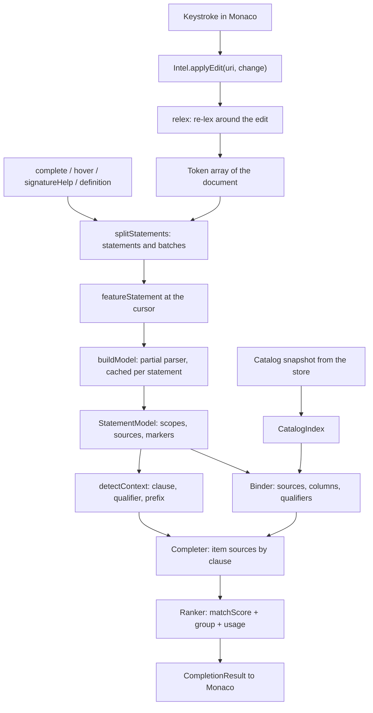
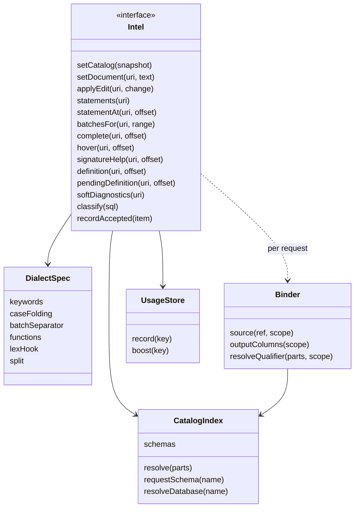
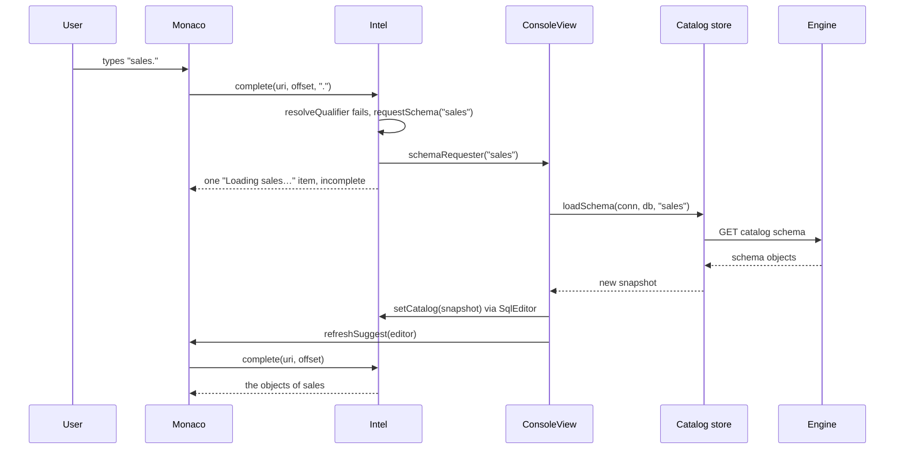
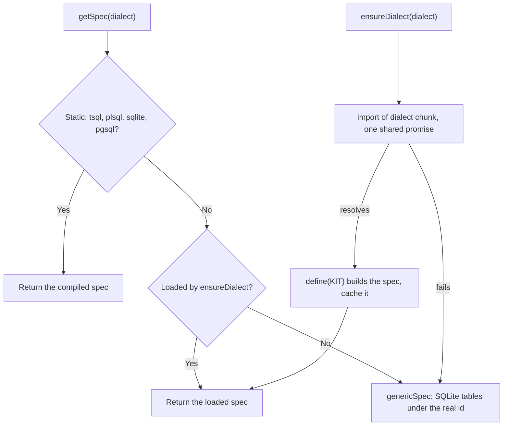

# 11. IntelliSense (sql-intel)

> **Level:** L3 senior (sections 1-2 readable from L2) | **Part:** II | **Code read at:** `b638b7b` (Rowlit 1.6.3 feature set; `version.json` in this tree says 1.7.0)
> **Language:** English | [فارسی](../../fa/part2/11-intellisense.md) | Previous: [10. Catalog, metadata cache and the explorer](./10-catalog-and-metadata.md) | Next: [12. The editor, formatter, snippets and local history](./12-editor-and-formatter.md)
> **In one sentence:** `ui/src/intel` is a pure TypeScript language service that turns the text of a console and a cached catalog snapshot into completion lists, signature help, hover cards, go-to-definition targets, statement boundaries and instant warnings, without asking the database anything while you type.
> **You will learn:**
> - the pipeline from a keystroke to a suggestion list: lexer, splitter, partial parser, catalog index, binder, cursor context, completer and ranker;
> - why the parser is "partial" and error tolerant, and what the statement model records;
> - how names are resolved per dialect (case folding, search path, synonyms, other databases, Oracle PUBLIC synonyms);
> - how completion is ranked, how usage is remembered, and how a schema that is still loading shows up as "Loading Sales…";
> - the difference between soft diagnostics (computed here) and server diagnostics (computed by the engine);
> - how nine dialects fit in one engine, five of them loaded lazily, and how all of it is wired into Monaco.
> **Prerequisites:** [10. Catalog, metadata cache and the explorer](./10-catalog-and-metadata.md) (the snapshot this chapter consumes), [08. Connections, sessions and executing SQL](./08-connections-sessions-execution.md) (what "run a batch" means). Part I background: [I-08 The query pipeline and the optimizer](../part1/08-query-processing.md) (parser and binder in a real DBMS), [I-17 dialect comparison](../part1/17-dialect-comparison.md) (quoting, case folding, batch separators).

## 1. The idea (beginner)

When you type `SELECT c.` in a console, a list of the columns of the table behind `c` appears. When you type `JOIN`, Rowlit offers the tables that have a foreign key to the tables you already have, together with a ready `ON` condition. When you hover a table name, a card shows its columns and keys. When you press F12 on a name, Rowlit opens that object. And when you write `DELETE FROM orders` without a `WHERE`, a yellow squiggle appears before you run anything. This family of features is called **[IntelliSense](../glossary.md#intellisense)** (after the Visual Studio feature) or, more generally, a **[language service](../glossary.md#language-service)**: software that understands a language well enough to help while you edit it.

Rowlit's language service lives in the folder `ui/src/intel` of the React app. It does not ask the database server what you mean. Asking would cost a network round trip per keystroke, and a half-typed statement is not valid SQL anyway, so the server could not parse it. Instead the engine sends the UI a cached description of the database once (the [catalog snapshot](../glossary.md#snapshot) of chapter [10](./10-catalog-and-metadata.md)), and the language service reads your text, guesses its structure even though it is incomplete, and matches names against that snapshot. Everything in this chapter runs inside the window, in plain TypeScript, with no DOM and no Monaco imports: the editor is only a client of it.

## 2. How it works (practitioner)

### 2.1 Goals and where it runs

The plan fixed three goals for the intel folder (`docs/PLAN.md` §4.1):

- **Run in the renderer, offline, over a cached snapshot.** "Keystroke latency must be < 5 ms; a round trip to the engine (even localhost) adds 2-10 ms plus JSON cost." The stated budget is completion ≤ 5 ms on a 300-line script with a 5 000-table catalog, and an index build ≤ 150 ms for 100 000 columns.
- **No shared mutable state with React**, so the library could move to a Web Worker later "as a transport change only" (decision D-11 in the plan). As far as the code shows it has not moved: nothing under `ui/src/intel` creates a worker, and `SqlEditor` calls the API synchronously (`ui/src/editor/SqlEditor.tsx:216`).
- **No DOM, no React, no Monaco.** The first line of the public module says so (`ui/src/intel/index.ts:1`), and the test configuration runs the folder in a plain Node environment (`ui/vitest.intel.config.ts`).

Hard syntax errors are the one thing the intel does not try to find. Those come from the engine (section 2.12).

### 2.2 The pipeline

Every editor creates one `Intel` object with `createIntel(dialect, options)` (`index.ts:548-550`). It keeps a small record per document URI: the text, the token array, the line starts, the split result, a cache of statement models and a cache of diagnostics (`index.ts:95-103`). Requests are answered lazily: an edit only updates the tokens and throws away the split and the diagnostics; the next request rebuilds what it needs.

**Figure 11.1 — From a keystroke to a completion list.**



Reading Figure 11.1 from the top:

1. **Edit.** `applyEdit` splices the change into the stored text, recomputes line starts and calls `relex` with the previous tokens (`index.ts:182-192`). A request for a URI it has never seen creates an empty document (`index.ts:196-203`); a change Monaco reports as several edits is passed as a full `setDocument` instead (`SqlEditor.tsx:295-303`).
2. **Split.** On the next request `splitOf` runs the dialect's splitter over the tokens and drops cached models of statements that no longer exist (`index.ts:208-216`).
3. **Pick the statement.** `featureStatement` finds the statement around the cursor, or the previous one when the cursor sits in its trailing whitespace without a `;`, a blank line or a `GO`/`/` line in between (`index.ts:313-330`).
4. **Parse.** `model` builds the statement's `StatementModel` from its significant tokens (no comments, whitespace or batch separators) and caches it under the key `start + NUL + text` (`index.ts:123-125`, `218-231`).
5. **Answer.** `complete` checks a few exits first (the cursor is inside a comment or string, or inside a Snowflake `$$` body that it completes as a separate document), then builds a `Binder`, detects the cursor context and runs the completer with the dialect's own source, the package sources and the editor's extra sources (`index.ts:463-477`).

**Figure 11.2 — The `Intel` facade and the parts behind it.**



The full interface is at `index.ts:36-82`. Besides the members in Figure 11.2 it has hooks the host fills in: `setSchemaRequester` and `setDatabaseRequester` (called when a schema or another database is needed), `setPublicSynonymResolver` (Oracle), `setForeignCatalogs` (T-SQL, other databases of the server), `setExtraCompletionSources` (snippets and postfix templates) and `onDidChange` (the catalog changed asynchronously). The default options are at `index.ts:84-93`: keywords upper case, identifiers as the catalog spells them, qualify objects only outside the default schema, qualify columns only when ambiguous, a blank line ends a statement (except for SQLite and PostgreSQL, `index.ts:141`), aliases from initials, and at most 3 000 column suggestions before a `FROM` exists.

### 2.3 The lexer

A **[lexer](../glossary.md#lexer)** (or tokenizer) cuts text into **[tokens](../glossary.md#token)**: words, strings, numbers, operators. Rowlit has one lexer engine for every dialect, driven by tables from the **[dialect spec](../glossary.md#dialect-spec)** (the `DialectSpec` object that holds a dialect's keywords, quoting, folding, functions and hooks; `ui/src/intel/lexer/lexer.ts:1-4`). Each token records its kind, text, absolute `[start, end)` offsets, 1-based line and column, an upper-cased copy for keyword matching, and an `unterminated` flag for a string, comment or quoted identifier that never closes (`ui/src/intel/types.ts:6-25`). The kinds are `ident`, `quotedIdent`, `keyword` (reserved words only; contextual words stay `ident`), `string`, `number`, `param`, `op`, `punct` (`( ) , . ;`), `comment`, `batchSep`, `ws`, `eof`, and `meta` for a client command line such as psql's `\dt`.

What the lexer knows per dialect, with the line that implements it:

| Construct | Dialects | Source |
|---|---|---|
| nested `/* /* */ */` comments | T-SQL, PostgreSQL | `lexer.ts:176` |
| `GO [n]` alone on a line becomes a `batchSep` token | T-SQL | `lexer.ts:543-558` |
| `/` alone on a line becomes a `batchSep` token | Oracle | `lexer.ts:416-424` |
| `[x]` identifiers; `` `x` `` | T-SQL and SQLite; SQLite | `lexer.ts:461-470` |
| `q'[...]'` quoting, `:bind` and `&subst` parameters, `%ROWTYPE` as an operator | Oracle | `lexer.ts:436-453`, `501-519`, `569-577` |
| `E'...'`, `U&'...'`, `$1`, `$tag$...$tag$` bodies, `\` meta lines, `0x1F`/`1_000` numbers | PostgreSQL | `lexer.ts:299-380` |
| `@var`, `@@fn`, `#temp`, `##temp`, `$ACTION` | T-SQL | `lexer.ts:494-500`, `528-530` |

**Lexer traits for the newer dialects.** The four original dialects (T-SQL, PL/SQL, SQLite, PostgreSQL) keep the hard-wired rules above. The five later ones (MySQL, ClickHouse, Snowflake, CQL, DuckDB) declare their rules as data in `LexTraits`: backtick identifiers, `#` comments, `//` comments, backslash escapes, dollar quoting, parameter prefixes such as `:` `@` `?`, `$1` parameters, ClickHouse `{name:Type}` parameters, hex literals and string prefixes (`ui/src/intel/dialect/spec.ts:39-63`). `lexer/traits.ts` turns a trait set into a **[lexer hook](../glossary.md#lexer-hook)** (`traitLexer`, `traits.ts:24-121`) that the lexer calls after its comment checks and before everything else (`lexer.ts:411-415`). The work-package note explains the shape: a hook instead of inline code kept "another ~0.5 KB off the initial load" (`docs/wp-notes/wp0.md`, deviation 4). A detail worth knowing: a `//` in Snowflake is not a comment when the word before it ends with a colon or starts with `@`, so `PUT file:///tmp/a.csv @~` keeps its URL (`traits.ts:16-21`).

**Three ways to run it.** `tokenize(text, spec)` lexes a whole document and always ends with an `eof` token (`lexer.ts:603-611`). `lexLine(line, spec, state)` lexes one line for Monaco's syntax highlighter and returns an end state encoded as a short string (`c<depth>` inside a block comment, `s` inside a string, `d<tag>` inside a dollar body, and so on: `lexer.ts:35-39`, `621-638`), so the highlighter can resume a multi-line construct on the next line. The third way, `relex`, is the incremental mode the next paragraph describes.

**[Incremental lexing](../glossary.md#incremental-lexing).** `relex(prev, newText, change, spec)` re-lexes only around the edit (`lexer.ts:684-732`). It keeps the old tokens before the edit, restarts at the start of the line containing the edit (because `GO` and `/` are recognised only at a line start), and lexes forward. As soon as it produces a token after the edited region that equals an old token shifted by the edit's length delta (same kind, text, start and end), the two streams are "in sync" and the rest of the old tokens are copied with shifted offsets and recomputed line numbers. A one-character edit in a 10 000-line script therefore usually costs a few tokens. An edit that opens a string or comment changes the meaning of everything after it, so the lexer runs until the streams meet again, which can be the end of the document.

> The plan said "the lexer tokenizes the whole document on each change (a 1 MB script tokenizes in ~15 ms)" (`docs/PLAN.md` §4.3). The code does more: it re-lexes incrementally (`lexer.ts:679-732`), and `applyEdit` always takes that path for a single change.

### 2.4 The splitter: statements and batches

A **[splitter](../glossary.md#splitter)** decides where one statement ends and the next begins. That decision drives Ctrl+Enter (run the statement at the cursor), which statement the parser models, and what "run script" sends. `splitStatements` collects the indices of significant tokens and dispatches on the dialect (`ui/src/intel/split/splitter.ts:63-80`). Each statement carries its text and offsets, its kind (section 2.5), whether it is a PL/SQL block, a batch index, and three optional flags: `execText` (what to send instead of the text), `skipOnRun` and `missingSlash` (`types.ts:33-54`).

- **T-SQL** (`splitter.ts:166-263`). `GO [n]` lines close *batches*; `GO 5` repeats the batch five times (`splitter.ts:186-191`, and `batchesFor` pushes it `repeat` times, `index.ts:283-292`). Inside a batch a statement ends at a `;` outside parentheses and `BEGIN ... END`/`CASE ... END`; at a blank line when `blankLineSplitsStatements` is on; or at a statement-start keyword at the start of a line that follows a complete statement. "Complete" is a set of heuristics in `canSplitTsql`: not after an operator, comma, `(` or `.`, not after an incomplete word such as `FROM` or `AND`, not inside an `IF`/`WHILE` whose body is still pending, not the `SELECT` of `INSERT ... SELECT`, not the main DML after a `WITH` list, not the `SET` of an `UPDATE` (`splitter.ts:250-263`). `CREATE PROCEDURE/FUNCTION/TRIGGER/VIEW` runs to the end of the batch (`splitter.ts:211-213`).
- **Oracle** (`splitter.ts:269-440`). A PL/SQL block starts at `DECLARE`, `BEGIN`, a `<<label>>`, or `CREATE [OR REPLACE ...] PROCEDURE|FUNCTION|PACKAGE|TYPE BODY|TRIGGER|...`, and ends at a `/` line; without one, an `END;` at depth 0 followed by a blank line or the end of the text closes it and sets `missingSlash`. Local subprograms inside a `DECLARE` section are tracked so their `END;` does not close the block. 12c `WITH FUNCTION ... SELECT` is one statement. SQL\*Plus lines (`SHOW`, `SPOOL`, `SET SERVEROUTPUT ON`...) become statements with `skipOnRun`, and `EXEC p(1)` is rewritten as `BEGIN p(1); END;` in `execText` (`splitter.ts:310-333`).
- **SQLite and PostgreSQL** (`splitter.ts:453-523`). A `;` outside parentheses and `CASE ... END` ends a statement; SQLite keeps `CREATE TRIGGER ... BEGIN ... END` whole, PostgreSQL keeps `BEGIN ATOMIC ... END` whole. Dollar-quoted bodies are single string tokens, so `CREATE FUNCTION ... AS $$ ...; ... $$;` never splits. A psql `\` line is its own statement with `skipOnRun`.
- **The lazy dialects** bring their own splitter through `DialectSpec.split`, else they get the semicolon splitter (`splitter.ts:72-77`). MySQL's handles `DELIMITER` lines and compound routine bodies without a delimiter (`ui/src/intel/split/mysql.ts:1-17`); CQL keeps `BEGIN BATCH ... APPLY BATCH` whole (`split/cql.ts`); Snowflake has its own file (`split/snowflake.ts`).

`statementAt(uri, offset)` is the run target's question "which statement is under the cursor?" (`index.ts:237-254`): the statement that contains the offset; else the previous one when only its trailing whitespace, comments and `;` lie in between and no blank line (`gapIsTrailing`, `index.ts:257-261`); else the next one when `runNextStatementOnBlank` is on and only blank space separates them. `batchesFor` turns the split into the list of `{ sql, line, col }` batches the engine executes: T-SQL sends GO batches, other dialects send statements, skipping `skipOnRun` and empty ones and using `execText` when present (`index.ts:269-300`). A selection is re-tokenised and split on its own with blank-line splitting off (`index.ts:271-277`). Chapter [12](./12-editor-and-formatter.md) shows how `run-target.ts` chooses between selection, statement and script.

### 2.5 Classification and the destructive guard

`classifyTokens` gives each statement a kind: `select`, `insert`, `update`, `delete`, `merge`, `truncate`, `drop`, `create`, `alter`, `exec`, `block`, `declare`, `set`, `use`, `tx`, `grant`, `pragma`, `explain`, `other`, `empty`, plus the client kinds `sqlplus` and `psql` (`types.ts:28-31`, `split/classify.ts:37-83`). It skips a leading `WITH` list to find the main verb, then lets a lazy dialect answer first through `DialectSpec.classify`. Four kinds get the suffix `:destructive`: `UPDATE` or `DELETE` without a `WHERE` at parenthesis depth 0, `TRUNCATE`, and `DROP` (`classify.ts:55-59`). `Intel.classify(sql)` splits a whole text and returns the first destructive kind it finds, else the first kind (`index.ts:302-308`). The UI uses it for the "this will change many rows" confirmation and for history labels; the engine has its own server-side check for read-only connections (chapter [08](./08-connections-sessions-execution.md)).

### 2.6 The partial parser and the statement model

A real DBMS parser rejects `SELECT c. FROM customers c` because it is not valid SQL. Completion has to work on exactly that text. Rowlit therefore uses a **[partial parser](../glossary.md#partial-parser)**, an example of **[error-tolerant parsing](../glossary.md#error-tolerant-parsing)** (parsing that keeps going and returns a best-effort structure when the input is invalid): a hand-written recursive-descent "structure parser" that "understands only what completion/diagnostics need and skips everything else token by token. Never throws on bad input; always makes progress" (`ui/src/intel/parse/partial-parser.ts:1-2`). Two guarantees make that true. `parseStatementList` advances one token whenever a statement parser consumed nothing (`partial-parser.ts:325-327`). And `buildModel` wraps the whole parse in a `try/catch` that keeps whatever was built so far (`partial-parser.ts:2296-2306`).

The output is a **[statement model](../glossary.md#statement-model)** (`ui/src/intel/parse/statement-model.ts`):

- a tree of **[scopes](../glossary.md#statement-scope)** (a scope is one query level, such as the main SELECT, a subquery or a CTE body): `select`, `insert`, `update`, `delete`, `merge`, `cte`, `subquery`, `exists`, `values`, `plsqlBlock`, `other` (`statement-model.ts:15-17`). Each scope has a content range, a parent, child scopes, an optional `outer` scope whose sources a correlated subquery or `LATERAL`/`APPLY` can see, and its own `sources`, `ctes`, `projections`, `joins`, `targetTable`, insert column list, local variables and **markers** (`statement-model.ts:135-163`);
- **table references** (`TableRef`): kind (`table`, `subquery`, `cte`, `function`, `tempTable`, `tableVar`, `values`...), name parts, alias and ranges, a sub-scope for derived tables, column aliases, a `remote` flag for Oracle `@dblink` and four-part T-SQL names, and `isTarget` for DML targets (`statement-model.ts:64-86`);
- **identifier chains** (`c.Name`, `dbo.fnTax(`) recorded during expression scans, for hover and diagnostics (`statement-model.ts:133`);
- the tables a statement **creates** (`CREATE TABLE`, `SELECT ... INTO #t`, `DECLARE @t TABLE`) and the variables it **declares** at top level, so later statements in the document can complete them (`statement-model.ts:178-190`).

A **[clause marker](../glossary.md#clause-marker)** is the parser's note "from this offset on, the cursor is in clause X": `{ pos, clause, data? }` (`statement-model.ts:46`). The clause kinds include `select`, `from`, `join`, `on`, `where`, `groupBy`, `orderBy`, `into`, `insertColumns`, `values`, `set`, `with`, `cteColumns`, `using`, `returning`, `exec`, `execArgs`, `declare`, `ddl`, `cast`, `expr` and `use` (`statement-model.ts:4-13`). Marker data adds details: the table an `ON` belongs to (`joinRef`), whether `INTO` is `SELECT ... INTO`, what a DDL position expects (`newName`, `objectName`, `columnOf`, `dataType`...), the PostgreSQL `ON CONFLICT` sub-position (`statement-model.ts:29-44`).

Take a statement on the `shop` sample with the cursor at `|`:

```sql
SELECT c.|, o.total
FROM customers c
JOIN orders o ON o.customer_id = c.id
WHERE o.status <> 'cancelled'
```

The parser makes one `select` scope. It sets a `select` marker after `SELECT`, records two projections, sets a `from` marker after `FROM` and records the source `customers` with alias `c`, sets a `join` marker, records `orders o`, sets an `on` marker carrying `joinRef = orders o` (`partial-parser.ts:885-897`), then a `where` marker. Expressions are scanned with `scanExpr`, which records chains and opens a child scope when it meets `(SELECT` (`partial-parser.ts:213-276`). The text after the cursor is part of the model, which is why `SELECT | FROM t` can complete the columns of `t` even though `FROM` comes later.

Dialect knowledge lives in the parser too: T-SQL `BEGIN TRY/CATCH`, `IF/WHILE`, `DECLARE @t TABLE`, `OUTPUT`; PL/SQL blocks, cursors, `FOR r IN c LOOP`, `%ROWTYPE`; PostgreSQL data-modifying CTEs, `DISTINCT ON`, `FILTER (WHERE ...)`, `WITH ORDINALITY`; Snowflake Scripting blocks; CQL `BEGIN BATCH`; the method list at `partial-parser.ts:319-2290` is long because each one handles one such construct.

### 2.7 The catalog index and the binder

The **[catalog index](../glossary.md#catalog-index)**, class `CatalogIndex` (`ui/src/intel/catalog/index.ts:148`), wraps the catalog snapshot of chapter [10](./10-catalog-and-metadata.md) in lookup maps:

- **Keys and folding.** `keyOfCatalog(name)` is the key of a name as stored (upper-cased only for case-insensitive dialects); `keyOf(name, quoted)` is the key of a name written in SQL, which folds unquoted names to upper case for Oracle and Snowflake, lower case for PostgreSQL and CQL, and compares case-insensitively elsewhere (`index.ts:206-213`, `spec.ts:103-107`). This is the dialect's [case folding](../glossary.md#case-folding) rule in one function.
- **Incremental per schema.** `setSnapshot` keeps a schema entry when its `version` and object count are unchanged and rebuilds only the others; a different connection or database clears everything (`index.ts:217-260`). After any change `rebuildGlobal` rebuilds the name map across schemas and the **foreign-key graph** in both directions (`fksOut`, `fksIn`), which is what join suggestions walk (`index.ts:281-309`).
- **Built-ins.** Oracle gets `DUAL` and the supplied packages (`DBMS_OUTPUT` and the others) as built-in objects (`index.ts:194-197`). A dialect's `systemCatalog` JSON adds built-in schemas that are consulted after the loaded ones: PostgreSQL ships 37 `pg_catalog` and 12 `information_schema` views (decision D-PG9: "a static JSON of the ~30 most used system views ships with the UI"), and MySQL, ClickHouse, Snowflake and CQL ship theirs (`ui/src/intel/dialect/data/*-system.json`).
- **PostgreSQL search path** (D-PG7). An unqualified name resolves in `search_path` order, then in `pg_catalog`, then in any loaded schema; if nothing matches, the not-yet-loaded search-path schemas are requested (`index.ts:409-424`).
- **Synonyms** resolve transparently, up to eight hops (`followSynonym`, `index.ts:476-488`). Oracle PUBLIC synonyms are resolved lazily through the host's resolver, once per name (`requestPublicSynonym`, `index.ts:521-537`).
- **Other databases of the server** (T-SQL and Snowflake three-part names `Other.dbo.Orders`, and `USE Other`). The index keeps a child `CatalogIndex` per foreign database, fed by the host through `setForeignCatalogs` (`index.ts:682-703`). `resolveDatabase` answers whether a name is the console's own database, another one (and requests its schema list on first use), or unknown (`index.ts:608-623`). After `USE Other`, `indexAt` makes the rest of the script complete against Other's catalog (`ui/src/intel/index.ts:379-385`, `catalog/index.ts:637-647`).
- **Requesters.** When something needs a schema that is listed but not loaded, `requestSchema` calls the host once per name (`index.ts:548-559`). In a console the host is `ConsoleView`, which loads the schema list first if needed and then the schema through the catalog store (`ui/src/components/layout/ConsoleView.tsx:195-214`).

The **[binder](../glossary.md#binder)** (`ui/src/intel/catalog/binder.ts`) connects the statement model to the index. Its name comes from the binder stage of a database's query pipeline ([I-08](../part1/08-query-processing.md)), which also maps names in a parsed query to catalog objects, but this one is forgiving and lazy:

- `source(ref, scope)` resolves a `TableRef` into a `ResolvedSource` with a label (alias, else the last name part), a display string and a lazy `columns()` function. The order is: subquery or `VALUES` → its output columns; table variable; `#temp`; a CTE visible from the scope; a table created earlier in the script; a catalog object (following synonyms); an Oracle PUBLIC synonym; a built-in set-returning function such as `generate_series(...) AS g(n)`; otherwise "unresolved" (`binder.ts:87-155`).
- `outputColumns(scope)` computes what a subquery or CTE returns, expanding `*` and `t.*` and folding unquoted output names for Oracle and PostgreSQL; a recursion guard handles recursive CTEs (`binder.ts:228-259`), and column functions are capped at a nesting depth of 12 (`binder.ts:81-85`).
- `resolveQualifier(parts, scope)` answers "what is `a.` here?": a source, a record (a `%ROWTYPE` variable, a cursor record, a CTE, a temp table, PostgreSQL `EXCLUDED`, T-SQL `inserted`/`deleted` inside `OUTPUT`), a package, a sequence, a schema, a database, or an object (`binder.ts:320-389`).
- `DocSymbols` carries the tables and variables defined by earlier statements; `Intel.symbols` collects them by scanning only statements that contain `CREATE`, `DECLARE` or `INTO` (`ui/src/intel/index.ts:332-355`). T-SQL variables are visible only inside the same GO batch.

### 2.8 The cursor context

The **[cursor context](../glossary.md#cursor-context)** is the description of where the cursor is in the statement. `detectContext(model, offset, spec, text)` turns "offset 7 in this statement" into a description the completer can act on (`ui/src/intel/context/context.ts:84-257`). It finds the token being typed (the **prefix**, with any opening quote, `context.ts:92-116`), walks back over a dotted chain to build the **qualifier** (`c.`, `dbo.Customers.`, T-SQL `db..`, `context.ts:118-137`), picks the deepest scope containing the chain start (`scopeAt`, `partial-parser.ts:2309-2323`) and the last marker before it, which gives the **clause**. Then it computes flags: at statement start; after an operand (identifier, literal, `)`) or expecting an expression; a complete table source already precedes the cursor (`afterSource`) or the word is the alias being typed (`aliasTyping`); left or right of `=` in a `SET` list; the enclosing function call and argument index (`findCall`, `context.ts:269-311`); the table of the current `ON`. Two type positions override the clause: PostgreSQL `expr::|` and `CAST(expr AS |`, and T-SQL `CAST/TRY_CAST/PARSE(... AS |` and the first argument of `CONVERT(` (`context.ts:228-246`). The resulting `CursorContext` has 26 fields (`context.ts:21-57`); the plan's sketch had 13 (`docs/PLAN.md` §4.5).

### 2.9 Completion and ranking

The **[completer](../glossary.md#completer)** produces **[completion items](../glossary.md#completion-item)** (one row of the suggestion list: label, kind, text to insert, sort key). Its entry point `complete(ctx, env)` chooses the item sources (`ui/src/intel/complete/completer.ts:328-368`):

1. with a qualifier: `qualifierItems` (columns of a source, objects of a schema, schemas of a database, members of a package, `NEXTVAL`/`CURRVAL` of a sequence);
2. a T-SQL or MySQL prefix starting with `@`: variables and global variables;
3. at the start of a statement: start keywords, the dialect's snippets and, once something is typed, tables that insert `SELECT * FROM table` ("DataGrip style", `completer.ts:400-428`);
4. a word with declared followers (`keywordFollowers`, for example CQL `CONSISTENCY` → the levels, `completer.ts:377-396`);
5. otherwise `clauseItems`, a switch on the clause (`completer.ts:459` onwards).

The main clause cases:

| Clause | What is offered | Source |
|---|---|---|
| `select` | columns of the scope's sources, aliases, `*` and `c.*`, "all columns of" items, functions, select keywords, variables, packages, sequences; after an operand: `FROM`, `AS`, `OVER`... | `completer.ts:472-496` |
| `select` with no `FROM` yet | columns of every table of the default schema, up to `maxColumnsWithoutFrom`; when the statement ends at the cursor, accepting one inserts `col FROM table` as a snippet | `completer.ts:762-789` |
| `from`, `join`, `update`, `delete`, `into`, `using` | CTEs, tables/views/synonyms of the default schema, temp tables, schemas and databases (the first 8 ranked above the tables, `TOP_CONTAINERS`), other schemas' objects once a prefix is typed, PostgreSQL `pg_catalog` views, table functions; after a complete source: the next keywords | `completer.ts:497-520`, `806-882`, `126` |
| `join` | first the tables linked by a foreign key ([FK join suggestion](../glossary.md#fk-join-suggestion)) to an earlier source, each also as a snippet `orders o ON o.customer_id = c.id` with a generated alias | `completer.ts:915-951` |
| `on` | the full FK conditions between the joined table and each earlier source (composite keys joined with `AND`), then columns | `completer.ts:953-975` |
| `where`, `having`, `groupBy`, `orderBy`, `limit`, `returning` | columns, aliases, `ORDER BY` projection aliases, functions, a few keywords, variables | `completer.ts:534-554` |
| `set` left of `=` | the target's writable columns only | `completer.ts:555-566` |

Two quieter features sit inside these sources. **[Backward inference](../glossary.md#backward-inference)**: in `SELECT name, price FROM |`, tables that have all the already typed unqualified columns get +25 relevance (`completer.ts:793-804`, `825`). **Quoting and case**: `formatIdent` quotes a name the dialect cannot write bare (mixed case in PostgreSQL and Oracle, spaces, reserved words), reuses an opening quote the user already typed and omits the closing one if it already follows the cursor; `formatObjectName` qualifies with the schema according to `qualifyObjects` (`ui/src/intel/complete/format.ts:14-23`, `60-77`).

**Extra sources.** After the built-in items the completer appends items from three kinds of extra sources, in this order (`ui/src/intel/index.ts:475`): the dialect's own `DialectSpec.complete` (DuckDB uses it for table functions in `FROM`, `ui/src/intel/dialect/duckdb.ts:108-127`); global sources a feature package registers per dialect with `registerCompletionSource` (`index.ts:105-121`; the links package registers one for the multi-part names of whole-database members, `ui/src/components/Links/intel/wideNames.ts:1-7`, see chapter [16](./16-linked-databases-federation.md)); and the editor's sources, the snippet library and the **[postfix templates](../glossary.md#postfix-completion)** (`SqlEditor.tsx:233`). A postfix template turns `customers.sel` at the start of a statement into `SELECT * FROM customers`; it is offered only when the qualifier resolves to a table or view (`ui/src/intel/complete/postfix.ts:19-69`). An extra snippet with the same label replaces the built-in snippet, so user snippets win (`completer.ts:360-365`).

**The [ranker](../glossary.md#ranker).** Each item's score is `group * 1000 + matchScore + usageBoost + relevance`, minus 20 for a deprecated function (`completer.ts:94`). The **group** encodes the clause table above (columns 10 in a select list, FK snippets 10 in a join, and so on). The **[match score](../glossary.md#match-score)** (`matchScore`) compares the typed prefix with the label (`ui/src/intel/complete/ranker.ts:85-116`):

| Match | Score | Example |
|---|---|---|
| exact (case-sensitive) | 100 | `id` → `id` |
| exact ignoring case | 96 | `ID` → `id` |
| prefix ignoring case | 90 minus a length penalty of up to 5 | `cust` → `customers` |
| underscore parts or word starts on `_`/camelCase boundaries | 70 (62 if the first word is skipped) | `cid` → `CustomerId`, `o_d` → `order_date` |
| substring | 50 | `omer` → `customers` |
| subsequence, prefix of 3+ characters | 20-30 | `csr` → `customers` |
| no match | −1 (the item is dropped unless forced) | |

The result is sorted by score, then by shorter label (`completer.ts:366`), and `sortTextFor` writes the score as seven digits with two decimals kept, so Monaco keeps Rowlit's order (`ranker.ts:119-122`). The list is capped at 2 500 items; a capped list is marked incomplete so Monaco asks again with a longer prefix (`completer.ts:34`, `92`, `367`).

**Usage memory ([MRU](../glossary.md#mru)).** `UsageStore` adds `2^((now − epoch) / halfLife)` to an item's key each time you accept it, with a half-life of 14 days, so the stored number is a frequency that decays with age without storing timestamps; `boost` turns it into 0 to 15 points (`ranker.ts:124-157`). The store keeps at most 2 000 keys and trims to the 1 500 strongest. Keys look like `obj:dbo.Customers`, `col:Customers.Name`, `kw:WHERE`, `join:dbo.Orders`. When Monaco runs the accept command, the editor records the key (`SqlEditor.tsx:280-285`), and `ConsoleView` saves the record per connection under `settings.ui.completionUsage` after a 1.5 s pause (`ConsoleView.tsx:215-222`).

**Completion with a schema that is still loading.** The explorer loads schemas lazily (chapter [10](./10-catalog-and-metadata.md)), so a user often types `sales.` before `sales` has been loaded. Figure 11.3 shows what happens.

**Figure 11.3 — Completion with a pending schema load.**



The loading row is a real item that matches whatever was typed, inserts nothing new and marks the result incomplete (`loadingItem`, `completer.ts:219-225`; `qualifierItems`, `completer.ts:1260-1266`). The completion provider remembers that a loading row was shown (`ui/src/editor/monaco-setup.ts:164`); when the next catalog arrives, `SqlEditor` re-runs the open suggest session in place (`SqlEditor.tsx:418-428`, `refreshSuggest` in `ui/src/editor/suggestKey.ts:69-77`). The same pattern covers another database of the server ("Loading Other…", `completer.ts:1288-1298`) and the console after `USE Other` (`completer.ts:344-348`).

### 2.10 Signature help and hover

**[Signature help](../glossary.md#signature-help)** is the small box that shows a function's parameters while you type its arguments. `Intel.signatureHelp` finds the enclosing call through the cursor context or by walking back from the cursor (`ui/src/intel/index.ts:514-528`). `signature.ts` lists user routines and package members first, because they shadow built-ins of the same name, and falls back to the dialect's function catalog (`ui/src/intel/signature/signature.ts:15-58`). The active parameter is the count of depth-0 commas before the cursor, or, for Oracle named notation `p_total => |`, the parameter with that name; with several overloads it picks the first that accepts that many arguments, and a variadic `...` parameter absorbs the rest. T-SQL `EXEC proc a, b` without parentheses works through the `execArgs` marker (`context.ts:214-226`). The function catalogs are JSON files per dialect: 311 functions for T-SQL, 356 plus 18 packages for Oracle, 150 for SQLite, 383 for PostgreSQL, 343 for MySQL, 570 for ClickHouse, 229 for Snowflake, 129 for CQL and 489 for DuckDB at this commit (`ui/src/intel/dialect/data/*-functions.json`).

**[Hover](../glossary.md#hover).** `symbolAt` finds the **[symbol](../glossary.md#symbol)** under the mouse, that is, what the named thing is: an alias definition or use, a table, a column (qualified or found in a visible source), a CTE, a variable, a temp table, a function, a package member, a schema, a database, an operator, or `seq.NEXTVAL` (`ui/src/intel/hover/symbol.ts:10-22`, `31-146`). `hoverFor` writes Markdown for it: an object shows `schema.name (table)`, its comment, a column table with PK/FK/identity badges for the first 25 columns, a routine's signature, a package's members, and a warning for an Oracle object whose status is `INVALID`; a column shows its type, nullability and badges such as `[FK → dbo.Countries.Id]` (`ui/src/intel/hover/hover.ts:10-110`). Monaco renders it with `isTrusted: false`, so links and commands in catalog comments cannot run (`monaco-setup.ts:237`).

### 2.11 Go to definition and pending definition

**[Go to definition](../glossary.md#go-to-definition)** (F12 or Ctrl+click) reuses `symbolAt`. `definitionFor` returns a `local` range for things defined in the same document (an alias, a CTE name, a `DECLARE`d variable, a temp table's creating statement, a CTE projection) and an `object` reference for catalog objects, with the column name when the symbol was a column (`ui/src/intel/definition/definition.ts:9-32`). Built-in objects have no target. The editor opens an object reference as a Data tab for tables, views and synonyms, and as the object's definition otherwise; Alt+F12 always opens the DDL (`ui/src/editor/registry.ts:13-16`, `SqlEditor.tsx:352-357`).

If the name sits in a schema that is not loaded, `definition` finds nothing. **`pendingDefinition`** tells the caller whether that is final or whether something is on its way: the default schema, an unloaded search-path schema (PostgreSQL), a pending Oracle PUBLIC synonym, another database's schema list or schema (T-SQL), or a listed schema of this database. Each missing piece is requested from the host as a side effect, so calling it again later is how the caller polls (`ui/src/intel/definition/pending.ts:24-71`). `resolveDefinition` in the editor loops: try `definition`; if empty ask `pendingDefinition`; if something is pending show "Loading Sales…" once and wait for the next catalog change or `onDidChange`; give up after `DEFINITION_WAIT_MS` = 15 000 ms (`ui/src/editor/definition-nav.ts:10-74`). A timeout or a schema that arrived without the name is reported through `definitionMissing` (`monaco-setup.ts:252-254`).

### 2.12 Diagnostics: soft and server

A **[diagnostic](../glossary.md#diagnostic)** (a problem found in the text, with a range, a severity and a code) becomes a [marker](../glossary.md#marker) (a squiggle with a message) in the editor. Rowlit has three marker owners (`ui/src/editor/markers-core.ts:6`); this chapter owns the first two, and chapter [12](./12-editor-and-formatter.md) describes the third (errors of the last run).

**[Soft diagnostics](../glossary.md#soft-diagnostics)** are computed by the intel on every change, debounced 250 ms (`SqlEditor.tsx:77-79`), cached per document until the next edit or catalog change (`ui/src/intel/index.ts:530-545`, `144-145`). They are deliberately cautious: an "unknown" warning is raised only when the schema that would contain the name is loaded, so a half-loaded catalog never produces false alarms (`schemaLoaded`, `ui/src/intel/diagnostics/soft-diagnostics.ts:36-55`).

| Code | Severity | Meaning | Source |
|---|---|---|---|
| `unterminated` | error | string, comment or quoted identifier never closed | `soft-diagnostics.ts:15-19` |
| `paren` | error | unbalanced `)` or unclosed `(` within a statement | `soft-diagnostics.ts:20-32` |
| `psql`, `sqlplus` | warning | client command skipped on run | `soft-diagnostics.ts:61-65` |
| `missing-slash` | info | PL/SQL block not ended by a `/` line | `soft-diagnostics.ts:66-69` |
| `unknown-database` | warning | T-SQL `USE x` or `x.dbo.t` names a database the server does not list | `soft-diagnostics.ts:71-85` |
| `duplicate-alias` | warning | the same alias twice in one scope | `soft-diagnostics.ts:87-98` |
| `unknown-table` | warning | table in `FROM`/`JOIN`/target not found (schema loaded, not a synonym or temp) | `soft-diagnostics.ts:100-114` |
| `insert-count` | warning | `INSERT` column list and first `VALUES` row differ in length | `soft-diagnostics.ts:116-119` |
| `no-where` | warning | top-level `DELETE` or `UPDATE` without `WHERE` | `soft-diagnostics.ts:121-124` |
| `unknown-alias` | warning | `x.col` where `x` is no source, schema, variable or package | `soft-diagnostics.ts:137-141` |
| `unknown-column` | warning | `c.col` where `c` resolves but has no such column (pseudo and system columns excepted) | `soft-diagnostics.ts:144-157` |
| `ambiguous-column` | info | an unqualified column exists in two or more sources | `soft-diagnostics.ts:160-173` |
| `unknown-type` | info | PostgreSQL `::name` cast to a type that is neither built in nor in the catalog | `soft-diagnostics.ts:189-207` |

For `unknown-table` and `unknown-column` the editor offers a "Did you mean …?" quick fix: the closest known name within about one edit per four characters (an optimal-string-alignment distance), never a pure case change (`markers-core.ts:43-126`).

**[Server diagnostics](../glossary.md#server-diagnostics)** come from the engine through `POST /sql/diagnostics`, which picks the provider for the dialect (or the console's connection) and calls its `ISqlDiagnostics.AnalyzeAsync`; positions are 1-based and absolute to the document (`engine/src/DbStudio.Core/Providers/IDbProvider.cs:168-173`, `engine/src/DbStudio.Host/Endpoints/HistoryAndSqlEndpoints.cs:63-87`). Three providers implement it: SQL Server with ScriptDom (`scriptdom`), PostgreSQL with a server-side prepare (`pg-prepare`) and SQLite with `Prepare` (`sqlite-prepare`); the others return `null` and the endpoint answers `NOT_SUPPORTED` (`*Provider.cs`, `Diagnostics => null`). Diagnostics never open an SSH tunnel: they use the open one or work offline (`HistoryAndSqlEndpoints.cs:80-81`). The editor debounces requests by 400 ms, and `LatestRequest` drops any answer that is older than the latest request or arrives after the model changed (`SqlEditor.tsx:63`, `84-93`; `markers-core.ts:129-147`). Oracle compile errors found after a `CREATE` run arrive as the `exec.diagnostics` event and become markers of the third owner.

### 2.13 Lazy dialects

Nine dialects share the engine: `tsql`, `plsql`, `sqlite`, `pgsql` are **static**, compiled into the initial bundle; `mysql`, `clickhouse`, `snowflake`, `cql` and `duckdb` are **[lazy dialects](../glossary.md#lazy-dialect)**, each a separate chunk loaded on first use (`ui/src/intel/dialect/registry.ts:16-23`). The reason is the bundle budget: decision D10 of `docs/PLAN-M2.md` allows the initial chunk to grow by at most 120 KB over the baseline, and every function catalog is tens of kilobytes (the CQL note measured its lazy chunk at 11.6 KB gzipped, `docs/wp-notes/WP-CS-intel.md`).

**Figure 11.4 — How `getSpec` resolves a dialect.**



`getSpec` is synchronous and never fails (`ui/src/intel/dialect/index.ts:18-26`). Until a lazy spec has loaded it answers with the **[generic stand-in](../glossary.md#generic-stand-in)**: the SQLite spec copied under the real dialect id, so code keyed on `'mysql'` still sees `'mysql'` (`ui/src/intel/dialect/generic.ts:1-15`). `ensureDialect` starts the import once, shares the promise among callers, and resolves to the generic spec if the chunk fails to load, so nothing hangs (`registry.ts:43-68`). `SqlEditor` waits for it before it creates the Monaco model and the `Intel` (`SqlEditor.tsx:49-59`, `212`), and opening a connection starts the load early (`registry.ts:1-6`). Synchronous users such as the formatter take whatever `getSpec` answers at that moment.

**The no-import rule.** A lazy dialect module exports `define(kit)` and receives `buildSpec` and the word helpers from the kit; its splitter receives a `SplitKit` and its formatter rules a `FormatKit`. It must not import runtime code from the shell, because "one such import makes the bundler re-partition the shared intel/splitter chunks (measured: about +3 KB gzipped on the initial load)" (`spec.ts:68-72`, `docs/wp-notes/wp0.md` §2 "Lazy dialects (D7)"). The DuckDB spec, the dialect of linked databases, shows the pattern: it spreads the lazy-only ANSI base, adds a lexer hook for `$name` parameters, its own classification (FROM-first queries, `SUMMARIZE`, `PIVOT` count as `select`) and a completion source for table functions (`duckdb.ts:1-186`).

### 2.14 Wiring into Monaco

`monaco-setup.ts` registers, once per dialect, a Monaco language with the id `dbstudio-<dialect>` (`ui/src/editor/monaco-setup.ts:19-31`, `98-120`) and these providers, each of which looks up the editor that owns the model by its URI through the binding registry, because several editors can be mounted at once (`ui/src/editor/registry.ts:1-70`):

- **Tokens.** A tokens provider that calls `lexLine` through `tokenizeLine`, so highlighting and parsing use the same lexer (`monaco-setup.ts:121-129`, `ui/src/editor/tokens-core.ts:9-43`). It calls `getSpec` per line, so a lazy dialect switches from generic to real highlighting as soon as its chunk arrives.
- **Completion** with **[trigger characters](../glossary.md#trigger-character)** (characters that open the list by themselves) `. ( , @ : # [ " ` and space (`monaco-setup.ts:43`). A space opens the list only after `FROM`, `JOIN`, `UPDATE`, `INTO`, `EXEC`, `EXECUTE`, `CALL`, `ON`, `USING`, `APPLY`, `LATERAL`, `RETURNING` or `CONFLICT` (`monaco-setup.ts:46`, `140-143`). The provider converts offsets to Monaco ranges, keeps the "Loading" flag and passes `incomplete` through (`monaco-setup.ts:131-167`). Ctrl+J asks the same provider for snippets only (`monaco-setup.ts:145-153`).
- **Signature help** on `(` and `,` (`monaco-setup.ts:207-228`), **hover** (`230-239`) and **definition** (`241` onwards).
- **Editor options** that leave the ranking to Rowlit: `quickSuggestionsDelay: 0`, `wordBasedSuggestions: 'off'`, `localityBonus: false`, `shareSuggestSelections: false`, `insertMode: 'replace'` (`SqlEditor.tsx:250-258`).

Three small editor files exist only because of Monaco's behaviour. `suggest-guard.ts` (the **[suggest guard](../glossary.md#suggest-guard)**) patches one re-entrancy bug in Monaco 0.57's `SuggestModel._onNewContext` that throws while typing with the list open; the patch swallows only a `TypeError` raised when the completion model vanished during the call (`ui/src/editor/suggest-guard.ts:1-55`). `suggestKey.ts` replaces Ctrl+Space (and Ctrl+I) because Monaco's own binding does nothing while the widget shows "Loading…" or "No suggestions." (`suggestKey.ts:1-63`). `suggestMetrics.ts` derives the list's font size and row height from the editor font: a 14 px editor gets 13 px text and 24 px rows (`ui/src/editor/suggestMetrics.ts:12-16`). The parameter hint "3 parameters · Ctrl+Alt+P to edit" after the first line of a statement uses intel tokens too (`ui/src/editor/param-hint.ts:11-67`, `SqlEditor.tsx:130-159`).

## 3. Deep dive (senior)

> **Deep dive (L3): why a partial parser and not a full grammar**
>
> A grammar-based parser (generated from ANTLR grammars, or a hand-written full parser per dialect) would give exact trees for valid SQL. The intel needs something else: a useful answer for *invalid* SQL, because the statement is always broken while you type it. Error recovery in full parsers is hard and dialect specific, and nine dialects with procedural extensions (T-SQL, PL/SQL, PL/pgSQL, Snowflake Scripting, MySQL routines, CQL batches) would mean nine large grammars in the browser bundle. The plan chose "a hand-written recursive-descent structure parser that understands only what completion needs" (`docs/PLAN.md` §4.6). The cost is visible in `partial-parser.ts`: about 2 300 lines of dialect cases. The benefit is that anything it does not understand degrades to "skip a token" rather than to "no answer", and that the hard syntax errors come from the real parsers on the server (ScriptDom, `PREPARE`), which are correct by definition.
>
> **Error tolerance in practice.** Three mechanisms keep the parser alive. Every loop has a progress guard (`partial-parser.ts:325-327`). Expression scans stop at a fixed set of words that cannot belong to an expression (`ELSE`, `END`, `THEN`, a T-SQL statement start) and at `;` or `)` at depth 0 (`partial-parser.ts:213-228`). And the last line of defence is the `try/catch` in `buildModel`: a parser bug truncates the model instead of breaking completion (`partial-parser.ts:2298-2302`). Scopes keep `Infinity` as their end until the parser sees their terminator, so an unclosed subquery still "contains" the cursor (`partial-parser.ts:99-116`).
>
> **Incremental relex boundaries.** `relex` restarts at the start of the edited line, not at the edit, because two token kinds depend on what precedes them on the line: `GO` and Oracle's `/` are separators only at a line start, and the lexer tracks `atLineStart` (`lexer.ts:90-91`, `692-702`). Resynchronisation compares kind, text and both shifted offsets, so a token that merely looks the same but now belongs to an open string is never reused. There is no upper bound: typing an opening quote early in a long script re-lexes to the end, because every following token changed meaning.
>
> **The model cache key and its limit.** Models are cached under `start + NUL + text` (`index.ts:123-125`). An edit inside one statement re-parses only that statement, but an edit that changes the length of an earlier statement shifts the `start` of every later one, so their models are rebuilt on the next request that needs them. Completion and hover model the statement at the cursor plus the earlier statements that can define tables or variables (those containing `CREATE`, `DECLARE` or `INTO`, `index.ts:349-355`); soft diagnostics model every statement, so the cost shows up in diagnostics on very long scripts. The plan proposed a key of `(start, end, textHash)` (`docs/PLAN.md` §4.3); the code uses the text itself.
>
> **Ranking as integer arithmetic.** Groups are multiplied by 1 000 so that the match score (≤ 100), usage (≤ 15) and relevance (FK +20, inferred table +25, containers 20-24) can only reorder items *within* a group. The plan's `sortText` had five digits; the code keeps two decimals and pads to seven (`ranker.ts:118-122`), which is what lets relevance values such as `(300 − ordinal) / 3` for qualified columns (`completer.ts:1278`) keep columns in table order.
>
> **Why some dialects resolve so differently.** Oracle and Snowflake fold unquoted names to upper case, PostgreSQL and CQL to lower case, the rest compare case-insensitively (`spec.ts:128-134`, `dialect/*.ts`). That is the entire reason `keyOf` and `keyOfCatalog` are two functions: one normalises what the user wrote, the other what the server stored. A PostgreSQL table created as `"Customers"` must be quoted forever, and `needsQuoting` says so (`format.ts:17`).

## 4. Edge cases and limits

| Topic | Fact | Source |
|---|---|---|
| Completion list size | at most 2 500 items; a capped list is incomplete | `completer.ts:34`, `92` |
| Columns before `FROM` | at most `maxColumnsWithoutFrom` = 3 000 | `index.ts:92`, `completer.ts:773` |
| Schemas/databases above the tables | the first 8 (`TOP_CONTAINERS`) | `completer.ts:126` |
| Usage memory | half-life 14 days; 2 000 keys, trimmed to 1 500; boost 0-15 | `ranker.ts:124-157` |
| Usage persistence | per connection in `settings.ui.completionUsage`, 1.5 s after the last accept | `ConsoleView.tsx:215-222` |
| Hover column list | first 25 columns, then "… and N more" | `hover.ts:10`, `31` |
| Synonym chain | followed up to 8 hops | `catalog/index.ts:478` |
| Correlated scope depth / column nesting | 8 outer levels; 12 nested column computations | `binder.ts:199`, `82` |
| Go-to-definition wait | 15 000 ms, then "missing" | `definition-nav.ts:11` |
| Soft / server diagnostics debounce | 250 ms / 400 ms | `SqlEditor.tsx:79`, `63` |
| Parameter hint debounce | 150 ms | `SqlEditor.tsx:158` |
| Server diagnostics available | SQL Server, PostgreSQL, SQLite only; others `NOT_SUPPORTED` | `HistoryAndSqlEndpoints.cs:83-84` |
| Inside a comment or string | no completion, also right after a `--` comment or an unterminated string; the exception is a Snowflake SQL `$$` body, completed as a document of its own | `index.ts:391-409`, `415-455` |
| Snowflake `$$` bodies | completed only for SQL-language routines and `EXECUTE IMMEDIATE`; JavaScript, Python, Java, Scala bodies stay opaque | `index.ts:411-433` |
| T-SQL variables | visible only within the same GO batch | `index.ts:342-344` |
| Remote names | Oracle `@dblink` and four-part T-SQL names are never resolved | `partial-parser.ts:967-972`, `binder.ts:98` |
| Lazy dialect fails to load | generic SQLite spec under the real id; no hang | `registry.ts:54-64` |
| Hover Markdown | rendered untrusted | `monaco-setup.ts:237` |

## 5. How it is tested

- **The intel suite.** `ui/src/intel/__tests__/` holds about 600 test cases (595 `it`/`test` lines at this commit) in files per subject: `lexer.test.ts`, `splitter.test.ts`, `parser.test.ts`, `features.test.ts`, `types.test.ts`, `pending-definition.test.ts`, `schemas-databases.test.ts`, `cross-database.test.ts`, `tsql-completion.test.ts`, one file per lazy dialect (`mysql`, `clickhouse`, `snowflake`, `cql`, `duckdb`) and `pgsql.test.ts`, plus `plan-4.14.test.ts`, which encodes the 54 cases of the plan's test table (`docs/PLAN.md` §4.14, "`|` is the cursor; top means first items in rank order").
- **Fixtures.** Each dialect has a `shop` catalog snapshot under `__tests__/fixtures/shop-<dialect>.json`, mirroring the Docker seed databases, and `helpers.ts` provides `intelFor`, `withCursor` (the `|` marker), `complete`, `labels`, `find` and `indexOf` (`__tests__/helpers.ts:34-75`).
- **Editor glue.** `ui/src/editor/*.test.ts` covers the Monaco-free parts: `suggest-guard.test.ts`, `suggestKey.test.ts`, `suggest-metrics.test.ts`, `definition-nav.test.ts` (the wait loop, with a fake catalog change), `editor-core.test.ts`, `run-popups.test.ts`.
- **How to run it.** `npm run test:intel` uses `vitest.intel.config.ts`: the `intel`, `editor`, `format` and `snippets` tests in a Node environment with thread pooling, no jsdom (`ui/package.json:13`, `ui/vitest.intel.config.ts`). CI runs it on Windows (chapter [23](./23-testing-and-qa.md)).
- **Playground.** `ui/src/editor/dev/EditorPlayground.tsx` (with `playground.html`) mounts the editor over the fixtures for manual checks; the work-package notes describe per-dialect tours in it.
- **Server diagnostics.** The engine smoke test posts a broken SQLite script to `/sql/diagnostics` and checks `engine: "sqlite-prepare"` and the line of the first error (`engine/tests/smoke/smoke.mjs:208-209`).

## Related chapters

- [10. Catalog, metadata cache and the explorer](./10-catalog-and-metadata.md) - the snapshot, `schemaNames`, lazy schema loads and `catalog.changed`.
- [12. The editor, formatter, snippets and local history](./12-editor-and-formatter.md) - `SqlEditor`, run targets, marker owners, the formatter that shares the lexer and splitter, snippets.
- [08. Connections, sessions and executing SQL](./08-connections-sessions-execution.md) - what happens to the batches `batchesFor` produces; the engine's read-only and destructive checks.
- [09. Relational providers one by one](./09-relational-providers.md) - `ISqlDiagnostics` implementations and each dialect's catalog queries.
- [16. Linked databases and federation](./16-linked-databases-federation.md) - the DuckDB dialect and the wide-member completion source.
- [20. UI architecture](./20-ui-architecture.md) - lazy chunks and the bundle budget; the command registry behind Ctrl+Space and F12.
- Part I: [I-08 The query pipeline and the optimizer](../part1/08-query-processing.md) (parser, binder), [I-17 dialect comparison](../part1/17-dialect-comparison.md) (quoting, case folding, `GO`, `/`, `DELIMITER`).

## Glossary terms introduced here

[IntelliSense](../glossary.md#intellisense), [language service](../glossary.md#language-service), [completion item](../glossary.md#completion-item), [lexer](../glossary.md#lexer), [token](../glossary.md#token), [lexer hook / lexer traits](../glossary.md#lexer-hook), [incremental lexing](../glossary.md#incremental-lexing), [splitter](../glossary.md#splitter), [partial parser](../glossary.md#partial-parser), [statement model](../glossary.md#statement-model), [scope (statement model)](../glossary.md#statement-scope), [clause marker](../glossary.md#clause-marker), [catalog index](../glossary.md#catalog-index), [binder](../glossary.md#binder), [symbol](../glossary.md#symbol), [cursor context](../glossary.md#cursor-context), [completer](../glossary.md#completer), [ranker](../glossary.md#ranker), [match score](../glossary.md#match-score), [MRU / usage store](../glossary.md#mru), [backward inference](../glossary.md#backward-inference), [FK join suggestion](../glossary.md#fk-join-suggestion), [trigger character](../glossary.md#trigger-character), [signature help](../glossary.md#signature-help), [hover](../glossary.md#hover), [go to definition](../glossary.md#go-to-definition), [pending definition](../glossary.md#pending-definition), [diagnostic](../glossary.md#diagnostic), [soft diagnostics](../glossary.md#soft-diagnostics), [server diagnostics](../glossary.md#server-diagnostics), [dialect spec](../glossary.md#dialect-spec), [lazy dialect](../glossary.md#lazy-dialect), [generic stand-in](../glossary.md#generic-stand-in), [suggest guard](../glossary.md#suggest-guard), [error-tolerant parsing](../glossary.md#error-tolerant-parsing). Reused: [catalog](../glossary.md#catalog), [snapshot](../glossary.md#snapshot), [dialect](../glossary.md#dialect), [case folding](../glossary.md#case-folding), [quoting](../glossary.md#quoting), [batch separator](../glossary.md#batch-separator), [search path](../glossary.md#search-path), [foreign catalog](../glossary.md#foreign-catalog), [marker](../glossary.md#marker), [Monaco](../glossary.md#monaco), [postfix completion](../glossary.md#postfix-completion), [snippet](../glossary.md#snippet), [lazy loading / code splitting](../glossary.md#code-splitting), [bundle budget](../glossary.md#bundle-budget).

## Files

| Path | Responsibility |
|---|---|
| `ui/src/intel/index.ts`, `types.ts` | the `Intel` facade, document cache, public types |
| `ui/src/intel/lexer/lexer.ts`, `lexer/traits.ts` | dialect-aware lexer, line mode, incremental relex; trait-driven lexer hook |
| `ui/src/intel/split/splitter.ts`, `split/{mysql,cql,snowflake}.ts`, `split/classify.ts` | statements and batches per dialect; statement kinds and the destructive flag |
| `ui/src/intel/parse/partial-parser.ts`, `parse/statement-model.ts` | error-tolerant structure parser and its model |
| `ui/src/intel/catalog/index.ts`, `catalog/binder.ts` | catalog lookup maps, FK graph, foreign databases; name binding |
| `ui/src/intel/context/context.ts` | cursor context and function-call detection |
| `ui/src/intel/complete/{completer,ranker,format,postfix}.ts` | completion sources, scoring and MRU, quoting and case, postfix templates |
| `ui/src/intel/signature/signature.ts`, `hover/{hover,symbol}.ts`, `definition/{definition,pending}.ts` | signature help, hover, go-to-definition, pending definition |
| `ui/src/intel/diagnostics/soft-diagnostics.ts` | soft diagnostics |
| `ui/src/intel/dialect/*.ts`, `dialect/data/*.json` | dialect specs, lazy registry, generic stand-in, function and system catalogs |
| `ui/src/intel/__tests__/**` | test suite and `shop` fixtures per dialect |
| `ui/src/editor/monaco-setup.ts`, `registry.ts`, `tokens-core.ts` | Monaco languages and providers, per-model bindings, highlighting |
| `ui/src/editor/definition-nav.ts`, `suggest-guard.ts`, `suggestKey.ts`, `suggestMetrics.ts`, `param-hint.ts`, `markers-core.ts` | definition wait loop, Monaco workarounds, suggest metrics, parameter hint, marker conversion |
| `engine/src/DbStudio.Host/Endpoints/HistoryAndSqlEndpoints.cs`, `engine/src/DbStudio.Core/Providers/IDbProvider.cs` | `POST /sql/diagnostics` and the `ISqlDiagnostics` contract |
