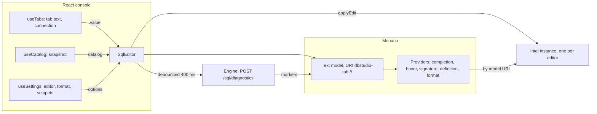
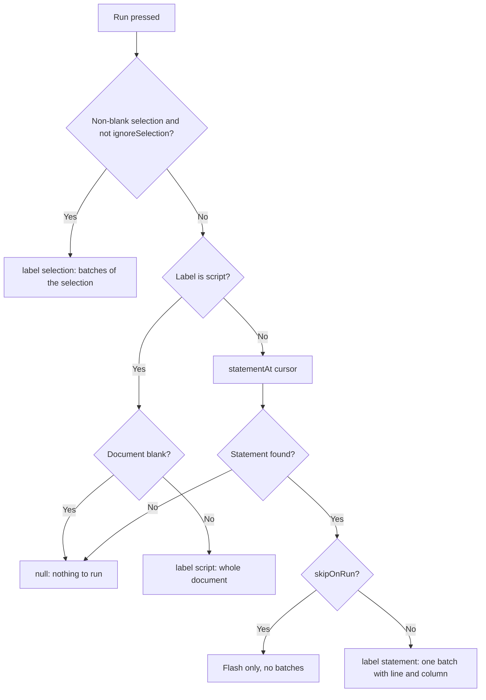
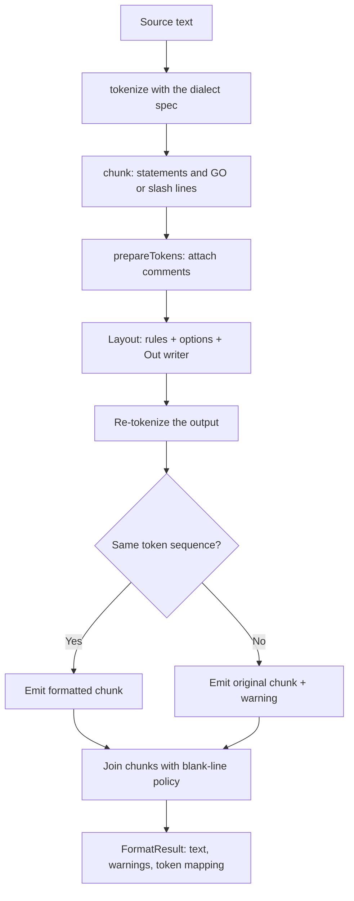

# 12. The editor, formatter, snippets and local history

> **Level:** L2 practitioner → L3 senior | **Part:** II | **Code read at:** `a61f3d1` (Rowlit 1.6.3; the tree also holds the local history announced in `docs/release-notes/v1.7.0.md`)
> **Language:** English | [فارسی](../../fa/part2/12-editor-and-formatter.md) | Previous: [11. IntelliSense](./11-intellisense.md) | Next: [13. The results grid and data editing](./13-results-grid-and-data-editing.md)
> **In one sentence:** the console is a Monaco editor wired to the IntelliSense engine, a token-based formatter that proves it never changes your SQL, a snippet library, and a private timeline of every text you ran.
> **You will learn:**
> - how `SqlEditor` mounts Monaco, binds your keymap into it and decides what "Run" means (`run-target.ts`);
> - how soft, server and execution diagnostics become markers;
> - how the formatter lays out tokens and why its token-equality check makes it safe;
> - how snippets, postfix templates and the Ctrl+J picker work;
> - how local history takes snapshots, stores them and restores them.
> **Prerequisites:** [02. A tour of the app](./02-tour-of-the-app.md), [11. IntelliSense](./11-intellisense.md), [08. Connections, sessions and executing SQL](./08-connections-sessions-execution.md).

## 1. The idea (beginner)

A SQL console looks like a text box, but a lot is going on around the text. Words are coloured by what they are (keyword, table, string). A list of suggestions appears while you type. Red squiggles mark mistakes. Pressing Ctrl+Enter runs only the statement under the cursor, not the whole file. A button reformats messy SQL into a standard layout. And if you delete a query by accident, you can go back in time.

Rowlit does not write a text editor from scratch. It embeds **[Monaco](../glossary.md#monaco)**, the editor of Visual Studio Code, and teaches it SQL. Rowlit's own code supplies four things Monaco lacks: knowledge of your database (chapter [11](./11-intellisense.md)), a SQL **[formatter](../glossary.md#formatter)**, a library of **[snippets](../glossary.md#snippet)**, and **[local history](../glossary.md#local-history)**. The rule that shapes all of them is the same: **never change what the user wrote without being able to prove the meaning is unchanged, and never lose their text.**

## 2. How it works (practitioner)

### 2.1 Monaco in Rowlit

`SqlEditor` (`ui/src/editor/SqlEditor.tsx`) is a React component that implements the contract in `SqlEditor.types.ts`. Several editors exist at once (one per console, plus designer previews), so the file states a rule at the top: every key binding is a per-editor action (`addAction`), global Monaco registrations happen once (`ensureMonacoSetup`), and the language providers find the right editor's IntelliSense through the model URI (`registry.ts`).

**Figure 12.1 — The editor, IntelliSense and the stores.**

At mount (`SqlEditor.tsx:211-403`) the component:

1. waits for the dialect spec if it is one of the lazily loaded ones (`ensureDialect`, [chapter 11](./11-intellisense.md));
2. creates an `Intel` instance for the dialect and gives it the catalog, usage history, a public-synonym resolver (Oracle) and, for T-SQL, a database requester and the other databases' catalogs;
3. creates a Monaco model with URI `dbstudio-tab://tab/<tabId>.sql` and the language id of the dialect (`LANGUAGE_IDS`, `monaco-setup.ts:19-31`: `dbstudio-tsql`, `dbstudio-plsql`, `dbstudio-sqlite`, `dbstudio-pgsql`, `dbstudio-mysql`, `dbstudio-clickhouse`, `dbstudio-snowflake`, `dbstudio-cql`, `dbstudio-duckdb`);
4. creates the editor with the options shared by every Monaco instance in the app (`baseMonacoOptions`, `monacoOptions.ts:13-25`: light DOM instead of a shadow root so theme variables apply, the app's code font stack, slim scrollbars) plus its own: no minimap, `quickSuggestionsDelay: 0`, `wordBasedSuggestions: 'off'`, hover delay 350 ms, no bracket-pair colours (`SqlEditor.tsx:235-264`);
5. feeds every Monaco content change to `intel.applyEdit` (a single change) or `setDocument` (several), which keeps the incremental lexer in step.

Two inputs are one-way copies. The tab's text flows in through `props.value`; when it differs from the model, the component applies it with `pushEditOperations` and a guard flag so the change is not echoed back (`SqlEditor.tsx:407-416`). The catalog flows in through `props.catalog`; a new catalog refreshes soft diagnostics and, if a "Loading <schema>..." row is on screen, refreshes the suggest list (`SqlEditor.tsx:418-428`).

**Code themes and font size.** Monaco has two registered themes, `dbstudio-light` and `dbstudio-dark` (`THEME_IDS`); the 22 code themes of [chapter 20](./20-ui-architecture.md) rewrite their colours at run time through `theme/monacoTheme.ts`. The font size follows `settings.editor.fontSize` live and Ctrl + wheel (Cmd + wheel on macOS) changes it by one pixel, clamped to 9-32; a `WheelStepper` accumulates 60 px of wheel delta per step so a trackpad does not jump (`editor/fontZoom.ts:1-50`). The whole-window zoom and the results grid are unaffected.

### 2.2 Keys: commands become Monaco actions

Rowlit lets you rebind shortcuts ([chapter 20](./20-ui-architecture.md)), but Monaco decides a key binding when an action is added and cannot change it afterwards. `bindCommandActions` (`editor/keyActions.ts:96-121`) solves this: for each registry command that has an editor action (Run statement, Run script, Format selection, Insert snippet, both Explains, Trigger suggest, Local history, Open definition DDL), it converts the command's *current* shortcuts to Monaco key codes (`shortcutToMonaco`) and registers the action; when the keymap changes it disposes the action and adds it again with the new keys. A shortcut Monaco cannot express (more than a two-stroke chord, an unknown key) is left out silently. Everything here is framework-free: the Monaco namespace is passed in, and tests use a fake editor.

The other half is who wins a key press. The global dispatcher ([chapter 20](./20-ui-architecture.md)) listens in the capture phase, but a list of `EDITOR_OWNED_KEYS` (Ctrl+Enter, F5, Ctrl+F, Ctrl+Z ...) is left to Monaco while the editor has focus. The same file deliberately does **not** own Ctrl+L / Ctrl+Shift+L (Explain), Ctrl+P (go to object) or Ctrl+J (snippets) (`dispatcher.ts:14-22`). When the user moves a command off an owned key, `isEditorOwned` releases the key.

Escape cancels a running query only when nothing else wants it: the action's precondition lists the suggest widget, parameter hints, find widget, snippet mode, multiple cursors, rename box and others (`SqlEditor.tsx:36`).

### 2.3 What "Run" runs: `run-target.ts`

The most-used function in the editor is 30 lines long (`ui/src/editor/run-target.ts:20-45`). Given the run label, the cursor offset and the selection, `resolveRunTarget` decides:

**Figure 12.2 — Choosing the text to run.**

The statement boundaries come from the IntelliSense splitter (`intel.statementAt`, `batchesFor`), which knows `;`, `GO`, `DELIMITER`, `/` and `$$` per dialect and, optionally, treats a blank line as a separator (`settings.editor.blankLineSplitsStatements`). Each batch carries its starting **line and column**, which is how an error at "line 2 of the statement" becomes the right line of the document. `ignoreSelection` exists for one case: Ctrl+S in an "Edit:" console saves the whole document even if you happen to have a selection ([chapter 14](./14-designers-and-ddl.md)). After the target is computed the editor flashes the range for 650 ms (`flash`, `SqlEditor.tsx:106-114`) and closes the suggest list and parameter hints (`dismissEditorPopups`) so the next Enter does not accept a suggestion.

A small related feature: after the first line of the statement at the cursor, a faint hint such as "2 parameters · Ctrl+Alt+P to edit" appears when the statement has bind parameters (`param-hint.ts`, `SqlEditor.tsx:130-160`, debounced 150 ms).

### 2.4 Markers: three owners

Monaco "markers" are the squiggles. Rowlit keeps three independent owners so one source never erases another (`editor/markers-core.ts:6`):

| Owner | Source | When |
|---|---|---|
| `dbstudio-semantic` | soft diagnostics from `intel.softDiagnostics` (unknown table, ambiguous column ...) | recomputed 250 ms after a change and when the catalog changes |
| `dbstudio-syntax` | server diagnostics: `POST /sql/diagnostics` (ScriptDom for T-SQL, `Prepare` for SQLite and PostgreSQL) | 400 ms debounce through `LatestRequest`; a result is dropped if the model version moved on |
| `dbstudio-external` | diagnostics of the last execution (`exec.diagnostics`, `props.externalDiagnostics`) mapped to document lines | when a run ends |

`softMarkers` and `serverMarkers` are pure conversions (`markers-core.ts:15-41`); an empty range is widened to the word at that position, or one character. The formatter owns a fourth owner, `dbstudio.format`, for "statement left unformatted" warnings (`actions.ts:12`). `suggestIdentifier` offers "Did you mean `Customers`?" using an optimal-string-alignment distance with at most about one edit per four characters (`markers-core.ts:43-80`).

### 2.5 Objects behind the cursor

`editor/object-uri.ts` builds synthetic URIs `dbstudio-object://<connection>/<db>/<schema>/<type>/<name>[?column=&owner=]` so Monaco's "go to definition" can point at a catalog object that is not a file. F12 or Ctrl+click opens a table's **data**; Alt+F12 ("Open definition (DDL)") opens the object tab (`object-uri.ts:40-46`). The hover text of such a link tells you which key does what.

### 2.6 The formatter

`ui/src/format` is plain TypeScript with no React, Monaco or DOM, built on the IntelliSense lexer. Its public API is in `format/index.ts`: `formatSql(text, dialect, options)`, `formatRange` and `mapOffset`.

**Figure 12.3 — The formatter pipeline for one document.**

1. **Chunking** (`chunksOf`, `index.ts:64-111`). The document is cut into top-level chunks: a statement with its terminating `;` and same-line comments, or a separator line (`GO`, `/`, MySQL `DELIMITER ...`). T-SQL is special: statements need no `;`, and the layout puts keywords at line starts, so re-splitting the output could differ. A whole `GO` batch is therefore one chunk and the layout finds the statements inside it (`batchChunks`, `index.ts:50-62`).
2. **Comments** (`format/comments.ts`). Every comment is attached to a neighbour with one of three roles: *trailing* (same line as the token before it), *inline* (between two tokens on one line) or *leading* (own line). Comment text is never changed, except that continuation lines of a multi-line block comment move by as many columns as the first line did.
3. **Layout** (`format/layout.ts`, about 2 000 lines). One left-to-right pass with recursive descent over blocks (`BEGIN...END`, `IF`, `LOOP`, packages, triggers), statements (clause keywords, lists, JOINs, AND/OR), parentheses and CASE. Per-dialect tables live in `format/rules/` (`FormatRules`: statement-start words, words after which a statement cannot end, keywords called like functions, condition clauses, extra clauses such as ClickHouse `PREWHERE`/`SETTINGS`). There is a rule file for each of the nine dialects: `tsql`, `plsql`, `sqlite`, `pgsql`, `mysql`, `clickhouse`, `snowflake`, `cql`, `duckdb`. The first four are static tables in `layout.ts`; the others come from the dialect spec's `formatRules` factory (and fall back to the SQLite tables) (`layout.ts:30-47`). Output goes through `Out`, a line writer that never leaves trailing whitespace, tracks the visual column for the line-width decision and materialises line breaks lazily so a pending comment lands at the right indent (`format/out.ts`).
4. **The safety check** (`layout`, `index.ts:295-302`). The output chunk is lexed again and compared with the input tokens (`sameTokens`): keywords, identifiers, operators and batch separators are compared by upper-case text (so only letter case may differ), comments by text with block-comment indentation ignored, everything else exactly. A `;` may move in front of the comments just before it. If anything differs, or the chunk has an unterminated string/comment/quoted identifier, the **original text is emitted** and a warning like "Statement at line 7 left unformatted: layout check failed" is returned.
5. **Resynchronising** (`resyncPoint`, `index.ts:240-263`). A broken statement should not leave the rest of the document unformatted, so the formatter looks for a cut point (after a `;`, or before a statement keyword in column 1 outside parentheses) and formats what follows. It never cuts inside a routine body (`tokenContext` tracks `CREATE PROCEDURE/FUNCTION/TRIGGER/PACKAGE` bodies, T-SQL `ALTER` of the same kinds, `BEGIN/CASE/END` nesting).
6. **PostgreSQL bodies.** A `$$ ... $$` body is a single string token to the lexer, so it passes the token check untouched and stays verbatim (decision D-PG10 in `docs/PLAN-PG.md`, `rules/pgsql.ts:1`). Only the `CREATE FUNCTION` header gets one attribute per line.
7. **Cursor and idempotency.** `mapOffset` maps a position in the old text to the new one through a token-to-token table (computed lazily on first use), so the caret stays on the same token. The layout's decisions depend only on the token sequence, comment placement and blank-line counts, which makes formatting idempotent (`layout.ts:5-9`).

**Options** are `FormatOptions`, stored in `settings.format` and validated and clamped by `resolveFormatOptions` (`format/options.ts`):

| Option | Default | Range / values |
|---|---|---|
| `keywordCase`, `identifierCase`, `functionCase`, `datatypeCase` | `upper`, `asIs`, `upper`, `upper` | `upper`, `lower`, `asIs` |
| `indent` / `useTabs` | 4 / false | 1-8 |
| `commaStyle` | `trailing` | `trailing`, `leading` |
| `lineWidth` | 120 | 40-400 |
| `clauseKeywordsOnOwnLine`, `andOrOnNewLine`, `alignAliases` | true, true, false | boolean |
| `blankLineBetweenStatements` / `maxConsecutiveBlankLines` | 1 / 1 | 0-3 / 0-5 |
| `formatDdlOnOpen` | true | boolean |

Identifier case is the only option that touches names, and `asIs` is the default: names are never changed unless you ask. In the editor the formatter appears as Monaco's own **Format Document** provider (`monaco-setup.ts:175-205`, so Monaco diffs the result into minimal edits and the cursor stays put) plus the actions in `editor/actions.ts` (`formatDocument`, `formatSelection` with undo stops around the edit). Shortcuts: Shift+Alt+F and Ctrl+Alt+L for the document, Ctrl+K Ctrl+F for the selection or the statement at the cursor. Ctrl+Alt+L is a key handler, not a Monaco keybinding, so AltGr+L ("ł" on Polish keyboards) still types its letter (`SqlEditor.tsx:366-381`).

**Formatted DDL.** The object tab's DDL pane has a "Formatted" toggle backed by `useFormattedDdl` (`editor/formatted-ddl.ts`): it formats the stored DDL with the same engine (default on, `formatDdlOnOpen`) and shows how many statements were left as they were.

**Parity test for T-SQL.** `engine/tests/DbStudio.Core.Tests/FormatterParity/FormatterParityTests.cs` goes further than the token check: for every fixture pair under `ui/src/format/__tests__/fixtures/tsql/` it parses the input and the formatted output with Microsoft's ScriptDom and requires the same token stream (ignoring whitespace, comments and keyword case) and the same parse tree. The formatter is TypeScript, the proof is C#.

### 2.7 Snippets

A snippet is a name, a prefix, an optional dialect filter and a body in Monaco snippet syntax (`$1`, `${1:default}`, `$0`, `\$` for a literal dollar). The built-in library lives in `ui/src/snippets/data/<dialect>.ts` and loads on demand per dialect (`ensureBuiltins`); on the order of 100 snippets per dialect (counting `s(...)` entries: tsql 116, plsql 107, pgsql 120, mysql 98, snowflake 107, clickhouse 100, duckdb 98, sqlite 67, cql 64) in five categories: Query, DML, DDL, Programmability, DBA.

They surface in three ways (`snippets/index.ts`):

- **Completion at a statement start**, ranked below exact keyword matches (`snippetSource`, score base 8000).
- **Ctrl+J picker** (`snippet.insert`): `openSnippetPicker` sets `binding.snippetPicker` and triggers suggest, so the provider returns snippets only, grouped by category when nothing is typed and ranked by prefix, name, category and description match otherwise (`snippetPickerItems`).
- **Postfix templates** (`Customers.sel`), contributed by `intel/complete/postfix`.

User snippets are stored in `settings.snippets` (the list is replaced wholesale by a patch). `snippetsFor` overlays them on the built-ins: a user snippet with the same prefix replaces the built-in. `validateSnippet` requires a name, a prefix of letters, digits, `_ . -` starting with a letter, a unique prefix, a non-empty body and balanced `${...}` placeholders (an escape is a backslash before `$`, `}` or `\`). `snippetPreview` renders what Monaco will insert (defaults filled in, mirrors resolved). The editor is **Settings → Snippets** (`components/SnippetsSettings`), a tab view with a Monaco body editor and a coloured preview.

### 2.8 Local history

Local history is DataGrip's safety net. Every console has a private, compressed timeline of its text.

**What triggers a snapshot** (`components/LocalHistory/capture.ts`, started once by the commands module). `startLocalHistoryCapture` subscribes to the stores and never touches the editor:

- a console appears (a file or saved query opened, a workspace restored) - baseline snapshot, reason `auto`;
- the saved text changes (Save, Save as, Save query, an "Edit:" console saved to the database) - reason `save`;
- a console closes - reason `close`, with its last text;
- a new execution begins in the console - reason `run`;
- the text changed and two minutes passed - reason `auto`, at most one per `AUTO_INTERVAL_MS` = 2 min (`capture.ts:15`); pending timers are flushed when the page becomes hidden.

Blank text, text over 5 000 000 characters and text identical to the key's last snapshot are dropped on the client, and the engine drops identical text again. Settings → Editor → "Keep local history" turns the whole thing off (`settings.ui.localHistory`) and sets the retention in days (1-365, default 30) (`LocalHistory/settings.ts`).

**Whose history is it?** A console's identity changes: a scratch console is later saved to a file, a file is reopened in a new tab after a restart, a query is renamed. `keys.ts` therefore gives each tab a *primary key* and aliases: `q:<savedQueryId>`, `o:<connection>|<db>|<schema>|<type>|<name>` for an F4 "Edit:" console, `f:<file path>`, otherwise `t:<tabId>` (`keys.ts:12-37`). New snapshots go to the primary key; the history view lists the union of the primary key, `t:<tabId>` and the file key, so a console that was later saved keeps its earlier history.

**Engine side.** `LocalHistoryService` (`engine/src/DbStudio.Core/LocalHistory/LocalHistoryService.cs`) stores snapshots in SQLite, `local-history.db` next to `history.db` (WAL mode), table `snapshots(id, key, at, reason, label, title, size, hash, bytes, data)`. The text is gzip-compressed (`CompressionLevel.Fastest`); `hash` is SHA-256 of the text. `AddAsync` skips a snapshot whose hash equals the key's latest (and, if a label was given, labels that one instead), inserts, then trims the key to 200 unlabelled snapshots (`DefaultPerKey`). Pruning enforces age (30 days default) and a total size cap (`DefaultMaxBytes` = 20 MB), runs once when the database is first opened in an engine run, and again once per UI session after the first stored snapshot with the user's retention days. **A labelled snapshot is never pruned or trimmed**: a label means "keep this" (class summary, `LocalHistoryService.cs:41-50`).

| Route | Purpose |
|---|---|
| `POST /local-history` | add `{key, text, reason, label?, title?}` → `{id, added}` |
| `GET /local-history?key=&key=&limit=&before=` | list (up to 8 keys, newest first, no text; limit up to 500) |
| `GET /local-history/{id}` | one snapshot with its text |
| `PATCH /local-history/{id}` | set or clear the label (max 200 characters) |
| `DELETE /local-history/{id}`, `DELETE /local-history?key=` | delete one, or clear keys |
| `POST /local-history/prune` | `{days?, maxBytes?, perKey?}` |

(Keys travel in the query string or body, never the path, because file paths contain slashes: `LocalHistoryModule.cs:11-20`.)

**The view.** **Ctrl+Alt+H** (command `editor.localHistory`, also in the Edit menu, the editor and tab context menus and the palette) opens a lazy `LocalHistoryView` tab, one per console: the timeline on the left grouped by day with the reason, time and size change against the previous snapshot, a side-by-side Monaco diff against the **current editor text** on the right, and Restore, Copy, Label and Delete. **Restore first stores the text it replaces** (reason `restore`, `LocalHistoryView.tsx:100-106`), so a restore is itself undoable from the same list.

## 3. Deep dive (senior)

> **Deep dive (L3): why the formatter checks tokens instead of trusting itself**
>
> A formatter that is 99 % right is worse than none, because the 1 % silently changes a query. Rowlit's answer is to treat the layout engine as an *untrusted proposal generator* and put a small, simple verifier behind it. The verifier is simple because its notion of equality is simple: the token sequence, with only the letter case of words and the position of `;` relative to comments allowed to differ. Everything the layout may legitimately change (whitespace, line breaks, indentation) is not a token. This also explains the odd constraints: why T-SQL batches are one chunk (the splitter's idea of a statement start depends on line starts, which the layout changes), why `$$` bodies pass for free (one string token), and why comments are re-attached by position instead of being re-flowed.
>
> The cost of the design is that *failure is local and visible*: a chunk that fails the check is left as the user typed it and flagged with a warning marker, so one exotic construct cannot spoil a file. The price paid is coverage: a construct the layout engine cannot parse (`problem` set) falls back to verbatim, and users see "left unformatted" instead of a half-formatted statement.
>
> **Why Monaco's formatting provider rather than `executeEdits` only.** `registerDocumentFormattingEditProvider` returns one full-range edit; Monaco diffs it against the model and applies minimal edits, which keeps the cursor, folding and decorations where they were. The toolbar path (`actions.ts`) instead replaces the range itself and restores the cursor with `mapOffset`; both paths write the same `dbstudio.format` markers, using a short-lived content listener so later typing never gets marked (`monaco-setup.ts:181-192`).
>
> **Why local history lives in the engine.** The renderer could keep snapshots in IndexedDB, but the engine is shared by every window and survives reloads, so one `local-history.db` serves detached windows and a restarted renderer. It also lets the engine enforce the size cap on the machine's disk even if the UI never runs again. The renderer's only job is *when* to snapshot; the engine decides *whether* (hash) and *how long to keep*.

## 4. Edge cases and limits

| Topic | Fact | Source |
|---|---|---|
| Run with a selection | selection wins over statement and script | `run-target.ts:24-29` |
| Statement flagged `skipOnRun` | flashed, nothing sent | `run-target.ts:38` |
| Soft / server diagnostics debounce | 250 ms / 400 ms | `SqlEditor.tsx:79`, `63` |
| Editor font size | 9-32 px, 1 px per 60 px of wheel | `fontZoom.ts:15-30` |
| Formatter: unterminated string or comment | chunk emitted verbatim + warning | `format/index.ts:297` |
| Formatter option clamps | indent 1-8, width 40-400 | `format/options.ts:47-52` |
| Local history auto interval | 2 min | `capture.ts:15` |
| Local history per key / age / size | 200 / 30 days / 20 MB (labelled never removed) | `LocalHistoryService.cs:53-60` |
| Local history text limit | 5 000 000 characters | `LocalHistoryService.cs:56` |
| History keys per list request | 8 | `LocalHistoryModule.cs:58` |
| Error codes | `VALIDATION` for bad key/text/reason/label, `NOT_FOUND` for an unknown snapshot | `LocalHistoryService.cs`, `LocalHistoryModule.cs:46` |

## 5. How it is tested

- **Editor.** `editor/keyActions.test.ts` (Monaco-free key conversion and re-registration), `editor-core.test.ts`, `fontZoom.test.ts`, `suggest-guard.test.ts`, `suggestKey.test.ts`, `definition-nav.test.ts`, `run-popups.test.ts`. The run-target resolver is pure and tested without Monaco.
- **Formatter.** `format/__tests__/format.test.ts`, `fixtures.test.ts` (input/expected pairs per dialect under `fixtures/`), `mysql.test.ts`, `cql-format.test.ts`; the C# parity test above; `intel` tests run in the node vitest config (`npm run test:intel`).
- **Snippets.** `snippets/snippets.test.ts`, `library.test.ts` (every built-in is valid), `live.test.ts` (snippets marked `run` execute as inserted on a real server in the integration job).
- **Local history.** Engine: `LocalHistory/LocalHistoryServiceTests.cs`, `LocalHistoryEndpointTests.cs`. UI: `components/LocalHistory/__tests__/`.

## Related chapters

- [11. IntelliSense](./11-intellisense.md) - the lexer, splitter and completer the editor and formatter share.
- [14. Designers, DDL and object editing](./14-designers-and-ddl.md) - F4 "Edit:" consoles, which use `ignoreSelection` and the `o:` history key.
- [13. The results grid and data editing](./13-results-grid-and-data-editing.md) - where the run's rows go.
- [20. UI architecture](./20-ui-architecture.md) - the command registry, dispatcher and keymap behind the key bindings; themes.
- Part I: [I-17 dialect comparison](../part1/17-dialect-comparison.md) - batch separators and delimiters the splitter handles.

## Glossary terms introduced here

[Monaco](../glossary.md#monaco), [language id](../glossary.md#language-id), [model (Monaco)](../glossary.md#monaco-model), [marker](../glossary.md#marker), [decoration](../glossary.md#decoration), [Monaco action](../glossary.md#monaco-action), [run target](../glossary.md#run-target), [formatter](../glossary.md#formatter), [layout rule](../glossary.md#layout-rule), [token-equality check](../glossary.md#token-equality-check), [format options](../glossary.md#format-options), [snippet](../glossary.md#snippet), [snippet placeholder](../glossary.md#snippet-placeholder), [postfix completion](../glossary.md#postfix-completion), [font zoom](../glossary.md#font-zoom), [formatted DDL](../glossary.md#formatted-ddl), [local history](../glossary.md#local-history), [snapshot (local history)](../glossary.md#local-history-snapshot).

## Files

| Path | Responsibility |
|---|---|
| `ui/src/editor/SqlEditor.tsx`, `SqlEditor.types.ts` | the component and its contract |
| `ui/src/editor/monaco-setup.ts`, `monacoOptions.ts`, `config.ts` | Monaco registration, shared options, app-wide editor config |
| `ui/src/editor/run-target.ts`, `actions.ts`, `keyActions.ts` | run decision, format/snippet/explain actions, keymap binding |
| `ui/src/editor/markers-core.ts`, `object-uri.ts`, `fontZoom.ts`, `formatted-ddl.ts` | markers, object URIs, font zoom, formatted DDL |
| `ui/src/format/*` | formatter: chunking, layout, writer, comments, options, per-dialect rules |
| `ui/src/snippets/*`, `components/SnippetsSettings/*` | snippet library, matching, settings editor |
| `ui/src/components/LocalHistory/*` | capture, keys, view, diff |
| `engine/src/DbStudio.Core/LocalHistory/*` | snapshot store and routes |
| `engine/tests/DbStudio.Core.Tests/FormatterParity/*` | ScriptDom parity of the T-SQL formatter |
