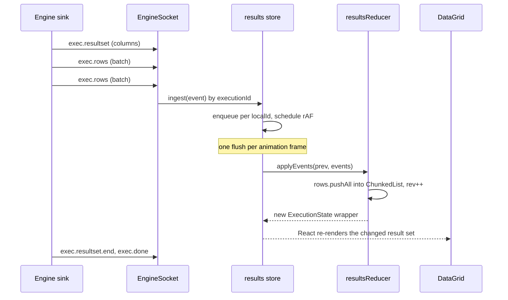
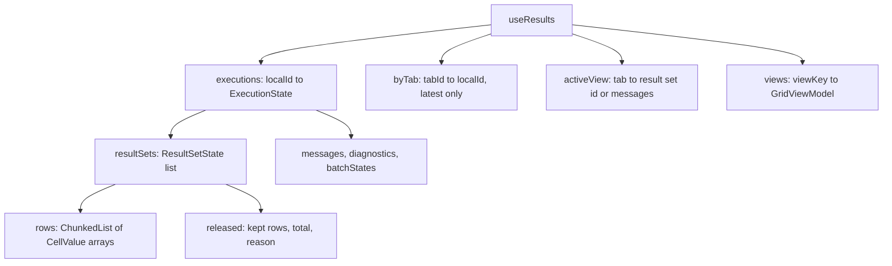
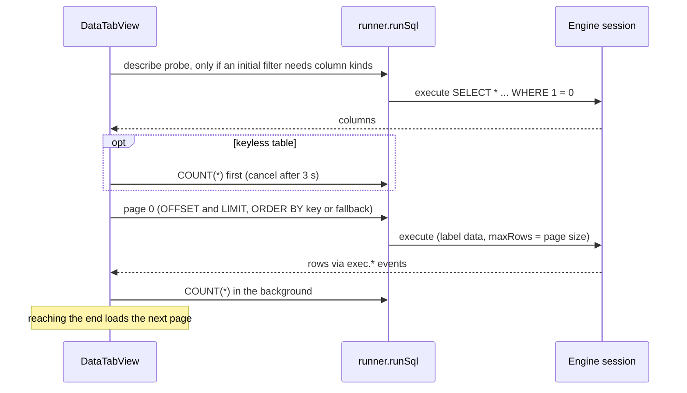
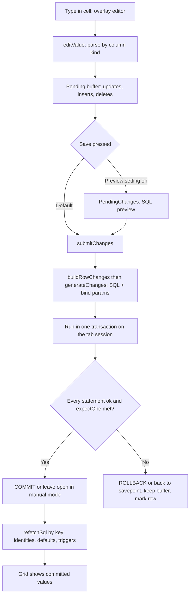
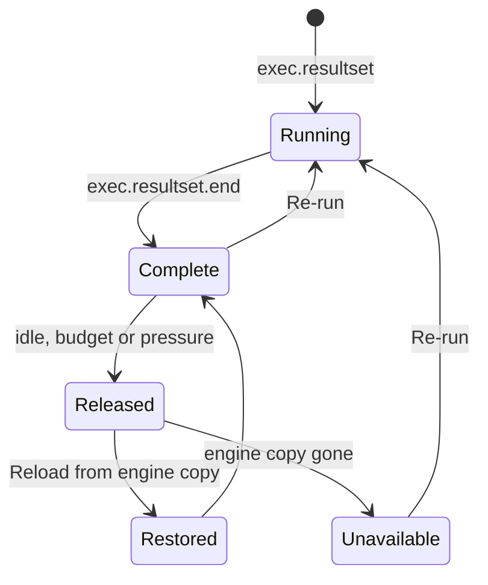
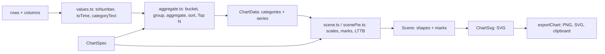

# 13. The results grid, charts and data editing

> **Level:** L2 practitioner → L3 senior | **Part:** II | **Code read at:** `a61f3d1` (Rowlit 1.6.3; the tree also holds the result charts announced in `docs/release-notes/v1.7.0.md`)
> **Language:** English | [فارسی](../../fa/part2/13-results-grid-and-data-editing.md) | Previous: [12. The editor and formatter](./12-editor-and-formatter.md) | Next: [14. Designers, DDL and object editing](./14-designers-and-ddl.md)
> **In one sentence:** rows stream from the engine into a chunked in-memory list, a canvas grid draws only what is visible, and the same data can be filtered, charted, exported and edited through generated, parameterised SQL.
> **You will learn:**
> - the path of a row from `exec.rows` to a painted cell, and why one animation frame is the unit of work;
> - what the grid does with big numbers, binary data, long text and right-to-left text;
> - how filters, the quick filter, the aggregate strip and the record view work;
> - how Data tabs page a table and how edits become `UPDATE`, `INSERT` and `DELETE` with optimistic checking;
> - how the new Grid | Chart switch builds a chart from the same rows.
> **Prerequisites:** [08. Connections, sessions and executing SQL](./08-connections-sessions-execution.md), [06. The WebSocket protocol](./06-websocket-protocol.md), [12. The editor](./12-editor-and-formatter.md).

## 1. The idea (beginner)

After you run `SELECT * FROM orders`, the engine may send ten thousand rows, or ten million if you ask for them. A browser cannot show ten thousand HTML table rows smoothly, and it should not hold a million copies of the data in React state. Rowlit therefore does four things. It **streams**: rows arrive in small batches over the WebSocket, and the screen updates once per frame (about every 16 ms), not once per message. It **stores compactly**: rows go into a chunked list that only appends. It **draws on a canvas**: the grid paints just the visible cells. And it keeps the engine's own copy of the latest result (capped at 256 MB) so that a full cell value, an export or a "reload" does not need the query to run again.

The grid is also an editor. If the result comes from one table and contains its key, you can type into a cell, add a row or delete one; Rowlit writes the SQL, runs it in a transaction, and refetches the affected rows. And since Rowlit 1.7 a switch above the grid turns the same rows into a bar, line or pie chart.

## 2. How it works (practitioner)

### 2.1 The path of a row

**Figure 13.1 — Rows streaming into the grid.**

The engine side batches rows (the plan says 200 rows or 256 KB per frame, flushed at least every 50 ms: `docs/PLAN.md:58`; mechanics in [chapter 08](./08-connections-sessions-execution.md)). On the UI, `engineSocket.onAny` forwards every `exec.*` event to `useResults.ingest` (`app/boot.ts:111-113`). Events can arrive before `POST /execute` has answered, so `ingest` parks events for an unknown execution id in an `orphans` map (dropped after 30 s) and `attach` replays them once the id is known (`store/results.ts:105-119`, `86-97`). Known events are queued per local id and applied in one batch: `schedule()` requests an animation frame and `flush()` calls `applyEvents` for each queued execution (`results.ts:48-63`, `121-140`).

`applyEvents` (`store/resultsReducer.ts:122-275`) is a pure function. It copies the wrapper arrays at most once per call. For `exec.rows` it does `rs.rows.pushAll(ev.rows)`, `rowCount = rows.length` and `rev++`; the existing rows are never copied. `exec.error`, `exec.message`, `exec.affected` become **messages**; `exec.done` sets the status, closes result sets that never got an end (a cancel), turns OUT parameters into one extra result set with a column per parameter, and adds the summary line "Completed in 12 ms · 1 result set". The state types are `ExecutionState` (status `starting | running | ok | error | cancelled`, `batches`, `params`, `resultSets`, `messages`, `diagnostics`, `txOpen`) and `ResultSetState` (`columns`, `rows`, `rowCount`, `truncated`, `done`, `rev`, `released`).

**`ChunkedList`** (`lib/chunked.ts`) is the data structure that makes this cheap: an append-only list stored as fixed chunks of 2 048 items (`SHIFT = 11`). `push` never copies old items, `get(i)` is two array lookups, and React sees only a new small wrapper object. A result can grow to millions of rows while each frame costs one `pushAll` and one wrapper copy. `rev` lets memoised views recompute only when rows were really added.

**Figure 13.2 — What the results store holds.**

Only the latest execution per tab is kept: `begin()` deletes the previous one and its grid views (`results.ts:71-84`). A result set is addressed by `viewKey(localId, rsId)`; the grid's sort, filter and selection (`GridViewModel`) hang off that key, and so does the edit buffer.

### 2.2 Values and cell kinds

The wire value type is `CellValue` (`api/types.ts:352-357`): `null`, boolean, number, string, `{ $bin, len }` for binary, `{ $trunc, len }` for text that the engine shortened, and `{ $cursor: true }`. Decimals and integers beyond 2^53 arrive as **strings** and dates as ISO strings with no time-zone conversion (decision D-4, `docs/PLAN.md:624`). Each column also carries a `ColumnKind` (`api/types.ts:335-337`): `int | float | decimal | string | bool | date | time | datetime | datetimeoffset | guid | binary | json | xml | cursor | other`. The grid chooses alignment (numbers right, booleans centred), formatting and editors from the kind, never by guessing from the value.

A truncated cell shows its prefix; opening the **cell viewer** (`Grid/CellViewer.tsx`) fetches the full value with `GET /executions/{xid}/resultsets/{rs}/cell?row=&col=` (`SessionEndpoints.cs:156-164`), which reads the engine's stored copy. The same stored copy backs row paging (`GET .../rows?offset=&limit=`, limit capped at 100 000) and "export the loaded rows" ([chapter 15](./15-import-export-plans-er.md)). The store is `ResultStore`: latest execution per session, 256 MB total cap with LRU eviction (`ResultStore.cs:14`), 30-minute expiry ([chapter 21](./21-logs-activity-resources.md)).

### 2.3 Drawing: `DataGrid.tsx`

The grid is `@glideapps/glide-data-grid`, a canvas component, wrapped in `components/Grid/DataGrid.tsx` (about 1 000 lines) and lazy-loaded (`LazyDataGrid`, preloaded at the end of boot, `boot.ts:268`). Row height is 28 px (24 in compact density), header 28 px (`DataGrid.tsx:176-178`). `getCellContent(col, row)` (`DataGrid.tsx:314`) builds the cell on demand for the visible window only, so cost does not depend on the row count. It returns Text, Boolean or custom cells, shows `NULL` in a muted style, and for unsaved edits colours the background (`cellColors.ts`: edited, inserted, deleted, error row, resolved from CSS tokens so themes apply).

Details that are easy to miss:

- **Ellipsis, not clipping.** `drawCellText` (`Grid/drawText.ts`) measures text with the canvas, and when it does not fit draws an ellipsised copy cached per (font, width, text).
- **Right-to-left data.** For Persian, Arabic or Hebrew values the grid sets `ctx.direction = 'rtl'`, right-aligns the cell and lets the browser's bidi algorithm order mixed Persian/Latin/number runs, so the ellipsis lands on the left. Direction is decided by the Unicode first-strong-character rule (UAX #9 P2/P3) in `lib/bidi.ts`: digits and punctuation are skipped, so `12 سفارش` is RTL and `Order #12 سفارش` is LTR. The scan stops at the first strong character and caches per value.
- **Column widths** are measured with the grid's own font on a sample of rows plus the header; date, time and GUID columns always fit their full formatted value; spare width goes to truncated columns up to a cap (`columnWidth.ts`).
- **Infinite scroll for Data tabs**: `onVisibleRegionChanged` calls `onReachEnd` when the last rows are visible (`DataGrid.tsx:1033-1038`).
- **Controller.** Keyboard commands act on the focused grid through `GridController` (`Grid/controller.ts`), an imperative handle each grid registers by key: `openFilter`, `quickFilterCell`, `submit`, `undo`, `redo`, `setNull`, `insertRow`, `deleteRows`, `revertAll`, `toggleRecordView`, `loadMore`, `copyAs`, `exportAs`, `openExport`, `focus` ... A command's `when` and `run` ask `activeGridController()`. This is the same trick as the editor registry: components own state, commands find them by key.

### 2.4 Filters, quick filter, sort

A filter is a tree: groups with AND/OR (optionally negated) over conditions, each naming a **column by name** (so a saved filter fits any result with the same columns) with a typed operator (`filter/model.ts`): `eq, neq, lt, lte, gt, gte, between, contains, notContains, startsWith, endsWith, in, notIn, isNull, isNotNull, isTrue, isFalse, isEmpty, regex, before, after, onDate, last, next`.

Two engines evaluate the same tree:

- **Client filter** (`filter/evaluate.ts`, `computeView`): applied to the loaded rows in the browser, instant, can do everything including `regex`.
- **Server filter** (`filter/sql.ts`): compiles the tree to a *parameterised* `WHERE` for the dialect (values are bind parameters, identifiers go through `quoteIdent`). For a Data tab it replaces the page query; for a console result, `ResultsPane/serverFilter.ts` rewrites the originating `SELECT` (`filter/rewrite.ts`) and runs it as a new execution of the tab ("Apply on server"). A regex part cannot be pushed; it remains as a client-only remainder (`ServerFilterState.clientOnly`).

The **quick filter** (`Grid/quickFilter.ts`) is the cell's context-menu "Filter" submenu: operators offered by the column kind and by NULL-ness (`name is NULL`, `status = 'open'`, `created on 2025-03-01`, `total after ...`). The **filter bar** (`components/FilterBar`) edits the tree; saved filters live in the engine (`FilterStore`, `/filters`, keyed by connection and column signature) and recent ones in `localStorage` (`store/filters.ts`, 5 entries).

### 2.5 Selection tools: aggregate strip, record view, copy

- **Aggregate strip** (`Grid/aggregate.ts`): for the selected cells it shows Count, Sum, Avg, Min, Max over numeric cells and "distinct N" for text, like the SSMS status bar. Decimals are summed exactly with `BigInt`, so a reconciliation total does not drift.
- **Record view** (`components/RecordView`): the selected row as a vertical form, with edit support, foreign-key links ("open the referenced row", "rows referencing this") and the same null text setting.
- **Copy and export**: `lib/serialize.ts` implements `CopyFormat` = `tsv | csv | json | markdown | sql-insert`; truncated cells are fetched in full first (`resolvePartialValues`), and SQL INSERT refuses to copy a value that is still truncated. `Grid/xlsx.ts` writes a typed `.xlsx` in the browser; the engine has its own writer ([chapter 15](./15-import-export-plans-er.md)).

### 2.6 Where results live: the results pane

`ResultsPane` shows the active console's execution: a tab per result set plus a **Messages** pane. Its position is a setting, not a layout constant: bottom, right, left, or "in a tab" (a `results` view tab, so it can sit in a split group), stored in `settings.ui.resultsLayout`, with a separate position for F4 "Edit:" consoles (`ResultsPane/dock.ts:1-60`). A run opens the pane unless "Open results automatically" is off; an error always opens it. Focus goes to the first result set when it appears, or to Messages when a run ends with errors and no data (`results.ts:131-137`).

### 2.7 Data tabs: paging a whole table

Double-clicking a table opens a **Data tab** (`components/DataTab`, a `view` tab registered as `data`). Its identity is `dataTabKey` with control-character separators and case folding only where the server folds (SQL Server and SQLite are case-insensitive; PostgreSQL's `"Orders"` and `orders` are two tables) (`DataTab/open.ts:44-59`).

**Figure 13.3 — Opening and paging a Data tab.**

Facts from the code:

- **One session per tab.** A Data tab owns an engine session; its probe, pages, `COUNT`, distinct-value lists and edit submits run one at a time through an `exclusive` chain (`DataTabView.tsx:4`, `158`). When the per-connection session limit (default 8) is reached, opening another table releases the least recently used *idle* Data session (auto mode, no open transaction, no pending edits, not running) instead of failing with `SESSION_LIMIT` (`DataTab/sessionLimit.ts:26-56`).
- **`runSql`** (`DataTab/runner.ts:49-157`) runs one statement on a session and collects the outcome from the WebSocket. It subscribes before it posts, matches events by execution id afterwards, reports `ENGINE_DISCONNECTED` if the socket drops, and has a 15-minute safety timeout. Data statements use the label `data` and `skipHistory: true` for internal probes, so the query history is not flooded.
- **Page size** is `settings.grid.pageSize`, default **1 000** (`DataTabView.tsx:66`, `store/settings.ts:22`). Pages are `selectPageSql` (`data/sqlgen.ts:466`): `ORDER BY` the primary key, with `OFFSET/FETCH` or `LIMIT/OFFSET` by dialect; the sort and the filter are server-side for Data tabs.
- **Keyless tables.** Without a key, `OFFSET` paging can repeat or skip rows. `sqlgen.ts` handles it explicitly: SQLite pages by `rowid`; Oracle by `ROWID` (selected as a hidden last column and used as the row identity for edits); others fall back to ordering by up to 8 orderable columns (`noKeyOrder`), but only when the row count is known and at most 500 000 (`keylessOrder`, `NO_KEY_ORDER_MAX_ROWS`, `sqlgen.ts:127-159`), because otherwise every page is a full sort. A keyless count is taken *before* the first page, cancelled after 3 s (`PRE_COUNT_TIMEOUT_MS`, `DataTabView.tsx:102`) and retried in the background. A unique index can also serve as the order key (`uniqueOrderKey`).
- **Editability** is decided once per table by `tableEditability` (`Grid/editability.ts:59-74`): a read-only connection, a view, a ClickHouse dictionary, or a table without any key is read-only, and the badge says why ("No primary key: read-only").

### 2.8 Editing data

Edits are not applied to the database as you type. They accumulate in an **edit buffer** per grid key (`store/edits.ts`): `Pending = { updates: row → column → value, inserts: [], deletes: row → true }`, plus `committed` (what earlier saves changed, shown over the base rows), an undo/redo stack of up to 200 snapshots (`UNDO_LIMIT`) and the status of a running submit. Because `Pending` is an immutable object, undo is just "use the previous snapshot".

**Figure 13.4 — From a typed value to the refreshed grid.**

1. **Overlay editor.** glide opens its editor in a global `#portal` element outside the grid DOM. `Grid/overlayEditor.ts` treats it as part of the grid: Ctrl+S inside it reaches the grid's submit command through `data-command-scope="gridEditor"`, and `commitOpenEditor()` commits a half-typed value like Enter before a submit or a dialog.
2. **Which cells are editable** (`editability.ts`): base columns of the table only. Computed columns (`flags & 2`) and Oracle `GENERATED ALWAYS` identities (`flags & 8`) are never written; ClickHouse key columns can be set on a new row but not changed (`updateLocked`, the server refuses `ALTER TABLE ... UPDATE` on a sorting-key column). A console result is editable only if it is a single `SELECT` from one table that includes every key column; otherwise the badge says why ("Results of a JOIN are not editable", "Add the key column id to edit"). For Oracle and SQLite tables without a key, `SELECT t.*, ROWID` (or `*, rowid`) makes the row identifiable.
3. **SQL generation** (`data/sqlgen.ts`). `generateChange` builds one statement per change. Every value is a **bind parameter** (`ParamBuilder`; PostgreSQL uses native `$1, $2`), and identifiers go through `quoteIdent`. Per dialect:
   - `UPDATE` sets only changed columns. ClickHouse has no `UPDATE`, so it emits `ALTER TABLE ... UPDATE ... SETTINGS mutations_sync = 1`; a mutation reports no row count, so conflicts cannot be detected there (`sqlgen.ts:290-295`).
   - `INSERT` omits identity columns left empty. SQL Server returns the new key through a table variable (`DECLARE @ins TABLE ... OUTPUT INSERTED.k INTO @ins; SELECT * FROM @ins`) because plain `OUTPUT` is rejected on tables with triggers (Msg 334); Oracle uses `RETURNING ... INTO :out1`; PostgreSQL `RETURNING`; MySQL reads `LAST_INSERT_ID()`; SQLite 3.35+ `RETURNING`, older `last_insert_rowid()`.
   - Oracle stores `''` as NULL, so an old value of `''` is compared with `IS NULL` (`isNullValue`).
4. **Verify unchanged** (`grid.verifyUnchanged`, optimistic concurrency). With it on, the `WHERE` of an `UPDATE`/`DELETE` also requires every edited column to still have its old value (`AND col = :old`). Columns that cannot be compared with `=` are skipped: Oracle LOBs, T-SQL `text/ntext/image/xml`, PostgreSQL `json`, and approximate numbers (`NOT_COMPARABLE_TYPE`, `sqlgen.ts:54-58`). `expectOne` makes an update that touches **0 rows** a *conflict*: "the row was changed or deleted by someone else".
5. **Transaction handling** (`PendingChanges/submit.ts:81-186`):
   - session in **auto** mode: switch to manual for the submit, commit on success, full rollback on failure, switch back;
   - session in **manual** mode with an open transaction: your own uncommitted work might be in it, so a savepoint (`dbs_edit`) is set first and a failure rolls back only to it;
   - manual mode with nothing open: the submit owns the transaction as in auto mode but does not commit, so the saved rows wait in the open transaction for your Commit (`savedInTx`); a later rollback of that transaction raises a banner offering Re-run, because the grid still shows values the database no longer has;
   - ClickHouse and Cassandra have no multi-statement transactions: statements run one by one, and the error message lists what stayed applied (`NO_TRANSACTIONS`).
6. **Refetch.** After success the affected rows are read back by key (`refetchSql`) so identity values, defaults and trigger effects appear; deleted rows are hidden, inserted rows appended.
7. **Unsaved work is protected.** `app/pendingGrids.ts` lists grids with pending edits for "Close connection", "Close database" and "Disconnect all" (Save / Discard / Cancel), and the quit guard reports them to the desktop shell ([chapter 20](./20-ui-architecture.md)). The statements of a save run with the label `data` and are recorded in the query history under it; only the internal probes, counts and savepoints skip the history.

### 2.9 Released results

Results can use a lot of memory. `app/resources.ts` releases rows in the **background**: a finished, non-visible console result without unsaved edits keeps only its first `RELEASE_KEEP_ROWS` = **1 000** rows when it has not been viewed for `releaseResultsMinutes` (default 10), when total rows exceed `resultRowBudget` (default 500 000, least recently viewed first), or under memory pressure (`resources.ts:19`, `66-110`; defaults in `store/settings.ts:24-27`). `releaseRows` replaces the chunked list with a smaller one and records `released = { kept, total, at, reason }` (`results.ts:164-180`).

**Figure 13.5 — States of a result set.**

The grid shows a banner (`ReleasedBanner`): "Results released to save memory - showing the first 1 000 of 52 000 rows" with **Reload** (`reloadReleased`: pages the rows back from the engine's stored copy with `GET /rows`, no query runs) and **Re-run**. If the engine's copy was evicted too, `Reload` marks the set `unavailable` and only Re-run helps. Grids with pending or saved-but-uncommitted edits are never released, because their row indices must stay valid.

### 2.10 Charts (Rowlit 1.7 feature in this tree)

Every result set and every Data tab has a **Grid | Chart | both** switch in its toolbar (`Charts/ChartToggle.tsx`). That switch is the only eager part: the chart module is a lazy chunk loaded the first time you press Chart (`lazy(() => import('./ChartPanel'))`), so charts add nothing to the initial bundle. The mode per result lives in a tiny store (`chartMode.ts`: `grid | chart | both`, keyed by the same `viewKey`). The command palette has "Toggle chart view of the results" and "Export chart..." (`Charts/commands.ts`).

**Figure 13.6 — The chart pipeline.**

- **The spec.** A `ChartSpec` (`Charts/types.ts`) names columns by **name**, so it survives a re-ordered select list: `type` (`bar, hbar, stacked, line, area, scatter, pie, donut, kpi`), `x`, up to 8 `y` series each with an aggregation (`sum, avg, count, min, max, none`), an optional `group` column, time `bucket` (`auto, none, hour, day, week, month, year`), `sort`, `topN`, `labels`, `legend`, `log`.
- **Values.** Wire values are loose, so every reader is total (`values.ts`): `toNumber` accepts numbers and numeric strings (decimals arrive as strings) and returns `null` for anything else; `toTime` reads ISO text as wall-clock time and places it on a UTC axis so buckets never shift with the machine's time zone; truncated and binary cells become category labels like `(binary 16 B)`. Column classes: number, time, category, other.
- **Aggregation** is one pass over the rows (`aggregate.ts`), linear in rows times series. Auto bucket picks the unit from the time span: up to 2 days hours, up to 92 days days, up to 200 days weeks, up to 3650 days months, otherwise years (`autoBucket`); weeks start on Monday. More than 12 group values keep the 12 biggest series (`MAX_SERIES`) and say so in a note.
- **Suggestion** (`suggest.ts`): looks at up to 2 000 rows. A single row becomes KPI numbers; a date plus numbers a line (raw points if at most 300 unique instants, else summed per bucket); a category plus a number a bar (Top 20 sorted descending when it has more than 25 categories); two numbers a scatter. Numeric columns that look like identifiers (`isKey`, `...id`) are not picked as measures.
- **Streaming.** The panel receives `rev`; `useDeferredValue(rev)` lets React keep input responsive while a running query appends rows, and a note says "rows are still loading". Charts read all loaded rows, not the grid's sorted or filtered view.
- **Rendering.** `buildScene` is a pure function of data, spec and size; the SVG is hand-built (`ChartSvg`), with no charting library. Line and area are downsampled to about two points per pixel with **LTTB** (Largest-Triangle-Three-Buckets, which keeps the visual shape by picking in each bucket the point forming the largest triangle with its neighbours); marks beyond 2 000 stop being individually focusable (`MARK_CAP`, `SPARSE_MARKS`); the status note tells how many points were thinned.
- **Memory of settings.** The spec is remembered per query: `hashQuery` is FNV-1a over the whitespace-normalised SQL, stored in `localStorage` under `rowlit.chart.v1.<hash>`, at most 200 entries, every access guarded. Stored settings are sanitised against the current columns before use (`sanitizeSpec`). A Data tab's key is `data <connection> <db> <schema>.<table>`.
- **Export.** `serializeSvg` clones the SVG, resolves every `var(--...)` to the computed colour, and prefixes a panel-coloured background; PNG is drawn through a canvas at 2x; copy puts the image on the clipboard; saving uses `getPlatform().saveFile`. Colours for series are tuned per theme (`chartTokens.test.ts` checks contrast).

## 3. Deep dive (senior)

> **Deep dive (L3): why a frame is the unit of work**
>
> A 100 000-row result arrives as hundreds of `exec.rows` frames. If each frame set React state, React would render hundreds of times. The store instead keeps a plain `Map` queue outside React, coalesces on `requestAnimationFrame`, and calls `set()` once per frame. `applyEvents` makes the cost of one frame independent of how many rows already exist, because `ChunkedList` appends in place and only the wrapper object changes identity. The invariant that makes this safe: a `ResultSetState` is *shared mutable storage plus a version* (`rev`); consumers must treat `rows` as append-only and key their memoisation on `rev`. `releaseRows` and `restoreRows` are the only places that replace or extend the list after completion, and they bump `rev`.
>
> **Why edits generate SQL on the client.** The engine's `ExecutionService` could accept "update row 5 set x = 7", but the UI already knows the table target, the key, the column kinds and the editability rules, and generating the statements next to the buffer keeps preview ("SQL preview") and execution identical: the preview shows exactly the statements `submitChanges` will run. The engine remains the authority on safety: read-only connections are refused there (`403 READ_ONLY`) whatever the UI says, and every edit statement is sent with `confirmedDestructive: true` only because the user explicitly pressed Save.
>
> **The savepoint decision table** in `submit.ts` is a small proof about not destroying someone else's work: an auto-mode submit may roll back everything (it opened the transaction); a manual submit with an open transaction must not (the user's own statements are in it), so only a savepoint protects them; SQL Server even refuses `SAVE TRANSACTION` outside a transaction, which is why "manual with nothing open" has its own branch.
>
> **Charts are deliberately dependency-free.** The scene is data (shapes and marks with positions), SVG and PNG exports consume the same scene logic, and every step is a pure function that is unit-tested without a DOM (`scene.test.ts`, `aggregate.test.ts`). The cost is that new chart kinds are code, not configuration; the benefit is a tiny lazy chunk, deterministic exports in any theme and keyboard/ARIA behaviour owned by the project.

## 4. Edge cases and limits

| Topic | Fact | Source |
|---|---|---|
| Chunk size of result rows | 2 048 | `lib/chunked.ts:5-6` |
| Orphan events kept for an unknown execution | 30 s | `store/results.ts:118` |
| Page size (Data tab) | 1 000 default (`settings.grid.pageSize`) | `DataTabView.tsx:66` |
| Keyless ordering | max 8 columns, only up to 500 000 rows | `sqlgen.ts:127-132` |
| Keyless pre-count timeout | 3 s | `DataTabView.tsx:102` |
| Edit undo depth | 200 | `store/edits.ts:65` |
| Released rows kept | 1 000 | `app/resources.ts:19` |
| Result store cap | 256 MB, LRU | `ResultStore.cs:14` |
| Rows page limit per request | 100 000 | `SessionEndpoints.cs:152` |
| Chart series limit | 12 groups; 8 Y series | `aggregate.ts:7`, `Charts/settings.ts:48` |
| Chart settings memory | 200 queries | `Charts/settings.ts:8` |
| Error codes seen here | `READ_ONLY` (403), `SESSION_LIMIT`, `NOT_FOUND` (cell/rows of an expired result), `DDL`-free | `Middleware.cs`, `sessionLimit.ts`, `resources.ts:164` |
| Dialects without transactions for edits | ClickHouse, Cassandra | `PendingChanges/submit.ts:67` |

Note on a stale header: `data/sqlgen.ts:1-2` still says "for T-SQL, Oracle, SQLite and PostgreSQL", but the code below it handles MySQL and ClickHouse too. The code wins.

## 5. How it is tested

- `store/resultsReducer.test.ts` (event reduction), `edits.test.ts`, `lib/lib.test.ts`, `serialize.test.ts`, `bidi.test.ts`, `typeKinds.test.ts`.
- Per-dialect SQL generation: `components/DataTab/sqlgen.test.ts`, `sqlgen.pgsql.test.ts`, `sqlgen.plsql.test.ts`, `sqlgen.sqlite.test.ts`, `sqlgen.mysql.test.ts`, `sqlgen.clickhouse.test.ts`.
- Data tab behaviour: `DataTab.test.tsx`, `dataTabKeyless.test.tsx`, `dataTabOracleRowid.test.tsx`, `dataTabSqliteRowid.test.tsx`, `dataTabSlowLoad.test.tsx`, `openSessionLimit.test.tsx`, `runner.test.ts`.
- Charts: `Charts/aggregate.test.ts`, `scene.test.ts`, `lttb.test.ts`, `scale.test.ts`, `suggest.test.ts`, `settings.test.ts`, `charts.test.tsx`, `resultsChart.test.tsx`, `dataTabChart.test.tsx`, `chartTokens.test.ts`.
- Engine: `ExportWriterTests.cs`, `ExportScopeTests.cs` for stored result paging and export.

## Related chapters

- [06. The WebSocket protocol](./06-websocket-protocol.md) - the `exec.*` events; [08](./08-connections-sessions-execution.md) - sinks, batching, `ResultStore`.
- [10. Catalog and metadata](./10-catalog-and-metadata.md) - the snapshot that decides editability.
- [14. Designers and DDL](./14-designers-and-ddl.md), [15. Import, export, plans, ER](./15-import-export-plans-er.md) - export from the grid.
- [21. Logs, activity, resources and memory](./21-logs-activity-resources.md) - the policy behind released results.
- Part I: [I-09 transactions and isolation](../part1/09-transactions-and-isolation.md) (the savepoint logic), [I-07 indexes](../part1/07-indexes.md) (why paging by `OFFSET` needs a stable order key).

## Glossary terms introduced here

[canvas grid](../glossary.md#canvas-grid), [virtualisation](../glossary.md#virtualisation), [chunked list](../glossary.md#chunked-list), [animation-frame batching](../glossary.md#animation-frame-batching), [cell kind](../glossary.md#cell-kind), [wire value](../glossary.md#wire-value), [bidi / RTL text](../glossary.md#bidi-rtl-text), [grid controller](../glossary.md#grid-controller), [quick filter](../glossary.md#quick-filter), [server filter vs client filter](../glossary.md#server-vs-client-filter), [saved filter](../glossary.md#saved-filter), [aggregate strip](../glossary.md#aggregate-strip), [record view](../glossary.md#record-view), [cell viewer](../glossary.md#cell-viewer), [Data tab](../glossary.md#data-tab), [paging](../glossary.md#paging), [keyless table](../glossary.md#keyless-table), [rowid](../glossary.md#rowid), [pending change](../glossary.md#pending-change), [overlay editor](../glossary.md#overlay-editor), [verify unchanged](../glossary.md#verify-unchanged), [released results](../glossary.md#released-results), [reload vs re-run](../glossary.md#reload-vs-re-run), [result chart](../glossary.md#result-chart), [LTTB](../glossary.md#lttb), [optimistic concurrency](../glossary.md#optimistic-concurrency).

## Files

| Path | Responsibility |
|---|---|
| `ui/src/store/results.ts`, `resultsReducer.ts`, `lib/chunked.ts` | streaming store, pure reducer, chunked list |
| `ui/src/components/Grid/*` | canvas grid, controller, drawing, editability, aggregates, xlsx |
| `ui/src/components/ResultsPane/*` | results pane, dock, released banner, server filter |
| `ui/src/components/DataTab/*` | Data tab view, paging runner, session limit |
| `ui/src/store/edits.ts`, `data/sqlgen.ts`, `components/PendingChanges/*` | edit buffer, SQL generation, submit |
| `ui/src/filter/*`, `components/FilterBar/*`, `store/filters.ts` | filter model, evaluation, SQL, UI |
| `ui/src/components/RecordView/*`, `lib/serialize.ts`, `lib/bidi.ts` | record view, copy formats, bidi |
| `ui/src/components/Charts/*` | result charts |
| `ui/src/app/resources.ts`, `pendingGrids.ts` | release policy, unsaved-edit guard |
| `engine/src/DbStudio.Core/Services/ResultStore.cs`, `Host/Endpoints/SessionEndpoints.cs` | stored copy, `rows` and `cell` routes |
