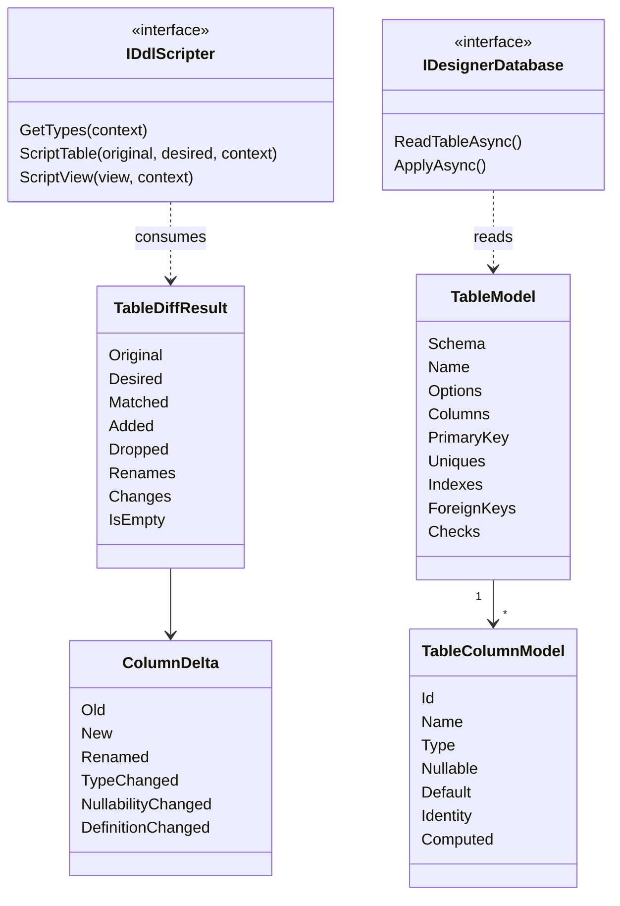

# 14. Designers, DDL and object editing

> **Level:** L2 practitioner → L3 senior | **Part:** II | **Code read at:** `a61f3d1` (Rowlit 1.6.3)
> **Language:** English | [فارسی](../../fa/part2/14-designers-and-ddl.md) | Previous: [13. The results grid and data editing](./13-results-grid-and-data-editing.md) | Next: [15. Import, export, plans and ER diagrams](./15-import-export-plans-er.md)
> **In one sentence:** you edit a model of a table in a form, the engine diffs it against the stored model and each provider turns the diff into a DDL script, which you can read, edit and apply in one transaction where the database allows it.
> **You will learn:**
> - the `TableModel` and `TableDiff` that all providers share, and what a "scripter" is;
> - the road designer open → model → script → preview → apply, and how apply fails safely;
> - what each provider can and cannot alter in place;
> - how F4 "Edit:" consoles, Compare with server, the Execute routine dialog and code generation work.
> **Prerequisites:** [10. Catalog and metadata](./10-catalog-and-metadata.md), [09. Relational providers](./09-relational-providers.md), [07. Engine modules and DI](./07-engine-modules-and-di.md). Part I: [I-05 modelling and normalisation](../part1/05-modelling-and-normalisation.md) (constraints, cascades), [I-09 transactions](../part1/09-transactions-and-isolation.md) (why some DDL is transactional).

## 1. The idea (beginner)

To change a table you can write `ALTER TABLE` by hand, but the exact words differ per database and some changes cannot be done in place at all. SQL Server cannot add `IDENTITY` to an existing column; SQLite cannot drop a constraint. A **designer** hides that. You see the table as a grid of columns and a few panels (keys, indexes, checks). You change the grid. Rowlit compares what you have with what is in the database and writes the script.

Three ideas hold the feature together. First, the script is shown **before** it runs, as plain text you may edit. Second, running it is **atomic when the database allows**: PostgreSQL, SQL Server and SQLite run DDL inside a transaction, so a failed script leaves nothing behind; Oracle, MySQL, Snowflake, ClickHouse and Cassandra commit each statement, and Rowlit says so. Third, the same machinery serves stored procedures, views, triggers and types through **edit consoles** (F4), a **Compare with server** diff, and a dialog that **executes** a routine with typed parameters. Beside them sits a **code generator** that turns tables into C#, Go, TypeScript, Java, Python, SQL or JSON.

## 2. How it works (practitioner)

### 2.1 The shared model

Everything is expressed in `engine/src/DbStudio.Core/Designer/TableModel.cs`:

- `TableModel`: `Schema`, `Name`, `Comment`, `Options`, `Columns`, `PrimaryKey`, `Uniques`, `Indexes`, `ForeignKeys`, `Checks`. Records with list defaults, so a partly specified JSON body still deserialises (`TableModel.cs:6-21`).
- `TableColumnModel`: `Id` (assigned by the UI; the original name for an existing column, so a **rename keeps its identity**), `Name`, `Type` (full text with size, `nvarchar(100)`), `Nullable`, `Default` (an SQL expression), `DefaultName` (SQL Server constraint), `Identity` (`Seed`, `Increment`, `Always`), `Computed` (`Expression`, `Persisted`), `Collation`, `Comment`, `Autoincrement` (SQLite) (`TableModel.cs:35-53`).
- `TableOptions`: `WithoutRowid`, `Strict` (SQLite), `Tablespace`, and `Extra`, a name-to-text dictionary for provider options (ClickHouse `engine`, `orderBy`, `partitionBy`, `primaryKey`, `sampleBy`, `ttl`, `settings`) (`TableModel.cs:23-33`).
- Constraints: `PrimaryKeyModel` (with `Clustered`), `UniqueModel`, `IndexModel` (columns with `Desc`, `Unique`, `Clustered`, `Include`, `Filter`), `ForeignKeyModel` (referenced table and columns, `OnDelete`, `OnUpdate`), `CheckModel`. Referential actions are normalised strings: `NO ACTION`, `CASCADE`, `SET NULL`, `SET DEFAULT`, `RESTRICT` (`ReferentialActions`).

`DesignerValidation.ValidateTable` rejects what no database could accept before any provider sees it: no name, no column, duplicate column names, no type (unless computed), two identity columns, a constraint naming an unknown column, an empty index, two clustered indexes, a foreign key with a different number of columns than referenced columns, an unknown action (`DesignerValidation.cs:6-56`). Violations throw `ArgumentException`, which `DesignerService` turns into `400 VALIDATION` naming the field (`DesignerService.cs:48-55`).

**Figure 14.1 — The model and the diff.**



### 2.2 `TableDiff`: matching, not guessing

`TableDiff.Compute(original, desired)` (`TableDiff.cs:91`) is a pure function. With no `original` it is a create: every desired column, key and index is "added". Otherwise:

1. **Columns are matched by id first, then by name.** A desired column whose `Id` equals an original column's name is that column, whatever its new name is. This is how a rename (`Id = "phone"`, `Name = "mobile"`) is recognised without ambiguity. A column whose id matches nothing is new; one with no id matches by name (`TableDiff.cs:119-155`). Unmatched originals are dropped.
2. Each matched pair becomes a `ColumnDelta` with booleans: `Renamed`, `TypeChanged`, `NullabilityChanged`, `DefaultChanged`, `IdentityChanged`, `ComputedChanged`, `CollationChanged`, `CommentChanged`, `AutoincrementChanged` (`TableDiff.cs:22-39`).
3. **Constraints and indexes are matched by structure after applying the column renames** (and by name). A *changed* constraint is a drop plus an add; there is no "alter constraint" (`TableDiff.cs:176-200`). Renames are carried in `Renames` so a primary key on a renamed column does not look dropped.
4. Every difference also becomes a `TableChange(Kind, Target, Detail)` (`columnAdded`, `columnTypeChanged`, `primaryKeyDropped`, `indexAdded` ...) which the UI lists in its change summary. `IsEmpty` is `!IsCreate && Changes.Count == 0`.

### 2.3 Scripters and designer databases

`IDdlScripter` is **pure**: `ScriptTable(original, desired, context)` returns a `TableScript` (statements with a kind and an optional warning, `RebuildRequired`, `Transactional`, warnings, changes). `IDesignerDatabase` is the I/O side: it reads models and applies scripts on **its own short-lived connection**, never on a tab session or the catalog connection (`DesignerContracts.cs:1-49`). Both are keyed DI singletons by provider id ([chapter 07](./07-engine-modules-and-di.md)). `DdlScriptContext` carries the server version (feature detection), the default schema and, for engines that rebuild, the dependent objects.

What each scripter documents about itself (class headers):

| Provider | Transactional DDL | Notes |
|---|---|---|
| PostgreSQL | yes | no change needs a rebuild; alters run in the order renames, drops, adds, types, nullability, defaults, identity, constraints, indexes, comments, and column/constraint sub-commands are combined into one `ALTER TABLE` (`PgDdlScripter.cs:7-14`) |
| SQL Server | yes (one transaction) | named constraints; drops default constraints before altering/dropping a column (looked up in `sys.default_constraints` when the name is unknown); **rebuilds the table when an identity changes** (new table, `SET IDENTITY_INSERT`, copy, drop, rename); comments are `MS_Description` extended properties (`SqlServerDdlScripter.cs:7-12`) |
| SQLite | yes | native `ALTER` only for `RENAME TO`, `RENAME COLUMN` (3.25+), `ADD COLUMN` (no PK/UNIQUE, constant default) and `DROP COLUMN` (3.35+); everything else is the documented rebuild: foreign keys off, new table, copy, drop, rename, recreate indexes, triggers and dependent views, `PRAGMA foreign_key_check`, foreign keys on (`SqliteDdlScripter.cs:8-13`) |
| Oracle | no (each DDL commits) | identity via `GENERATED ... AS IDENTITY`; `ON UPDATE` actions are not supported and ignored with a warning; **adding an identity to an existing column is refused** (ORA-30673) with a validation error (`OracleDdlScripter.cs:200-208`) |
| MySQL / MariaDB | no | `RENAME TABLE` first, `DROP FOREIGN KEY` as its own statement, one `ALTER TABLE` with `CHANGE`/`MODIFY` and `FIRST`/`AFTER` for order; `FULLTEXT`, `SPATIAL` and functional indexes are not in the model and are left alone (`MySqlDdlScripter.cs:7-15`) |
| ClickHouse | no | `ENGINE`, `ORDER BY`, `PARTITION BY`, `TTL` and `SETTINGS` come from `TableOptions.Extra`; a table without them gets a default MergeTree ordered by its primary key (`ChDdlScripter.cs:6-14`) |
| Snowflake | no | identity becomes `IDENTITY(start, increment)`; a clustered index becomes the clustering key `CLUSTER BY`; other indexes, check constraints and computed columns do not exist and produce warnings; `SET DATA TYPE` only widens (`SnowflakeDdlScripter.cs:7-19`) |
| Cassandra (CQL) | no | partition key = first primary-key columns, a unique constraint named `partition_key` lists them; an index named `clustering_order` gives the order; a column comment `static` marks a static column; check constraints are table options (`CqlDdlScripter.cs:7-20`) |

The Cassandra row shows the cost of one shared model: a feature foreign to relational databases is encoded in conventions of the existing fields until a CQL-specific panel exists. `DesignerFeatures` (`TableModel.cs:133-147`) tells the UI what to enable per provider: identity, computed, clustered/included/filtered indexes, `OnUpdateAction`, comments, rename, drop column, `WithoutRowid`, `Strict`, `TransactionalDdl`, `Autoincrement`, schemas.

Some alterations are too dangerous to do silently. The SQL Server identity rebuild reads **dependent objects** through the designer database (`DependentObject`: triggers, inbound foreign keys of other tables, permissions) so the script can recreate them, and **refuses the rebuild** when it would lose something the model cannot hold: columnstore, XML, spatial or full-text indexes, partitioning, filegroups, compression, change tracking, CDC (`DependentTypes.UnsupportedStorage`, `TableModel.cs:196-216`). It returns a validation error naming the cause instead.

### 2.4 The endpoints and the apply

`DesignerEndpoints` (`Host/Endpoints/DesignerEndpoints.cs:11-45`) under `/connections/{id}/designer`:

| Route | Does |
|---|---|
| `GET /types` | the provider's data types and `DesignerFeatures` |
| `GET /table`, `GET /view` | read the stored model or view body |
| `POST /table/script` | `{database, original, desired}` → `TableScript` (nothing runs) |
| `POST /view/script` | `{name, originalName, body, options}` → `DdlScript` |
| `POST /apply` | `{database, statements, transactional, schema}` → `{ok, executed, elapsedMs}` |

`DesignerService.ApplyAsync` (`DesignerService.cs:93-139`): requires at least one non-blank statement; refuses read-only connections with `403 READ_ONLY` ("DDL is not allowed"); runs through the provider's `ApplyAsync`; then **always** (in `finally`, even after a partial non-transactional failure, because what ran changed the catalog) invalidates the catalog and records the attempt in the query history under the label `designer`, as one re-runnable script separated the way the dialect's console splits batches (T-SQL `GO`, PL/SQL `/`, otherwise `;`) (`DesignerService.cs:141-177`). A lock error is reworded with the same "locked by another session: Console 1 (open transaction)" text executions use, via `LockWait` and `SessionManager.DescribeLockHolders` (`DesignerService.cs:114-121`).

The actual run is `DdlApplyRunner.RunAsync` (`DdlApplyRunner.cs:38-118`). Transactional mode begins a transaction (a failure to begin says "Nothing was changed"), skips transaction-control statements in hand-edited scripts (`DdlText.IsTransactionControl`: `BEGIN`, `COMMIT`, `END` ...) because the runner owns the transaction, runs each statement with `CommandTimeout` 0 by default (a rebuild of a big table may legitimately run long; SQLite passes its busy timeout), and on the first error rolls back and throws `DdlFailedException` (`409 DDL_FAILED`) with `{failedIndex, executed, rolledBack, providerError}`. The message reads "Statement 2 failed: <error>. All changes were rolled back." or, in non-transactional mode, "... 1 statement(s) had already run and were committed." Commit itself can fail on SQLite when a console still reads; that too rolls back.

**Figure 14.2 — Designing a table.**

```mermaid
sequenceDiagram
    participant U as TableDesigner
    participant API as designer API
    participant DB as IDesignerDatabase
    participant SC as IDdlScripter
    U->>API: GET /table (existing table)
    API->>DB: ReadTableAsync
    DB-->>U: TableModel (original)
    Note over U: user edits the grid; desired model changes
    U->>API: POST /table/script (original, desired), debounced 250 ms
    API->>SC: ScriptTable with TableDiff
    SC-->>U: statements, warnings, changes
    Note over U: preview text, may be edited by hand
    U->>API: POST /apply (statements, transactional)
    API->>DB: ApplyAsync (own connection, one transaction)
    DB-->>API: ok or DDL_FAILED
    API-->>U: result
    API->>API: invalidate catalog, write history
```

### 2.5 The designer UI

`ui/src/designer` is the UI half. The table designer (`table/TableDesigner.tsx`) is a `view` tab whose state (`schema`, `name`, `desired`, `original`, hand-edited preview) is saved in the workspace, so an unfinished design survives a restart. It is built from:

- `ColumnGrid.tsx` - the editable column grid with keyboard commands registered in the `designer` scope (`designer.grid.*`, `keyHandler: 'host'`).
- `ConstraintsPanel.tsx` - keys, uniques, indexes, foreign keys, checks.
- `optionsPanels.ts` - a registry: a provider registers a lazy panel with `registerDesignerOptionsPanel(providerId, component)` (ClickHouse engine/order/TTL, MySQL table options); the designer renders it above the grid and the panel edits `TableOptions.extra`.
- `model.ts` - UI-side helpers; `withIds` gives every column its id (the original name).

The script is requested with a **250 ms debounce** (`TableDesigner.tsx:183`) and an `AbortController`, so a fast typist only sends the last model. If the user edits the preview text by hand, the designer switches to `handEdited` and stops regenerating. `DdlPreview` shows the text with `scriptToText` (`designer/ddl.ts`): statements terminated by dialect (T-SQL `GO` between batches, Oracle `/` after PL/SQL blocks, otherwise `;`), warnings as `-- ⚠` comments. On Apply, `splitForApply` re-splits the text with the IntelliSense splitter, because a hand-edited preview must go back to the engine as separate statements. Before applying, `confirmSummary.ts` builds a plain-language summary of destructive changes (dropped columns, type changes) for a confirmation; after success the designer reloads the model (`withIds` again), shows "Altered orders - 3 statements in 41 ms" and revalidates the catalog.

The view designer (`view/ViewDesigner.tsx`) edits the `SELECT` body with the schema-binding, check-option and force flags, previews the result columns with `POST /sessions/{sid}/describe` (the `DescribeService`: `CommandBehavior.SchemaOnly`, single `SELECT` only, runs on the tab session without executing) and refuses a name that collides with another object (`nameConflict.ts`). SQLite has no `CREATE OR ALTER`, so `ScriptView` produces `DROP` + `CREATE` and recreates `INSTEAD OF` triggers.

The **procedure wizard** (`proc/ProcWizard.tsx`, `templates.ts`) creates procedures, functions, packages and triggers from per-dialect templates; it opens an edit console rather than applying anything itself.

### 2.6 F4 and edit consoles

Pressing F4 on an object runs `editObject` (`designer/open.ts:156-170`): a table opens the table designer, a view the view designer, and procedures, functions, table functions, packages, triggers, types and materialised views open an **edit console**: a normal console tab named `Edit: name` whose text is the stored DDL rewritten into a **re-runnable** form by `rewriteForEdit` (`designer/rewrite.ts`):

- T-SQL: `CREATE PROCEDURE/FUNCTION/VIEW/TRIGGER` becomes `CREATE OR ALTER` (needs SQL Server 2016 SP1 = 13.0.4001; older servers get `ALTER`, `supportsCreateOrAlter`);
- Oracle: `CREATE [EDITIONABLE] ...` becomes `CREATE OR REPLACE`, with `/` after blocks;
- PostgreSQL: functions, procedures, views, triggers become `CREATE OR REPLACE` (triggers need PostgreSQL 14, else `DROP TRIGGER IF EXISTS` is prepended; a materialised view gets `DROP MATERIALIZED VIEW IF EXISTS`; an enum type opens as it is with a note to use `ALTER TYPE ... ADD VALUE`);
- SQLite: views and triggers get `DROP ... IF EXISTS` prepended.

The tab carries a `ConsoleEdit` record (`connectionId`, `database`, `ref`, `dialect`, `serverDdl`, `savedText`, `isNew`) persisted with the workspace, so after a restart it still saves correctly and still offers Compare. `designer/store.ts` mirrors it in memory.

**Ctrl+S in an edit console saves the object to the database**, not to a file (`saveEditToDatabase`, `app/actions.ts:616-665`): SQLite views and triggers take an **atomic apply** (`runEditTab`: the editor text split into statements, `DROP ... IF EXISTS` added if missing, sent to `POST /designer/apply` with `transactional: true`, so a failing `CREATE` cannot leave the object dropped; the Stop button is disabled while it runs, up to 30 s of lock waiting); everything else runs the **whole script** (never just a selection, `ignoreSelection`) on the tab's session, quietly, and reports a toast: "Saved procedure X" or an error pointing at the line. The catalog schema of the object is revalidated in place, and `serverDdl` is refreshed as the new baseline. Save to a `.sql` file stays on Save as. A new object from the wizard takes its name from the script; saving refuses a name that already exists instead of replacing it. **Run** in an edit console of a procedure or function does not run the script: it opens Execute routine (`ExecuteRoutine/intercept.ts`), and the Run menu keeps "Run script".

**Compare with server** (`CompareDialog.tsx`) is a Monaco `DiffEditor`: the object's current server definition, rewritten the same way, on the left and the tab text on the right. If the server cannot be reached it falls back to the DDL loaded when the tab opened and says so. Local history ([chapter 12](./12-editor-and-formatter.md)) gives edit consoles the key `o:<connection>|<db>|<schema>|<type>|<name>`, so the timeline follows the object, not the tab.

### 2.7 Execute routine

"Execute procedure or function..." (explorer menu, palette, or Run in an edit console) opens a dialog (`ExecuteRoutine/ExecuteRoutineDialog.tsx`) with typed inputs per parameter (default, NULL, literal). `routineSql.ts` builds the call, with **values always as bind parameters**, only names, placeholders, `NULL` and `DEFAULT` in the text:

- SQL Server: `DECLARE @return_value int, @Total money; EXEC @return_value = [dbo].[proc] @Id = @Id, @Total = @Total OUTPUT; SELECT @return_value AS [Return value], @Total AS [Total];` (an OUTPUT argument writes back into the variable and one final `SELECT` returns all outputs, so no engine change was needed); functions are `SELECT [dbo].[fn](@a, DEFAULT)`; table functions `SELECT * FROM`.
- Oracle: `BEGIN SHOP.PKG.PROC(P_ID => :p_id, P_CUR => :p_cur); END;` with OUT and REF CURSOR as out binds; a function `BEGIN :result := SHOP.FN(...); END;`.
- PostgreSQL: `CALL public.proc($1::bigint, ...)` positional then named after a default; functions via `SELECT`.

The result opens as a `routine.run` tab (`runModel.ts`) that splits an execution into **outputs** (OUT/IN OUT parameters and the return value, shown as a key/value card; the reducer appends them as one extra one-row result set at `exec.done`) and the ordinary result sets as tabs. SQLite has no routines, so the command is hidden for it.

### 2.8 Code generation

`ui/src/codegen` is pure TypeScript (`index.ts`): `generate(input, options)` returns files. The input model (`model.ts`) comes from the catalog snapshot, `GET /catalog/object` details or a described query result (`fromCatalog.ts`, `CgTable`, `CgRoutine`, `CgColumn` with identity, computed, enum labels, domain base). Languages and flavors (`options.ts`): C# (Dapper, EF Core, ADO.NET, model only), Go, TypeScript (including a **Prisma schema** flavor, PostgreSQL only: `generatePrisma` is called from `lang/typescript.ts`, not a separate language), Java, Python, SQL, JSON. Type mapping uses one JSON table per dialect (`codegen/types/*.json`). `naming.ts` splits identifiers into words (`ORDER_LINES`, `orderLines`, `HTMLParser2`), converts to `pascal | camel | snake | asIs`, singularises table names (`Customers` becomes `Customer`, with an exceptions list) and escapes reserved words per target language. Options persist in `settings.ui.codegen`. `CodegenPanel` shows the files in Monaco with Copy and "open as file". For a SQL Server procedure whose result shape is unknown it can ask the server through `sys.dm_exec_describe_first_result_set_for_object` (`describeProc.ts`) without running the procedure.

## 3. Deep dive (senior)

> **Deep dive (L3): a diff is only as good as its matching rule**
>
> The hard part of schema diffing is renames. From two snapshots alone a rename is indistinguishable from "drop column a, add column b". Tools either guess by similarity or ask the user. Rowlit avoids both with a **stable id carried by the UI**: the id is the original name, set when the model is read and never changed by editing; the diff matches on it first. This turns a rename into a fact and is why `TableColumnModel.Id` exists at all. The price is that the id lives in the client state: anything that builds a `desired` model without ids (a script, a test, the ER diagram's "create foreign key") falls back to name matching, where a rename looks like drop and add. The FK dialog in the ER diagram (chapter 15) only adds a constraint, so it is unaffected; a future "import desired model" feature would need to supply ids.
>
> **Why pure scripters.** `IDdlScripter` takes models and returns statements without touching a connection. That is what lets the same scripter run in unit tests against fixtures (`Providers.Conformance/M15/DesignerCases.cs` runs shared cases for each provider), keeps `POST /table/script` safe to call on every keystroke, and keeps all the dialect knowledge in text that can be reviewed. The I/O interface is separate because *applying* needs transaction semantics that differ per engine: PostgreSQL, SQL Server and SQLite wrap everything; Oracle and MySQL commit per statement, so the runner stops at the first error and reports `executed`.
>
> **Why apply uses its own connection.** DDL on a tab's session would join that tab's open transaction, and in SQL Server a schema-modification lock behind someone's uncommitted read would hang the apply. A dedicated short-lived connection gives the apply a clean transaction boundary and lets `DesignerService` name the blocking sessions of other consoles when it fails on a lock.
>
> **History as an audit trail.** Every attempted apply is recorded (success or failure) under the label `designer`, in a form that can be re-run from History. Requests refused before anything runs (validation, read-only) are not recorded; that is a deliberate boundary between "something was tried on the database" and "the request was malformed".

## 4. Edge cases and limits

| Topic | Fact | Source |
|---|---|---|
| Script preview debounce | 250 ms | `TableDesigner.tsx:183` |
| Edit-console atomic apply lock wait | up to 30 s | `designer/store.ts:12` |
| Designer apply `CommandTimeout` | 0 (no limit) unless the provider sets one | `DdlApplyRunner.cs:25-28` |
| `DDL_FAILED` (409) detail | `failedIndex`, `executed`, `rolledBack`, `providerError` | `DesignerContracts.cs:52-62` |
| Read-only connection | `403 READ_ONLY` for apply | `DesignerService.cs:98-99` |
| Validation failures | `400 VALIDATION`, field `desired` or `body` | `DesignerService.cs:52-54`, `78-80` |
| Oracle identity on an existing column | refused | `OracleDdlScripter.cs:204-208` |
| SQL Server identity rebuild with unsupported storage | refused, cause named | `TableModel.cs:196-216` |
| SQL Server column reordering | not supported in place; warning | `SqlServerDdlScripter.cs:84` |
| Snowflake `SET DATA TYPE` | widening only | `SnowflakeDdlScripter.cs:17-18` |
| ClickHouse key column update | locked in the data grid | [chapter 13](./13-results-grid-and-data-editing.md) |

## 5. How it is tested

- Engine: `M15/TableDiffTests.cs` (matching and change list), per-provider designer tests (`Sqlite.Tests/M15/SqliteDesignerTests.cs`, `ClickHouse.Tests/M15/ChDesignerTests.cs`, `ChDesignerApplyTests.cs`, `Snowflake.Tests/DesignerTests.cs`), and the shared conformance `Providers.Conformance/M15/DesignerCases.cs`; `Core.Tests/M15/M15ServiceTests.cs` covers `DesignerService`.
- UI: `designer/__tests__/designer.test.ts`, `pgsql.test.ts`, `compareDiff.test.ts`, `ColumnGrid.test.tsx`, `table/tableDesignerUx.test.tsx`, `view/nameConflict.test.ts`, `proc/wizardRun.test.ts`, `proc/templates.mysql.test.ts`, `app/editRun.test.ts` and `editRunRestore.test.ts` (atomic apply, restored tabs), `app/objectActions.test.ts`; `ExecuteRoutine/routineSql.test.ts`, `runModel.test.ts`, `ExecuteRoutine.test.tsx`; `codegen/__tests__` and the C# smoke project `engine/tests/Codegen.Smoke`.

## Related chapters

- [09. Relational providers](./09-relational-providers.md) - how each provider reads its catalog and registers its scripter.
- [10. Catalog and metadata](./10-catalog-and-metadata.md) - the snapshot and `catalog.changed` after apply.
- [12. The editor](./12-editor-and-formatter.md) - edit consoles are consoles; `ignoreSelection`; local history keys.
- [15. Import, export, plans and ER diagrams](./15-import-export-plans-er.md) - the ER diagram's foreign-key dialog reuses `scriptTable` and `applyDdl`.
- Part I: [I-05 modelling and normalisation](../part1/05-modelling-and-normalisation.md), [I-09 transactions](../part1/09-transactions-and-isolation.md), [I-17 dialect comparison](../part1/17-dialect-comparison.md).

## Glossary terms introduced here

[designer](../glossary.md#designer), [table model](../glossary.md#table-model), [table diff](../glossary.md#table-diff), [DDL scripter](../glossary.md#ddl-scripter), [designer database](../glossary.md#designer-database), [DDL apply runner](../glossary.md#ddl-apply-runner), [DDL preview](../glossary.md#ddl-preview), [compare with server](../glossary.md#compare-with-server), [edit console](../glossary.md#edit-console), [execute routine dialog](../glossary.md#execute-routine-dialog), [OUT parameter](../glossary.md#out-parameter), [describe](../glossary.md#describe), [code generation](../glossary.md#code-generation), [naming convention](../glossary.md#naming-convention), [Prisma schema](../glossary.md#prisma-schema), [procedure wizard](../glossary.md#procedure-wizard).

## Files

| Path | Responsibility |
|---|---|
| `engine/src/DbStudio.Core/Designer/TableModel.cs`, `TableDiff.cs`, `DesignerValidation.cs`, `ViewText.cs` | model, diff, validation, view body extraction |
| `engine/src/DbStudio.Core/Designer/DesignerContracts.cs`, `DesignerService.cs`, `DdlApplyRunner.cs` | scripter and database interfaces, orchestration, transactional runner |
| `engine/src/DbStudio.Providers.*/Designer/*` | per-provider scripters and designer databases |
| `engine/src/DbStudio.Core/Params/DescribeService.cs` | describe a query's columns without running it |
| `engine/src/DbStudio.Host/Endpoints/DesignerEndpoints.cs` | HTTP routes |
| `ui/src/designer/*` | table/view/procedure designers, preview, rewrite, edit sessions and atomic apply |
| `ui/src/components/ExecuteRoutine/*`, `CodegenPanel/*`, `ui/src/codegen/*` | execute routine, code generation |
