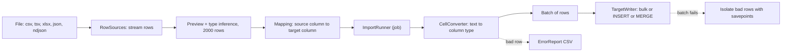
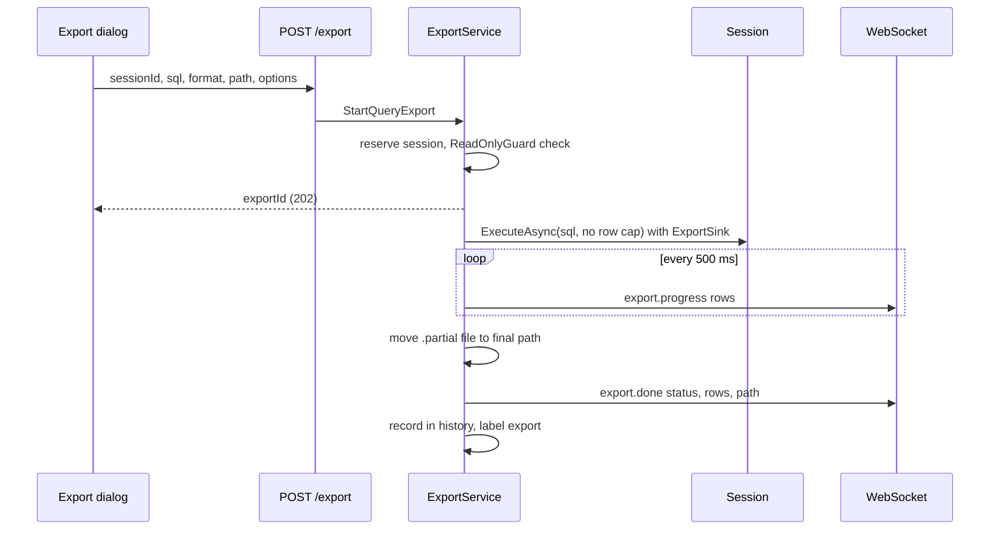
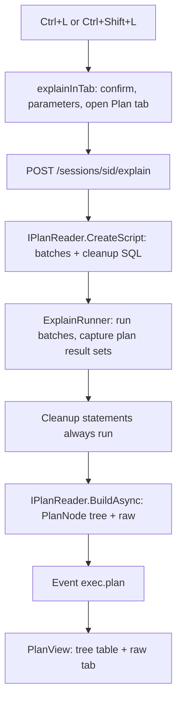
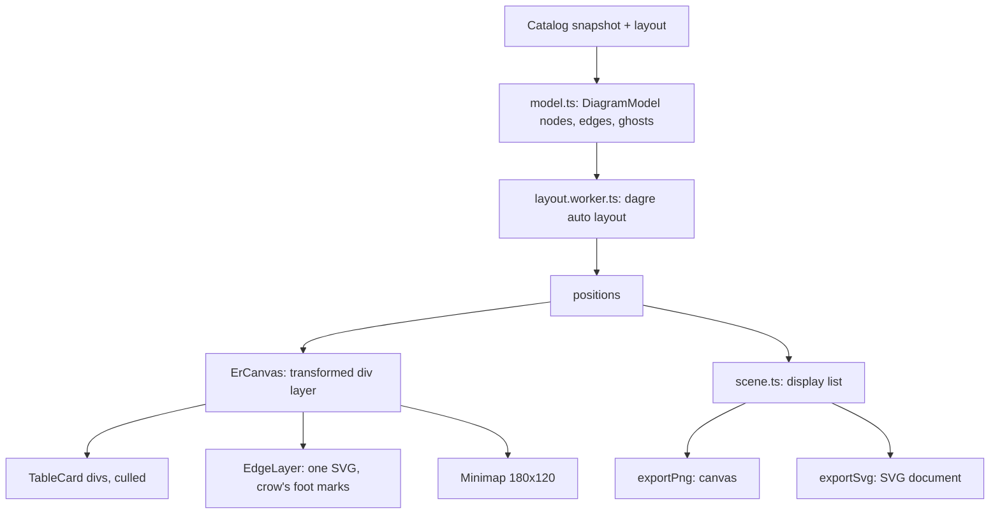

# 15. Import, export, execution plans and ER diagrams

> **Level:** L2 practitioner | **Part:** II | **Code read at:** `a61f3d1` (Rowlit 1.6.3)
> **Language:** English | [فارسی](../../fa/part2/15-import-export-plans-er.md) | Previous: [14. Designers, DDL and object editing](./14-designers-and-ddl.md) | Next: [16. Linked databases and federation](./16-linked-databases-federation.md)
> **In one sentence:** four tools that move structure and data across the edges of a database: a wizard that loads files into tables, an export that writes results to files, a viewer that explains how a query ran, and a diagram that draws how tables relate.
> **You will learn:**
> - the import pipeline: preview, inference, mapping, bulk load per dialect, error report;
> - the export scopes, the six writers, and when the engine or the browser writes the file;
> - how an `EXPLAIN` becomes one normalised `PlanNode` tree for seven providers;
> - how the ER diagram lays out hundreds of tables without freezing the UI.
> **Prerequisites:** [08. Connections, sessions and executing SQL](./08-connections-sessions-execution.md), [10. Catalog and metadata](./10-catalog-and-metadata.md), [13. The results grid](./13-results-grid-and-data-editing.md). Part I: [I-08 the query pipeline and the optimizer](../part1/08-query-processing.md) (how to read what the plan viewer shows), [I-02 the relational model](../part1/02-relational-model.md) (keys and ER notation).

## 1. The idea (beginner)

Data lives in files as often as in databases: a CSV from an accountant, a JSON dump from an API, an Excel sheet from a colleague. The **Import Wizard** reads such a file, guesses the type of every column, lets you match columns to a table (new or existing) and loads the rows, collecting the ones that fail in a report. The reverse is **export**: take a result or a whole table and write CSV, JSON, Excel, Markdown or SQL `INSERT` statements.

An **execution plan** answers "why is this query slow?" by showing the steps the database chose: which index, which join method, how many rows it expected and how many it got. Each engine prints plans in its own format (XML, JSON, text); Rowlit converts all of them into one tree it can show the same way. An **ER diagram** (entity-relationship diagram) draws tables as cards and foreign keys as lines, so you can see the shape of a schema at a glance; Rowlit lets you drag lines between columns to create new foreign keys.

## 2. How it works (practitioner)

### 2.1 Import: the pipeline

**Figure 15.1 — Import pipeline.**

The backend is its own assembly, `DbStudio.Import` (a module found by reflection like the others, [chapter 07](./07-engine-modules-and-di.md)). `ImportModule` exposes six routes (`ImportModule.cs:11-62`):

| Route | Purpose |
|---|---|
| `POST /import/preview` | read a file by **path**, infer column types, return a page of rows |
| `GET /connections/{cid}/import/capabilities` | can this connection take imports, which modes, bulk method, batch size, identifier length, SQL types |
| `POST /connections/{cid}/import/table-info` | does the target table exist, its columns, keys |
| `POST /connections/{cid}/import/ddl` | preview the `CREATE TABLE` for new columns |
| `POST /connections/{cid}/import/start` | start the job: `202 { jobId }` |
| `GET /import/errors/{jobId}` | the error report as `text/csv` |

The engine reads the file itself: requests carry a path, not content. (In a browser build there is no path; the UI sends a path typed by the user. `Platform.hasFileSystem`, [chapter 20](./20-ui-architecture.md).)

**Row sources** (`Parsing/RowSources.cs`, `JsonRowSource.cs`, `XlsxRowSource.cs`) stream rows from CSV/TSV (delimiter, quote, escape, encoding detection by BOM and sample, header row, skipped rows), `.xlsx` (sheet choice; read straight from the zip archive with a streaming XML reader, no spreadsheet library), and JSON or NDJSON (a JSON path to the array, NDJSON line by line). `SourceOptions` also holds trimming, null tokens (default `""`, `NULL`, `null`), date formats, decimal and thousands separators, and `NormalizeDigits` (default true, so Persian and Arabic-Indic digits are read as numbers). Legacy `.xls` is recognised only to explain why it cannot be read (`files.ts:isLegacyExcel`).

**Inference.** The preview samples up to `InferenceSampleRows` = **2 000** rows (`ImportService.cs:16`) and a per-column profiler picks a kind from `Kinds`: `empty, bool, int, bigint, decimal, float, date, datetime, time, guid, text, binary, json, other`, with length, precision and scale. The preview also warns about **Persian (Jalali) dates**: a column that looks like `1403/05/12` is flagged because it "would be read as Gregorian years", suggesting text or conversion first (`ImportService.cs:108-111`). That is the kind of detail that only exists because the audience reads right to left.

**Import dialects.** `ImportDialect` (`Run/ImportDialect.cs`) hides the per-engine differences: how to fold and quote identifiers, map an inferred kind to a column type, `CREATE TABLE`, savepoints, rows per statement, and the load method:

| Dialect | Modes | Load method | Default batch | Transactional |
|---|---|---|---|---|
| SQL Server | append, truncateInsert, upsert, updateOnly | `SqlBulkCopy` | 5 000 | yes |
| PostgreSQL | same four | `COPY` (text) | 5 000 | yes |
| MySQL / MariaDB | same four | batched multi-row `INSERT` | 1 000 | yes |
| Oracle | same four | array binding | 1 000 | yes |
| SQLite | same four | batched multi-row `INSERT` | 1 000 | yes |
| Snowflake | same four | batched multi-row `INSERT` | 1 000 | yes |
| ClickHouse | append, truncateInsert | native bulk insert | 10 000 | no |
| Cassandra | not supported (`Importing files into Cassandra is not supported yet.`) | | | |

(`ImportDialect.cs:220-527`; `ImportService.cs:130-148`.) Upsert maps to `MERGE`, `ON CONFLICT` or `ON DUPLICATE KEY` per dialect. Bulk paths apply only to `append` and `truncateInsert` on SQL Server, PostgreSQL and ClickHouse (`TargetWriter.UsesBulk`, `TargetWriter.cs:23`); everything else uses parameterised multi-row statements. SQL Server with identity columns gets `SET IDENTITY_INSERT ON`; PostgreSQL overrides identity (`ImportRunner.cs:162-165`).

**The run** (`Run/ImportRunner.cs:29-369`) happens inside a **job** (`JobManager`, [chapter 05](./05-engine-host-and-api.md); `ImportService.Start` returns the job id, progress arrives as `job.progress`, the result as `job.done`). Steps:

1. Validate: mode supported by the dialect, mapped columns exist (or, when creating, derive column types from the mapping or the inference), no column mapped twice, `keyColumns` present for `upsert`/`updateOnly`.
2. Open a **dedicated connection** (`ImportConnections.OpenAsync`), not a console session.
3. Optionally `CREATE TABLE` (`createdTable`, `ddl` in the summary), `SET IDENTITY_INSERT`, begin one transaction (`transaction: true` and the dialect is transactional), truncate for `truncateInsert`.
4. Stream rows. Each mapped target value comes from a source column, a constant or an expression; `CellConverter` converts text to the column kind; a `NULL` into a non-nullable column, text longer than the column (outside Oracle), or an unparsable value makes the **row** bad. A bad row is written to the error report and, with `onError: "skip"`, skipped; with the default `stop` it ends the import. `maxErrors` defaults to **1 000**.
5. Rows go in batches of `batchSize`. If a batch fails, the writer uses savepoints to **isolate the bad rows** and keeps the good ones, except on dialects without savepoints, where a batch is limited to one atomic statement (`ImportRunner.cs:102-103`).
6. Progress is reported at most every 250 ms with an exponentially smoothed rate (`ImportProgress`: phase, rows read, written, skipped, errors, rows per second, bytes). Cancelling the job rolls back (if transactional) and reports it.
7. The summary (`ImportSummary`) tells the outcome, counts, `Committed`/`RolledBack`, the DDL, the first 50 error samples and whether an error report exists. `ErrorReport` writes a CSV `row,column,error,<source columns>` **as errors occur**, UTF-8 with a BOM so Excel shows Persian text correctly; old reports are cleaned after 7 days.

**The wizard UI** (`components/ImportWizard`) is a lazy `ImportWizardView` tab with six steps (`wizardState.ts:9-27`): **Source** (pick or drop a file), **Format** (delimiter, header, sheet, JSON path, encoding, null tokens; the preview grid pages with `offset`), **Target** (existing table or new, via `table-info`), **Columns** (auto-match by name; per-column source, constant or expression; types for new columns with a live DDL preview), **Options** (mode, key columns, error policy, batch size, transaction), **Run** (live log, progress, summary, error CSV download). `fileDrop.ts` makes the explorer a drop target: a data file dropped on a table imports into it, on a schema, database or connection creates a new table, a `.sql` file opens in a console. A job can finish before the `202` arrives, so `jobs.ts` remembers recent `job.done` events (50) and `waitForImportJob` checks them first. Recent files are kept in `localStorage` (6 entries, every access guarded).

### 2.2 Export

**Figure 15.2 — Export of a query to a file.**

An export is **not** a `JobManager` job; it has its own events `export.progress` and `export.done` (`ExportService.cs:76-130`, `Events`). The dialog (`components/Export`) offers five **scopes** (`Export/types.ts:11-13`):

| Scope | Where the file is written | What it contains |
|---|---|---|
| `loaded` | engine (stored copy) or browser | the rows now in the grid (after client filters/edits) |
| `selection` | browser | the selected block |
| `filtered` | engine, fresh query | the table or query with the server filter, **no row cap** |
| `all` | engine, fresh query | the whole table |
| `rerun` | engine, fresh query | the console statement again, no row cap |

`runExport` (`Export/run.ts:44-107`) chooses the route:

- `filtered | all | rerun`: `source.serverQuery(scope)` gives SQL and parameters; `runServerExport` posts `POST /export` and follows `export.progress`/`export.done`. It subscribes to the events *before* posting and matches the id afterwards, so a small export that ends before the response is not missed; it reports `Connection to the engine was lost` if the socket drops; cancelling calls `api.cancel(sessionId)` and, if the engine stays silent, reports cancelled after 8 s (`CANCEL_GRACE_MS`).
- `loaded` of an unchanged console result: `POST /executions/{xid}/resultsets/{rs}/export` makes the engine write its **stored copy** (full values, every stored row).
- otherwise the rows the grid holds are rendered in the browser (`clientRender.ts`: fetches full values of truncated cells first; refuses SQL INSERT while anything is still truncated) and saved with `Platform.saveFile` or `writeTextFile`.

On the engine, `ExportService.StartQueryExport` accepts **one query only** (`ReadOnlyGuard.EnforceExportQuery`: data changes on read-only connections give `403 READ_ONLY`, other statements `400 VALIDATION`), reserves the session (`409 SESSION_BUSY` if busy), and runs the SQL through the normal session path with no row cap, so provider adaptations still apply (Cassandra drops `ORDER BY` and adds `ALLOW FILTERING`). Only the **first result set** is written. The file is written as `path + ".partial"` and moved into place only on success; failure or cancel deletes it, so a half file never looks complete. The export is recorded in the query history with label `export`.

**Writers** (`ResultWriters.cs`): `ExportFormats` = `csv, tsv, json, sql-insert, markdown, xlsx`. `ExportOptions`: `Delimiter`, `Header`, `NullAs`, `TableName`, `Bom`, `DateFormat`, `SheetName`, `TargetDialect` (SQL INSERT can target another dialect than the connection's). `XlsxResultWriter` writes typed cells; the browser has its own `Grid/xlsx.ts`. The dialog remembers the last format, header, delimiter, BOM, null text, date pattern and folder in `localStorage` (`rowlit.export.v1`). The same options drive the client renderer and the engine writer, so every scope produces the same file.

### 2.3 Execution plans

**Figure 15.3 — From EXPLAIN to the tree.**

Two modes (`ExplainModes`): **estimated** (nothing runs, the optimiser's guess) and **actual** (the statement runs and real row counts and timings are collected). The UI starts it from a console (`Ctrl+L` / `Ctrl+Shift+L`), `explainInTab` in `PlanView/explain.ts`:

- Statements with bind parameters ask for values first.
- **Actual mode runs the statement.** On a writable connection, if it is not a query (classified by the intel classifier, not a regex: `WITH ... DELETE` is not a query), a danger confirmation "Run the statement to get the actual plan?" with the button **Run and explain** appears; on read-only connections the engine refuses with `READ_ONLY` and the console's explicit armed override is offered. `confirmedDestructive` is never sent implicitly.
- SQLite has no actual statistics: "actual" there shows the estimated plan plus a normal run.
- The actual run also shows its rows: for PostgreSQL and MySQL the query runs twice ("The query ran twice: once for its rows and once under EXPLAIN ANALYZE for the plan").

`POST /sessions/{sid}/explain` (`PlansEndpoints.cs`) answers `202 { executionId }` and the result arrives as `exec.*` events plus **`exec.plan`** (`ExecPlanEvent(ExecutionId, Dialect, Mode, Root, Raw, RawFormat, Warnings)`). The `ExplainRunner` (`Core/Plans/ExplainRunner.cs:14-136`) runs the reader's batches through the **normal execution path** (`label "explain"`), so actual-mode result sets stream as usual; an `ExplainSink` captures plan result sets instead of publishing them, renumbers visible ones from 0, and maps the visible batch to batch 0. The reader's `CleanupSql` (e.g. `SET SHOWPLAN_XML OFF`) runs in a `finally`, even after errors or cancel.

Each provider supplies an `IPlanReader` (keyed DI by provider id) with `CreateScript` and `BuildAsync`:

| Provider | Estimated | Actual | Raw |
|---|---|---|---|
| SQL Server | `SET SHOWPLAN_XML ON` | `SET STATISTICS XML ON` (rows stream normally; trailing showplan captured) | xml |
| PostgreSQL | `EXPLAIN (FORMAT JSON, VERBOSE, COSTS)` | `EXPLAIN (ANALYZE, BUFFERS, VERBOSE, COSTS, TIMING, FORMAT JSON)` | json |
| Oracle | `EXPLAIN PLAN ... FOR`, read `PLAN_TABLE`, rows deleted after; `DBMS_XPLAN.DISPLAY` | `V$SQL_PLAN_STATISTICS_ALL` + `DISPLAY_CURSOR(..., 'ALLSTATS LAST')` | text |
| MySQL / MariaDB | `EXPLAIN FORMAT=JSON` | `EXPLAIN ANALYZE` (8.0.18+), MariaDB `ANALYZE FORMAT=JSON`, older MySQL estimated only (with a warning) | json / text |
| SQLite | `EXPLAIN QUERY PLAN` rows (id, parent, detail) | estimated + normal run | text |
| ClickHouse | `EXPLAIN json = 1, indexes = 1, description = 1` (+ `EXPLAIN PIPELINE` text for queries) | statement runs normally | json |
| Snowflake | `EXPLAIN USING JSON` | statement runs normally, then `GET_QUERY_OPERATOR_STATS` gives the executed operator tree with output rows, time share, pruning and spilling | json |

(From the class headers in each `Plans/*PlanReader.cs`; Cassandra has no `EXPLAIN`, `hasExplain` hides the command.) All of them return a `PlanResult(Root, Raw, RawFormat, Warnings)` where `Root` is a `PlanNode`: `Id`, `Op`, `LogicalOp`, `Object`, `EstRows`, `ActualRows`, `Cost` (subtree cost in the provider's unit, null when unknown such as SQLite), `CostPct`, `Predicate`, `Warnings`, `Props` (provider-specific key/values) and `Children`. `PlanTree.ComputeCostPercentages` sets `CostPct = (own cost / root cost) x 100`, where own cost is the node's subtree cost minus its children's, never negative.

**The viewer** (`PlanView.tsx`) is a *tree table*, not a graph: Operation (indented), Object, Est. rows, Actual rows, Cost %, with a **Tree** tab and a **Raw** tab (the provider's own XML/JSON/text) and "Copy plan". `planRows` (`PlanView/model.ts`) flattens the tree depth-first and derives for each node a **heat** from its own cost share: 3 for the single most expensive node or at least 50 %, 2 for at least 25 %, 1 for at least 10 %; and an `estimateOff` flag when actual rows differ from the estimate by 10x or more (`≠` mark). That flag is the practical cue for stale statistics ([I-07 indexes](../part1/07-indexes.md) covers statistics, [I-08](../part1/08-query-processing.md) the optimiser).

### 2.4 ER diagrams

Open one from a schema node, with the selected tables, or "related tables" (a table plus every table one foreign key away): `Ctrl+Alt+E` (`er.open`), `er.openRelated`, `er.openSelected` (`ErDiagram/commands.ts`).

**Engine side.** Only layouts are stored. `DiagramStore` writes `diagrams.json` in the data directory (same guarantees as the filter store: thread-safe, atomic, corrupt file kept as `.corrupt`). One layout per (connection, scope key): `ScopeKey` is `db|schema` or `db|t:a,b` with sorted table names, identical to `layoutScopeKey` in `ui/src/api/er.ts` (`DiagramStore.cs:55-66`). A `DiagramLayout` holds positions (`schema.table` to `[x, y]`), hidden tables, zoom, pan, an `Auto` layout name (`layered-lr`, `layered-tb`, `grid`), added and pinned cards and an opaque `Options` object. Routes: `GET/PUT/DELETE /connections/{cid}/er/layouts[/{id}]` (`DiagramEndpoints.cs`). Limits: 2 000 layouts, 20 000 tables per layout, zoom 0.05-4 (`DiagramStore.cs:35-48`). **The diagram data itself is the catalog snapshot** of [chapter 10](./10-catalog-and-metadata.md): `refBy` names the schemas that point into this one, so the diagram can load one hop of neighbours; `fkHidden` counts keys the login cannot see.

**UI side** (`ui/src/components/ErDiagram`):

**Figure 15.4 — Layers of the ER renderer.**

- **Model.** `model.ts` builds nodes (tables and views) and edges (foreign keys) from the loaded schemas. A key whose target is not in the diagram adds a **ghost card** (name only) so the line has an end; "Add to diagram" turns it into a real one. Disabled SQL Server keys (`NOCHECK`) are drawn dotted; optional relationships (nullable FK columns) get the "zero or one" ring of crow's-foot notation (`EdgeLayer.tsx`, `DetailsPane` legend).
- **Auto layout** (`layout.ts`) uses `@dagrejs/dagre` (rank direction left-right or top-bottom, `RANKSEP` 80, `NODESEP` 30) per connected component; components are tiled; above **300 tables** (`CLUSTER_THRESHOLD`) tables are first clustered per schema and each cluster is laid out separately; a component of more than 120 nodes uses the faster longest-path ranker. Input is sorted, so the same input gives the same layout. It runs in a **Web Worker** (`layout.worker.ts`, one shared worker, requests answered in order, progress messages back); if no Worker exists or it fails to start (CSP, tests) `layoutRunner.ts` falls back to the same `computeLayout` on the main thread through a lazy import. Pinned cards keep their position.
- **Rendering.** Cards are absolutely positioned `div`s inside **one CSS-transformed layer**; relationship lines are **one SVG** in the same layer with `non-scaling-stroke`. Pan and zoom write the layer's transform directly, with no React render per frame (`ErCanvas.tsx:1-10`). **Culling** renders only cards and edges inside the viewport padded by half a screen, re-rendering when the viewport leaves that region or the level of detail changes. **Level of detail**: below zoom 0.2 cards are coloured boxes, below 0.45 header only, otherwise full (`viewport.ts:11-22`); zoom runs 0.1-3. A 500-table synthetic diagram (`synthetic.ts`, dev command `er.devSynthetic`) is the performance test.
- **Interaction.** Wheel zooms at the cursor, drag pans, Shift+drag marquee-selects, cards drag (positions saved after a 250 ms commit delay), a drag from one column's handle to another proposes a **foreign key**: `fkDialog.tsx` proposes name, column pairs and actions per dialect (`ACTIONS` table: SQLite and ClickHouse only `NO ACTION`, Oracle no `ON UPDATE`), builds the new `TableModel`, and runs **the designer's `scriptTable` + `applyDdl`**, so the DDL is the same the table designer would produce ([chapter 14](./14-designers-and-ddl.md)); on success the schema reloads and the edge appears. Keys are commands in the `er-canvas` scope (arrow keys move, Tab/Shift+Tab walk cards, Delete removes from the diagram, Shift+F10 opens the card menu).
- **Export.** `scene.ts` builds a flat display list (rectangles, text, paths, circles) of the **whole** diagram from the model, never from the DOM, in the current theme's colours. `exportPng.ts` paints it on a canvas at 2x, lowering the scale so the bitmap stays within 16 000 px per side and 200 M pixels (`exportScale`); `exportSvg.ts` writes plain SVG (no `foreignObject`) with an embedded stylesheet. Both come from the same scene, so the pictures match.

One correction to the planning notes: there is no "synthetic relationship" feature for restricted SQL Server logins. `synthetic.ts` generates *test data* for the performance test. What exists for hidden keys is the `HiddenForeignKeys` count and the ghost cards.

## 3. Deep dive (senior)

> **Deep dive (L3): three decisions that look odd and are not**
>
> *Export is not a job.* `JobManager` jobs are cancelled by job id and survive without a session. An export needs the **session** (it runs the user's SQL on it, with its transaction state and read-only rules), reserves it for the duration and cancels through the session's own `cancel`. Reusing `POST /sessions/{id}/cancel` meant no second cancel mechanism. The price is a dedicated pair of events and the client-side dance (`serverExport.ts`) of subscribing before posting. Imports are the opposite: they use their own dedicated connection and survive without a tab, so they *are* jobs.
>
> *The plan reader is a script, not a parser.* `CreateScript` returns batches the **normal execution path** runs, plus cleanup SQL. This is why an actual plan can stream its real result rows to the grid while the plan is captured on the side, and why `SET STATISTICS XML OFF` is guaranteed even when the statement fails. The reader never owns a connection. The cost is the `ExplainSink` shim that renumbers result sets so the visible batch is always batch 0.
>
> *Layout in a worker, rendering in the DOM.* A canvas would draw 500 cards faster, but the cards contain text the user selects, and links for keyboard focus and screen readers. Rowlit keeps DOM cards and pays for it with culling and levels of detail. dagre is the CPU-heavy part, and it is a pure function of sorted nodes and edges, which is exactly what a worker wants (messages in, result out, no shared state). The fallback to the main thread exists because workers can fail to load under a strict CSP.

## 4. Edge cases and limits

| Topic | Fact | Source |
|---|---|---|
| Inference sample | 2 000 rows | `ImportService.cs:16` |
| Import max errors (skip mode) | 1 000 default | `ImportRunner.cs:106` |
| Error report retention | 7 days | `ImportRunner.cs:113` |
| Job progress throttle | 250 ms in the runner | `ImportRunner.cs:128` |
| Import into Cassandra | refused | `ImportService.cs:130-133` |
| Read-only target | `canImport = false` with a reason | `ImportService.cs:142-147` |
| Export progress interval | 500 ms | `ExportService.cs:200` |
| Export cancel grace in the UI | 8 s | `Export/serverExport.ts:31` |
| Export errors | `400 VALIDATION` (path, format, sql), `403 READ_ONLY`, `409 SESSION_BUSY` | `ExportService.cs:70-100` |
| ER auto-layout clustering | above 300 tables | `layout.ts:CLUSTER_THRESHOLD` |
| ER zoom (UI) / (stored) | 0.1-3 / 0.05-4 | `viewport.ts:9-10`, `DiagramStore.cs:47-48` |
| ER PNG limits | 16 000 px per side, 200 M pixels | `exportPng.ts:6-8` |
| Plan heat thresholds | 10 %, 25 %, 50 % | `PlanView/model.ts` |
| `estimateOff` | 10x difference | `PlanView/model.ts` |

## 5. How it is tested

- Import: `DbStudio.Import.Tests` (`ParserTests`, `InferenceTests`, `DialectTests`, `SqliteImportTests`, `PreviewPagingTests`, `EndpointTests`, and the Docker-gated `DockerImportTests` for the server dialects). UI: `ImportWizard/ImportWizard.test.tsx`, `model.test.ts`, `api.test.ts`, `fileDrop.test.ts`, `jobs.test.ts`, `hints.test.ts`.
- Export: `ExportWriterTests.cs`, `ExportScopeTests.cs`, `Providers.Conformance/ExportHarness.cs`; UI `components/Export/__tests__`.
- Plans: per-provider plan tests (for example `Cassandra.Tests`, `ClickHouse.Tests`, `Snowflake.Tests/PlanLogModuleTests.cs`), `Core.Tests/M15/M15ServiceTests.cs`; UI `PlanView/PlanView.test.tsx`, `PlanView.pgsql.test.tsx`, `explain.test.ts` and fixtures.
- ER: `Core.Tests/Diagrams/DiagramStoreTests.cs`; UI `ErDiagram/__tests__`; manual walkthrough `docs/qa/er-walkthrough.md`.

## Related chapters

- [05. The engine host and API](./05-engine-host-and-api.md) - jobs; [06. The WebSocket protocol](./06-websocket-protocol.md) - `job.*`, `export.*`, `exec.plan`.
- [08. Connections, sessions and executing SQL](./08-connections-sessions-execution.md) - `ReadOnlyGuard`, the execution path plans reuse.
- [10. Catalog and metadata](./10-catalog-and-metadata.md) - the snapshot the diagram draws; [14. Designers and DDL](./14-designers-and-ddl.md) - the FK dialog's engine.
- [13. The results grid](./13-results-grid-and-data-editing.md) - export from a grid.
- [16. Linked databases and federation](./16-linked-databases-federation.md) - plans of linked queries.
- Part I: [I-08 the query pipeline and the optimizer](../part1/08-query-processing.md), [I-07 indexes](../part1/07-indexes.md).

## Glossary terms introduced here

[import wizard](../glossary.md#import-wizard), [row source](../glossary.md#row-source), [mapping](../glossary.md#mapping), [upsert](../glossary.md#upsert), [bulk load](../glossary.md#bulk-load), [error report](../glossary.md#error-report), [import dialect](../glossary.md#import-dialect), [export scope](../glossary.md#export-scope), [result writer](../glossary.md#result-writer), [XLSX](../glossary.md#xlsx), [plan reader](../glossary.md#plan-reader), [plan node](../glossary.md#plan-node), [estimated vs actual plan](../glossary.md#estimated-vs-actual-plan), [ER diagram](../glossary.md#er-diagram), [layout engine (dagre)](../glossary.md#layout-engine-dagre), [Web Worker](../glossary.md#web-worker), [level of detail (LOD)](../glossary.md#level-of-detail), [culling](../glossary.md#culling), [minimap](../glossary.md#minimap), [ghost card](../glossary.md#ghost-card).

## Files

| Path | Responsibility |
|---|---|
| `engine/src/DbStudio.Import/**` | routes, row sources, inference, runner, dialects, writer, error report |
| `engine/src/DbStudio.Core/Export/*` | export service, six writers, date format |
| `engine/src/DbStudio.Core/Plans/*`, `Providers.*/Plans/*` | plan models, runner, per-provider readers |
| `engine/src/DbStudio.Core/Diagrams/*`, `Host/Endpoints/DiagramEndpoints.cs` | layout store and routes |
| `ui/src/components/ImportWizard/*`, `Export/*`, `PlanView/*`, `ErDiagram/*`, `ui/src/api/er.ts` | the four UIs |
