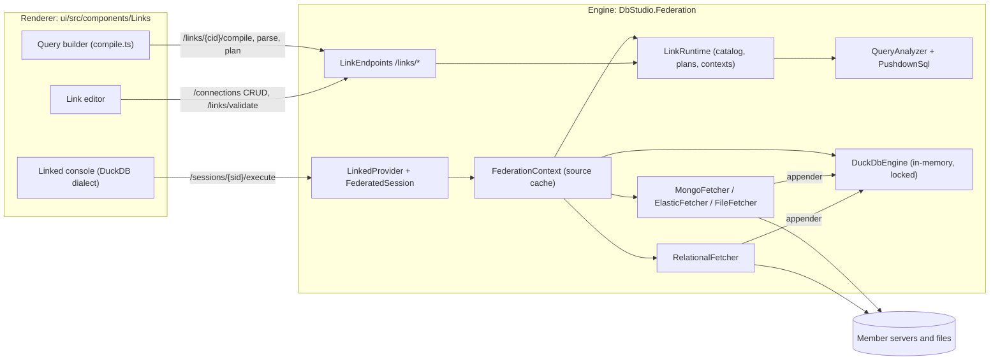
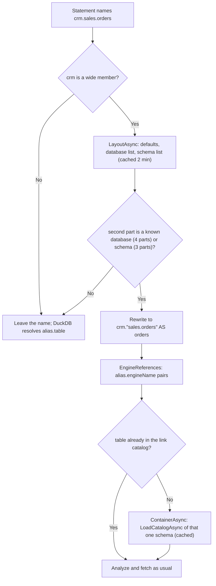
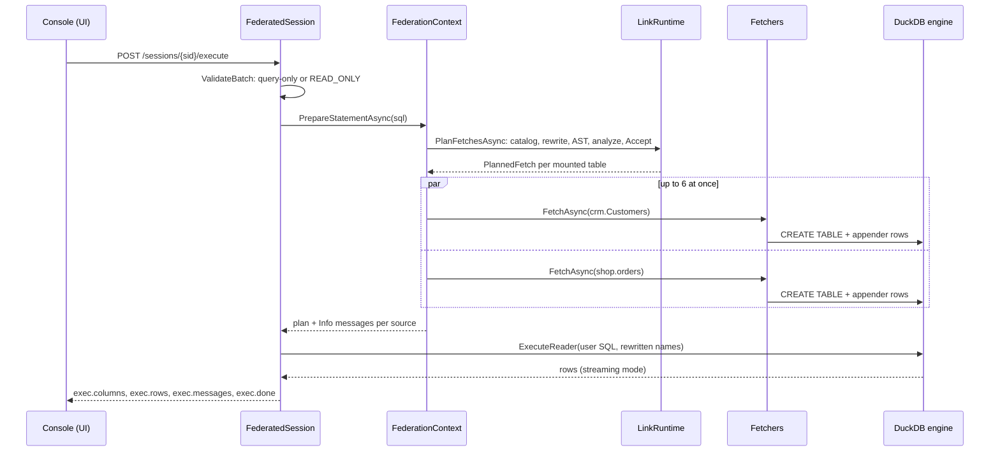
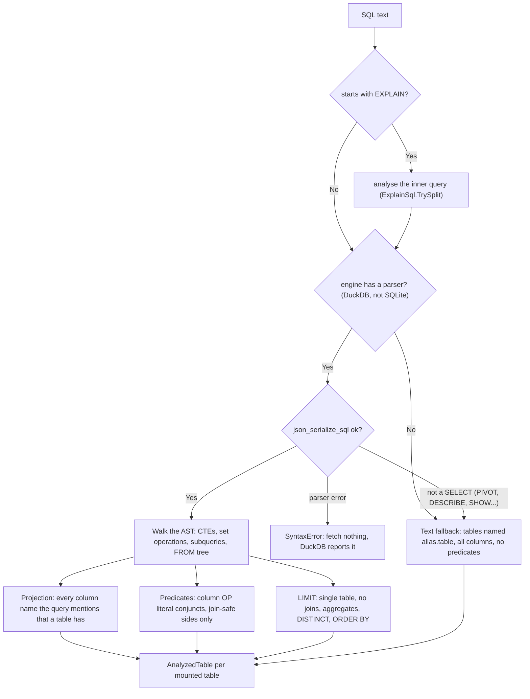
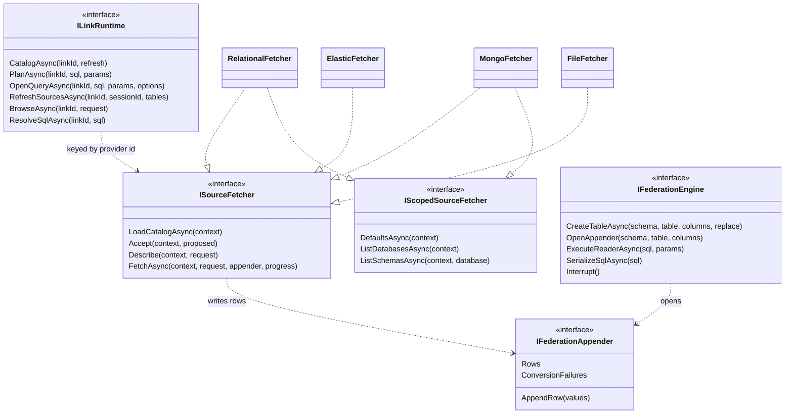
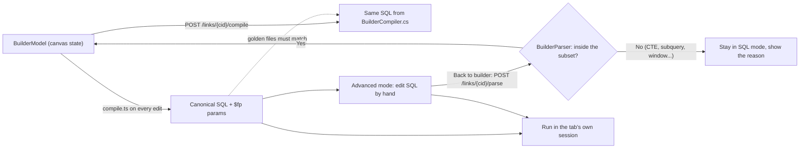

# 16. Linked databases and federation (DuckDB)

> **Level:** L3 senior (sections 1 and 2.1-2.4 are readable at L2) | **Part:** II | **Code read at:** `b638b7b` (Rowlit 1.6.3 feature set; `version.json` in this tree says 1.7.0, which also routes members through SSH tunnels)
> **Language:** English | [فارسی](../../fa/part2/16-linked-databases-federation.md) | Previous: [15. Import, export, execution plans and ER diagrams](./15-import-export-plans-er.md) | Next: [17. Sources I: Redis and MongoDB](./17-sources-redis-mongo.md)
> **In one sentence:** a linked database is a saved connection that mounts tables of several other connections under short aliases, so one DuckDB SQL statement can join a SQL Server table with a PostgreSQL table, while Rowlit fetches only the columns and rows that statement needs.
> **You will learn:**
> - what a link, a member, an alias, a mounted table and a scope are, and how a link is stored as an ordinary connection profile;
> - how whole-schema, whole-database and whole-connection members (1.6.3) name their tables (`crm.sales.orders`, `crm.shop.dbo.orders`) and load them lazily;
> - the path of one federated query: analysis of DuckDB's syntax tree, push-down of projection, predicates and limits per source dialect, parallel fetches into an in-memory DuckDB, then the user's SQL unchanged;
> - why push-down is only an optimisation and how the analyzer stays correct across outer joins, collations and row caps;
> - the push-down plan, `EXPLAIN` on a link, and every plan warning;
> - the visual query builder with two compilers that must produce byte-identical SQL, linked views, materialize, and native link scripts.
> **Prerequisites:** [08. Connections, sessions and executing SQL](./08-connections-sessions-execution.md) (sessions, `AdoSessionBase`, the read-only guard), [10. Catalog and metadata](./10-catalog-and-metadata.md). Part I: [I-08 the query pipeline and the optimizer](../part1/08-query-processing.md) (predicate push-down, projection pruning, EXPLAIN), [I-12 replication, partitioning and sharding](../part1/12-backup-replication-ha.md) (federation versus sharding), [I-17 dialect comparison](../part1/17-dialect-comparison.md) (quoting, `TOP` / `FETCH FIRST` / `LIMIT`).

## 1. The idea (beginner)

Companies rarely keep all their data in one database. Customers may live in a SQL Server CRM, orders in a PostgreSQL shop, products in MySQL and click logs in Elasticsearch. A question such as "total paid per customer" then needs data from two servers. The classic answers are to copy the data into one place first (an ETL job, a warehouse) or to make one server reach the other (a SQL Server linked server, a PostgreSQL foreign data wrapper). Both need administrator rights and planning.

Rowlit adds a third answer on the desktop. You create a **[linked database](../glossary.md#linked-database)** (a *link*): a saved connection that does not point to a server but lists **[members](../glossary.md#link-member)**. Each member is one of your existing connections (or some local files) mounted under a short **[alias](../glossary.md#member-alias)** such as `crm` or `shop`. In the link's console you write `SELECT … FROM crm.customers c JOIN shop.orders o ON o.customer_id = c.id`. Rowlit reads what each source must supply, asks each server for exactly that, loads the answers into an embedded analytical engine called **[DuckDB](../glossary.md#duckdb)**, and runs your statement there. This is **[federation](../glossary.md#federation)**: one [federated query](../glossary.md#federated-query) over several independent databases, without moving them permanently (Part I contrasts it with sharding in [I-12](../part1/12-backup-replication-ha.md)).

Two rules shape everything in this chapter. First, a link is **read-only**: it can never write to a member. Second, sending filters to the servers (**[push-down](../glossary.md#push-down)**) is an *optimisation*: DuckDB always applies the whole query again, so a filter the analyzer is unsure about is simply not sent, and the answer stays correct. Around this core, Rowlit offers a drag-and-drop query builder, saved linked views, a "materialize" job that writes a result into a real table, and scripts that set up a native link on a server when a permanent one is wanted.

## 2. How it works (practitioner)

**Figure 16.1 — The moving parts of linked databases.**



Figure 16.1 shows the split. The UI never talks to a member server: it saves the link through the ordinary connection API, runs SQL through the ordinary session API, and asks the `/links` routes for catalog, plans and builder services. Everything that touches a member happens in the engine assembly `DbStudio.Federation`, which is a normal engine module (`FederationModule`, discovered like every other `IEngineModule`; see [07. Engine modules](./07-engine-modules-and-di.md)). Its `ConfigureServices` registers the DuckDB factory, the runtime, the `linked` provider, a DuckDB parameter binder and one keyed fetcher per source kind (`engine/src/DbStudio.Federation/FederationModule.cs:21-41`), and `MapEndpoints` maps the `/links` group (`FederationModule.cs:43-54`).

### 2.1 A link is a connection

A link is stored as an ordinary `ConnectionProfile` whose `providerId` is `"linked"` (`Contracts/LinkModels.cs:16`). It has no host, no password and no connection string (`Provider/LinkedProvider.cs:25-30`); its definition lives in four keys of the profile's `props`: `members`, `relations`, `options` and `linkVersion` (`LinkModels.cs:29-39`). The editor saves it through `/connections` like any connection (`ui/src/components/Links/editor/save.ts:1`), into the explorer folder "Linked databases" (`LinkModels.cs:19`). Because it is a connection, everything that works on connections works on a link: the explorer, Ctrl+P, consoles, saved queries, history.

The **[link definition](../glossary.md#link-definition)** (`LinkDefinition`, `LinkModels.cs:83-143`) has:

| Part | Meaning | Source |
|---|---|---|
| `Members` | the sources (see below) | `LinkModels.cs:146-207` |
| `Relations` | user-declared [virtual relations](../glossary.md#virtual-relation) ("virtual foreign keys") between mounted tables of different members, used by the explorer and by join suggestions | `LinkModels.cs:248-256` |
| `Options` | per-link overrides of the `links.*` settings: row cap, fetch timeout, source cache, forced engine | `LinkModels.cs:259-272` |
| `Version` | `2` since members carry a scope; a version 1 profile is migrated on read | `LinkModels.cs:86`, `125-129` |

A **member** (`LinkMember`) has an alias, a kind (`connection` or `files`), the connection id, an optional database and schema, a **[scope](../glossary.md#link-scope)** and a list of **[mounted tables](../glossary.md#mounted-table)** (`LinkModels.cs:146-207`). A mounted table has the source `Name`, an optional link name `As` and fetcher options such as the CSV delimiter or the MongoDB sample size (`LinkModels.cs:210-235`). In SQL a mounted table is `alias.table`: the alias becomes a DuckDB schema and the link name its table, so the user's SQL runs on the engine *unchanged* (`Contracts/IFederationEngine.cs:52-56`).

The alias rules are strict because the alias is an identifier in every statement: lower-case letters, digits and `_`, starting with a letter or `_`, at most 63 characters, not a PostgreSQL reserved word (DuckDB uses PostgreSQL's grammar) and not one of DuckDB's own catalogs `main`, `temp`, `system`, `memory`, `information_schema`, `pg_catalog`, nor `views`, which is the link's folder for linked views (`Contracts/LinkSql.cs:16`, `43`, `49-60`). The editor proposes a slug of the connection name (`LinkSql.cs:71`).

The provider's `TestAsync` is a validation with probing (`LinkedProvider.cs:32-57`). `LinkRuntime.ValidateAsync` (`Runtime/LinkRuntime.cs:255-365`) checks aliases (invalid, duplicate, reserved), members (missing connection, unsupported provider, a member that is itself a link), scopes, table names and relations, and with `probe` it also connects to every member and resolves its tables. Problems carry codes from `LinkProblemCodes` (`Contracts/LinkApi.cs:44-56`): `empty`, `aliasInvalid`, `aliasDuplicate`, `aliasReserved`, `memberMissing`, `memberUnsupported`, `memberLinked`, `memberUnreachable`, `tableInvalid`, `tableDuplicate`, `tableMissing`, `noTables`, `relationInvalid`, `scopeInvalid` and the warning `scopeNarrowed`. Only errors make the result not `Ok` (`LinkRuntime.cs:364`).

Members' secrets never leave the engine. `ResolveMember` builds a `SourceContext` with a runtime copy of the member profile and its password from the secret store (`LinkRuntime.cs:91-136`, `Contracts/ISourceFetcher.cs:82-108`); in this tree the profile also goes through `ConnectionStore.ResolveForOpen`, so a member with an SSH tunnel is fetched through it (`LinkRuntime.cs:118`).

### 2.2 Scopes: from a few tables to a whole server

Until 1.6.2 a member mounted either an explicit list of tables or "all tables" of one schema. 1.6.3 turned this into four **scopes** (`LinkModels.cs:64-74`; release note `docs/release-notes/v1.6.3.md:4-9`):

| Scope | What it mounts | SQL names |
|---|---|---|
| `tables` | the explicit `Tables` list of one schema | `alias.table` |
| `schema` | every table and view of one schema (the former `allTables`) | `alias.table` |
| `database` | every schema of one database | `alias.schema.table`; the default schema also `alias.table` |
| `connection` | every database of the connection | `alias.database.schema.table`; the default database also `alias.schema.table`, its default schema `alias.table` |

What "database" and "connection" mean depends on the provider. `MemberScopes` (`Runtime/LinkNames.cs:17-43`) groups providers into three shapes:

| Provider shape | Providers | Levels of `database` | Levels of `connection` |
|---|---|---|---|
| database above schema | `sqlserver`, `postgresql`, `snowflake` (`LinkNames.cs:22`) | `[schema]` | `[database, schema]` |
| one database, many schemas | `oracle` (schemas are users), `sqlite` (main and attached files) (`LinkNames.cs:27`) | `[schema]` | `[schema]` |
| the schema is the database | `mysql`, `mariadb`, `clickhouse`, `cassandra`, `mongodb` (`LinkNames.cs:25`) | none (same as `schema`) | `[schema]` |
| nothing to span | `elasticsearch` and anything else | none | none |

The rules are in `MemberScopes.Levels` (`LinkNames.cs:30-36`) and are pinned by `Levels_per_provider` in `engine/tests/DbStudio.Federation.Tests/Wide/WideMemberTests.cs:52-65`. When a `connection` scope spans nothing more than a schema would, validation emits the warning `scopeNarrowed` (`LinkNames.cs:39-42`). Files members can only have `tables` (`LinkRuntime.cs:288-289`). Version 1 links are migrated on read: `allTables: true` becomes `schema`, anything else `tables`, and `AllTables` keeps following the scope so that an older build reading a version 2 link still mounts the member's schema (`LinkModels.cs:119-129`, `199-203`).

A scope is called **[wide](../glossary.md#wide-member)** when it is `database` or `connection` (`LinkModels.cs:73`, `196`). Wide members are the reason the federation had to learn multi-part names. DuckDB allows at most three name parts (`catalog.schema.table`), and in the link the member alias already *is* the DuckDB schema. So `crm.sales.orders` cannot be a real DuckDB name. Rowlit solves this with an **[engine name](../glossary.md#engine-name)**: the parts below the alias are joined with a dot into one table name, `crm."sales.orders"`, and the default database and schema are left out (`LinkNames.cs:104-118`). `LinkNames.Rewrite` (`LinkNames.cs:213-289`) rewrites a statement token by token before it is analysed or run:

| You write | The engine runs | Rule |
|---|---|---|
| `FROM crm.sales.orders` | `FROM crm."sales.orders" AS orders` | a table position without an alias gets `AS <table>` so `orders.amount` still works (`LinkNames.cs:269-274`) |
| `FROM crm.dbo.customers` | `FROM crm.customers` | the default schema is dropped |
| `FROM ms.Staging.dbo.orders` | `FROM ms."Staging.dbo.orders" AS orders` | whole connection, another database |
| `SELECT crm.sales.orders.amount` | `SELECT orders.amount` | a fully qualified column uses the implicit alias (`LinkNames.cs:261-265`) |

The tokenizer leaves strings, comments and quoted text alone, and a name whose second part is not a known schema or database is not touched, so DuckDB reports it normally (`LinkNames.cs:141-149`). These cases are the assertions of `Three_and_four_part_names_become_engine_tables` and `Columns_qualified_with_the_full_name_use_the_implicit_alias` (`WideMemberTests.cs:106-131`).

Wide members are also **lazy**. A server with thousands of tables must not cost thousands of catalog reads when the link opens. The link catalog therefore holds only the member's *default container* (the connection's default database and schema); every other container is loaded the first time a query, the builder or IntelliSense names it (`LinkModels.cs:59-62`, `Runtime/WideMembers.cs:8-13`). `IScopedSourceFetcher`, the [scoped source fetcher](../glossary.md#scoped-source-fetcher) (`ISourceFetcher.cs:58-68`), adds the three cheap calls that make this possible: the connection's defaults, its databases and the schemas of one database, names only. The relational fetcher filters system databases (`master`, `tempdb`, `template0`, `SNOWFLAKE`…) and system schemas (`information_schema`, `pg_catalog`, `sys`, the SQL Server `db_*` role schemas…) out of those lists (`Fetchers/RelationalFetcher.cs:24-39`).

In the UI, `editor/scopes.ts` decides which scopes the editor offers per provider (MongoDB `database` and `connection`, Elasticsearch `connection`, relational providers all four; `ui/src/components/Links/editor/scopes.ts:11`, `34-37`), where a whole-database member stores its database name (`databaseScopeField`, `scopes.ts:26-31`) and the one-line naming hint under the picker ("Query as crm.schema.table; crm.table for the default schema", `scopes.ts:58-73`). The explorer adds **Link database…** and **Link schema…** on database and schema nodes (`ui/src/components/Links/materialize/commands.tsx:52-63`); `materialize/linkScope.ts` turns the node into a wide member and checks with `scopeCovers` whether an existing member already spans it (`linkScope.ts:1-2`, `scopes.ts:76-93`).

**Figure 16.2 — How a multi-part name of a wide member reaches a table.**



`ResolveSqlCoreAsync` (`WideMembers.cs:213-228`) implements Figure 16.2: it finds which wide aliases the text names (`LinkNames.NamedAliases`, `LinkNames.cs:177-191`), loads only their layouts, rewrites, lists the engine references (`LinkNames.cs:194-210`) and extends the catalog with the tables they need (`WideMembers.cs:231-251`). A database the layout's list did not show (permissions) is still tried as `alias.database.schema.table` (`WideMembers.cs:171-176`). Each load runs once per key and TTL even with several waiting callers, and has its own 60-second budget, so one caller giving up does not cancel a read another caller waits for (`WideMembers.cs:23`, `37-63`).

### 2.3 The link catalog

`LinkRuntime.CatalogAsync` (`LinkRuntime.cs:184-206`) returns the **[link catalog](../glossary.md#link-catalog)** (`LinkCatalog`): one `LinkCatalogSchema` per member with its tables, warnings, error, scope, levels and default path (`Contracts/ILinkRuntime.cs:87-103`). It is cached per link for `CatalogTtl` = 2 minutes (`LinkRuntime.cs:31`). The cache key is a **[fingerprint](../glossary.md#link-fingerprint)**: the serialized profile props (`LinkRuntime.cs:188`), so editing the link invalidates the entry at once even inside the two minutes. A semaphore per link makes concurrent first callers share one load (`LinkRuntime.cs:191-205`, double-checked after the wait).

Members load in parallel (`LinkRuntime.cs:215-221`). Each has 60 seconds (`LinkRuntime.cs:232`); a member that fails does not fail the catalog: it appears with `Error` set and no tables (`LinkRuntime.cs:241-246`). A query that names a failed member then gets a clear `SOURCE_UNAVAILABLE` naming the alias instead of DuckDB's "table does not exist" (`LinkRuntime.cs:402-414`).

The relational fetcher builds a member's catalog from the provider's own catalog reader, the same `LoadSchemaAsync` the explorer uses ([10. Catalog](./10-catalog-and-metadata.md)): tables, views and materialized views, columns with a **[kind](../glossary.md#cell-kind)** from the type map, the primary key and only those same-source foreign keys whose target is mounted in the same member (`RelationalFetcher.cs:82-151`). For Cassandra it also records the partition key in the table options, because push-down needs it (`RelationalFetcher.cs:138-146`).

The explorer, Ctrl+P, the Objects tab and IntelliSense see the link "like any database" through `LinkCatalogReader` (`Provider/LinkCatalogReader.cs:11-18`): no database level, schemas = member aliases (the first is the default), objects = mounted tables, column types as DuckDB stores them with the source type in the column comment, and virtual relations reported as foreign keys. The UI keeps link catalogs in a lazy Zustand store, `store/links.ts`, which falls back to a catalog rebuilt from the link's explorer catalog while the engine runtime is unavailable (`ui/src/store/links.ts:1-4`, `20-21`). As far as the code shows, the explorer tree lists a wide member's default container only; the builder's table list and IntelliSense browse the other levels on demand (`POST /links/{cid}/browse`; `ui/src/components/Links/builder/TableList.tsx:111-123`, `ui/src/components/Links/intel/wideNames.ts:1-7`).

### 2.4 One federated query, end to end

Opening a console on a link calls `LinkedProvider.OpenSessionAsync` (`LinkedProvider.cs:59-77`). It opens a **[federation context](../glossary.md#federation-context)**: one in-memory engine with a schema per member alias and the session's limits, registered under the session id so that "Refresh sources" and materialize can reach its cache (`LinkRuntime.cs:165-176`). The session object, the [federated session](../glossary.md#federated-session), is `FederatedSession`, a subclass of the shared `AdoSessionBase` (`Provider/FederatedSession.cs:27`), so streaming, row caps, cancel and messages behave as in every other console ([08](./08-connections-sessions-execution.md)).

Take this statement on a link with a SQL Server member `crm` (database `shop`, scope `database`) and a PostgreSQL member `shop` (schema `public`, scope `tables`):

```sql
SELECT c.Name, count(*) AS orders, sum(o.total) AS total
FROM crm.Customers c
JOIN shop.orders o ON o.customer_id = c.Id
WHERE o.total > 50 AND c.Name LIKE 'A%'
GROUP BY c.Name
ORDER BY total DESC;
```

**Figure 16.3 — A federated query from Run to rows.**



Step by step (Figure 16.3):

1. **Read-only check.** `ValidateBatch` refuses any batch that is not made of queries (and session statements) with `READ_ONLY`, even when the user confirmed writes elsewhere (`FederatedSession.cs:48-55`; doc `FederatedSession.cs:14-26`). Transactions do not exist: manual mode throws, commit and rollback are no-ops, and switching database is refused (`FederatedSession.cs:115-125`). The UI hides the Tx toggle and the Explain button for `linked` (`ui/src/lib/providerLevels.ts:16-17`, `20-26`).
2. **Prepare.** `ExecuteReaderAsync` turns on DuckDB.NET's streaming mode and calls `PrepareStatementAsync` (`FederatedSession.cs:57-64`). Prepares are serialized per context by a semaphore (`Runtime/FederationContext.cs:53`, `103`).
3. **Plan the fetches.** `PlanFetchesAsync` loads the catalog, resolves wide names (2.2), serializes the statement to DuckDB's syntax tree and builds one accepted [fetch request](../glossary.md#fetch-request) (`FetchRequest`) per mounted table (`LinkRuntime.cs:376-397`, `399-481`). Sections 2.5 and 2.6 describe this step.
4. **Fetch in parallel.** At most `MaxParallelFetches` = 6 sources are fetched at the same time (`LinkRuntime.cs:28`, `FederationContext.cs:112`). Each fetch creates (or re-creates) the engine table with exactly the requested columns, opens an **[appender](../glossary.md#appender)** and lets the fetcher stream rows into it (`FederationContext.cs:202-222`). If one source fails, the others are cancelled at once, because the query cannot run without it, and the first real failure is reported rather than the cancellations it caused (`FederationContext.cs:120-141`).
5. **Messages.** One Info line per source, for example `crm.Customers: 2 rows from SQL Server in 120 ms.`, then the plan's warnings (`FederationContext.cs:226-230`, `163-167`).
6. **Run.** The session executes the user's statement on the engine. Only if wide names were rewritten does the command text change (`FederatedSession.cs:63-64`). DuckDB.NET executes synchronously, so the call runs on a worker thread and `Cancel` interrupts it from outside (`FederatedSession.cs:77-82`).
7. **Retry once.** If DuckDB reports a column the projection missed, the context fetches whole tables and the statement runs again (`FederatedSession.cs:69-74`; same in `OpenQueryAsync`, `LinkRuntime.cs:545-549`). This is the safety net behind the conservative projection of 2.5.
8. **Values.** Result columns and cells go through `ResultValues`; DuckDB's reader names a `DECIMAL(38,2)` column only "DECIMAL", so precision and scale are read from the schema table, otherwise `120.50` would print as `120.5` (`Runtime/ResultValues.cs:31-34`; QA finding L-3 in `docs/qa/round-links.md`).

**The [source cache](../glossary.md#source-cache).** With `cacheSources` on (the default, `engine/src/DbStudio.Core/Services/SettingsService.cs:99-100`), fetched tables stay in the context's engine for the session's next statements. A cached copy is reused when it has every needed column, no predicate the new request lacks (so it holds a superset of the rows) and was not truncated differently (`FederationContext.cs:241-252`). When it cannot be reused, the new request is widened to the columns the old copy had, so alternating between two queries does not refetch back and forth (`FederationContext.cs:192-200`). A reused copy prints `… rows from the session cache.` and the plan warns `cached` (`FederationContext.cs:184-190`, `149-151`). **[Refresh sources](../glossary.md#refresh-sources)** (`links.refreshSources`, `ui/src/components/Links/commands.ts:165`) calls `POST /links/{cid}/refresh-sources`, which forgets the link catalog and drops cached tables of one session or of all sessions of the link (`LinkRuntime.cs:569-577`, `FederationContext.cs:61-82`). When the resource manager releases an idle linked session, only the fetched copies are lost: the next run fetches again (`FederatedSession.cs:24`; see [21. Logs, activity and resources](./21-logs-activity-resources.md)).

### 2.5 The query analyzer

The **[query analyzer](../glossary.md#query-analyzer)** decides, for each mounted table, which columns to fetch, which predicates the source may evaluate and whether a `LIMIT` may be sent. It does not parse SQL itself. It asks DuckDB: `SELECT json_serialize_sql(CAST($sql AS VARCHAR))` returns the parser's **[abstract syntax tree](../glossary.md#ast)** as JSON (`Diagnostics/DuckDbProbe.cs:55-71`; the cast is needed because the function has overloads, `DuckDbProbe.cs:58-59`). `QueryAnalyzer.Analyze` then walks that JSON (`Pushdown/QueryAnalyzer.cs:79-97`). Using DuckDB's own parser means the analyzer and the engine can never disagree about what the SQL means.

**Figure 16.4 — The analyzer's decision tree.**



What the walker extracts (doc `QueryAnalyzer.cs:61-76`, walk `QueryAnalyzer.cs:169-221`):

- **Projection** (always pushed). The walker collects every column reference in the whole tree and attributes each name conservatively to every table occurrence that has a column of that name (`QueryAnalyzer.cs:226-268`). Over-fetching a column is harmless; missing one would break the query (and trigger the retry of 2.4). `SELECT *`, `t.*`, `COLUMNS(…)`, `NATURAL JOIN` and a bare table alias used as a row struct mark the table "all columns". A query that needs no column of a table (`COUNT(*)`) fetches its first primary-key column, else its first column, because an engine table cannot have zero columns (`QueryAnalyzer.cs:203-204`; contract `ISourceFetcher.cs:163-167`).
- **Predicates** ([pushdown predicates](../glossary.md#pushdown-predicate)). Only conjuncts of the form `column OP literal`: `=`, `<>`, `<`, `>`, `<=`, `>=`, `IN (literals)`, `BETWEEN`, `LIKE` and `IS NOT NULL`, with the literal on either side (the operator is flipped, `QueryAnalyzer.cs:603-688`). Never `IS NULL`, `OR`, `NOT`, functions or casts on the column, parameters, or a column on both sides (`ISourceFetcher.cs:197-202`). `NOT LIKE`, `ILIKE` and `LIKE … ESCAPE` do not push, and neither does a pattern with a backslash, because escape rules differ per source (`QueryAnalyzer.cs:664-687`).
- **Type compatibility.** `Compatible` (`QueryAnalyzer.cs:903-942`) refuses any literal whose comparison could keep *fewer* rows on the source than DuckDB would. Strings push only for `=`, `IN` and `LIKE`: a case-insensitive or padding collation on the source gives a superset that the engine filters, while `<>` or a range could drop rows DuckDB's binary comparison keeps. Booleans push only `=`. Dates and timestamps accept date, timestamp or ISO text literals, never `LIKE` or `<>`. Guids push `=` and `IN`. There is no case for `datetimeoffset`, so a `timestamptz` column is never filtered at the source.
- **Outer-join safety.** WHERE conjuncts push to any table of their own SELECT, because they reject NULLs and the engine re-applies the WHERE anyway. ON conjuncts push only to the side the join filters: both sides of INNER and SEMI, the right side of LEFT and ANTI, the left side of RIGHT, nothing for FULL (`QueryAnalyzer.cs:433-452`). A table read several times (self-join, subquery) keeps only the predicates *every* occurrence has (`QueryAnalyzer.cs:206-215`). POSITIONAL and ASOF joins and unknown table references make the tables "opaque": whole tables, no predicates (`QueryAnalyzer.cs:427-432`).
- **LIMIT.** Pushed only for a single statement whose FROM is one base table read once, without CTEs, grouping, HAVING, QUALIFY, sampling, aggregates, windows or subqueries, and only when *every* WHERE conjunct became a pushed predicate; `OFFSET` is added to the limit (`QueryAnalyzer.cs:722-756`).
- **Join pairs.** Equalities between columns of two mounted tables are recorded for the plan warnings `joinKinds` and `joinCollation` (`LinkRuntime.cs:427-436`).

When DuckDB cannot serialize the statement (PIVOT, DESCRIBE, SHOW, SUMMARIZE…), the **[text fallback](../glossary.md#text-fallback)** scans the tokens for `alias.table` (and default-schema tables after FROM, JOIN, PIVOT, DESCRIBE…) and fetches those tables whole, without predicates, with the warning `fallback` (`QueryAnalyzer.cs:117-140`, `LinkRuntime.cs:422-424`). A real parser error is different: nothing is fetched and the engine reports the syntax error (`QueryAnalyzer.cs:83-86`, `LinkRuntime.cs:421`).

For the example query the analyzer finds two tables. `crm.Customers` needs `Id` and `Name` and gets the predicate `Name LIKE 'A%'` (a string `LIKE`, pushed). `shop.orders` needs `customer_id` and `total` and gets `total > 50` (a decimal column, an integer literal: numeric, pushed). No limit pushes, because there is a join and an aggregate.

### 2.6 Push-down per source: `Accept` and `Render`

The analyzer proposes; each fetcher decides. `ISourceFetcher.Accept` returns the request with the predicates it cannot render removed, and the contract demands that dropping any predicate also drops the limit, because a limit is only correct when every predicate is applied at the source (`ISourceFetcher.cs:31-36`). The relational fetcher delegates to `PushdownSql.Accept` (`RelationalFetcher.cs:153-157`, `Pushdown/PushdownSql.cs:40-59`). Per dialect (`PushdownSql.cs:30-39`, `61-74`):

| Source | What does not push | Why |
|---|---|---|
| SQLite | predicates on dates, times, guids, booleans | values are text or numbers of any shape; text comparison is not date comparison |
| ClickHouse | `datetime`, `datetimeoffset`, `time` predicates | DateTime columns compare in the column's time zone |
| Cassandra (CQL) | everything except `=` on *every* partition key column | Rowlit never sends `ALLOW FILTERING`; the plan warns `fullScan` (`LinkRuntime.cs:469-471`) |
| every dialect | `datetimeoffset` and `time`; `LIKE` with a backslash | offsets and time types differ across engines; escape rules differ |
| T-SQL | (pushes) `LIKE` with `[` escaped as `[[]` | `[` opens a character class in T-SQL (`PushdownSql.cs:175-177`) |

`PushdownSql.Render` (`PushdownSql.cs:82-110`) then writes `SELECT <projection> FROM <qualified name> [WHERE …]` with a row limit: the pushed `LIMIT`, or otherwise the [row cap](../glossary.md#row-cap) plus one, so a source never streams more rows than the fetcher will read. The limit is spelled `TOP (n)` on T-SQL, `FETCH FIRST n ROWS ONLY` on Oracle and `LIMIT n` elsewhere. Identifiers go through `DialectInfo.QuoteIdentifier`. Literals are typed (`PushdownLiteral`, `ISourceFetcher.cs:204-211`) and rendered per dialect (`PushdownSql.cs:142-188`): T-SQL `N'…'` strings and `CAST('…' AS date)`, Oracle `DATE '…'` and `TIMESTAMP '…'`, ClickHouse `toDate('…')` and `toUUID('…')`, Snowflake `'…'::DATE`, PostgreSQL `'…'::uuid`, CQL unquoted uuids, `1`/`0` booleans on T-SQL, Oracle and SQLite, and backslashes doubled where they escape (MySQL, ClickHouse, Snowflake; `PushdownSql.cs:198-203`).

For the example, with the default cap of 2,000,000 rows, the two sources are asked (illustrative output, derived from `Render`; the QA round recorded the same shape, `SELECT TOP (2000001) [Id], [Name] ...`):

```sql
-- crm.Customers on SQL Server
SELECT TOP (2000001) [Id], [Name] FROM [dbo].[Customers] WHERE [Name] LIKE N'A%'
-- shop.orders on PostgreSQL
SELECT "customer_id", "total" FROM "public"."orders" WHERE "total" > 50 LIMIT 2000001
```

### 2.7 Fetchers

**Figure 16.5 — The federation contracts.**



**[Source fetchers](../glossary.md#source-fetcher)** are **[keyed singletons](../glossary.md#keyed-service)** resolved by the member's provider id, or by `files` for file members (`FetcherKeys`, `ISourceFetcher.cs:71-79`; registrations `FederationModule.cs:31`, `37-39`). They are stateless and thread-safe because the context fetches several tables of one member in parallel (`ISourceFetcher.cs:10-15`). A member whose provider has no fetcher fails validation with `memberUnsupported` (`LinkRuntime.cs:113-114`).

| Fetcher | Key | Catalog | Fetch | Source |
|---|---|---|---|---|
| `RelationalFetcher` | `sqlserver`, `oracle`, `postgresql`, `mysql`, `mariadb`, `sqlite`, `clickhouse`, `snowflake`, `cassandra` | the provider's catalog reader | a dedicated connection through Import's `ImportConnections.OpenAsync` (Cassandra through a provider session), the `Render` SQL, at most `MaxRows` + 1 rows read | `RelationalFetcher.cs:13-20`, `71-72`, `173-213` |
| `MongoFetcher` | `mongodb` | collections with top-level fields inferred from a sample (default 1,000 documents; int+double → float, mixed or nested → JSON text) | aggregate `$match` → `$project` → `$limit`; ObjectIds as hex, dates UTC, nested values as relaxed Extended JSON | `Fetchers/MongoFetcher.cs:62-73` |
| `ElasticFetcher` | `elasticsearch` | `_id` plus every leaf field of the mapping by dotted path | `_search` with `_source` filtering and a `bool.filter` of term / terms / range / exists, scrolled in pages of 1,000 (keep-alive `2m`) up to the cap | `Fetchers/ElasticFetcher.cs:11-22` |
| `FileFetcher` | `files` | CSV/TSV, XLSX, JSON/NDJSON with the import wizard's type inference over the first 2,000 rows | Import's row sources; only the projection pushes; Parquet not supported yet | `Fetchers/FileFetcher.cs:11-21` |

Three details matter for correctness and resources. The relational fetch has its own timeout (`links.fetchTimeoutSeconds`, default 300 s) and turns a timeout into a `FetchException` that names the member and the table; a driver error caused by Rowlit's own cancel (`Operation cancelled by user`, `ORA-01013`) becomes a clean cancellation (`RelationalFetcher.cs:182-212`). Cancel calls `DbCommand.Cancel`, and for SQLite also `sqlite3_interrupt`, because `Microsoft.Data.Sqlite`'s `Cancel` does not stop a running step (`RelationalFetcher.cs:223-231`). Non-relational members do not open a second driver pool: `MemberClients.WithClientAsync` borrows the engine's shared source client with a **[lease](../glossary.md#lease)** for the duration of the call (`MongoFetcher.cs:15-41`; the client manager is described in [17](./17-sources-redis-mongo.md#21-the-non-relational-family)).

The file fetcher exists because of the lockdown of 2.8: the federation DuckDB cannot read local files itself, so files arrive through the same row sources the Import Wizard uses ([15](./15-import-export-plans-er.md); `docs/wp-notes/links/wp0.md` §4, deviation 3).

**Types.** The [type map](../glossary.md#type-map) (`TypeMap`) turns a source type into a kind and an engine type (`Pushdown/TypeMap.cs:9-20`): integers → `BIGINT` (unsigned 64-bit, 128-bit and `NUMBER(19..38,0)` → `HUGEINT`), floats → `DOUBLE`, `decimal(p,s)` → `DECIMAL(38,s)` (wider than 38 → `VARCHAR` with the warning `decimalWidened`; no precision → `DOUBLE`), strings → `VARCHAR`, dates and times to their DuckDB types, `datetimeoffset` → `TIMESTAMPTZ` in UTC, guid → `UUID`, binary → `BLOB`, JSON → `JSON`. ClickHouse `Nullable(…)` and `LowCardinality(…)` are unwrapped. The appender stores a value it cannot convert as NULL and counts it; the plan then warns `conversion` (`IFederationEngine.cs:98-112`, `FederationContext.cs:153-158`).

### 2.8 The engine: DuckDB, its lockdown, and the SQLite fallback

`DuckDbEngineFactory.OpenAsync` opens one in-memory DuckDB, the [federation engine](../glossary.md#federation-engine), per context (`Engine/DuckDbEngine.cs:39-66`). Before any user SQL can run, `DuckDbEngine.Open` applies, in this order (`DuckDbEngine.cs:98-121`):

1. configuration: `memory_limit`, `threads`, `temp_directory`, `TimeZone = 'UTC'`, one `CREATE SCHEMA` per alias and `search_path` = the first alias (so an unqualified table name means the first member);
2. the **[lockdown](../glossary.md#lockdown)** statements `autoinstall_known_extensions = false`, `autoload_known_extensions = false` and `enable_external_access = false` (`DuckDbProbe.cs:20-25`);
3. `SET lock_configuration = true`, so user SQL cannot undo any of it.

The effect is that a linked console cannot install or load extensions, cannot read or write local files (`read_csv`, `COPY … TO`) and cannot reach the network. The QA round checked that `INSERT`, `DELETE`, `CREATE`, `ATTACH`, `COPY`, `INSTALL`, `CALL`, `read_csv` and `glob` are refused and that the configuration is locked (`docs/qa/round-links.md`, "Checked and found correct"). Read-only is enforced twice: by `ValidateBatch` before anything runs, and by the lockdown inside the engine. [19. Security](./19-security-and-secrets.md) puts this in the wider threat model.

**Memory and spill.** `memory_limit` comes from `links.memoryLimitMb`; 0 means automatic: 25 % of the memory the .NET runtime reports as available to the process, at least 512 MB (`LinkRuntime.cs:147-148`, `155-160`). Beyond the limit DuckDB **[spills](../glossary.md#spill)** to `<DataDir>/tmp/links/<sessionId>` (`LinkRuntime.cs:151`, `Contracts/LinkModels.cs:274-281`), a directory deleted when the engine closes; leftovers from a crashed engine are deleted at start-up, when no session can exist yet (`LinkRuntime.cs:69-73`). `threads` 0 leaves DuckDB's default.

**[Interrupt](../glossary.md#interrupt).** `IFederationEngine.Interrupt` cancels every running command from another thread (`DuckDbEngine.cs:265-273`). The session's cancel calls both the command's `Cancel` and the engine's `Interrupt` (`FederatedSession.cs:86-90`), and a running prepare cancels its fetches through the linked token (`FederationContext.cs:111`). The QA round measured about 120 ms to cancel a four-way cross join, with the session still usable afterwards (`docs/qa/round-links.md`).

**The [SQLite fallback](../glossary.md#sqlite-fallback-engine).** If libduckdb cannot load (a missing or unloadable native library), the factory opens `SqliteFederationEngine` instead and the session carries a warning (`DuckDbEngine.cs:59-63`, `LinkRuntime.cs:172`). It attaches one in-memory database per alias so `alias.table` still resolves, guarantees only the builder's subset of SQL, has no parser (every query takes the text fallback) and does not spill; appenders buffer 5,000 rows and write under the engine lock (`Engine/SqliteFederationEngine.cs:10-19`). Every plan then warns `fallbackEngine` (`LinkRuntime.cs:419-420`). `GET /links/engine` reports which engine this build runs (`FederationModule.cs:48`, `DuckDbProbe.cs:80-96`); the native smoke test in CI calls it (`docs/wp-notes/links/wp0.md` §3). A link can also force an engine with `options.engine` (`LinkModels.cs:270-271`).

**Parameters.** Link SQL binds parameters as `$name`, `$1` or `?`; the builder's filter values are `$fp1`, `$fp2`… (`Engine/DuckDbParamBinder.cs:11-15`). The session refuses unbound parameters instead of sending them to DuckDB (`FederatedSession.cs:44`), and the console's Parameters dialog asks for the values ([08](./08-connections-sessions-execution.md)).

### 2.9 Push-down plans, `EXPLAIN` and warnings

**Show push-down plan** (`links.plan`, `ui/src/components/Links/commands.ts:178`) calls `POST /links/{cid}/plan` and shows the [push-down plan](../glossary.md#push-down-plan). `PlanAsync` runs the same analysis as a real query but fetches nothing (`LinkRuntime.cs:494-516`): for every mounted table it returns the source query text from the fetcher's `Describe` (SQL, a Mongo pipeline or an Elasticsearch body; never executed, `ISourceFetcher.cs:38-39`), the projection, the pushed predicates and limit, the row cap, and whether a cached copy exists in any session of the link (`LinkApi.cs:109-134`). After a real run, the context's plan also has rows, truncation, elapsed time and the cache flag (`FederationContext.cs:234-235`).

The [plan warnings](../glossary.md#plan-warning) (`PlanWarningCodes`, `LinkApi.cs:140-164`):

| Code | Meaning |
|---|---|
| `rowCap` | a source hit `maxRowsPerSource`; results may be incomplete |
| `fallback` | the statement was not analysed: whole tables, no filters |
| `joinKinds` | a join compares columns of different kinds (number with text…) |
| `joinCollation` | a join compares text columns with different collations; the engine compares exact text |
| `limitWithoutOrder` | `LIMIT` without `ORDER BY`: which rows come back is arbitrary |
| `cartesian` | a builder table no join reaches (cross product) |
| `decimalWidened` | a decimal wider than `DECIMAL(38)` was read as `VARCHAR` |
| `conversion` | values the engine could not convert were stored as NULL |
| `fullScan` | a Cassandra table is read whole (only full partition-key equality pushes) |
| `cached` | served from the session cache; use Refresh sources for current data |
| `fallbackEngine` | the SQLite fallback runs the query |

**`EXPLAIN` on a link.** The console's Explain button is hidden for links (`providerLevels.ts:20-26`) because the push-down plan above is the useful view. A user can still type `EXPLAIN SELECT …`. `json_serialize_sql` accepts only SELECT, so until 1.6.3 such a statement fell into the text fallback and read whole tables. Now `ExplainSql.TrySplit` (`Pushdown/ExplainSql.cs:16-31`) splits off `EXPLAIN [ANALYZE] [(options)]` and the analyzer works on the inner query, so projection and predicates push down as in the real run (`LinkRuntime.cs:383-393`, `503`). A plain `EXPLAIN` needs no data, so it reads at most `SampleRows` = 1,000 rows per source ([EXPLAIN sampling](../glossary.md#explain-sampling)) and says so in one Info message instead of a row-cap warning (`ExplainSql.cs:14`, `FederationContext.cs:146`, `160-162`); `EXPLAIN ANALYZE` runs the query and reads normally. What DuckDB prints is its plan over the local copies, not the member servers' plans (`docs/qa/round-links.md`, O-1). For the source side of the story, read the plan view of [15](./15-import-export-plans-er.md) on each member, and Part I [I-08](../part1/08-query-processing.md) for how to read it.

### 2.10 The visual query builder

**Open query builder** (`links.builder`, `ui/src/components/Links/commands.ts:111`) opens the [query builder](../glossary.md#query-builder): a tab with the link's tables on a canvas, joins drawn between columns, a bottom panel for output columns, filters, grouping, sort and limit, and the SQL on the right (`ui/src/components/Links/builder/BuilderView.tsx:1-3`). Its state is a `BuilderModel` (`Contracts/BuilderModel.cs:25-62`): tables (`t1`, `t2`… with a member alias, a mounted table and a SQL alias), joins in SQL order, columns, a filter tree (the same `FilterNode` shape the grid's filter bar uses), explicit or automatic GROUP BY, HAVING, sort, limit, offset and DISTINCT.

The model compiles to **[canonical SQL](../glossary.md#canonical-sql)**, a fixed layout written out in the header of `BuilderModel.cs` (`BuilderModel.cs:9-21`): one clause per line, upper-case keywords, no trailing semicolon, identifiers quoted only when needed, column references `<as>.<column>`, filter values as bind parameters `$fp1…` returned next to the SQL and never inlined. Two compilers produce it. The UI's `builder/compile.ts` compiles on every edit for the live preview, without a round trip (`ui/src/components/Links/builder/compile.ts:1-27`). The engine's `BuilderCompiler` answers `POST /links/{cid}/compile` for materialize and saved views (`Builder/BuilderCompiler.cs`). They must agree byte for byte, and **[golden tests](../glossary.md#golden-test)** enforce it: every file in `engine/tests/DbStudio.Federation.Tests/Goldens/Builder/` holds a catalog, a model, the expected SQL, params and warnings, and both `BuilderGoldenTests.cs` (C#) and `ui/src/components/Links/__tests__/goldens.test.ts` (TypeScript) must pass all of them. Files `b-*` were written by the engine work package, `c-*` by the UI one (`docs/wp-notes/links/wp0.md` §1).

Wide members reach the builder too. A table of a non-default schema is written in its natural form, `pg.sales.orders`, every part quoted only when needed (golden `c-007-wide-member-names.json`), and `BuilderCompiler` rewrites those natural names to engine names before DuckDB parses them back (`BuilderCompiler.cs:10-26`).

**Figure 16.6 — Builder and SQL round trip.**



The way back, shown in Figure 16.6, is `BuilderParser` (`Builder/BuilderParser.cs:11-20`). It reads DuckDB's AST of hand-edited SQL and rebuilds a model when the SQL stays inside the builder subset: one SELECT, left-deep INNER/LEFT/RIGHT/FULL/CROSS joins whose ON is an AND of column comparisons (optionally wrapped in `lower()` / `trim()`), table columns, the five aggregates, calculated expressions without aggregates or windows, WHERE/HAVING shaped like the filter compiler's output, GROUP BY, ORDER BY, LIMIT/OFFSET and DISTINCT. Anything else (CTEs, subqueries, set operations, windows, USING/NATURAL/SEMI joins, bind parameters) returns no model with a reason, and the tab stays in SQL mode. Every model the parser returns compiles back to a statement with the same meaning. In [Advanced mode](../glossary.md#advanced-mode) the builder asks for `$name` values in the Parameters dialog on Run and on Materialize (`BuilderView.tsx:284-288`; QA O-2).

**[Join inference](../glossary.md#join-inference)** (`ui/src/components/Links/builder/infer.ts`) suggests joins from three sources, scored 0-100: a same-source foreign key (100), a virtual relation of the link (95), a naming convention such as `orders.customer_id → customers.id` (85, or 55 when the kinds do not match) and a shared key-like column name (70, else 40) (`infer.ts:76`, `82`, `97`, `107`). Adding a table joins it automatically when the best suggestion scores at least `AUTO_JOIN_SCORE` = 80 (`infer.ts:22`, `136`); weaker ones are drawn as dashed hints.

### 2.11 Linked views and materialize

A **[linked view](../glossary.md#linked-view)** is a query saved on a link. The SQL, name and description are an ordinary saved query of the link with schema `views`, so the explorer's Queries node and Ctrl+P list it and deleting the link deletes it; the builder model, when there is one, lives in `<DataDir>/linked-views.json`, written atomically and keyed by the saved query id (`Views/LinkedViewStore.cs:9-15`). Routes: `GET/PUT/DELETE /links/{cid}/views[/{id}]` (`LinkApi.cs:16-18`). **Open in query builder** reopens a view with its model (`links.openView`, `commands.ts:146`).

**[Materialize](../glossary.md#materialize)** writes the result of a link query (SQL or a view) into a table of a writable relational connection (`Materialize/MaterializeService.cs:36-44`). It reuses Import's `TargetWriter` and `ImportDialect` ([15](./15-import-export-plans-er.md)), so it gets the bulk paths (`COPY`, `SqlBulkCopy`, ClickHouse bulk insert) where the target has one and batched INSERTs otherwise (`MaterializeService.cs:218`). It runs as a job of kind `links.materialize` with phases preparing, fetching, writing, committing, done (`MaterializeService.cs:19-26`, `55`); see [06](./06-websocket-protocol.md) for `job.progress` and `job.done`. The three modes (`LinkApi.cs:177-185`):

- `create` fails when the table exists;
- `replace` loads the rows into a new table and swaps it in by renaming only after every row was written, so a failure leaves the old table untouched (`MaterializeService.cs:41-42`, `276`);
- `append` matches columns by name, case-insensitively, and finds the table by the name as typed or its folded form (Oracle creates `QA_MAT_X` for `qa_mat_x`; QA L-2) (`MaterializeService.cs:331-334`).

The preview (`POST /links/{cid}/materialize/preview`) learns the result columns by running `SELECT * FROM (…) AS q LIMIT 0` with a one-row cap per source, then shows the DDL and the column mapping (`MaterializeService.cs:98-106`). Read-only targets are refused with `READ_ONLY`, links and non-relational targets with `VALIDATION` (`MaterializeService.cs:42-43`). A materialize can pass the console's session id to reuse its source cache (`LinkApi.cs:193-203`, `MaterializeService.cs:189`).

### 2.12 Native link scripts

Sometimes a permanent, server-side link is the right tool: a nightly job, a report on the server. **Create native link…** (`links.nativeLink`, `ui/src/components/Links/native/commands.tsx:42`) calls `POST /links/{cid}/native-script`, and `NativeLinkScripter` writes a [native link script](../glossary.md#native-link-script) that makes a *target* connection's server reach a member natively (`Native/NativeLinkScripter.cs:28-34`). The engine never runs it: the UI opens it in a console on the target, and every secret is a `<password>`-style placeholder listed in the result (`LinkApi.cs:233-239`). Which kinds a pair allows (`NativeLinkScripter.cs:44-52`):

| Target | Member providers | Kind | What the script creates |
|---|---|---|---|
| SQL Server | any relational | `linkedServer` ([linked server](../glossary.md#linked-server)) | `sp_addlinkedserver` + `sp_addlinkedsrvlogin`, sample `OPENQUERY` |
| PostgreSQL | PostgreSQL, MySQL/MariaDB, Oracle, SQL Server | `fdw` ([FDW](../glossary.md#fdw)) | `CREATE EXTENSION` postgres_fdw / mysql_fdw / oracle_fdw / tds_fdw, `CREATE SERVER`, user mapping, `IMPORT FOREIGN SCHEMA` |
| Oracle | any relational | `dbLink` ([database link](../glossary.md#database-link)) | `CREATE DATABASE LINK` |
| MySQL / MariaDB | MySQL, MariaDB | `federated` ([FEDERATED engine](../glossary.md#federated-engine)) | `CREATE SERVER` + one `ENGINE = FEDERATED` table per mounted table |
| ClickHouse | PostgreSQL, MySQL/MariaDB | `clickhouseEngine` | tables or databases with `ENGINE = PostgreSQL(...)` / `MySQL(...)` |

Wide members change the scripts. A linked server or a database link already reaches every schema the remote login can read, so the script adds a note on how to qualify names. Over FDW a whole database becomes one `IMPORT FOREIGN SCHEMA` per remote schema into local schemas `name_schema`; because postgres_fdw and tds_fdw reach one database per foreign server, a whole connection gets one server per database. At most 25 containers are written out, the rest as a comment (`NativeLinkScripter.cs:300-344`). ClickHouse gets one database engine per remote schema or database (`NativeLinkScripter.cs:430-445`). FEDERATED maps one table at a time, so it covers only the default database and says so (`NativeLinkScripter.cs:418-419`). If the target connection is read-only, a note tells the user to run the script from a writable connection to the same server (`Endpoints/LinkEndpoints.cs:138-139`). The thirteen snapshot files under `engine/tests/DbStudio.Federation.Tests/WpB/Snapshots/` pin the output.

## 3. Deep dive (senior)

> **Deep dive (L3): why push-down is an optimisation and never a rule**
>
> A federated engine that trusts its push-down must prove, for every dialect, collation, type and NULL rule, that the source returns exactly the rows the engine would keep. That proof is impossible to maintain across nine providers and their versions. Rowlit inverts the burden (`ISourceFetcher.cs:16-20`): a fetch may return **more** rows than the query needs, never fewer (except the documented, reported row cap), and DuckDB re-applies every predicate of the original statement. The analyzer and the fetchers then only need to be *conservative*, and each rule above is an instance of "drop it when unsure": strings push only `=`, `IN` and `LIKE` because a case-insensitive SQL Server collation makes `'a' = 'A'` true at the source (a superset, filtered again by DuckDB's binary comparison) but makes `name > 'a'` keep a different set. `timestamptz` never pushes because "the same instant" and "the same wall-clock text" differ across time zone settings. A limit pushes only when every WHERE conjunct was pushed, because `LIMIT 10` applied before a filter the source did not evaluate would return fewer than ten matching rows.
>
> **Outer joins.** A predicate in `ON` of `a LEFT JOIN b` filters `b` (rows of `b` that fail it simply do not match), but it does not filter `a` (every `a` row survives with NULLs). Pushing it to `a` would drop rows the query returns. Hence the side table in 2.5. WHERE predicates are different: they run after the join and reject NULLs, so pushing a WHERE predicate on the null-supplying side removes only rows the WHERE would remove anyway. Since the engine re-applies the WHERE, the push is safe on any side.
>
> **Self-joins.** One mounted table becomes one engine table even if the query reads it twice with different filters (`FROM t a JOIN t b ON … WHERE a.x = 1 AND b.y = 2`). The fetch must serve both occurrences, so only the intersection of their predicates may push (`QueryAnalyzer.cs:206-215`). The same reasoning drives the cache reuse rule (`FederationContext.cs:241-252`): a cached copy fetched with predicates `P` serves a new request with predicates `Q` only if `P ⊆ Q`, because then the copy is a superset of what `Q` keeps.

> **Deep dive (L3): why ask DuckDB for the syntax tree**
>
> The analyzer could have used Rowlit's own SQL tokenizer, as the IntelliSense does. But push-down decisions must match the *executor's* understanding of the statement exactly: which `orders` a bare name binds to, whether a `LIMIT` belongs to a subquery, how `QUALIFY` or `GROUP BY ALL` change the shape. `json_serialize_sql` is DuckDB's own parser, so there is no second grammar to drift. The costs are that it only serializes SELECT (hence the text fallback and the EXPLAIN split), that its JSON shape can change between DuckDB versions (the walker treats an unexpected shape as "not understood" and falls back, `QueryAnalyzer.cs:93-96`), and that the SQLite fallback has no parser at all. The builder's way back (`BuilderParser`) uses the same AST, which is why "Back to builder" understands exactly what the engine would run.

> **Deep dive (L3): engine names instead of a fourth name part**
>
> DuckDB could have represented a whole SQL Server connection with one attached *catalog* per member (`crm.shop.dbo.orders` would then be catalog `crm`, schema `shop.dbo`…), but catalogs cannot be created lazily per name and would still leave one level too few for a whole connection. Joining the lower parts into one quoted table name keeps the engine layout flat (schema = alias, table = anything), keeps every existing two-part link working unchanged, and moves all the complexity into one pure, well-tested rewrite (`LinkNames.Rewrite`) that runs before analysis. The price is that the rewrite must understand table positions to add `AS orders`, so that the user can keep writing `orders.amount` as on the source; that is why it tracks the clause stack and `FROM`/`JOIN`/`DESCRIBE` introductions (`LinkNames.cs:152-169`, `218-229`).

> **Deep dive (L3): a frozen contract for four parallel work packages**
>
> The feature was built by four work packages at once (engine core, engine services, UI editor and builder, UI IntelliSense and wizards). WP0 first froze the contracts in `Contracts/` (`LinkModels.cs:9-10`, `IFederationEngine.cs` header, `ISourceFetcher.cs:7-8`) and gave each package labelled blocks of the shared composition root (`FederationModule.cs:23-40`, blocks `LINKS-WPA` and `LINKS-WPB`). `UnavailableLinkRuntime` answered until the real runtime landed, so the endpoint package could be tested first (`Runtime/UnavailableLinkRuntime.cs`). The rules are in `docs/wp-notes/links/wp0.md` §0-§2, and the deviations from the plan, with reasons, in §4 (for example the extra contract files `ILinkRuntime.cs`, `LinkApi.cs` and `LinkSql.cs`, and the decision to lock external access, which forced the file fetcher through Import's row sources).

## 4. Edge cases, limits and error codes

| Topic | Fact | Source |
|---|---|---|
| Rows per mounted table and query | 2,000,000 by default (`links.maxRowsPerSource`), the source is asked for cap + 1 to detect truncation | `SettingsService.cs:94`, `LinkRuntime.cs:33`, `PushdownSql.cs:84-85` |
| Fetch timeout per source | 300 s (`links.fetchTimeoutSeconds`) | `SettingsService.cs:96`, `LinkRuntime.cs:34` |
| Parallel fetches per statement | 6 | `LinkRuntime.cs:28` |
| Link catalog and wide-member caches | 2 minutes, invalidated by any change of the link's props | `LinkRuntime.cs:31`, `188`, `WideMembers.cs:45` |
| Member catalog read / one wide-member read | 60 s each | `LinkRuntime.cs:232`, `WideMembers.cs:23` |
| DuckDB memory | `links.memoryLimitMb`, 0 = 25 % of available memory, at least 512 MB | `LinkRuntime.cs:35`, `147-148`, `155-160` |
| Plain `EXPLAIN` | at most 1,000 rows per source | `ExplainSql.cs:14` |
| Alias | `^[a-z_][a-z0-9_]*$`, at most 63 characters, not reserved | `LinkSql.cs:43`, `49-60` |
| Native FDW / ClickHouse scripts for wide members | at most 25 containers written out | `NativeLinkScripter.cs:300` |
| A table with no readable columns (ClickHouse parametrised view, table function) | refused up front with `VALIDATION` instead of DuckDB's "table does not exist" | `LinkRuntime.cs:447-453` |
| Write statements | `READ_ONLY` (403) in the console and in `OpenQueryAsync` | `FederatedSession.cs:48-55`, `LinkRuntime.cs:561-567` |
| A member cannot connect | `SOURCE_UNAVAILABLE` (503) naming the alias | `LinkRuntime.cs:412`, `445` |
| A fetch fails | `PROVIDER_ERROR` naming `alias.table` | `FederatedSession.cs:98`, `ISourceFetcher.cs:213-219` |
| An engine error | code `DUCKDB` with DuckDB's message | `FederatedSession.cs:100` |
| No federation runtime | `NOT_SUPPORTED` (501) | `LinkedProvider.cs:19-20`, `ILinkRuntime.cs:47-52` |
| Route error envelope | 404 `NOT_FOUND` (link, view), 400 `VALIDATION`, 403 `READ_ONLY`, 501 `NOT_SUPPORTED`, 503 `SOURCE_UNAVAILABLE` | `LinkApi.cs:26-27` |

Known limits, as far as the code shows: a link reads data, it never writes to a member; Parquet files are not supported (`FileFetcher.cs:17`); the explorer lists only a wide member's default container (2.3); `EXPLAIN` prints DuckDB's plan over local copies, not the sources' plans; Elasticsearch members have no levels, so `connection` is their only scope and means "every index" (`scopes.ts:11`, `60`).

## 5. How it is tested

- **Engine** (`engine/tests/DbStudio.Federation.Tests`, xUnit, about 160 `[Fact]`/`[Theory]` attributes by count):
  - `WpZero/ContractTests.cs`, `DuckDbSmokeTests.cs`: frozen contract shapes, the native library loads and `json_serialize_sql` works.
  - `WpA/QueryAnalyzerTests.cs` (22), `PushdownSqlTests.cs` (12), `TypeMapTests.cs`: analyzer decisions including outer-join sides, push-down SQL snapshots for every source dialect, type mapping.
  - `WpA/EngineTests.cs`, `FederatedSessionTests.cs` (23): the real DuckDB engine, lockdown, sessions, cancel, decimal scale (`Decimal_results_keep_their_scale`), the builder's regex filter running in DuckDB.
  - `WpB/BuilderGoldenTests.cs`, `BuilderParserTests.cs`: the shared goldens and SQL → model.
  - `WpB/FetcherTests.cs`, `LinkEndpointTests.cs`, `LinkedViewStoreTests.cs`, `MaterializeTests.cs`, `NativeLinkScripterTests.cs` (with `WpB/Snapshots/*.sql`).
  - `Wide/WideMemberTests.cs` (16): scope levels per provider, engine names, the rewrite, lazy catalogs, three-part names that push down, builder round trip through `/resolve`, scope validation, MongoDB whole database and whole connection, and native scripts for whole databases.
  - Docker suites `WpA/DockerFederationTests.cs` and `WpB/DockerMaterializeTests.cs` run against the `shop` servers when `DBSTUDIO_IT` allows (they skip, not fail, otherwise; see [23. Testing and QA](./23-testing-and-qa.md)).
- **UI** (`ui/src/components/Links/__tests__/`): `goldens.test.ts` (the TypeScript compiler against the same golden files), `builder.model.test.ts`, `builder.view.test.tsx`, `builder.wide.test.tsx`, `editor.model.test.ts`, `editor.dialog.test.tsx`, `wideNames.test.ts`, `mockPack.test.ts`; plus `materialize/*.test.ts*` and `native/native.test.tsx`. The mock engine has a `linked` pack for `npm run dev:mock` (`docs/wp-notes/links/wp0.md` §6).
- **QA**: `docs/qa/links-walkthrough.md` (the scripted walkthrough) and `docs/qa/round-links.md` (findings L-1 … L-6 and O-1 … O-5, with the tests added for each).

## Related chapters

- [08. Connections, sessions and executing SQL](./08-connections-sessions-execution.md) - `AdoSessionBase`, the read-only guard and the statement classifier a linked session builds on.
- [09. Relational providers](./09-relational-providers.md) - the catalog readers and connection builders the relational fetcher reuses.
- [10. Catalog and metadata](./10-catalog-and-metadata.md) - how `LinkCatalogReader` makes a link look like any database in the explorer.
- [11. IntelliSense](./11-intellisense.md) - the lazy DuckDB dialect and the extra completion source for wide-member names.
- [15. Import, export, plans and ER](./15-import-export-plans-er.md) - `TargetWriter`, row sources and the source-side plan viewer.
- [17. Sources I: Redis and MongoDB](./17-sources-redis-mongo.md) and [18. Sources II: Kafka and Elasticsearch](./18-sources-kafka-elasticsearch.md) - the source clients MongoDB and Elasticsearch members borrow.
- [19. Security and secrets](./19-security-and-secrets.md) - lockdown and read-only enforcement in the threat model.
- Part I: [I-08 query processing](../part1/08-query-processing.md) (push-down, projection pruning, EXPLAIN), [I-12 backup, replication, partitioning, sharding](../part1/12-backup-replication-ha.md), [I-15 OLTP vs OLAP](../part1/15-oltp-vs-olap-columnar.md) (why a columnar, vectorised engine like DuckDB suits joins of fetched data), [I-17 dialect comparison](../part1/17-dialect-comparison.md).

## Glossary terms introduced here

[linked database](../glossary.md#linked-database), [link definition](../glossary.md#link-definition), [link member](../glossary.md#link-member), [member alias](../glossary.md#member-alias), [mounted table](../glossary.md#mounted-table), [virtual relation](../glossary.md#virtual-relation), [link scope](../glossary.md#link-scope), [wide member](../glossary.md#wide-member), [engine name](../glossary.md#engine-name), [link catalog](../glossary.md#link-catalog), [link fingerprint](../glossary.md#link-fingerprint), [federation](../glossary.md#federation), [federated query](../glossary.md#federated-query), [federated session](../glossary.md#federated-session), [federation context](../glossary.md#federation-context), [federation engine](../glossary.md#federation-engine), [DuckDB](../glossary.md#duckdb), [SQLite fallback engine](../glossary.md#sqlite-fallback-engine), [appender](../glossary.md#appender), [type map](../glossary.md#type-map), [query analyzer](../glossary.md#query-analyzer), [AST](../glossary.md#ast), [text fallback](../glossary.md#text-fallback), [push-down](../glossary.md#push-down), [pushdown predicate](../glossary.md#pushdown-predicate), [source fetcher](../glossary.md#source-fetcher), [scoped source fetcher](../glossary.md#scoped-source-fetcher), [fetch request](../glossary.md#fetch-request), [row cap](../glossary.md#row-cap), [source cache](../glossary.md#source-cache), [refresh sources](../glossary.md#refresh-sources), [lockdown](../glossary.md#lockdown), [spill](../glossary.md#spill), [interrupt](../glossary.md#interrupt), [push-down plan](../glossary.md#push-down-plan), [plan warning](../glossary.md#plan-warning), [EXPLAIN sampling](../glossary.md#explain-sampling), [query builder](../glossary.md#query-builder), [canonical SQL](../glossary.md#canonical-sql), [golden test](../glossary.md#golden-test), [join inference](../glossary.md#join-inference), [Advanced mode](../glossary.md#advanced-mode), [linked view](../glossary.md#linked-view), [materialize](../glossary.md#materialize), [native link script](../glossary.md#native-link-script), [linked server](../glossary.md#linked-server), [foreign data wrapper (FDW)](../glossary.md#fdw), [database link](../glossary.md#database-link), [FEDERATED engine](../glossary.md#federated-engine). Reused: [projection](../glossary.md#projection), [predicate](../glossary.md#predicate), [cell kind](../glossary.md#cell-kind), [lease](../glossary.md#lease), [keyed service](../glossary.md#keyed-service).

## Files

| Path | Responsibility |
|---|---|
| `engine/src/DbStudio.Federation/FederationModule.cs` | composition root: DI registrations, `/links` route group |
| `engine/src/DbStudio.Federation/Contracts/*` | frozen contracts: link model and scopes, runtime, engine, fetchers, REST DTOs, builder model, DuckDB quoting and alias rules |
| `engine/src/DbStudio.Federation/Provider/*` | `LinkedProvider`, `FederatedSession`, `LinkCatalogReader` |
| `engine/src/DbStudio.Federation/Runtime/LinkRuntime.cs`, `FederationContext.cs` | definitions, validation, catalog cache, limits, plans, contexts, source cache, one-off queries |
| `engine/src/DbStudio.Federation/Runtime/LinkNames.cs`, `WideMembers.cs` | scope levels per provider, engine names, the rewrite, lazy layouts and containers, browse and resolve |
| `engine/src/DbStudio.Federation/Pushdown/*` | `QueryAnalyzer`, `PushdownSql`, `TypeMap`, `ExplainSql` |
| `engine/src/DbStudio.Federation/Engine/*`, `Diagnostics/DuckDbProbe.cs` | DuckDB engine and lockdown, SQLite fallback, parameter binder, engine probe |
| `engine/src/DbStudio.Federation/Fetchers/*` | relational, MongoDB, Elasticsearch and file fetchers |
| `engine/src/DbStudio.Federation/Builder/*` | `BuilderCompiler`, `BuilderParser`, `FilterSql` |
| `engine/src/DbStudio.Federation/Views/*`, `Materialize/*`, `Native/*`, `Endpoints/*` | linked views, materialize job, native scripts, REST endpoints |
| `ui/src/api/links.ts`, `ui/src/store/links.ts` | wire types and client, lazy links store (catalogs, views, browse levels, builder history) |
| `ui/src/components/Links/editor/*` | link editor, draft model, scopes, save |
| `ui/src/components/Links/builder/*` | query builder view, canvas, compiler, join inference |
| `ui/src/components/Links/intel/wideNames.ts` | completion of wide-member multi-part names |
| `ui/src/components/Links/materialize/*`, `native/*`, `commands.ts` | materialize wizard, Link database / schema, Add to link, native link dialog, commands |
| `ui/src/intel/dialect/duckdb.ts`, `ui/src/format/rules/duckdb.ts` | DuckDB IntelliSense and formatter rules (chapters 11 and 12) |
| `engine/tests/DbStudio.Federation.Tests/**` | unit, golden, snapshot and Docker tests |
| `docs/wp-notes/links/*.md`, `docs/qa/{links-walkthrough,round-links}.md` | work-package notes, walkthrough and QA round |
