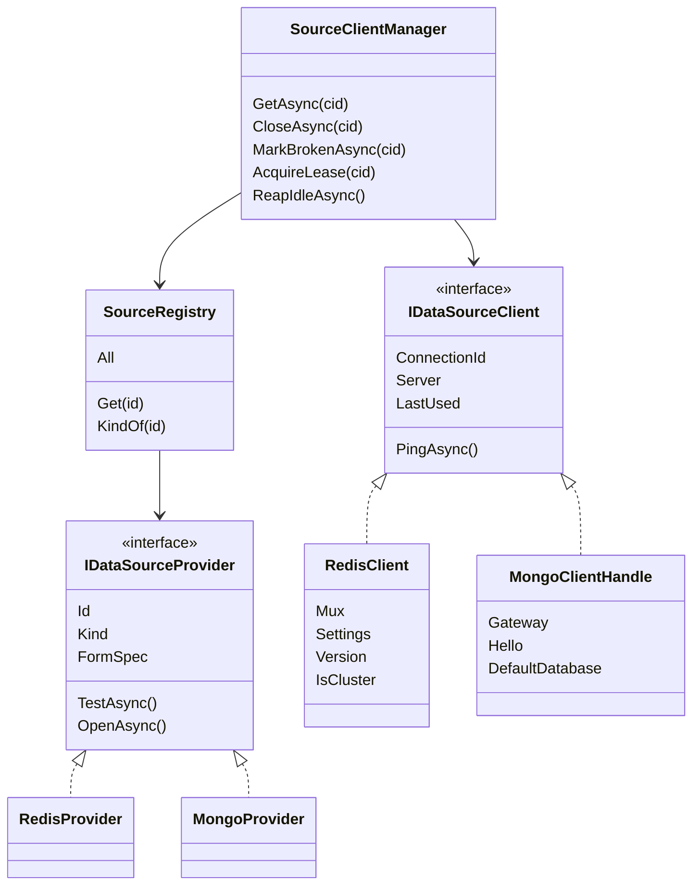
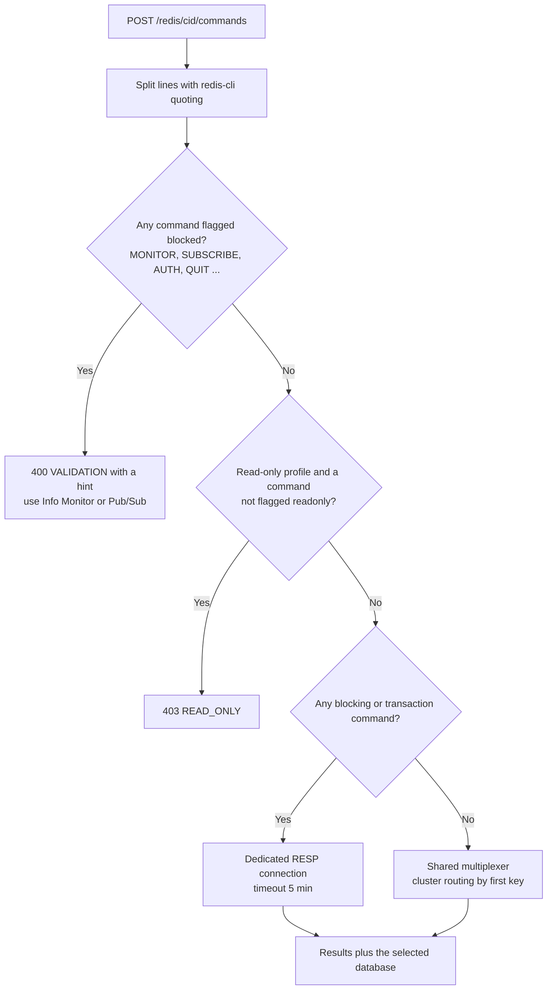
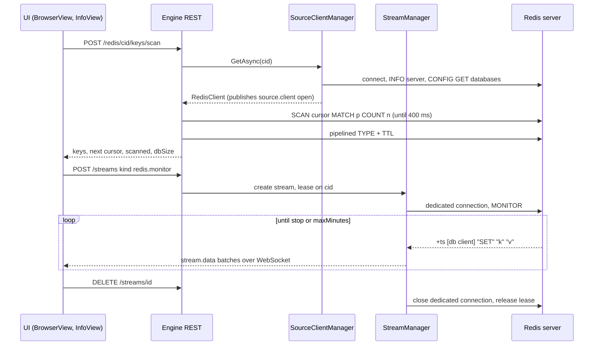
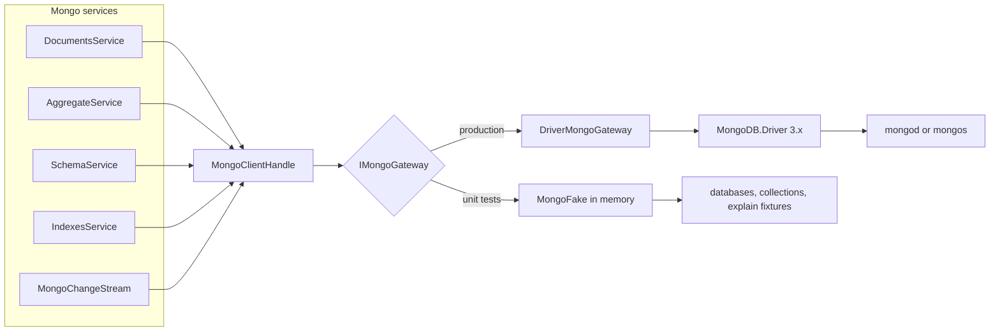
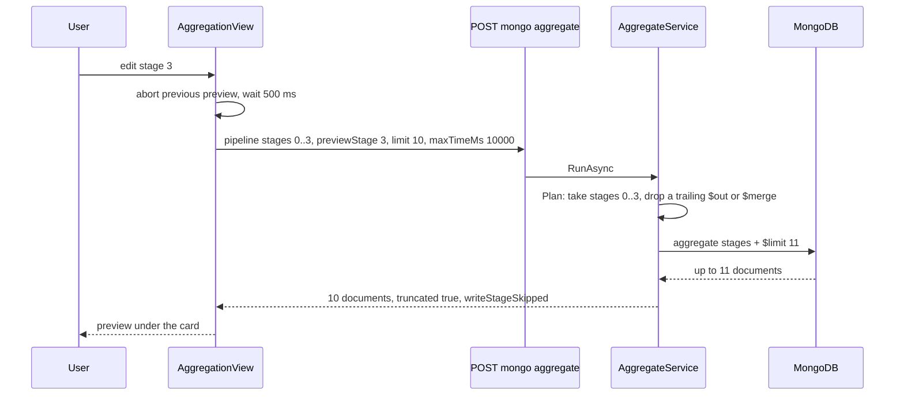

# 17. Sources I: Redis and MongoDB

> **Level:** L2 practitioner → L3 senior | **Part:** II | **Code read at:** `b638b7b` (Rowlit 1.6.3 feature set; `version.json` in this tree says 1.7.0)
> **Language:** English | [فارسی](../../fa/part2/17-sources-redis-mongo.md) | Previous: [16. Linked databases and federation](./16-linked-databases-federation.md) | Next: [18. Sources II: Kafka and Elasticsearch](./18-sources-kafka-elasticsearch.md)
> **In one sentence:** Redis and MongoDB are not driven by SQL batches, so Rowlit talks to them through a second provider family that keeps one shared driver client per connection, and builds a key browser, a command workbench, a document editor, an aggregation builder and live streams on top of it.
> **You will learn:**
> - what the non-relational provider family is (`IDataSourceProvider`, `IDataSourceClient`, `SourceRegistry`) and why it exists next to `IDbProvider`;
> - how `SourceClientManager` opens one client per connection, keeps it alive with leases and closes it when idle;
> - how the Redis key browser scans millions of keys without blocking the server, and how values of every type are read and edited byte-exactly;
> - why the Workbench sends some commands to a dedicated connection, and how MONITOR and pub/sub become engine streams;
> - how the MongoDB package hides the driver behind a gateway seam, speaks Extended JSON and mongosh syntax, and previews an aggregation stage by stage;
> - the limits, the error mapping and the tests of both packages.
> **Prerequisites:** [03. Big-picture architecture](./03-big-picture-architecture.md), [07. Engine modules, DI and keyed features](./07-engine-modules-and-di.md), [06. The WebSocket event protocol](./06-websocket-protocol.md). Part I background: [I-16 NoSQL families](../part1/16-nosql-families.md) (sections 2.1 Redis and 2.2 MongoDB).

## 1. The idea (beginner)

A relational database is driven by text: you send a batch of SQL, the server sends back rows. Rowlit's relational side is built around that idea, with one session per editor tab ([chapter 08](./08-connections-sessions-execution.md)). Redis and MongoDB do not fit it. Redis is a **[key-value store](../glossary.md#key-value-store)**: you send commands such as `GET user:1001` or `HGETALL cart:7`, and each key holds a typed value (string, hash, list, set, sorted set, stream, JSON). MongoDB is a **[document store](../glossary.md#document-store)**: a collection holds JSON-like documents, and you ask with a filter document (`{ status: "paid" }`) or an [aggregation pipeline](../glossary.md#aggregation-pipeline), not with SQL. Their drivers also want to be used differently: one `ConnectionMultiplexer` (Redis) or one `MongoClient` (Mongo) is meant to be **shared** by the whole program, with its own internal connection pool and reconnect logic.

So Rowlit has a second family of providers for these systems. Each connection gets exactly one long-lived **[source client](../glossary.md#source-client)** in the engine, opened on first use and closed after ten idle minutes. On top of it each package offers screens that match the data model: for Redis a key browser with a folder tree, typed value editors, a command Workbench and CLI, Info, Slowlog, Pub/Sub and a memory Analysis; for MongoDB a collection workspace with Documents, Aggregations, Schema, Indexes, Explain and Validation sub-views. Live data (Redis `MONITOR`, pub/sub messages, Mongo change streams) arrives as engine **[streams](../glossary.md#stream)**, and long work (memory analysis, schema analysis, delete by pattern, import and export) runs as engine **[jobs](../glossary.md#job)**. This chapter follows those pieces from the shared contracts down to the commands each screen sends.

## 2. How it works (practitioner)

### 2.1 The non-relational family

The plan's first decision explains the split: `IDbProvider`/`IDbSession` stays frozen, and non-relational sources implement a new `IDataSourceProvider` in Core (`docs/PLAN-M2.md` D1). The contract is small (`engine/src/DbStudio.Core/Providers/IDataSourceProvider.cs:13-43`):

```csharp
// engine/src/DbStudio.Core/Providers/IDataSourceProvider.cs:13-43
public interface IDataSourceProvider
{
    string Id { get; }                       // "redis" | "mongodb" | "kafka" | ...
    string DisplayName { get; }
    SourceKind Kind { get; }
    ConnectionFormSpec FormSpec { get; }     // drives the generic connection dialog
    Task<TestConnectionResult> TestAsync(ConnectionProfile profile, string? password, CancellationToken ct);
    Task<IDataSourceClient> OpenAsync(ConnectionProfile profile, string? password, CancellationToken ct);
}
public interface IDataSourceClient : IAsyncDisposable
{
    string ConnectionId { get; }
    ServerInfo Server { get; }
    Task<bool> PingAsync(CancellationToken ct);
    DateTimeOffset LastUsed { get; set; }    // maintained by SourceClientManager; drives the idle reaper
}
```

The **[source kind](../glossary.md#source-kind)** is `enum SourceKind { Relational, KeyValue, Document, Stream, Search }` (`engine/src/DbStudio.Core/Models/CoreModels.cs:21`). Redis reports `KeyValue` and MongoDB `Document`; Kafka (`Stream`) and Elasticsearch (`Search`) follow in [chapter 18](./18-sources-kafka-elasticsearch.md). `TestAsync` returns driver failures as a result instead of throwing, and `OpenAsync` is called only by the client manager, which serialises opens per connection (`IDataSourceProvider.cs:23-31`).

The **[source registry](../glossary.md#source-registry)** (`engine/src/DbStudio.Core/Services/SourceRegistry.cs`) lists *every* provider id. It wraps each relational `IDbProvider` in a `RelationalSourceAdapter` of kind `Relational`, adds the registered `IDataSourceProvider`s, and lets a relational id win over a module that tries to reuse it (`SourceRegistry.cs:24-33`). `GET /providers` uses its fixed display order, where Redis and MongoDB come after the relational engines and `linked` comes last (`SourceRegistry.cs:18-19`). The SQL code paths keep using `ProviderRegistry`; the adapter refuses `OpenAsync`, because relational connections use tab sessions (`SourceRegistry.cs:70-80`).

**Figure 17.1 — The source contracts and the two clients this chapter covers.**



**One client per profile.** Decision D2 says the shared driver objects (`ConnectionMultiplexer`, `MongoClient`, the Kafka admin client) are designed to be shared, so a connection gets one client, not one per tab, and idle clients close after `connections.sourceIdleSeconds` (`docs/PLAN-M2.md` D2). `SourceClientManager` implements it (`engine/src/DbStudio.Core/Services/SourceClientManager.cs`):

- **Open lazily, once.** `GetAsync` returns the cached client and stamps `LastUsed`. Otherwise it looks up the profile, refuses relational connections with `400 VALIDATION` ("it uses sessions, not a source client"), calls the `BeforeConnect` hook, then takes a per-connection `SemaphoreSlim(1, 1)` so two concurrent requests open one client (`SourceClientManager.cs:75-104`). The hook is set by the `ResourceManager` to enforce the open-connections limit (`ResourceManager.cs:188`, see [chapter 21](./21-logs-activity-resources.md)).
- **Errors become one code.** A driver failure during open is logged and turned into `503 SOURCE_UNAVAILABLE` with the connection and provider id; an `EngineException` (for example a validation error from the settings) passes through unchanged (`SourceClientManager.cs:105-122`). Since 1.7.0 the profile is passed through `ResolveForOpenAsync` first, which is where an SSH tunnel is set up (`SourceClientManager.cs:108`).
- **Events.** Every open, close and break publishes `source.client` (`SourceClientChangedEvent`, `engine/src/DbStudio.Core/Services/Events.cs:102`; `SourceClientManager.cs:128`, `224`). The UI store `ui/src/store/sourceClients.ts` refetches the list on `open` and drops the entry on `closed`/`broken` (`sourceClients.ts:37-45`); it feeds the "Clients" list of the Connections panel, the activity dots and the status bar count (`sourceClients.ts:1-2`).
- **Close and break.** `CloseAsync` (Disconnect) and `MarkBrokenAsync` (the driver lost the server) both dispose the client, publish the event and raise `ClientClosed` (`SourceClientManager.cs:147-150`, `212-234`). The next `GetAsync` opens a fresh client.
- **Leases and the idle reaper.** A timer runs every 30 s (`SourceClientManager.cs:55-56`) and closes clients unused for the idle timeout, default 600 s, clamped to 0..86 400, where 0 means never (`SourceClientManager.cs:25`, `171-177`). A client is skipped while anyone holds a **[lease](../glossary.md#lease)** on it (`SourceClientManager.cs:196`). The `StreamManager` takes a lease for each open stream (`StreamManager.cs:223`); the Redis and Mongo endpoints take one for each job and for Workbench batches (`RedisEndpoints.cs:48`, `107`, `147`; `MongoEndpoints.cs:276`). Under memory pressure the `ResourceManager` shortens the timeout to 3 min (high) or 1 min (critical) (`ResourceManager.cs:266`; `SourceClientManager.cs:182-191`). This is the **[idle reaper](../glossary.md#idle-reaper)**.

Three REST routes expose the manager (`engine/src/DbStudio.Host/Endpoints/SourcesEndpoints.cs:16-28`): `GET /sources/clients` (list), `GET /sources/{cid}/client` (open if needed and describe) and `DELETE /sources/{cid}/client` (Disconnect, `204`).

**Streams and jobs.** Live views implement `IStreamFactory`/`IEngineStream`, registered as keyed singletons under a kind such as `redis.monitor` (`StreamManager.cs:13-37`). The `StreamManager` owns the bounded queue, the batching into `stream.data` events, the per-window limit of 8 streams and the engine-wide limit of 64 (`StreamManager.cs:155-157`), and it ends every stream of a connection when its client closes, with reason `source-closed` or `source-broken` (`StreamManager.cs:456-460`). Jobs report progress through `JobContext.Report` and finish with `job.done`. Both managers are described in [chapter 06](./06-websocket-protocol.md) and [chapter 21](./21-logs-activity-resources.md); this chapter only shows the Redis and Mongo implementations.

### 2.2 Redis: connecting

`RedisModule` is the package's composition root, found by reflection like every [engine module](../glossary.md#engine-module) ([chapter 07](./07-engine-modules-and-di.md)). It registers the provider, five singleton services (`KeyBrowser`, `ValueService`, `CommandService`, `InfoService`, `AnalysisService`), two keyed stream factories (`redis.monitor`, `redis.subscribe`) and the `/redis/{cid}/…` routes (`engine/src/DbStudio.Sources.Redis/RedisModule.cs:17-29`).

`RedisProvider` (id `redis`, kind `KeyValue`) declares the connection form: mode standalone, cluster or [Sentinel](../glossary.md#sentinel); host and port, cluster nodes or sentinels plus a service name (default `mymaster`); ACL user and password; database index; TLS and "skip certificate verification"; key delimiter (default `:`); SCAN count (default 500); connect timeout (default 5 s) (`RedisProvider.cs:23-40`). The SSH tunnel fields added in 1.7.0 carry a warning that only standalone mode can be tunnelled, because Cluster and Sentinel hand out node addresses the tunnel cannot reach (`RedisProvider.cs:19`).

`RedisSettings.From` validates the profile: unknown modes, empty hosts and ports out of range are `400 VALIDATION` with the field name; `host:port` typed into the host field wins over the port field; the SCAN count is clamped to 10..10 000 and the timeout to 1..120 s (`RedisSettings.cs:30-75`). `BuildConfiguration` then fills the StackExchange.Redis options. The choices matter for a long-lived shared client (`RedisSettings.cs:120-153`):

| Option | Value | Why (from the code) |
|---|---|---|
| `AbortOnConnectFail` | `false` | the multiplexer keeps trying in the background; the provider surfaces the failure itself |
| `ReconnectRetryPolicy` | `ExponentialRetry(500, 10_000)` | "the engine is long-lived and shared: reconnect quietly in the background" |
| `KeepAlive` | 30 | keeps idle sockets open through NATs |
| `ClientName` | `Rowlit` | visible in `CLIENT LIST` |
| `AllowAdmin` | `true` | needed for `INFO`, `CONFIG`, `SLOWLOG`, `CLIENT KILL` |
| `DefaultDatabase` | profile value, null in cluster | Redis Cluster has only database 0 |

`RedisProvider.ConnectAsync` connects and then reads the server facts (`RedisProvider.cs:64-141`). Because `AbortOnConnectFail` is false, a dead host would otherwise "connect" and fail on the first command, so the provider pings with a short grace and reports "Could not connect … within N s" after about one timeout, not two (`RedisProvider.cs:80-96`). It detects a cluster from the server types, reads `INFO server` for the version and `CONFIG GET databases` for the database count (16 when `CONFIG` is renamed or denied by ACL, as on managed services) (`RedisProvider.cs:97-117`). One subtle check is worth knowing: StackExchange.Redis carries on as the `default` user when `AUTH` is rejected and that user needs no password, so a wrong ACL user would look like a successful login. On Redis 6+ the provider therefore asks `ACL WHOAMI` and fails with a `WRONGPASS`-style message when the server names another user (`RedisProvider.cs:118-133`).

The result is a `RedisClient` (`engine/src/DbStudio.Sources.Redis/RedisClient.cs`): the multiplexer, the settings, the version (which gates `SCAN … TYPE` and `KEEPTTL` at 6.0, `UNLINK` and `MEMORY` at 4.0, `RedisClient.cs:40-41`), `IsCluster` and the database count. It also offers `EnsureWritable` (403 `READ_ONLY` on a read-only profile, `RedisClient.cs:56-59`), `CheckDb` (cluster accepts only database 0, `RedisClient.cs:62-68`), `Primaries()` and `ServerFor(key)`, which routes by the key's [hash slot](../glossary.md#hash-slot) in a cluster (`RedisClient.cs:73-113`), and a cached `MODULE LIST` that tells whether **[ReJSON](../glossary.md#rejson)** is loaded (`RedisClient.cs:123-157`).

**Raw RESP for what the multiplexer cannot share.** A multiplexer sends every caller's commands over one pipe. That is efficient, but some commands would hold the pipe for everyone: `MONITOR` never ends, `MULTI`/`EXEC` and `WATCH` need a connection of their own, and blocking commands (`BLPOP`, `XREAD BLOCK`) wait on the server. For those, `RawRedisConnection` opens a **[dedicated connection](../glossary.md#dedicated-connection)**: a plain `TcpClient` (optionally wrapped in `SslStream`), [RESP](../glossary.md#resp)2 framing with a 64 KB buffer, `AUTH` with the profile's user and password, `CLIENT SETNAME Rowlit-dedicated` and `SELECT` of the database (`RawRedisConnection.cs:22-80`). `RedisClient.OpenDedicatedAsync` opens one to a chosen server (`RedisClient.cs:116-120`).

**The command table.** `RedisCommandCatalog` loads `redis-commands.json`, embedded in the assembly, with each command's group, syntax, complexity, key positions and flags: `readonly`, `write`, `admin`, `blocking`, `transaction`, `blocked`, `dangerous`, `pubsub`, `module` (`RedisCommandCatalog.cs:7-58`). The engine uses the flags for read-only enforcement and dedicated routing; the UI ships the same file for completion, hover and argument hints (`ui/src/redis/catalog.ts:1-3`), and an engine test asserts that both copies are identical (`engine/tests/DbStudio.Sources.Redis.Tests/EndpointTests.cs:182-184`).

### 2.3 Redis: the key browser

A Redis database can hold hundreds of millions of keys, and `KEYS *` would block the single-threaded server while it walks all of them. The browser uses **[SCAN](../glossary.md#scan)** instead: a cursor-based command whose each call does a bounded amount of work (`O(COUNT)`). `KeyBrowser.ScanAsync` adds two more bounds (`engine/src/DbStudio.Sources.Redis/Services/KeyBrowser.cs:8-77`):

```csharp
// engine/src/DbStudio.Sources.Redis/Services/KeyBrowser.cs:16-19, 38-46
public static TimeSpan Budget { get; set; } = TimeSpan.FromMilliseconds(400);
public const int MaxIterations = 64;
public const int MaxMemoryKeys = 100;
// …
while (cursors.Count > 0 && found.Count < count && iterations < MaxIterations)
{
    var (node, cursor) = cursors[0];
    var args = new List<object> { cursor, "MATCH", pattern, "COUNT", count };
    if (serverTypeFilter) { args.Add("TYPE"); args.Add(Resp.ServerType(type!)); }
    // … one SCAN call, then: if (sw.Elapsed > Budget) break;
```

One request stops after 400 ms, after 64 SCAN calls or once it has a page of keys, and returns the cursor. The UI then shows "scanned X of ~Y" and a **Scan more** button (`ui/src/components/Redis/BrowserView.tsx:333-336`), so the user, not the engine, decides whether to keep walking. The type filter runs on the server (`SCAN … TYPE`) from Redis 6 and is applied after `TYPE` on older servers (`KeyBrowser.cs:30`, `70`). In a cluster there is one cursor per primary, encoded `host:port@cursor;…`, and the loop goes round-robin so one big node does not starve the others (`KeyBrowser.cs:56-62`, `163-193`). SCAN may return a key twice during rehashing, so keys are de-duplicated, and keys that expired between SCAN and TTL (`TTL = -2`) are dropped (`KeyBrowser.cs:67-71`). `TYPE` and `TTL` of a page are sent as one pipelined batch in chunks of 500 (`KeyBrowser.cs:80-113`). Memory badges come from a separate `POST /keys/memory` of at most 100 keys using `MEMORY USAGE key SAMPLES 0` (`KeyBrowser.cs:124-131`).

The **folder tree** is built in the UI. `buildKeyIndex` splits each key by the delimiter, so `user:1001:profile` lands under the folders `user:` and `user:1001:`; flattening walks only expanded folders, which keeps a 100 000-key browser responsive (`ui/src/redis/keyTree.ts:1-3`, `20-59`). A folder's count is the number of *scanned* keys below it, not the server's total, because only SCAN results are known: these are **partial counts**, and the header says so with "scanned … of ~…". Opening a folder can start a fresh scan with its prefix as the pattern, glob characters escaped (`keyTree.ts:73-76`).

**Binary-safe keys and values.** Redis keys and values are byte strings, not text. A key whose bytes are not valid UTF-8 is displayed with `\xHH` escapes; when such a key does not exist under its binary reading, the browser tries the literal text, so a key that really contains the characters `\xff` is still found (`KeyBrowser.cs:85-98`). For hash, list, set and sorted-set elements, `BinaryText` sends the display text plus a side map from that text to the real bytes in base64; an edit request that sends the text back with the map writes the exact original bytes (`engine/src/DbStudio.Sources.Redis/Services/BinaryText.cs:7-13`). The key itself travels in the URL path; the endpoint decodes the raw request target once, so `%2F` and `%25` stay exact (`RedisEndpoints.cs:172-175`).

### 2.4 Redis: values, commands, info and analysis

**Typed values.** `ValueService.GetAsync` pipelines `TYPE`, `TTL` and `OBJECT ENCODING`, reads the memory size and dispatches by type: string (capped at 1 MB, binary shown as hex, JSON detected), hash (`HSCAN`), list (`LRANGE` pages), set (`SSCAN`), sorted set (`ZRANGE` by rank, `ZSCAN` when filtered), stream (`XREVRANGE` pages, groups, consumers, pending entries) and RedisJSON (`JSON.GET`, `JSON.SET`). Pages default to 200 items, stream pages to 100 (`engine/src/DbStudio.Sources.Redis/Services/ValueService.cs:12-58`). A module type Rowlit cannot display returns `400 NOT_SUPPORTED` with "use the Workbench" (`ValueService.cs:57`). RedisJSON commands go through `db.Execute`, not through `NRedisStack` (`docs/PLAN-M2.md` D7).

Every mutation calls `EnsureWritable` first (`ValueService.cs:302`, `330`, `343`, …). Edits also defend against the key changing under the editor. Saving a string checks that the key still exists and is still a string, then uses `SET … XX KEEPTTL` so `SET` itself refuses to re-create a deleted key and keeps its expiry; before Redis 6 it reads `PTTL` and passes it back with `PX` (`ValueService.cs:300-326`). The detail pane shows a **[TTL countdown](../glossary.md#ttl-countdown)** computed in the browser from the TTL at load time, turning to a warning colour under 60 s (`ui/src/components/Redis/KeyDetail.tsx:103-113`). "Delete by pattern" is a job: `SCAN MATCH` plus `UNLINK` (or `DEL` before 4.0) in pipelines of 500, with progress after each page and cancellation between pages (`ValueService.cs:583-592`; route `RedisEndpoints.cs:39-52`).

**Workbench and CLI.** `POST /redis/{cid}/commands` accepts raw lines (split with redis-cli quoting by `RedisArgs`) or pre-split argument arrays, at most 1 000 commands (`engine/src/DbStudio.Sources.Redis/Services/CommandService.cs:19`, `26-50`). Before anything runs, every command is classified (`CommandService.cs:52-64`):

**Figure 17.2 — How the Workbench routes a batch of Redis commands.**



The refusal hints point the user to the right screen: MONITOR to *Info › Monitor*, the subscribe family to the Pub/Sub tab, and `AUTH`, `HELLO`, `CLIENT SETNAME` to the connection editor, because they "would change the shared connection" (`CommandService.cs:74-84`). `SELECT` is tracked per request, so later commands of the batch use the chosen database and the response reports it (`CommandService.cs:96-100`, `125-132`). A blocking command or a dedicated batch is bounded by 5 minutes (`CommandService.cs:22`). Completion in the editor offers command names, then sub-commands of containers such as `CONFIG GET`, then key names from the browser's scan cache after an argument that takes a key, otherwise syntax keywords such as `NX`, `EX`, `WITHSCORES` (`ui/src/redis/complete.ts:1-2`).

**Info, clients, config, slowlog.** `InfoService` serves the dashboard and admin screens: server and modules and keyspace summed over primaries, parsed `INFO`, `CLIENT LIST`/`KILL`, `CONFIG GET`/`SET`, `SLOWLOG GET`/`RESET`, `PUBSUB CHANNELS`/`NUMSUB` and `PUBLISH`; the writes among them are READ_ONLY-guarded (`engine/src/DbStudio.Sources.Redis/Services/InfoService.cs:7-11`). The Info view polls every 2 s, so a single node answers the client count from `INFO` instead of the server-blocking `CLIENT LIST` (`InfoService.cs:38-40`). `InfoParser` turns the `INFO` text into section → key → value maps (`InfoParser.cs:8-25`). **[Slowlog](../glossary.md#slowlog)** is a plain REST read in this package (`RedisEndpoints.cs:118-122`); the Logs view has its own `slowlog` source over the same command (`engine/src/DbStudio.Logs/Providers/Redis/RedisLogSource.cs:8-13`). The plan listed slowlog among the stream factories; the code makes it a request, not a stream.

**Memory analysis.** The Analysis tab starts a job (`POST /redis/{cid}/analysis`, `RedisEndpoints.cs:140-147`). `AnalysisService.RunAsync` scans up to `sampleLimit` keys (default 100 000, at most 5 000 000) in pages of 1 000, pipelines `TYPE`, `TTL` and `MEMORY USAGE`, and aggregates (`engine/src/DbStudio.Sources.Redis/Services/AnalysisService.cs:14-18`, `41-116`):

- namespaces at the first two delimiter levels (`user:` and `user:1001:` for `user:1001:profile`) with key count, memory, average TTL and types (`AnalysisService.cs:122-133`);
- the top 100 keys by memory, kept in a min-heap so memory stays constant (`AnalysisService.cs:94-95`);
- totals per type and TTL buckets `< 1 hour`, `< 1 day`, `< 1 week`, `< 1 month`, `> 1 month` (`AnalysisService.cs:20-23`).

A keyspace with millions of distinct second-level prefixes would grow the namespace map without bound, so when it passes 4 × 2 000 entries the smallest second-level half is dropped (`AnalysisService.cs:85`, `135-140`). The result flags the sample as partial (`scanned < total`) when it stopped at the sample limit (`AnalysisService.cs:113`). This is the **[memory analysis](../glossary.md#memory-analysis)**.

### 2.5 Redis: MONITOR and pub/sub as streams

Two keyed stream factories turn Redis' push features into engine streams.

**Figure 17.3 — Open a Redis client, browse keys, then stream MONITOR.**



`redis.monitor` runs **[MONITOR](../glossary.md#monitor)** on a dedicated connection to the primary or to a chosen cluster node. MONITOR costs the server throughput, so the stream stops itself after `maxMinutes` (default 10, at most 60) and ends with reason `completed` (`engine/src/DbStudio.Sources.Redis/Services/Streams.cs:15-22`, `46-63`). Each line such as `1700000000.123456 [0 127.0.0.1:5000] "SET" "k" "v"` is parsed into `{ ts, db, client, args }` (`Streams.cs:66-89`). If the UI cannot keep up, the `StreamManager` drops the oldest queued items and counts them; the view shows the drop counter (`StreamManager.cs:54-57`; `ui/src/components/Redis/useRedisStream.ts:1-3`).

`redis.subscribe` takes up to 100 channels and patterns in total and subscribes through the multiplexer's own subscriber connection, which StackExchange.Redis keeps apart from the command pipe (`Streams.cs:92-131`). Payloads that are not valid text travel as hex with `binary: true` (`Streams.cs:166-171`). When the client is closed under the stream (Disconnect, idle reaper), the stream does not report an error: it waits for the `source-closed` cancellation that the `StreamManager` sends right after (`Streams.cs:136-148`). On the UI side `useRedisStream` buffers items, keeps the last 10 000, and never stores live stream ids in tab state, so a restored workspace starts stopped (`useRedisStream.ts:1-3`, `26`).

**Errors.** `RedisErrors.Map` turns `NOPERM`, `NOAUTH` and `WRONGPASS` replies into `403 PRIVILEGE` naming the ACL permission (`+get`, `+scan`…), other server errors into `400 PROVIDER_ERROR`, timeouts and connection failures into `503 SOURCE_UNAVAILABLE`, and command misuse into `400 VALIDATION`; it also cuts StackExchange.Redis' configuration advice out of messages (`engine/src/DbStudio.Sources.Redis/RedisErrors.cs:6-31`, `58-61`). The Redis endpoints do not mark the client broken: the multiplexer reconnects by itself (`RedisSettings.cs:136-137`).

### 2.6 MongoDB: connecting and the gateway seam

`MongoModule` registers the provider, ten services (Explorer, Documents, Aggregate, Explain, Schema, Fields, Indexes, Validation, Profiling, ImportExport) and the `mongo.changes` stream factory (`engine/src/DbStudio.Sources.Mongo/MongoModule.cs:14-36`). `AddServices` is a separate method so tests can register the services over a fake provider (`MongoModule.cs:22-23`).

`MongoProvider` (id `mongodb`, kind `Document`) asks for a `mongodb://` or `mongodb+srv://` connection string plus optional user, password, auth database, mechanism (SCRAM-SHA-256, SCRAM-SHA-1, X.509, PLAIN for LDAP), default database, TLS with a CA file, read preference, connect timeout (default 10 s) and app name (default `Rowlit`) (`engine/src/DbStudio.Sources.Mongo/MongoProvider.cs:32-58`). The user field is merged into the URI only when the URI has no credentials (`MongoProvider.cs:36`). With an SSH tunnel only a single-host `mongodb://` string works; `mongodb+srv://` is not supported there (`MongoProvider.cs:30`). The driver resolves SRV and TXT records synchronously, so the provider builds the settings on a worker thread and bounds it by the connect timeout plus one second ("Resolving the connection string took longer than … (DNS)") (`MongoProvider.cs:60-75`). The handshake runs `hello` and `buildInfo` on `admin` and labels the topology: sharded cluster, replica set *name*, load balanced or standalone (`MongoProvider.cs:123-147`). Every error message passes through `MongoSettingsBuilder.Redact`, which replaces the connection string and any `user:password@` part with `***` (`MongoProvider.cs:173-188`; `MongoSettingsBuilder.cs:190-199`). The password itself is a `password`-type form field and is stored in the secret store, never in the profile props (`docs/PLAN-M2.md` D12; [chapter 19](./19-security-and-secrets.md)).

**The gateway seam.** Every Mongo service calls `IMongoGateway`, not the driver. The interface lists exactly the calls the services need: `RunCommandAsync`, `ListDatabasesAsync`, `ListCollectionsAsync`, `FindAsync` and `FindStreamAsync`, counts, `AggregateAsync` and `AggregateStreamAsync`, inserts, replace, bulk upsert, delete, index calls, collection DDL and `WatchAsync` for change streams (`engine/src/DbStudio.Sources.Mongo/IMongoGateway.cs:30-91`). `DriverMongoGateway` implements it over MongoDB.Driver 3.x with untyped `BsonDocument` collections (`DriverMongoGateway.cs:7`); the test project's `MongoFake` implements it in memory (`docs/PLAN-M2.md` D11). This is a **[gateway seam](../glossary.md#gateway-seam)**: one interface at the edge of the package that lets the real and the fake backends be swapped without touching service code.

**Figure 17.4 — The Mongo gateway seam: production and tests use the same services.**



`MongoProvider` takes the gateway factory as a constructor argument; the public constructor uses the real one, an internal one lets tests open handles over the fake (`MongoProvider.cs:17-25`). The resulting `MongoClientHandle` holds the gateway, the `hello` reply and the profile; it exposes the driver client to other packages (the Logs profiler source, the federation `MongoFetcher`) and returns null there when fake-backed (`engine/src/DbStudio.Sources.Mongo/MongoClientHandle.cs:10-42`). It also caches the type of each collection (`collection`, `view`, `timeseries`) for 30 s, because counting and some commands behave differently on views (`MongoClientHandle.cs:66-83`).

**Errors and broken clients.** `MongoErrors.Map` maps `Unauthorized` (13) to `403 PRIVILEGE` with the needed action, other server errors (`MaxTimeMSExpired` 50 included) to `422 PROVIDER_ERROR` with `providerCode` and `codeName`, authentication and connection failures to `503 SOURCE_UNAVAILABLE`, and shell-JSON parse errors to `400 VALIDATION` with `{ field, offset, line, col }` so the query bar can underline the exact character (`engine/src/DbStudio.Sources.Mongo/MongoErrors.cs:7-58`). Unlike Redis, a connection-level failure marks the client broken: an endpoint filter calls `MarkBrokenAsync` so the next request opens a fresh client (`MongoEndpoints.cs:244-259`).

### 2.7 MongoDB: documents, Extended JSON and shell syntax

A collection opens as one tab (`mongo.documents`, keyed by connection, database and collection) with sub-views Documents, Aggregations, Schema, Indexes, Explain and Validation, in the style of MongoDB Compass (`ui/src/components/Mongo/open.ts:1-10`; `CollectionView.tsx:1-3`). The explorer lists databases with `listDatabases`; when the login may not list them all, it retries with `authorizedDatabases: true`, and if even that is denied it shows only the profile's default database (`engine/src/DbStudio.Sources.Mongo/Services/ExplorerService.cs:66-85`).

**Two JSON dialects.** Documents travel to the UI as canonical **[Extended JSON](../glossary.md#extended-json)**, which keeps every [BSON](../glossary.md#bson) type (`{"$oid": …}`, `{"$numberLong": …}`, `{"$date": …}`). Find, aggregate and change-stream output replace strings longer than 32 768 characters and binaries larger than 8 192 bytes with `{"$trunc": …, "len": n}` markers anywhere in the tree (`engine/src/DbStudio.Sources.Mongo/Ejson.cs:7-14`), the same idea as the relational wire values of [chapter 13](./13-results-grid-and-data-editing.md). In the other direction, users type mongosh syntax. `ShellJson` is a hand-written tokenizer and recursive-descent parser that accepts JSON plus comments, trailing commas, single quotes, unquoted keys, regex literals, `NaN`/`Infinity`/`undefined`, the shell helpers (`ObjectId("…")`, `ISODate("…")`, `NumberLong(…)`, `NumberDecimal("…")`, `BinData`, `UUID`, `Timestamp`) and the Extended JSON wrappers, straight to BSON; errors carry positions (`engine/src/DbStudio.Sources.Mongo/ShellJson.cs:16-22`). The UI has its own TypeScript copy for highlighting and completion (`ui/src/mongo/shellJson.ts`, `ui/src/mongo/bson.ts`). `BsonKit` implements the server's comparison order (MinKey < null < numbers < strings < object < array …) and query equality where `1 == 1.0 == NumberLong(1)` (`BsonKit.cs:50-72`, `132-133`).

**Find and count.** `DocumentsService.ParseFind` parses filter, projection, sort and collation (a collation needs a `locale`), allows a limit of 1..1 000 and sets `maxTimeMS` to 30 s unless the request says otherwise (`engine/src/DbStudio.Sources.Mongo/Services/DocumentsService.cs:10`, `15-27`). `FindAsync` runs the find and the count in parallel; if the count fails for any reason except a lost connection, the response still returns the documents with an inexact count (`DocumentsService.cs:31-48`). Counting is chosen per collection: an unfiltered plain collection uses `estimatedDocumentCount`, a filtered one `countDocuments` with a 2 s `maxTimeMS` that falls back to an estimate flagged `exact: false`, and views and time series always use `countDocuments` (`DocumentsService.cs:12-13`, `51-54`).

**Editing.** Insert, replace and delete are READ_ONLY-guarded. Replace is full-document only and refuses a document whose [`_id`](../glossary.md#_id) differs from the edited one, by value *and* BSON type, because "changing `_id` needs insert + delete" (`DocumentsService.cs:101-123`). The document list, JSON page and table views are `DocumentsView`, `JsonPage` and `DocumentTable` in `ui/src/components/Mongo/`.

**Query-bar completion.** `POST /mongo/{cid}/…/fields` samples documents (default 500, at most 10 000; `$sample` without a filter, otherwise a find with a limit) and returns the dotted field paths with their BSON types and, for enumerable fields, the sampled distinct values; results are cached 60 s per sample key (`engine/src/DbStudio.Sources.Mongo/Services/SchemaService.cs:9-16`, `141-170`). `ui/src/mongo/complete.ts` finds where the caret is in shell JSON (a key or a value, inside which operators) and proposes field paths, query operators, aggregation stages and accumulators, sampled values and value helpers (`complete.ts:1-3`, `12-25`).

### 2.8 MongoDB: aggregation builder with stage previews

The Aggregations sub-view is a list of stage cards. Each card has a stage picker, a shell-JSON body with completion and an enable toggle; each card also shows a preview of 10 documents, debounced 500 ms and cancelled when the user edits again (`ui/src/components/Mongo/AggregationView.tsx:1-4`, `95-114`).

**Figure 17.5 — A per-stage preview of an aggregation pipeline.**



`AggregateService.Plan` keeps the stages up to `previewStage` and removes a final `$out` or `$merge`, because a preview must never write (`engine/src/DbStudio.Sources.Mongo/Services/AggregateService.cs:6-8`, `15-32`). A full run that ends with a write stage is READ_ONLY-guarded, executes and returns no documents (`AggregateService.cs:44-49`). Otherwise the service appends `$skip` and `$limit limit+1`; the extra document tells "there is more" without a second count query (`AggregateService.cs:50-53`). `maxTimeMS` defaults to 60 s for runs and 10 s for previews (`AggregateService.cs:40`), and `MongoValidate.Pipeline` refuses `$out`/`$merge` anywhere but the last stage (`MongoValidate.cs:91-92`). **Export to code** writes the query or pipeline as mongosh, Node.js, C#, Python or Java, using each driver's own constructor for every BSON type (`ui/src/components/Mongo/exportCode.ts:1-6`).

### 2.9 MongoDB: schema, indexes, validation, explain, change streams, import and export

- **[Schema analysis](../glossary.md#schema-analysis).** A job over a sample (default 1 000 documents, 1..100 000) that returns the field tree with type distributions, probabilities, examples and min/max/distinct statistics; progress every 100 documents; distinct values are tracked up to 10 000 and strings are cut at 100 characters (`SchemaService.cs:18-38`, `81`, `132-136`). A collection is schemaless, so "the schema" is always a description of a sample, never a guarantee.
- **Indexes.** List with sizes and usage; create answers inline when the build finishes within 2 s and otherwise becomes a job; drop (`engine/src/DbStudio.Sources.Mongo/Services/IndexesService.cs:10-14`). A **[wildcard index](../glossary.md#wildcard-index)** (`{ "$**": 1 }`) may carry a `wildcardProjection`, accepted only on a single `$**` key over the whole document (`IndexesService.cs:128-131`).
- **[Validation rules](../glossary.md#validation-rule).** Read from the `listCollections` options (`validator`, `validationLevel` default `strict`, `validationAction` default `error`) and written with `collMod`; the level must be `off`, `strict` or `moderate` and the action `error`, `warn` or `errorAndLog` (`engine/src/DbStudio.Sources.Mongo/Services/ValidationService.cs:6-38`). The UI can generate a `$jsonSchema` validator from the schema analysis (`ui/src/mongo/jsonSchema.ts`).
- **[Explain (Mongo)](../glossary.md#explain-mongo).** `ExplainService` runs `explain` on a find or an aggregate and `ExplainNormalizer` turns the server's shapes (classic, SBE `winningPlan.queryPlan` in 7.x, aggregates with a `$cursor` first stage, sharded `shards` arrays) into the shared `PlanNode` tree used by the relational plan view of [chapter 15](./15-import-export-plans-er.md), plus warnings "Collection scan: no index was used" and "Sort in memory" (`engine/src/DbStudio.Sources.Mongo/Services/ExplainService.cs:8-14`, `64-73`). Write stages are not run by explain (`ExplainService.cs:14`).
- **Change streams.** `mongo.changes` watches a collection, or a whole database when `coll` is absent, with `fullDocument` `default` or `updateLookup` (`engine/src/DbStudio.Sources.Mongo/Services/ChangeStreamService.cs:8-27`). The driver cursor waits at most 1 s per round (`DriverMongoGateway.cs:179-194`). A standalone server has no [change streams](../glossary.md#change-stream); error 40573 ends the stream with "Change streams need a replica set or a sharded cluster" (`ChangeStreamService.cs:38-41`; `MongoErrors.cs:15-16`).
- **Import and export.** Export writes JSON (pretty array), JSONL or CSV with flattened dotted paths; import reads JSON (array or concatenated documents, parsed with `ShellJson`), JSONL or CSV with optional header, type inference over the first 20 rows, per-column overrides and dotted names that build subdocuments; at most 100 errors are kept (`engine/src/DbStudio.Sources.Mongo/Services/ImportExportService.cs:23-30`). Both run as jobs that hold a lease (`MongoEndpoints.cs:273-289`).
- **Profiling.** The profiler level of a database is read with `{ profile: -1 }` and written with `{ profile, slowms, sampleRate }`; writing is READ_ONLY-guarded (`engine/src/DbStudio.Sources.Mongo/Services/ProfilingService.cs:6-35`). The Logs view reads the profiler output ([chapter 21](./21-logs-activity-resources.md)).

## 3. Deep dive (senior)

> **Deep dive (L3): why one shared client and not one session per tab**
>
> The relational side gives each tab its own physical connection because a SQL session has state that belongs to the tab: an open transaction, temp tables, `SET` options, a current schema. Redis and MongoDB clients do not work that way. A `ConnectionMultiplexer` pipelines every caller's commands over one socket per server and reconnects by itself; a `MongoClient` owns a pool and a server-monitoring loop. Opening one per tab would multiply sockets and heartbeats for no gain, which is why D2 chose one client per profile (`docs/PLAN-M2.md` D2). The price is that per-request state must be explicit: the Redis database index travels on every request (`?db=`) and is checked by `CheckDb`; Workbench `SELECT` lives only for one batch (`CommandService.cs:96-100`); transactions and blocking commands are pushed to a dedicated connection that exists only for that batch. Leases solve the remaining problem, that a shared object has no single owner who could say "I am done": the reaper may close a client only when nobody holds a lease and nobody used it for the idle timeout.
>
> **Why the scan budget is time-based.** `COUNT` is only a hint to Redis; a sparse database (a narrow `MATCH` over millions of keys) may return zero keys per call for a long time. A limit on keys found would then never trigger, and a limit on calls alone would still let one request run long on a slow network. A wall-clock budget of 400 ms plus 64 calls bounds both the server load and the HTTP latency, and handing the cursor back to the UI turns "scan the whole database" into a user decision (`KeyBrowser.cs:16-19`, `38-65`).
>
> **Why the Mongo seam is an interface over BSON, not over the driver's typed API.** The services work on `BsonDocument`s because the user's data has no C# type. Putting the seam at "run this command / find / aggregate with these BSON arguments" keeps the fake small enough to be realistic: it evaluates filters, projections, sorts and pipelines with the same `BsonKit` comparison rules, emits MongoDB 7 explain documents from fixtures and feeds change streams from its own writes (`engine/tests/DbStudio.Sources.Mongo.Tests/Fake/MongoFake.cs`). Every service then runs in unit tests on every machine, and the Testcontainers suite against `mongo:7` checks that the fake did not drift from the server (`docs/PLAN-M2.md` D11).
>
> **Two edit guards that look alike.** Redis `SET … XX KEEPTTL` and Mongo "replace by `_id`, refuse a changed `_id`" both protect an edit made on a value loaded seconds ago. Neither is full optimistic concurrency: a concurrent write to the same key or document between load and save is overwritten. What they prevent is worse: silently re-creating a deleted key without its TTL, writing a string over a key that became a hash, or turning an edit into an insert of a second document.

## 4. Edge cases and limits

| Topic | Fact | Source |
|---|---|---|
| Source client idle close | 600 s default, 0..86 400, 0 = never; reaper every 30 s | `SourceClientManager.cs:25`, `55`, `171-177` |
| Idle close under memory pressure | 3 min (high), 1 min (critical) | `ResourceManager.cs:266` |
| Streams per window / engine | 8 / 64 (`409 STREAM_LIMIT`) | `StreamManager.cs:156-157`, `314-320` |
| Redis SCAN count | 10..10 000, default 500 | `RedisSettings.cs:68`, `KeyBrowser.cs:26` |
| Redis scan request | stops after 400 ms or 64 calls | `KeyBrowser.cs:16-18` |
| Redis memory badges | at most 100 keys per request | `KeyBrowser.cs:19` |
| Redis string value | 1 MB cap | `ValueService.cs:19` |
| Redis Workbench | 1 000 commands per request; dedicated batch 5 min | `CommandService.cs:19-22` |
| Redis MONITOR | default 10 min, at most 60 | `Streams.cs:21-22` |
| Redis pub/sub | 100 channels + patterns per stream | `Streams.cs:98` |
| Redis analysis | sample 100 000 default, 5 000 000 max, pages of 1 000, top 100 | `AnalysisService.cs:14-17` |
| Redis Cluster | only database 0; SSH tunnel only in standalone | `RedisClient.cs:64`, `RedisProvider.cs:19` |
| Redis ACL errors | `403 PRIVILEGE` naming `+command` | `RedisErrors.cs:22-31` |
| Mongo find limit / maxTime | 1..1 000 / 30 s default | `DocumentsService.cs:10`, `26` |
| Mongo filtered count | 2 s, then estimate `exact: false` | `DocumentsService.cs:12-13` |
| Mongo aggregate maxTime | 60 s run, 10 s preview; preview 10 documents | `AggregateService.cs:40`, `AggregationView.tsx:2` |
| Mongo Extended JSON truncation | strings > 32 768 chars, binaries > 8 192 bytes | `Ejson.cs:14` |
| Mongo schema sample | 1 000 default, 1..100 000 | `SchemaService.cs:24-25` |
| Mongo field sample (completion) | 500 default, 1..10 000, cached 60 s | `SchemaService.cs:149`, `156` |
| Mongo index create | inline if done in 2 s, else a job | `IndexesService.cs:13-14` |
| Mongo change streams | need a replica set or sharded cluster (40573) | `ChangeStreamService.cs:38-41` |
| Mongo SSH tunnel | single-host `mongodb://` only, no `+srv` | `MongoProvider.cs:30` |
| Mongo errors | 13 → `403 PRIVILEGE`, server errors → `422 PROVIDER_ERROR`, connection → `503` + client marked broken | `MongoErrors.cs:7-58`, `MongoEndpoints.cs:244-259` |

## 5. How it is tested

- **Source framework.** `engine/tests/DbStudio.Core.Tests/M2/SourceFrameworkTests.cs` covers the registry, the client manager (single open under concurrency, error mapping, leases, the reaper) and the `source.client` events.
- **Redis without Docker.** `engine/tests/DbStudio.Sources.Redis.Tests/Fake/FakeRedisServer.cs` is a RESP2 server on loopback TCP that StackExchange.Redis connects to like a real one; it implements the commands the package uses plus `MULTI`/`EXEC`, `BLPOP`, `MONITOR`, pub/sub, `SLOWLOG`, `CLIENT LIST`/`KILL`, ACL users with `NOPERM` and a simulated RedisJSON (`docs/PLAN-M2.md` D11). Suites: `ConnectionTests`, `KeyBrowserTests`, `ValueServiceTests`, `CommandServiceTests`, `RedisArgsTests`, `StreamTests`, `JobAndInfoTests`, `EndpointTests` (including the two copies of `redis-commands.json`), `RedisModuleTests`.
- **Redis live.** `LiveRedisTests.cs` runs against `redis/redis-stack:7.4.0-v1` from `engine/tests/docker/compose.yml` when the integration environment is enabled (`LiveRedisTests.cs:10`).
- **Mongo without Docker.** `engine/tests/DbStudio.Sources.Mongo.Tests/Fake/MongoFake.cs` (plus `FakeQuery`, `FakePipeline`, `FakeExplain` and explain fixtures under `Fixtures/explain/`) backs `ServiceTests`, `FakeAndQueryTests`, `ShellJsonTests`, `SchemaIndexValidationTests`, `ImportExportTests`, `EndpointTests` and `MongoModuleTests`.
- **Mongo live.** `MongoBackendTests.cs` starts `mongo:7` as a single-node replica set (`--replSet rs0`) with Testcontainers so change streams work (`MongoBackendTests.cs:11-15`).
- **UI.** `ui/src/redis/__tests__/` (argument parsing, binary display, completion), `ui/src/components/Redis/__tests__/` (browser, views, a QA pass over the mock engine), `ui/src/mongo/__tests__/` (BSON, shell JSON, completion, JSON Schema) and `ui/src/components/Mongo/__tests__/` (documents, explorer, workspace, export-to-code snapshots).
- **Manual QA.** `docs/qa/redis-walkthrough.md`, `docs/qa/mongo-walkthrough.md` and the rounds `round-redis.md`, `round-mongodb.md`.

## Related chapters

- [06. The WebSocket event protocol](./06-websocket-protocol.md) - `stream.data`, `stream.state`, `job.progress`, `source.client` on the wire.
- [07. Engine modules, DI and keyed features](./07-engine-modules-and-di.md) - how `RedisModule` and `MongoModule` are discovered and how keyed stream factories are registered.
- [15. Import, export, plans and ER diagrams](./15-import-export-plans-er.md) - the `PlanNode` view that also shows Mongo explain output.
- [16. Linked databases and federation](./16-linked-databases-federation.md) - `MongoFetcher` reads a collection through the same client and lease.
- [18. Sources II: Kafka and Elasticsearch](./18-sources-kafka-elasticsearch.md) - the other two packages of this family.
- [19. Security model and secrets](./19-security-and-secrets.md) - password fields, read-only enforcement, redaction.
- [21. Logs and activity, resources and memory](./21-logs-activity-resources.md) - the stream and job managers, the resource policies that close idle clients, Redis slowlog and Mongo profiler log sources.
- Part I: [I-16 NoSQL families](../part1/16-nosql-families.md) - Redis data types, persistence and cluster; MongoDB BSON, replica sets, indexes and aggregation.

## Glossary terms introduced here

[source client](../glossary.md#source-client), [source client manager](../glossary.md#source-client-manager), [source kind](../glossary.md#source-kind), [source registry](../glossary.md#source-registry), [lease](../glossary.md#lease), [idle reaper](../glossary.md#idle-reaper), [multiplexer (Redis)](../glossary.md#multiplexer), [dedicated connection](../glossary.md#dedicated-connection), [Redis command table](../glossary.md#redis-command-table), [SCAN](../glossary.md#scan), [partial count](../glossary.md#partial-count), [key delimiter](../glossary.md#key-delimiter), [binary-safe text](../glossary.md#binary-safe-text), [ReJSON](../glossary.md#rejson), [TTL countdown](../glossary.md#ttl-countdown), [MONITOR](../glossary.md#monitor), [slowlog](../glossary.md#slowlog), [memory analysis](../glossary.md#memory-analysis), [gateway seam](../glossary.md#gateway-seam), [shell JSON](../glossary.md#shell-json), [stage preview](../glossary.md#stage-preview), [schema analysis](../glossary.md#schema-analysis), [validation rule](../glossary.md#validation-rule), [explain (Mongo)](../glossary.md#explain-mongo), [wildcard index](../glossary.md#wildcard-index).

Reused from other chapters: [key-value store](../glossary.md#key-value-store), [document store](../glossary.md#document-store), [RESP](../glossary.md#resp), [Sentinel](../glossary.md#sentinel), [hash slot](../glossary.md#hash-slot), [TTL](../glossary.md#ttl), [pub/sub](../glossary.md#pub-sub), [BSON](../glossary.md#bson), [Extended JSON](../glossary.md#extended-json), [`_id`](../glossary.md#_id), [aggregation pipeline](../glossary.md#aggregation-pipeline), [change stream](../glossary.md#change-stream), [replica set](../glossary.md#replica-set), [stream](../glossary.md#stream), [job](../glossary.md#job), [engine module](../glossary.md#engine-module).

## Files

| Path | Responsibility |
|---|---|
| `engine/src/DbStudio.Core/Providers/IDataSourceProvider.cs` | the non-relational provider and client contracts, `IEngineModule` |
| `engine/src/DbStudio.Core/Services/SourceRegistry.cs` | every provider id, relational adapter, display order |
| `engine/src/DbStudio.Core/Services/SourceClientManager.cs` | one client per connection, leases, idle reaper, `source.client` |
| `engine/src/DbStudio.Host/Endpoints/SourcesEndpoints.cs` | `/sources/clients`, `/sources/{cid}/client` |
| `engine/src/DbStudio.Sources.Redis/RedisProvider.cs`, `RedisSettings.cs`, `RedisClient.cs` | form, validation, connect, server facts, the shared client |
| `engine/src/DbStudio.Sources.Redis/RawRedisConnection.cs`, `RedisCommandCatalog.cs`, `RedisArgs.cs` | dedicated RESP connection, command table, redis-cli quoting |
| `engine/src/DbStudio.Sources.Redis/Services/*` | key browser, values, commands, info, analysis, MONITOR and pub/sub streams |
| `engine/src/DbStudio.Sources.Redis/Endpoints/RedisEndpoints.cs`, `RedisErrors.cs` | `/redis/{cid}/…` routes, error mapping |
| `engine/src/DbStudio.Sources.Mongo/MongoProvider.cs`, `MongoSettingsBuilder.cs`, `MongoClientHandle.cs` | form, URI and SRV, handshake, redaction, the shared client |
| `engine/src/DbStudio.Sources.Mongo/IMongoGateway.cs`, `DriverMongoGateway.cs` | the gateway seam and its driver implementation |
| `engine/src/DbStudio.Sources.Mongo/Ejson.cs`, `ShellJson.cs`, `BsonKit.cs`, `MongoValidate.cs`, `MongoErrors.cs` | Extended JSON out, mongosh syntax in, BSON order, validation, errors |
| `engine/src/DbStudio.Sources.Mongo/Services/*` | explorer, documents, aggregate, explain, schema and fields, indexes, validation, profiling, change streams, import/export |
| `ui/src/store/sourceClients.ts` | the UI list of open source clients |
| `ui/src/components/Redis/*`, `ui/src/redis/*` | Redis views, key tree, command table copy, completion |
| `ui/src/components/Mongo/*`, `ui/src/mongo/*` | collection workspace, aggregation builder, export to code, BSON and shell JSON, completion |
| `engine/tests/DbStudio.Sources.Redis.Tests/*`, `engine/tests/DbStudio.Sources.Mongo.Tests/*` | fakes, unit and live suites |
