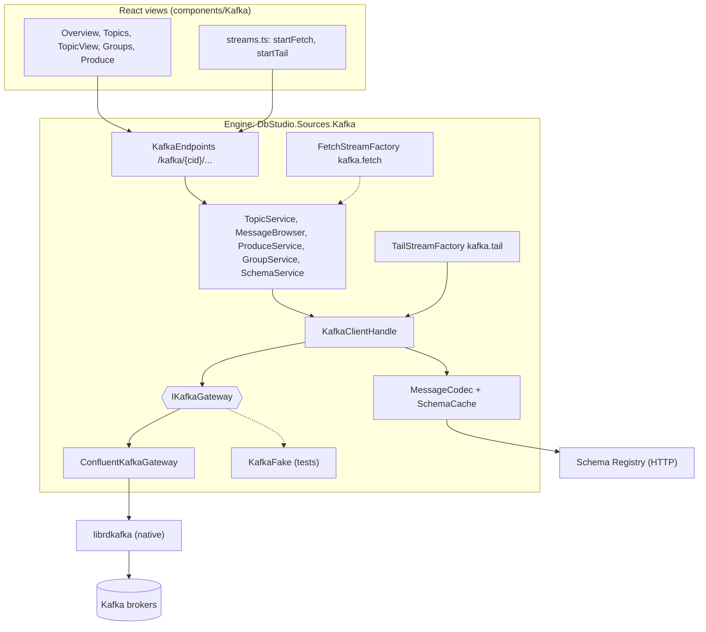
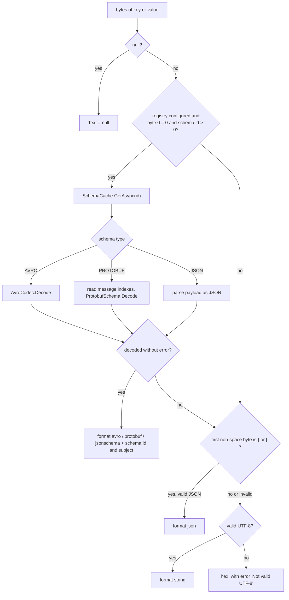
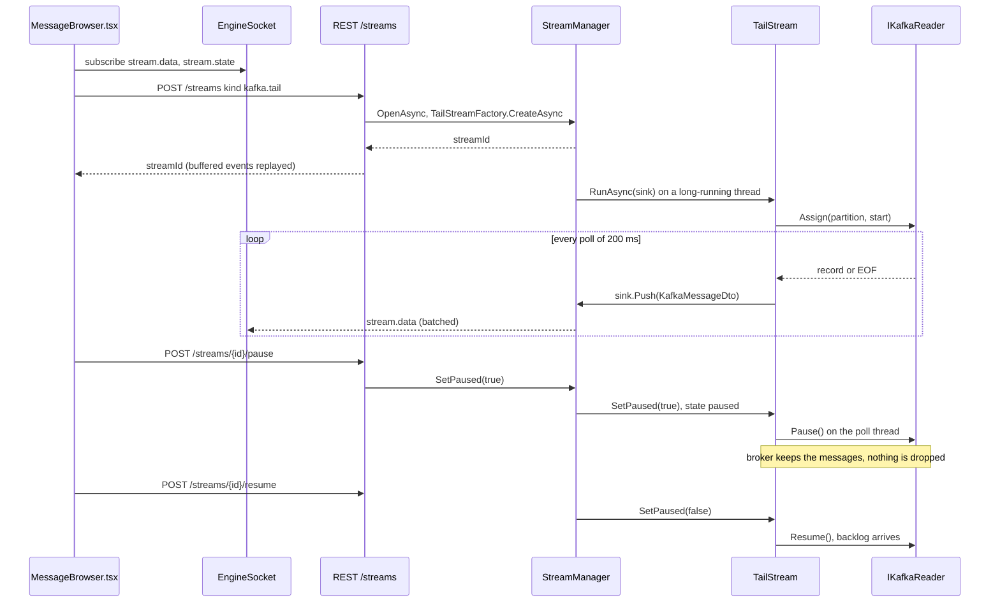
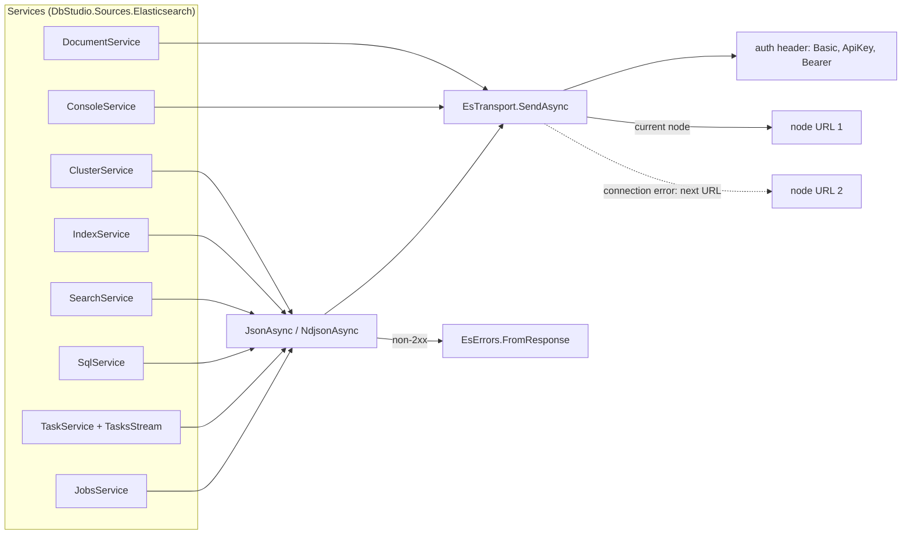
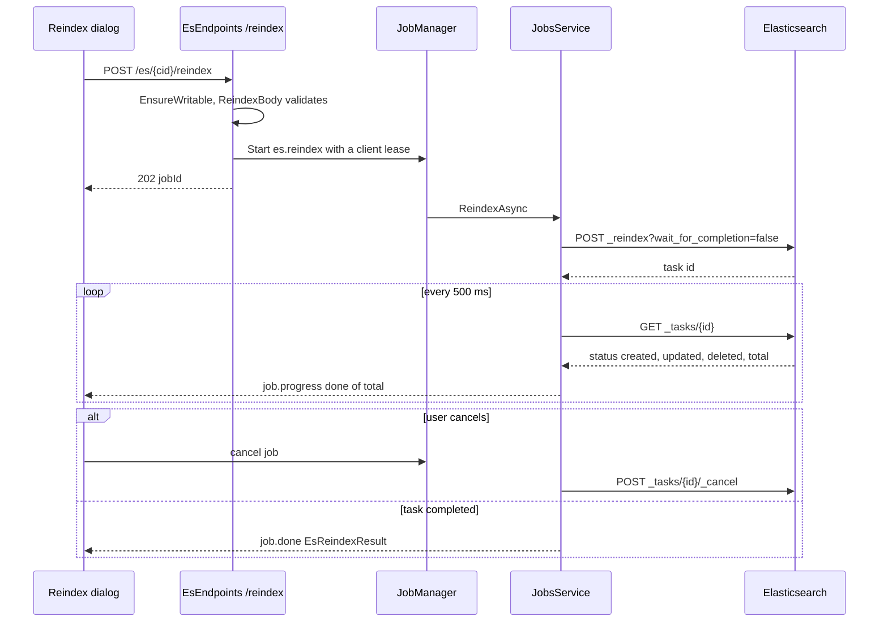

# 18. Sources II: Kafka and Elasticsearch

> **Level:** L2 practitioner → L3 senior | **Part:** II | **Code read at:** `b638b7b` (Rowlit 1.6.3 feature set; `version.json` in this tree says 1.7.0)
> **Language:** English | [فارسی](../../fa/part2/18-sources-kafka-elasticsearch.md) | Previous: [17. Sources I: Redis and MongoDB](./17-sources-redis-mongo.md) | Next: [19. Security model and secrets](./19-security-and-secrets.md)
> **In one sentence:** Rowlit talks to Kafka through Confluent's librdkafka behind a small gateway interface and to Elasticsearch/OpenSearch through a plain HTTP client, and turns both into browsable trees, message and document grids, live streams and background jobs.
> **You will learn:**
> - how a Kafka connection is configured, opened and kept, and why the native library librdkafka needs special packaging;
> - how the message browser picks start offsets, decodes Avro/Protobuf/JSON through the Schema Registry, and how the live tail pauses without losing messages;
> - how producing, consumer-group lag and offset reset work, and what the engine refuses on a read-only connection;
> - how the Elasticsearch transport fails over between nodes, maps errors, and protects document edits with `seq_no` / `primary_term`;
> - how search, the Dev Tools console, SQL with cursors, the tasks stream and the reindex / import / export jobs are built.
> **Prerequisites:** [17. Sources I: Redis and MongoDB](./17-sources-redis-mongo.md) (the non-relational family), [06. The WebSocket event protocol](./06-websocket-protocol.md) (streams and jobs on the wire). Part I background: [I-16 NoSQL families](../part1/16-nosql-families.md) (Kafka and Elasticsearch internals).

## 1. The idea (beginner)

Kafka and Elasticsearch are not databases you query with SQL, but people use a database IDE to look inside them every day. **Apache Kafka** is an event log: programs called producers append messages to named **[topics](../glossary.md#topic)**, each topic is split into **[partitions](../glossary.md#partition-kafka)**, and every message in a partition has a position number, its **[offset](../glossary.md#offset)**. Programs called consumers read the log, and a **[consumer group](../glossary.md#consumer-group)** remembers how far each group has read. The questions you ask a Kafka cluster are therefore "what is in this topic right now", "show me the messages from 10:00", "how far behind is the billing service" and "send this test message".

**Elasticsearch** (and its fork **[OpenSearch](../glossary.md#opensearch)**) is a search engine. It stores JSON documents in *indices* (an Elasticsearch index is closer to a table than to a relational index), builds an **[inverted index](../glossary.md#inverted-index)** over their words and answers searches written in a JSON language, the **[query DSL](../glossary.md#query-dsl)**. The questions here are "which indices exist and how big are they", "find the orders that mention *Tehran*", "edit this one document", "run this raw REST request" and "copy this index into a new one".

Rowlit answers both kinds of question with the same machinery it uses for Redis and MongoDB (chapter [17](./17-sources-redis-mongo.md#21-the-non-relational-family)): a provider that knows how to test and open a connection, one long-lived client per connection kept by the engine, REST endpoints for the short questions, WebSocket **streams** for live data and **jobs** with progress for long work. This chapter follows that machinery through the Kafka package (`engine/src/DbStudio.Sources.Kafka`) and the Elasticsearch package (`engine/src/DbStudio.Sources.Elasticsearch`), then through the React views that sit on top.

## 2. How it works (practitioner)

### 2.1 Where the two packages plug in

Both packages are ordinary engine modules. `KafkaModule` registers the provider, seven singleton services and two keyed stream factories, `kafka.tail` and `kafka.fetch` (`KafkaModule.cs:16-34`). `ElasticsearchModule` registers its provider, eight services and one stream factory, `es.tasks` (`ElasticsearchModule.cs:17-35`). Neither module knows about the other; the engine finds both by reflection (chapter [07](./07-engine-modules-and-di.md)). The providers implement `IDataSourceProvider`: Kafka is `Id "kafka"`, `SourceKind.Stream` (`KafkaProvider.cs:24-26`); Elasticsearch is `Id "elasticsearch"`, `SourceKind.Search` (`EsProvider.cs:20-22`). `SourceClientManager` then keeps one client per connection, closes idle clients and publishes `source.client` events; that shared part is described once in [17 §2.1](./17-sources-redis-mongo.md#21-the-non-relational-family) and not repeated here.

**Figure 18.1 — The Kafka package: services above a driver seam.**

The figure shows the most important design choice of the Kafka package: **the services never see a Confluent type**. Everything they need from the driver is behind `IKafkaGateway` (`IKafkaGateway.cs:72-115`), a plain C# interface made of records such as `KTopicMeta`, `KWatermarks`, `KRecord` and `KGroupDescription` (`IKafkaGateway.cs:7-57`). The production implementation is `ConfluentKafkaGateway`; the test project has `KafkaFake`, an in-memory broker model with partitions, watermarks, timestamps, groups and error injection (`engine/tests/DbStudio.Sources.Kafka.Tests/KafkaFake.cs`). This is the same **[gateway seam](../glossary.md#gateway-seam)** the Mongo package uses (chapter [17](./17-sources-redis-mongo.md)); the comment at `IKafkaGateway.cs:3-5` says why: "every behaviour is unit-testable".

### 2.2 Kafka: settings, test and open

The connection form is a `ConnectionFormSpec` (`KafkaProvider.cs:29-58`): bootstrap servers, a security protocol (`PLAINTEXT`, `SSL`, `SASL_PLAINTEXT`, `SASL_SSL`), a SASL mechanism (`PLAIN`, `SCRAM-SHA-256`, `SCRAM-SHA-512`, `OAUTHBEARER`), user and password, three certificate files and a key password, the Schema Registry URL with its user and secret, a client id (default `Rowlit`), a request timeout (default 15 000 ms) and an "Extra librdkafka settings" text. The form also carries a note that SSH tunnels are not available for Kafka, because brokers advertise their own addresses and one forwarded port cannot reach them (`KafkaProvider.cs:27`).

`KafkaSettings.From` validates the profile and answers `400 VALIDATION` naming the field (`KafkaSettings.cs:38-87`):

- every bootstrap entry must be `host:port` with a port from 1 to 65 535 (`KafkaSettings.cs:43-48`);
- `SASL_*` protocols need a user unless the mechanism is `OAUTHBEARER` (`KafkaSettings.cs:58-59`);
- the request timeout must be 1 000 to 300 000 ms (`KafkaSettings.cs:62-63`);
- the registry URL must be an absolute `http(s)` URL (`KafkaSettings.cs:66-67`);
- the extra settings are `key=value` pairs separated by `;` or new lines, and **a key that contains `password` or `secret` is refused**, because secrets belong in the password fields that the OS secret store keeps (`KafkaSettings.cs:90-105`). The SASL password, the key password and the registry secret are password-typed fields, so `ConnectionStore` never writes them into `connections.json` (`KafkaProvider.cs:13-16`, chapter [19](./19-security-and-secrets.md)).

`ToClientConfig` turns the settings into the librdkafka dictionary shared by the admin client, consumers and producers (`KafkaSettings.cs:108-139`). Three entries are deliberate: `reconnect.backoff.max.ms = 5000` so an unreachable broker is retried quickly instead of for ever (`KafkaSettings.cs:118`), `socket.connection.setup.timeout.ms` capped at 30 s (`KafkaSettings.cs:116`), and `allow.auto.create.topics = false`, so a typo or a tab left open on a deleted topic answers "unknown topic" instead of silently creating it (`KafkaSettings.cs:120-122`).

**Test** (`KafkaProvider.TestAsync`, `KafkaProvider.cs:64-103`) builds a gateway, asks `DescribeCluster`, falls back to plain metadata on old brokers or when the login may not describe the cluster (`KafkaProvider.cs:136-141`), reads the broker version from the controller's `inter.broker.protocol.version` within 5 s (`KafkaProvider.cs:161-180`) and probes the Schema Registry. A registry failure does **not** fail the test; it is appended as a warning to the server text (`KafkaProvider.cs:145-156`), so you see `Kafka 3.8 (3 brokers, controller 1); warning: …`. When the native library itself cannot load, the test answers `ENGINE_ERROR` with detail `librdkafka-missing` instead of a provider error (`KafkaProvider.cs:92-97`); the CI smoke uses that difference (§2.10).

**Open** (`KafkaProvider.cs:105-129`) creates the long-lived `KafkaClientHandle`: the gateway (one shared admin client plus cached producers), the registry client, the `MessageCodec` with its schema cache, and a `KafkaLogBuffer` of 2 000 entries that collects librdkafka log and error callbacks (`KafkaClientHandle.cs:16-27`, `KafkaLogBuffer.cs:12`). Kafka has no server log over its protocol, so the Logs view shows this client log instead (`KafkaLogBuffer.cs:7-11`, chapter [21](./21-logs-activity-resources.md)). If the broker version lookup timed out at open time, `TryResolveVersionAsync` tries again when the overview is read, at most once a minute (`KafkaClientHandle.cs:46-61`). `PingAsync` is a `DescribeCluster` with a 10 s budget (`KafkaClientHandle.cs:72-85`).

Every write path calls `EnsureWritable`, which throws `403 READ_ONLY` naming the action on a read-only connection (`KafkaClientHandle.cs:66-70`). The writes are: create topic, alter configs, add partitions, delete, purge, produce, offset reset and delete group (`KafkaEndpoints.cs:27-32`).

### 2.3 Kafka: the gateway and its errors

`ConfluentKafkaGateway` holds one `IAdminClient` for the connection, one producer per compression codec, and creates short-lived consumers on demand (`ConfluentKafkaGateway.cs:6-30`). Each consumer it creates for browsing or tailing is a **reader that never joins a group**: a random `group.id` of the form `dbstudio-<purpose>-<guid>`, auto-commit and offset store off, partition-EOF events on, and a 16 MB fetch limit (`ConfluentKafkaGateway.cs:132-146`). The reader is assigned partitions manually (`Assign`), so looking at a topic never moves any real group's committed offsets and never triggers a rebalance.

Admin calls run through one helper, `Run` (`ConfluentKafkaGateway.cs:235-249`). It retries the three group-coordinator errors a broker answers while a coordinator moves or loads (`NOT_COORDINATOR`, `COORDINATOR_NOT_AVAILABLE`, `COORDINATOR_LOAD_IN_PROGRESS`) up to `TransientAttempts = 6` times with a back-off of 150 ms × attempt (`ConfluentKafkaGateway.cs:232-260`). Anything else is translated to a `KafkaGatewayException` with a `KafkaErrorKind` (`ConfluentKafkaGateway.cs:279-299`), using the most specific error inside Confluent's per-result exception lists (`EffectiveError`, `ConfluentKafkaGateway.cs:263-276`). `KafkaErrors.ToEngine` then maps the kind to the engine's error envelope (`KafkaErrors.cs:8-21`):

| Gateway kind | REST answer |
|---|---|
| `Unreachable`, `Timeout`, `Authentication` | 503 `SOURCE_UNAVAILABLE` |
| `UnknownTopic`, `UnknownGroup` | 404 `NOT_FOUND` |
| `TopicExists` | 409 `VALIDATION` (field `name`) |
| `GroupNotEmpty` | 409 `GROUP_ACTIVE` |
| `Authorization` | `PRIVILEGE` ("Kafka ACL for this operation") |
| `InvalidRequest`, `PolicyViolation` | 400 `VALIDATION` |
| anything else | 422 `PROVIDER_ERROR` |

The endpoint group adds a filter that catches any gateway exception that escaped a service, so no Confluent message ever reaches the UI unmapped (`KafkaEndpoints.cs:40-45`).

### 2.4 Kafka: cluster, topics and configs

`ClusterService.ClusterAsync` combines `DescribeCluster` with full metadata and counts brokers, topics, partitions, under-replicated partitions (ISR smaller than the replica list) and offline partitions (no leader) (`TopicService.cs:10-26`). Internal topics are recognised by name: `__*`, `_confluent*` and `_schemas` (`ConfluentKafkaGateway.cs:45`); the topic list hides them unless `includeInternal` is set (`TopicService.cs:55-58`).

The topic list estimates message counts as the sum of `high − low` watermarks per partition. The **[watermarks](../glossary.md#watermark)** are read with two `ListOffsets` calls (earliest and latest, `ConfluentKafkaGateway.cs:100-117`), and the whole estimate has a 5 s budget: if it runs out, the counts are simply `null` and the list still appears (`TopicService.cs:41`, `59-67`). The estimate is an upper bound on a compacted or deleted-from topic, which is why the UI calls it an estimate.

Topic names are validated with the same rule Kafka uses, `^[A-Za-z0-9._-]{1,249}$` and not `.` or `..` (`TopicService.cs:43-53`). Create accepts 1 to 10 000 partitions (`TopicService.cs:118`); add partitions requires a larger total, because partitions cannot be removed (`TopicService.cs:142-144`). **Purge** deletes every record before the current high watermark of each chosen partition with `DeleteRecords` and returns the new low watermarks (`TopicService.cs:156-166`); the UI makes you type the topic name first. Config edits use `IncrementalAlterConfigs` with separate `set` and `delete` lists and refuse a name that is in both (`TopicService.cs:126-136`, `ConfluentKafkaGateway.cs:83-91`). Sensitive config values are never sent to the UI: `KafkaConfigEntryDto.From` nulls them (`KafkaModels.cs:20-21`).

### 2.5 Kafka: browsing messages

Opening a topic's **Messages** tab and pressing **Fetch** starts a browse. The request (`KafkaFetchRequest`, `KafkaModels.cs:48-49`) says which partitions, where to start (`latest` with a count, `oldest`, an `offset`, or a `timestamp`), how many messages (default 200, at most 5 000), how to decode key and value, an optional search text, a byte budget (default 10 MB, 1 KB to 64 MB) and a timeout (default 8 s, 0.5 to 120 s) (`MessageBrowser.cs:8-52`).

`MessageBrowser.PlanAsync` turns the start into one range `[Start, End)` per partition, with `End` fixed to the high watermark at the moment the fetch begins (`MessageBrowser.cs:55-90`):

| Start kind | First offset of each partition |
|---|---|
| `latest` (count N) | `max(low, high − N)` |
| `oldest` | `low` |
| `offset` | the offset, clamped to `[low, high]` |
| `timestamp` | `OffsetsForTimes` result, else `high`, clamped |

Fixing `End` at the start matters: on a busy topic the browse would otherwise never finish, because new messages keep arriving. The consume loop (`MessageBrowser.cs:103-201`) stops when every partition reached its end (by offset or by an EOF event), the limit, the byte budget, the timeout, or when the stream is closed. Two details come from real clusters. First, the consumer's first poll includes connecting to the partition leaders, which can take seconds; the timeout clock therefore starts at the first record or EOF, and until then a separate 10 s `StartupGrace` applies (`MessageBrowser.cs:66-67`, `123-145`). Second, "latest N" over several partitions cannot know the global newest messages in advance, so it collects every matching message of the ranges and keeps the N newest by timestamp at the end (`MessageBrowser.cs:189-198`).

Search runs on the **decoded** text (`FullText`), not on raw bytes, so a search for a customer name finds it inside an Avro value too (`MessageBrowser.cs:163-167`). Progress is reported every 100 scanned messages and every 500 skipped ones (`MessageBrowser.cs:165`, `185`).

**Why a job plus a stream.** A browse can return thousands of messages, and the UI wants to show the first ones immediately. `POST /kafka/{cid}/topics/{topic}/messages` therefore answers `202 { jobId, streamId }` (`KafkaEndpoints.cs:91-130`): the messages travel on a `kafka.fetch` stream, the progress and the final `KafkaFetchResult` (fetched, scanned, partitions done, timed out, truncated) travel as `job.progress` / `job.done`. The two are tied together by a **[fetch relay](../glossary.md#fetch-relay)**: the endpoint registers a relay with a random token, opens the stream with that token as its only parameter, and the job waits for the stream's sink before pushing (`TailStream.cs:107-165`). `FetchStreamFactory` refuses a `kafka.fetch` stream that was not opened this way (`TailStream.cs:155-165`). Closing the stream cancels the job through `relay.Closed` (`KafkaEndpoints.cs:112`, `120-123`), and the job waits 150 ms before the first batch so the UI has time to subscribe (`KafkaEndpoints.cs:116-117`).

On the UI side, `startFetch` subscribes to the four event types **before** it sends the request and buffers up to 5 000 events of unknown ids, then replays them once the 202 names the ids (`ui/src/components/Kafka/streams.ts:10-37`, `51-104`). A fast fetch can finish before the 202 is processed; this buffer is what keeps those messages. If the stream's end event is missed after `job.done`, a 3 s timer finishes anyway (`streams.ts:80-81`).

"Load full" on a truncated value calls `GET …/messages/{partition}/{offset}`, which reads exactly one record with a fresh reader and answers 404 when the offset was compacted or deleted (`MessageBrowser.cs:203-233`).

### 2.6 Kafka: decoding with codecs and the Schema Registry

A Kafka message is bytes. To show it, the engine needs a **[codec](../glossary.md#codec)**, a rule that turns bytes into text and back. `KafkaFormats` lists nine decoders (`string`, `json`, `hex`, `int32`, `int64`, `avro`, `protobuf`, `jsonschema`, `auto`) and six encoders for produce (`KafkaFormats`, `MessageCodec.cs:9-23`). The value decoder defaults to `auto`, the key decoder to `string` (`TailStream.cs:24-25`, `MessageBrowser.cs:50`).

**Figure 18.2 — How the `auto` decoder chooses a codec.**

The schema-based formats use the **[Confluent wire format](../glossary.md#confluent-wire-format)**: byte 0 is a magic `0`, bytes 1 to 4 are the big-endian schema id, and the payload follows; Protobuf adds a short list of message indexes that says which message type of the `.proto` file was used (`MessageCodec.cs:25-30`, `119-125`, `ProtobufCodec.cs:549-567`). The codec never throws on bad data: a decode failure returns the hex form with an `Error` text so the grid can show a warning badge (`MessageCodec.cs:54-57`, `107-110`). Text longer than the engine's wire limit is cut to the `{$trunc,len}` form unless "full" was asked for, and hex is shown for at most 16 KB of bytes (`MessageCodec.cs:28-29`, `34`, `156-162`).

`SchemaCache` keeps parsed schemas per id, because a registry schema never changes for a given id (`SchemaCache.cs:10-35`). It resolves **references** depth-first, each once (Avro named types, Protobuf imports), before parsing (`SchemaCache.cs:52-53`, `69-79`). A load that fails is removed from the cache, so a registry outage heals by itself (`SchemaCache.cs:29-33`). The registry client is a thin `HttpClient` with Basic auth and the registry's media type (`SchemaRegistryService.cs:35-55`). The Avro codec writes plain JSON, not Avro's JSON encoding: unions are unwrapped, bytes are base64, logical types become ISO strings or numbers (`AvroCodec.cs:11-15`). The Protobuf codec works **without generated classes**: it parses the registry's `.proto` text with protobuf-net.Reflection and walks the binary message field by field into proto3-style JSON (`ProtobufCodec.cs:11-16`). The project file explains a packaging wrinkle this causes: Google.Protobuf and protobuf-net both define descriptor types, so Google.Protobuf is referenced only through an extern alias (`DbStudio.Sources.Kafka.csproj:21-23`).

The **Schema Registry** folder in the explorer lists subjects; for the first 200 subjects it also fetches the latest version and type in parallel (8 at a time) within a 5 s budget, best effort (`SchemaRegistryService.cs:158-168`).

### 2.7 Kafka: the live tail and pausing

The **[tail](../glossary.md#tail)** shows new messages as they arrive. It is a `kafka.tail` stream opened with `POST /streams` and params `{ topic, partitions, from: 'latest' | 'offsetMap', offsets, keyFormat, valueFormat, filter }` (`TailStream.cs:9-40`). With `latest`, each partition starts at its high watermark; with `offsetMap`, at the given offset clamped to the watermarks (`TailStream.cs:33-38`).

**Figure 18.3 — A live tail with pause and resume.**

`TailStream` is an `IPausableEngineStream` (`TailStream.cs:64-65`). That interface matters because of how `StreamManager` treats a paused stream: for an ordinary stream, items pushed while paused are **dropped and counted**; a stream that implements `IPausableEngineStream` is told to pause itself instead (`StreamManager.cs:40-55`, `243-254`, `515`). The tail pauses the Kafka consumer itself, so the broker simply keeps the messages and the backlog arrives on resume (`TailStream.cs:9-13`). There is a threading subtlety: the reader is not thread-safe and must be paused from the thread that polls it (`IKafkaGateway.cs:117`). `SetPaused` therefore only flips a volatile flag; the poll loop notices the change and calls `Pause()` / `Resume()` itself, sleeping 100 ms between checks while paused (`TailStream.cs:71`, `76-104`). The loop runs on a `LongRunning` task because `Consume` blocks a thread for up to 200 ms per poll (`TailStream.cs:73-74`, `95`).

The tail's `filter` is a case-insensitive substring match on the decoded key or value (`TailStream.cs:100-101`). The UI keeps at most `TAIL_CAP = 10 000` messages while tailing and drops the oldest (`MessageBrowser.tsx:27-28`). Stream ownership, batching into `stream.data` frames and the cleanup of orphaned streams are the `StreamManager`'s job (chapter [06](./06-websocket-protocol.md)).

### 2.8 Kafka: producing

`POST …/topics/{topic}/produce` (`ProduceService.cs:20-60`) accepts up to 1 000 messages and 16 MB per request, each with a key, value, headers and an optional partition, plus a key format, value format, compression (`none`, `gzip`, `snappy`, `lz4`, `zstd`) and, for schema formats, a subject and version (number or `latest`) for key and value independently (`ProduceService.cs:16-18`, `62-81`). The UI's **Repeat N times** with `${i}` substitution builds those messages on the client and is capped at the same 1 000 (`Produce.tsx:19-29`).

The engine validates the subject's schema type against the chosen format (an Avro subject cannot encode `protobuf`), encodes with `MessageCodec.Encode` (`MessageCodec.cs:193-239`) and sends the batch through a cached producer with `acks=all`, idempotence off and a message timeout of at least 10 s, flushed within 10 s (`ConfluentKafkaGateway.cs:148-167`, `202-220`). Each result returns partition, offset, timestamp and **warnings**: the Avro encoder reports every input field the record schema does not have, because Avro writes only the schema's fields and a typo such as `amout` would otherwise vanish silently (`AvroCodec.cs:52-56`, `171-175`). The Produce view shows those warnings in a banner after a successful send (`Produce.tsx:90-112`).

### 2.9 Kafka: consumer groups, lag and offset reset

`GroupService.ListAsync` lists groups, describes them in chunks of 50, then computes **[lag](../glossary.md#consumer-lag)** for each group as the sum over its partitions of `high − committed` (`GroupService.cs:17-74`). Committed offsets are read in parallel with at most 8 requests at a time, then one watermark query covers every partition involved; the whole lag pass has a 10 s budget, and a group whose lag could not be computed in time shows `null`, not a wrong number (`GroupService.cs:14`, `28-51`). The group detail lists members with their assignments and each partition's committed, low, high and lag (`GroupService.cs:76-96`).

**[Offset reset](../glossary.md#offset-reset)** (`GroupService.cs:117-184`) moves a group's committed offsets to `earliest`, `latest`, an `offset`, a `timestamp`, or `shiftBy` a signed number from the committed position. Every target is clamped to the partition's `[low, high]` (`GroupService.cs:186-194`). The targets are explicit partitions, a whole topic, or every partition the group has committed. Two safety rules apply:

1. A **[dry run](../glossary.md#dry-run)** is always allowed, even on a read-only connection; it returns the from/to rows without changing anything. The UI's Reset dialog runs the dry run first and shows the preview table (`GroupService.cs:142-146`, `ui/src/components/Kafka/dialogs.tsx:154-200`).
2. Applying needs a writable connection **and** a group that is not active. A group with members, or in `Stable` / `PreparingRebalance` / `CompletingRebalance`, answers `409 GROUP_ACTIVE` listing its members (`GroupService.cs:15`, `111-115`). Kafka itself would reject the change for a live group; Rowlit checks first so the message is clear.

A group that does not exist yet is treated as `Empty`, because Kafka creates a group when offsets are committed for it (`GroupService.cs:196-204`). Delete follows the same active-group rule (`GroupService.cs:206-212`).

### 2.10 Kafka: the native library

Confluent.Kafka 2.6.1 is a .NET wrapper around **[librdkafka](../glossary.md#librdkafka)**, a C library (`DbStudio.Sources.Kafka.csproj:17-20`). Native code inside a single-file, self-contained engine is the packaging risk that decision D8 of `docs/PLAN-M2.md` deals with. What the code does today (`KafkaNative.cs:6-56`):

- **win-x64**: the single-file engine self-extracts `librdkafka.dll` and its dependencies (OpenSSL, libcurl, zlib, zstd, the VC runtime) to `%TEMP%\.net\…` and the runtime's native probing finds them (`KafkaNative.cs:7-9`).
- **macOS**: `librdkafka.dylib` ships next to the apphost, is signed with the app, and is **loaded explicitly** from `AppContext.BaseDirectory` with `Library.Load` (`KafkaNative.cs:9-11`, `22-45`). The plan text said Confluent's probing would find it in the app directory; the code comment explains that the probe depends on an assembly location that is empty in single-file apps, so the code does not rely on it.
- `ConfluentKafkaGateway`'s constructor calls `KafkaNative.EnsureLoaded()` before building any client (`ConfluentKafkaGateway.cs:23`).

`GET /api/v1/kafka/library` reports the librdkafka version, its debug contexts and the path it was loaded from; calling it forces the native load (`KafkaEndpoints.cs:37-38`, `KafkaModels.cs:120-121`). The CI step `scripts/ci/kafka-native-smoke.mjs` starts a **published** engine, calls that endpoint, then tests a Kafka connection to `127.0.0.1:1`, which must fail with a librdkafka error and never with `librdkafka-missing`; on macOS it also checks that the dylibs sit next to the apphost with the right architecture and only system dependencies (`kafka-native-smoke.mjs:2-21`). The packaging itself is chapter [24](./24-build-ci-release-contributing.md).

### 2.11 Elasticsearch: settings and the transport

The Elasticsearch connection form (`EsProvider.cs:27-48`) has one required **URL** field that accepts several node URLs separated by commas, an authentication choice (`none`, `basic`, `apiKey`, `bearer`, each showing only its own fields), "Skip TLS verification", a CA certificate file, a connect timeout (default 10 s) and a flavor (`auto`, `elasticsearch`, `opensearch`). `EsSettings.ParseUrl` adds `http://` when no scheme is given and refuses a query, a fragment, or user and password inside the URL (`EsSettings.cs:70-83`). The request timeout is 60 s (`EsSettings.cs:19`). Unlike Kafka, an Elasticsearch connection can go through an SSH tunnel, with one node URL (`EsProvider.cs:23`).

There is no official client library underneath. The comment on `EsTransport` cites decision D4 of the batch-3 plan: **plain `HttpClient` plus `System.Text.Json`** (`EsTransport.cs:35-40`). That batch plan is not in the repository; as far as the code shows, the reason is that one small transport serves Elasticsearch 7/8 and OpenSearch 1/2 alike (`EsProvider.cs:10-15`), while the official clients are tied to one product and major version.

**Figure 18.4 — The Elasticsearch transport and the services above it.**

`EsTransport.SendAsync` (`EsTransport.cs:109-158`) sends one request to the current node. On a connection error it tries the next URL, and the node that answers becomes the new current one (`Volatile.Write(ref _current, index)`, `EsTransport.cs:138`), so requests **stick to the last node that worked**. Two failures are deliberately not retried: a **timeout** (the request may already have executed on the server, and resending a write could apply it twice) and a **TLS error** (the next node has the same certificate setup) (`EsTransport.cs:145-155`). Both end as `503 SOURCE_UNAVAILABLE` with a readable message; `Describe` even recognises the .NET "frame size" error you get when `https://` meets a plain-HTTP server and suggests `http://` (`EsTransport.cs:184-198`). Paths are joined with a `./` prefix so a first segment such as `remote:logs-*` (cross-cluster search) is not read as a URI scheme (`EsTransport.cs:128-129`). The handler turns proxies off, enables gzip, and with a CA file builds a custom-root chain while still failing on a host-name mismatch (`EsTransport.cs:76-107`).

`SendAsync` returns any HTTP status; the JSON helpers turn non-2xx answers into engine errors through `EsErrors.FromResponse` (`EsTransport.cs:200-226`). `EsErrors` reads Elasticsearch's error body (`type`, `reason`, `root_cause`, `caused_by`, or OpenSearch's `{ message }`) and maps the status (`EsErrors.cs:16-30`): 404 → `NOT_FOUND`, 409 → 409 `PROVIDER_ERROR` (a version conflict), 401/403 → `PRIVILEGE`, anything else → 422 `PROVIDER_ERROR`; the detail keeps the status, the Elasticsearch error type and the root cause.

Test and open read `GET /` and `_cluster/health`; the flavor comes from the profile or from `version.distribution` / the tagline of `GET /` (`EsProvider.cs:99-127`). The server text looks like `Elasticsearch 8.15.3 (cluster docker-cluster, green, 1 node)`. The resulting `EsClient` keeps the transport, flavor and version, offers `IsOpenSearch` and `Major`, and has the same `EnsureWritable` rule as Kafka (`EsClient.cs:7-52`).

### 2.12 Elasticsearch: indices and documents

`IndexService` serves the explorer and the index tabs: indices (with hidden and system indices behind a toggle), aliases, data streams, templates, an index detail with settings, mappings, `_cat/shards` and `_stats`, the field list from `_mapping`, and create / delete / open / close / refresh / flush / forcemerge / clear cache, settings, mappings and aliases changes (`IndexService.cs:7-367`). One counting detail is worth knowing: `_cat/indices` `docs.count` counts **Lucene** documents, where every nested object is its own document. To show the numbers users expect, the service runs one `_msearch` of size-0 searches over at most 500 indices and replaces the counts, best effort (`IndexService.cs:31-34`); the cluster overview uses `_count` for the same reason (`ClusterService.cs:14-16`).

The documents panel lists hits as a grid whose columns are the flattened `_source` (`ui/src/es/docs.ts`) and opens one document for editing. Editing uses **[optimistic concurrency](../glossary.md#seq-no-primary-term)**: every search asks for `seq_no_primary_term` (`SearchService.cs:55`), the UI keeps each hit's `_seq_no` and `_primary_term`, and saving sends them back as `if_seq_no` / `if_primary_term` (`SearchService.cs:148-170`, `DocumentsPanel.tsx:134`). If someone changed the document meanwhile, Elasticsearch answers 409, the engine maps it to `409 PROVIDER_ERROR`, and the panel shows a conflict bar with **Reload** and **Overwrite**; Overwrite saves again without the guard (`DocumentsPanel.tsx:159`, `302-305`). Writes default to `refresh=wait_for`, so the grid sees the change on its next search (`SearchService.cs:191-197`). Delete sends the same guard (`SearchService.cs:172-189`).

### 2.13 Elasticsearch: search, console and SQL

**Search** (`SearchService.cs:8-57`) passes the user's query DSL body through almost unchanged. The engine adds `seq_no_primary_term`, exact totals (`track_total_hits: true`) unless the body says otherwise, applies `from` / `size` / `search_after` overrides from the paging toolbar (a `search_after` removes `from`), and caps `size` at 10 000 with a `Capped` flag in the answer (`SearchService.cs:14`, `41-46`). The response is mapped to hits (score, seq_no, highlight, explanation, matched queries), aggregations, shard counts and profile (`SearchService.cs:59-118`). The UI shows bucket aggregations as tables with bars and metric aggregations as tiles (`ui/src/es/aggs.ts`).

The editor's query DSL completion lives in `ui/src/es/dsl.ts`: a lenient scanner finds whether the cursor is at a key or a value and the path of keys above it, a small grammar maps that path to a context (`query`, `aggs`, `sort`, `highlight`, `_source`, a field clause…), and the context lists the keys, field names from the mapping and enum values to offer (`dsl.ts:1-3`, `136-152`, `278-290`). It is pure TypeScript; `components/Elasticsearch/language.ts` adapts it to Monaco.

The **[Dev Tools console](../glossary.md#dev-tools-console)** imitates Kibana's: requests are `METHOD /path` lines followed by an optional JSON or NDJSON body (`ui/src/es/console.ts:1-2`), Ctrl+Enter runs the request at the cursor (`ConsoleView.tsx:1-4`). The engine side, `ConsoleService.RunAsync`, sends one raw request with a 5-minute timeout and cuts the answer at 5 MB (`ConsoleService.cs:25-53`, `EsTransport.cs:44`). Because the console can call any API, its input is sanitised (`ConsoleService.cs:55-79`): only `GET`, `POST`, `PUT`, `DELETE`, `HEAD`; the path must be relative (no scheme or host); no `.` or `..` segments, line breaks, tabs, backslashes or `#`. Date-math index names such as `<logs-{now/d}>` contain a `/` that belongs to the name, so it is sent as `%2F` (`ConsoleService.cs:67-70`). Bodies to `_bulk` and `_msearch` are normalised to one JSON value per line (`ConsoleService.cs:107-135`).

On a **read-only** connection the console allows `GET` and `HEAD`, and `POST` only to a list of APIs that read: `_search`, `_msearch`, `_count`, `_mget`, `_field_caps`, `_explain`, `_analyze`, `_validate`, `_sql`, `_eql`, `_async_search`, `_pit`, ES|QL `_query`, `_knn_search` and the OpenSearch SQL/PPL plugins, among others (`ConsoleService.cs:16-23`, `99-105`). The API is found as the first path segment that starts with `_` (`ConsoleService.cs:86-97`).

**SQL** (`SqlService.cs:9-56`) uses Elasticsearch's `_sql?format=json` or OpenSearch's `_plugins/_sql?format=jdbc`, and normalises both answer shapes (`columns`/`rows` vs `schema`/`datarows`) into one `EsSqlResponse` (`SqlService.cs:24-40`). The fetch size defaults to 1 000 and is clamped to 1…10 000 (`SqlService.cs:21`). A large result comes with a **[cursor](../glossary.md#cursor-es-sql)**; "More rows" sends the cursor back, and the UI **closes** the cursor through `/sql/close` when the result is replaced or fully read, so the server can free its context early (`SqlService.cs:42-47`, `ui/src/components/Elasticsearch/SqlView.tsx:40`, `55`). "Translate to DSL" calls `_sql/translate` or `_plugins/_sql/_explain` (`SqlService.cs:49-56`).

### 2.14 Elasticsearch: tasks and jobs

Elasticsearch runs long operations as server-side **[tasks](../glossary.md#task-es)**. `TaskService` lists `_tasks?detailed` and cancels one with `_tasks/{id}/_cancel` (writable connections only) (`SqlService.cs:60-119`). The Tasks view shows them live through an `es.tasks` stream while the tab is visible (`TasksView.tsx:1-2`, `60`). The stream polls every `intervalMs` (default 2 000, at least 1 000, at most 60 000), validates the filter once before it starts so a bad filter is a `400`, and ends with an error only after three unreachable polls in a row (`TasksStream.cs:7-47`).

Three operations run as engine **jobs** (`202 { jobId }`, then `job.progress` / `job.done`, chapter [06](./06-websocket-protocol.md)): reindex, import and export. Each job holds a **lease** on the connection's source client, so the idle reaper cannot close the client while the job is running (`EsEndpoints.cs:47-62`). The UI remembers recent `job.done` events because a fast job can finish before its 202 arrives (`ui/src/components/Elasticsearch/jobs.ts:1-2`, `20-27`).

**Figure 18.5 — A reindex job.**

**[Reindex](../glossary.md#reindex)** (`JobsService.cs:27-100`) validates first, in the endpoint, so a bad request is a `400` before any job starts (`EsEndpoints.cs:190-197`): source and destination must differ, `conflicts` is `abort` or `proceed`, `slices` is 1 to 64, an optional query must be a DSL object, an optional script is Painless. Then it starts the reindex with `wait_for_completion=false`, so Elasticsearch runs it as a task, and polls `_tasks/{id}` every 500 ms, reporting created + updated + deleted + version conflicts against the total (`JobsService.cs:23`, `48`, `57-88`). Cancelling the job cancels the server task too, best effort, with its own 10 s budget (`JobsService.cs:90-99`). Without that step, closing the dialog would leave the cluster copying documents.

**Import** (`JobsService.cs:104-184`) reads NDJSON, JSON or CSV from a path or uploaded text and sends **[`_bulk`](../glossary.md#bulk-api)** requests of `batchSize` documents (default 1 000, at most 50 000) and never more than 5 MB each, with `refresh=false` during the load and one `_refresh` at the end. With an id field, a document without a value is reported as a failure rather than given a generated id, because a re-import would otherwise duplicate it (`JobsService.cs:165-171`). At most 20 error lines are kept (`JobsService.cs:20`).

**Export** (`JobsService.cs:418-519`) pages with a **[scroll](../glossary.md#scroll-es)** of 1 000 documents and a 2-minute keep-alive, writes NDJSON, JSON or CSV (CSV header = the union of fields, written after the scroll ends), and clears the scroll ids at the end. When the target is a file path, the job writes to a `.part` file and moves it over the target only when complete, so a failed or cancelled export never leaves a truncated file or wipes the one you chose to overwrite (`EsEndpoints.cs:205-226`).

## 3. Deep dive (senior)

> **Deep dive (L3): why browsing Kafka never touches a consumer group**
>
> The obvious way to read a topic is to subscribe a consumer in some group. That would be wrong for an IDE in three ways: it would commit offsets (changing what a real service reads next), it would trigger rebalances in that group, and it would make "show me the last 200 messages" depend on group state. Rowlit's readers are built to avoid all three (`ConfluentKafkaGateway.cs:132-146`): a fresh random `group.id` that is never used to subscribe, `enable.auto.commit=false`, `enable.auto.offset.store=false`, and manual `Assign` with explicit start offsets computed from watermarks. The group id exists only because librdkafka requires one for a consumer. The same reasoning explains why the browse fixes each partition's end at the high watermark of the moment it starts (`MessageBrowser.cs:55-56`): a snapshot gives a finite, repeatable answer, while the tail exists for "what arrives next".
>
> **Pausing a stream without losing data.** The general stream rule in Rowlit is "pause = drop and count", which is right for MONITOR or a log tail, where the source cannot hold data back. Kafka is different: the broker *is* a buffer. `IPausableEngineStream` lets a source say "I can pause at the source", and `TailStream` uses it to pause the consumer's fetches. Because librdkafka consumers are not thread-safe, the pause request crosses threads as a volatile flag and the poll thread applies it (`TailStream.cs:67-93`). This is a small example of a general rule: when a library object belongs to one thread, send *intent* to that thread, not calls.
>
> **The fetch relay as a rendezvous.** A browse needs both a job (progress, a final result, cancellation from the jobs UI) and a stream (many small batches routed by `streamId`). Neither existing abstraction does both. The relay is a rendezvous point: a one-time token registered before the stream is opened, a `TaskCompletionSource<IStreamSink>` the job awaits, and a `CancellationTokenSource` that fires when the stream closes first (`TailStream.cs:112-153`). The token makes the stream impossible to open from outside, and the two cancellation paths mean that closing either side ends the other.
>
> **Why the Elasticsearch transport does not resend on timeout.** Failover across URLs is safe only when the request certainly did not reach a server. A connection refused or a DNS failure guarantees that; a timeout does not. An `_update_by_query` or a document `PUT` that timed out may still be running, and sending it to the next node could apply it twice. `EsTransport` therefore fails over only on `HttpRequestException` that is not TLS, and turns a timeout into `503` with the elapsed budget in the message (`EsTransport.cs:141-157`). The reindex job applies the same idea one level up: it never waits on a long HTTP call, it starts a task and polls it, so a lost connection loses only one poll.
>
> **Optimistic concurrency end to end.** Elasticsearch's `if_seq_no` / `if_primary_term` is a compare-and-set on the document's sequence number within the current primary term (see [I-10](../part1/10-concurrency-locking-mvcc.md) for the general idea). Rowlit makes it the default rather than an option: the search body always asks for the pair (`SearchService.cs:55`), the hit model carries it (`SearchService.cs:108-110`), save and delete send it (`SearchService.cs:155-159`, `178-182`), and the UI's "Overwrite" is the only path that sends a write without it (`DocumentsPanel.tsx:134`). A 409 is mapped to its own status rather than to the generic 422, so the UI can recognise it.

## 4. Edge cases and limits

| Topic | Fact | Source |
|---|---|---|
| Kafka request timeout | default 15 000 ms, allowed 1 000-300 000 ms | `KafkaSettings.cs:62-63` |
| Secrets in "extra" settings | keys containing `password` / `secret` refused | `KafkaSettings.cs:99-101` |
| Topic auto-creation | always off (`allow.auto.create.topics=false`) | `KafkaSettings.cs:120-122` |
| Transient coordinator errors | 6 attempts, 150 ms × attempt back-off | `ConfluentKafkaGateway.cs:233`, `249` |
| Topic list message estimate | 5 s budget, else `null` | `TopicService.cs:41` |
| Partitions per topic | 1-10 000; cannot be reduced | `TopicService.cs:118`, `142-144` |
| Browse limit / bytes / timeout | 200 default, 5 000 max; 10 MB default (1 KB-64 MB); 8 s default (0.5-120 s) + 10 s startup grace | `MessageBrowser.cs:11-12`, `19-47`, `67` |
| Hex shown per value | 16 KB of bytes unless "full" | `MessageCodec.cs:34` |
| Produce | 1 000 messages, 16 MB per request; `acks=all`, flushed within 10 s | `ProduceService.cs:16-17`, `ConfluentKafkaGateway.cs:163`, `209` |
| Group lag | 10 s budget, 8 parallel offset reads, describe in chunks of 50 | `GroupService.cs:14`, `23`, `31` |
| Offset reset / delete group on an active group | `409 GROUP_ACTIVE` with the members | `GroupService.cs:111-115` |
| Schema subjects detail | first 200 subjects, 8 parallel, 5 s | `SchemaRegistryService.cs:160-168` |
| Tail in the UI | 10 000 messages kept | `MessageBrowser.tsx:28` |
| SSH tunnel | not available for Kafka; one node URL for Elasticsearch | `KafkaProvider.cs:27`, `EsProvider.cs:23` |
| ES request / connect timeout | 60 s / 10 s (connect 1-600 s, else 10) | `EsSettings.cs:18-19`, `45-46` |
| ES search size | capped at 10 000, `Capped` flag | `SearchService.cs:14`, `42-46` |
| Console | 5 MB answer, 5 min timeout; methods GET/POST/PUT/DELETE/HEAD | `EsTransport.cs:44`, `ConsoleService.cs:14`, `50` |
| ES SQL fetch size | default 1 000, 1-10 000 | `SqlService.cs:21` |
| Tasks stream | interval 1-60 s, default 2 s; error after 3 failed polls | `TasksStream.cs:15-22`, `42` |
| Bulk import | batch 1-50 000 (default 1 000), 5 MB per request, 20 errors kept | `JobsService.cs:18-20`, `113-114` |
| Reindex | slices 1-64; poll 500 ms; cancel sent with a 10 s budget | `JobsService.cs:23`, `51`, `94` |
| Error codes | Kafka: `SOURCE_UNAVAILABLE`, `NOT_FOUND`, `VALIDATION`, `GROUP_ACTIVE`, `PRIVILEGE`, `PROVIDER_ERROR`, `READ_ONLY`; ES: `NOT_FOUND`, 409 `PROVIDER_ERROR`, `PRIVILEGE`, 422 `PROVIDER_ERROR`, `SOURCE_UNAVAILABLE`, `READ_ONLY` | `KafkaErrors.cs:8-21`, `EsErrors.cs:16-30` |

## 5. How it is tested

- **Kafka engine** (`engine/tests/DbStudio.Sources.Kafka.Tests`). Almost everything runs over `KafkaFake` through the gateway seam: `SettingsAndTopicTests.cs` (validation, extra settings, topic rules), `MessageTests.cs` (start offsets, latest-N across partitions, search, limits, timeouts, full message), `CodecTests.cs` (wire format, Avro, Protobuf, JSON Schema, auto, encode warnings), `GroupTests.cs` (lag, reset targets, dry run, active groups), `ProviderTests.cs` (test/open, registry warning), `EndpointTests.cs` over an in-process host (`EndpointHost.cs`), and `KafkaModuleTests.cs`. `KafkaIntegrationTests.cs` uses `DBSTUDIO_KAFKA_BOOTSTRAP` or a Testcontainers `apache/kafka:3.8.0` (KRaft) and is skipped when `DBSTUDIO_IT=0` or Docker is missing (`KafkaIntegrationTests.cs:8-21`).
- **Elasticsearch engine** (`engine/tests/DbStudio.Sources.Elasticsearch.Tests`). `FakeEs.cs` is a small in-memory Elasticsearch behind an `HttpMessageHandler` with documents and `seq_no` concurrency, `_bulk`, scroll, `_reindex` as a task, `_tasks` and `_sql` for both flavors (`FakeEs.cs`); `UnitTests.cs` and `EndpointTests.cs` run on it. `LiveTests.cs` uses `DBSTUDIO_ES_URL` / `DBSTUDIO_OS_URL` or a container (Elasticsearch 8.15.3; OpenSearch 2 only with `DBSTUDIO_ES_OPENSEARCH=1`), seeded with the Docker seed.
- **UI.** `components/Kafka/__tests__/kafka.unit.test.ts` and `kafka.views.test.tsx`; `components/Elasticsearch/__tests__/es.views.test.tsx` and `rawDoc.test.ts`; `ui/src/es/__tests__/es.logic.test.ts` for the console parser, DSL completion, JSON and aggregation helpers. The mock engine has an in-memory cluster for each (`ui/src/es/mock/*`, connection `c_es`; Kafka `c_kafka`).
- **Native smoke.** `scripts/ci/kafka-native-smoke.mjs` on the published engine (§2.10).
- **QA.** `docs/qa/kafka-walkthrough.md` and `docs/qa/elasticsearch-walkthrough.md` step through every screen against the Docker seeds (`seed-kafka.sh`, `seed-elasticsearch.sh`), and `docs/qa/round-kafka.md` / `round-elasticsearch.md` record the QA rounds.

## Related chapters

- [17. Sources I: Redis and MongoDB](./17-sources-redis-mongo.md) - `IDataSourceProvider`, `SourceClientManager`, leases, and the gateway seam this chapter reuses.
- [06. The WebSocket event protocol](./06-websocket-protocol.md) - `stream.data`, `stream.state`, `job.progress`, `job.done`.
- [21. Logs & activity, resources and memory](./21-logs-activity-resources.md) - the Kafka client log in the Logs view, idle source clients.
- [16. Linked databases and federation](./16-linked-databases-federation.md) - `ElasticFetcher`, which reads an Elasticsearch index into a federated query.
- [19. Security model and secrets](./19-security-and-secrets.md) - where the SASL password, API keys and tokens are stored; read-only enforcement.
- [24. Build, CI, release and contributing](./24-build-ci-release-contributing.md) - publishing native libraries and the native smoke step.
- Part I: [I-16 NoSQL families](../part1/16-nosql-families.md) - topics, partitions, offsets, consumer groups, Schema Registry, inverted indices, shards, `seq_no`; [I-10 concurrency](../part1/10-concurrency-locking-mvcc.md) - optimistic concurrency.

## Glossary terms introduced here

[producer](../glossary.md#producer), [offset reset](../glossary.md#offset-reset), [dry run](../glossary.md#dry-run), [watermark](../glossary.md#watermark), [codec](../glossary.md#codec), [Confluent wire format](../glossary.md#confluent-wire-format), [librdkafka](../glossary.md#librdkafka), [tail](../glossary.md#tail), [pausable stream](../glossary.md#pausable-stream), [fetch relay](../glossary.md#fetch-relay), [OpenSearch](../glossary.md#opensearch), [query DSL](../glossary.md#query-dsl), [Dev Tools console](../glossary.md#dev-tools-console), [search_after](../glossary.md#search-after), [cursor (ES SQL)](../glossary.md#cursor-es-sql), [task (Elasticsearch)](../glossary.md#task-es), [reindex](../glossary.md#reindex), [bulk API](../glossary.md#bulk-api), [scroll](../glossary.md#scroll-es). Reused: [topic](../glossary.md#topic), [partition (Kafka)](../glossary.md#partition-kafka), [offset](../glossary.md#offset), [consumer group](../glossary.md#consumer-group), [consumer lag](../glossary.md#consumer-lag), [broker](../glossary.md#broker), [Schema Registry](../glossary.md#schema-registry), [subject](../glossary.md#subject), [Avro](../glossary.md#avro), [Protobuf](../glossary.md#protobuf), [mapping](../glossary.md#mapping), [shard / replica](../glossary.md#shard-replica-elasticsearch), [seq_no / primary_term](../glossary.md#seq-no-primary-term), [inverted index](../glossary.md#inverted-index), [gateway seam](../glossary.md#gateway-seam).

## Files

| Path | Responsibility |
|---|---|
| `engine/src/DbStudio.Sources.Kafka/KafkaModule.cs`, `KafkaProvider.cs`, `KafkaSettings.cs` | composition root, form, test/open, settings validation and librdkafka config |
| `engine/src/DbStudio.Sources.Kafka/IKafkaGateway.cs`, `ConfluentKafkaGateway.cs` | driver seam and its Confluent implementation (admin, readers, producers, retries, error translation) |
| `engine/src/DbStudio.Sources.Kafka/KafkaClientHandle.cs`, `KafkaLogBuffer.cs`, `KafkaErrors.cs`, `KafkaNative.cs` | per-connection client, client log, error mapping, native library loading |
| `engine/src/DbStudio.Sources.Kafka/Services/*` | topics and cluster, message browser, tail and fetch streams, produce, groups, Schema Registry |
| `engine/src/DbStudio.Sources.Kafka/Deserializers/*` | `MessageCodec`, `AvroCodec`, `ProtobufCodec`, `SchemaCache` |
| `engine/src/DbStudio.Sources.Kafka/Endpoints/KafkaEndpoints.cs` | `/kafka/{cid}/...` and `/kafka/library` |
| `engine/src/DbStudio.Sources.Elasticsearch/ElasticsearchModule.cs`, `EsProvider.cs`, `EsSettings.cs`, `EsClient.cs` | composition root, form, flavor detection, settings, per-connection client |
| `engine/src/DbStudio.Sources.Elasticsearch/EsTransport.cs`, `EsErrors.cs`, `EsJson.cs`, `EsNames.cs`, `EsModels.cs` | HTTP transport with failover, error mapping, JSON and name helpers, wire types |
| `engine/src/DbStudio.Sources.Elasticsearch/Services/*` | cluster, indices, search and documents, console, SQL and tasks, tasks stream, jobs |
| `engine/src/DbStudio.Sources.Elasticsearch/Endpoints/EsEndpoints.cs` | `/es/{cid}/...`, job start with a client lease, export to a file |
| `ui/src/components/Kafka/*` | Kafka views, explorer tree, dialogs, `streams.ts` (fetch and tail) |
| `ui/src/components/Elasticsearch/*`, `ui/src/es/*` | Elasticsearch views, Monaco languages, pure logic (console parser, DSL completion, aggregations, document grid), mock cluster |
| `ui/src/api/m3/es.ts`, `ui/src/api/types.es.ts` | Elasticsearch REST wrappers and wire types |
| `scripts/ci/kafka-native-smoke.mjs` | CI check that librdkafka (and other natives) load in the published engine |
