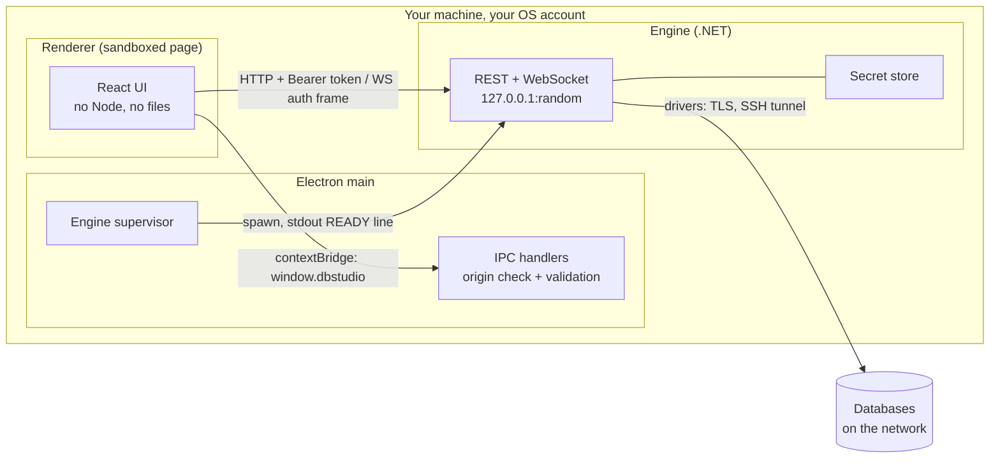
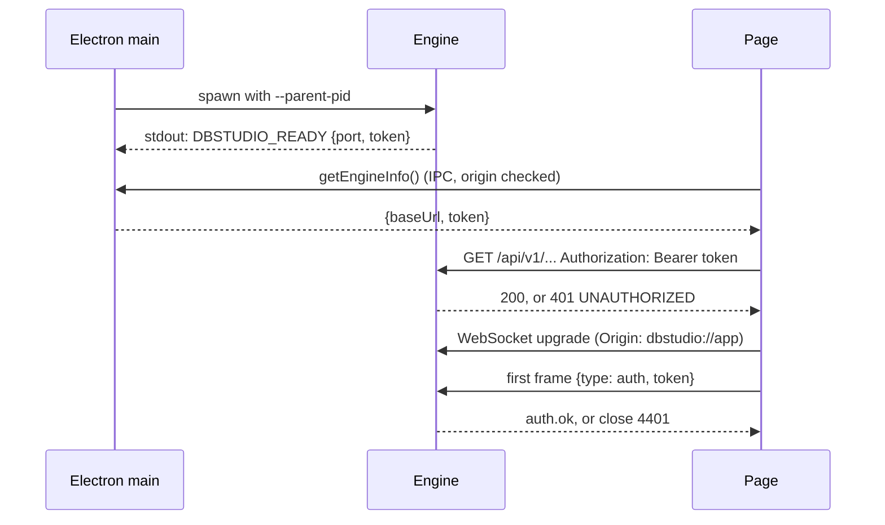
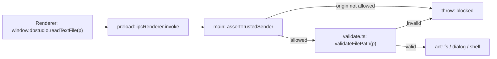
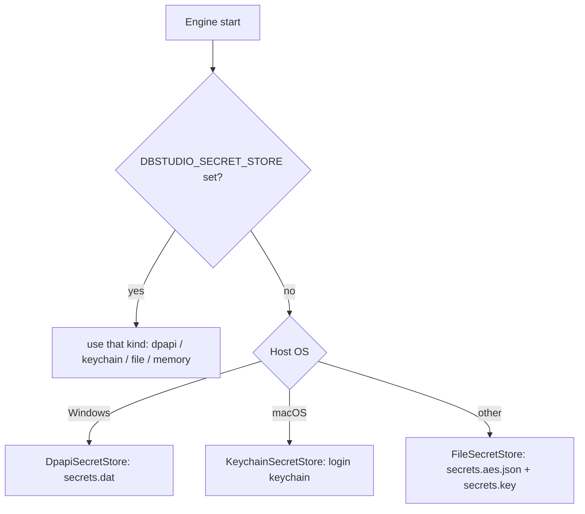

# 19. Security model and secrets

> **Level:** L2 practitioner → L3 senior | **Part:** II | **Code read at:** `d2f42ad` (Rowlit 1.7.0)
> [فارسی](../../fa/part2/19-security-and-secrets.md) · Previous: [18. Sources II: Kafka and Elasticsearch](18-sources-kafka-elasticsearch.md) · Next: [20. UI architecture](20-ui-architecture.md)
>
> **In one sentence:** Rowlit is a local program that holds database passwords, so it defends the local machine's edges
> (a loopback-only engine behind a random token, a sandboxed page with a strict content policy, validated IPC, encrypted
> secret stores, an encrypted connections file) and it is honest about what it cannot stop: anything that already runs as you.
>
> **You will learn:**
> - the threat model: who Rowlit defends against and who it does not;
> - how the engine, the Electron shell and the page protect each other, one boundary at a time;
> - how saved passwords are stored on Windows, macOS and Linux, and how the connections file is encrypted when you export it;
> - which features protect your data (read-only connections, destructive confirmation, SSH host keys, DuckDB lockdown);
> - the supply-chain checks and the list of things that are not protected.
>
> **Prerequisites:** [3. Big-picture architecture](03-big-picture-architecture.md), [5. The engine host](05-engine-host-and-api.md), [Part I, chapter 14: Database security](../part1/14-security.md).

## 1. The idea (beginner)

A database client is an unusually sensitive program. It knows the address of your production database, it often knows the
password, and it can run `DELETE`. Two questions decide how much trust it deserves: *who else on this computer can talk to it*,
and *what happens to the passwords when you are not looking*.

Rowlit answers the first with layers. The part that talks to databases (the engine) listens only on the computer's own
loopback address, on a random port, and refuses every request that does not carry a secret token created at start. The
window that you look at is a locked-down browser page that cannot touch your files or run Node.js; it can only ask the
Electron shell for a short list of things, and the shell checks every request. The second question is answered by the
operating system's own secret storage: Windows DPAPI, the macOS Keychain, or an encrypted file on Linux. A saved password
never sits in `connections.json`.

This does not make Rowlit a safe against a thief who already has your logged-in session. Anything that runs as you can read
what Rowlit can read. The chapter ends with that list, because knowing the limits is part of the model.

## 2. How it works (practitioner)

### 2.1 The threat model

A threat model says what is defended and against whom. This one is reconstructed from the code and the plan decisions
(`docs/PLAN.md` D-7 for the privileged origin and D-13 for read-only enforcement).

| Attacker | Example | Defended? | By |
|---|---|---|---|
| Another local user | a second Windows account on the same PC | yes | loopback + token; DPAPI is per user; Linux key file mode 0600 |
| A web page in your browser | a malicious site doing `fetch('http://127.0.0.1:5121')` | yes | bearer token on every request; CORS allows only `dbstudio://app`; no token in any URL |
| A web page loaded inside Rowlit | a link that opens in the app | yes | navigation lock; links open in the default browser |
| A bug in the page (XSS) | untrusted data rendered as HTML | limited | sandbox, context isolation, CSP, validated IPC; the page has no Node |
| A network attacker | someone watching the wire | partly | the engine never leaves loopback; database traffic uses the driver's TLS settings; SSH tunnels encrypt the rest |
| A poisoned package | a vulnerable NuGet dependency | partly | NuGet audit and a CI check |
| Software running as you | malware, a script, another app | **no** | it can read the data folder, memory and the token |
| Someone with your unlocked desktop | | **no** | out of scope |
| An administrator or root | | **no** | out of scope |

### 2.2 The three processes and their boundaries

**Figure 19.1 — Trust boundaries, with the mechanism on each arrow.**

Each arrow is a decision:

1. **Page → shell** goes only through `window.dbstudio`, a `contextBridge` object defined in the preload script. The page
   has `contextIsolation: true`, `sandbox: true` and `nodeIntegration: false` (`desktop/src/main/window.ts:158-167`).
2. **Page → engine** is HTTP and WebSocket to `127.0.0.1`, authenticated by a token.
3. **Shell → engine** is the child-process link: the shell starts the engine and reads one stdout line.
4. **Engine → database** uses the database driver's own security (TLS, certificates) and, if configured, an SSH tunnel.

### 2.3 The engine: loopback, token, origin

**Loopback only.** Kestrel is configured with `k.Listen(IPAddress.Loopback, options.Port)`, a 64 MB body limit and no `Server`
header (`engine/src/DbStudio.Host/Program.cs:72-77`). The loopback address is not reachable from other computers.

**A random token.** Unless `--dev` is set, `EngineOptions.NewToken()` makes 32 random bytes, base64url, with
`RandomNumberGenerator` (`EngineOptions.cs:78-79`, `:73`). With `--dev` the default is the fixed string `dev-token`
(`:13`), for development only ([chapter 4](04-development-setup.md)). The token reaches Electron through the single
stdout line `DBSTUDIO_READY {"port":…,"token":"…"}` (`Program.cs:196`); the shell masks the token when it logs that line
(`desktop/src/main/engine-process.ts:381`).

**Header, never URL.** `TokenAuthMiddleware` requires `Authorization: Bearer <token>` on every request under `/api`, except
CORS preflights and the WebSocket paths, and compares in constant time with `CryptographicOperations.FixedTimeEquals`
(`engine/src/DbStudio.Host/Infrastructure/Middleware.cs:84-104`); a mismatch is `401 UNAUTHORIZED` in the error envelope. The
WebSocket cannot send headers from a browser, so it authenticates with a first frame `{"type":"auth","token":…}` that must
arrive within 2 seconds (`WsHub.cs:113-122`, `:20`); a wrong or missing frame closes the socket with code 4401
(`WsHub.cs:143-144`). Because the token is never in a URL, it does not end up in a browser history, a log line or a
`Referer` header.

**Origin.** CORS uses `options.IsOriginAllowed` (`Program.cs:82-87`): the allowed origin is `dbstudio://app`, and with `--dev`
also `localhost` and `127.0.0.1` on `http` with any port and no path, query or user info
(`EngineOptions.cs:21-38`). The WebSocket upgrade checks the `Origin` header the same way and answers 403 when a
browser sends a disallowed one (`WsHub.cs:74-79`). A client that sends no `Origin` (a script) is not stopped by the origin
check; it is stopped by the token. CORS is a browser rule, not a firewall: it protects against *other web pages*, and the
token protects against everything else.

**Figure 19.2 — The token handshake.**

The Electron smoke test checks the observable parts: the engine answers with the token, answers 401 without it, and the
token never appears in `location.href` (`desktop/src/main/smoke.ts:11-19`).

### 2.4 The shell: scheme, CSP, sandbox, navigation

**A privileged custom origin.** The built page is served from `dbstudio://app`, registered as `standard`, `secure`,
`supportFetchAPI` and `corsEnabled` (`desktop/src/main/protocol.ts:43-50`). `resolveUnderRoot` decodes the path, rejects NUL
bytes and any path that escapes the UI folder (`:56-69`); only `GET` and `HEAD` are answered (`:102-104`); files get
`X-Content-Type-Options: nosniff`, and HTML gets the CSP header (`:83-94`).

**The Content-Security-Policy.** `buildCsp` (`desktop/src/main/csp.ts:11-31`) is a list of directives. Read them one by one:

| Directive | Value | Why |
|---|---|---|
| `default-src` | `'self' dbstudio:` | anything not listed may load only from the app |
| `script-src` | `'self' dbstudio: blob:` | no inline script and no `eval` (the smoke test checks `eval` is blocked); `blob:` is for Monaco workers |
| `worker-src` | `'self' dbstudio: blob:` | Monaco and the ER layout worker |
| `style-src` | `'self' dbstudio: 'unsafe-inline'` | Monaco and React set inline styles |
| `img-src` / `font-src` | `'self' dbstudio: data: blob:` / `data:` | icons and codicon fonts |
| `connect-src` | `'self' dbstudio: http://127.0.0.1:* ws://127.0.0.1:*` | the page may talk only to itself and to a loopback engine |
| `object-src` | `'none'` | no plugins |
| `base-uri` | `'self'` | blocks `<base>` hijacking |
| `form-action` | `'none'` | no form can post anywhere |
| `frame-ancestors` | `'none'` | cannot be framed |

In development, when the page comes from Vite, the policy adds the dev origin, `'unsafe-inline'` scripts (React Refresh
needs one) and `localhost:*` (`csp.ts:12-16`, `:19`). `installCsp` also sets the header on responses that come through the
network stack (the Vite dev server), because only `dbstudio://` sets it itself (`window.ts:91-106`), and denies every
permission request except `clipboard-sanitized-write` from an allowed origin (`:108-114`).

**Window hardening.** Besides `contextIsolation`, `sandbox` and `nodeIntegration: false`, the window sets
`nodeIntegrationInWorker: false`, `webSecurity: true`, `allowRunningInsecureContent: false` and `webviewTag: false`
(`window.ts:158-167`). Navigation is locked: `will-navigate` and `will-redirect` to a URL that is not an allowed origin are
prevented, `http(s)` links open in the default browser, `window.open` is denied, and `will-attach-webview` is prevented
(`window.ts:181-193`).

**Electron fuses.** `electron-builder.yml:49-55` turns off the features of the Electron binary that a malicious
local file could abuse: `runAsNode: false` (the binary cannot be used as a plain Node), `enableCookieEncryption: true`,
`enableNodeOptionsEnvironmentVariable: false`, `enableNodeCliInspectArguments: false`, `enableEmbeddedAsarIntegrityValidation: true`
and `onlyLoadAppFromAsar: true` (the app must come from `app.asar`, and the asar's integrity is validated). The package
contains only the bundled `main.js` and `preload.js`; there are no runtime `node_modules` (`:21-27`).

### 2.5 IPC: every handler checks and validates

The renderer reaches the shell through `ipcRenderer.invoke` and `send` wrappers in `preload.ts`. On the main side
(`desktop/src/main/ipc.ts`) every handler is registered through a wrapper that runs `assertTrustedSender`
(`:49-52`, `:81-87`): the URL of the sending frame must have an allowed origin (`dbstudio://app`, plus the Vite origin in dev),
else the call throws "Blocked IPC from untrusted origin". Fire-and-forget channels do the same and silently ignore failures
(`:168-179`).

Then arguments are validated by pure functions in `validate.ts`, which can be unit-tested without Electron:

**Figure 19.3 — The path of one IPC request.**

| Validator | Rule (from `validate.ts`) |
|---|---|
| `validateFilePath` | non-empty string, ≤ 32 000 chars, no NUL, must be absolute; refuses `\\?\` and `\\.\` device namespaces (`:49-58`) |
| `validateExternalUrl` | only `http:` and `https:`, ≤ 4096 chars, no credentials in the URL (`:126-138`); `file:`, `javascript:` and `ms-settings:` are refused |
| `validateExportedFilePath` | for "Open file after export": only `.csv .tsv .json .sql .md .xlsx .txt` (`:221-229`), never programs or scripts |
| `validateFileContent` | string or bytes, ≤ 256 M chars (`:61-69`) |
| `validateTitleBarTheme` | hex colours only, height clamped 24–96 (`:157-174`) |
| `validateMenuShortcuts` | ≤ 300 entries, command-id and shortcut patterns, malformed entries dropped (`:187-211`) |
| `validateNotification` | plain one-line strings, control characters replaced (`:233-239`) |
| workspace | JSON-serialisable, ≤ 64 M chars (`:248-258`) |
| `windows-core.ts` `validateTabs` | ≤ 50 tabs, ids `[\w.:-]+`, known kinds, ≤ 20 windows, ≤ 32 M chars |

Reads are limited to 64 MB (`LIMITS.readBytes`). One honest limit: `readTextFile`, `writeTextFile` and `revealInFolder` accept
**any absolute path** from the trusted page, because the app opens `.sql` files from anywhere. The protection is that only
the trusted origin can call them; if the page itself were compromised it could read files the user can read. That is why
the CSP, the sandbox and the absence of `eval` matter.

### 2.6 Secrets: where passwords live

Passwords never appear in the API: the engine only exposes `hasPassword`, and `ISecretStore` holds the values
(`engine/src/DbStudio.Core/Services/SecretStore.cs:9-20`). The store is chosen at start by
`SecretStoreFactory.Choose(os, override)`: DPAPI on Windows, Keychain on macOS, an AES file elsewhere, and the environment
variable `DBSTUDIO_SECRET_STORE` (`dpapi|keychain|file|memory`) overrides the choice
(`Secrets/SecretStoreFactory.cs:7-48`).

**Figure 19.4 — Choosing the secret store.**

| Store | How it protects | Details |
|---|---|---|
| **DPAPI** (Windows) | the OS encrypts with a key bound to your Windows account | `secrets.dat` is a JSON map `profileId → base64(blob)` protected with `DataProtectionScope.CurrentUser` and an entropy made of a fixed constant plus the profile id, so a blob cannot be moved to another profile (`SecretStore.cs:22-95`); the entropy keeps its DbStudio-era value so old passwords stay readable (`:30`). A blob from another account decrypts to "no password" (`:51-54`). Passwords do not roam to another machine or account |
| **Keychain** (macOS) | the login keychain | one generic-password item per connection, service `DbStudio`, account = profile id; the engine runs `/usr/bin/security`, and the secret is passed on **stdin** hex-encoded, never on a command line where `ps` could read it (`KeychainSecretStore.cs:73-80`) |
| **AES file** (Linux, others) | AES-256-GCM, key in `secrets.key` (mode 0600) | `secrets.aes.json` maps `profileId → base64(nonce[12] ‖ ciphertext ‖ tag[16])`; the profile id is the associated data, so a swapped blob fails to decrypt (`FileSecretStore.cs:8-23`, `:47-86`). The class documents its own limit: it "keeps passwords out of `connections.json`" and away from other users, but "does not protect against anything that runs as the same user" |
| **Memory** | none (nothing persisted) | tests and CI runners without an unlocked keychain |

A connection can also be saved **without** its password: `SavePassword = false` keeps it in memory only for the engine's
lifetime (`Set(id, secret, persist: false)`).

**What is stripped from `connections.json`.** `ConnectionStore.Clone` removes every password-typed field of the provider's
form (`ConnectionStore.cs:336-355`; for example Kafka's `saslPassword` and `schemaRegistrySecret` live in the secret store under
`<profileId>#<field>`, `:14-16`, `:46`). The file keeps host, port, database, user name and other non-secret options in plain
JSON. `WithSecrets` restores secrets into a short-lived runtime copy that is given to the driver (`:74-90`). Federation member
credentials are resolved inside the engine through the same path (`LinkRuntime.cs:21`) and are never sent to the page.

### 2.7 The connections file: PBKDF2 and AES-GCM

*File › Export connections…* writes `*.rowlit-connections.json` (WP-5). The settings, including SSH tunnel settings, are
plain JSON. **Passwords are left out unless you tick "Include passwords" and enter a passphrase.** Then every secret
(connection passwords, SSH passwords, key passphrases, SASL secrets) is gathered into one map `ref → {key → value}`, serialised and
sealed by `PassphraseBox` (`engine/src/DbStudio.Core/Services/Portability/PassphraseBox.cs`):

1. **Key derivation:** PBKDF2 with HMAC-SHA-256, **600 000 iterations** (the OWASP 2023 figure; the comment notes that .NET has no
   Argon2), over the NFC-normalised passphrase and a random 16-byte salt, giving a 256-bit key (`:10-14`, `:87-88`).
2. **Encryption:** AES-256-GCM with a random 96-bit nonce and a 16-byte tag. The header (`format|v<version>|kdf|iterations|cipher`) is the
   **associated data**, so changing the KDF settings makes the tag check fail (`:24-46`).
3. **The file** records `"passwords": "encrypted"`, an `encryption` block (`pbkdf2-sha256`, iterations, salt, `aes-256-gcm`,
   nonce; none of it secret) and the base64 `secrets` (`ConnectionsFile.cs:22-35`).

On import, a wrong passphrase and a modified file fail the same tag check and are reported together as "Wrong passphrase, or the
file was modified." (`PassphraseBox.cs:79`). Bounds protect the engine from a hostile file: iterations must be between 100 000 and
5 000 000, files are limited to 8 MB and 2000 connections (`:21`, `ConnectionsFile.cs:14`). The passphrase must have at least 8
characters (`PassphraseBox.cs:19`; the dialog keeps *Export* disabled until it does). The passphrase is not stored and cannot be
recovered. The key derivation takes a few hundred milliseconds of CPU, so the endpoints run it off the request thread
(`ConnectionsPortabilityModule.cs:28-33`). Secrets and passphrases are never logged and never part of an exception message
(`ConnectionsPortabilityService.cs:9-14`). Linked databases are not exported because their members are connection ids of this machine
(`ConnectionsFormat.LinkedProviderId`); key file paths and SQLite paths are exported as typed.

> This is encryption of a file you hand to someone. Its strength is the strength of the passphrase: PBKDF2 slows guessing down but does not
> stop a weak passphrase from being guessed.

### 2.8 SSH tunnels

A tunnel opens an SSH session with SSH.NET and listens on `127.0.0.1:<random>` (`SshTunnelService.cs:14`, `:203`, `:241`); every driver
connection of the profile is piped through it. Two security rules are in the code:

- **Trust on first use for host keys.** `SshKnownHosts` stores, per `host:port`, the key algorithm and SHA-256 fingerprint in
  `ssh-known-hosts.json`. The first connection remembers the key; a later connection that presents another key is
  **refused**, because that is what a man in the middle looks like (`SshKnownHosts.cs:5-48`, checked in the `HostKeyReceived`
  handler at `SshTunnelService.cs:386`). The user can forget a host if the server was reinstalled.
- **Secrets stay in the secret store.** The SSH password and key passphrase are stored like database passwords; the
  profile's `Fingerprint` hashes them so a changed secret opens a new tunnel instead of reusing the old one
  (`SshSettings.cs:24-32`). PuTTY `.ppk` keys are refused and must be exported to OpenSSH format first.

### 2.9 Data-protection features

| Feature | What it does | Where |
|---|---|---|
| **Read-only connection** | a connection flag; the engine refuses any batch that is not query-only with `403 READ_ONLY` | `ReadOnlyGuard.Enforce`, called from `ExecutionService.cs:131`; shared by execution, "explain actual" and exports |
| **Export guard** | an export of a query must be one `SELECT`; anything else is refused (read-only or `VALIDATION`) | `ReadOnlyGuard.EnforceExportQuery`, `ExportService.cs:91` |
| **Destructive confirmation** | before running, the page classifies the batches; `DELETE`/`DROP`-like findings ask "Run destructive statement?" | `ui/src/app/actions.ts:138-153`; setting `confirmDestructive`; not asked on read-only connections |
| **Read-only override** | the engine refused and the user *still* wants to write: a dialog whose danger button enables only after ticking "Allow this statement to write to …" with Cancel focused | `askReadOnlyOverride`, `actions.ts:103-114`, then a re-run with `confirmedDestructive: true` |
| **Production colour** | a connection coloured red is "production": the toolbar warns on the Run button | `isProductionColor`, `theme/connColors.ts:48-50`, `Toolbar.tsx:126` |
| **Kill with typed confirmation** | to kill a session you must type its id; the dialog shows the exact statement | `KillDialog.tsx` ([chapter 21](21-logs-activity-resources.md)) |
| **Linked queries are read-only** | the `linked` provider only reads; the DuckDB engine cannot write to your sources | `LinkedProvider` ([chapter 16](16-linked-databases-federation.md)) |
| **DuckDB lockdown** | the federation engine runs `SET autoinstall_known_extensions = false`, `autoload_known_extensions = false`, `enable_external_access = false` and then `lock_configuration = true`, so user SQL cannot read files, load extensions or undo the settings | `DuckDbProbe.LockdownStatements` (`DuckDbProbe.cs:20-24`), `DuckDbEngine.cs:120-121` |

Note the order of authority for read-only: the **engine** enforces it, not the page. The page's override is a deliberate human
step that sends `confirmedDestructive`; the guard returns early when that flag is set (`ReadOnlyGuard.cs:18`). So read-only protects
against mistakes, not against someone who can click the confirmation.

### 2.10 Supply chain and builds

- **NuGet audit.** `engine/Directory.Build.props` sets `NuGetAudit` true, `NuGetAuditMode` all, `NuGetAuditLevel` low, and turns warnings
  NU1902, NU1903 and NU1904 into errors, so a restore with a known advisory fails (the comment says to pin a patched version).
- **CI step.** `ci.yml:69-76` also runs `dotnet list package --vulnerable --include-transitive` and fails on any hit.
- **Pinned drivers.** Driver versions are exact `PackageReference` versions in the provider projects ([chapter 1](01-what-is-a-database-ide.md)
  table), and some transitive packages are pinned only to dodge advisories (for example `System.Security.Cryptography.Pkcs`, `Newtonsoft.Json`).
- **Dependencies of the shell.** The packaged app has no runtime `node_modules`; main and preload are bundled by esbuild.
- **Code signing.** The Windows installer is **not code-signed**; SmartScreen warns on first run (`README.md:120-121`). macOS builds are
  ad-hoc signed unless the build has a Developer ID certificate, and are notarized only when Apple credentials are present
  ([chapter 24](24-build-ci-release-contributing.md)). The auto-updater follows this: the full macOS update flow runs only when the app has a
  Developer ID signature (`updater.ts:5-7`, [chapter 22](22-desktop-shell.md)).

### 2.11 What is not protected

Read this list as the second half of the threat model.

- **Software running as you.** It can read the data folder, the Linux key file, the Windows DPAPI blob (DPAPI decrypts for any process of
  your account), ask the Keychain for items after you allow it, and read the engine's memory and token.
- **Non-secret connection settings** are plain JSON in `connections.json`: host names, ports, database names, user names, SSH user and host.
- **Your SQL text is stored.** `history.db` keeps the queries you ran, `workspace.json` keeps unsaved editor text, and `local-history.db`
  keeps editor snapshots (compressed, not encrypted). A password typed into a SQL statement lives there too.
- **Logs.** The engine log and server errors can quote statements or object names; every log call has not been audited for this in the handbook.
- **The renderer can read and write any file you can** (see 2.5), if it is compromised.
- **The passphrase of an exported file** is as strong as you make it.
- **Unsigned Windows installer, ad-hoc macOS signature:** you trust the download source (the GitHub release).
- **Dev mode** (`--dev`, fixed token, extra CORS origins, `'unsafe-inline'`) is for development only.

## 3. Deep dive (senior)

> **Deep dive (L3): why a bearer token on loopback, and why the WebSocket needs a frame.**
>
> Loopback is not private: any process on the machine, and any web page in any browser, can send requests to
> `127.0.0.1`. A browser enforces CORS only for *reading the response*, not for *sending the request*, so a malicious page could
> trigger side effects with a simple `POST`. Requiring a header the page cannot know turns every such request into a `401`. The
> token is random per start, so a leaked token is useless after the next restart.
>
> A browser `WebSocket` cannot set an `Authorization` header, and putting the token in the URL would leak it into logs and
> history. So the design authenticates with the first message instead, with a 2-second deadline so an idle unauthenticated socket
> cannot linger (`WsHub.cs`, plan D-6). The cost is that the socket is open for a moment before it is trusted; the hub sends
> nothing until the frame is verified.
>
> **Why the CSP allows `'unsafe-inline'` styles but not scripts.** An injected `<style>` can exfiltrate data only in narrow
> ways, and Monaco and React need inline styles; an injected `<script>` is code execution. The policy spends its strictness
> where the impact is.
>
> **Why IPC validators are separate pure functions.** `validate.ts` has no `electron` import, so `test/ipc-validate.test.mjs`
> feeds it hostile inputs in plain Node (relative paths, device namespaces, `file:` URLs, oversized strings). The security of the
> bridge is therefore tested without launching a window.

> **Deep dive (L3): AES-GCM nonces and associated data.**
> Both encrypted formats use a fresh random 96-bit nonce per encryption. GCM is catastrophic if a nonce repeats under one key, so the
> random nonce is generated inside `Seal` and `WritePersisted` every time and never stored with a counter. The associated data binds
> a ciphertext to its context: the profile id in the file store, the format header in the connections file. Moving a blob to another
> profile, or editing the iteration count, fails authentication rather than decrypting to garbage.

## 4. Edge cases and limits

| Topic | Fact | Source |
|---|---|---|
| Request body limit | 64 MB | `Program.cs:75` |
| Auth frame deadline | 2 s, ≤ 16 KB | `WsHub.cs:117`, `:120` |
| Close code for a bad token | 4401 | `WsHub.cs:20` |
| IPC file read | ≤ 64 MB | `validate.ts:19` |
| IPC write | ≤ 256 M characters | `validate.ts:21` |
| Workspace size | ≤ 64 M characters | `validate.ts:23` |
| Connections file | ≤ 8 MB, ≤ 2000 connections | `ConnectionsFile.cs:14` |
| PBKDF2 | 600 000 iterations; accepted 100 000–5 000 000 | `PassphraseBox.cs:18`, `:21` |
| Passphrase | ≥ 8 characters | `PassphraseBox.cs:19` |
| Keychain command timeout | 120 s (waits for an unlock prompt) | `KeychainSecretStore.cs:26-30` |
| Detached windows | ≤ 20, ≤ 50 tabs per call | `windows-core.ts:14-24` |
| Corrupt `secrets.dat` | starts empty, copies the file to `.corrupt` | `SecretStore.cs:108-111` |
| Linux key lost | the secrets are unrecoverable (`return null`) | `FileSecretStore.cs:52` |

## 5. How it is tested

- Engine: `engine/tests/DbStudio.Core.Tests/Portability/ConnectionsPortabilityTests.cs` (round trip, wrong passphrase, tampering, bad files),
  secret-store tests in `DbStudio.Core.Tests/Platform/SecretStoreTests.cs`, and the macOS Keychain round trip runs in CI's macOS job
  ([chapter 23](23-testing-and-qa.md)). I found no unit test that targets `TokenAuthMiddleware` or the WebSocket auth frame directly in
  `engine/tests`; they are covered end to end by the desktop smoke test below (not verified beyond that).
- Tunnels: `DbStudio.Core.Tests/Tunnels/*` and `PgSshTunnelTests.cs`.
- Desktop: `desktop/test/ipc-validate.test.mjs` (validators), `windows.test.mjs` (tab validation), and `smoke.test.mjs` (the live checks listed in 2.3:
  eval blocked, `file:` URLs rejected, relative paths rejected, token not in the URL).
- UI: `ConnectionsPanel/__tests__/portability.test.tsx`, `actions.test.ts` for the destructive and read-only flows.
- CI gates: the NuGet audit step ([chapter 24](24-build-ci-release-contributing.md)).

## Related chapters

- [Part I, chapter 14: Database security](../part1/14-security.md): authentication, TLS modes, SQL injection, the database side of everything here.
- [5. The engine host](05-engine-host-and-api.md): middleware order and the error envelope.
- [8. Connections, sessions and executing SQL](08-connections-sessions-execution.md): the read-only guard in the execution path.
- [16. Linked databases](16-linked-databases-federation.md): the DuckDB lockdown in context.
- [22. The desktop shell](22-desktop-shell.md): the main process, IPC and updates.
- [24. Build, CI, release and contributing](24-build-ci-release-contributing.md): signing and the audit step.

## Glossary terms introduced here

[threat model](../glossary.md#threat-model) · [loopback](../glossary.md#loopback) · [bearer token](../glossary.md#bearer-token) ·
[origin](../glossary.md#origin) · [CORS](../glossary.md#cors) · [preflight](../glossary.md#preflight) · [CSP](../glossary.md#csp) ·
[context isolation](../glossary.md#context-isolation) · [sandbox](../glossary.md#sandbox) · [preload bridge](../glossary.md#preload-bridge) ·
[IPC validation](../glossary.md#ipc-validation) · [Electron fuses](../glossary.md#electron-fuses) · [asar](../glossary.md#asar) ·
[DPAPI](../glossary.md#dpapi) · [Keychain](../glossary.md#keychain) · [AES-GCM](../glossary.md#aes-gcm) · [PBKDF2](../glossary.md#pbkdf2) ·
[secret store](../glossary.md#secret-store) · [read-only enforcement](../glossary.md#read-only-enforcement) · [lockdown](../glossary.md#lockdown) ·
[supply chain](../glossary.md#supply-chain) · [NuGet audit](../glossary.md#nuget-audit) · [code signing](../glossary.md#code-signing) ·
[notarization](../glossary.md#notarization) · [SmartScreen](../glossary.md#smartscreen) · [Gatekeeper](../glossary.md#gatekeeper) ·
[trust on first use](../glossary.md#trust-on-first-use) · [connections file](../glossary.md#connections-file)

## Files

| Path | Responsibility |
|---|---|
| `engine/src/DbStudio.Host/EngineOptions.cs` | token, dev flag, allowed origins |
| `engine/src/DbStudio.Host/Infrastructure/Middleware.cs` | `TokenAuthMiddleware`, error envelope |
| `engine/src/DbStudio.Host/Ws/WsHub.cs` | WebSocket origin check and auth frame |
| `engine/src/DbStudio.Core/Services/SecretStore.cs`, `Secrets/*` | secret stores and their factory |
| `engine/src/DbStudio.Core/Services/ConnectionStore.cs` | stripping and restoring secrets |
| `engine/src/DbStudio.Core/Services/Portability/*` | export/import, `PassphraseBox` |
| `engine/src/DbStudio.Core/Services/Tunnels/*` | SSH tunnels and known hosts |
| `engine/src/DbStudio.Core/Services/ReadOnlyGuard.cs` | read-only enforcement |
| `engine/src/DbStudio.Federation/Diagnostics/DuckDbProbe.cs`, `Engine/DuckDbEngine.cs` | DuckDB lockdown |
| `desktop/src/main/csp.ts`, `protocol.ts`, `window.ts` | CSP, scheme, window hardening |
| `desktop/src/main/ipc.ts`, `validate.ts`, `windows-core.ts` | trusted-sender check and validators |
| `desktop/src/preload/preload.ts` | the `window.dbstudio` bridge |
| `desktop/electron-builder.yml` | Electron fuses |
| `engine/Directory.Build.props`, `.github/workflows/ci.yml` | NuGet audit |
| `ui/src/app/actions.ts` | destructive confirmation and read-only override |
