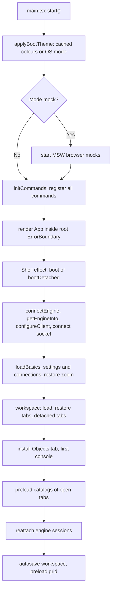
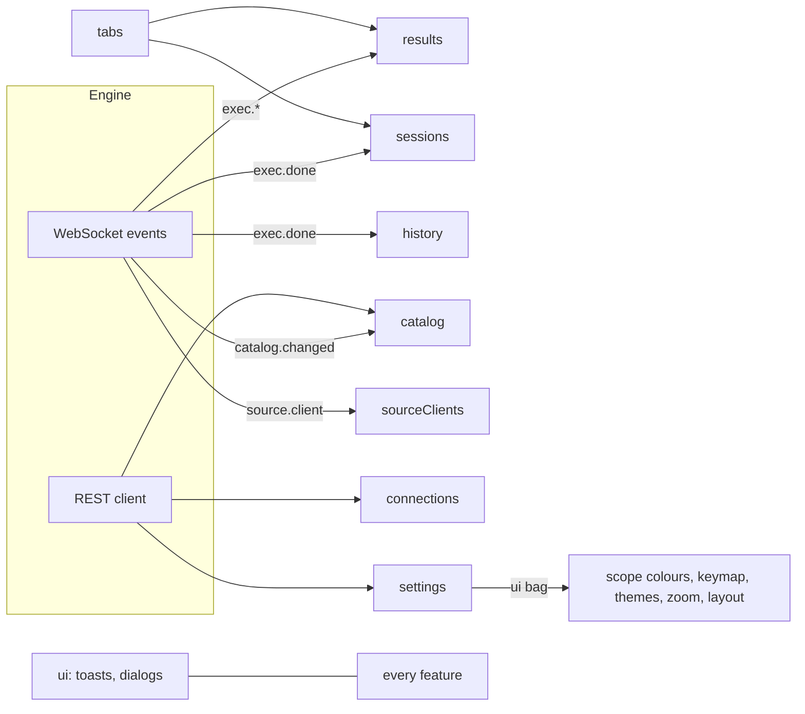
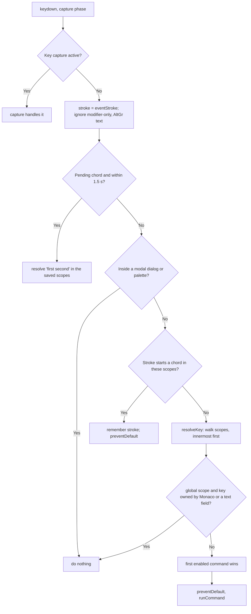
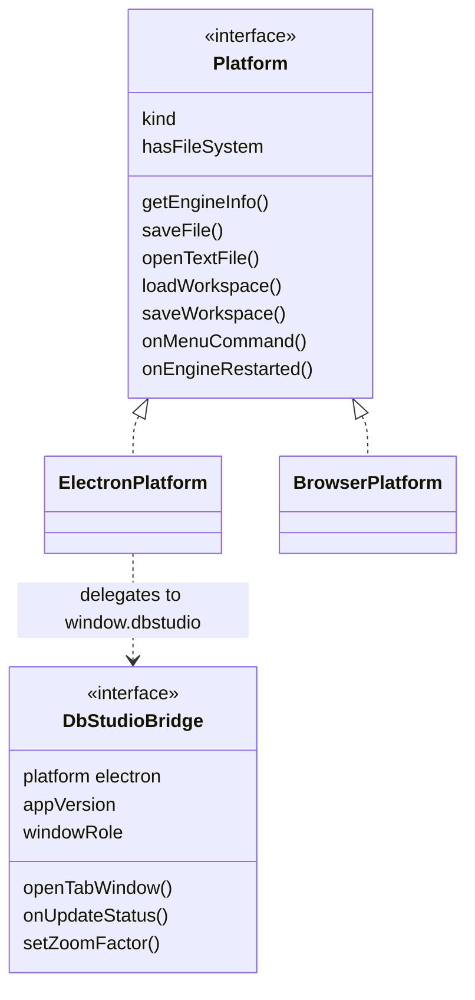

# 20. UI architecture: React, Zustand, commands and the platform

> **Level:** L2 practitioner → L3 senior | **Part:** II | **Code read at:** `a61f3d1` (Rowlit 1.6.3)
> **Language:** English | [فارسی](../../fa/part2/20-ui-architecture.md) | Previous: [19. Security and secrets](./19-security-and-secrets.md) | Next: [21. Logs, activity, resources and memory](./21-logs-activity-resources.md)
> **In one sentence:** the UI is a React 18 app whose state lives in small Zustand stores, whose every user action is a registered command, whose host (Electron or a plain browser) hides behind one adapter, and whose heavy parts are lazy chunks under a bundle budget.
> **You will learn:**
> - what happens between `main.tsx` and the first usable window (the boot sequence);
> - how the folders depend on each other and which stores exist;
> - how tabs, editor groups and detached windows are modelled;
> - how a key press becomes a command: registry, scopes, chords, keymap, presets, menus;
> - the platform adapter, lazy chunks and the bundle-size gate, error boundaries, theming, settings, updates.
> **Prerequisites:** [03. Big-picture architecture](./03-big-picture-architecture.md), [06. The WebSocket protocol](./06-websocket-protocol.md), [02. A tour of the app](./02-tour-of-the-app.md).

## 1. The idea (beginner)

A desktop application is a lot of buttons, menus, keyboard shortcuts and windows that must agree with each other. If each button knew how to do its job, you would have the same logic in the toolbar, the menu, the context menu and the shortcut, and they would drift apart. Rowlit uses a simple rule instead: **every action is a command** with an id, a title and an optional shortcut. Buttons, menus and keys only say "run command `format.document`". Commands read what they need from **stores**: small, named boxes of state (`tabs`, `results`, `catalog`, `settings` ...). Components subscribe to the parts of a store they draw, and React re-renders only those.

The renderer also has to run in two places: inside Electron (with file dialogs, native menus, auto-update) and in a plain browser during development. A **platform adapter** gives the UI one interface and hides the difference. And because the app has many large screens (the designer, the ER diagram, the import wizard, Monaco itself), most of them are loaded **lazily**, only when first opened, to keep startup fast; a CI script enforces a size budget.

## 2. How it works (practitioner)

### 2.1 Boot sequence

**Figure 20.1 — From `main.tsx` to a restored workspace.**



`ui/src/main.tsx` (30 lines) does three things before React renders: `applyBootTheme()` paints the last used mode and colours from `localStorage` (key `dbstudio.theme`) so there is no flash of the wrong theme, `isMac()` adds an `os-mac` class, and, only in `--mode mock`, the in-browser fake engine starts (`startBrowserMocks`, MSW for REST plus a fake WebSocket, `npm run dev:mock`). Then `await initCommands()` and `createRoot(...).render(<StrictMode><ErrorBoundary variant="root"><App/></ErrorBoundary></StrictMode>)`.

`App` has a dev-only `#/playground` route (a lazy IntelliSense playground) and otherwise renders `Shell` (`App.tsx:68-122`). `Shell` calls `boot()` (or `bootDetached()` for a detached window) once; a module-level `booted` flag keeps React StrictMode's double effect from running it twice. It also installs the key dispatcher, the keymap, and the native-menu handler (`App.tsx:93-103`).

`boot()` (`app/boot.ts:224-269`) in order:

1. `wireQuitGuard()` - answer the desktop shell's "what would be lost?" questions ([2.8](#28-the-platform-adapter)).
2. `connectEngine()`: `getPlatform().getEngineInfo()` returns `{baseUrl, token}` (from the preload bridge in Electron, from `VITE_ENGINE_URL`/`VITE_ENGINE_TOKEN` in a browser), `configureClient(info)`, `engineSocket.connect(info)`, and `onEngineRestarted` re-does it, clears sessions, ends live streams and shows a toast. If the info cannot be had, an engine error banner (with Retry) appears and boot stops.
3. `loadBasics()`: settings and connections in parallel, then `restoreZoom()`.
4. Workspace: `liveDetachedTabs()` (tabs currently open in other windows stay there), `platform.loadWorkspace()`, `useTabs.restore(...)`; tabs of deleted connections are closed (object tabs) or unbound (consoles).
5. The permanent **Objects tab** is installed (lazy import); with no tab open and no Objects tab, a first console opens on the first relational connection.
6. `preloadTabCatalogs()` - one `preloadCatalog` per connection and database that has a tab ([chapter 10](./10-catalog-and-metadata.md)).
7. `reattachSessions()` - `GET /sessions` and re-attach engine sessions to the tabs that own them (so an open transaction survives a reload); the rest are announced once as "unused sessions" in a toast.
8. Page-hide cleanup, workspace autosave, `preloadDataGrid()`.

`wireSocket()` (idempotent) routes engine events to stores: `exec.*` to `results.ingest`, `exec.done` to `sessions.applyDone` and history, `session.changed`, `catalog.changed` to `catalog.applyChanged`, `source.client`, `engine.log` errors to a toast, plus the resource wiring (`app/boot.ts:99-138`). The socket client itself (backoff, auth frame, handlers) is [chapter 06](./06-websocket-protocol.md).

### 2.2 Folders and the dependency direction

```text
ui/src/
  api/         typed REST client, WebSocket client, wire types        (no React)
  store/       Zustand stores                                          (state + actions)
  app/         cross-store orchestration: boot, run, detach, resources (no components)
  commands/    registry, dispatcher, keymap, menu model                (framework-free)
  intel/ format/ codegen/ filter/ designer/(logic) snippets/ data/ lib/   pure domain modules
  editor/      Monaco glue
  components/  React components, one folder per feature
  platform/    host adapter; theme/ tokens, themes
  mocks/       MSW handlers and fake socket for dev and tests
```

The intended direction is `api` then `store` then `app` then `components`, with the domain modules (`intel`, `format`, `commands`, `codegen`, `filter`, the logic parts of `designer`) free of React so they can be tested in a Node environment (`vitest.intel.config.ts` runs `intel`, `editor`, `format`, `snippets` under `environment: 'node'`). It is a direction, not an enforced lint rule: for instance `store/consoleSchema.ts` imports `app/actions`, and `app/boot.ts` imports from `components`. Treat violations as debt, not as proof the rule is wrong.

### 2.3 Stores

State management is **Zustand 5** (`ui/package.json`). A store is `create((set, get) => ({...state, ...actions}))`; components read with a selector (`useStore(s => s.part)`) and re-render only when that selection changes (with `useShallow` for objects and arrays); code outside React uses `useStore.getState()`. There is no Redux, no context provider tree for data.

| Store | Holds | Written by |
|---|---|---|
| `connections` | connection profiles, load error | connection dialog, boot |
| `catalog` | per-connection/database cache, ETags, closed marks | explorer, `catalog.changed`, resources ([ch. 10](./10-catalog-and-metadata.md)) |
| `sessions` | engine sessions by id and by tab, tx state | run code, `session.changed` |
| `tabs` | all tabs, active tab, groups, layout, detached | commands, explorer, boot |
| `editorGroups` | pure reducers for the split layout | called by `tabs` |
| `results` | executions, result sets, grid views | WebSocket ingest ([ch. 13](./13-results-grid-and-data-editing.md)) |
| `edits` | pending data edits per grid | grid |
| `filters` | saved/recent filters, server-filter state | filter bar |
| `params` | bind-parameter dialog state | run code |
| `history` | query history list | `exec.done`, history panel |
| `settings` | engine-validated settings and the free-form `ui` bag | settings dialog, many features |
| `ui` | dialogs, toasts, confirm requests, dock, WS status, announcements | everywhere |
| `resources` | memory level, counts for the status bar | resource wiring ([ch. 21](./21-logs-activity-resources.md)) |
| `links` | linked databases ([ch. 16](./16-linked-databases-federation.md)) | links UI |
| `savedQueries`, `systemTypes`, `consoleSchema` | see [ch. 10](./10-catalog-and-metadata.md) | |
| `sourceClients` | Redis/Mongo/Kafka clients the engine holds | `source.client` events |
| `updates` | auto-update status | `app/updates.ts` |

Feature-local stores exist next to their components (`Explorer/explorerStore`, `Search/searchStore`, `designer/store`, `ErDiagram/store`, `Charts/chartMode`), a pattern the code keeps on purpose: a store a lazy feature owns is loaded with the feature.

**Figure 20.2 — Who feeds which store.**



**The settings store** (`store/settings.ts`) is worth a note. The engine validates a fixed schema (`theme`, `editor`, `results`, `confirmDestructive`, `format`, `snippets`, `grid`, `connections`, `resources`) and keeps one **free-form `ui` object** that features use for their own keys without an engine change: `scopeColors`, `keybindings`, `appThemeLight/Dark`, `editorTheme`, `zoom`, `autoCheckUpdates`, `objectsTab`, `openRoutinesInEditMode`, `localHistory`, `resultsLayout`, `codegen`. `update(patch)` merges optimistically into the store (`mergeSettings`: objects one level deep, arrays and scalars replace) and queues a **debounced `PUT`** (600 ms, merged patches) (`settings.ts:98-128`). Arrays replace wholesale, which is why the keymap is stored as an array of entries rather than a map (an array can express "unbound"; the engine deletes a key whose patch value is `null`, `commands/keymap.ts:15-18`).

### 2.4 Tabs, editor groups and detached windows

`useTabs` (`store/tabs.ts`, about 700 lines) holds `tabs: Tab[]` where `Tab` is one of three kinds (`tabs.ts:67-115`): `console` (text, savedText, connection, database, schema, tx mode, `maxRows`, optional `edit` and `savedQuery` bindings), `object` (a table/view tab), and the generic `view` tab. A `ViewTab` has a `view` id registered with `registerTabView` (`components/layout/tabViews.ts`), a serialisable `state`, an optional `key` (re-opening activates the existing tab), `dirty`, and `pinned` (the permanent Objects tab). Every feature adds its screens this way, which is why the shell does not know about the data tab or the ER diagram. A `TabViewDef` can declare `beforeClose`, `onClosed`, `detachable: false` (for tabs that show live window state such as a console's results) and `focusPrimary`.

**Editor groups** (`store/editorGroups.ts`) are the split editor: up to `MAX_GROUPS = 3` groups side by side or stacked, each with its own tab strip and active tab, laid out as a tree of `group` and `split` nodes with sizes summing to 1 and a minimum share of 0.12. The module is pure; `normalizeGroups` re-establishes the invariants after every change: every tab in exactly one group, at least one group, the globally active tab is the focused group's active tab, pinned tabs first in the first group. Dragging a tab onto a drop zone (`left | right | up | down | center`) splits or moves. The layout is saved in the workspace as the optional `groups` field; an older workspace without it loads as one group.

**Workspace persistence.** `useTabs.serialize()` produces `WorkspaceData { version: 1, tabs, activeId, seq, groups?, detached? }`; boot autosaves it 800 ms after any change of `tabs`, `activeId`, `groups`, `layout` or `detached`, and on `beforeunload`, through `platform.saveWorkspace` (a file in the data directory for Electron; the browser fallback in `platform/browser.ts`). Unsaved console text is part of that file, which is why consoles never lose work on restart.

**Detached windows** (desktop). "Open in new window" or dragging a tab out hands the tab to the main process (`app/detach.ts`, `platform/windows.ts`): each Electron window runs its own copy of the UI; a tab travels as its serialised workspace form (text, connection, database, tx mode, a view's state); results are **not** carried and the engine session is released in the window the tab leaves. The detached window boots with `bootDetached()` (only the handed-over tabs, no autosave, no updater, explorer hidden), reports its tabs to main so nothing is lost on quit, and can hand them back. `isDetachedWindow()` is true when the bridge says so, or when the URL carries `#detached` and the bridge exists (a plain browser ignores the hash). More in [chapter 22](./22-desktop-shell.md).

**Unsaved work and the quit guard.** `app/unsavedWork.ts` computes what a window would lose (grids with pending edits, open transactions); `app/quitGuard.ts` answers the main process and shows one danger confirmation naming it ("Discard and quit"). Consoles are not listed because the workspace file keeps them.

### 2.5 The command system

**Registry** (`commands/registry.ts`, framework-free). A `Command` has `id` (namespaced: `designer.newTable`), `title`, `category`, `shortcut` and `altShortcuts`, `scope`, `when(args)`, `run(args)`, `keyHandler: 'registry' | 'host'`, `palette`, `keywords`, `icon`, `danger` (menus draw it red). `registerCommand` stores it and, in development, logs a console error when two commands share a stroke in the same scope. `aliasCommand` keeps old ids working. `runCommand(id, args)` checks `when`, runs, and turns a rejected promise into a logged error. Context menus pass a typed target as `args` (`ObjectTarget`, `ContainerTarget`, `SavedQueryTarget`, `ConnectionTarget`, `TabTarget`, `SourceTarget`, `commands/types.ts`); the palette and shortcuts pass none and the command falls back to the explorer selection or the active tab.

**Auto-loading.** `commands/index.ts` uses Vite's `import.meta.glob` over `../*/commands.ts`, `../*/*/commands.ts` and `../components/*/commands.ts` (excluding `app`, `intel`, `commands`) and, for each module, calls any exported zero-argument function named `register`, `default` or `register...Commands`, and registers any exported array named `commands` or `COMMANDS`. Modules load in parallel; one that fails is reported and skipped instead of breaking the shell. This is the whole "plugin" story of the UI: a feature is a folder with a `commands.ts` (all compiled in, nothing loaded from outside).

**Dispatcher** (`commands/dispatcher.ts`). One capture-phase `keydown` listener. For a key press it builds the scope chain by walking up from the focused element: every `data-command-scope="..."` attribute adds scopes (innermost first), a Monaco element adds `editor`, and `global` is always last (`scopesFor`, `dispatcher.ts:34-45`).

**Figure 20.3 — Resolving a key.**



Details: `EDITOR_OWNED_KEYS` (Ctrl+Enter, F5, Ctrl+F, Ctrl+Z, Ctrl+/ ...) are left to Monaco while it has focus, and `TEXT_FIELD_KEYS` to inputs; a command whose `keyHandler` is `'host'` is listed (palette, sheet, conflict check) but never dispatched here because a component handles that key itself; chords have at most two strokes with a 1 500 ms timeout (`CHORD_TIMEOUT`); a key inside a modal dialog does nothing here; `F5`/`Ctrl+R` never reload the page in the browser build. A desktop wrinkle: a native-menu accelerator can fire before the page sees the key (F4 on Windows), so `routeMenuCommand` re-runs scope resolution for the focused element and prefers a scoped command (F4 on an ER card runs `er.design`, in a Data tab `dataTab.design`) over the menu's own.

**Keymap** (`commands/keymap.ts`, `keymapPresets.ts`, `keymapSettings.ts`). A command ships defaults; the user's overrides are `{ commandId: string[] | null }` (an array replaces the command's shortcuts, `null` means unbound), stored in `settings.ui.keybindings` as an array of `{command, keys}` entries. Shortcuts are written platform-neutral (`Mod+Shift+P`, `MacCtrl+Space`, chords `Mod+K Mod+S`); `shortcutsOf(command)` is what everything (dispatcher, menus, tooltips, palette, editor, sheet) uses. Limits: 4 shortcuts per command, 2 strokes per chord; plain letters may not be bound in typing scopes (`global`, `console`, `editor`). **Presets** (JetBrains / DataGrip, VS Code / Azure Data Studio, SSMS) list only what differs from the defaults; a test (`keymapPresets.test.ts`) checks that every preset id is a registered command and no preset creates a same-scope conflict, so renaming a command fails the build instead of silently dropping a binding. Keymaps can be exported/imported as `{format: "rowlit-keymap", version, keybindings}` files. The shortcut sheet (Ctrl+K Ctrl+S) lists every binding, searches by recording a key, and edits them (`components/Shortcuts`). When the keymap changes the native menu's accelerators are rebuilt through `platform.setMenuShortcuts`.

**Menus.** `commands/menuModel.ts` is pure data with no imports: `MENUS` (File, Edit, View, ... as `MenuDef`/`MenuEntry`) and `CONTEXT_MENUS` keyed by ids such as `explorer.table`. The Electron main process builds the native menu from `MENUS`; the renderer builds context menus and toolbars from the same ids; a test in `commands.test.ts` checks every menu id is a registered command with the same title and shortcut. Items marked `optional` belong to lazily registered features and are hidden when their command is missing. `extendContextMenu(id, entries)` lets a provider add entries to a shell menu from its own `commands.ts` (before the last, destructive group), usually with `hideDisabled` and a `when` on the provider. `useCommands` binds the registry to React with `useSyncExternalStore` so toolbar buttons re-evaluate `when` when tabs, sessions, executions or catalog change (`useCommandContext`).

**Palette** (`CommandPalette`, Ctrl+Shift+P) has two modes: **commands** (every command whose `when` is true, matched with the scoring in `paletteScore.ts`) and **objects** (go to object, Ctrl+P, built from the loaded catalogs and saved queries, `objectIndex.ts`).

### 2.6 Lazy chunks and the bundle budget

Every large screen is a `lazy(() => import(...))` chunk: the Settings dialog, Objects views, the data grid (`LazyDataGrid`), the ER diagram, Import Wizard, local history, code generation, charts, logs, the source workspaces (Redis, Mongo, Kafka, Elasticsearch, ClickHouse, Cassandra, Snowflake), link builder, even the Monaco editors inside the source UIs. Registered tab views render a placeholder toolbar while their chunk loads (`ViewTabHost`). Dialect specs other than the first four, 11 of the 22 code themes (`lazyCode`) and the built-in snippet libraries load on demand too. About 140 dynamic `import()` call sites exist outside tests and mocks.

The gate is `.github/scripts/bundle-size.mjs`, run by CI as `--budget-kb 1400 --initial-kb 120` (`ci.yml:115`). It sums the **gzipped** size (zlib level 9) of every `.js/.css/.html/.json/.svg/.wasm` in `ui/dist` and compares with the committed `.github/bundle-size-baseline.json` (baseline `gzipBytes: 1426124` of the total, `1487026` of the **initial load**). The budget is the *allowed growth over the baseline*: total may grow by 1 400 KB, the initial load by 120 KB. The "initial load" is computed from `index.html`: the entry chunk, `modulepreload` links and static imports followed transitively, with `import()` chunks excluded. The script's header forbids re-baselining on the current tree to get past a failure ("that silently widens the budget"); the baseline file's note says it was measured from an earlier commit. A feature that must be cheap at startup therefore ships a tiny eager part (the chart toggle, the commands file) and a lazy rest.

### 2.7 Error boundaries, notifications, window title, zoom

`ErrorBoundary` (`components/common/ErrorBoundary.tsx`) contains a render error to an area so that Electron does not show a white window. Variants: `root` (whole window, "Reload window"), `tab` (fills the workspace), `panel`, `dialog` (with Close), `inline`, `strip`. It shows "Something went wrong in <area>", offers Try again, Copy details (app version, area, message, component stack, JS stack) and "Open engine log" (command `logs.openEngineLog`), and resets when its `resetKey` changes. `App.tsx` wraps the top bar, status bar, menu, each dialog host, each tab body and the toasts separately, so one crashed dialog does not take the others down. `hidden` renders nothing while crashed.

Notifications are **toasts** (`toast(kind, text, detail, action)` from `store/ui.ts`), `kind` info/success/warning/error, with an optional action button (for example "Open engine log"), plus `askConfirm` dialogs with danger styling, an optional acknowledgement checkbox and a third choice. Screen readers get an `aria-live` region (`LiveRegion`) fed by `useUi.announce`. The window title is `<tab title> - <connection> - Rowlit`, the connection omitted when the title already names it (`app/windowTitle.ts`). Zoom is 0.6-2 in 10 % steps: Electron's native `setZoomFactor` (which scales `devicePixelRatio`, keeping canvases sharp) or CSS `zoom` in a browser, stored in `settings.ui.zoom` (`app/zoom.ts`).

### 2.8 The platform adapter

`ui/src/platform/types.ts` defines `Platform`: `kind`, `getEngineInfo`, `hasFileSystem`, `showSaveDialog`, `showOpenDialog`, `saveFile`, `openTextFile` (with `maxBytes` to read only the head and keep the path for the engine), `writeTextFile`, `openExternal`, `onMenuCommand`, `onEngineRestarted`, `loadWorkspace`, `saveWorkspace`, `setTitle`, and a long tail of **optional** members for desktop-only features: `setZoomFactor`, update status/check/install, `setTitleBarTheme`, `showAppMenu`, `showNotification`, `setMenuShortcuts`, `getFilePath` (a dropped `File`'s path), `getAppMemory`, `openPath`/`revealInFolder`, `onUnsavedWorkQuery`/`onConfirmDiscard`. `getPlatform()` returns the Electron adapter when `window.dbstudio` exists (exposed by the preload through `contextBridge`) and the browser adapter otherwise (`platform/index.ts`).

The contract with the preload is the type `DbStudioBridge` in `platform/bridge.ts`. Its rule is **additive evolution**: new members are optional (`?`) so an older preload that lacks them still works and the UI feature-detects (`p.onUpdateStatus?.(...)`). `platform/windows.ts` does the same for the detached-window API: `windowsApi()` returns `null` unless every needed member exists. The preload and main-process side are [chapter 22](./22-desktop-shell.md).

**Figure 20.4 — The bridge contract (excerpt).**



### 2.9 Theming

`theme/tokens.css` is the **only place colours are written** for the two base themes (light and dark), as CSS custom properties (design tokens): `--bg-app`, `--bg-panel`, `--fg`, `--fg-muted`, `--accent`, `--border`, `--border-strong`, `--success`, ... The theme is switched by `data-theme` on `<html>`; `settings.theme` is `system | light | dark` and `system` follows `prefers-color-scheme` live (`useTheme.ts`). Further themes are **sets of overrides** of a base block applied as inline custom properties (`theme/themes.ts`): **7 app themes** (Light, Paper, Solarized Light; Dark, Midnight, Nord, Violet), and **22 code themes** for Monaco in three groups (Rowlit 4, JetBrains 5, Popular 13), of which 11 are `lazyCode` entries whose palette arrives on first use (`themesExtra.ts`). One light and one dark slot are chosen (so "Follow system" switches between the user's two favourites) and the code theme can be `match` (derived from the app theme). Those choices live in `settings.ui` (`appThemeLight`, `appThemeDark`, `editorTheme`).

Quality is enforced by tests rather than convention: `tokens.test.ts` lints that no literal colours appear outside `src/theme/`, that `--fg-disabled` is used only on disabled controls, and checks a declared **contrast matrix** (`contrastMatrix.ts`: every foreground/background pair the UI paints must reach 4.5:1 for text or 3:1 for UI parts, WCAG 1.4.3 and 1.4.11); `themes.test.ts` runs the same matrix against every theme, including the translucent glass top bar composited over its backdrop. On desktop `theme/titlebar.ts` keeps the Windows caption-button overlay and the native light/dark mode in step with the app theme through `platform.setTitleBarTheme`. The grid reads colours from CSS tokens through `cellColors.ts` and re-resolves them when the theme changes (`resetCellColors`).

### 2.10 Settings dialog and update wiring

The Settings dialog (`components/layout/settings`) is a lazy dialog with sections `general | appearance | editor | results | format | connections | snippets | updates` (`settings/nav.ts`), remembered per session and openable on a section (`openSettings('updates')` from the status bar chip). A search box filters settings (`search.ts`).

Auto-update is the main process's job (electron-updater over GitHub Releases, [chapter 22](./22-desktop-shell.md)); the renderer only mirrors it. `useUpdateWiring` (`app/updates.ts`) subscribes to `onUpdateStatus`, stores the status in `useUpdates`, announces a new version **once per version** (a toast while downloading, an OS notification when ready while the window is in the background), and reports "Automatically check for updates" (`settings.ui.autoCheckUpdates`, on unless turned off) to main: nothing is checked before the renderer reports it. The status bar chip and Settings → Updates show the same state machine; the "ready" notice offers Restart now (`updateNotice` in `store/updates.ts`); on an ad-hoc signed macOS build an update is only announced, with a link to the release page. A detached window does not run this wiring.

## 3. Deep dive (senior)

> **Deep dive (L3): why commands, scopes and `keyHandler: 'host'`**
>
> The alternative to a registry is the usual one: each component binds `onKeyDown`. It fails in three ways Rowlit has hit. First, the same action appears in four places (menu, toolbar, context menu, key) and their enablement drifts. Second, shortcuts cannot be listed, rebound or checked for conflicts. Third, focus is context: the same key (Ctrl+S) must save a file in a console, submit edits in a grid, apply a design in a designer, and write back a saved query. A **scope chain** from the focused element solves the third: the innermost `data-command-scope` wins, so Ctrl+S in a designer is `designer.apply`, in the grid editor's portal `grid.submitFromEditor`, in a console `file.save` (which itself routes to `queries.save` or `saveEditToDatabase` by tab state).
>
> The two escape hatches exist because two widgets own their keys: Monaco and glide-data-grid. Monaco handles Ctrl+F or Ctrl+Z internally; fighting it with a capture-phase handler would break features. So the registry lists such commands (for the sheet and the conflict check) but marks them `keyHandler: 'host'`, and for the editor `bindCommandActions` ([chapter 12](./12-editor-and-formatter.md)) mirrors the *current* keymap into Monaco actions. The registry is the single source of truth; Monaco is a view of it.
>
> **Why the bridge is additive.** The renderer and the preload ship together in the installer, so version skew should not exist. It does exist in two situations: the dev server talking to an older installed preload, and tests substituting a fake. Making every new member optional and feature-detecting costs one `?.` per use and removes a class of "white window after update" failures. It also gives a free browser build: absent members are exactly what a browser lacks.
>
> **Stores versus context.** Zustand stores are module singletons, so any code (commands, engine event handlers) can read and write them without a React tree. The price is that tests must reset them, and that state shared across windows is not shared: each Electron window has its own stores. Anything that must be shared goes through the engine (settings, history, saved queries, local history) or the main process (the workspace, detached tabs).

## 4. Edge cases and limits

| Topic | Fact | Source |
|---|---|---|
| Max editor groups | 3, minimum group share 0.12 | `store/editorGroups.ts:13-15` |
| Workspace autosave | 800 ms after a change, and on `beforeunload` | `app/boot.ts:164-173` |
| Settings PUT debounce | 600 ms | `store/settings.ts:129` |
| Chord timeout | 1 500 ms; at most 2 strokes | `dispatcher.ts:31`, `keymap.ts:28-30` |
| Shortcuts per command | 4 | `keymap.ts:28` |
| Zoom range | 0.6-2, 10 % steps | `app/zoom.ts:8-9` |
| Bundle gate | +1 400 KB total, +120 KB initial (gzipped) over the baseline | `ci.yml:115`, `bundle-size.mjs` |
| Themes | 7 app, 22 code (11 lazy) | `theme/themes.ts` |
| Orphan WS events | 30 s | `store/results.ts:118` |
| Engine unreachable at boot | banner with Retry, boot stops | `app/boot.ts:228-229`, `App.tsx` `EngineBanner` |
| Browser build | pages release their sessions on `pagehide` with `keepalive` requests | `app/boot.ts:73-91` |

## 5. How it is tested

- `commands/commands.test.ts` (registry, scopes, chords, menu ids vs registry with titles and shortcuts), `commandSmoke.test.ts`, `keymap.test.ts`, `keymapSettings.test.ts`, `keymapPresets.test.ts`, `Shortcuts/KeymapEditor.test.tsx`, `ShortcutSheet.test.tsx`.
- Stores: `store/*.test.ts` (catalog, sessions, editorGroups, edits, results, savedQueries ...). Boot and wiring: `app/sessions.test.ts`, `quitGuard.test.ts`, `unsavedWork.test.ts`, `windowTitle.test.ts`, `resources.test.tsx`.
- Theme: `theme/tokens.test.ts`, `themes.test.ts`, `useTheme.test.tsx`, `designQa.test.ts`, `iconSizes.test.ts`.
- Shell: `components/layout/shell.test.tsx`, `updates.test.tsx`, `consoleNavigation.test.tsx`. Everything runs under vitest 5 with jsdom, `@testing-library/react` and MSW; `npm run test:intel` runs the framework-free domain tests in Node.
- CI: lint (oxlint), typecheck (`tsc -b`), tests, bundle-size gate ([chapter 24](./24-build-ci-release-contributing.md)).

## Related chapters

- [03. Big-picture architecture](./03-big-picture-architecture.md) - the three processes this chapter's renderer sits in.
- [06. The WebSocket protocol](./06-websocket-protocol.md) - the client behind `engineSocket`.
- [10. Catalog](./10-catalog-and-metadata.md), [12. Editor](./12-editor-and-formatter.md), [13. Grid](./13-results-grid-and-data-editing.md) - the stores and commands used as examples here.
- [22. The Electron shell](./22-desktop-shell.md) - preload, IPC, windows, auto-update.
- [24. Build, CI, release](./24-build-ci-release-contributing.md) - the bundle gate in CI.

## Glossary terms introduced here

[React](../glossary.md#react), [component](../glossary.md#component), [hook](../glossary.md#hook), [Zustand store](../glossary.md#zustand-store), [selector](../glossary.md#selector), [useShallow](../glossary.md#useshallow), [useSyncExternalStore](../glossary.md#usesyncexternalstore), [lazy loading / code splitting](../glossary.md#code-splitting), [chunk](../glossary.md#chunk), [bundle budget](../glossary.md#bundle-budget), [error boundary](../glossary.md#error-boundary), [command](../glossary.md#command), [command registry](../glossary.md#command-registry), [command scope](../glossary.md#command-scope), [keymap](../glossary.md#keymap), [chord](../glossary.md#chord), [preset](../glossary.md#keymap-preset), [menu model](../glossary.md#menu-model), [platform adapter](../glossary.md#platform-adapter), [bridge](../glossary.md#bridge), [tab kind](../glossary.md#tab-kind), [editor group](../glossary.md#editor-group), [detached window](../glossary.md#detached-window), [workspace file](../glossary.md#workspace-file), [design token](../glossary.md#design-token), [theme](../glossary.md#theme), [contrast ratio](../glossary.md#contrast-ratio), [settings bag](../glossary.md#settings-bag), [toast](../glossary.md#toast), [quit guard](../glossary.md#quit-guard), [session restore](../glossary.md#session-restore).

## Files

| Path | Responsibility |
|---|---|
| `ui/src/main.tsx`, `App.tsx`, `app/boot.ts` | entry, shell, boot and event wiring |
| `ui/src/store/*` | Zustand stores (see 2.3) |
| `ui/src/commands/*` | registry, dispatcher, keys, keymap, presets, menu model, auto-loader |
| `ui/src/platform/*` | adapter, bridge contract, windows API |
| `ui/src/theme/*` | tokens, themes, contrast matrix, title bar |
| `ui/src/components/layout/*`, `components/common/ErrorBoundary.tsx` | shell chrome, settings, error boundaries |
| `ui/src/app/*` | detach, quit guard, updates, zoom, window title, resources |
| `.github/scripts/bundle-size.mjs`, `.github/bundle-size-baseline.json` | bundle gate |
