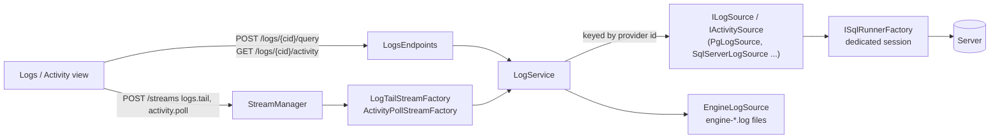
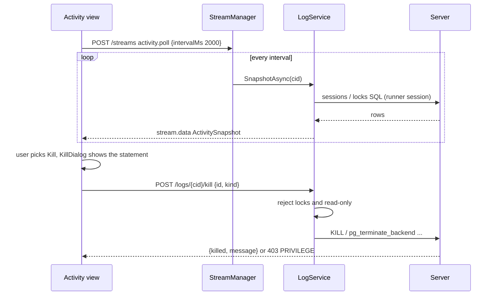
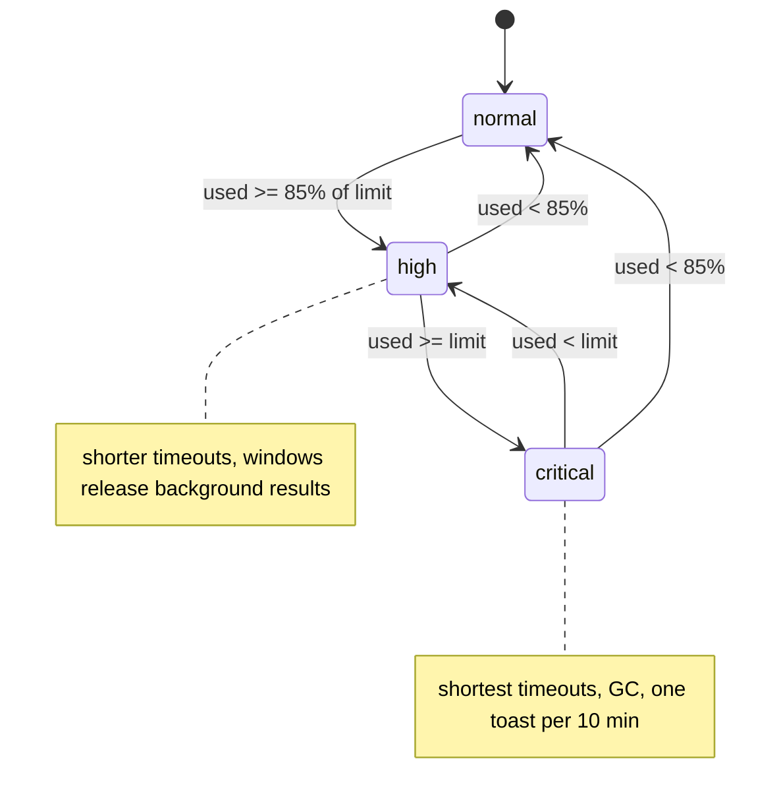

# 21. Logs and activity, resources and memory

> **Level:** L2 practitioner → L3 senior | **Part:** II | **Code read at:** `d2f42ad` (Rowlit 1.7.0)
> [فارسی](../../fa/part2/21-logs-activity-resources.md) · Previous: [20. UI architecture](20-ui-architecture.md) · Next: [22. The desktop shell](22-desktop-shell.md)
>
> **In one sentence:** the `DbStudio.Logs` package reads each server's own logs and its live sessions through small
> keyed "log source" objects (and the engine's own log file), while the `ResourceManager` keeps memory and the number
> of open server connections in check by releasing idle sessions, trimming caches and telling the windows to let go of old results.
>
> **You will learn:**
> - what the Logs and Activity views show, and how a log line gets from a server to the screen;
> - how the Kill flow works and why it asks you to type the session id;
> - what "release a session" means, and the automatic policies that run every 30 seconds;
> - how memory pressure is measured, what the three levels do, and what the status bar and popover show;
> - what Close connection, Close database and Disconnect all do, and when the engine answers `409 RESOURCE_BUSY`.
>
> **Prerequisites:** [8. Connections, sessions and executing SQL](08-connections-sessions-execution.md), [6. The WebSocket protocol](06-websocket-protocol.md) (streams), [10. Catalog and metadata](10-catalog-and-metadata.md) (the catalog cache).

## 1. The idea (beginner)

Two different questions share this chapter because they use the same screen space and the same engine machinery.

*What is the server doing, and what has it said?* A database keeps a log of its own life (errors, slow queries, restarts) and
a live list of who is connected and what each session is running. Looking at these usually means leaving your SQL client
for another tool. Rowlit shows them in a tab beside your queries: **Logs** for the text that servers write, **Activity** for
sessions, running operations, locks and which session blocks which. If one session is stuck and blocking others, you can
**Kill** it from the same place.

*What is Rowlit itself costing?* Every open tab can hold a physical connection to a server, every result can hold hundreds of
thousands of rows, every explorer node can hold a cached catalog. Left alone, a day of work with twenty connections would hold a
lot of memory and many server sessions. Rowlit therefore runs a small **resource policy** every 30 seconds: sessions that have been idle give back their
connection (but keep the tab, the text and the results, and reconnect the next time you run something), caches are trimmed to a
budget, and if the whole app's memory is high it trims harder. You see the result as a memory figure in the status bar, and
you can ask for a clean-up yourself.

## 2. How it works (practitioner)

### 2.1 The Logs package

`engine/src/DbStudio.Logs` is its own assembly with an `IEngineModule` (`LogsModule`, discovered like every module, see
[chapter 7](07-engine-modules-and-di.md)). Its two central interfaces are in `ILogSource.cs`:

- `ILogSource` has `ListAsync(target)` (which sources does this connection offer, and which are allowed for this login),
  `QueryAsync(target, query)` (a range of entries) and an optional `OpenLive(...)` for push-only sources such as Redis MONITOR
  (`ILogSource.cs:18-41`).
- `IActivitySource` has `SnapshotAsync` (sessions, operations, locks) and `KillAsync` (`:44-55`).

They are registered as **keyed singletons by provider id** (`LogsModule.cs:99-104`, helper `Keyed<T>` at `:112-116`). SQL Server,
Oracle, PostgreSQL, Redis, MongoDB and Kafka are registered in `LogsModule` itself; MySQL/MariaDB, ClickHouse and Snowflake register
their sources from their own provider modules (`MySqlModule.cs`, `ClickHouseModule.cs:34-36`, `SnowflakeModule.cs:54-56`).
SQLite has none, so its Logs tab shows only the engine log (`LogService.ListAsync`, `LogService.cs:51`).

| Provider | Log sources (ids in code) | Activity |
|---|---|---|
| SQL Server | error log, SQL Agent log, `system_health` (extended events) | sessions, locks, blocking |
| PostgreSQL | server log, `pg_stat_statements` top statements | `pg_stat_activity`, cancel or terminate |
| Oracle | alert log, unified audit trail | `V$SESSION`, blocking session, `ALTER SYSTEM KILL SESSION` |
| MySQL / MariaDB | error log, general log, slow log, InnoDB status | process list, `KILL` / `KILL QUERY` |
| ClickHouse | query log, text log, part log | `system.processes`, mutations, merges |
| Snowflake | query history, warehouse load, login history | running queries, locks |
| Redis | slow log, latency monitor, MONITOR (live) | clients, `CLIENT KILL` |
| MongoDB | `getLog`, change stream, profiler per database | current operations, `killOp` |
| Kafka | client log (librdkafka) | jobs and streams of Rowlit |
| (engine) | the engine's own Serilog files | none |

(`new LogSourceInfo(...)` calls in `Providers/*`.) Each source declares whether it supports a range query, a live tail and which
levels it can emit (`LogSourceInfo`, `LogModels.cs:6-27`). A source the login may not read comes back with `available: false` and a
`needs` hint: the exact `GRANT` or statement to ask a DBA for (`LogModels.cs:9-11`).

**One entry shape.** Every line becomes a `LogEntry { Ts, Level, Source, Message, Seq, Detail?, Fields? }` (`LogModels.cs:35-44`). `Seq` is a
monotonic number per source (a natural id, a byte position or a timestamp times 1000 plus an ordinal, `TimeSeq`, `:156-181`), which
lets the UI page backwards (`before`) and the tail go forwards (`after`) without skipping. Levels are normalised to
debug, info, warn, error, fatal or unknown (`LogLevels.Normalize`, `:144-153`).

**The runner.** Provider log sources that read SQL tables use `ISqlRunnerFactory`, whose implementation `SessionSqlRunnerFactory`
runs log and activity SQL on a **dedicated engine-owned session per connection**, not listed among the tab sessions, serialised per
connection, closed after two idle minutes, and each query is cancelled after 30 seconds (`Sql/SqlRunner.cs:137-152`). A busy log query
therefore never blocks your console.

**The service.** `LogService` resolves the connection (or the special id `engine`), dispatches to the keyed source, caches the source
list for five minutes per connection (`ListTtl`, `LogService.cs:17`, `:53`) and forgets it after a privilege error so the next
list probes again (`:72-76`). Driver failures become engine errors: SQL errors `ProviderError`, permission problems `PRIVILEGE`
(`403` with `detail.needs`), I/O problems `SOURCE_UNAVAILABLE` (`:122-144`). `LogFilter` validates a query (limit 1–5000, default 1000,
query text ≤ 1000 characters, known levels, `from` not after `to`) and also does the engine-side filtering, because a server-side filter is
only a pre-filter (`LogFilter.cs:5-90`).

**Figure 21.1 — How log sources are plumbed.**

**REST routes** (`Endpoints/LogsEndpoints.cs`, all under `/api/v1/logs/{cid}`; `cid = "engine"` is the engine's log):
`GET sources[?refresh=true]`, `POST query`, `GET activity`, `POST kill` and `POST export`. A kill on a read-only connection answers
`403 READ_ONLY` (`LogService.cs:117`). An export without a `path` returns the file; with a `path` it starts a **job** that writes
`path + ".partial"` and renames it on success, reporting progress through `job.progress` (`LogsEndpoints.cs:162-191`).

**Tails are streams.** Live following is not polling from the UI. The UI opens a stream of kind `logs.tail` (parameters `sourceId`,
`levels`, `q`, `after`, `maxMinutes`) or `activity.poll` (`intervalMs`) through `POST /streams`, and receives batched
`stream.data` events ([chapter 6](06-websocket-protocol.md)). `LogTailStreamFactory` decides how: polled sources are queried every
`logs.tailIntervalMs` (default 2000 ms, clamped 250–600 000) with a seq cursor that starts at the newest entry, the engine log at most every
second, and pausing stops polling and resuming catches up (`LogStreams.cs:7-62`, `LogsModule.cs:119-123`). Push sources (Redis MONITOR,
the Mongo change stream) feed entries as they come, and MONITOR **stops by itself after `maxMinutes`** (default 10, allowed 1–120) with a final
warning entry, because it costs a busy Redis throughput (`LogStreams.cs:99-116`). `activity.poll` clamps its interval to 500–60 000 ms
(default 2000) and tolerates two transient failures in a row (`:122-143`).

**The engine log.** `EngineLogSource` reads the Serilog files `engine-yyyyMMdd.log` and `engine-yyyyMMdd_001.log` of the data folder's `logs`
directory; its `Seq` is the file key times 2^31 plus the byte offset of the entry, so a tail resumes exactly where it stopped even across
the daily roll (`EngineLogSource.cs:8-14`). The engine itself keeps ten daily files (`Program.cs:58`).

### 2.2 The Logs and Activity views

The tab (`view: 'logs'`, `components/Logs/commands.ts`) is opened by **Ctrl+Alt+Shift+L**, *Logs & activity* on a connection, or *Activity* in the Connections
panel. `Logs/model.ts` is the pure logic; `LogsView.tsx` and `ActivityView.tsx` draw it.

- **Logs sub-view.** A source picker (the connection's sources, then always the engine log: `mergeSources`, `model.ts:36-45`), level chips
  (error also covers fatal), time range, text search, a **Follow** toggle for the tail, an archive picker for SQL Server (current file or
  "Archive #n") and **Export** (txt, csv or json through `/logs/{cid}/export`, `LogExporter.Formats`).
- **Activity sub-view.** A grid of sessions, operations and locks with duration, wait type, who blocks whom and the SQL text. The
  summary tiles count sessions and blocked sessions and name the **head blocker**. A row blocked by another shows "↳ blocked by *id*" and
  a hover with the whole chain; a blocker shows "blocks *n*" (`ActivityView.tsx:307-333`). "Only active", Sessions/Locks switches and search narrow it.

**Kill.** Choosing *Kill…* (or PostgreSQL's *Cancel*) opens `KillDialog` (`Logs/KillDialog.tsx`): it explains what will happen ("*id* is
disconnected and its open transaction is rolled back", or for cancel "the statement is interrupted; the session stays connected"),
shows the **exact statement the engine will run**, and keeps the danger button disabled until you type the row id. The statements
are plain and visible in the code: PostgreSQL `pg_cancel_backend(pid)` or `pg_terminate_backend(pid)` (`PgLogSource.cs:84`), MySQL `KILL QUERY id` or
`KILL id` (`MySqlLogSource.cs:64`), Oracle `ALTER SYSTEM KILL SESSION 'sid,serial' IMMEDIATE` (`OracleLogSource.cs:70`), ClickHouse
`KILL QUERY WHERE query_id = … SYNC` and `KILL MUTATION …` (`ChLogSource.cs:155-158`), Redis `CLIENT KILL ID`, Mongo `killOp`. A server that denies the right
answers `PRIVILEGE`, and the dialog shows the `GRANT` to ask for (for ClickHouse `GRANT KILL QUERY ON *.* TO user`, `ChLogSource.cs:511-518`). The
service refuses locks (only `session`, `op` and `client` can be killed, `LogService.cs:113-114`), and refuses read-only connections.

**Figure 21.2 — Activity poll and Kill.**

### 2.3 What a session holds, and "releasing" it

Recall from [chapter 8](08-connections-sessions-execution.md) that one tab owns one session which owns one physical connection
(`Pooling=false`). A session can **release** its physical connection while its id stays valid: `SessionInfo.Released` with a
`ReleasedReason` of `idle`, `closed`, `pressure` or `limit` (`SessionManager.cs:26-28`, `:63-72`). The tab keeps its editor, results and transaction
mode; the status bar says "Disconnected (idle)" with a **Reconnect** button. The next run reopens the connection on the same database and
transaction mode and prints an info message ("Reconnected: the session had been closed after being idle."). Where a session has its own default
schema (`SchemaMode.Session`: PostgreSQL, Oracle, Snowflake) the schema it had is restored too (`docs/resources.md`, "Releasing a session").

What a reconnect cannot restore (session `SET` options, variables) is lost, so the **automatic** policies never release a session that

- has an **open transaction** (`TxOpen`),
- is **running** a statement, export or describe,
- created **temporary objects** (`#temp`, `CREATE TEMP TABLE`, `SELECT … INTO #t`, SQLite `temp.`): the statement classifier detects them and the flag
  `HasTempObjects` is sticky until the session is released or closed.

Only an explicit *Close* with confirmation rolls a transaction back. The idle ping (every 60 s, `SessionManager.cs:202`) does not count as activity.

### 2.4 The automatic policies

`ResourceManager` (`Core/Services/ResourceManager.cs`) is a singleton created at start (`Program.cs` resolves it right after the pipeline).
It runs `RunPolicyAsync` on a timer every **30 seconds** (`:189`) and also on demand (`POST /resources/trim`, tests). One pass does, in order:
sample memory and publish a level change (`:245-262`); release idle sessions; reap idle source clients (Redis, MongoDB, Kafka, Elasticsearch clients) unless a stream or job holds
a lease; trim the catalog cache; trim stored result rows; clear pooled catalog connections of connections nobody used; and, at `critical`, run a compacting GC at most every five minutes
(`:263-290`). The defaults (`ResourcePolicy`, `:29-37`) and what pressure changes (from `docs/resources.md` and the code):

| Policy | Normal | `high` | `critical` |
|---|---|---|---|
| Idle session releases its connection | after 15 min (`idleSessionMinutes`) | one third, at least 2 min | 1 min |
| Source client closes | 600 s (`connections.sourceIdleSeconds`), never while leased | 3 min | 1 min |
| Catalog cache (LRU per schema) | 128 MB budget; entries used in the last 10 min stay | half the budget, 2 min | quarter, 0 min |
| Stored result rows (engine copy, for paging and export) | 256 MB cap; unread results expire after 30 min | expire after 5 min | expire after 1 min |
| Compacting GC | no | no | at most every 5 min |

(`IdleTimeout` at `ResourceManager.cs:295-306`; the expiry lines `:272-278`.) `trimUnderPressure = false` keeps the normal column.

**Open connections limit.** A connection "holds server resources" when a session holds its connection, its source client is open, or a stream runs. Before a session opens or a
source client opens for a connection that holds nothing, `EnsureCapacityAsync` (`:372-397`) checks `maxOpenConnections` (default 20). If that many
already hold resources, it releases the **least recently used idle** one (`IsIdleConnection`: no transaction, running work, temporary objects, streams, leases or
jobs) with reason `limit` and publishes `resources.released`; the UI toasts "Closed X to free resources". If none is idle the new connection **opens anyway**: the limit never makes
a connect fail (`:366-371`).

**Memory pressure.** The engine samples its working set and managed heap (`IMemoryProbe`, `GC.GetGCMemoryInfo`). Each window reports the Electron processes' memory (desktop:
`app.getAppMetrics()` through the `getAppMemory` bridge, `desktop/src/main/memory.ts:11-21`; browser: the JS heap if available) with `POST /resources/report`; a report counts for two
minutes (`ReportTtl`, `:166`). **Used** is the engine's working set plus the *largest* window report (`:222-229`). The **limit** is `memoryLimitMb`, or auto: 25% of the memory available to the
process, clamped to 1–8 GB (`AutoLimitBytes`, `:208-214`). `LevelOf` gives `normal` below 85% of the limit, `high` up to it, `critical` at or above (`:233-234`).

**Figure 21.3 — Pressure levels.**

A level change logs a line and publishes `resources.pressure { level, usedBytes, limitBytes }`. The page reacts in `onPressure`: it runs its own policy at that level and, at `critical`, shows
"Memory use is above the limit" at most once per ten minutes (`ui/src/app/resources.ts:onPressure`).

### 2.5 The window's own policies

The page holds rows and catalogs too, so `app/resources.ts` runs a pass every 30 seconds (`POLICY_INTERVAL_MS`) and on `resources.pressure`.

- **Results.** Console results of tabs that are not on screen (the active tab of every editor group stays) keep only their **first page, 1000 rows** (`RELEASE_KEEP_ROWS`) when the tab was not viewed
  for `releaseResultsMinutes` (10), when all results together exceed `resultRowBudget` (500 000 rows; least recently viewed first), or under pressure. Never touched: running queries, grids with unsaved or
  saved-but-overlaid edits (`releasable`, `:70-83`). The grid then shows "Results released to save memory" with **Reload** (fetches the rows back from the engine's stored copy in pages of 5000, no query
  runs: `reloadReleased`) and **Re-run**; if the engine copy is gone only Re-run is offered. Data tabs are not released: they page from the server anyway.
- **Catalog.** Cached databases that no open tab's connection uses and whose Explorer node is collapsed are evicted (LRU) beyond `catalogCacheMb`; they reload when shown (`evictCatalogs`, ETags make it cheap, [chapter 10](10-catalog-and-metadata.md)).

### 2.6 Manual controls and `RESOURCE_BUSY`

| Control | Command | What it does |
|---|---|---|
| **Close connection** | `connections.disconnect` (Explorer menu, palette) | releases this window's sessions of the connection (tabs keep their results), closes its streams, source client and jobs, drops its catalog cache and clears its connection pools |
| **Close database** | `connections.closeDatabase` (database node menu) | releases sessions on that database and drops its catalog cache |
| **Disconnect all** | Connections panel, palette, Resources popover | Close connection for every connection |
| **Free memory now** | Resources popover (`POST /resources/trim`) | one engine pass as under `critical`, plus this window releases every background result (`freeMemoryNow`) |

Before closing, the window confirms what it knows (open transactions are rolled back, running queries cancelled). The engine answers **`409 RESOURCE_BUSY`** with `detail.blockers` for what only it
knows (exports, imports, jobs, live streams), listing each as "Closing would interrupt n item(s): …"; the window confirms those and retries with `force: true` (`ResourceManager.CloseAsync`, `:497-508`;
`CloseAllAsync`, `:510-521`). Another window's sessions are left alone: `InScope` compares the `X-DbStudio-Client` id of the caller with the session's owner (`:422-426`).

**Closing with tabs open.** Consoles and Data tabs stay open when their connection closes: the console keeps text and results (status bar "Disconnected" with **Reconnect**), the Data tab keeps its rows under a
"Disconnected — Reconnect" banner and becomes read-only. **Nothing reconnects by itself**: the catalog store marks the connection `closed`, and only a user action clears it (expanding the node, running a
statement, Reconnect, opening a console). Unsaved grid edits block the close with Save / Discard / Cancel (`docs/resources.md`, "Closing with tabs open").

### 2.7 The status bar item and the popover

`ResourcesItem` shows the memory in use with a gauge icon; its colour is amber at `high` and red at `critical`, and the tooltip gives `used of limit` and the number of connections holding server resources
(`StatusBar/ResourcesItem.tsx`). A click opens the **Resources popover**, loaded lazily so the initial bundle stays small: memory against the limit (engine, windows, result cache, metadata), every
connection with what it holds (open and released sessions, client, live views, jobs, metadata size) and a **Close** button each, **Free memory now**, **Disconnect all** and a link to Settings
(Settings › Connections › Resources). The Explorer's filled dot means "holds server resources"; a dim dot means only a cached catalog or released sessions. The settings (`settings.json › resources`):
`autoRelease`, `idleSessionMinutes`, `maxOpenConnections`, `memoryLimitMb`, `trimUnderPressure`, `releaseResultsMinutes`, `resultRowBudget`, `catalogCacheMb`, `resultCacheMb`, `resultCacheMinutes`
(ranges in `ResourcePolicy.Ranges`, `:42-47`).

**API.** `GET /resources`, `POST /resources/report`, `POST /resources/trim`, `POST /resources/close-all`, `GET /connections/{id}/resources`, `POST /connections/{id}/close`
(`Host/Endpoints/ResourceEndpoints.cs:20-52`); events `session.changed` (with `released`, `releasedReason`, `hasTempObjects`), `resources.released`, `resources.pressure`.

## 3. Deep dive (senior)

> **Deep dive (L3): dead connections are a resource problem too.**
>
> A pooled catalog connection whose server vanished without a reset (Docker Desktop restarted, a VPN dropped) is handed out unchecked and its first query blocks. `docs/resources.md` ("Dead connections")
> records the countermeasures that live in `CatalogService` and `ConnectionGuard`: opening a catalog reader runs a liveness probe (15 s), database and schema lists have a 30 s deadline, schema loads
> and DDL 5 minutes, and the deadline ends the wait even when the driver ignores its cancellation token. A deadline or a transport failure clears the provider's pooled connections and retries once on new
> ones; a second failure is `503 SERVER_UNREACHABLE`. Opening a session is bounded at 45 s (`SessionManager.OpenTimeout`, `:250`). Not covered: a statement already running on a dead open session keeps the
> driver's own behaviour; use Cancel.
>
> **Why a separate runner session for logs.** Activity queries must work *while your console is busy* (that is when you need them), and a blocked console cannot run a second statement on the same session.
> A dedicated session per connection, serialised and short-lived, keeps the diagnostics path independent. The 30 s per-query timeout stops a huge log or a stuck server from hanging the view.
>
> **Why `Seq` instead of timestamps.** Logs from different servers have different clocks, coarse resolution and out-of-order lines. A per-source monotonic cursor lets the engine page backwards and
> tail forwards with no gaps and no duplicates, at the cost of each source defining what its `Seq` means (a natural id, a byte position or a time-based number, as listed above).

## 4. Edge cases and limits

| Topic | Value | Source |
|---|---|---|
| Resource policy period | 30 s | `ResourceManager.cs:189` |
| Window policy period | 30 s | `app/resources.ts` `POLICY_INTERVAL_MS` |
| Idle ping | 60 s | `SessionManager.cs:202` |
| Idle session timeout | 15 min (0 = never) | `ResourceManager.cs:39` |
| Open connections limit | 20 (0 = unlimited) | `ResourceManager.cs:40` |
| Max sessions per profile | 8 | `SessionManager.cs:171` |
| Window memory report lifetime | 2 min | `ResourceManager.cs:166` |
| Auto memory limit | 25% of available RAM, 1–8 GB | `ResourceManager.cs:208-214` |
| Level thresholds | 85% and 100% of the limit | `ResourceManager.cs:233-234` |
| Released result keeps | 1000 rows | `RELEASE_KEEP_ROWS` |
| Result row budget | 500 000 rows | `ResourcePolicy` |
| Log query limit | 1–5000 (default 1000) | `LogFilter.cs:7-9` |
| Log source list cache | 5 min | `LogService.cs:17` |
| Log SQL timeout / runner idle | 30 s / 2 min | `SqlRunner.cs:149-151` |
| Tail interval | 250–600 000 ms (default 2000) | `LogsModule.cs:119-123` |
| MONITOR auto-stop | 10 min (1–120) | `LogStreams.cs:20-21` |
| Activity poll interval | 500–60 000 ms | `LogStreams.cs:118` |
| Idle runner session | closed after 2 min | `SqlRunner.cs:149` |

Other edge cases: a source can be unavailable for lack of a privilege (the view shows the `needs` text instead of an empty list); SQLite and any provider without log sources show only the engine log; a Kafka
"activity" is Rowlit's own jobs and streams, not broker sessions; the Kill button never appears for lock rows (`CanKill` false).

## 5. How it is tested

- Engine: `engine/tests/DbStudio.Logs.Tests` (parsers, filter, sources with a fake SQL runner, tails and exports) and `DbStudio.Core.Tests/Resources/*` (the policy with a fake `TimeProvider` and a fake memory probe,
  release and reopen, the limit, close with blockers).
- UI: `components/Logs/model.test.ts`, `LogsView.test.tsx`, `ActivityView.test.tsx`; `app/resources.test.tsx` (window policy); `StatusBar` tests.
- Manual: `docs/qa/logs-walkthrough.md`, per-provider rounds `docs/qa/round-*.md` ([chapter 23](23-testing-and-qa.md)).

## Related chapters

- [Part I, chapter 10: Concurrency, locks and MVCC](../part1/10-concurrency-locking-mvcc.md): blocking chains, deadlocks, why Kill is sometimes needed.
- [Part I, chapter 13: Performance tuning](../part1/13-performance-tuning.md): where wait statistics and slow logs fit.
- [8. Connections, sessions and executing SQL](08-connections-sessions-execution.md): the session lifecycle that releasing builds on.
- [6. The WebSocket protocol](06-websocket-protocol.md): `stream.data`, `job.progress`, `resources.*` events.
- [22. The desktop shell](22-desktop-shell.md): `getAppMemory`.

## Glossary terms introduced here

[log source](../glossary.md#log-source) · [activity source](../glossary.md#activity-source) · [tail](../glossary.md#tail) · [blocking chain](../glossary.md#blocking-chain) ·
[kill](../glossary.md#kill) · [resource policy](../glossary.md#resource-policy) · [memory pressure](../glossary.md#memory-pressure) · [working set](../glossary.md#working-set) ·
[GC heap](../glossary.md#gc-heap) · [LRU budget](../glossary.md#lru-budget) · [released session](../glossary.md#released-session) · [release vs close](../glossary.md#release-vs-close) ·
[blocker](../glossary.md#blocker) · [trim](../glossary.md#trim) · [popover](../glossary.md#popover) · [idle timeout](../glossary.md#idle-timeout) · [released results](../glossary.md#released-results)

## Files

| Path | Responsibility |
|---|---|
| `engine/src/DbStudio.Logs/ILogSource.cs`, `LogModels.cs`, `LogFilter.cs`, `LogService.cs` | contracts, wire model, validation, dispatch |
| `engine/src/DbStudio.Logs/LogStreams.cs` | `logs.tail` and `activity.poll` stream factories |
| `engine/src/DbStudio.Logs/EngineLogSource.cs`, `LogExporter.cs` | engine log files, export |
| `engine/src/DbStudio.Logs/Providers/*` | one log/activity source per provider |
| `engine/src/DbStudio.Logs/Sql/SqlRunner.cs` | dedicated SQL runner sessions |
| `engine/src/DbStudio.Core/Services/ResourceManager.cs` | policies, pressure, close |
| `engine/src/DbStudio.Core/Services/SessionManager.cs` | release and reopen |
| `engine/src/DbStudio.Host/Endpoints/ResourceEndpoints.cs` | resource routes |
| `ui/src/components/Logs/*` | Logs and Activity views, Kill dialog |
| `ui/src/app/resources.ts`, `store/resources.ts` | window policy and snapshot polling |
| `ui/src/components/StatusBar/Resources*.tsx` | status item and popover |
| `desktop/src/main/memory.ts` | Electron memory report |
| `docs/resources.md` | the policy document |
