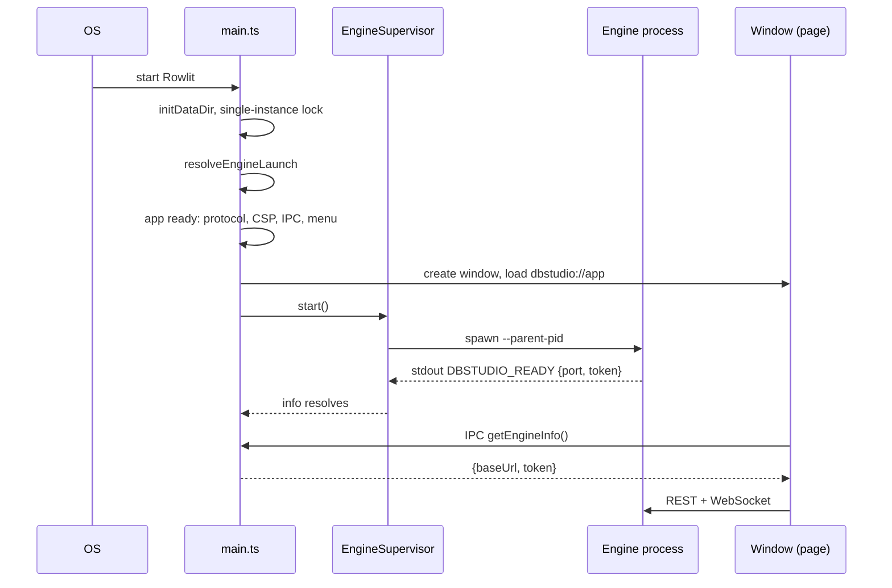
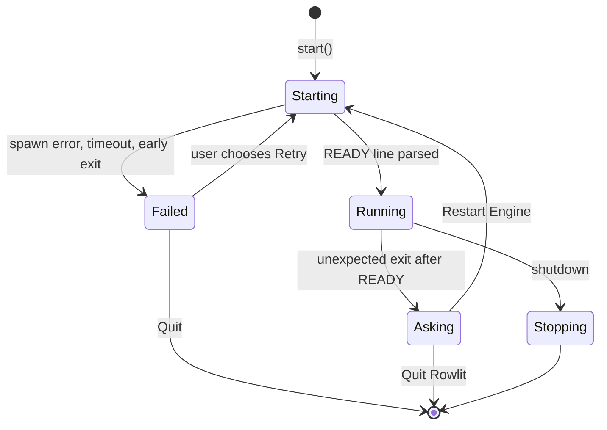
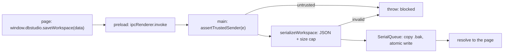
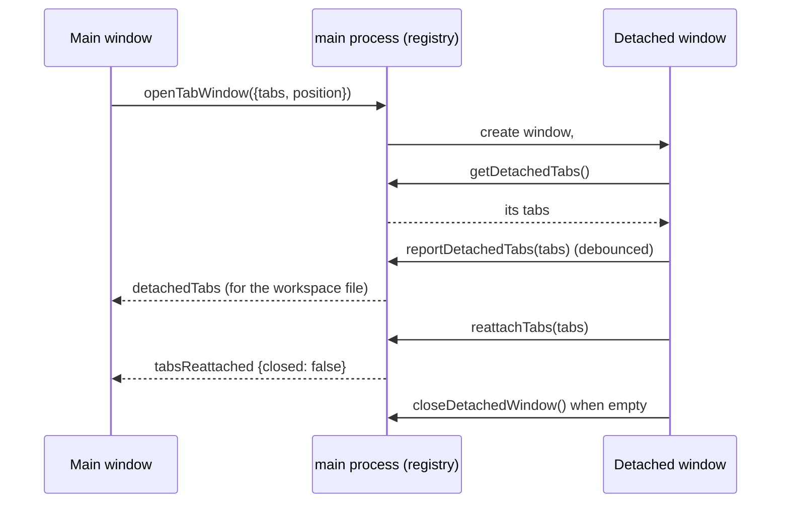
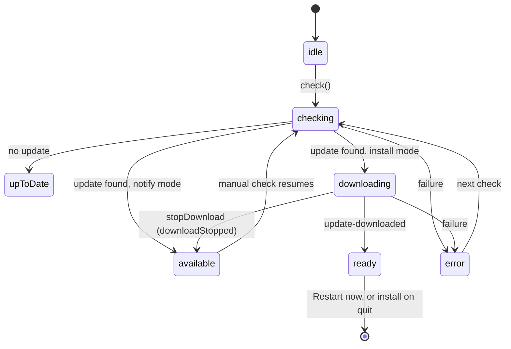

# 22. The Electron shell: lifecycle, IPC, windows and updates

> **Level:** L2 practitioner → L3 senior | **Part:** II | **Code read at:** `d2f42ad` (Rowlit 1.7.0)
> [فارسی](../../fa/part2/22-desktop-shell.md) · Previous: [21. Logs, activity, resources and memory](21-logs-activity-resources.md) · Next: [23. Testing and QA](23-testing-and-qa.md)
>
> **In one sentence:** `desktop/` is a small Electron program, about 4200 lines of TypeScript in 23 files, whose
> job is to start the .NET engine, show the page in a locked-down window, answer the page's few requests for native things
> (files, dialogs, menus, updates), and shut everything down without losing your work.
>
> **You will learn:**
> - what the main, preload and renderer parts are and which file is which;
> - how the app starts: single instance, data folder, engine launch, the READY handshake, the window;
> - what happens when the engine crashes, fails to start, or the app quits;
> - how the IPC bridge, detached windows, the native menu, the quit guard and the auto-updater work;
> - what the shell deliberately does *not* do.
>
> **Prerequisites:** [3. Big-picture architecture](03-big-picture-architecture.md), [4. Running from source](04-development-setup.md), [19. Security and secrets](19-security-and-secrets.md).

## 1. The idea (beginner)

Electron lets a web page run as a desktop program. It gives you two kinds of process. The **main process** is a Node.js program that
owns the windows and can talk to the operating system. A **renderer process** shows one page; here, the React UI. For safety, the page
may not use Node.js or the file system directly. A tiny script called the **preload** runs in between and hands the page a short list
of allowed requests ("show a save dialog", "read this text file", "check for updates"). The main process receives each request,
checks it, and does it.

In Rowlit the main process has one more job that a plain Electron app does not have: it starts the .NET **engine** as a child process,
waits until the engine says it is ready (and learns its port and token), hands those two values to the page, and kills the engine when the
app closes. If the engine dies, the shell notices and offers to restart it. In short, the shell is a **supervisor** with a window.

It also guards your work. If you try to quit while there are unsaved grid edits or open transactions, the shell asks the page what would be
lost and shows a confirmation first.

## 2. How it works (practitioner)

### 2.1 The files

`desktop/src` has three folders: `main/` (21 files), `preload/preload.ts` and `shared/channels.ts`. The bundle is built by esbuild
(`desktop/build/bundle.mjs`) into `out/main.js` and `out/preload.js`, and into `out/lib/*` for the modules that have no `electron` import so
Node tests can load them. A design rule explains the layout: **everything with logic is Electron-free** (`engine-process.ts`, `validate.ts`,
`csp.ts`, `platform.ts`, `updater-core.ts`, `data-dir.ts`, `windows-core.ts`, `quit-core.ts`, `fs-utils.ts`, `memory.ts`) and is unit-tested in plain Node; the thin
Electron-facing wrappers (`main.ts`, `ipc.ts`, `window.ts`, `windows.ts`, `quit.ts`, `updater.ts`, `menu.ts`, `protocol.ts`) only wire them.

| File | Role |
|---|---|
| `main/main.ts` | entry: single instance, data dir, engine supervisor, window, menu, IPC, updater, quit guard |
| `main/engine-process.ts` | how to launch the engine, `EngineProcess`, `EngineSupervisor`, process-tree kill |
| `main/window.ts` | the hardened `BrowserWindow`, window state, CSP install, navigation lock |
| `main/protocol.ts`, `csp.ts` | the `dbstudio://app` scheme and the Content-Security-Policy ([chapter 19](19-security-and-secrets.md)) |
| `main/ipc.ts`, `validate.ts` | IPC handlers and argument validation |
| `main/windows.ts`, `windows-core.ts` | detached tab windows |
| `main/quit.ts`, `quit-core.ts` | the quit guard |
| `main/updater.ts`, `updater-core.ts` | auto-update wiring and its state machine |
| `main/menu.ts` | the native menu, built from the UI's menu model |
| `main/data-dir.ts`, `paths.ts` | where data lives, and the one-time move from `DbStudio` |
| `main/platform.ts` | per-OS decisions (title bar, Mica, vibrancy, macOS keeps running) |
| `main/memory.ts` | `app.getAppMetrics()` summary for the resource manager |
| `main/fs-utils.ts` | atomic file writes, `SerialQueue`, rotating log, text decoding |
| `main/error-page.ts`, `smoke.ts` | the "engine failed to start" page, the Electron self-test |
| `preload/preload.ts` | the `window.dbstudio` bridge |
| `shared/channels.ts` | IPC channel names |

### 2.2 Start-up, step by step

`main.ts` runs top to bottom (`desktop/src/main/main.ts`):

1. **Dev URL** (`:31-44`): `DBSTUDIO_DEV_URL` is accepted only if it is an `http(s)` URL on `localhost`, `127.0.0.1` or `[::1]`; anything else is logged and ignored.
2. **Data folder** (`:48-49`): `initDataDir()` resolves it (migrating `DbStudio` → `Rowlit` once, see 2.9) and the result is written to
   `process.env.DBSTUDIO_DATA_DIR`, so the engine, started later, uses the same folder.
3. **Profile and scheme** (`:52-54`): `app.setPath('userData', …/electron)`, `setAppUserModelId('com.dbstudio.desktop')` (the kept id) and `registerSchemePrivileges()`. These must run before `ready`.
4. **Single instance** (`:56-71`): `app.requestSingleInstanceLock()`. A second launch quits at once; the first instance gets a `second-instance` event and brings its window
   forward (`:206-215`). One special case: if the lock failed because **DbStudio is still running** and holds the same profile, a dialog says to quit DbStudio first (`:57-65`).
5. **`main()`** (`:73`): starts a rotating log (`engine-process.log`), then `resolveEngineLaunch` picks how to get an engine (order in [chapter 4](04-development-setup.md)); a bad
   configuration shows an error box and quits (`:89-105`).
6. **On `ready`** (`:217-259`): registers the `dbstudio://` protocol handler, installs the CSP, creates the updater, registers IPC and the window IPC, builds the native menu, **creates the window**,
   starts the supervisor (`supervisor.start()`) and **in parallel** loads the UI; `getEngineInfo()` calls from the page wait for the handshake (`:254-258`).

**Figure 22.1 — From launch to a usable window.**

### 2.3 The engine supervisor

`EngineProcess` (`engine-process.ts:311-482`) owns one child process and is not reusable. `start()` does the following (`:339-406`):

- spawns with `stdio: ['pipe','pipe','pipe']`, `windowsHide: true`, and on POSIX `detached: true` so the engine leads its own **process group** (needed to signal the whole tree);
- starts a ready timer (**15 s**, or **180 s** for `dotnet run`, overridable by `DBSTUDIO_ENGINE_TIMEOUT_MS`; `:46-48`, `:110-115`);
- reads stdout line by line; the first line that parses as `DBSTUDIO_READY {"port":N,"token":"…"}` (port 1–65535, token ≤ 512 chars; `parseReadyLine`, `:208-222`)
  resolves the start with `http://127.0.0.1:<port>` and the token, and is logged with the token replaced by `<redacted>` (`:381`);
- keeps draining stdout and stderr for the life of the process, because an undrained pipe fills and blocks the engine (`:372-373`), and remembers the last 40 lines for error reports;
- fails with an `EngineStartError` of kind `spawn`, `timeout`, `exit` or `stopped`, each with the recent output.

**Stopping.** `killProcessTree` is `taskkill /PID n /T /F` on Windows and `SIGKILL` to the process group elsewhere (`:234-267`). `stopAndWait` is graceful on macOS and Linux: `SIGTERM` to the
group so the engine can roll back transactions, wait a grace period (**3 s** by default, `DEFAULT_KILL_GRACE_MS`), then `SIGKILL`, and finally reap grandchildren that ignored the signal, signalling the
group only because the pid may have been reused (`:435-466`). The engine has a second line of defence: its `--parent-pid` watchdog exits when Electron disappears ([chapter 5](05-engine-host-and-api.md)).

`EngineSupervisor` (`:492-569`) wraps the process and the "engine info" promise the page waits on. `whenReady()` returns the promise of the current start; during a restart it is replaced, so a caller that
asks while the engine restarts waits for the *new* info. An engine that was `external` (attached through `DBSTUDIO_ENGINE_URL`) is never spawned or killed (`:505`, `start()` just resolves the given info).

**Figure 22.2 — The engine supervisor.**

- **Crash after ready** (`handleExit`, `:533-552`): the exit was not expected, the engine had been ready, and the app is not shutting down. The ready promise is replaced, and the shell asks:
  *"The Rowlit engine stopped unexpectedly. Exit code: …. Open sessions and uncommitted transactions were lost; editor tabs are kept."* with **Restart Engine** or **Quit Rowlit**
  (`main.ts:115-133`). On macOS with no window, it restarts silently, because the app keeps running without windows (`:117-118`). After a restart the shell sends `engineRestarted` to **every** window
  (`:171-174`), and the page reconnects with the new port and token ([chapter 20](20-ui-architecture.md)).
- **Failure to start** (`showStartFailure`, `:135-167`): the window loads a static page from a `data:` URL with the message and the last 25 output lines (`error-page.ts`: no script, `default-src 'none'`), and a dialog offers
  **Retry**, **Open Log** or **Quit**; Retry calls `supervisor.start()` again.
- **Help › Restart engine** and **Open logs folder** are native menu items (`menu.ts:92-93`); Restart is absent when the engine is external (`main.ts:246`).

### 2.4 The scheme, the CSP and the window

The page is served by `registerUiProtocol(uiDir())` from `dbstudio://app` (`protocol.ts:96-116`), with an SPA fallback: a path with no extension, or ending in `.html`, returns `index.html`; a missing asset is a 404. Hashed files under `assets/` are
`immutable` for a year, `index.html` is `no-cache`. The directory is `ui/dist` in a repository checkout, `resources/ui` when packaged, or `DBSTUDIO_UI_DIR` (`paths.ts:59-63`). The CSP and the `webPreferences` are explained one directive at a time in
[chapter 19](19-security-and-secrets.md).

`createMainWindow` (`window.ts:132-196`) adds comfort to the safety:

- default size 1400 × 900, minimum 800 × 500, position and maximised state remembered in `electron/window-state.json`; a saved position is restored only if at least 200 × 100 px of the window would still be visible on a connected display (`:18`, `:22-40`). Writes are debounced 500 ms and atomic.
- a background colour matching the OS theme so there is no white flash, kept in sync with `nativeTheme` (`:141-179`);
- **per-OS chrome** (`platform.ts`): macOS gets an inset title bar with vibrancy (the page leaves 78 px for the traffic lights); Windows 11 gets a hidden title bar with `titleBarOverlay` caption buttons inside the page's top bar and Mica
  (build ≥ 22621); Linux gets a native frame. The page tells the shell its theme with `setTitleBarTheme`, which validates hex colours and sets the native light/dark mode and the overlay colours (`window.ts:198-208`);
- a crashed renderer is reloaded (`render-process-gone` unless the reason is `clean-exit` and the app is not quitting, `main.ts:304-307`).

### 2.5 The preload and the bridge

`preload.ts` is a sandboxed script, bundled to a single file whose only runtime `require` is `electron`. It builds a `bridge` object that implements the TypeScript contract `DbStudioBridge` (`ui/src/platform/bridge.ts`) and exposes it with
`contextBridge.exposeInMainWorld('dbstudio', bridge)` (`preload.ts:27`, `:106`). Each member is a thin wrapper: `ipcRenderer.invoke(channel, args)` for requests that return a value, `ipcRenderer.send` for fire-and-forget
(`setTitle`, `setTitleBarTheme`, `showAppMenu`, `notify`, `setMenuShortcuts`), and `subscribe(channel, cb)` for events pushed by main (it returns an unsubscribe function and rejects a non-function). Two extras sit outside the frozen contract:
`window.dbstudioPlatform` (`{platform, arch, titleBar, nativeMaterial}`) and CSS classes and variables on `<html>` set before the UI runs (`platform-win32`, `titlebar-overlay`, `--titlebar-inset-left`, …). The app version and the window role
(`main` or `detached`) arrive as `additionalArguments` of the window and are read from `process.argv` (`preload.ts:10-18`, `window.ts:168`).

### 2.6 The IPC handlers

Every handler is registered by `handle(channel, fn)`, which first runs `assertTrustedSender` ([chapter 19](19-security-and-secrets.md)), then `fn`. The channel names are in `shared/channels.ts`; the handlers are in `ipc.ts:80-218`.

| Bridge member | Channel | Does | Validator |
|---|---|---|---|
| `getEngineInfo` | `get-engine-info` | `supervisor.whenReady()` | none |
| `showSaveDialog`, `showOpenDialog` | `show-*-dialog` | native dialog on the owner window; save asks to confirm overwrite; open can prompt to create (new SQLite file) | `validateSaveDialogArgs`, `validateOpenDialogArgs` |
| `readTextFile`, `readTextFileHead` | `read-text-file(-head)` | read with UTF-8/UTF-16 BOM handling, ≤ 64 MB; the head variant reads only the first bytes for the Import preview | `validateFilePath`, `validateHeadBytes` |
| `writeTextFile` | `write-text-file` | atomic write: temp file, `fsync`, rename, retry ~1 s on `EPERM`/`EBUSY` | `validateFilePath`, `validateFileContent` |
| `openExternal` | `open-external` | `shell.openExternal` of an `http(s)` URL | `validateExternalUrl` |
| `openPath`, `revealInFolder` | `open-path`, `reveal-in-folder` | open an exported data file / show it in its folder | `validateExportedFilePath` / `validateFilePath` |
| `loadWorkspace`, `saveWorkspace` | `load-/save-workspace` | `workspace.json` with a `SerialQueue`, one `.bak` generation, load falls back to the backup on corrupt JSON | `serializeWorkspace` (≤ 64 M chars) |
| `getUpdateStatus`, `checkForUpdates`, `configureUpdates`, `quitAndInstall`, `cancelUpdateDownload` | `updates-*` | forwards to the `UpdateController` | `validateUpdateCheckArgs`, `validateUpdateConfig` |
| `getAppMemory` | `get-app-memory` | `summarizeAppMetrics(app.getAppMetrics(), os.totalmem())` | none |
| `setTitleBarTheme`, `showAppMenu`, `setMenuShortcuts`, `notify`, `setTitle` | fire-and-forget | window chrome and menu; an OS notification only while the window is in the background | their validators |

`atomicWriteFile` and `SerialQueue` (`fs-utils.ts`) are why a crash in the middle of saving does not leave half a workspace file. `getPathForFile` (drag and drop of files onto the window) is resolved in the preload with `webUtils.getPathForFile`
because `File.path` no longer exists since Electron 32 (`preload.ts`).

**Figure 22.3 — One IPC request.**

### 2.7 The native menu

`buildMenu` (`menu.ts:116-129`) turns the UI's `MENUS` model (`ui/src/commands/menuModel.ts`) into an Electron menu. A command item sends its **registry command id** to the focused window over `menuCommand`
(`sendMenuCommand`, `:78-81`), and the page runs the command. A shortcut written `Mod+Shift+P` becomes the accelerator `CmdOrCtrl+Shift+P` (`toAccelerator`, `:27-43`); a chord (`Mod+K Mod+S`) has no native accelerator. Two details prevent double firing:
Chromium gives the page the key first and the accelerator fires only if the page did not call `preventDefault`, and items whose key the editor owns (Ctrl+Enter, F5) are registered with `registerAccelerator: false` so they are only displayed. When
the user rebinds a shortcut, the page sends `setMenuShortcuts`; the validated map is applied and the menu rebuilt (`setMenuShortcuts`, `:66-76`), falling back to the shipped shortcuts if Electron cannot parse one.
Native-only items are *Open logs folder* (`shell.openPath(logsDir())`) and *Restart engine*. On Windows there is no menu bar; the page's menu button calls `showAppMenu` and the shell pops the application menu up at that point.

### 2.8 Detached windows

A tab can leave the main window ([chapter 2](02-tour-of-the-app.md)). `windows.ts` creates a secondary `BrowserWindow` through the same `createMainWindow` with `kind: 'secondary'`, the page URL with the fragment `#detached` and the argument
`--dbstudio-window-role=detached` (`windows.ts:34-52`); the UI sees `isDetachedWindow()` and skips engine supervision, update wiring, workspace autosave and the dock. Main keeps a registry, `DetachedWindows` (`windows-core.ts:125-227`), keyed by `webContents.id`
with the tabs each window shows. Rules in the code: at most 20 windows (`WINDOW_LIMITS.windows`) and 50 tabs per call; tab payloads are validated (`id` matching `[\w.:-]+`, kind `console|object|view`, ≤ 32 M characters of JSON); a window opens near where a tab was dropped but is
kept inside the display's work area (`secondaryWindowBounds`).

**Figure 22.4 — Tab hand-off between windows.**

The main window always knows the tabs in other windows, so its saved workspace includes them (`WorkspaceData.detached`, `ui/src/store/tabs.ts`). Detached windows are *not* restored as windows after a restart: their tabs come back into the main window.
If the user closes a detached window with tabs still in it, main sends `tabsReattached {closed: true}` so the main window lists them in "recently closed" (Ctrl+Shift+T). When the main window closes, `closeAll()` closes the others without asking and
their tabs are already in the workspace (`windows-core.ts:190-198`). They share the one engine, and engine events (`engineRestarted`) go to all windows (`main.ts:85-87`).

### 2.9 The data folder and its one-time migration

`data-dir.ts` is a long, carefully documented module (511 lines) because losing a user's connections in the rename would be the worst bug of the DbStudio → Rowlit change. The rules, from its header:

- the folder is `<appData>/Rowlit` (Windows `%APPDATA%`, macOS `~/Library/Application Support`, Linux `~/.config`); `DBSTUDIO_DATA_DIR` overrides it;
- **packaged builds only** migrate, so a dev run never moves a developer's real data;
- if the Rowlit folder holds the **migration marker** `migrated-from-dbstudio.json`, never look back;
- if it holds real data of its own, use it, and only *report* a DbStudio folder with data; two real datasets are never merged;
- if there is no Rowlit data and a DbStudio folder exists, **rename** `DbStudio` → `Rowlit` (one atomic rename on the same volume) and re-point saved connections whose file lived inside the old folder (the sample database);
- a "young" Rowlit folder (no marker, no secrets, only the auto-created sample connection) plus a DbStudio folder with data triggers a **late migration**: the young folder is set aside, DbStudio is renamed, the sample items are carried over;
- if the rename fails (a file is open by an old process) it keeps using the DbStudio folder for this run and retries next start; nothing is ever copied half-way or deleted;
- on Windows it also copes with **virtualised AppData**: a DbStudio started from inside an MSIX-packaged app keeps files under `%LOCALAPPDATA%\Packages\<package>\LocalCache\Roaming`, and the NSIS updater starts the new version outside that container, so Rowlit looks there for the one DbStudio folder with real data.

The macOS Keychain items keep the service name `DbStudio`, and the DPAPI entropy keeps its old value, so moving the folder does not strand passwords ([chapter 19](19-security-and-secrets.md)).

### 2.10 The quit guard

Quitting must not silently lose work (release 1.6.2). `quit-core.ts` holds the logic, free of Electron, tested with fake windows and a fake engine. The sequence (`QuitFlow`):

1. `before-quit`, or a window's `close`, is intercepted (`preventDefault`). `guard('quit' | 'close-window', windows)` asks **every window** what it would lose: main sends `unsavedWorkQuery` and the page answers
   `{grids, edits, transactions[]}` through the bridge (`quit.ts:34-38`, `ui/src/app/quitGuard.ts`). Each window has **3 s** (`QUERY_TIMEOUT_MS`); a window that does not answer counts as having nothing to lose, and is destroyed without asking (`proceed`), so a hung window never blocks quitting.
2. If any window would lose something, **one** window shows the app's own confirmation (`confirmDiscard`), merged across windows: the focused window if it answered, else the main one. There is no time limit, because the user is reading.
3. Only after a confirmed quit do windows close; **the engine is stopped last**, in `will-quit` (`onWillQuit`, `quit-core.ts:255-286`), so a cancelled quit leaves every window with a live engine. On macOS and Linux the stop is graceful (**5 s** SIGTERM grace,
   `main.ts:194`), on Windows an immediate `taskkill`.
4. Closing a **detached** window asks only about its own work; closing the **main** window on Windows and Linux means quitting, while on macOS it closes the window and the app (and engine) keep running until ⌘Q (`quitWhenAllWindowsClosed`).
5. Update restart: the page has already asked; `updatesQuitAndInstall` tells the guard (`onQuitForUpdate`) so the quit it starts does not ask twice. A Windows log-off (`session-end`) confirms the quit at once.

The data crossing the channels is validated (`validateUnsavedWork` caps counts and truncates names, `quit-core.ts:46-64`), and the preload answers with safe defaults (`null` for the query, `true` for the confirmation) when the page has no handler yet
(`preload.ts` `listen`).

### 2.11 Auto-update

Updates come from GitHub Releases through `electron-updater`; `release.yml` publishes `latest.yml` and `latest-mac.yml` ([chapter 24](24-build-ci-release-contributing.md)). `updater.ts` decides whether updating is possible; `updater-core.ts` is the state machine.

**When it is off** (`disabledReason`, `updater.ts:37-43`): smoke tests, unpackaged builds, `DBSTUDIO_DISABLE_UPDATES=1`, Linux.
**Which mode** (`updateModeFor`, `updater-core.ts:303-307`): Windows is `install`; macOS is `install` only when `codesign -dv` shows a **Developer ID** signature, else `notify`; anything else `disabled`. The reason: Squirrel.Mac refuses to install into an ad-hoc signed app, so an
ad-hoc build only announces the release and opens its page (`parseCodesignOutput`, `:291-296`).

**Figure 22.5 — The updater state machine.**

Details from the code: `autoDownload` is off and the controller starts the download itself so it can hold a `CancellationToken` and offer **Stop**; `autoInstallOnAppQuit` is on in install mode, so **Later** installs when you quit. The page tells the shell
whether **Automatically check for updates** is on (`configure`); the first check runs 10 s after start (or right away if the setting arrives later) and then every 6 hours (`INITIAL_CHECK_DELAY_MS`, `CHECK_INTERVAL_MS`, `updater-core.ts:21-22`). A stopped version is not restarted by automatic checks, only by a manual
one (`stopped` set). A finished download stays installable even if a later check fails (`fail()`, `:257-265`). Windows installs with `quitAndInstall(true, true)` (silent, relaunch). The release page URL is `releases/tag/v<version>` only when the version matches a strict pattern.
Status changes are broadcast to every window (`updater.ts:21-25`), and the page shows the chip in the status bar and a notice. An OS notification appears only while the window is in the background (`shouldShowNotification`).

### 2.12 Memory report, smoke test, paths

`memory.ts` sums `app.getAppMetrics()` over every process (browser, renderers, GPU, utilities), using `workingSetSize` (kilobytes) and counting `Tab`/`renderer` processes separately, and returns `{totalBytes, rendererBytes, processes, systemBytes}`
(`memory.ts:11-21`); the page forwards `totalBytes` to the engine ([chapter 21](21-logs-activity-resources.md)). `smoke.ts` is a self-test that runs inside the real app when `DBSTUDIO_SMOKE=1`: it checks the bridge shape, the handshake, an authenticated fetch from the
`dbstudio://` origin, that `eval` is blocked, that bad IPC arguments are rejected, a workspace round trip, a detached window, worker loading, the SPA fallback, then kills the engine and verifies the restart path ([chapter 23](23-testing-and-qa.md)).

## 3. Deep dive (senior)

> **Deep dive (L3): why the engine is stopped last and with a process group.**
>
> The engine is a child of Electron, but the engine may have children of its own (a native helper, a subprocess for a driver). Killing only the leader would leave orphans holding database sessions. So on POSIX the engine is spawned `detached` as the leader of a new
> process group, and `kill(-pid)` reaches every descendant; on Windows `taskkill /T` walks the tree. The order matters for correctness: stopping the engine *before* the windows close would make a cancelled quit leave windows pointing at a dead engine, and
> stopping it from `before-quit` would race with the question to the user. Hence the three phases: ask (`before-quit`), close windows, then stop the engine (`will-quit`). The graceful SIGTERM exists because the engine rolls open transactions back on exit; the
> 5 s bound exists because a stuck engine must not hold the app open. On Windows the choice was an immediate `taskkill`, as the comment in `main.ts` puts it ("Windows keeps the immediate taskkill").
>
> **Why `electron-updater` runs in notify mode on ad-hoc signed macOS.** Squirrel.Mac validates the code signature of the downloaded update against the running app. An ad-hoc signature has no identity to match, so the swap would be refused and the user would be left with a half-finished update.
> Detecting the signature at run time (rather than at build time) means the same code does the right thing for a Developer-ID build and an ad-hoc one.
>
> **Why electron-free cores.** Every module with a decision in it (`resolveEngineLaunch`, `parseReadyLine`, `QuitFlow`, `UpdateController`, the validators, `resolveDataDir`) takes its dependencies as arguments (a `kill` function, a `Timers`, a `FsOps`), so the Node test runner can
> drive them with fakes in milliseconds. The Electron wrappers are the part that is only covered by the smoke test.

## 4. Edge cases and limits

| Topic | Value | Source |
|---|---|---|
| Engine READY timeout | 15 s (180 s for `dotnet run`) | `engine-process.ts:46-48` |
| SIGTERM grace (engine) | 3 s default in `EngineProcess`; 5 s bound when quitting | `engine-process.ts:25`, `main.ts:194` |
| Quit question deadline per window | 3 s | `quit-core.ts:14` |
| First update check / interval | 10 s / 6 h | `updater-core.ts:21-22` |
| Window default / minimum | 1400×900 / 800×500 | `window.ts:18`, `:147-148` |
| Detached windows / tabs per call | 20 / 50 | `windows-core.ts:14-24` |
| Workspace file | ≤ 64 M characters, one `.bak` | `validate.ts:23`, `ipc.ts:54-78` |
| Text file read | ≤ 64 MB | `validate.ts:19` |
| Error page output | last 25 lines | `error-page.ts` |
| Tail kept for errors | 40 lines | `engine-process.ts:333` |

- A renderer that crashes is reloaded; one that hangs does not block quitting.
- On macOS closing the last window keeps Rowlit and the engine running; a second launch or the Dock icon creates a window (`main.ts:206-215`, `:262-265`).
- If the engine's stdout READY line never comes, the error page shows the last output lines, which usually include the reason.
- The shell never talks to databases and never reads the engine's data files; it only passes the data folder path.

## 5. How it is tested

`desktop/package.json` `test` builds, then runs `node --test` over: `engine-process.test.mjs` (launch resolution, READY parsing, kill, supervisor with `fake-engine.mjs`), `ipc-validate.test.mjs`, `platform.test.mjs`, `updater.test.mjs` (the state machine with a fake
electron-updater and fake timers), `windows.test.mjs`, `quit.test.mjs`, `data-dir.test.mjs` (every migration case with an in-memory file system), and `smoke.test.mjs`, which starts real Electron against the fake engine and the fixture UI and asserts the JSON the smoke
code prints ([chapter 23](23-testing-and-qa.md)). CI runs them on Windows and macOS.

## Related chapters

- [3. Big-picture architecture](03-big-picture-architecture.md): the three processes and trust boundaries.
- [5. The engine host](05-engine-host-and-api.md): the other end of the handshake and `--parent-pid`.
- [19. Security and secrets](19-security-and-secrets.md): CSP, sandbox, IPC validation, fuses.
- [20. UI architecture](20-ui-architecture.md): the platform adapter that wraps the bridge.
- [24. Build, CI and release](24-build-ci-release-contributing.md): packaging and update metadata.

## Glossary terms introduced here

[Electron](../glossary.md#electron) · [main process](../glossary.md#main-process) · [renderer](../glossary.md#renderer) · [preload](../glossary.md#preload) ·
[contextBridge](../glossary.md#preload-bridge) · [IPC](../glossary.md#ipc) · [custom scheme](../glossary.md#custom-scheme) · [single instance lock](../glossary.md#single-instance-lock) ·
[supervisor](../glossary.md#supervisor) · [handshake](../glossary.md#handshake) · [process tree kill](../glossary.md#process-tree-kill) · [user data dir](../glossary.md#user-data-dir) ·
[quit guard](../glossary.md#quit-guard) · [auto-update](../glossary.md#auto-update) · [electron-updater](../glossary.md#electron-updater) · [blockmap](../glossary.md#blockmap) ·
[hardened runtime](../glossary.md#hardened-runtime) · [entitlements](../glossary.md#entitlements) · [esbuild](../glossary.md#esbuild) · [detached window](../glossary.md#detached-window)

## Files

| Path | Responsibility |
|---|---|
| `desktop/src/main/main.ts` | entry and wiring |
| `desktop/src/main/engine-process.ts` | launch resolution, process, supervisor |
| `desktop/src/main/window.ts`, `protocol.ts`, `csp.ts` | window, scheme, policy |
| `desktop/src/main/ipc.ts`, `validate.ts`, `fs-utils.ts` | bridge handlers and helpers |
| `desktop/src/main/windows.ts`, `windows-core.ts` | detached windows |
| `desktop/src/main/quit.ts`, `quit-core.ts` | quit guard |
| `desktop/src/main/updater.ts`, `updater-core.ts` | updates |
| `desktop/src/main/menu.ts`, `platform.ts`, `memory.ts`, `paths.ts`, `data-dir.ts` | menu, OS decisions, memory, paths, migration |
| `desktop/src/preload/preload.ts`, `shared/channels.ts` | bridge and channel names |
| `desktop/build/bundle.mjs` | esbuild bundles |
| `desktop/electron-builder.yml` | packaging and fuses |
| `desktop/test/*.mjs` | tests, fake engine, smoke |
