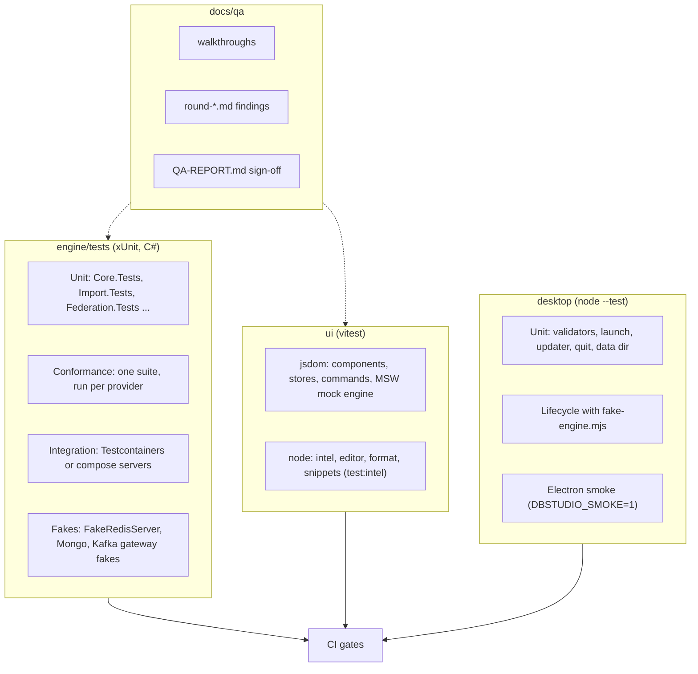
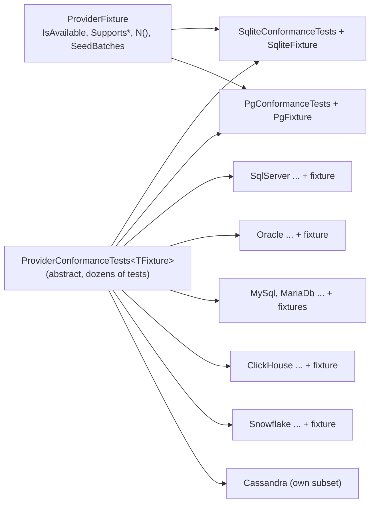

# 23. Testing and QA

> **Level:** L2 practitioner | **Part:** II | **Code read at:** `d2f42ad` (Rowlit 1.7.0)
> [فارسی](../../fa/part2/23-testing-and-qa.md) · Previous: [22. The desktop shell](22-desktop-shell.md) · Next: [24. Build, CI, release and contributing](24-build-ci-release-contributing.md)
>
> **In one sentence:** Rowlit is tested in layers (engine unit tests, a shared conformance suite that every database provider must pass,
> Docker-backed integration tests that skip themselves, UI tests against an in-page fake engine, desktop tests against a fake engine, and a
> written QA process of walkthroughs and finding tables), and CI runs the fast layers on every push.
>
> **You will learn:**
> - the test layers and which folder holds each one;
> - how the conformance suite makes eight providers behave the same, and how Testcontainers and "skippable" tests keep the suite green without Docker;
> - the difference between a fake, a mock and a stub, and where Rowlit uses each;
> - what golden files are, and which golden tests exist;
> - how the UI and desktop tests are set up;
> - the QA process: walkthroughs, rounds, severity, sign-off; and how to run everything locally.
>
> **Prerequisites:** [4. Running from source](04-development-setup.md), [9. Relational providers](09-relational-providers.md).

## 1. The idea (beginner)

A test is a small program that checks that another program does what you said it should. Rowlit has thousands of them, in three languages (C#, TypeScript, JavaScript), and
that many tests need an organisation, or they become impossible to run and to trust. Rowlit groups them by how much of the system they involve:

- a **unit test** checks one function or class with no outside world ("does the statement classifier call `DROP TABLE` destructive?");
- an **integration test** uses a real outside thing, such as a PostgreSQL server in a Docker container ("does the PostgreSQL provider stream a million rows?");
- an **end-to-end test** drives the whole program ("start Electron, start the engine, check the window can talk to it").

Real servers are slow and not always available, so Rowlit uses stand-ins: a **fake** (a small working imitation, such as an in-memory Redis server), a **mock** (a stand-in
that records and checks the calls made to it), a **stub** (a canned answer). The main trick of the suite is that integration tests are written so that, when Docker is missing,
they report "skipped" instead of "failed": a laptop without Docker still gets a green run of everything else.

Tests find bugs a developer thought of. People find the others. So Rowlit also has a written **QA process**: scripted walkthroughs that someone follows by hand, and tables of findings with a severity and a link to the test that now guards each fix.

## 2. How it works (practitioner)

### 2.1 The layers

**Figure 23.1 — Test layers per package.**



| Layer | Where | Tool | Runs without Docker? |
|---|---|---|---|
| Engine unit | `engine/tests/DbStudio.*.Tests` | xUnit | yes |
| Provider conformance | `engine/tests/DbStudio.Providers.Conformance` + each `DbStudio.Providers.*.Tests` | xUnit, `[SkippableFact]` | SQLite yes; others skip |
| Engine integration | provider and source test projects, `Federation.Tests`, `Import.Tests` | Testcontainers or compose | skips |
| Protocol fakes | `Sources.Redis.Tests/Fake`, `Sources.Mongo.Tests/Fake`, `KafkaFake.cs` | in-process | yes |
| UI components, stores | `ui/src/**/*.test.ts(x)` (311 files at this commit) | vitest, jsdom, testing-library, MSW | yes |
| UI pure logic | `ui/src/{intel,editor,format,snippets}/**` | vitest, node (`npm run test:intel`) | yes |
| Desktop | `desktop/test/*.test.mjs` | `node --test` | yes |
| Electron smoke | `desktop/test/smoke.test.mjs` | real Electron, fake engine | yes (needs a display or CI) |
| Codegen compile checks | `engine/tests/Codegen.Smoke`, `check-go-ts.mjs` | `dotnet`, `go vet`, `tsc` | needs network for TypeScript |
| HTTP smoke | `engine/tests/smoke` (`run-smoke.ps1`, `smoke.mjs`) | PowerShell/Node over a dev engine | no (needs an engine) |
| Manual QA | `docs/qa/*.md` | people | n/a |

### 2.2 Engine tests

The solution has one test project per source project, named after it: `DbStudio.Core.Tests`, `DbStudio.Providers.PostgreSql.Tests`, `DbStudio.Sources.Redis.Tests`,
`DbStudio.Federation.Tests`, `DbStudio.Import.Tests`, `DbStudio.Logs.Tests`, `DbStudio.SchemaCompare.Tests`, `DbStudio.Transfer.Tests`, and so on (20 projects under `engine/tests`).
`DbStudio.Core.Tests` is organised in folders that name the work stream that wrote them (`B1`, `B2`, `Batch3`, `M15`, `M2`) and by topic (`Resources`, `Search`, `Queries`, `Params`,
`Platform`, `Diagrams`, `FormatterParity`, `LocalHistory`, `Portability`, `Tunnels`). Root files such as `ServiceTests.cs`, `StatementClassifierTests.cs`, `ValueConverterTests.cs` and `CatalogWireTests.cs` test core services directly.

Two design habits make the tests fast and deterministic. Services take a `TimeProvider` (and similar seams such as `IMemoryProbe`) so a test can advance a fake clock instead of waiting
(`ResourceManager` takes `TimeProvider? time` and `IMemoryProbe? probe`, `ResourceManager.cs:169-173`). And network-facing code sits behind small interfaces (`IMongoGateway`, `IKafkaGateway`, `ISqlRunnerFactory`)
so the real driver can be swapped for a fake.

### 2.3 The conformance suite

Eight relational providers should behave the same where the product depends on it: open a session, stream rows, honour `MaxRows`, report an error with the right line, cancel a long statement, commit and roll back, list a catalog.
Rather than copy those tests eight times, `DbStudio.Providers.Conformance` defines them **once** as an abstract generic class:

```csharp
// engine/tests/DbStudio.Providers.Conformance/ProviderConformanceTests.cs:3-14
public abstract class ProviderConformanceTests<TFixture> : IClassFixture<TFixture> where TFixture : ProviderFixture
```

Each provider's test project writes one line, for example `public sealed class SqliteConformanceTests(SqliteFixture f) : ProviderConformanceTests<SqliteFixture>(f);`
(the doc comment on the class says so), and inherits every test. The class contains tests such as `TestConnection_Succeeds_WithServerInfo`, `Execute_Query_StreamsColumnsAndRows`, `Execute_MaxRows_TruncatesAndContinues`,
`Execute_Error_ReportsDocumentLine`, `Cancel_LongRunningQuery_ReturnsQuicklyAndSessionStaysUsable`, `ManualTransaction_Commit_Persists`, `ManualTransaction_EditSavepoint_RollbackTo_LeavesACleanOpenTransaction`,
`Catalog_ListsShopSchema_AndDefault` and `Export_WholeTable_AndCancel`, about thirty-five in the base class at this commit.

**Figure 23.2 — How the conformance suite is reused.**



The variation between engines lives in the **fixture**, `ProviderFixture` (`ProviderFixture.cs`):

- `SetUpAsync()` starts the backend (a container, or a temp SQLite file) and returns `false`, with `SkipReason` set, when it is unavailable (`:120`);
- capability flags `SupportsTransactions`, `SupportsSavepoints`, `SupportsForeignKeys`, `SupportsIdentity`, `ReportsDmlRowCounts`, `SupportsCancel` (`:44-58`) make the matching tests skip with a clear reason
  (`RequireTransactions`, `RequireCancel` in the base class). ClickHouse and Cassandra have no manual transactions, Snowflake no savepoints, and so on;
- `N("Customers")` maps a *logical* T-SQL PascalCase name to the dialect's physical name (upper case on Oracle and Snowflake, lower on PostgreSQL); `ShopSchema`, `ShopSchemaQualifier` and `SeedBatches` describe the shop sample
  per dialect (`ShopSchema.cs`); `LongRunningQuery`, `MultiResultSetBatch`, `InvalidQuery` and the scratch-table SQL are overridable per engine, with comments recording why (the Oracle long query is a CPU-bound cartesian count, not a sleep, because of how TNS breaks arrive through Docker);
- `RecordingSink` (an `IExecutionSink` that stores events) and `ExportHarness` make assertions about streamed output easy.

Cassandra re-implements a subset itself, a known gap noted in `docs/wp-notes/wp0.md`.

### 2.4 Integration tests: skippable, Testcontainers, compose

Integration tests are marked `[SkippableFact]` (package `Xunit.SkippableFact`) and call `Skip.IfNot(condition, reason)`. If the condition is false the test is reported **skipped**, not failed.
Where the servers come from is decided per backend, for example `PgBackend.StartAsync` (`PostgreSql.Tests/PgFixture.cs`):

1. if `DBSTUDIO_IT=0`: skip everything with "Integration tests disabled";
2. if `DBSTUDIO_PG_HOST` is set: use that already-running server (the compose service, port 15432 by default);
3. otherwise start a throw-away **Testcontainers** container (`postgres:17`) and seed it from `engine/tests/docker/seed-postgres.sql`; if Docker is unreachable the reason is "Docker/PostgreSQL container unavailable" and the tests skip.

Testcontainers is a library that starts Docker containers from test code and removes them afterwards (the `Ryuk` helper container cleans up). The backend is created once per test assembly (`Lazy<Task<…>>`). The same pattern repeats for SQL Server, Oracle, Redis, MongoDB, Kafka, MySQL, MariaDB,
ClickHouse, Elasticsearch and Cassandra, each with its own `DBSTUDIO_*_HOST`-style variables listed in `engine/tests/docker/README.md`. Snowflake is the exception: it needs a real account, so it runs only when `DBSTUDIO_SF_*` variables are set (CI: manual input `integration-snowflake`).
Image names and versions are in the README and in `compose.yml`.

### 2.5 Fakes, mocks and stubs: how Rowlit uses the words

| Word | Meaning | Rowlit example |
|---|---|---|
| **Fake** | a small working imitation | `FakeRedisServer` speaks RESP over a socket (`Sources.Redis.Tests/Fake`); `MongoFake` serves canned collections behind `IMongoGateway`; `KafkaFake`; `fake-engine.mjs` prints READY and answers `/health`; the UI's `MockEngine` and `FakeSocket` |
| **Mock** | a stand-in whose interactions are asserted | MSW handlers in `ui/src/mocks` (also used as a fake by `dev:mock`); `vi.fn()` in vitest |
| **Stub** | a canned return value with no logic | a provider test that returns a fixed `ConnectionProfile`; the `SqliteFederationEngine` fallback is a real engine, not a stub |

Fakes are used where a real service is heavy but its *protocol* is stable and worth testing end to end. For instance, the Redis tests drive the real `RedisClient` against `FakeRedisServer`, so the RESP parser and the command layer run for real.

### 2.6 Golden files

A **golden file** (snapshot) is the expected output stored in the repository. The test produces the output, compares it with the file, and fails on a difference; a developer who *intends* a change regenerates the file and reviews the diff.

| Golden set | Where | Guards |
|---|---|---|
| Visual-builder SQL | `Federation.Tests/Goldens/Builder/*.json` (18 files) | the C# `BuilderCompiler` and the TypeScript `compile.ts` must produce identical SQL for the same builder model ([chapter 16](16-linked-databases-federation.md)) |
| Formatter parity | `Core.Tests/FormatterParity/FormatterParityTests.cs` | the UI's SQL formatter output versus ScriptDom parsing for T-SQL fixtures; unparseable input is checked only for token equality (`:8-11`) |
| Designer DDL | `engine/tests/<project>/M15/golden/` | scripter output; rewrite with `DBSTUDIO_UPDATE_GOLDEN=1 dotnet test` (`engine/tests/docker/README.md`) |
| Code generation | `ui/src/codegen/__tests__/__snapshots__` | generated C#, Go, TypeScript, Java, Python, Prisma; `Codegen.Smoke` compiles the C# and `check-go-ts.mjs` runs `go vet` and `tsc --noEmit --strict` over the Go and TypeScript ones |
| Explain plans | `ui/src/mocks/fixtures/m15/` | plan fixtures, rewritten with the same variable |

A **smoke test** is the opposite of exhaustive: a quick check that the thing starts and the main path works. `desktop/test/smoke.test.mjs`, `kafka-native-smoke.mjs` (the published engine starts and answers `GET /providers`, and native libraries load)
and `engine/tests/smoke` are smoke tests.

### 2.7 UI tests

There are two vitest configurations (`ui/vitest.config.ts`, `ui/vitest.intel.config.ts`) because they need different environments:

- the **default** one uses `jsdom` (a simulated browser), the setup file `src/test/setup.ts`, includes `src/**/*.test.{ts,tsx}` but **excludes** `src/intel/**` and `src/editor/**`, sets `css: false` and a 15 s timeout;
- the **intel** one uses the plain `node` environment and the thread pool and includes `src/intel`, `src/editor`, `src/format`, `src/snippets`. These are pure TypeScript with no DOM ([chapter 11](11-intellisense.md)), so they run faster and cannot accidentally depend on a browser.

`src/test/setup.ts` loads `@testing-library/jest-dom`, cleans up after each test, preloads two lazy chunks (the provider logos and the data grid) so tests can render them synchronously, raises the `findBy*` wait to 5 s because about 135 jsdom files run in parallel,
and fills jsdom gaps (`matchMedia`, `ResizeObserver`, `scrollIntoView`). Component tests use `@testing-library/react` and `user-event`. For data they use the **MSW mock engine** (`ui/src/mocks`, the same one as `npm run dev:mock`, [chapter 4](04-development-setup.md)) through helpers in `src/test/mockServer.ts`;
the WebSocket is replaced by `FakeSocket` with `engineSocket.setSocketFactory(...)`.

Kinds of UI test worth knowing:

- **Store and pure-logic tests** (`store/*.test.ts`, `commands/*.test.ts`, `filter/__tests__`, `data/sqlgen` tests) have no React at all.
- **Command smoke** (`commands/commandSmoke.test.ts`): every registered command has a unique id, a title and a category, and its `when` predicate does not throw for junk arguments of every target shape,
  because the palette and menus call `when()` for every command on each render and one throwing predicate would take the menu down. It asserts there are more than 300 commands.
- **Design QA** (`theme/designQa.test.ts`, `iconSizes.test.ts`, `tokens.test.ts`, `themes.test.ts`, `editorWidgets.test.ts`): token lint, contrast of themes, icon sizes ([chapter 20](20-ui-architecture.md)); `Charts/chartTokens.test.ts` checks series colours in every theme.
- **Worker and large-data tests** such as the results compare diff worker and the ER layout use real functions with big inputs.
- **Screenshots**: `ui/scripts/shot.mjs` is a helper used for manual checks in light and dark (the walkthroughs mention it); it is not part of CI.

### 2.8 Desktop tests

`desktop/package.json` runs `npm run build` (type-check and bundle, which also emits `out/lib/*`) and then `node --test` over eight files: `engine-process`, `ipc-validate`, `platform`, `updater`, `windows`, `quit`, `data-dir` and `smoke`
([chapter 22](22-desktop-shell.md)). The unit tests import the Electron-free modules from `out/lib`. The lifecycle test spawns `fake-engine.mjs` in its failure modes. The **smoke test** starts real Electron with `DBSTUDIO_SMOKE=1`, a temporary data folder and the fixture UI
(`desktop/test/fixture-ui`), lets `smoke.ts` run its in-page checks, parses the single JSON line `DBSTUDIO_SMOKE_RESULT` it prints, and finally checks that the engine and its child process are gone after quit (`helpers.mjs` `isAlive`).

### 2.9 CI gates

`ci.yml` runs on every push to `main`, every pull request and on demand (`:3-16`). `DBSTUDIO_IT=0` is set globally, so integration tests skip on the runners (`:26`). The **Windows job** does, in order (`:62-135`): engine tests in Release with a `.trx` log; failed tests annotated
by `.github/scripts/trx-annotate.mjs`; the NuGet vulnerability check; UI `npm ci`, lint (oxlint), type-check (`tsc -b`), tests, and `test:intel`; desktop `npm ci` and tests; the full installer build; the **bundle size** check; the **native smoke**; artifact uploads. The **macOS job** runs engine tests (which include a
real Keychain round trip), the desktop tests and the DMG build. Optional jobs run the Docker suites on Ubuntu (`workflow_dispatch` input `integration`) and the live Snowflake suite. `concurrency: ci-${{ github.ref }}` cancels an older run of the same branch. The details of each step, and why, are in
[chapter 24](24-build-ci-release-contributing.md).

**The bundle-size gate** (`.github/scripts/bundle-size.mjs`) sums the gzipped size of the built UI and fails when it exceeds the committed baseline by more than the budget (1400 KB total, 120 KB for the initial load). The baseline is the M1 build and is **never re-recorded** to make a failing check pass, because that would silently widen the budget (header of the script).

### 2.10 The QA process

Automated tests were complemented by a documented human process, in `docs/qa`:

- **Walkthroughs** (`*-walkthrough.md`): a numbered script for one feature ("Setup, Steps, Expect"), written by the work package that built it, so that anyone can repeat the check. There is one per provider (`pg-`, `mysql-`, `clickhouse-`, `snowflake-`, `cassandra-`, `redis-`, `mongo-`, `kafka-`, `elasticsearch-`) and per feature (`links-`, `er-`, `logs-`, `m15-`, and for 1.7: `schema-compare-`, `transfer-`, `charts-`,
  `local-history-`, `ssh-tunnel-`; for 1.8: `connections-portability-`, `results-compare-`).
- **Rounds** (`round-<area>.md`): a QA pass over an area against real servers, as a table `# | Area | Sev | Finding | Status | Where | Test`. Every fixed finding names the file that changed and the test that now guards it; findings not fixed go to an "Open / not fixed" table with the reason, and a
  "Verified without findings" paragraph records what was checked and found fine. Example: `docs/qa/round-sqlite.md`.
- **Severity** is a three-step ladder written at the top of each round: *crash / wrong data / failed operation* is worst, then *broken workflow*, then *UX*.
- **Sign-off** (`docs/QA-REPORT.md`): the M1.5 final report by the lead: a verdict, totals across rounds (accepted, rejected, resolved), the final gate result and a spot-check of "resolved" claims. It is also honest about what it could not see (for instance, SQL Server and Oracle integration tests skipped in every gate).

A walkthrough also records what it verified and how: for example the transfer walkthrough lists the live runs and says Docker "did not answer", so the cross-engine matrix was covered by unit tests instead. That honesty is a convention worth keeping.

### 2.11 Running everything locally

```powershell
dotnet test engine/DbStudio.slnx -c Release                 # engine; Docker-backed tests skip without Docker
$env:DBSTUDIO_IT = '0'                                        # skip without probing Docker at all
$env:DBSTUDIO_IT = '1'; dotnet test engine/DbStudio.slnx      # with Docker: Testcontainers or the compose servers
cd ui;  npm run lint; npm run typecheck; npm test; npm run test:intel
cd ui;  npm run build; cd ..; node .github/scripts/bundle-size.mjs --dist ui/dist --budget-kb 1400 --initial-kb 120
cd desktop; npm test                                          # type-check, lifecycle tests, Electron smoke
```

The rule for parallel work packages is the same list: before hand-in, engine tests green with `DBSTUDIO_IT=0` plus the package's own integration tests against Docker, the four UI commands, the build and bundle check (print the initial-load delta, at most +1.5 KB per package), and a walkthrough
(`docs/wp-notes/README.md`, rule R4).

## 3. Deep dive (senior)

> **Deep dive (L3): the cost of "skip, don't fail".**
>
> Skipped tests make CI green on a runner with no Docker, which is why a contributor can run `dotnet test` anywhere. The risk is silent decay: if a backend stops starting, its tests keep "passing" as skips. The QA report names this exactly: 48 SQL Server and 55 Oracle integration
> tests were skipped in every gate of the M1.5 round, so "code and golden verified only" was the honest verdict for those providers. Rowlit's mitigations are social and procedural rather than technical: the optional `integration` workflow, the `SkipReason` text that says *why*,
> walkthroughs that record what was run live, and release notes that say which database a fix was proven on. If you add a backend, make its skip reason specific.
>
> **Conformance vs. provider-specific tests.** The base suite can only assert what *every* engine does. Anything dialect-specific (PostgreSQL's savepoint per statement, Oracle's `DBMS_OUTPUT`, SQL Server's `InfoMessage`) lives in the provider's own project (`PgIntegrationTests`,
> `OracleAndPgLogTests`, `SqlServerLogTests`). When a behaviour becomes common, move the assertion into the base class and add a `Supports*` flag for the exceptions.
>
> **Two ways to fake a clock.** The engine passes `TimeProvider`; the UI tests set `lastViewed` and `now` explicitly (`setLastViewedForTests`, `runResourcePolicy({ now })` in `ui/src/app/resources.ts`) and use vitest fake timers. Both avoid `sleep` in tests. A test that waits real seconds is a flaky test waiting for a slower runner.

## 4. Edge cases and limits

- **Parallelism.** About 135 jsdom test files run in parallel, so UI timeouts are generous (15 s per test, 5 s per `findBy`). A test that fails only under load is called "load-flaky" in the rounds (for example Redis `browser.test.tsx`); it is rerun alone before being believed.
- **Windows-only and macOS-only code** is covered by the matching CI job: the Keychain test runs on macOS, DPAPI tests on Windows.
- **Docker Desktop hangs.** If `docker ps` does not answer, do not restart it from a script; use `DBSTUDIO_IT=0` and rely on unit tests plus the walkthrough.
- **Snowflake** has no emulator, so its provider tests need a real trial account (`docs/qa/snowflake-walkthrough.md`).
- **Line counts of tests are not a metric.** The suite is judged by the QA rounds' finding tables (what was found, what now guards it), not by coverage percentage; the repository has no coverage gate.

## 5. How it is tested (the tests of the tests)

The test infrastructure has its own checks: `commandSmoke.test.ts` checks the command registry itself; `tokens.test.ts` lints the CSS tokens; the desktop `smoke.test.mjs` checks that the build output starts at all; `bundle-size.mjs` checks the build; and `check-update-info.mjs`
(run in `release.yml`) checks the update metadata before publishing.

## Related chapters

- [9. Relational providers](09-relational-providers.md): what the conformance suite is checking.
- [4. Running from source](04-development-setup.md): the mock and fake engines used here.
- [16. Linked databases](16-linked-databases-federation.md): the builder goldens.
- [22. The desktop shell](22-desktop-shell.md): the Node-testable core modules.
- [24. Build, CI, release and contributing](24-build-ci-release-contributing.md): the CI steps in detail.

## Glossary terms introduced here

[unit test](../glossary.md#unit-test) · [integration test](../glossary.md#integration-test) · [fixture](../glossary.md#fixture) · [conformance test](../glossary.md#conformance-test) ·
[skippable test](../glossary.md#skippable-test) · [Testcontainers](../glossary.md#testcontainers) · [fake](../glossary.md#fake) · [golden file](../glossary.md#golden-file) ·
[smoke test](../glossary.md#smoke-test) · [lint](../glossary.md#lint) · [type check](../glossary.md#type-check) · [QA walkthrough](../glossary.md#qa-walkthrough) ·
[QA round](../glossary.md#qa-round) · [severity](../glossary.md#severity) · [sign-off](../glossary.md#sign-off) · [gate](../glossary.md#gate) · [MSW](../glossary.md#msw)

## Files

| Path | Responsibility |
|---|---|
| `engine/tests/DbStudio.Providers.Conformance/*` | the shared provider suite, fixture, shop schema, recording sink |
| `engine/tests/DbStudio.*/` | per-project tests |
| `engine/tests/docker/compose.yml`, `README.md`, `seed-*` | sample/test servers and seeds |
| `engine/tests/smoke/*`, `engine/tests/Codegen.Smoke/*` | HTTP smoke, codegen compile checks |
| `ui/vitest.config.ts`, `ui/vitest.intel.config.ts`, `ui/src/test/*` | UI test setup |
| `ui/src/mocks/*` | MSW handlers, fake socket, mock packs |
| `desktop/test/*` | Node tests, fake engine, fixture UI, smoke |
| `.github/workflows/ci.yml`, `.github/scripts/*.mjs` | gates |
| `docs/qa/*`, `docs/QA-REPORT.md`, `docs/wp-notes/README.md` | QA process and rules |
