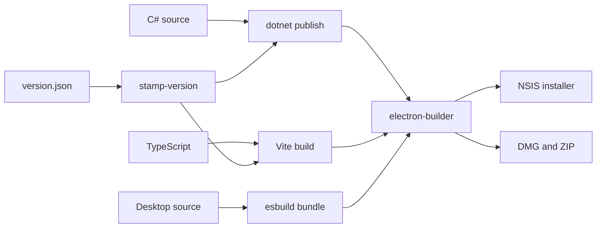
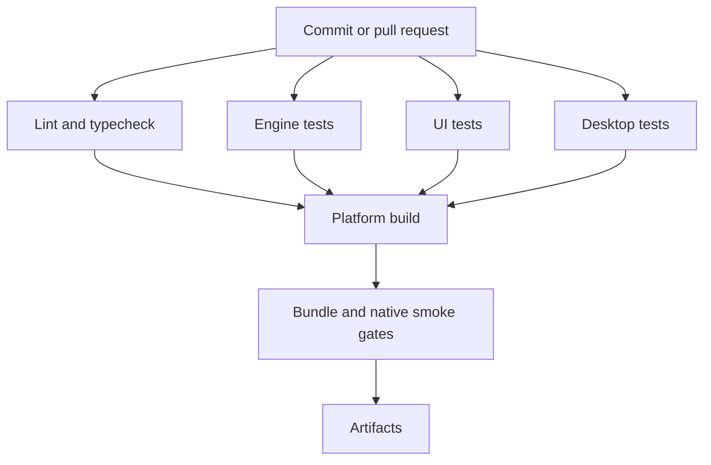
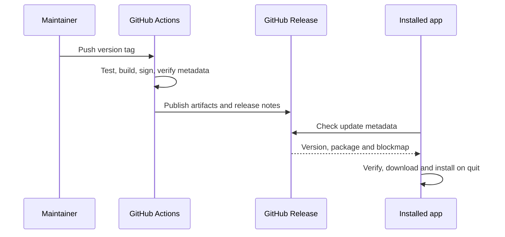
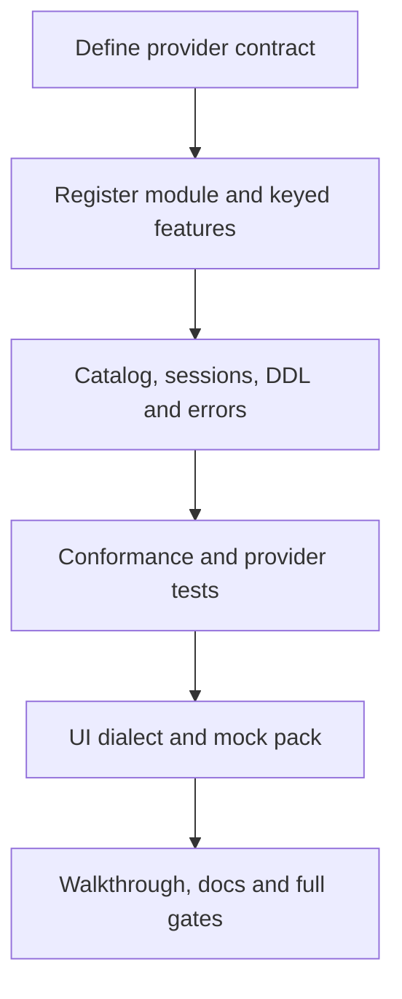

# 24. Build, CI, release and contributing

> **Level:** L2 practitioner | **Part:** II | **Code read at:** `94ae9c7`
> **In one sentence:** Rowlit's release pipeline turns one versioned source tree into tested engine, web, and signed desktop artifacts, while contribution rules keep provider and UI extensions reviewable.
> **You will learn:** how versions are stamped; what Windows and macOS builds contain; which CI gates protect a release; how an update travels from a tag to an installation; how to add a provider or command safely.
> **Prerequisites:** [Architecture](03-big-picture-architecture.md), [engine modules](07-engine-modules-and-di.md), [desktop shell](22-desktop-shell.md). [فارسی](../../fa/part2/24-build-ci-release-contributing.md)

## 1. The idea (beginner)

A [build](../glossary.md#build) converts source files into runnable files. A release adds a stable version, notes, platform packaging, signatures, and update metadata. Rowlit builds three products together: the .NET engine, the Vite UI, and the Electron desktop shell. `version.json` is the shared version source; scripts stamp that value into the projects before packaging.

Local builds and CI use the same basic stages: restore dependencies, compile, test, build the UI, bundle Electron, publish the engine for a runtime, and package the application. A contributor should run the narrow tests while editing and the relevant full gates before handing work off.

**Figure 24.1 — Build inputs and outputs.**

## 2. How it works (practitioner)

### 2.1 Versioning and build scripts

`scripts/stamp-version.ps1` reads `version.json` and updates the engine, UI, and desktop metadata. `build.ps1` publishes a self-contained Windows engine, builds the UI with `VITE_APP_VERSION`, bundles desktop main/preload code, and invokes electron-builder. Its directory and engine-only switches shorten diagnostics. `build.sh` produces the macOS runtime-specific engine and DMG/ZIP packages. Trimming is deliberately off because providers and module discovery use reflection.

The desktop packaging recipe lives in `desktop/electron-builder.yml`. It fixes the application identity, includes UI and engine resources, applies Electron fuses, configures NSIS, and names macOS entitlements. Signing and notarization depend on environment credentials; an ad-hoc local signature is not equivalent to a Developer ID release.

### 2.2 Continuous integration

The GitHub Actions workflow separates fast static gates from platform builds. It runs formatting/lint checks, strict TypeScript compilation, Vitest, .NET tests, desktop `node --test`, dependency auditing, bundle-budget checks, and native smoke checks. Test result files are retained as artifacts so a failure can be diagnosed after the runner exits.

**Figure 24.2 — CI gates.**

### 2.3 Releasing and updating

The release workflow validates that the Git tag agrees with `version.json`, builds each platform, checks update metadata, merges artifacts, and publishes notes from `docs/release-notes/`. electron-builder produces `latest.yml` or `latest-mac.yml` plus blockmaps. The updater described in chapter 22 consumes those files; signing is part of the trust decision, not decoration.

### 2.4 Contributing a feature or provider

Keep work packages file-disjoint where possible. A provider needs an engine project, an `IEngineModule`, an `IDbProvider`, keyed optional features, catalog and DDL behavior, conformance tests, sample/seed coverage, UI dialect metadata, formatter/intelligence rules where applicable, and a QA walkthrough. A command belongs in a small auto-loaded `commands.ts`; its heavy view stays behind `lazy()`. New WebSocket events require matching engine payloads, UI types, reconnect/orphan behavior, and protocol tests.

## 3. Deep dive (senior)

Reproducibility depends on pinning inputs and keeping generated metadata checked by CI. Self-contained and single-file are separate .NET publishing choices: self-contained carries the runtime; single-file bundles managed payloads into an apphost. Native provider libraries may still be extracted or shipped beside it. A runtime identifier (RID) selects the platform/architecture graph and must agree with the Electron target.

Bundle baselines are safety rails. A feature may justify a new lazy chunk, but it should not silently increase the initial bundle. Do not rebaseline merely to make a gate green. Likewise, dependency audits are evidence, not proof: reachable behavior, secrets, process boundaries, and signing still need design review.

## 4. Edge cases and limits

- Windows signing, Apple Developer ID signing, notarization, and stapling require external credentials and services.
- A successful ad-hoc macOS build does not prove Gatekeeper acceptance.
- Cross-publishing compiles another RID but cannot fully test that operating system.
- Native drivers and Electron must agree on architecture.
- Release notes describe user-visible change; they are not a substitute for tests or migration notes.
- Never put production secrets in workflow YAML, logs, sample connections, or artifacts.

## 5. How it is tested

CI validates version agreement, update metadata, desktop bundles, installer inputs, UI bundle size, dependency audit output, and native startup. Desktop unit tests cover platform selection and updater state; engine/UI suites prove the packaged components before assembly. A release candidate still needs the platform smoke checklist because signing dialogs, Gatekeeper, SmartScreen, and installers are outside jsdom and ordinary unit tests.

## Related chapters

- [Development setup](04-development-setup.md)
- [Testing and QA](23-testing-and-qa.md)
- [Desktop lifecycle and updates](22-desktop-shell.md)
- [Provider architecture](09-relational-providers.md)

## Glossary terms introduced here

[build](../glossary.md#build), [publish](../glossary.md#publish), [self-contained](../glossary.md#self-contained), [single-file](../glossary.md#single-file), [RID](../glossary.md#rid), [NSIS](../glossary.md#nsis), [DMG](../glossary.md#dmg), [code signing](../glossary.md#code-signing), [notarization](../glossary.md#notarization), [CI](../glossary.md#ci), [artifact](../glossary.md#artifact), [workflow](../glossary.md#workflow), [bundle budget](../glossary.md#bundle-budget), [work package](../glossary.md#work-package).

## Files

| Path | Responsibility |
|---|---|
| `version.json`, `scripts/stamp-version.ps1` | Shared version and stamping |
| `build.ps1`, `build.sh` | Platform build orchestration |
| `desktop/electron-builder.yml`, `desktop/build/` | Desktop bundle and packages |
| `.github/workflows/ci.yml` | Pull-request and branch gates |
| `.github/workflows/release.yml` | Tagged release assembly |
| `.github/scripts/` | Metadata, bundle, and test-result checks |
| `docs/release-notes/` | User-facing release notes |
