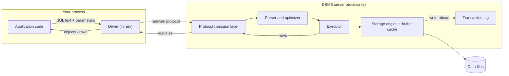
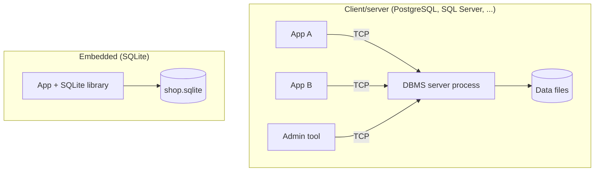

<div dir="rtl">

# 1. پایگاه داده چیست

> **زبان:** [English](../../en/part1/01-what-is-a-database.md) | فارسی | **بعدی:** [2. مدل رابطه‌ای](02-relational-model.md)
> **سطح:** L1 مبتدی ← L2 | **بخش:** I
> **در یک جمله:** پایگاه داده مجموعه‌ای سازمان‌یافته و ماندگار از داده است که برنامه‌ای به نام DBMS از آن نگهداری می‌کند تا برنامه‌های بسیاری بتوانند آن را با اطمینان ذخیره کنند، پیدا کنند و تغییر دهند.
> **چه می‌آموزید:**
> - چرا یک پوشه پر از فایل به‌محض بزرگ‌شدن داده یا دخالت دو نفر از کار می‌افتد
> - DBMS چه چیزی به فایل‌ها اضافه می‌کند: پایداری، هم‌روندی، زبان پرس‌وجو و کنترل دسترسی
> - تفاوت پایگاه داده کلاینت/سرور با پایگاه داده توکار
> - واژه‌های instance، database، schema، connection، session و driver و اینکه چگونه درون هم قرار می‌گیرند
> - IDE پایگاه داده مثل Rowlit چیست: یک کلاینت
>
> **پیش‌نیازها:** ندارد.
> برچسب‌های نمودارها به انگلیسی نگه داشته شده‌اند تا در GitHub درست نمایش داده شوند.

## 1. ایده (مبتدی)

یک فروشگاه اینترنتی کوچک را در نظر بگیرید. در هفتهٔ اول صاحب فروشگاه سفارش‌ها را در یک صفحه‌گسترده نگه می‌دارد: هر سفارش یک سطر، با نام مشتری، محصول، قیمت و تاریخ. این روش جواب می‌دهد. یک سال بعد 40,000 سطر داریم، دو نفر هم‌زمان فایل را ویرایش می‌کنند، لپ‌تاپی در میانهٔ ذخیره‌کردن فایل خاموش می‌شود و صاحب فروشگاه می‌خواهد بداند «کدام مشتری‌ها کیبورد خریده‌اند ولی هیچ‌وقت ماوس نخریده‌اند؟». برای هر یک از این مشکل‌ها راه‌حل استانداردی وجود دارد و مجموعهٔ این راه‌حل‌ها همان چیزی است که **پایگاه داده** می‌نامیم.

[پایگاه داده](../glossary.md#database) (database) مجموعه‌ای سازمان‌یافته و ماندگار از داده است. «سازمان‌یافته» یعنی داده ساختاری اعلام‌شده دارد (جدول، ستون، نوع، ارتباط) و فقط متنِ ریخته‌شده در یک فایل نیست. «ماندگار» یعنی داده از راه‌اندازی مجدد، خرابی و قطع برق جان به در می‌برد. نرم‌افزاری که داده را ذخیره می‌کند و به پرسش‌ها دربارهٔ آن پاسخ می‌دهد [DBMS](../glossary.md#dbms) است (سامانه مدیریت پایگاه داده، database management system). مردم اغلب هم برای داده و هم برای نرم‌افزار می‌گویند «پایگاه داده»؛ این کتاب تا جای ممکن وقتی منظورش نرم‌افزار است «DBMS» می‌نویسد. اگر DBMS داده را در جدول‌های مرتبط نگه دارد، به آن DBMS رابطه‌ای می‌گویند، یا [RDBMS](../glossary.md#rdbms) ([فصل I-02](02-relational-model.md)).

یک DBMS چهار چیز به شما می‌دهد که پوشه‌ای از فایل‌ها نمی‌دهد:

1. **پایداری (durability).** وقتی DBMS می‌گوید «ذخیره شد»، داده روی دیسک است، حتی اگر یک میلی‌ثانیه بعد ماشین از کار بیفتد.
2. **هم‌روندی (concurrency).** برنامه‌های بسیاری می‌توانند هم‌زمان بخوانند و بنویسند، بی‌آنکه کار نیمه‌تمام یکدیگر را ببینند یا تغییرات هم را بازنویسی کنند.
3. **زبان پرس‌وجو.** شما توصیف می‌کنید چه می‌خواهید («مشتری‌هایی که کیبورد خریده‌اند اما ماوس نه») و DBMS تصمیم می‌گیرد چگونه به آن برسد. در پایگاه‌های داده رابطه‌ای این زبان [SQL](../glossary.md#sql) است.
4. **کنترل.** می‌توانید تعیین کنید چه کسی اجازهٔ خواندن کدام جدول را دارد و DBMS بقیه را رد می‌کند؛ همچنین می‌توانید قاعده‌هایی تعریف کنید («هر سفارش باید به یک مشتری موجود تعلق داشته باشد») که DBMS در هر تغییر اجرایشان می‌کند.

بقیهٔ این فصل این چهار نکته را ملموس می‌کند، واژگانی را که هر فصل بعدی به کار می‌برد معرفی می‌کند و نشان می‌دهد ابزاری مثل Rowlit کجای این تصویر قرار می‌گیرد.

### 1.1 مشکل فایل‌ها

همین داده‌ها را به شکل یک فایل متنی به نام `orders.csv` در نظر بگیرید:

</div>

```text
order_id,customer,email,product,price,date
1,Alice,alice@example.com,Keyboard,49.90,2026-01-05
1,Alice,alice@example.com,Mouse,19.50,2026-01-05
2,Alice,alice@example.com,Mouse,19.50,2026-02-11
3,Bob,,Monitor,199.00,2026-02-12
```

<div dir="rtl">

این فایل را با هر ویرایشگری می‌توان باز کرد و برای 4 خط مشکلی ندارد. با بزرگ‌شدن آن، مشکل‌های زیر پیدا می‌شوند. هر کدام را اینجا نام برده‌ایم چون یکی از فصل‌های بعد آن را حل می‌کند.

| مشکل | با فایل چه می‌شود | DBMS چه می‌کند | فصل |
|---|---|---|---|
| **هزینهٔ جست‌وجو** | پیداکردن سفارش‌های Alice هر بار کل فایل را می‌خواند. | ساختارهای کمکی ([نمایه‌ها](../glossary.md#index)، index) نگه می‌دارد تا یک جست‌وجو به چند صفحه برسد، نه کل فایل. | [I-07](07-indexes.md) |
| **افزونگی** | ایمیل Alice در هر خط تکرار شده است. اگر آن را فقط در یک جا عوض کنید، فایل با خودش ناسازگار می‌شود. | مدل داده، واقعیت‌ها را میان جدول‌ها تقسیم می‌کند تا هر واقعیت یک بار ذخیره شود. | [I-05](05-modelling-and-normalisation.md) |
| **تمامیت** | هیچ چیز جلوی خطی با قیمت `abc` یا مشتری ناموجود را نمی‌گیرد. | نوع‌ها و [قیدها](../glossary.md#constraint) (constraint) در هر نوشتن بررسی می‌شوند. | [I-05](05-modelling-and-normalisation.md) |
| **نویسنده‌های هم‌زمان** | دو نفر هم‌زمان ذخیره می‌کنند؛ آخرین ذخیره برنده است و تغییر دیگری گم می‌شود. | [تراکنش‌ها](../glossary.md#transaction) (transaction) و قفل‌ها یا نسخه‌ها تغییرات را از هم جدا نگه می‌دارند. | [I-09](09-transactions-and-isolation.md)، [I-10](10-concurrency-locking-mvcc.md) |
| **نوشتن ناقص** | ماشین وسط ذخیره‌کردن خاموش می‌شود و فایل نیمه‌کاره می‌ماند. | write-ahead log هر تغییر را به عملی «یا همه یا هیچ» تبدیل می‌کند. | [I-11](11-logging-and-recovery.md) |
| **کنترل دسترسی** | هر کس بتواند فایل را بخواند، همهٔ محتوایش را می‌خواند. | کاربران، نقش‌ها و دسترسی‌ها در سطح جدول یا حتی سطر تعیین می‌کنند. | [I-14](14-security.md) |
| **مقیاس** | فایل دیگر در حافظه جا نمی‌شود و برنامه‌ای که همه‌اش را بارگذاری کند از کار می‌افتد. | صفحه‌ها را به‌اندازهٔ نیاز می‌خواند و پراستفاده‌ها را در حافظهٔ نهان نگه می‌دارد. | [I-06](06-storage-internals.md) |

هیچ‌یک از این مشکل‌ها در برنامهٔ خودتان غیرقابل حل نیست. نکته این است که سی سال کار صرف حل خوب آن‌ها شده، آن هم یک بار و در نرم‌افزاری که می‌توانید دوباره از آن استفاده کنید.

### 1.2 DBMS از بیرون چه شکلی دارد

از دید برنامه، پایگاه داده چیزی است که به آن **وصل می‌شوید**، **پرس‌وجو** می‌فرستید و **نتیجه** می‌گیرید. پرس‌وجو درخواستی برای داده یا برای تغییر است. نتیجه جدولی از سطرهاست. ترتیب کار همیشه یکی است:

1. برنامه یک [اتصال](../glossary.md#connection) (connection) باز می‌کند؛ یعنی یک مجرای ارتباطی با DBMS، همراه با ورود به سیستم.
2. متنی می‌فرستد، مثلاً `SELECT name FROM customers WHERE country_id = 1`.
3. DBMS متن را تجزیه می‌کند، برای پاسخ به آن طرح می‌ریزد، داده را می‌خواند و یک [مجموعه نتیجه](../glossary.md#result-set) (result set) پس می‌فرستد.
4. برنامه سطرها را می‌خواند، پرس‌وجوهای بیشتری می‌فرستد و در پایان اتصال را می‌بندد.

در پایگاه داده رابطه‌ای این متن SQL است. در خانواده‌های دیگر پایگاه داده «متن» زبان فرمان دیگری است (فرمان‌های Redis، سندهای پرس‌وجوی MongoDB، CQL برای Cassandra)؛ [فصل I-16](16-nosql-families.md) آن‌ها را پوشش می‌دهد.

## 2. نحوهٔ کار (حرفه‌ای)

### 2.1 لایه‌های میان کد شما و دیسک

**شکل 1.1: مسیر یک پرس‌وجو از برنامه تا فایل‌ها.**

</div>



<div dir="rtl">

شکل را از چپ به راست بخوانید:

- **برنامه** (application) همان برنامهٔ شماست: یک وب‌سرور، یک اسکریپت، یک ابزار دسکتاپ.
- [درایور](../glossary.md#driver) (driver) کتابخانه‌ای درون برنامهٔ شماست که زبان شبکه‌ای DBMS را (یعنی [پروتکل شبکه‌ای](../glossary.md#wire-protocol)، wire protocol) می‌داند. عبارت «این SQL را اجرا کن» را به بایت‌هایی روی یک سوکت تبدیل می‌کند و پاسخ را به سطرهایی که بتوانید به کار ببرید برمی‌گرداند. JDBC (جاوا)، ADO.NET (دات‌نت)، `psycopg` (پایتون)، `node-postgres` (جاوااسکریپت) و ODBC درایور یا استاندارد درایور هستند. درایور تنها بخشی است که سمت کلاینت نصب می‌کنید.
- **لایهٔ پروتکل** در DBMS هویت شما را احراز می‌کند و وضعیت نشست شما را نگه می‌دارد.
- **تجزیه‌گر و بهینه‌ساز** SQL را می‌خوانند و یک طرح اجرا انتخاب می‌کنند ([فصل I-08](08-query-processing.md)).
- **اجراکننده** (executor) طرح را اجرا می‌کند.
- **موتور ذخیره‌سازی** صفحه‌های فایل‌های داده را می‌خواند و می‌نویسد و از یک حافظهٔ نهان درون حافظه به نام استخر بافر (buffer pool) بهره می‌برد ([فصل I-06](06-storage-internals.md)).
- **لاگ تراکنش** هر تغییر را پیش از دست‌زدن به فایل‌های داده ثبت می‌کند ([فصل I-11](11-logging-and-recovery.md)).

لازم نیست جعبه‌ها را حفظ کنید. نکتهٔ شکل این است که «پایگاه داده» یک چیز واحد نیست؛ یک خط لوله است و هر مرحله‌اش جایی است که ممکن است مشکلی پیش بیاید و جایی که می‌شود تصمیمی برای تنظیم کارایی گرفت.

### 2.2 پایگاه داده کلاینت/سرور و توکار

برای چیدن DBMS و برنامه دو روش وجود دارد.

**کلاینت/سرور.** DBMS برنامه‌ای جداست، معمولاً روی ماشینی دیگر، که همیشه در حال اجراست و مالک فایل‌های داده است. برنامهٔ شما و همهٔ برنامه‌های دیگر از راه شبکه به آن وصل می‌شوند. PostgreSQL، SQL Server، Oracle، MySQL، MariaDB، ClickHouse، Cassandra و Snowflake (به‌صورت سرویس ابری) همگی این‌طور کار می‌کنند. مزیتش این است که کلاینت‌های بسیاری یک پایگاه داده را به اشتراک می‌گذارند، DBMS را می‌توان در یک نقطه ایمن و پایش کرد و منابع (حافظه، دیسک) به آن اختصاص دارد. هزینه‌اش این است که کسی باید یک سرور را نصب کند، راه بیندازد، از آن پشتیبان بگیرد و ارتقا دهد.

**توکار (embedded).** DBMS کتابخانه‌ای است که به برنامهٔ شما لینک می‌شود و «پایگاه داده» یک فایل واحد است که برنامه مستقیماً باز می‌کند. [SQLite](../glossary.md#embedded-database) شناخته‌شده‌ترین نمونه است و احتمالاً پرکاربردترین پایگاه داده جهان، چون گوشی‌ها، مرورگرها و بسیاری از برنامه‌های دسکتاپ از آن استفاده می‌کنند. سرور، شبکه و ورود به سیستم وجود ندارد؛ راهی هم نیست که دو ماشین فایل را با امنیت به اشتراک بگذارند. DuckDB موتور توکار دیگری است که برای تحلیل داده طراحی شده است.

**شکل 1.2: کلاینت/سرور در برابر توکار.**

</div>



<div dir="rtl">

| | کلاینت/سرور | توکار |
|---|---|---|
| نصب | یک سرور را نصب و اجرا کنید | یک کتابخانه اضافه کنید |
| چه کسی می‌تواند وصل شود | هر کلاینتی که دسترسی شبکه و ورود به سیستم داشته باشد | فقط فرایندی که فایل را باز کرده |
| هم‌روندی | نویسنده‌های بسیار، با مدیریت DBMS | خواننده‌های بسیار، در هر لحظه یک نویسنده (SQLite) |
| امنیت | کاربران، نقش‌ها، TLS | مجوزهای فایل سیستم‌عامل |
| کاربرد معمول | بک‌اندهای وب، سامانه‌های سازمانی، انبار داده | برنامه‌های موبایل و دسکتاپ، آزمون‌ها، ابزارهای کوچک |

### 2.3 واژگان ظرف‌ها

هر DBMS اشیای خود را در یک سلسله‌مراتب سازمان می‌دهد، اما نام سطوح فرق می‌کند و یک واژه در محصولات مختلف معناهای متفاوت دارد. این‌ها واژه‌هایی هستند که کتاب به کار می‌برد.

- [**نمونه**](../glossary.md#instance) (instance) یک نسخهٔ در حال اجرای نرم‌افزار DBMS است: فرایندها و حافظهٔ آن. یک ماشین می‌تواند چند نمونه اجرا کند (مثلاً روی پورت‌های مختلف).
- **پایگاه داده** (database) مجموعه‌ای نام‌دار از جدول‌ها و اشیای دیگر درون یک نمونه است. بعضی سامانه‌ها اجازه می‌دهند یک اتصال در هر لحظه فقط از یک پایگاه داده استفاده کند (PostgreSQL)، بعضی دیگر اجازه می‌دهند یک پرس‌وجو میان چند پایگاه داده پرسه بزند (SQL Server، MySQL).
- [**اسکیما**](../glossary.md#schema) (schema) دو معنا دارد و واژه‌نامه هر دو را نگه می‌دارد:
  1. *ساختار*: تعریف جدول‌ها، ستون‌ها و نوع‌ها («اسکیمای پایگاه داده shop»).
  2. *فضای نام*: ظرفی نام‌دار از جدول‌ها درون یک پایگاه داده، برای دسته‌بندی آن‌ها و دادن مالک و مجوز جداگانه به هر دسته. `sales.invoices` یعنی جدول `invoices` در اسکیمای `sales`.
  هر جا این کتاب «اسکیما» می‌گوید، اگر بدیهی نباشد مشخص می‌کند کدام معنا را در نظر دارد.
- **جدول** (table) سطرها را نگه می‌دارد. **نما** (view)، **سکوئنس** (sequence)، **تابع** (function) و **رویه** (procedure) انواع دیگر اشیایی هستند که در یک اسکیما قرار می‌گیرند.
- [**فهرست سیستمی**](../glossary.md#system-catalog) (system catalog) مجموعه جدول‌ها و نماهایی است که DBMS تعریف همهٔ موارد بالا را در آن‌ها ثبت می‌کند (چه جدول‌هایی هست، ستون‌هایشان چیست، مالکشان کیست). آن را با SQL معمولی می‌پرسید (`information_schema`، `pg_catalog`، `sys.*`، `ALL_TABLES` و غیره که در [فصل I-17](17-dialect-comparison.md) مقایسه شده‌اند)؛ یک IDE پایگاه داده از آن برای پر کردن درخت اشیا استفاده می‌کند.
- [**نشست**](../glossary.md#session) (session) وضعیت سمت سروری است که به یک اتصال تعلق دارد: شما کیستید، از کدام پایگاه داده استفاده می‌کنید، آیا تراکنشی باز است، جدول‌های موقت و تنظیمات. در عمل یک اتصال برابر یک نشست است.

سطوح در هر محصول فرق می‌کنند:

| سامانه | سطح بالا | بعد | بعد | یادداشت |
|---|---|---|---|---|
| PostgreSQL 17 | [کلاستر](../glossary.md#cluster) (cluster؛ یک نمونهٔ سرور به‌همراه دایرکتوری داده‌اش) | database | schema | هر اتصال به یک database بسته است؛ بدون افزونه پرس‌وجوی میان‌پایگاهی وجود ندارد. اسکیمای پیش‌فرض `public`. |
| SQL Server 2022 | instance | database | schema | نام‌های سه‌بخشی مثل `shop.sales.Invoices` میان پایگاه‌های داده یک نمونه کار می‌کنند. اسکیمای پیش‌فرض `dbo`. |
| Oracle 23 | instance (با یک container database و pluggable databaseها) | pluggable database (PDB) | schema = user | در Oracle یک schema *همان* حساب کاربری است که مالک اشیاست. seed از کاربر `shop` استفاده می‌کند. |
| MySQL 8.4 / MariaDB 11 | server | database | (ندارد) | `SCHEMA` مترادف `DATABASE` است؛ سطح فضای نام جداگانه‌ای نیست. |
| SQLite 3.4x | خود فایل | `main` (به‌علاوهٔ فایل‌های attach‌شده) | (ندارد) | یک اتصال یک فایل را باز می‌کند؛ `ATTACH` فایل‌های بیشتری اضافه می‌کند. |
| ClickHouse 24.8 | server | database | (ندارد) | هر جدول یک موتور جدول (table engine) هم دارد ([I-15](15-oltp-vs-olap-columnar.md)). |
| Snowflake | account | database | schema | محاسبه (warehouse) شیء جدایی از ذخیره‌سازی است. |
| Cassandra 5 | cluster | keyspace | (ندارد) | keyspace نزدیک‌ترین چیز به database است؛ نحوهٔ همانندسازی داده را اعلام می‌کند. |

می‌بینید که چرا واژهٔ «اسکیما» به دقت نیاز دارد. کاربران Oracle و پایگاه‌های داده MySQL، تقریباً، همان چیزی هستند که در PostgreSQL اسکیما نام دارد؛ مهم *گروه‌بندی و مالکیت* است، نه کلیدواژه.

### 2.4 نمونهٔ `shop`

از اینجا به بعد کتاب از `shop` استفاده می‌کند، همان پایگاه داده کوچکی که در [چگونه این کتاب را بخوانیم](../00-how-to-read.md) شرح داده شد. واقعیت‌ها این‌هاست، به نحو PostgreSQL:

</div>

```sql
-- engine/tests/docker/seed-postgres.sql:28-33 (trimmed)
CREATE TABLE public.countries (id integer PRIMARY KEY, name text NOT NULL);
CREATE TABLE public.customers (
  id integer GENERATED BY DEFAULT AS IDENTITY PRIMARY KEY,
  name varchar(100) NOT NULL,
  email public.email_address,
  country_id integer REFERENCES public.countries(id));
```

<div dir="rtl">

سه کشور، پنج مشتری (Alice، Bob، Chie، Dora، Emil)، چهار محصول، شش سفارش و هفت سطر سفارش. نخستین پرس‌وجو:

</div>

```sql
SELECT id, name, email FROM customers WHERE country_id = 1;
```

<div dir="rtl">

| id | name | email |
|---|---|---|
| 1 | Alice | alice@example.com |
| 4 | Dora | dora@example.com |

با لایه‌های شکل 1.1 ببینیم چه اتفاقی افتاد: درایور متن را فرستاد؛ بهینه‌ساز دید که روی `country_id` نمایه‌ای نیست و پیمایش کل جدول (کوچک) را برگزید؛ اجراکننده دو سطری را که `country_id` آن‌ها 1 است (Germany) برگرداند؛ درایور آن‌ها را تحویل داد. با پنج سطر طرح اجرا اهمیتی ندارد. با پنجاه میلیون سطر فرق آن، فرق یک میلی‌ثانیه با یک دقیقه است، و [فصل I-07](07-indexes.md) دربارهٔ همین است.

### 2.5 چه کسانی با پایگاه داده کار می‌کنند

| نقش | کارهای معمول | ابزارها |
|---|---|---|
| **توسعه‌دهندهٔ برنامه** | SQL می‌نویسد یا با ORM داده می‌خواند و می‌نویسد؛ جدول‌های یک قابلیت را طراحی می‌کند. | درایور، ویرایشگر SQL، migration |
| **DBA** ([مدیر پایگاه داده](../glossary.md#dba)، database administrator) | DBMS را نصب و ارتقا می‌دهد؛ پشتیبان‌گیری، امنیت، کارایی و ظرفیت را بر عهده دارد. | ابزارهای خط فرمان، پایش، یک کلاینت SQL |
| **مهندس داده** | داده را میان سامانه‌ها جابه‌جا می‌کند و خط لوله‌ها و انبارهای داده می‌سازد. | SQL، orchestrator، ابزارهای بارگذاری انبوه |
| **تحلیلگر / دانشمند داده** | از داده پرسش می‌کند و گزارش می‌سازد. | SQL، ابزارهای BI، notebook |
| **آزمونگر / پشتیبان** | بررسی می‌کند برنامه واقعاً چه ذخیره کرده؛ مشکل یک مشتری را بازتولید می‌کند. | یک کلاینت SQL فقط‌خواندنی |

همهٔ افراد این جدول به راهی برای صحبت مستقیم با پایگاه داده، بدون عبور از یک برنامه، نیاز دارند. برنامه‌ای که به کار می‌برند **کلاینت پایگاه داده** است، و کلاینتی که ویرایشگر، مرورگر اسکیما، گرید نتایج و ابزارهای کمکی فراوان دارد **IDE پایگاه داده** (integrated development environment، محیط توسعهٔ یکپارچه) نامیده می‌شود.

### 2.6 جای Rowlit

Rowlit چنین کلاینتی است. داده‌های شما را ذخیره نمی‌کند. با یک درایور به یک DBMS در حال اجرا وصل می‌شود (یا یک فایل SQLite را باز می‌کند)، SQL ای را که شما می‌نویسید یا خودش تولید می‌کند می‌فرستد و آنچه را برمی‌گردد نمایش می‌دهد. هر آنچه در شکل 1.1 در سمت چپِ «DBMS server» قرار دارد در Rowlit معادلی دارد: ویرایشگر SQL را تولید می‌کند، فراهم‌کننده‌ای (provider) پایگاه داده در موتور Rowlit نقش درایور را بازی می‌کند و گرید مجموعه نتیجه را نشان می‌دهد. بخش دوم هر یک از این اجزا را توضیح می‌دهد. فعلاً یک واقعیت را به خاطر بسپارید: Rowlit یک **کلاینت** است، پس هر کاری که بتواند بکند محدود به کارهایی است که DBMS به حسابِ ورودش اجازه می‌دهد. [فصل II-01](../part2/01-what-is-a-database-ide.md) کار یک IDE پایگاه داده را مفصل‌تر شرح می‌دهد.

## 3. بررسی عمیق (پیشرفته)

> **بررسی عمیق (L3): سرورها اتصال‌ها را چگونه اداره می‌کنند.**
> «لایهٔ پروتکل» در شکل 1.1 تفاوت‌های طراحی واقعی را پنهان می‌کند که هنگام تعیین اندازهٔ سرور یا connection pool اهمیت دارند.
> - **PostgreSQL** برای هر اتصال یک فرایند سیستم‌عامل (یک *backend*) راه می‌اندازد که از postmaster fork می‌شود. فرایند به ازای هر اتصال مقاوم است (خرابی یکی جدا می‌ماند) اما سنگین است؛ برای همین وقتی صدها کلاینت وجود دارد، معمولاً جلوی سرور PostgreSQL یک pooler مثل PgBouncer می‌گذارند.
> - **MySQL و MariaDB** به‌طور پیش‌فرض هر اتصال را با یک نخ (thread) سرویس می‌دهند؛ نسخهٔ enterprise در MySQL و همچنین MariaDB یک thread pool عرضه می‌کنند.
> - **SQL Server** زمان‌بند user-mode خودش (SQLOS) را اجرا می‌کند. هر اتصال یک نشست است؛ نشست‌ها روی تعداد کمی نخ کارگر مالتی‌پلکس می‌شوند، با یک زمان‌بند برای هر CPU.
> - **Oracle** به‌طور پیش‌فرض از فرایندهای سرور اختصاصی استفاده می‌کند، با حالت اختیاری shared-server و connection pooling (DRCP).
> - **SQLite** اصلاً سرور ندارد: کد DBMS روی نخ خود برنامه اجرا می‌شود و یک قفل روی فایل تعیین می‌کند چه کسی اجازهٔ نوشتن دارد.
> - **ClickHouse** و **Cassandra** (روی JVM) فرایندهای سرور چندنخی واحدی هستند که انتظار دارند اتصال‌های کلاینت کم و طولانی‌مدت، یا بسیار زیاد و سبک، باشند.
> چون این مدل‌ها فرق دارند، پاسخ «چند اتصال زیاد است» در هر موتور متفاوت است. دربارهٔ pooling به [فصل I-13](13-performance-tuning.md) و دربارهٔ اینکه چرا Rowlit به هر تب ویرایشگر یک اتصال فیزیکی جداگانه می‌دهد و آن‌ها را pool نمی‌کند، به [فصل II-08](../part2/08-connections-sessions-execution.md) نگاه کنید.

> **بررسی عمیق (L3): پروتکل‌های شبکه‌ای.**
> هر خانوادهٔ DBMS پروتکل خودش را دارد و یک درایور عمدتاً پیاده‌سازی همان است: پروتکل frontend/backend در PostgreSQL (نسخهٔ 3)، TDS (tabular data stream) در SQL Server، پروتکل MySQL (مشترک با MariaDB)، TNS/Net8 در Oracle، پروتکل باینری بومی CQL در Cassandra، و پروتکل TCP بومی ClickHouse به‌علاوهٔ یک رابط HTTP. Snowflake فقط HTTPS است. چون پروتکل همان قرارداد است، ابزاری که پروتکل PostgreSQL را بفهمد با هر سرور سازگار با PostgreSQL (CockroachDB، Aurora PostgreSQL، YugabyteDB و غیره) کار می‌کند؛ به همین دلیل «سازگار با PostgreSQL» ادعایی رایج است.

**انواع پایگاه داده در یک نگاه.** بخش اول این کتاب عمدتاً دربارهٔ پایگاه‌های داده رابطه‌ای است که داده را در جدول نگه می‌دارند و با SQL پرس‌وجو می‌شوند. این‌ها گزینهٔ پیش‌فرض‌اند و همهٔ موتورهای جدول بالا به‌جز Cassandra از این نوع هستند. خانواده‌های دیگر بعضی قابلیت‌های رابطه‌ای را کنار می‌گذارند تا چیز دیگری به دست آورند: ذخیره‌گاه‌های کلید-مقدار (سرعت، دسترسی ساده)، ذخیره‌گاه‌های سند (شکل انعطاف‌پذیر)، ذخیره‌گاه‌های wide-column (مقیاس نوشتن)، موتورهای جست‌وجو (رتبه‌بندی ارتباط) و لاگ‌های رویداد (جریان‌های مرتب). [فصل I-16](16-nosql-families.md) هر یک را توضیح می‌دهد. [فصل I-15](15-oltp-vs-olap-columnar.md) سامانه‌های تحلیلی (ستون‌گرا) را شرح می‌دهد که از نظر مدل رابطه‌ای‌اند ولی روی دیسک به شکل دیگری سازمان یافته‌اند.

## 4. در هر موتور

| پرسش | PostgreSQL 17 | SQL Server 2022 | Oracle 23 | MySQL 8.4 / MariaDB 11 | SQLite 3.4x | ClickHouse 24.8 | Snowflake | Cassandra 5 |
|---|---|---|---|---|---|---|---|---|
| معماری | کلاینت/سرور | کلاینت/سرور | کلاینت/سرور | کلاینت/سرور | توکار | کلاینت/سرور | سرویس ابری | کلاینت/سرور، توزیع‌شده |
| پورت پیش‌فرض | 5432 | 1433 | 1521 | 3306 | ندارد (یک فایل) | 8123 HTTP، 9000 native | 443 (HTTPS) | 9042 |
| نمونهٔ `shop` در Rowlit | `localhost:15432` | `localhost,14333` | `localhost:15211/FREEPDB1` | `localhost:13306` / `:13307` | فایل `shop.sqlite` | `localhost:18123` | حساب خودتان | `localhost:19042` (profile) |
| نام ظرف یک جدول | schema | schema | schema (= user) | database | (ندارد) | database | schema | keyspace |
| پرس‌وجوی میان‌پایگاهی در یک اتصال | خیر | بله | با database link | بله | `ATTACH` | بله | بله | خیر (و join هم نیست) |

پورت‌های پیش‌فرض همان پیش‌فرض محصول‌اند؛ پورت‌های نمونهٔ Rowlit در سطر سوم پورت‌های میزبانی هستند که `engine/tests/docker/compose.yml` منتشر می‌کند و در [فصل I-18](18-exercise-answers.md) فهرست شده‌اند.

## 5. تمرین‌ها

1. **توکار یا سرور؟** برای هر یک از موارد زیر تعیین کنید پایگاه داده توکار است یا کلاینت/سرور، و بگویید اگر آن را در حین اجرا به ماشین دوم کپی کنید چه چیزی خراب می‌شود: (الف) پایگاه داده مخاطبین یک برنامهٔ گوشی، (ب) پایگاه داده پشت فروشگاه وب یک شرکت، (ج) فایل حافظهٔ نهان یک ویرایشگر دسکتاپ، (د) یک انبار داده در فضای ابری.
2. **آنچه فایل نمی‌تواند.** مثال `orders.csv` در بخش 1.1 را ببینید. چهار اتفاق مشخصی را که اگر دو کارمند هم‌زمان از آن استفاده کنند ممکن است بیفتد بنویسید و برای هر کدام قابلیتی از DBMS (پایداری، هم‌روندی، زبان پرس‌وجو، کنترل) را که جلوی آن را می‌گیرد نام ببرید.
3. **ردیابی یک پرس‌وجو.** لایه‌های شکل 1.1 را به ترتیب بنویسید و برای پرس‌وجوی `SELECT count(*) FROM customers` در یک جمله بگویید هر لایه چه می‌کند. کدام لایه عدد 5 را پس می‌فرستد؟
4. **نام‌ها.** seed مربوط به `shop` جدول `invoices` را در اسکیمایی به نام `sales` می‌گذارد. نامی را که برای ارجاع به آن به کار می‌برید بنویسید: (الف) در PostgreSQL، (ب) در SQL Server، (ج) در Oracle اگر `sales` یک user بود، (د) در MySQL اگر `sales` یک database بود. کدام‌یک از این چهار را می‌توان از اتصالی که `sales` را انتخاب نکرده به کار برد؟
5. **عملی (SQLite، بدون نصب).** فایل `engine/tests/fixtures/shop.sqlite` را با هر کلاینت SQLite باز کنید. `SELECT sqlite_version();` و `SELECT count(*) FROM customers;` را اجرا کنید. جدول چند سطر دارد، و کدام لایه از شکل 1.1 در این چیدمان وجود ندارد؟

پاسخ‌ها: [فصل I-18، بخش I-01](18-exercise-answers.md#i-01).

## فصل‌های مرتبط

- بعدی: [I-02، مدل رابطه‌ای](02-relational-model.md).
- در ادامهٔ همین بخش: [I-06 ذخیره‌سازی](06-storage-internals.md)، [I-08 خط لولهٔ پرس‌وجو](08-query-processing.md)، [I-09 تراکنش‌ها](09-transactions-and-isolation.md)، [I-16 NoSQL](16-nosql-families.md).
- بخش دوم: [II-01 IDE پایگاه داده چیست](../part2/01-what-is-a-database-ide.md)، [II-03 معماری](../part2/03-big-picture-architecture.md).

## اصطلاحات جدید این فصل

[پایگاه داده](../glossary.md#database)، [DBMS](../glossary.md#dbms)، [RDBMS](../glossary.md#rdbms)،
[SQL](../glossary.md#sql)، [کلاینت/سرور](../glossary.md#client-server)،
[پایگاه داده توکار](../glossary.md#embedded-database)، [درایور](../glossary.md#driver)،
[پروتکل شبکه‌ای](../glossary.md#wire-protocol)، [اتصال](../glossary.md#connection)،
[نشست](../glossary.md#session)، [پرس‌وجو](../glossary.md#query)، [مجموعه نتیجه](../glossary.md#result-set)،
[نمونه](../glossary.md#instance)، [کلاستر](../glossary.md#cluster)، [اسکیما](../glossary.md#schema)،
[فضای نام](../glossary.md#namespace)، [مدیر پایگاه داده](../glossary.md#dba)، [فهرست سیستمی](../glossary.md#system-catalog).

</div>
