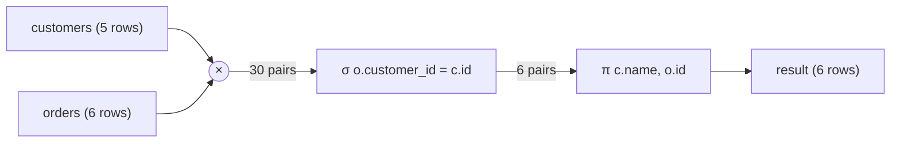

<div dir="rtl">

# 2. مدل رابطه‌ای

> **زبان:** [English](../../en/part1/02-relational-model.md) | فارسی | **قبلی:** [1. پایگاه داده چیست](01-what-is-a-database.md) | **بعدی:** [3. SQL I: خواندن داده](03-sql-basics.md)
> **سطح:** L1 مبتدی ← L2 | **بخش:** I
> **در یک جمله:** مدل رابطه‌ای داده را به‌صورت جدول‌هایی از سطرها توصیف می‌کند که کلیدها آن‌ها را به هم پیوند می‌دهند، و جبری کوچک از عملیات (گزینش، تصویر، پیوند، اجتماع، تفاضل) به دست می‌دهد که هر پرس‌وجویی از آن ساخته می‌شود.
> **چه می‌آموزید:**
> - واژه‌های رسمی (relation، tuple، attribute، domain) و معادل‌های روزمره‌شان (جدول، سطر، ستون، نوع)
> - انواع کلید و اینکه چرا کلید اصلی و کلید خارجی اهمیت دارند
> - NULL واقعاً چه معنایی دارد و منطق سه‌مقداری نتیجهٔ یک مقایسه را چگونه تغییر می‌دهد
> - شش عمل اصلی جبر رابطه‌ای و SQL متناظر با هر کدام
> - نمودار موجودیت-ارتباط `shop` را چگونه بخوانیم
>
> **پیش‌نیازها:** [فصل I-01](01-what-is-a-database.md).
> برچسب‌های نمودارها به انگلیسی نگه داشته شده‌اند تا در GitHub درست نمایش داده شوند.

## 1. ایده (مبتدی)

در سال 1970 یک پژوهشگر IBM به نام Edgar F. Codd راهی ساده برای فکر کردن به داده پیشنهاد کرد: واقعیت‌ها را در جدول ذخیره کن و بگذار کاربر با ترکیب جدول‌ها بگوید چه می‌خواهد، بی‌آنکه بگوید داده کجاست یا چگونه باید آن را آورد. تقریباً همهٔ پایگاه‌های داده تجاری از آن زمان به بعد، و زبان SQL، از همین پیشنهاد سرچشمه می‌گیرند. نام آن **مدل رابطه‌ای** است و «رابطه» (relation) در این نام واژه‌ای ریاضی است برای چیزی که شما از قبل به نام جدول می‌شناسید.

جدول ستون‌هایی دارد که واقعیت‌های ذخیره‌شده را نام‌گذاری می‌کنند (`name`، `email`) و سطرهایی که هر کدام یک چیز را نگه می‌دارند (یک مشتری). مدل سه ایده بر این تصویر می‌افزاید. اول، **هر سطر با یک کلید شناسایی می‌شود**؛ یک ستون یا گروهی از ستون‌ها که مقدارشان برای هر سطر متفاوت است، پس همیشه می‌توانید دقیقاً به یک سطر اشاره کنید. دوم، **سطرهای جدول‌های مختلف با کپی‌کردن یک کلید به هم پیوند می‌خورند**: سفارش نام و ایمیل مشتری را تکرار نمی‌کند، کلید مشتری را نگه می‌دارد و بقیه را هر وقت لازم شد جست‌وجو می‌کنید. سوم، **هر بار روی جدول‌های کامل کار می‌کنید**: پرس‌وجو جدول‌ها را می‌گیرد و جدولی پس می‌دهد، و چون نتیجه خودش جدول است می‌توانید آن را به پرس‌وجوی بعدی بدهید.

همین سه ایده برای طراحی پایگاه داده `shop` و فهمیدن معنای هر دستور SQL در دو فصل بعد کافی است. این فصل به آن‌ها نام درست می‌دهد، تنها مفهوم کمی عجیب را اضافه می‌کند (NULL) و جبر کوچکی را معرفی می‌کند که بهینه‌ساز SQL در درون به کار می‌برد.

### 1.1 واژه‌ها

واژگان رسمی از ریاضیات می‌آید؛ واژگان روزمره از صفحه‌گسترده‌ها و SQL. هر دو در مستندات واقعی به کار می‌روند، پس نگاشت میانشان را یاد بگیرید.

| رسمی (مدل رابطه‌ای) | SQL / روزمره | نمونه در `shop` |
|---|---|---|
| [رابطه](../glossary.md#relation) (relation) | [جدول](../glossary.md#relation) (table) | `customers` |
| [چندتایی](../glossary.md#tuple) (tuple) | [سطر](../glossary.md#tuple) (row؛ «رکورد» هم می‌گویند) | `(1, 'Alice', 'alice@example.com', 1)` |
| [صفت](../glossary.md#attribute) (attribute) | [ستون](../glossary.md#attribute) (column؛ «فیلد» هم می‌گویند) | `email` |
| [دامنه](../glossary.md#domain) (domain) | نوع داده به‌علاوهٔ قیدها | `email` متنی است که `@` دارد؛ `total` عددی با 2 رقم اعشار است |
| درجه (degree) | تعداد ستون‌ها | `customers` درجهٔ 4 دارد |
| کاردینالیتی (یک رابطه) | تعداد سطرها | `customers` دارای 5 سطر است |
| سرایند / اسکیما (heading / schema) | فهرست نام و نوع ستون‌ها | `customers(id, name, email, country_id)` |
| بدنه (body) | مجموعهٔ سطرها | پنج مشتری |

دو هشدار. اول اینکه واژهٔ *کاردینالیتی* برای دو چیز متفاوت به کار می‌رود: تعداد سطرهای یک جدول، و ماهیت «یک‌به‌چند» یک ارتباط میان جدول‌ها (بخش 2.6). زمینهٔ بحث تعیین می‌کند کدام منظور است. دوم اینکه مدل رسمی می‌گوید رابطه یک **مجموعه** است، پس سطر تکراری و ترتیب ندارد. جدول‌های SQL سهل‌گیرترند: ممکن است سطرهای تکراری داشته باشند (وقتی کلیدی در کار نیست) و نتیجهٔ یک پرس‌وجو تا وقتی `ORDER BY` نیاورید ذاتاً ترتیبی ندارد. مجموعه‌ای که تکرار را می‌پذیرد اما ترتیب ندارد [چندمجموعه](../glossary.md#bag) (bag یا multiset) نام دارد. این تفاوت را در ذهن نگه دارید؛ توضیح می‌دهد که چرا SQL هم `UNION` دارد هم `UNION ALL`، و `DISTINCT`.

## 2. نحوهٔ کار (حرفه‌ای)

### 2.1 رابطه‌ها، ترتیب و تکرار

یک رابطه این ویژگی‌ها را دارد:

1. **سطرها ترتیب ندارند.** «سطر اول» بدون مرتب‌سازی معنایی ندارد. اگر پرس‌وجویی امروز سطرها را به ترتیب خوبی برگرداند، آن اتفاقِ ناشی از نحوهٔ ذخیره‌سازی است؛ بهینه‌ساز مجاز است فردا آن را عوض کند.
2. **ستون‌ها در مدل رسمی با موقعیتشان معنا نمی‌یابند**؛ با نام به آن‌ها ارجاع می‌دهید. SQL اجازه می‌دهد `ORDER BY 2` بنویسید که راحت است ولی شکننده.
3. **هر مقدار اتمی است**: در هر خانه یک مقدار هست، نه یک فهرست. خانه‌ای با `'vip,b2b'` که در کد آن را تکه‌تکه می‌کنید این قاعده را می‌شکند (شکل نرمال اول در [فصل I-05](05-modelling-and-normalisation.md)). چند موتور به‌هرحال اجازه می‌دهند آرایه یا JSON ذخیره کنید؛ این گامی آگاهانه بیرون از مدل سخت‌گیر است.
4. **هر سطر برای هر ستون مقداری دارد**، حتی اگر آن مقدار نشانهٔ ویژهٔ NULL باشد (بخش 2.3).
5. **سطرها متمایزند** (مجموعه). جدولی که کلید اصلی دارد این را تضمین می‌کند.

### 2.2 کلیدها

[کلید](../glossary.md#candidate-key) پاسخ این پرسش است: «چگونه دقیقاً یک سطر را نام ببرم؟». چند نوع دارد و بهتر است به ترتیبی یاد گرفته شوند که یک طراح با آن‌ها روبه‌رو می‌شود.

- **ابرکلید (superkey)** هر مجموعه از ستون‌هاست که برای هر سطر یکتا باشد. `(id, name)` ابرکلید `customers` است چون `id` به‌تنهایی چنین است.
- [**کلید کاندید**](../glossary.md#candidate-key) (candidate key) یک ابرکلید *کمینه* است: هر ستونی را حذف کنید، دیگر یکتا نیست. جدول می‌تواند چندتا داشته باشد. در `customers`، `id` یک کلید کاندید است. اگر هر مشتری ایمیل متفاوتی داشت و هیچ ایمیلی خالی نبود، `email` هم کلید کاندید دیگری می‌شد (در seed دو مشتری ایمیل ندارند، پس در آنجا نمی‌تواند کلید باشد).
- [**کلید اصلی**](../glossary.md#primary-key) (primary key) آن کلید کاندیدی است که به‌عنوان شناسهٔ رسمی انتخاب می‌کنید. NULL نمی‌پذیرد و DBMS برایش نمایه می‌سازد تا جست‌وجو سریع باشد. کلیدهای کاندید دیگر «کلید جایگزین» (alternate key) می‌شوند و معمولاً با قید `UNIQUE` تعریف می‌شوند. هر جدول حداکثر یک کلید اصلی دارد.
- [**کلید مرکب**](../glossary.md#composite-key) (composite key) بیش از یک ستون دارد. در `order_lines` کلید اصلی `(order_id, product_id)` است: یک سفارش می‌تواند محصول‌های متعدد داشته باشد و یک محصول در سفارش‌های متعدد بیاید، ولی یک محصول در یک سفارش حداکثر یک بار می‌آید. (اگر می‌خواستید یک محصول در دو خط بیاید، شمارهٔ خط را هم به کلید اضافه می‌کردید، همان‌طور که پایگاه داده نمونهٔ خود Rowlit با `(OrderId, LineNo)` می‌کند.)
- [**کلید جانشین**](../glossary.md#surrogate-key) (surrogate key) شناسه‌ای است که سیستم می‌سازد و معنای کسب‌وکاری ندارد: `customers.id` یک عدد صحیح تولیدشده است (در PostgreSQL با `GENERATED BY DEFAULT AS IDENTITY`، در SQL Server با `IDENTITY(1,1)`، در MySQL با `AUTO_INCREMENT`). [**کلید طبیعی**](../glossary.md#natural-key) (natural key) مقداری است که در دنیای واقعی از پیش وجود دارد و یکتاست، مثل کد کشور `DE` یا شابک (ISBN). کلیدهای طبیعی جذاب‌اند و عادت بدی دارند: دنیای واقعی آن‌ها را تغییر می‌دهد (آدم‌ها ایمیلشان را عوض می‌کنند، کشورها نامشان را). [فصل I-05](05-modelling-and-normalisation.md) این مبادله را بحث می‌کند.
- [**کلید خارجی**](../glossary.md#foreign-key) (foreign key) ستون (یا ستون‌هایی) در یک جدول است که مقدارهایش باید به‌عنوان کلید در جدول دیگری وجود داشته باشد. `orders.customer_id` به `customers.id` ارجاع می‌دهد. سطرهای جدول‌های مختلف از همین راه به هم پیوند می‌خورند.

قاعده‌ای که می‌گوید مقدار کلید خارجی باید با یک کلید موجود تطابق داشته باشد، یا اگر ستون اجازه می‌دهد NULL باشد، [**تمامیت ارجاعی**](../glossary.md#referential-integrity) (referential integrity) نام دارد. DBMS آن را اعمال می‌کند: درج سفارش برای مشتری 99 شکست می‌خورد چون مشتری 99 وجود ندارد، و حذف مشتری 1 تا وقتی سفارش‌هایی به او اشاره می‌کنند شکست می‌خورد (یا آبشاری حذف می‌کند، یا NULL می‌گذارد، بسته به آنچه تعریف کرده باشید). در `shop`:

</div>

```sql
-- engine/tests/docker/seed-postgres.sql:36-41 (trimmed)
CREATE TABLE public.orders (
  id integer CONSTRAINT pk_orders PRIMARY KEY,
  customer_id integer NOT NULL CONSTRAINT fk_orders_customers REFERENCES public.customers(id),
  order_date timestamptz NOT NULL,
  total numeric(12,2) NOT NULL);
```

<div dir="rtl">

`pk_orders` و `fk_orders_customers` نام قیدها هستند. نام‌گذاری قیدها عادت خوبی است، چون نام در پیام‌های خطا ظاهر می‌شود.

### 2.3 NULL و منطق سه‌مقداری

داده‌های seed دو مشتری بدون ایمیل و یک مشتری بدون کشور دارد. مدل رابطه‌ای جایی برای «نامعلوم» ندارد، پس SQL یک نشانه اضافه می‌کند: [NULL](../glossary.md#null). NULL به معنای صفر، رشتهٔ خالی یا نادرست نیست. معنایش این است که **اینجا مقداری نیست**، یا چون نامعلوم است (از Emil کشورش را نپرسیده‌ایم) یا چون در این مورد کاربرد ندارد. همین یک نشانه بیش از هر قابلیت دیگر SQL غافلگیر می‌کند، پس ارزش دارد دقیق فهمیده شود.

هر مقایسه‌ای که NULL در آن باشد درست یا نادرست برنمی‌گرداند. مقدار سومی برمی‌گرداند: **UNKNOWN** (نامعلوم). منطقی که از این حاصل می‌شود [منطق سه‌مقداری](../glossary.md#three-valued-logic) است. جدول‌های درستی:

| `a` | `b` | `a AND b` | `a OR b` |
|---|---|---|---|
| TRUE | TRUE | TRUE | TRUE |
| TRUE | FALSE | FALSE | TRUE |
| TRUE | UNKNOWN | UNKNOWN | TRUE |
| FALSE | FALSE | FALSE | FALSE |
| FALSE | UNKNOWN | FALSE | UNKNOWN |
| UNKNOWN | UNKNOWN | UNKNOWN | UNKNOWN |

حاصل `NOT UNKNOWN` برابر UNKNOWN است. جدول را با عبارت «نمی‌دانم» در ذهن بخوانید: `UNKNOWN AND FALSE` برابر FALSE است چون مقدار نامعلوم هر چه باشد کل عبارت نمی‌تواند درست باشد؛ `UNKNOWN OR TRUE` به همین دلیل برابر TRUE است.

حالا قاعده‌ای که همه را غافلگیر می‌کند: **بند `WHERE` سطر را فقط وقتی نگه می‌دارد که شرطش TRUE باشد.** هم FALSE و هم UNKNOWN سطر را کنار می‌گذارند. سه پیامد، هر کدام با داده‌های `shop`:

</div>

```sql
SELECT name FROM customers WHERE country_id = 1;        -- Alice, Dora
SELECT name FROM customers WHERE country_id <> 1;       -- Bob, Chie (Emil is missing!)
SELECT name FROM customers WHERE country_id IS NULL;    -- Emil
```

<div dir="rtl">

شرط `country_id <> 1` برای Emil برابر UNKNOWN است، چون نمی‌دانیم کشور ناشناخته‌اش آلمان است یا نه؛ پس کنار گذاشته می‌شود. اگر «همهٔ کسانی که در آلمان نیستند، از جمله آن‌ها که کشور ندارند» را می‌خواهید باید صریحاً بنویسید: `WHERE country_id <> 1 OR country_id IS NULL`، یا در موتورهایی که پشتیبانی می‌کنند `country_id IS DISTINCT FROM 1`.

همچنین:

- عبارت `NULL = NULL` برابر UNKNOWN است، نه TRUE. از `IS NULL` و `IS NOT NULL` استفاده کنید. پرس‌وجوی `WHERE email = NULL` در همهٔ موتورها هیچ سطری برنمی‌گرداند.
- **توابع تجمیعی NULLها را رد می‌کنند.** پرس‌وجوی `SELECT count(*), count(email), count(country_id) FROM customers` مقدارهای 5 و 3 و 4 را برمی‌گرداند: `count(*)` سطرها را می‌شمارد، `count(column)` مقدارهای غیر NULL را. `avg` و `sum` هم NULLها را نادیده می‌گیرند، یعنی میانگین `(10, NULL, 20)` برابر 15 است، نه 10.
- **`GROUP BY`، `DISTINCT` و `UNION` NULLها را با هم برابر می‌گیرند.** گروه‌بندی `customers` بر اساس `country_id` چهار گروه می‌دهد که یکی گروه NULL است، با اینکه `NULL = NULL` برابر TRUE نیست. SQL دو مفهوم متفاوت برای «یکسان» دارد: مقایسهٔ `=` و آزمون *not distinct* که گروه‌بندی به کار می‌برد.
- قید `CHECK` وقتی شرطش UNKNOWN شود برقرار شمرده می‌شود. `CHECK (qty > 0)` به `qty` برابر NULL اجازه می‌دهد؛ اگر هر دو را می‌خواهید، آن را با `NOT NULL` ترکیب کنید.
- `NOT IN` با یک NULL در فهرست هیچ سطری برنمی‌گرداند. عبارت `WHERE id NOT IN (SELECT country_id FROM customers)` برابر `id <> 1 AND id <> 2 AND id <> 3 AND id <> NULL` است و جملهٔ آخر کل زنجیره را در بهترین حالت UNKNOWN می‌کند. فصل [I-03](03-sql-basics.md) مثال و جایگزین‌های امن را نشان می‌دهد (`NOT EXISTS`، `LEFT JOIN … IS NULL`).

### 2.4 جبر رابطه‌ای

دومین سهم Codd مجموعه‌ای از عملیات روی رابطه‌هاست، یعنی [جبر رابطه‌ای](../glossary.md#relational-algebra) (relational algebra). هیچ‌وقت آن را در ویرایشگر SQL نمی‌نویسید، اما بهینه‌سازها این‌طور فکر می‌کنند: دستور SQL به درختی از این عملیات ترجمه می‌شود، به درختی ارزان‌تر بازآرایی می‌شود و اجرا می‌گردد ([فصل I-08](08-query-processing.md)). عملگرها را یک بار یاد بگیرید تا بندهای SQL دیگر فهرستی از کلیدواژه‌های حفظی نباشند.

| عملگر | نماد | چه می‌کند | SQL |
|---|---|---|---|
| [گزینش](../glossary.md#selection) (selection) | σ<sub>condition</sub>(R) | سطرهایی را نگه می‌دارد که شرط در آن‌ها برقرار است | `WHERE` |
| [تصویر](../glossary.md#projection) (projection) | π<sub>columns</sub>(R) | فقط بعضی ستون‌ها را نگه می‌دارد (و در مدل محض تکراری‌ها را حذف می‌کند) | فهرست ستون‌های `SELECT` (برای رفتار مجموعه‌ای `DISTINCT` اضافه کنید) |
| تغییر نام (rename) | ρ | به رابطه یا ستون نام تازه می‌دهد | `AS` ([نام مستعار](../glossary.md#alias)، alias) |
| ضرب دکارتی (Cartesian product) | R × S | هر سطر R با هر سطر S جفت می‌شود | `CROSS JOIN` یا ویرگول میان جدول‌ها |
| اجتماع (union) | R ∪ S | سطرهای R یا S (ستون‌های یکسان لازم است) | `UNION` |
| تفاضل (difference) | R − S | سطرهای R که در S نیستند | `EXCEPT` (در Oracle `MINUS`) |
| اشتراک (intersection) | R ∩ S | سطرهای مشترک (از بقیه قابل استخراج است) | `INTERSECT` |
| [پیوند](../glossary.md#join) (join) | R ⋈<sub>condition</sub> S | ضرب و سپس گزینش | `JOIN … ON` |
| تقسیم (division) | R ÷ S | سطرهای R که با *همهٔ* سطرهای S جفت شده‌اند | کلیدواژه‌ای ندارد؛ دو بار `NOT EXISTS` |

شش عمل اول (گزینش، تصویر، تغییر نام، ضرب، اجتماع، تفاضل) کافی‌اند: بقیه با آن‌ها بیان می‌شوند. زبانی که بتواند هر شش را بیان کند *رابطه‌ای کامل* (relationally complete) نام دارد و SQL دست‌کم چنین است.

**گزینش و تصویر روی `customers`.**

σ<sub>country_id = 1</sub>(customers) یعنی «مشتری‌های آلمان»:

</div>

```sql
SELECT * FROM customers WHERE country_id = 1;
```

<div dir="rtl">

| id | name | email | country_id |
|---|---|---|---|
| 1 | Alice | alice@example.com | 1 |
| 4 | Dora | dora@example.com | 1 |

π<sub>country_id</sub>(customers) ستون یگانهٔ شناسهٔ کشورهاست. در مدل محض نتیجه مجموعه است، پس `1` تکراری ادغام می‌شود؛ در SQL باید خودتان بخواهید:

</div>

```sql
SELECT country_id FROM customers;            -- 5 rows: 1, 2, 3, 1, NULL   (a bag)
SELECT DISTINCT country_id FROM customers;   -- 4 rows: 1, 2, 3, NULL      (a set)
```

<div dir="rtl">

**ضرب و پیوند.** ضرب `customers × orders` شامل 5 × 6 = 30 سطر است: هر مشتری با هر سفارش جفت شده است. تقریباً همهٔ آن جفت‌ها بی‌معنایند (Alice در کنار سفارش Bob). پیوند فقط جفت‌هایی را نگه می‌دارد که کلیدهایشان تطابق دارد. این دو پرس‌وجو یک رابطه‌اند:

</div>

```sql
SELECT c.name, o.id AS order_id FROM customers c, orders o WHERE o.customer_id = c.id;
SELECT c.name, o.id AS order_id FROM customers c JOIN orders o ON o.customer_id = c.id;
```

<div dir="rtl">

| name | order_id |
|---|---|
| Alice | 1 |
| Alice | 2 |
| Bob | 3 |
| Chie | 4 |
| Dora | 5 |
| Dora | 6 |

**شکل 2.1: پیوند یعنی ضرب، به‌دنبال آن گزینش و تصویر.**

</div>



<div dir="rtl">

Emil سفارشی ندارد، پس در هیچ‌یک از 6 جفت تطابق‌یافته نیست. به همین دلیل پیوند داخلی (inner join) او را از دست می‌دهد و به همین دلیل پیوندهای *خارجی* در [فصل I-03](03-sql-basics.md) وجود دارند.

بهینه‌ساز واقعی هیچ‌وقت ضرب 30 سطری را نمی‌سازد؛ از نمایهٔ `orders.customer_id` استفاده می‌کند. ضرب **معنای** پیوند است و طرح اجرا راهی است که موتور سریع‌تر به همان پاسخ می‌رسد.

**اجتماع، تفاضل، اشتراک.** هر کدام دو رابطه با ستون‌های یکسان می‌خواهند:

</div>

```sql
SELECT id FROM customers EXCEPT SELECT customer_id FROM orders;   -- 5  (Emil)
```

<div dir="rtl">

«مشتری‌هایی که هرگز سفارش نداده‌اند» یعنی شناسهٔ مشتری‌ها منهای شناسهٔ مشتری‌های سفارش‌دهنده.

**تقسیم** به پرسش‌هایی از نوع «برای همه» پاسخ می‌دهد. «کدام مشتری‌ها همهٔ محصول‌هایی را که Alice خریده خریده‌اند؟» Alice کیبورد (Keyboard) و ماوس (Mouse) خریده است؛ فقط خود Alice هر دو را خریده، پس پاسخ Alice است. SQL کلیدواژه‌ای برای تقسیم ندارد؛ شیوهٔ استاندارد نفی دوگانه است، «هیچ محصولی از Alice نیست که این مشتری نخریده باشد»:

</div>

```sql
SELECT c.name
FROM customers c
WHERE NOT EXISTS (
  SELECT 1 FROM products p
  WHERE p.id IN (SELECT l.product_id FROM order_lines l JOIN orders o ON o.id = l.order_id WHERE o.customer_id = 1)
    AND NOT EXISTS (
      SELECT 1 FROM order_lines l2 JOIN orders o2 ON o2.id = l2.order_id
      WHERE o2.customer_id = c.id AND l2.product_id = p.id));
```

<div dir="rtl">

| name |
|---|
| Alice |

به ندرت به تقسیم نیاز پیدا می‌کنید، و هر وقت پیدا کردید بهتر است در کد توضیحی کنارش بگذارید. اینجا فقط برای تکمیل مجموعه آمده است.

**خاصیت بستار.** هر عملگر رابطه می‌گیرد و رابطه برمی‌گرداند. چون خروجی از همان نوع ورودی است، عملگرها بی‌پایان ترکیب می‌شوند: `π(σ(R ⋈ S))`. این [بستار](../glossary.md#closure) (closure) دلیل آن است که SQL در هر جا که جدول می‌آید زیرپرس‌وجو را هم می‌پذیرد، و دلیل آن است که پرس‌وجو یک درخت است.

### 2.5 داده‌های seed به‌صورت رابطه

برای مرجع، همهٔ داده‌های `shop` (سطرهای یکسان در همهٔ موتورها؛ مهر زمانی `order_date` تا دقیقه کوتاه شده است):

`countries`

| id | name |
|---|---|
| 1 | Germany |
| 2 | France |
| 3 | Japan |

`customers`

| id | name | email | country_id |
|---|---|---|---|
| 1 | Alice | alice@example.com | 1 |
| 2 | Bob | NULL | 2 |
| 3 | Chie | chie@example.jp | 3 |
| 4 | Dora | dora@example.com | 1 |
| 5 | Emil | NULL | NULL |

`products`

| id | name | price |
|---|---|---|
| 1 | Keyboard | 49.90 |
| 2 | Mouse | 19.50 |
| 3 | Monitor | 199.00 |
| 4 | Cable | 5.25 |

`orders`

| id | customer_id | order_date | total |
|---|---|---|---|
| 1 | 1 | 2026-01-05 10:00 | 120.50 |
| 2 | 1 | 2026-02-11 09:30 | 19.50 |
| 3 | 2 | 2026-02-12 14:00 | 199.00 |
| 4 | 3 | 2026-03-01 08:15 | 54.15 |
| 5 | 4 | 2026-03-02 17:45 | 5.25 |
| 6 | 4 | 2026-03-03 12:00 | 249.00 |

`order_lines` (کلید اصلی `(order_id, product_id)`)

| order_id | product_id | qty |
|---|---|---|
| 1 | 1 | 2 |
| 1 | 2 | 1 |
| 2 | 2 | 1 |
| 3 | 3 | 1 |
| 4 | 1 | 1 |
| 4 | 4 | 1 |
| 6 | 3 | 1 |

دو نکته دربارهٔ این داده‌ها همین حالا قابل توجه است، چون فصل‌های بعد از آن‌ها استفاده می‌کنند. سفارش 5 **هیچ سطر سفارشی ندارد**، و `total` یک سفارش عددی ذخیره‌شده است که همیشه با مجموع سطرهایش برابر نیست (سفارش 1 مقدار 120.50 را ذخیره کرده ولی خطوطش جمعاً 119.30 می‌شود؛ سفارش 4 مقدار 54.15 را ذخیره کرده ولی خطوطش جمعاً 55.15 می‌شود؛ سفارش 6 برای یک مانیتور 199.00 مقدار 249.00 را ذخیره کرده است). این fixture سعی ندارد با خودش سازگار باشد. دقیقاً همین وضعیتی است که [فصل I-05](05-modelling-and-normalisation.md) از آن هشدار می‌دهد: وقتی یک واقعیت دو بار ذخیره شود، نسخه‌ها از هم دور می‌شوند.

### 2.6 نمودار موجودیت-ارتباط `shop`

[نمودار موجودیت-ارتباط](../glossary.md#er-diagram) (ER diagram) جدول‌ها را به‌صورت جعبه (موجودیت) و کلیدهای خارجی را به‌صورت خط (ارتباط) می‌کشد. انتهای خط‌ها [کاردینالیتی](../glossary.md#cardinality-relationship) (cardinality) ارتباط را نشان می‌دهد: به ازای هر سطر در یک سمت، در سمت دیگر چند سطر می‌تواند وجود داشته باشد. نمادگذاری اینجا [پای کلاغی](../glossary.md#crows-foot) (crow's foot) است: خط عمودی یعنی «دقیقاً یک»، دایره یعنی «صفر»، چنگال سه‌شاخه یعنی «چند».

**شکل 2.2: مدل `shop`.**

```mermaid
erDiagram
  COUNTRIES |o--o{ CUSTOMERS : "lives in"
  CUSTOMERS ||--o{ ORDERS : places
  ORDERS ||--o{ ORDER_LINES : contains
  PRODUCTS ||--o{ ORDER_LINES : "appears in"
  ORDERS ||--o{ INVOICES : "billed by"
  COUNTRIES {
    int id PK
    text name
  }
  CUSTOMERS {
    int id PK
    text name
    text email
    int country_id FK
  }
  ORDERS {
    int id PK
    int customer_id FK
    timestamptz order_date
    numeric total
  }
  PRODUCTS {
    int id PK
    text name
    numeric price
  }
  ORDER_LINES {
    int order_id PK, FK
    int product_id PK, FK
    int qty
  }
  INVOICES {
    int id PK
    int order_id FK
    numeric amount
  }
```

</div>



<div dir="rtl">

نحوهٔ خواندن آن:

- عبارت `CUSTOMERS ||--o{ ORDERS` یعنی هر سفارش دقیقاً به یک مشتری تعلق دارد (`||`) و یک مشتری صفر یا چند سفارش دارد (`o{`). کلید خارجی `orders.customer_id` برابر `NOT NULL` است، و همین «دقیقاً یک» را می‌سازد.
- عبارت `COUNTRIES |o--o{ CUSTOMERS` یعنی یک مشتری *صفر یا یک* کشور دارد (`|o`)، چون `country_id` می‌تواند NULL باشد (Emil). یک کشور صفر یا چند مشتری دارد.
- عبارت‌های `ORDERS ||--o{ ORDER_LINES` و `PRODUCTS ||--o{ ORDER_LINES`: **ارتباط چندبه‌چند میان سفارش‌ها و محصول‌ها** از راه یک *جدول رابط* (link table؛ با نام‌های junction یا associative table هم شناخته می‌شود) به دو ارتباط یک‌به‌چند شکسته می‌شود؛ این جدول `order_lines` است و کلید اصلی مرکبش جفتِ دو کلید خارجی است. هر ارتباط چندبه‌چند در پایگاه داده رابطه‌ای به یک جدول رابط تبدیل می‌شود. جدول رابط جای خوبی برای نگه‌داشتن واقعیت‌های مربوط به خود ارتباط است، مانند `qty`.
- جدول `INVOICES` فقط در seedهای PostgreSQL و SQL Server وجود دارد، در اسکیمای دومی به نام `sales` (به شکل `sales.invoices`)، که یک کلید خارجی عبورکننده از میان اسکیماها را هم نشان می‌دهد.

نام‌های نمودار نام‌های PostgreSQL هستند. seed مربوط به SQL Server از PascalCase استفاده می‌کند (`Customers`، `CountryId`) و Oracle از حروف بزرگ (`CUSTOMERS`، `COUNTRY_ID`)؛ مدل یکسان است.

## 3. بررسی عمیق (پیشرفته)

> **بررسی عمیق (L3): SQL کجا از مدل فاصله می‌گیرد.**
> SQL بعد از مدل طراحی شد و چند قاعدهٔ آن را عمداً می‌شکند، بیشتر به دلایل کارایی و عمل‌گرایی. وقتی دربارهٔ پرس‌وجوها استدلال می‌کنید یا قاعده‌ای برای بهینه‌ساز می‌نویسید، پیامدهایش مهم است.
> - **چندمجموعه، نه مجموعه.** حذف تکراری‌ها مستلزم مرتب‌سازی یا هش‌کردن داده است که گران است، پس SQL تکراری‌ها را نگه می‌دارد مگر اینکه `DISTINCT` یا `UNION` بنویسید. جبر برای چندمجموعه‌ها کمی فرق می‌کند: `UNION ALL` تعدد را جمع می‌کند، `INTERSECT ALL` کمینه را برمی‌دارد و `EXCEPT ALL` آن‌ها را کم می‌کند (PostgreSQL و SQL استاندارد پشتیبانی می‌کنند؛ همهٔ موتورها نه). هم‌ارزی‌هایی که برای مجموعه‌ها برقرارند می‌توانند برای چندمجموعه‌ها شکست بخورند؛ پس بهینه‌ساز باید ثابت کند بازنویسی برای معنای واقعی امن است.
> - **ترتیب فقط وقتی جزء نتیجه است که درخواست شود.** مدل ترتیب ندارد؛ `ORDER BY` نتیجه را به فهرست تبدیل می‌کند.
> - **NULL.** Codd بعدها نشانه‌هایی برای «اطلاعات غایب» به مدل افزود (دو نوع پیشنهاد کرد: «غایب ولی کاربردپذیر» و «غایب و کاربردناپذیر»)؛ SQL یکی را استاندارد کرد. منطق سه‌مقداری قانون‌های آشنا را می‌شکند: `x = x` همیشه درست نیست، `x OR NOT x` همیشه TRUE نیست، و وقتی داده NULL دارد `NOT (a = b)` با `a <> b` یکی نیست. بهینه‌سازها باید هنگام جابه‌جاکردن گزاره‌ها از میان پیوندهای خارجی و `NOT IN` احتیاط کنند.
> - **نام‌های ستون تکراری و ستون‌های بی‌نام** در نتیجه مجازند؛ مدل صفت‌های نام‌دار و متمایز می‌خواهد.
> - **جزئیات فیزیکی نشت می‌کنند.** مدل منطقی را از فیزیکی جدا می‌کند و SQL عمدتاً از آن پیروی می‌کند، اما قابلیت‌هایی مثل `ROWID`، `ctid`، راهنماهای نمایه (index hint) و `LIMIT` بدون `ORDER BY` لایهٔ ذخیره‌سازی را آشکار می‌کنند.
> - **تمامیت ارجاعی اختیاری است.** DBMS فقط وقتی آن را اعمال می‌کند که کلید خارجی را تعریف کرده باشید، و چند موتور تعریف را می‌پذیرند ولی اعمالش نمی‌کنند (جدول زیر را ببینید).

> **بررسی عمیق (L3): NULL و کلیدها.** مدل رابطه‌ای می‌گوید کلید اصلی هرگز نمی‌تواند NULL باشد. SQL در مورد کلیدهای اصلی موافق است، اما قید *یکتایی* مجاز است NULL داشته باشد و موتورها در اینکه چند تا، اختلاف دارند. SQL Server برای یکتایی NULL را مثل مقداری معمولی می‌گیرد و در نمایهٔ یکتا دقیقاً یک NULL اجازه می‌دهد؛ PostgreSQL، MySQL، MariaDB و SQLite هر تعداد را می‌پذیرند، چون دو NULL «برابر نیستند»؛ PostgreSQL 15 قید `UNIQUE NULLS NOT DISTINCT` را اضافه کرد تا رفتار دیگر را بتوان برگزید. Oracle هم در نمایهٔ یکتای تک‌ستونی چند NULL می‌پذیرد، اما در نمایهٔ یکتای مرکب دو سطری را رد می‌کند که ستون‌های غیر NULL آن‌ها برابر باشد و بقیهٔ ستون‌هایشان همه NULL باشد (سطری که همهٔ ستون‌هایش NULL است اصلاً نمایه نمی‌شود). وقتی اسکیمایی را به موتور دیگری منتقل می‌کنید، این را آزمایش کنید.

## 4. در هر موتور

| موضوع | PostgreSQL 17 | SQL Server 2022 | Oracle 23 | MySQL 8.4 / MariaDB 11 | SQLite 3.4x | ClickHouse 24.8 | Snowflake | Cassandra 5 |
|---|---|---|---|---|---|---|---|---|
| اعمال کلید اصلی | بله | بله | بله | بله (InnoDB) | بله (`PRIMARY KEY` یکتاست؛ در کلیدهای غیر عدد صحیح، اگر `NOT NULL` نباشد NULL پذیرفته می‌شود، که یک ناهمخوانی تاریخی است) | **خیر**: `PRIMARY KEY` کلید مرتب‌سازی/نمایهٔ تُنُک است، نه قاعدهٔ یکتایی | فقط اطلاعاتی، **اعمال نمی‌شود** | بله، و `INSERT` با کلید موجود آن را بازنویسی می‌کند (upsert) |
| اعمال کلید خارجی | بله | بله | بله | بله (InnoDB) | فقط وقتی `PRAGMA foreign_keys = ON` برای آن اتصال باشد | کلید خارجی ندارد | فقط اطلاعاتی | کلید خارجی و join ندارد |
| اعمال `NOT NULL` | بله | بله | بله | بله | بله | بله (ستون‌ها غیر nullable‌اند مگر `Nullable(T)`) | بله | فقط ستون‌های کلید اصلی |
| `ORDER BY x` پیش‌فرض NULLها را کجا می‌گذارد | آخر، در حالت صعودی | اول، در حالت صعودی | آخر، در حالت صعودی | اول، در حالت صعودی | اول، در حالت صعودی | آخر (`NULLS LAST`) | آخر، در حالت صعودی | کاربرد ندارد |
| نحو کنترل آن | `NULLS FIRST` / `NULLS LAST` | کلیدواژه ندارد؛ از `ORDER BY CASE WHEN x IS NULL …` استفاده کنید | `NULLS FIRST` / `NULLS LAST` | کلیدواژه ندارد (MySQL)؛ از `ISNULL(x)` استفاده کنید | `NULLS FIRST` / `NULLS LAST` از نسخهٔ 3.30 | `NULLS FIRST` / `NULLS LAST` | `NULLS FIRST` / `NULLS LAST` | ندارد |
| رشتهٔ خالی `''` است … | مقداری، متفاوت از NULL | مقداری | **همان NULL** | مقداری | مقداری | مقداری | مقداری | مقداری |
| برابری امن در برابر NULL | `IS NOT DISTINCT FROM` | `IS NOT DISTINCT FROM` (2022) | `DECODE(a, b, 1, 0) = 1` (عملگر ندارد) | `<=>` | `IS` / `IS NOT` | `isNotDistinctFrom()` (برای 24.8 راستی‌آزمایی نشده) | `IS NOT DISTINCT FROM`، `EQUAL_NULL()` | کاربرد ندارد |

سلول‌هایی که با «فقط اطلاعاتی» (informational) شروع می‌شوند یعنی موتور قید را تجزیه می‌کند، در فهرست سیستمی خود ثبت می‌کند (ابزارهای BI از آن برای استنباط ارتباط‌ها استفاده می‌کنند) و هرگز سطر ناقض را رد نمی‌کند. با نسخه‌ای که به کار می‌برید راستی‌آزمایی کنید؛ جدول رفتار نسخه‌های فهرست‌شده را ثبت کرده است. سطر مربوط به Oracle به‌ویژه خطرناک است: در Oracle رشتهٔ با طول صفر *همان* NULL است، پس `WHERE name = ''` هرگز چیزی برنمی‌گرداند و `'abc' || NULL` برابر `'abc'` است.

## 5. تمرین‌ها

1. **کلیدها.** در `order_lines`، آیا `order_id` به‌تنهایی کلید است؟ آیا `product_id` به‌تنهایی؟ چرا `(order_id, product_id)` کلید اصلی است و `(order_id, product_id, qty)` نیست؟ چه چیزی در جدول باید عوض شود تا یک سفارش بتواند Mouse را در دو سطر جداگانه داشته باشد؟
2. **منطق سه‌مقداری.** هر یک از عبارت‌های زیر را TRUE، FALSE یا UNKNOWN ارزیابی کنید: `NULL = NULL`؛ `NULL IS NULL`؛ `1 <> NULL`؛ `NULL OR TRUE`؛ `NULL AND FALSE`؛ `NOT NULL`؛ `(1 = 1) AND (NULL = 2)`.
3. **شمارش.** بدون اجرای چیزی، خروجی `SELECT count(*), count(email), count(country_id), count(DISTINCT country_id) FROM customers` را پیش‌بینی کنید. سپس پیش‌بینی کنید `SELECT * FROM customers WHERE country_id <> 1` چند سطر برمی‌گرداند و کدام مشتری‌ها از پاسخ غایب‌اند. هر دو را اجرا کنید و بررسی کنید.
4. **جبر.** عبارت جبر رابطه‌ای (با σ، π و ⋈) و SQL مربوط به «نام مشتری‌هایی که سفارشی با مبلغ کل بیش از 100 داده‌اند» را بنویسید. درخت عبارت آن را بکشید. پیش از پیوند کدام‌یک از دو رابطه بزرگ‌تر است، و بهینه‌ساز ترجیح می‌دهد اول چه کند، گزینش یا پیوند؟
5. **مدل.** فروشگاه نقد محصول می‌خواهد: یک مشتری می‌تواند دربارهٔ یک محصول، حداکثر یک بار، نقد بنویسد، با امتیازی از 1 تا 5 و کمی متن. موجودیت‌ها و کاردینالیتی‌ها را با نمادگذاری پای کلاغی بکشید، کلید اصلی جدول جدید را انتخاب کنید و `CREATE TABLE` را به‌همراه کلیدهای خارجی و یک قید `CHECK` بنویسید. این ارتباط یک‌به‌چند است یا چندبه‌چند، و چرا جدول جدید شبیه `order_lines` است؟
6. **مجموعه در برابر چندمجموعه.** پرس‌وجوی `SELECT country_id FROM customers UNION SELECT id FROM countries` چند سطر برمی‌گرداند، و همین پرس‌وجو با `UNION ALL` چند سطر؟ اولی کدام سطرها را حذف می‌کند و چرا NULL دقیقاً یک بار ظاهر می‌شود؟

پاسخ‌ها: [فصل I-18، بخش I-02](18-exercise-answers.md#i-02).

## فصل‌های مرتبط

- قبلی: [I-01 پایگاه داده چیست](01-what-is-a-database.md). بعدی: [I-03 SQL I](03-sql-basics.md) که جبر را به دستورهای SELECT تبدیل می‌کند.
- [I-05 مدل‌سازی و نرمال‌سازی](05-modelling-and-normalisation.md) با کلیدها، قیدها و طراحی جدول‌ها ادامه می‌دهد.
- [I-08 خط لولهٔ پرس‌وجو](08-query-processing.md) نشان می‌دهد دستور SQL چگونه به درخت‌های جبری بخش 2.4 تبدیل و بهینه می‌شود.
- بخش دوم: Rowlit برای هر پایگاه داده متصل همین نوع نمودار را می‌کشد ([II-15](../part2/15-import-export-plans-er.md)، نمودارهای ER).

## اصطلاحات جدید این فصل

[رابطه](../glossary.md#relation)، [چندتایی](../glossary.md#tuple)، [صفت](../glossary.md#attribute)،
[دامنه](../glossary.md#domain)، [چندمجموعه](../glossary.md#bag)، [کلید کاندید](../glossary.md#candidate-key)،
[کلید اصلی](../glossary.md#primary-key)، [کلید مرکب](../glossary.md#composite-key)،
[کلید جانشین](../glossary.md#surrogate-key)، [کلید طبیعی](../glossary.md#natural-key)،
[کلید خارجی](../glossary.md#foreign-key)، [تمامیت ارجاعی](../glossary.md#referential-integrity)،
[NULL](../glossary.md#null)، [منطق سه‌مقداری](../glossary.md#three-valued-logic)،
[جبر رابطه‌ای](../glossary.md#relational-algebra)، [گزینش](../glossary.md#selection)،
[تصویر](../glossary.md#projection)، [پیوند](../glossary.md#join)، [بستار](../glossary.md#closure)،
[نام مستعار](../glossary.md#alias)، [نمودار ER](../glossary.md#er-diagram)،
[کاردینالیتی (ارتباط)](../glossary.md#cardinality-relationship)، [پای کلاغی](../glossary.md#crows-foot).

</div>
