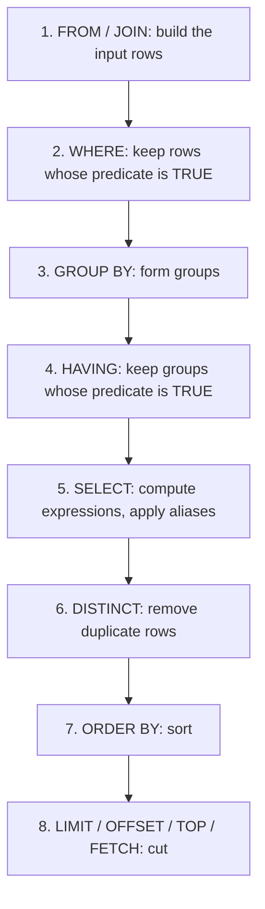
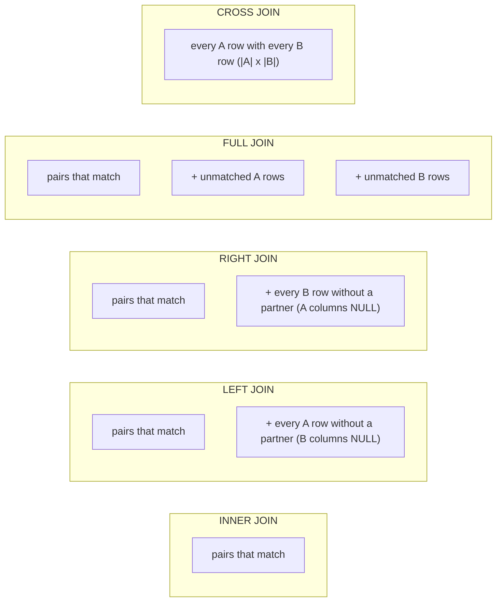

<div dir="rtl">

# 3. SQL I: خواندن داده

> **زبان:** [English](../../en/part1/03-sql-basics.md) | فارسی | **قبلی:** [2. مدل رابطه‌ای](02-relational-model.md) | **بعدی:** [4. SQL II: پرس‌وجوهای پیشرفته](04-sql-advanced.md)
> **سطح:** L1 مبتدی | **بخش:** I
> **در یک جمله:** دستور SELECT سطرهای مورد نظر شما را توصیف می‌کند و DBMS تصمیم می‌گیرد چگونه آن‌ها را بیاورد؛ این فصل بندها، پیوندها، گروه‌بندی و دستورهای پایهٔ تغییر داده را یاد می‌دهد.
> **چه می‌آموزید:**
> - ساختار `SELECT` و ترتیبی که بندهای آن واقعاً به آن ترتیب ارزیابی می‌شوند
> - فیلتر، مرتب‌سازی، محدودکردن و صفحه‌بندی نتیجه، و تفاوت این کارها میان موتورها
> - پیوندهای داخلی، چپ، راست، کامل، ضرب دکارتی و خودی، با تصویر و سطرهای `shop`
> - توابع تجمیعی، `GROUP BY` و `HAVING`، و خطای کلاسیک «پیوند بزن و جمع بزن»
> - عملگرهای مجموعه‌ای، راه‌های امن برای پرسیدن «چه کسی ... ندارد»، و مبانی `INSERT`، `UPDATE`، `DELETE` و `CREATE TABLE`
>
> **پیش‌نیازها:** [I-01](01-what-is-a-database.md)، [I-02](02-relational-model.md).
> **دربارهٔ خروجی‌ها:** نتیجهٔ نسخه‌های SQLite این پرس‌وجوها با اجرای آن‌ها روی fixture با نام `shop` (SQLite 3.51) به دست آمده است. برای موتورهای دیگر پرس‌وجو همان سطرها را برمی‌گرداند؛ جایی که نحو موتور فرق می‌کند، خروجی یک *خروجی نمونه* (illustrative output) است که از داده‌های seed محاسبه شده. اعداد به سبک PostgreSQL نمایش داده شده‌اند (`120.50`).
> برچسب‌های نمودارها به انگلیسی نگه داشته شده‌اند تا در GitHub درست نمایش داده شوند.

## 1. ایده (مبتدی)

SQL (Structured Query Language؛ معمولاً «سیکوئل» یا «اس‌کیو‌ال» خوانده می‌شود) زبانی است که با آن با یک پایگاه داده رابطه‌ای صحبت می‌کنید. ایدهٔ مرکزی‌اش این است که **اعلانی** (declarative) است: می‌گویید *چه* نتیجه‌ای می‌خواهید، نه اینکه *چگونه* محاسبه شود. جملهٔ «نام مشتری‌های آلمان را بده» به DBMS نمی‌گوید فایلی را باز کند، روی سطرها حلقه بزند یا از نمایه استفاده کند؛ این تصمیم‌ها با خود DBMS است. می‌توانید بدون دانستن آن‌ها SQL درست بنویسید و بعداً آن‌ها را یاد بگیرید ([فصل‌های I-07 و I-08](07-indexes.md)) تا همان SQL را سریع‌تر کنید.

دستورهای SQL بسته به کارشان به چند گروه تقسیم می‌شوند. این نام‌ها در همهٔ مستندات می‌آیند، پس همین حالا یادشان بگیرید.

| گروه | نام | هدف | نمونه‌ها |
|---|---|---|---|
| [DQL](../glossary.md#dql) | Data Query Language | خواندن داده | `SELECT` |
| [DML](../glossary.md#dml) | Data Manipulation Language | تغییر سطرها | `INSERT`, `UPDATE`, `DELETE`, `MERGE` |
| [DDL](../glossary.md#ddl) | Data Definition Language | تغییر ساختار | `CREATE`, `ALTER`, `DROP`, `TRUNCATE` |
| [DCL](../glossary.md#dcl) | Data Control Language | دسترسی‌ها | `GRANT`, `REVOKE` |
| [TCL](../glossary.md#tcl) | Transaction Control Language | گروه‌کردن تغییرها | `BEGIN`, `COMMIT`, `ROLLBACK`, `SAVEPOINT` |

بعضی نویسندگان `SELECT` را بخشی از DML می‌شمارند؛ تقسیم بالا رایج‌ترین است. این فصل تقریباً کاملاً دربارهٔ `SELECT` است. بخش آخر دستورهای دیگر را فقط در حدی نشان می‌دهد که بتوانید در تمرین‌ها داده‌های `shop` را تغییر دهید. تراکنش‌ها [فصل I-09](09-transactions-and-isolation.md) را دارند و دسترسی‌ها [فصل I-14](14-security.md) را.

کلیدواژه‌های SQL به بزرگی و کوچکی حروف حساس نیستند (`select` و `SELECT` یکی‌اند) و در بیشتر ابزارها دستور با نقطه‌ویرگول تمام می‌شود. این کتاب کلیدواژه‌ها را با حروف بزرگ و شناسه‌ها را با حروف کوچک می‌نویسد؛ این یک قرارداد است، نه قاعده.

## 2. نحوهٔ کار (حرفه‌ای)

### 2.1 شکل یک SELECT

</div>

```sql
SELECT   <what to return>          -- projection: columns and expressions
FROM     <where the rows come from>-- tables, joins, subqueries
WHERE    <row filter>              -- predicate on single rows
GROUP BY <grouping columns>        -- collapse rows into groups
HAVING   <group filter>            -- predicate on groups
ORDER BY <sort keys>               -- order the result
LIMIT    <how many>                -- (spelling depends on the engine)
```

<div dir="rtl">

در بیشتر موتورها فقط `SELECT` الزامی است (و `FROM` در همه به‌جز چند موتور؛ Oracle پیش از نسخهٔ 23 به `FROM dual` نیاز داشت). بندها همیشه به همین ترتیب نوشته می‌شوند، اما DBMS **آن‌ها را با ترتیب دیگری ارزیابی می‌کند**، و همین ترتیب بیشتر قاعده‌هایی را که با آن‌ها روبه‌رو می‌شوید توضیح می‌دهد.

**شکل 3.1: ترتیب منطقی ارزیابی یک SELECT.**

</div>



<div dir="rtl">

این ترتیب *منطقی* است: معنای دستور را می‌دهد. بهینه‌ساز آزاد است با هر ترتیبی اجرا کند که همان نتیجه را بدهد، مثلاً پیش از پیوند فیلتر کند ([فصل I-08](08-query-processing.md)). آنچه این ترتیب به شما می‌گوید:

- `WHERE` پیش از `SELECT` اجرا می‌شود، پس **نام مستعاری که در فهرست select تعریف شده در SQL استاندارد در `WHERE` قابل استفاده نیست** (`SELECT total * 1.19 AS gross ... WHERE gross > 100` در PostgreSQL، SQL Server و Oracle خطا می‌دهد). بعضی موتورها در بندهای دیگر آسان‌گیرترند: MySQL و PostgreSQL نام مستعار را در `GROUP BY` می‌پذیرند و SQLite حتی در `WHERE` (به آن تکیه نکنید). عبارت را تکرار کنید، یا پرس‌وجو را در یک زیرپرس‌وجو یا CTE بگذارید ([فصل I-04](04-sql-advanced.md)).
- `ORDER BY` بعد از `SELECT` اجرا می‌شود، پس **می‌تواند** از نام مستعار استفاده کند.
- `WHERE` پیش از گروه‌بندی اجرا می‌شود، پس نمی‌تواند تابع تجمیعی داشته باشد؛ `HAVING` بعد از آن اجرا می‌شود، پس می‌تواند.
- `LIMIT` آخر است: DBMS باید کل نتیجه را محاسبه و مرتب کند تا بداند کدام سطرها اولند.

### 2.2 تصویر، عبارت، مقدار لفظی و نام مستعار

فهرست select ستون‌ها را برمی‌گزیند. هر [عبارت](../glossary.md#expression) (expression) هم می‌تواند در آن بیاید: محاسبات عددی، فراخوانی تابع، عملیات روی رشته، `CASE`. [مقدار لفظی](../glossary.md#literal) (literal) مقداری است که مستقیماً در دستور نوشته می‌شود: `42`، `'Alice'`، `DATE '2026-01-05'`. [نام مستعار](../glossary.md#alias) (alias) که با `AS` معرفی می‌شود، به یک ستون یا جدول در همان دستور نام می‌دهد.

</div>

```sql
SELECT id,
       name,
       coalesce(email, '(none)') AS email,
       upper(name)               AS shout
FROM customers
WHERE id <= 3;
```

<div dir="rtl">

| id | name | email | shout |
|---|---|---|---|
| 1 | Alice | alice@example.com | ALICE |
| 2 | Bob | (none) | BOB |
| 3 | Chie | chie@example.jp | CHIE |

تابع `coalesce(a, b, …)` اولین آرگومانش را که NULL نباشد برمی‌گرداند، پس راه جایگزین‌کردن NULL با مقدار پیش‌فرض است. استاندارد SQL است و در همهٔ موتورهای این کتاب کار می‌کند (SQL Server و Oracle توابع `ISNULL` و `NVL` را هم دارند؛ `coalesce` را ترجیح دهید).

`SELECT *` همهٔ ستون‌ها را برمی‌گرداند. برای کاوش راحت است و در کد برنامه مضر: وقتی کسی ستونی اضافه کند نتیجه تغییر می‌کند و داده‌ای می‌آورد که لازم ندارید ([فصل I-13](13-performance-tuning.md)).

[`DISTINCT`](../glossary.md#distinct) سطرهای تکراری را از نتیجه حذف می‌کند: `SELECT DISTINCT customer_id FROM orders` به‌جای شش سطر، مقدارهای 1، 2، 3، 4 (چهار سطر) را برمی‌گرداند. روی *کل* سطر اثر می‌گذارد، نه روی ستون اول.

نام مستعار جدول نام‌ها را کوتاه می‌کند و برای پیوند خودی (بخش 2.5) اجباری است: `FROM customers c`. وقتی به جدولی نام مستعار دادید، در تمام آن دستور از همان استفاده کنید.

### 2.3 فیلتر با WHERE

[گزاره](../glossary.md#predicate) (predicate) شرطی است که برای هر سطر TRUE، FALSE یا UNKNOWN می‌شود ([فصل I-02](02-relational-model.md)، منطق سه‌مقداری). `WHERE` سطرهایی را نگه می‌دارد که شرطشان TRUE است.

| گزاره | معنا | نمونه روی `shop` |
|---|---|---|
| `=`, `<>`, `<`, `<=`, `>`, `>=` | مقایسه (`<>` یعنی «نابرابر»؛ در بیشتر موتورها `!=` هم کار می‌کند) | `total >= 100` |
| `AND`, `OR`, `NOT` | ترکیب گزاره‌ها؛ `AND` قوی‌تر از `OR` می‌بندد | `country_id = 1 AND email IS NOT NULL` |
| `BETWEEN a AND b` | بازهٔ بسته (دو سر شامل) | `total BETWEEN 19.50 AND 120.50` |
| `IN (…)` | عضویت در فهرست یا زیرپرس‌وجو | `customer_id IN (1, 3)` |
| `LIKE 'pat'` | الگو؛ `%` هر تعداد نویسه، `_` یک نویسه | `name LIKE '%i%'` |
| `IS NULL`, `IS NOT NULL` | آزمون NULL (هرگز `= NULL` ننویسید) | `email IS NULL` |
| `EXISTS (subquery)` | دست‌کم یک سطر وجود دارد | [فصل I-04](04-sql-advanced.md) |

</div>

```sql
SELECT id, total FROM orders
WHERE total BETWEEN 19.50 AND 120.50 AND customer_id IN (1, 3)
ORDER BY id;
```

<div dir="rtl">

| id | total |
|---|---|
| 1 | 120.50 |
| 2 | 19.50 |
| 4 | 54.15 |

دو تلهٔ NULL را به یاد داشته باشید. `WHERE email = NULL` هیچ سطری برنمی‌گرداند (از `IS NULL` استفاده کنید). `WHERE country_id <> 1` بی‌سروصدا Emil را کنار می‌گذارد که کشورش NULL است. همیشه بپرسید: «سطرهایی که این ستون در آن‌ها NULL است چه سرنوشتی باید داشته باشند؟»

`LIKE` در PostgreSQL و Oracle به بزرگی و کوچکی حروف حساس است، در SQL Server و MySQL به‌طور پیش‌فرض حساس نیست (از [ترتیب مرتب‌سازی و مقایسه](../glossary.md#collation) (collation) ستون پیروی می‌کند)، و در SQLite برای ASCII حساس نیست. PostgreSQL برای تطبیق بی‌توجه به بزرگی و کوچکی حروف `ILIKE` دارد. الگویی که با `%` شروع شود نمی‌تواند از نمایهٔ معمولی استفاده کند ([فصل I-07](07-indexes.md)).

### 2.4 مرتب‌سازی، محدودکردن و صفحه‌بندی

مجموعه نتیجه (result set) تا وقتی `ORDER BY` نیاورید ترتیبی ندارد. می‌توانید بر اساس چند کلید مرتب کنید که هر کدام `ASC` (پیش‌فرض) یا `DESC` است:

</div>

```sql
SELECT id, customer_id, total FROM orders ORDER BY total DESC LIMIT 3;
```

<div dir="rtl">

| id | customer_id | total |
|---|---|---|
| 6 | 4 | 249.00 |
| 3 | 2 | 199.00 |
| 1 | 1 | 120.50 |

برای گرفتن صفحهٔ بعد، سطرها را با offset رد کنید. همیشه یک کلید تعیین‌کنندهٔ ترتیب (tie-breaker؛ اینجا `id`) اضافه کنید تا ترتیب قطعی باشد؛ وگرنه سطرهایی که کلیدشان برابر است ممکن است در دو صفحه بیایند یا در هیچ‌کدام.

</div>

```sql
SELECT id, customer_id, total FROM orders ORDER BY total DESC, id LIMIT 3 OFFSET 3;
```

<div dir="rtl">

| id | customer_id | total |
|---|---|---|
| 4 | 3 | 54.15 |
| 2 | 1 | 19.50 |
| 5 | 4 | 5.25 |

نحو «فقط N سطر اول» آشکارترین تفاوت میان گویش‌های SQL است:

| موتور | 3 سطر اول | سطرهای 4 تا 6 |
|---|---|---|
| PostgreSQL 17 | `… ORDER BY total DESC LIMIT 3` | `LIMIT 3 OFFSET 3` یا `OFFSET 3 ROWS FETCH NEXT 3 ROWS ONLY` |
| SQL Server 2022 | `SELECT TOP (3) … ORDER BY total DESC` | `ORDER BY total DESC OFFSET 3 ROWS FETCH NEXT 3 ROWS ONLY` (به `ORDER BY` نیاز دارد) |
| Oracle 23 | `… ORDER BY total DESC FETCH FIRST 3 ROWS ONLY` (قدیمی‌تر: `WHERE ROWNUM <= 3` روی یک زیرپرس‌وجوی مرتب‌شده) | `OFFSET 3 ROWS FETCH NEXT 3 ROWS ONLY` |
| MySQL 8.4 / MariaDB 11 | `LIMIT 3` | `LIMIT 3 OFFSET 3` یا `LIMIT 3, 3` (اول offset) |
| SQLite 3.4x | `LIMIT 3` | `LIMIT 3 OFFSET 3` |
| ClickHouse 24.8 | `LIMIT 3` | `LIMIT 3 OFFSET 3` یا `LIMIT 3, 3` |
| Snowflake | `LIMIT 3` یا `TOP 3` | `LIMIT 3 OFFSET 3` |
| Cassandra 5 (CQL) | `LIMIT 3` | `OFFSET` ندارد؛ با paging state یا با کلید خوشه‌بندی (clustering key) صفحه‌بندی کنید |

صفحه‌بندی با offset ساده است و هرچه عمیق‌تر بروید کندتر می‌شود: DBMS هنوز باید همهٔ سطرهای ردشده را تولید و دور بریزد. [فصل I-13](13-performance-tuning.md) راه جایگزین، یعنی صفحه‌بندی مبتنی بر کلید (keyset pagination)، را نشان می‌دهد.

### 2.5 پیوندها

[پیوند](../glossary.md#join) (join) سطرهای دو جدول را که شرطی را برآورده می‌کنند ترکیب می‌کند، معمولاً «کلید خارجی برابر کلید اصلی باشد». انواع پیوند در سرنوشت سطرهایی که شریک پیدا نمی‌کنند با هم فرق دارند.

**شکل 3.2: هر نوع پیوند کدام سطرها را نگه می‌دارد (A = جدول چپ، B = جدول راست).**

</div>



<div dir="rtl">

**پیوند داخلی (inner join).** فقط جفت‌های تطابق‌یافته. Emil که سفارشی ندارد ظاهر نمی‌شود.

</div>

```sql
SELECT c.name, o.id AS order_id, o.total
FROM customers c
JOIN orders o ON o.customer_id = c.id
ORDER BY o.id;
```

<div dir="rtl">

| name | order_id | total |
|---|---|---|
| Alice | 1 | 120.50 |
| Alice | 2 | 19.50 |
| Bob | 3 | 199.00 |
| Chie | 4 | 54.15 |
| Dora | 5 | 5.25 |
| Dora | 6 | 249.00 |

`JOIN` به‌تنهایی یعنی `INNER JOIN`. شرطی که بعد از `ON` می‌آید *گزارهٔ پیوند* (join predicate) است.

**پیوند خارجی چپ (left outer join).** همهٔ سطرهای جدول چپ، و در جاهایی که جدول راست تطابقی ندارد NULL. برای «همهٔ مشتری‌ها، و اگر سفارشی دارند همراه سفارش‌هایشان» همین را می‌خواهید:

</div>

```sql
SELECT c.name, o.id AS order_id, o.total
FROM customers c
LEFT JOIN orders o ON o.customer_id = c.id
ORDER BY c.id, o.id;
```

<div dir="rtl">

| name | order_id | total |
|---|---|---|
| Alice | 1 | 120.50 |
| Alice | 2 | 19.50 |
| Bob | 3 | 199.00 |
| Chie | 4 | 54.15 |
| Dora | 5 | 5.25 |
| Dora | 6 | 249.00 |
| Emil | NULL | NULL |

**پیوند راست و کامل.** `RIGHT JOIN` همان پیوند چپ است با جابه‌جاشدن جدول‌ها؛ بیشتر افراد `LEFT JOIN` می‌نویسند و جای جدول‌ها را عوض می‌کنند. `FULL JOIN` سطرهای بی‌شریک را از هر دو طرف نگه می‌دارد. `countries FULL JOIN customers` هم کشوری بدون مشتری را نشان می‌دهد (در seed چنین کشوری نیست) و هم مشتری بدون کشور را (Emil):

</div>

```sql
SELECT co.name AS country, c.name AS customer
FROM countries co
FULL JOIN customers c ON c.country_id = co.id
ORDER BY c.id;
```

<div dir="rtl">

| country | customer |
|---|---|
| Germany | Alice |
| France | Bob |
| Japan | Chie |
| Germany | Dora |
| NULL | Emil |

MySQL و MariaDB `FULL JOIN` ندارند؛ آن را با اجتماع یک `LEFT JOIN` و یک `RIGHT JOIN` شبیه‌سازی کنید. Cassandra اصلاً پیوند ندارد: داده را طوری مدل می‌کنید که یک جدول به هر پرس‌وجو جواب دهد ([فصل I-16](16-nosql-families.md)). SQLite از نسخهٔ 3.39 به بعد از `RIGHT` و `FULL` پشتیبانی می‌کند.

**ضرب دکارتی (cross join).** همهٔ ترکیب‌ها، بدون شرط: `countries CROSS JOIN products` معادل 3 × 4 = 12 سطر می‌دهد. ضرب دکارتی به‌ندرت چیزی است که می‌خواهید، اما تقویم و داده‌های آزمایشی را با آن می‌سازند. نحو قدیمی `FROM a, b` (با ویرگول) یک ضرب دکارتی است و پیش از آنکه کلیدواژهٔ `JOIN` وجود داشته باشد، افزودن `WHERE a.k = b.k` آن را به پیوند داخلی تبدیل می‌کرد. فراموش‌کردن `WHERE` ضرب دکارتی تصادفی می‌سازد، که دلیل معمول پرس‌وجویی است که میلیون‌ها سطر برمی‌گرداند.

**پیوند خودی (self join).** جدولی که با خودش پیوند می‌خورد، با دو نام مستعار متفاوت. «جفت مشتری‌هایی که از یک کشورند»:

</div>

```sql
SELECT a.name AS customer_a, b.name AS customer_b, a.country_id
FROM customers a
JOIN customers b ON a.country_id = b.country_id AND a.id < b.id;
```

<div dir="rtl">

| customer_a | customer_b | country_id |
|---|---|---|
| Alice | Dora | 1 |

شرط `a.id < b.id` هر جفت را یک بار نگه می‌دارد و جفت‌شدن مشتری با خودش را حذف می‌کند. (کشور NULL مربوط به Emil با هیچ‌چیز تطابق نمی‌یابد، چون `NULL = NULL` برابر UNKNOWN است.) سلسله‌مراتبی که به‌شکل ستون «شناسهٔ والد» ذخیره شده هم با پیوند خودی پیمایش می‌شود، که [فصل I-04](04-sql-advanced.md) آن را با CTEهای بازگشتی بهتر انجام می‌دهد.

**پیوند طبیعی (natural join) و `USING`.** `NATURAL JOIN` روی همهٔ ستون‌های همنام پیوند می‌زند؛ وقتی کسی ستونی اضافه کند بی‌صدا می‌شکند، پس از آن دوری کنید. `JOIN … USING (country_id)` روی یک ستون نام‌برده که در هر دو جدول هست پیوند می‌زند و آن را یک بار برمی‌گرداند؛ وقتی نام‌ها یکی است مشکلی ندارد و از `ON` کوتاه‌تر است. SQL Server از `USING` پشتیبانی نمی‌کند.

**پیوند سه جدول یا بیشتر** فقط تکرار همین الگوست. هر مشتری چه محصول‌هایی خریده؟

</div>

```sql
SELECT c.name, p.name AS product, l.qty
FROM customers c
JOIN orders o       ON o.customer_id = c.id
JOIN order_lines l  ON l.order_id = o.id
JOIN products p     ON p.id = l.product_id
ORDER BY c.id, o.id, p.id;
```

<div dir="rtl">

| name | product | qty |
|---|---|---|
| Alice | Keyboard | 2 |
| Alice | Mouse | 1 |
| Alice | Mouse | 1 |
| Bob | Monitor | 1 |
| Chie | Keyboard | 1 |
| Chie | Cable | 1 |
| Dora | Monitor | 1 |

ماوس (Mouse) Alice دو بار آمده چون آن را در دو سفارش مختلف (1 و 2) خریده است. تعداد سطرهای نتیجه برابر تعداد سطرهای *درونی‌ترین* جدول زنجیره است، یعنی `order_lines` (7 سطر). این جمله را به یاد داشته باشید؛ تلهٔ بخش 2.6 را توضیح می‌دهد.

**`ON` در برابر `WHERE` در پیوندهای خارجی.** برای پیوند داخلی فرقی نمی‌کند شرط در `ON` باشد یا در `WHERE`. برای پیوند خارجی فرق می‌کند. هر دو پرس‌وجوی زیر دربارهٔ سفارش‌های بالای 100 می‌پرسند، اما به دو پرسش متفاوت جواب می‌دهند:

</div>

```sql
-- A: the condition is part of the join. Customers without a big order are kept, with NULLs.
SELECT c.name, o.id AS order_id, o.total
FROM customers c LEFT JOIN orders o ON o.customer_id = c.id AND o.total > 100 ORDER BY c.id;

-- B: the condition filters the joined result. Rows with NULL totals are discarded.
SELECT c.name, o.id AS order_id, o.total
FROM customers c LEFT JOIN orders o ON o.customer_id = c.id WHERE o.total > 100 ORDER BY c.id;
```

<div dir="rtl">

| A: name | order_id | total |
|---|---|---|
| Alice | 1 | 120.50 |
| Bob | 3 | 199.00 |
| Chie | NULL | NULL |
| Dora | 6 | 249.00 |
| Emil | NULL | NULL |

| B: name | order_id | total |
|---|---|---|
| Alice | 1 | 120.50 |
| Bob | 3 | 199.00 |
| Dora | 6 | 249.00 |

پرس‌وجوی B فیلتر را بعد از پیوند خارجی گذاشته است، جایی که `NULL > 100` برابر UNKNOWN است؛ پس مشتری‌های بی‌شریک ناپدید می‌شوند و `LEFT JOIN` بی‌سروصدا به پیوند داخلی تبدیل شده است. قاعده: *شرط‌های مربوط به سمت اختیاری (راست) در `ON` جا دارند.*

### 2.6 توابع تجمیعی، GROUP BY و HAVING

[تابع تجمیعی](../glossary.md#aggregate) (aggregate function) چند سطر را به یک مقدار تبدیل می‌کند: `count`، `sum`، `avg`، `min`، `max`. بدون `GROUP BY` کل نتیجه یک گروه است:

</div>

```sql
SELECT count(*) AS orders, min(total) AS lo, max(total) AS hi, sum(total) AS revenue, round(avg(total), 2) AS mean
FROM orders;
```

<div dir="rtl">

| orders | lo | hi | revenue | mean |
|---|---|---|---|---|
| 6 | 5.25 | 249.00 | 647.40 | 107.90 |

`count(*)` سطرها را می‌شمارد، `count(col)` سطرهایی را که `col` در آن‌ها NULL نیست، و `count(DISTINCT col)` مقدارهای متمایز غیر NULL را. روی `customers`، مقدارهای `count(*)`، `count(email)` و `count(DISTINCT country_id)` به‌ترتیب 5 و 3 و 3 است.

[`GROUP BY`](../glossary.md#group-by) به ازای هر ترکیب متمایز از ستون‌های گروه‌بندی یک گروه می‌سازد و توابع تجمیعی را برای هر گروه محاسبه می‌کند:

</div>

```sql
SELECT c.name, count(o.id) AS orders, sum(o.total) AS revenue
FROM customers c
LEFT JOIN orders o ON o.customer_id = c.id
GROUP BY c.id, c.name
ORDER BY c.id;
```

<div dir="rtl">

| name | orders | revenue |
|---|---|---|
| Alice | 2 | 140.00 |
| Bob | 1 | 199.00 |
| Chie | 1 | 54.15 |
| Dora | 2 | 254.25 |
| Emil | 0 | NULL |

سه نکته را ببینید. اول، Emil به‌خاطر `LEFT JOIN` حاضر است و `count(o.id)` او 0 است، نه NULL، چون `count(column)` روی هیچ سطری صفر می‌شود (در حالی که `sum` روی هیچ سطری NULL است؛ اگر 0 می‌خواهید `coalesce(sum(...), 0)` بنویسید). دوم، `count(o.id)` و نه `count(*)`: `count(*)` تک‌سطر پرشدهٔ Emil را می‌شمرد و 1 می‌داد. سوم، فهرست `SELECT` فقط ستون‌های گروه‌بندی و توابع تجمیعی دارد. **هر ستون در فهرست select یا باید در `GROUP BY` باشد یا درون یک تابع تجمیعی**؛ وگرنه پرسش «مقدار کدام سطر گروه نمایش داده شود؟» پاسخی ندارد. PostgreSQL، SQL Server و Oracle چنین پرس‌وجویی را رد می‌کنند. MySQL 8 هم به‌طور پیش‌فرض رد می‌کند (`ONLY_FULL_GROUP_BY`)، اما نسخه‌های قدیمی‌تر و SQLite مقدار یک سطر دلخواه را برمی‌گردانند، که منبع کلاسیک گزارش‌های غلط است.

`HAVING` گروه‌ها را بعد از تجمیع فیلتر می‌کند (شرط روی گروه‌ها)، در حالی که `WHERE` سطرها را پیش از آن فیلتر می‌کند:

</div>

```sql
SELECT customer_id, count(*) AS orders, sum(total) AS revenue
FROM orders
GROUP BY customer_id
HAVING sum(total) > 100
ORDER BY customer_id;
```

<div dir="rtl">

| customer_id | orders | revenue |
|---|---|---|
| 1 | 2 | 140.00 |
| 2 | 1 | 199.00 |
| 4 | 2 | 254.25 |

هر چه را می‌توان برای هر سطر به‌تنهایی تصمیم گرفت در `WHERE` بگذارید، چون فیلتر زودهنگام یعنی سطر کمتر برای گروه‌بندی. شرطی مانند `order_date >= '2026-02-01'` جایش در `WHERE` است؛ شرط روی `sum(total)` فقط می‌تواند در `HAVING` باشد.

**تلهٔ تکثیر سطر (fan-out).** پیوند زدن یک ارتباط یک‌به‌چند، طرف «یک» را به تعداد هر سطر مطابق در طرف «چند» تکرار می‌کند و تابع تجمیعی آنگاه مقدارهای تکراری را می‌شمرد. درآمد کل `sum(total)` روی `orders` است: 647.40. اول با سطرهای سفارش پیوند بزنید و دوباره جمع بزنید:

</div>

```sql
SELECT sum(o.total) AS wrong_sum FROM orders o JOIN order_lines l ON l.order_id = o.id;
```

<div dir="rtl">

| wrong_sum |
|---|
| 816.80 |

سفارش 1 دو سطر دارد، پس `total` آن (120.50) دو بار جمع شده؛ سفارش 4 هم دو سطر دارد، پس 54.15 دو بار جمع شده؛ سفارش 5 هیچ سطری ندارد، پس 5.25 آن گم شده است. راه‌حل این است که هر طرف را پیش از پیوند جداگانه تجمیع کنید، یا اگر به جدول دیگر نیازی ندارید اصلاً پیوند نزنید. هر وقت پرس‌وجویی پیوند می‌زند و بعد جمع می‌بندد، بپرسید سطرهای کدام جدول دارند تکرار می‌شوند.

### 2.7 عملگرهای مجموعه‌ای

عملگرهای مجموعه‌ای دو مجموعه نتیجه را که تعداد ستون‌های یکسان با نوع‌های سازگار دارند ترکیب می‌کنند.

| عملگر | نتیجه | تکراری‌ها |
|---|---|---|
| `UNION` | سطرهای هر یک از دو ورودی | حذف می‌شوند |
| `UNION ALL` | سطرهای هر یک از دو ورودی | نگه داشته می‌شوند (و ارزان‌تر: برای حذف‌شان نیازی به مرتب‌سازی یا هش نیست) |
| `INTERSECT` | سطرهای مشترک در هر دو | حذف می‌شوند |
| `EXCEPT` (در Oracle: `MINUS`) | سطرهای اولی که در دومی نیستند | حذف می‌شوند |

</div>

```sql
SELECT name FROM customers WHERE country_id = 1
UNION
SELECT name FROM customers WHERE email IS NOT NULL
ORDER BY name;
```

<div dir="rtl">

| name |
|---|
| Alice |
| Chie |
| Dora |

پرس‌وجوی اول Alice و Dora را برمی‌گرداند و دومی Alice، Chie و Dora را؛ `UNION` آن‌ها را در سه سطر ادغام می‌کند و `UNION ALL` پنج سطر برمی‌گرداند. `ORDER BY` روی نتیجهٔ ترکیبی اعمال می‌شود و باید آخر بیاید. مگر وقتی حذف تکراری‌ها را لازم دارید، `UNION ALL` بنویسید. در ClickHouse یک `UNION` ساده خطاست مگر اینکه تنظیم `union_default_mode` مقدار داشته باشد؛ `UNION ALL` یا `UNION DISTINCT` بنویسید.

`EXCEPT` یکی از راه‌های پاسخ به «چه کسی سفارش ندارد» است: `SELECT id FROM customers EXCEPT SELECT customer_id FROM orders` مقدار 5 را برمی‌گرداند. بخش بعد راه‌های انعطاف‌پذیرتر را نشان می‌دهد.

### 2.8 پرسیدن «چه کسی ندارد»: پیوند منفی (anti-join)

«مشتری‌های بدون سفارش» رایج‌ترین پرس‌وجویی است که در آن NULL و پیوند با هم برخورد می‌کنند. سه شکل درست و یک شکل غلط:

</div>

```sql
-- 1. LEFT JOIN and test for the missing partner
SELECT c.name FROM customers c
LEFT JOIN orders o ON o.customer_id = c.id
WHERE o.id IS NULL;

-- 2. NOT EXISTS (usually the clearest)
SELECT c.name FROM customers c
WHERE NOT EXISTS (SELECT 1 FROM orders o WHERE o.customer_id = c.id);

-- 3. EXCEPT (returns ids; join back for names)
SELECT id FROM customers EXCEPT SELECT customer_id FROM orders;
```

<div dir="rtl">

هر سه Emil را برمی‌گردانند. شکل غلط `NOT IN` است:

</div>

```sql
-- Which countries have no customer other than Chie?  Expected: Japan.
SELECT name FROM countries
WHERE id NOT IN (SELECT country_id FROM customers WHERE name <> 'Chie');
```

<div dir="rtl">

| name |
|---|
| *(no rows)* |

زیرپرس‌وجو مقدارهای `1, 2, 1, NULL` را برمی‌گرداند (کشور NULL مربوط به Emil). عبارت `3 NOT IN (1, 2, 1, NULL)` یعنی `3 <> 1 AND 3 <> 2 AND 3 <> 1 AND 3 <> NULL`، و جملهٔ آخر UNKNOWN است، پس کل شرط هیچ‌وقت TRUE نمی‌شود. `AND country_id IS NOT NULL` را درون زیرپرس‌وجو اضافه کنید، یا از `NOT EXISTS` استفاده کنید، تا پاسخ Japan شود. `NOT EXISTS` را ترجیح دهید که چنین تله‌ای ندارد.

### 2.9 CASE و مقدارهای شرطی

`CASE` همان if-then-else در SQL است و هر جا عبارت مجاز باشد کار می‌کند:

</div>

```sql
SELECT id, total,
       CASE WHEN total >= 200 THEN 'large'
            WHEN total >= 100 THEN 'medium'
            ELSE 'small' END AS size
FROM orders ORDER BY id;
```

<div dir="rtl">

| id | total | size |
|---|---|---|
| 1 | 120.50 | medium |
| 2 | 19.50 | small |
| 3 | 199.00 | medium |
| 4 | 54.15 | small |
| 5 | 5.25 | small |
| 6 | 249.00 | large |

شاخه‌ها به ترتیب آزمایش می‌شوند و اولین شاخه‌ای که TRUE شود برنده است؛ اگر هیچ‌کدام نخورد و `ELSE` هم نباشد، نتیجه NULL است.

### 2.10 تغییر داده و ساختار: مبانی

حتی فصلی که دربارهٔ خواندن است به چند دستور تغییر نیاز دارد. این‌ها را روی یک نسخهٔ آزمایشی از `shop` اجرا کنید، نه روی داده‌ای که برایتان مهم است.

**INSERT.**

</div>

```sql
INSERT INTO customers (name, email, country_id) VALUES ('Farid', 'farid@example.ir', NULL);
INSERT INTO products (id, name, price) VALUES (5, 'Webcam', 59.00), (6, 'Headset', 79.90);
```

<div dir="rtl">

ستون‌هایی را که مقدار می‌دهید فهرست کنید؛ ستون‌هایی که حذف کنید `DEFAULT` یا NULL می‌گیرند یا تولید می‌شوند (`id` در `customers` از یک ستون هویت (identity) می‌آید). `VALUES` چندسطری یک دستور است و از چند دستور جدا سریع‌تر. `INSERT … SELECT` سطرها را از یک پرس‌وجو کپی می‌کند. بعد از درج، بسیاری از موتورها می‌توانند کلید تولیدشده را برگردانند (`RETURNING id` در PostgreSQL، SQLite و MariaDB؛ `OUTPUT inserted.Id` در SQL Server؛ `RETURNING … INTO` در Oracle).

**UPDATE.**

</div>

```sql
UPDATE products SET price = price * 1.10 WHERE id = 4;
```

<div dir="rtl">

**DELETE.**

</div>

```sql
DELETE FROM customers WHERE id = 6;
```

<div dir="rtl">

**دو پرهزینه‌ترین اشتباه در SQL یک `UPDATE` یا `DELETE` بدون `WHERE` است.** هر سطر را تغییر می‌دهند. دو عادت از شما محافظت می‌کنند: اول `WHERE` را بنویسید (یا همان `WHERE` را پیش از اجرای `DELETE` در یک `SELECT` اجرا کنید)، و از [تراکنش](../glossary.md#transaction) (transaction) استفاده کنید تا بتوانید به عقب برگردید ([فصل I-09](09-transactions-and-isolation.md)). ابزارهای پایگاه داده اغلب وقتی دستور تغییر داده را بدون `WHERE` ببینند هشدار می‌دهند؛ محافظ فقط‌خواندنی (read-only guard) و تأیید دستورهای مخرب در Rowlit هم به همین شکل کار می‌کنند ([فصل II-08](../part2/08-connections-sessions-execution.md)).

`TRUNCATE TABLE orders` همهٔ سطرها را سریع پاک می‌کند و در بیشتر موتورها سطر‌به‌سطر قابل بازگشت نیست؛ در چند موتور DDL است، نه DML. یک `DELETE` یا `UPDATE` که کلید خارجی را نقض کند رد می‌شود؛ بخش 5 از [فصل I-05](05-modelling-and-normalisation.md) گزینه‌های `ON DELETE` را نشان می‌دهد.

**CREATE TABLE.** ساختن جدول DDL است:

</div>

```sql
CREATE TABLE reviews (
  customer_id integer NOT NULL REFERENCES customers (id),
  product_id  integer NOT NULL REFERENCES products (id),
  rating      integer NOT NULL CHECK (rating BETWEEN 1 AND 5),
  comment     text,
  created_at  timestamp NOT NULL DEFAULT CURRENT_TIMESTAMP,
  PRIMARY KEY (customer_id, product_id)
);
```

<div dir="rtl">

تعریف جدول فهرستی از ستون‌هاست (نام، [نوع داده](../glossary.md#data-type) (data type)، قواعد اختیاری) به‌علاوهٔ قیدهای سطح جدول. این مثال بی‌تغییر روی PostgreSQL، SQLite و MySQL اجرا می‌شود؛ SQL Server به‌جای `text` چیزی مثل `nvarchar(max)` می‌خواهد، و Oracle به‌جای آن `varchar2` و `timestamp` را با پیش‌فرض‌های خودش. نوع‌های داده، قیدها و طراحی موضوع [فصل I-05](05-modelling-and-normalisation.md) هستند. دستور `ALTER TABLE reviews ADD COLUMN helpful integer NOT NULL DEFAULT 0` جدول را تغییر می‌دهد (SQL Server و Oracle کلمهٔ `COLUMN` را حذف می‌کنند) و `DROP TABLE reviews` آن را برمی‌دارد. حذف فوری است. PostgreSQL، SQL Server و SQLite اگر `DROP TABLE` درون یک تراکنش باز اجرا شده باشد می‌توانند آن را برگردانند؛ MySQL، MariaDB و Oracle DDL را ضمناً commit می‌کنند، پس قابل بازگشت نیست.

**DCL و TCL، هر کدام در یک خط.** `GRANT SELECT ON customers TO analyst` به یک کاربر یا نقش اجازهٔ خواندن جدول را می‌دهد؛ `BEGIN; …; COMMIT;` یا `ROLLBACK;` چند دستور را در یک واحد «یا همه یا هیچ» گروه می‌کند. هر دو فصل خودشان را دارند.

## 3. بررسی عمیق (پیشرفته)

> **بررسی عمیق (L3): «اعلانی» بودن چه هزینه و چه سودی دارد.**
> چون دستور فقط *چه* را می‌گوید، همان SQL می‌تواند با طرح‌های بسیار متفاوت اجرا شود، و تغییری بی‌ضرر به‌نظر (یک پیوند اضافه، تابعی دور ستون، ثابتی که عوض شده) می‌تواند طرح را از میلی‌ثانیه به دقیقه ببرد. آزادی بهینه‌ساز بر هم‌ارزی‌های جبر [فصل I-02](02-relational-model.md) استوار است: می‌تواند پیوندهای داخلی را جابه‌جا کند، `WHERE` را زیر پیوند ببرد و زیرپرس‌وجوهای `IN` را به پیوند تبدیل کند. اما **نمی‌تواند** پیوندهای خارجی را آزادانه جابه‌جا کند، و دقیقاً به همین دلیل قاعدهٔ بخش 2.5، «شرط‌های سمت اختیاری در `ON` جا دارند»، اهمیت دارد: جابه‌جاکردن یک گزاره در عرض پیوند خارجی نتیجه را عوض می‌کند، پس بهینه‌ساز این کار را برای شما نمی‌کند.
>
> پیامد دوم این است که `SELECT … ORDER BY` تنها راه گرفتن ترتیب است. موتورها سطرها را به هر ترتیبی که طرح انتخاب‌شده تولید کند برمی‌گردانند، و آن ترتیب می‌تواند پس از افزودن نمایه، پس از تازه‌شدن آمار، یا با درجهٔ متفاوتی از موازی‌سازی تغییر کند. کدی که «کار می‌کند» چون سطرها امروز به ترتیب کلید اصلی برمی‌گردند، یک روز خراب می‌شود.

> **بررسی عمیق (L3): تعیین ترتیب در تساوی و `WITH TIES`.**
> استاندارد SQL:2008 اجازه می‌دهد `FETCH FIRST 3 ROWS WITH TIES` بنویسید، که هر سطری را که با سطر آخر مساوی است هم برمی‌گرداند (PostgreSQL 13+، Oracle 12c+، و `TOP (3) WITH TIES` در SQL Server). برای «سه قیمت بالاتر» وقتی دو محصول قیمت سوم را دارند، پاسخ درست همین است. `LIMIT` بدون `WITH TIES` یکی از سطرهای مساوی را دلخواه برمی‌دارد، مگر اینکه ستون یکتای تعیین‌کنندهٔ ترتیب را به `ORDER BY` اضافه کنید.

> **بررسی عمیق (L3): افزونه‌های `GROUP BY`.**
> عبارت `GROUP BY ROLLUP (a, b)` سطرهای جمع جزء و جمع کل اضافه می‌کند، `CUBE` همهٔ ترکیب‌ها را اضافه می‌کند، و `GROUPING SETS` گروه‌بندی‌ها را صریحاً فهرست می‌کند (PostgreSQL، SQL Server، Oracle، Snowflake، MySQL با `WITH ROLLUP`، ClickHouse با `WITH ROLLUP/CUBE`، و SQLite ندارد). این‌ها چند پرس‌وجوی `UNION ALL`شده را با یک پیمایش جایگزین می‌کنند.

## 4. در هر موتور

علاوه بر جدول `LIMIT` در بخش 2.4، تفاوت‌هایی که مبتدی اول از همه با آن‌ها روبه‌رو می‌شود:

| موضوع | PostgreSQL 17 | SQL Server 2022 | Oracle 23 | MySQL 8.4 / MariaDB 11 | SQLite 3.4x | ClickHouse 24.8 | Snowflake | Cassandra 5 (CQL) |
|---|---|---|---|---|---|---|---|---|
| الصاق رشته‌ها | `a \|\| b` | `a + b`, `concat()` | `a \|\| b` | `concat(a, b)` (مگر با `PIPES_AS_CONCAT`، `\|\|` یعنی OR) | `a \|\| b` | `concat()`, `\|\|` | `a \|\| b`, `concat()` | در `SELECT` موجود نیست |
| یکدست‌شدن حروف شناسهٔ بدون نقل‌قول | به حروف کوچک | حفظ می‌شود (قاعدهٔ حروف از collation می‌آید) | به حروف **بزرگ** | جدول‌ها: وابسته به سیستم‌عامل (`lower_case_table_names`)؛ ستون‌ها: حساس نیست | حساس نیست، حفظ می‌شود | حساس است | به حروف **بزرگ** | به حروف کوچک |
| نقل‌قول‌گذاری شناسه | `"Name"` | `[Name]` یا `"Name"` | `"NAME"` | `` `Name` `` (یا `"` با `ANSI_QUOTES`) | `"Name"`, `` ` ``, `[ ]` | `"Name"` یا `` ` `` | `"Name"` | `"Name"` |
| `SELECT` بدون `FROM` | بله | بله | در 23 بله (قدیمی‌تر: `FROM dual`) | بله | بله | بله | بله | خیر |
| `FULL JOIN` | بله | بله | بله | خیر | بله (3.39+) | بله | بله | پیوند ندارد |
| `EXCEPT` | `EXCEPT` | `EXCEPT` | `MINUS` | `EXCEPT` (MySQL 8.0.31+، MariaDB 10.3+) | `EXCEPT` | `EXCEPT` | `EXCEPT` / `MINUS` | عملگر مجموعه‌ای ندارد |
| نوع Boolean | `boolean` | `bit` (گزارهٔ بولی به‌عنوان مقدار ندارد) | `BOOLEAN` در 23ai (قدیمی‌تر: `NUMBER(1)`) | `BOOLEAN` = `TINYINT(1)` | نوع ندارد؛ 0/1 | `Bool` | `BOOLEAN` | `boolean` |
| زمان جاری | `now()`, `CURRENT_TIMESTAMP` | `SYSDATETIME()`, `GETDATE()` | `SYSTIMESTAMP`, `CURRENT_TIMESTAMP` | `NOW()` | `CURRENT_TIMESTAMP` (متن UTC) | `now()` | `CURRENT_TIMESTAMP` | `toTimestamp(now())` |
| `GROUP BY` با ستون گروه‌بندی‌نشده | خطا | خطا | خطا | خطا (`ONLY_FULL_GROUP_BY`، پیش‌فرض در 8) | مجاز (سطر دلخواه) | خطا | خطا | فقط کلیدهای partition/clustering |

Rowlit این قواعد هر گویش (نقل‌قول‌گذاری، پارامترها، محدودیت‌ها) را در توصیف گویش (dialect) هر provider ثبت می‌کند که [فصل II-09](../part2/09-relational-providers.md) آن را توضیح می‌دهد؛ [فصل I-17](17-dialect-comparison.md) همهٔ آن‌ها را کنار هم مقایسه می‌کند.

## 5. تمرین‌ها

از داده‌های `shop` استفاده کنید. پیش از اجرای هر پرس‌وجو سطرهای مورد انتظار را بنویسید.

1. **فیلتر و مرتب‌سازی.** نام و ایمیل مشتری‌هایی را که ایمیل دارند، به‌ترتیب نزولی نام، فهرست کنید. چند سطر است؟ حالا مشتری‌هایی را فهرست کنید که کشورشان آلمان *نیست*، از جمله آن‌که کشور ندارد. علاوه بر `<>` به چه گزاره‌ای نیاز دارید؟
2. **پیوندها.** پرس‌وجویی بنویسید که نام هر کشور را با تعداد مشتری‌هایی که در آن زندگی می‌کنند برگرداند، از جمله کشورهای بدون مشتری (در seed چنین کشوری نیست، پس اول یکی درج کنید: `INSERT INTO countries VALUES (4, 'Chile')`). کدام نوع پیوند، کدام جدول در سمت چپ، و چرا `count(c.id)` به‌جای `count(*)`؟
3. **گروه‌بندی.** درآمد هر مشتری، فقط برای مشتری‌هایی که درآمد کل‌شان از میانگین مبلغ سفارش‌ها (647.40 / 6) بیشتر است. میانگین کجا می‌رود، و چرا نمی‌تواند یک شرط `WHERE` هم‌سطح با `sum` باشد؟
4. **تله.** صاحب فروشگاه «مجموع تعداد فروخته‌شده برای هر محصول، با نام محصول، از جمله محصول‌هایی که هرگز فروش نرفته‌اند» را می‌خواهد. آن را بنویسید. سپس توضیح دهید اگر `orders` را به پیوند اضافه می‌کردید، `SELECT p.name, sum(o.total) ...` چه اشکالی پیدا می‌کرد.
5. **پیوند منفی.** «محصول‌هایی که هیچ سطر سفارشی به آن‌ها اشاره نمی‌کند» را به سه روش متفاوت بنویسید (`LEFT JOIN`، `NOT EXISTS`، `NOT IN`). هر کدام روی داده‌های seed چه برمی‌گرداند؟ دستور `INSERT INTO products VALUES (5, 'Webcam', 59.00)` را اضافه کنید و دوباره پاسخ دهید.
6. **جای شرط در پیوند خارجی.** برای هر مشتری تعداد سفارش‌های بالای 100 را نشان دهید (اگر نداشت 0). یک نسخه با شرط در `ON` و یک نسخه با شرط در `WHERE` بنویسید، هر دو را اجرا کنید و تفاوت را توضیح دهید.

پاسخ‌ها: [فصل I-18، بخش I-03](18-exercise-answers.md#i-03).

## فصل‌های مرتبط

- قبلی: [I-02 مدل رابطه‌ای](02-relational-model.md). بعدی: [I-04 SQL II](04-sql-advanced.md) که زیرپرس‌وجو، CTE، توابع پنجره‌ای و موارد دیگر را اضافه می‌کند.
- [I-07 نمایه‌ها](07-indexes.md) و [I-08 پردازش پرس‌وجو](08-query-processing.md) توضیح می‌دهند دستورهای این فصل چگونه اجرا می‌شوند.
- [I-13 تنظیم کارایی](13-performance-tuning.md): صفحه‌بندی با offset، `SELECT *`، تبدیل‌های ضمنی.
- [I-17 مقایسهٔ گویش‌ها](17-dialect-comparison.md): همهٔ تفاوت‌های نحو در یک‌جا.
- بخش دوم: [II-08 اجرای SQL در Rowlit](../part2/08-connections-sessions-execution.md)، [II-13 شبکهٔ نتایج](../part2/13-results-grid-and-data-editing.md).

## اصطلاحات جدید این فصل

[DDL](../glossary.md#ddl)، [DML](../glossary.md#dml)، [DQL](../glossary.md#dql)، [DCL](../glossary.md#dcl)،
[TCL](../glossary.md#tcl)، [عبارت](../glossary.md#expression)، [مقدار لفظی](../glossary.md#literal)،
[نام مستعار](../glossary.md#alias)، [گزاره](../glossary.md#predicate)، [حذف تکراری‌ها (DISTINCT)](../glossary.md#distinct)،
[پیوند](../glossary.md#join) (داخلی، خارجی، ضرب دکارتی، خودی، طبیعی)، [تابع تجمیعی](../glossary.md#aggregate)،
[GROUP BY](../glossary.md#group-by)، [HAVING](../glossary.md#having)، [عملگر مجموعه‌ای](../glossary.md#set-operation)،
[ORDER BY](../glossary.md#order-by)، [LIMIT / OFFSET / TOP / FETCH](../glossary.md#limit-offset)،
[ترتیب مرتب‌سازی و مقایسه](../glossary.md#collation)، [نوع داده](../glossary.md#data-type).

</div>
