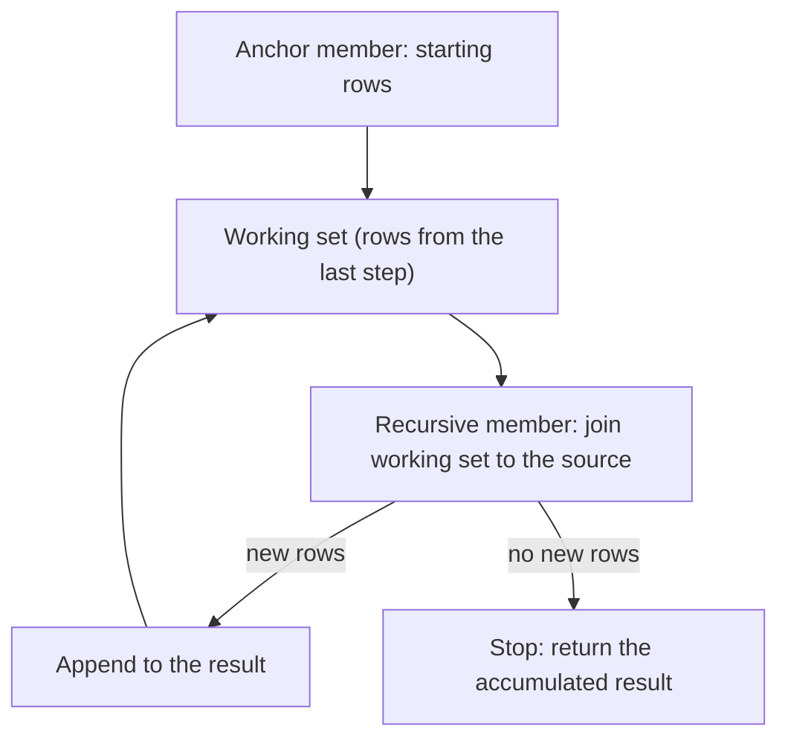
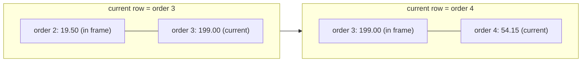

<div dir="rtl">

# 4. SQL II: پرس‌وجوهای پیشرفته

> **زبان:** [English](../../en/part1/04-sql-advanced.md) | فارسی | **قبلی:** [3. SQL I: خواندن داده](03-sql-basics.md) | **بعدی:** [5. مدل‌سازی داده و نرمال‌سازی](05-modelling-and-normalisation.md)
> **سطح:** L2 حرفه‌ای | **بخش:** I
> **در یک جمله:** زیرپرس‌وجوها، عبارت‌های جدولی مشترک، توابع پنجره‌ای، محوری‌سازی، پیوند lateral، upsert و JSON باعث می‌شوند یک دستور به پرسش‌هایی پاسخ بدهد که در غیر این صورت چند پرس‌وجو و کدی در برنامه می‌خواستند.
> **چه می‌آموزید:**
> - زیرپرس‌وجوی scalar، `IN`، `EXISTS` و همبسته، و جدول‌های مشتق‌شده
> - CTEها، از جمله نوع بازگشتی برای درخت‌ها و دنباله‌های عددی
> - توابع پنجره‌ای: رتبه‌بندی، جمع تجمعی، `LAG`/`LEAD`، قاب‌ها و N برتر در هر گروه
> - محوری‌سازی با تجمیع شرطی، `PIVOT` و `LATERAL` / `APPLY`
> - upsert و `MERGE` در هر موتور، مقدمات JSON و آرایه، جدول‌های موقت
> - اشیای برنامه‌پذیر: نما، سکوئنس، رویه، تابع، پکیج، تریگر، مترادف
>
> **پیش‌نیازها:** [فصل I-03](03-sql-basics.md).
> **دربارهٔ خروجی‌ها:** پرس‌وجوهای سازگار با SQLite روی fixture به نام `shop` اجرا شده‌اند (SQLite 3.51)؛ خروجی نحوهایی که SQLite ندارد (`LATERAL`، `APPLY`، `MERGE`، `PIVOT`) *خروجی تصویری* (illustrative) است که از داده‌های seed محاسبه شده است.
> برچسب‌های نمودارها به انگلیسی نگه داشته شده‌اند تا در GitHub درست نمایش داده شوند.

## 1. ایده (مبتدی)

پرس‌وجوهای فصل I-03 هر بار یک دستهٔ سطر را می‌خوانند. پرسش‌های واقعی اغلب لایه‌لایه‌اند: «سفارش‌های بالاتر از *میانگین* سفارش‌ها»، «*بزرگ‌ترین* سفارش هر مشتری»، «جمع تجمعی در طول زمان»، «همهٔ کسانی که در شرکت زیر دست این مدیرند». هر کدام پرس‌وجویی می‌خواهد که ورودی‌اش به پرس‌وجوی دیگر بستگی دارد، یا محاسبه‌ای که میان سطرها را نگاه می‌کند بی‌آنکه آن‌ها را در یک سطر ادغام کند. SQL برای این کار سه ابزار دارد و بیشتر این فصل دربارهٔ همین‌هاست:

- **زیرپرس‌وجوها و CTEها** پرس‌وجویی را درون پرس‌وجوی دیگر می‌گذارند، یا به پرس‌وجو نام می‌دهند تا دستور اصلی از بالا به پایین خوانده شود.
- **توابع پنجره‌ای** برای هر سطر مقداری را از روی پنجره‌ای از سطرهای همسایه حساب می‌کنند (سطر قبلی، همهٔ سطرها تا همین سطر، سایر سطرهای همان گروه)، بی‌آنکه اثر ادغام‌کنندهٔ `GROUP BY` را داشته باشند.
- **بازگشت** (recursion) به پرس‌وجو اجازه می‌دهد به خروجی خودش ارجاع بدهد؛ راهی که SQL با آن روی درخت‌ها حرکت می‌کند.

بخش‌های بعدی ابزارهایی را پوشش می‌دهند که مسئله‌های محدودتری را حل می‌کنند (محوری‌سازی، پیوند lateral، upsert، JSON) و فصل با مروری بر اشیایی تمام می‌شود که می‌توانید در کنار جدول‌ها در پایگاه داده ذخیره کنید: نما، رویه، تریگر و مانند آن.

## 2. نحوهٔ کار (حرفه‌ای)

### 2.1 زیرپرس‌وجوها

[زیرپرس‌وجو](../glossary.md#subquery) (subquery) یک `SELECT` است در داخل دستوری دیگر، میان پرانتز. جایی که قرار می‌گیرد تعیین می‌کند چه چیزی می‌تواند برگرداند.

**زیرپرس‌وجوی scalar** (یک سطر، یک ستون) مثل یک مقدار به کار می‌رود. سفارش‌های بزرگ‌تر از میانگین سفارش‌ها (میانگین 107.90 است):

</div>

```sql
SELECT id, total
FROM orders
WHERE total > (SELECT avg(total) FROM orders)
ORDER BY id;
```

<div dir="rtl">

| id | total |
|---|---|
| 1 | 120.50 |
| 3 | 199.00 |
| 6 | 249.00 |

اگر زیرپرس‌وجوی scalar بیش از یک سطر برگرداند، دستور در PostgreSQL، SQL Server، Oracle و MySQL با خطا شکست می‌خورد (SQLite بی‌سروصدا از سطر اول استفاده می‌کند، که بدتر است). زیرپرس‌وجوی scalar در فهرست ستون‌های `SELECT` هم کار می‌کند: عبارت `(SELECT count(*) FROM orders o WHERE o.customer_id = c.id) AS orders` برای هر مشتری شمارش را می‌دهد، و برای Emil صفر.

**زیرپرس‌وجوی `IN`** (یک ستون، چند سطر) عضویت را می‌سنجد. مشتری‌هایی که سفارشی بالای 100 دارند:

</div>

```sql
SELECT name FROM customers
WHERE id IN (SELECT customer_id FROM orders WHERE total > 100) ORDER BY id;   -- Alice, Bob, Dora
```

<div dir="rtl">

**`EXISTS`** (با هر شکلی) وقتی درست است که زیرپرس‌وجو دست‌کم یک سطر برگرداند؛ فهرست ستون‌ها اهمیتی ندارد و به همین دلیل مردم `SELECT 1` می‌نویسند. ابزار درست برای «دست‌کم یکی دارد» است و در حالت نفی‌شده برای «هیچ‌کدام ندارد» (فصل I-03، بخش 2.8):

</div>

```sql
SELECT name FROM customers c
WHERE EXISTS (SELECT 1 FROM orders o WHERE o.customer_id = c.id AND o.total > 100) ORDER BY id;   -- Alice, Bob, Dora
```

<div dir="rtl">

`IN` و `EXISTS` اینجا همان سطرها را می‌دهند. تفاوتشان در برخورد با NULLهاست (دام در `NOT IN` است و `NOT EXISTS` آن را ندارد) و، در بهینه‌سازهای قدیمی‌تر، در سرعت؛ PostgreSQL، SQL Server، Oracle و MySQL 8 امروزی هر دو را به یک طرح semi-join تبدیل می‌کنند ([فصل I-08](08-query-processing.md)).

**زیرپرس‌وجوی همبسته.** [زیرپرس‌وجوی همبسته](../glossary.md#correlated-subquery) (correlated subquery) به ستونی از پرس‌وجوی بیرونی ارجاع می‌دهد، پس از نظر مفهومی برای هر سطر بیرونی یک بار اجرا می‌شود. «سفارش‌هایی که از میانگین سفارش‌های خود همان مشتری بزرگ‌ترند»:

</div>

```sql
SELECT o.id, o.customer_id, o.total
FROM orders o
WHERE o.total > (SELECT avg(o2.total) FROM orders o2 WHERE o2.customer_id = o.customer_id)
ORDER BY o.id;
```

<div dir="rtl">

| id | customer_id | total |
|---|---|---|
| 1 | 1 | 120.50 |
| 6 | 4 | 249.00 |

میانگین مشتری 1 برابر 70.00 است (120.50 و 19.50)، پس فقط سفارش 1 از آن بالاتر است؛ مشتری‌های 2 و 3 هر کدام یک سفارش دارند و نمی‌توانند از خودشان بزرگ‌تر باشند. موتورهای واقعی معمولاً چنین پرس‌وجویی را به پیوند با یک زیرپرس‌وجوی گروه‌بندی‌شده تبدیل می‌کنند (decorrelate)؛ نوشتن خودتان به همین شکل اغلب هم خواندنش آسان‌تر است هم اجرایش سریع‌تر.

**جدول مشتق‌شده** (زیرپرس‌وجو در `FROM`). [جدول مشتق‌شده](../glossary.md#derived-table) (derived table) زیرپرس‌وجویی است که مثل جدول به کار می‌رود و باید نام مستعار داشته باشد:

</div>

```sql
SELECT c.name, t.revenue
FROM customers c
JOIN (SELECT customer_id, sum(total) AS revenue FROM orders GROUP BY customer_id) t ON t.customer_id = c.id
ORDER BY t.revenue DESC;
```

<div dir="rtl">

| name | revenue |
|---|---|
| Dora | 254.25 |
| Bob | 199.00 |
| Alice | 140.00 |
| Chie | 54.15 |

درمان دام fan-out در فصل I-03 هم همین است: ابتدا سمت «چند» را در یک جدول مشتق‌شده تجمیع کنید، سپس پیوند بزنید. عملگرهای `ANY`/`SOME` و `ALL` یک مقدار را با همهٔ مقدارهایی که زیرپرس‌وجو برمی‌گرداند مقایسه می‌کنند (`total > ALL (SELECT …)`) و به ندرت لازم می‌شوند.

### 2.2 عبارت‌های جدولی مشترک

[CTE](../glossary.md#cte) (عبارت جدولی مشترک) با `WITH` و پیش از دستوری که از آن استفاده می‌کند به زیرپرس‌وجو نام می‌دهد. منطق همان جدول مشتق‌شدهٔ بالاست، ولی از بالا به پایین خوانده می‌شود و می‌توان CTE را بیش از یک بار به کار برد:

</div>

```sql
WITH per_customer AS (
  SELECT customer_id, count(*) AS orders, sum(total) AS revenue
  FROM orders GROUP BY customer_id
),
avg_rev AS (
  SELECT avg(revenue) AS a FROM per_customer
)
SELECT c.name, p.orders, p.revenue
FROM per_customer p
JOIN customers c ON c.id = p.customer_id
CROSS JOIN avg_rev
WHERE p.revenue > avg_rev.a
ORDER BY p.revenue DESC;
```

<div dir="rtl">

| name | orders | revenue |
|---|---|---|
| Dora | 2 | 254.25 |
| Bob | 1 | 199.00 |

مشتری‌هایی که درآمدشان از میانگین درآمد هر مشتری (161.85) بیشتر است. CTE دوم از اولی می‌خواند. CTE ابزار نام‌گذاری است، نه جدول: اینکه موتور آن را یک بار حساب و نتیجه را ذخیره کند یا در هر جایی که به کار رفته بسطش بدهد، تصمیم بهینه‌ساز است. PostgreSQL 12 و بعد از آن CTEای را که یک بار به کار رفته و عارضهٔ جانبی ندارد درون‌خطی (inline) می‌کنند و با `MATERIALIZED` / `NOT MATERIALIZED` می‌توانید هر دو رفتار را اجبار کنید؛ SQL Server همیشه CTEها را مثل نما بسط می‌دهد؛ Oracle ممکن است CTEای را که چند بار به آن ارجاع شده مادی‌سازی کند؛ MySQL 8 آن‌ها را مثل جدول‌های مشتق‌شده ادغام می‌کند. تا وقتی رفتار موتور خودتان را راستی‌آزمایی نکرده‌اید، CTE را به‌عنوان مانع بهینه‌سازی (optimisation fence) به کار نبرید.

SQL Server لازم دارد دستور پیش از `WITH` به `;` ختم شود، وگرنه `WITH` به‌عنوان راهنمای جدول (table hint) تجزیه می‌شود. نقطه‌ویرگول را بنویسید.

### 2.3 CTEهای بازگشتی

[CTE بازگشتی](../glossary.md#recursive-cte) (recursive CTE) به خودش ارجاع می‌دهد. دو بخش دارد که با `UNION ALL` به هم وصل می‌شوند: **عضو لنگر** (anchor)، یعنی سطرهای شروع، و **عضو بازگشتی** (recursive member)، یعنی چگونگی گرفتن سطرهای بعدی از روی قبلی‌ها. موتور لنگر را یک بار اجرا می‌کند، سپس عضو بازگشتی را روی سطرهای گام قبل تکرار می‌کند تا گامی بی‌سطر پیش بیاید.

**شکل 4.1: تکرار یک CTE بازگشتی چگونه پیش می‌رود.**

</div>



<div dir="rtl">

جدول کارکنان با ستون مدیر نمونهٔ استاندارد این بحث است. داده یک جدول آزمایشی است، نه بخشی از `shop`:

</div>

```sql
CREATE TABLE employees (id integer PRIMARY KEY, name text NOT NULL, manager_id integer REFERENCES employees(id));
INSERT INTO employees VALUES (1,'Ada',NULL),(2,'Ben',1),(3,'Cyra',1),(4,'Dmitri',2),(5,'Eli',2),(6,'Fay',4);
```

```sql
WITH RECURSIVE tree(id, name, depth, path) AS (
  SELECT id, name, 0, name FROM employees WHERE manager_id IS NULL       -- anchor: the root
  UNION ALL
  SELECT e.id, e.name, t.depth + 1, t.path || ' > ' || e.name            -- recursive member
  FROM employees e JOIN tree t ON e.manager_id = t.id
)
SELECT id, name, depth, path FROM tree ORDER BY path;
```

<div dir="rtl">

| id | name | depth | path |
|---|---|---|---|
| 1 | Ada | 0 | Ada |
| 2 | Ben | 1 | Ada > Ben |
| 4 | Dmitri | 2 | Ada > Ben > Dmitri |
| 6 | Fay | 3 | Ada > Ben > Dmitri > Fay |
| 5 | Eli | 2 | Ada > Ben > Eli |
| 3 | Cyra | 1 | Ada > Cyra |

گام 0، Ada را تولید می‌کند؛ گام 1 کارمندانی را که مدیرشان Ada است پیدا می‌کند (Ben و Cyra)؛ گام 2 زیردستان Ben و Cyra را (Dmitri و Eli)؛ گام 3 Fay را؛ و گام 4 کسی را پیدا نمی‌کند و متوقف می‌شود. همین ساختار برای فهرست مواد (bill of materials) هم کار می‌کند («این مجموعه از چه قطعه‌هایی ساخته شده»)، و برای درخت دسته‌بندی‌ها و دیدگاه‌های زنجیره‌ای.

بازگشت راه قابل‌حمل برای تولید یک دنباله هم هست، مثلاً تقویمی برای پیدا کردن روزهای بدون فروش:

</div>

```sql
WITH RECURSIVE d(day) AS (
  SELECT date('2026-02-10') UNION ALL SELECT date(day, '+1 day') FROM d WHERE day < '2026-02-14')
SELECT d.day, count(o.id) AS orders
FROM d LEFT JOIN orders o ON date(o.order_date) = d.day
GROUP BY d.day ORDER BY d.day;
```

<div dir="rtl">

| day | orders |
|---|---|
| 2026-02-10 | 0 |
| 2026-02-11 | 1 |
| 2026-02-12 | 1 |
| 2026-02-13 | 0 |
| 2026-02-14 | 0 |

(این نحو تاریخ در SQLite است؛ PostgreSQL تابع `generate_series` دارد که ساده‌تر است.) **CTE بازگشتی روی داده‌ای که چرخه دارد هرگز تمام نمی‌شود.** از خودتان محافظت کنید: در `WHERE` عضو بازگشتی حد عمق بگذارید، از بندهای `CYCLE`/`SEARCH` (PostgreSQL 14+) استفاده کنید، یا مسیر را بررسی کنید. SQL Server حد پیش‌فرض 100 سطح بازگشت دارد (`OPTION (MAXRECURSION n)`)، و SQL Server و Oracle فقط `WITH` ساده می‌نویسند (بدون کلیدواژهٔ `RECURSIVE`) و در Oracle پس از نام CTE فهرست ستون‌ها لازم است.

### 2.4 توابع پنجره‌ای

[تابع پنجره‌ای](../glossary.md#window-function) (window function) برای هر سطر مقداری را از روی مجموعه‌ای از سطرهای مرتبط (*پنجرهٔ* آن) حساب می‌کند و، برخلاف تابع تجمیعی با `GROUP BY`، **همهٔ سطرها را نگه می‌دارد**. نحو آن تابعی است که پس از آن `OVER (…)` می‌آید:

</div>

```text
function(args) OVER (
    PARTITION BY <columns>     -- split rows into independent groups (optional)
    ORDER BY <columns>         -- order inside each group (needed for ranking and running values)
    <frame>                    -- which rows around the current one to include (optional)
)
```

<div dir="rtl">

[`PARTITION BY`](../glossary.md#window-partition) (بخش‌بندی پنجره) محاسبه را برای هر گروه از نو شروع می‌کند، شبیه `GROUP BY` ولی بدون ادغام. [قاب](../glossary.md#frame) (frame) مشخص می‌کند تابع کدام سطرها را، نسبت به سطر جاری، می‌بیند.

**رتبه‌بندی.** `row_number()` سطرها را در هر بخش 1، 2، 3 شماره می‌زند. سفارش‌های هر مشتری را به ترتیب بزرگی شماره بزنید:

</div>

```sql
SELECT customer_id, id AS order_id, total,
       row_number() OVER (PARTITION BY customer_id ORDER BY total DESC) AS rn
FROM orders ORDER BY customer_id, rn;
```

<div dir="rtl">

| customer_id | order_id | total | rn |
|---|---|---|---|
| 1 | 1 | 120.50 | 1 |
| 1 | 2 | 19.50 | 2 |
| 2 | 3 | 199.00 | 1 |
| 3 | 4 | 54.15 | 1 |
| 4 | 6 | 249.00 | 1 |
| 4 | 5 | 5.25 | 2 |

فیلتر کردن روی `rn` الگوی استاندارد **N برتر در هر گروه** است. توابع پنجره‌ای نمی‌توانند در `WHERE` بیایند (بعد از آن اجرا می‌شوند)، پس پرس‌وجو را در یک لایهٔ بیرونی بپیچید:

</div>

```sql
SELECT customer_id, order_id, total
FROM (SELECT customer_id, id AS order_id, total,
             row_number() OVER (PARTITION BY customer_id ORDER BY total DESC) AS rn
      FROM orders) t
WHERE rn = 1 ORDER BY customer_id;       -- each customer's largest order: 1, 3, 4, 6
```

<div dir="rtl">

توابع `rank()`، `dense_rank()` و `row_number()` در برخورد با مقدارهای مساوی تفاوت دارند. برای قیمت‌های 5.25، 5.25، 19.50 و 49.90:

| price | row_number | rank | dense_rank |
|---|---|---|---|
| 5.25 | 1 | 1 | 1 |
| 5.25 | 2 | 1 | 1 |
| 19.50 | 3 | 3 | 2 |
| 49.90 | 4 | 4 | 3 |

`row_number` هرگز تکرار نمی‌شود؛ `rank` تکرار می‌شود و شکاف می‌گذارد؛ `dense_rank` بی‌شکاف تکرار می‌شود. `ntile(n)` سطرهای مرتب‌شده را به n سطل تقسیم می‌کند.

**جمع تجمعی و تجمیع روی پنجره.** هر تابع تجمیعی می‌تواند `OVER` بگیرد. با `ORDER BY` تجمعی می‌شود:

</div>

```sql
SELECT id, order_date, total, sum(total) OVER (ORDER BY order_date, id) AS running
FROM orders ORDER BY order_date, id;
```

<div dir="rtl">

| id | order_date | total | running |
|---|---|---|---|
| 1 | 2026-01-05 10:00 | 120.50 | 120.50 |
| 2 | 2026-02-11 09:30 | 19.50 | 140.00 |
| 3 | 2026-02-12 14:00 | 199.00 | 339.00 |
| 4 | 2026-03-01 08:15 | 54.15 | 393.15 |
| 5 | 2026-03-02 17:45 | 5.25 | 398.40 |
| 6 | 2026-03-03 12:00 | 249.00 | 647.40 |

عبارت `sum(total) OVER ()` با پرانتز خالی، جمع کل را در هر سطر می‌گذارد؛ پس `100.0 * total / sum(total) OVER ()` سهم هر سفارش است (18.6، 3.0، 30.7، 8.4، 0.8 و 38.5 درصد).

**نگاه به همسایه‌ها.** `lag(x)` مقدار سطر قبلی پنجره و `lead(x)` مقدار سطر بعدی را برمی‌گرداند، هر کدام با آفست و مقدار پیش‌فرض اختیاری:

</div>

```sql
SELECT id, total, lag(total) OVER (ORDER BY order_date, id) AS prev_total,
       total - lag(total) OVER (ORDER BY order_date, id)     AS delta
FROM orders ORDER BY order_date, id;
```

<div dir="rtl">

| id | total | prev_total | delta |
|---|---|---|---|
| 1 | 120.50 | NULL | NULL |
| 2 | 19.50 | 120.50 | -101.00 |
| 3 | 199.00 | 19.50 | 179.50 |
| 4 | 54.15 | 199.00 | -144.85 |
| 5 | 5.25 | 54.15 | -48.90 |
| 6 | 249.00 | 5.25 | 243.75 |

**قاب‌ها.** وقتی `ORDER BY` هست، قاب پنجره را دقیق‌تر می‌کند. عبارت `ROWS BETWEEN 1 PRECEDING AND CURRENT ROW` یعنی «این سطر و سطر قبل از آن». میانگین متحرک دو سفارش:

</div>

```sql
SELECT id, total,
       round(avg(total) OVER (ORDER BY order_date, id ROWS BETWEEN 1 PRECEDING AND CURRENT ROW), 2) AS avg2
FROM orders ORDER BY order_date, id;       -- 120.50, 70.00, 109.25, 126.58, 29.70, 127.13
```

<div dir="rtl">

**شکل 4.2: قاب `ROWS BETWEEN 1 PRECEDING AND CURRENT ROW` همراه با سطر جاری می‌لغزد.**

</div>



<div dir="rtl">

دو دام دربارهٔ قاب. **(1)** وقتی `ORDER BY` هست و قاب صریحی نیامده، قاب پیش‌فرض `RANGE BETWEEN UNBOUNDED PRECEDING AND CURRENT ROW` است؛ بنابراین `last_value(total) OVER (ORDER BY id)` مقدار سطر *جاری* را برمی‌گرداند، نه آخرین مقدار بخش را. برای دیدن مقدار واقعاً آخر بنویسید `ROWS BETWEEN UNBOUNDED PRECEDING AND UNBOUNDED FOLLOWING` (در `shop` برابر 249.00). **(2)** `RANGE` سطرهای هم‌کلید مرتب‌سازی را یک واحد (peer) می‌گیرد، در حالی که `ROWS` سطرهای فیزیکی را می‌شمارد؛ با مقدارهای مساوی، جمع تجمعی روی `RANGE` به‌اندازهٔ کل گروه peer می‌پرد. مگر اینکه peerها را بخواهید، `ROWS` را ترجیح بدهید.

توابع پنجره‌ای در بعضی موتورها دیر آمدند: PostgreSQL 8.4، SQL Server 2012 (با قاب‌های کامل)، Oracle 8i، MySQL 8.0، MariaDB 10.2 و SQLite 3.25؛ ClickHouse و Snowflake هم در نسخه‌های فهرست‌شده در این کتاب دارند. Cassandra هیچ‌کدام را ندارد.

### 2.5 تبدیل سطر به ستون (محوری‌سازی)

«درآمد هر مشتری در هر ماه» طبیعتاً به شکل سطرهای `(customer, month, revenue)` می‌رسد، اما گزارش برای هر ماه یک ستون می‌خواهد. روش قابل‌حمل **تجمیع شرطی** است: یک `CASE` درون تابع تجمیعی.

</div>

```sql
SELECT c.name,
       sum(CASE WHEN o.order_date >= '2026-01-01' AND o.order_date < '2026-02-01' THEN o.total ELSE 0 END) AS jan,
       sum(CASE WHEN o.order_date >= '2026-02-01' AND o.order_date < '2026-03-01' THEN o.total ELSE 0 END) AS feb,
       sum(CASE WHEN o.order_date >= '2026-03-01' AND o.order_date < '2026-04-01' THEN o.total ELSE 0 END) AS mar
FROM customers c LEFT JOIN orders o ON o.customer_id = c.id
GROUP BY c.id, c.name ORDER BY c.id;
```

<div dir="rtl">

| name | jan | feb | mar |
|---|---|---|---|
| Alice | 120.50 | 19.50 | 0.00 |
| Bob | 0.00 | 199.00 | 0.00 |
| Chie | 0.00 | 0.00 | 54.15 |
| Dora | 0.00 | 0.00 | 254.25 |
| Emil | 0.00 | 0.00 | 0.00 |

بازه‌های نیم‌باز (`>=` شروع، `<` شروع بعدی) راه امن دسته‌بندی مهرهای زمانی هستند. PostgreSQL، SQLite و ClickHouse شکل‌های کوتاه‌تری دارند (`count(*) FILTER (WHERE total >= 100)` در PostgreSQL و SQLite؛ `sumIf(total, cond)` در ClickHouse). SQL Server، Oracle و Snowflake عملگر اختصاصی `PIVOT` هم دارند که وقتی فهرست ستون‌ها معلوم است همین کار را می‌کند:

#### SQL Server

</div>

```sql
SELECT * FROM (SELECT CustomerId, MONTH(OrderDate) AS m, Total FROM dbo.Orders) s
PIVOT (SUM(Total) FOR m IN ([1], [2], [3])) p;
```

<div dir="rtl">

فهرست ستون‌ها باید در خود دستور نوشته شود، پس محوری‌سازی واقعاً پویا به SQL تولیدشده نیاز دارد. PostgreSQL برای همین منظور `crosstab()` را در افزونهٔ `tablefunc` دارد. MySQL، MariaDB و SQLite هیچ‌کدام را ندارند؛ از شکل `CASE` استفاده کنید. عکس آن، تبدیل ستون به سطر، `UNPIVOT` است (SQL Server، Oracle، Snowflake)، یا `LATERAL (VALUES …)`، یا `UNION ALL`.

### 2.6 LATERAL و APPLY

در پیوند معمولی سمت راست نمی‌تواند به سطر چپ ارجاع بدهد. پیوند **lateral** می‌تواند، و همین آن را به عملگر «برای هر سطر این زیرپرس‌وجو را اجرا کن» تبدیل می‌کند: در استاندارد [`LATERAL`](../glossary.md#lateral) و در [SQL Server و Oracle](../glossary.md#apply) `CROSS APPLY` و `OUTER APPLY`. کاربرد کلاسیک آن «N برتر برای هر سطر» است، با `ORDER BY … LIMIT` در داخل:

#### PostgreSQL

</div>

```sql
SELECT c.name, t.id AS order_id, t.total
FROM customers c
LEFT JOIN LATERAL (
  SELECT o.id, o.total FROM orders o WHERE o.customer_id = c.id ORDER BY o.total DESC LIMIT 2
) t ON true
ORDER BY c.id, t.total DESC;
```

<div dir="rtl">

#### SQL Server

</div>

```sql
SELECT c.Name, t.Id AS OrderId, t.Total
FROM dbo.Customers c
OUTER APPLY (SELECT TOP (2) o.Id, o.Total FROM dbo.Orders o WHERE o.CustomerId = c.Id ORDER BY o.Total DESC) t
ORDER BY c.Id, t.Total DESC;
```

<div dir="rtl">

خروجی تصویری (illustrative، برای هر دو): Alice با 1 / 120.50 و 2 / 19.50؛ Bob با 3 / 199.00؛ Chie با 4 / 54.15؛ Dora با 6 / 249.00 و 5 / 5.25؛ Emil با NULL / NULL (`LEFT JOIN … ON true` و `OUTER APPLY` Emil را نگه می‌دارند؛ `CROSS APPLY` و `JOIN LATERAL` ساده او را حذف می‌کردند). Oracle 12c و بعد از آن از `CROSS APPLY`، `OUTER APPLY` و `LATERAL` پشتیبانی می‌کند؛ MySQL از نسخهٔ 8.0.14 `LATERAL` دارد؛ Snowflake `LATERAL` دارد؛ SQLite و ClickHouse 24 ندارند، پس از الگوی `row_number()` در بخش 2.4 استفاده کنید. `LATERAL` همان راهی است که توابع جدول‌مقدار (table-valued) و `unnest(array)` برای هر سطر اعمال می‌شوند.

### 2.7 Upsert و MERGE

*Upsert* یعنی «این سطر را درج کن، یا اگر از قبل هست به‌روزرسانی‌اش کن». انجام آن با `SELECT` و سپس `INSERT` یا `UPDATE` در شرایط همزمانی غلط است (دو نشست هر دو «نیست» می‌بینند و هر دو درج می‌کنند). به همین دلیل هر موتور شکل اتمی خودش را دارد، و همه با هم فرق دارند. مثال یک جدول موجودی نگه می‌دارد: 5 عدد Webcam اضافه کن، یا اگر سطر هست مقدار را بالا ببر.

</div>

```sql
CREATE TABLE stock (product_id integer PRIMARY KEY, qty integer NOT NULL);
```

<div dir="rtl">

| موتور | دستور |
|---|---|
| PostgreSQL 17, SQLite 3.24+ | `INSERT INTO stock VALUES (5, 5) ON CONFLICT (product_id) DO UPDATE SET qty = stock.qty + excluded.qty;` |
| MySQL 8.4, MariaDB 11 | `INSERT INTO stock VALUES (5, 5) ON DUPLICATE KEY UPDATE qty = qty + VALUES(qty);` (MySQL 8.0.20+ نام مستعار سطر را ترجیح می‌دهد؛ `REPLACE INTO` حذف و درج دوباره انجام می‌دهد، که تریگرهای حذف را هم فعال می‌کند) |
| SQL Server 2022, Oracle 23, Snowflake | `MERGE INTO stock t USING (SELECT 5 AS product_id, 5 AS qty) s ON t.product_id = s.product_id WHEN MATCHED THEN UPDATE SET t.qty = t.qty + s.qty WHEN NOT MATCHED THEN INSERT (product_id, qty) VALUES (s.product_id, s.qty);` (SQL Server یک `;` پایانی لازم دارد؛ Oracle برای نام مستعار جدول `AS` ندارد) |
| PostgreSQL 15+ | همان `MERGE` بالا؛ PostgreSQL 17 به `MERGE` عبارت `RETURNING` را اضافه می‌کند |
| ClickHouse | upsert در سطح سطر ندارد؛ نسخهٔ جدید را در جدول `ReplacingMergeTree` درج کنید و بگذارید ادغام‌ها نسخه‌های قدیمی را حذف کنند ([I-15](15-oltp-vs-olap-columnar.md)) |
| Cassandra | هر `INSERT` و `UPDATE` از قبل upsert روی کلید اصلی است؛ `IF NOT EXISTS` درج شرطی سبک (و کند) می‌سازد |

`MERGE` می‌تواند سطرهای تطبیق‌یافته را `DELETE` هم بکند و بسته به شرط عمل متفاوتی اجرا کند، که آن را ابزار همگام‌سازی انبوه می‌کند. `MERGE` در SQL Server سابقهٔ مشکلات شناخته‌شده و دام‌های همزمانی دارد، و بسیاری از تیم‌ها در آنجا دستورهایی به سبک `INSERT … ON CONFLICT` یا قفل‌گذاری صریح را ترجیح می‌دهند.

### 2.8 JSON و آرایه‌ها

طرفداران محض مدل رابطه‌ای در هر ستون یک واقعیت ذخیره می‌کنند. سیستم‌های واقعی سند هم ذخیره می‌کنند (پاسخ یک API، یک بلوک تنظیمات) در ستون JSON، و هر موتور برای آن تابع‌هایی پیدا کرده است. استخراج مقدار `tier` از `{"tier":"gold","n":1,"tags":["vip","b2b"]}`:

| موتور | استخراج یک مقدار | تبدیل آرایه به سطر | نوع بومی JSON |
|---|---|---|---|
| PostgreSQL 17 | `meta ->> 'tier'` (متن)، `meta -> 'tags' -> 1` (json)، `meta @> '{"tier":"gold"}'` (شمول؛ با GIN نمایه‌پذیر) | `jsonb_array_elements_text(meta -> 'tags')` | `json`، `jsonb` (دودویی، نمایه‌پذیر) |
| SQL Server 2022 | `JSON_VALUE(meta, '$.tier')`، و `JSON_QUERY` برای شیء/آرایه | `OPENJSON(meta, '$.tags')` | ندارد: در `nvarchar(max)` ذخیره می‌شود (`isjson()` بررسی می‌کند) |
| Oracle 23 | `JSON_VALUE(meta, '$.tier')` | `JSON_TABLE(meta, '$.tags[*]' COLUMNS (tag VARCHAR2 PATH '$'))` | نوع `JSON` |
| MySQL 8.4 | `meta ->> '$.tier'`، `JSON_EXTRACT` | `JSON_TABLE` | `JSON` (دودویی) |
| SQLite 3.4x | `json_extract(meta, '$.tier')`، `->>` | `json_each(meta, '$.tags')` | ندارد (متن) |
| ClickHouse 24.8 | `JSONExtractString(meta, 'tier')` | `arrayJoin(JSONExtract(meta, 'tags', 'Array(String)'))` | `JSON` (در 24.8 هنوز در حال پخته شدن است؛ بررسی کنید) |
| Snowflake | `meta:tier::string` | `LATERAL FLATTEN(input => meta:tags)` | `VARIANT` |
| Cassandra 5 | `SELECT JSON …` و `INSERT … JSON` سطرها را به JSON و از JSON نگاشت می‌کنند | مجموعه‌های `list`، `set`، `map` | ندارد (نوع‌های مجموعه درجه‌یک‌اند) |

در SQLite، عبارت `json_extract('{"tier":"gold","n":1,"tags":["vip","b2b"]}', '$.tags[1]')` مقدار `b2b` را برمی‌گرداند و `json_each('["vip","b2b"]')` دو سطر می‌دهد. seed مربوط به PostgreSQL برای همین منظور جدولی به نام `extra_types` دارد با ستون `jsonb` به نام `meta` و ستون آرایه‌ای `text[]` به نام `tags` (`engine/tests/docker/seed-postgres.sql:53-55`). **آرایه‌ها** در PostgreSQL (`text[]`، `ANY(array)`، `unnest`)، Snowflake (`ARRAY`)، ClickHouse (`Array(T)`) و Cassandra (`list`/`set`/`map`) بومی‌اند؛ Oracle `VARRAY` و جدول‌های تودرتو دارد؛ SQL Server و MySQL از JSON یا جدول فرزند استفاده می‌کنند. ذخیرهٔ آرایه یا JSON عمداً شکل نرمال اول را می‌شکند ([فصل I-05](05-modelling-and-normalisation.md)): این کار را برای داده‌ای بکنید که کامل می‌خوانید و کامل می‌نویسید، و واقعیت‌هایی را که روی آن‌ها فیلتر، پیوند و تجمیع می‌کنید در ستون‌های معمولی نگه دارید.

### 2.9 جدول‌های موقت و متغیرهای جدولی

[جدول موقت](../glossary.md#temp-table) (temporary table) نتایج میانی را نگه می‌دارد و در پایان نشست (یا تراکنش) از بین می‌رود. ابزار شکستن یک اسکریپت بلند به گام‌هایی است که نتیجهٔ هر کدام را می‌توانید بررسی کنید.

| موتور | دستور | دیده می‌شود برای |
|---|---|---|
| PostgreSQL, SQLite, Snowflake, ClickHouse | `CREATE TEMPORARY TABLE t (…)` | نشست |
| MySQL, MariaDB | `CREATE TEMPORARY TABLE t (…)` | نشست (در یک پرس‌وجو نمی‌توان آن را دو بار باز کرد) |
| SQL Server | `CREATE TABLE #t (…)` (`##t` سراسری است) یا `SELECT … INTO #t` | نشست (پیشوند `#`) |
| Oracle | `CREATE GLOBAL TEMPORARY TABLE` (ساختار دائمی است، سطرها خصوصی‌اند) یا، از 18c، `CREATE PRIVATE TEMPORARY TABLE ORA$PTT_t` | سطرها: نشست یا تراکنش |
| Cassandra | ندارد | |

SQL Server یک [متغیر جدولی](../glossary.md#table-variable) (table variable) هم دارد، یعنی `DECLARE @ids TABLE (id int)`، که دامنه‌اش یک دسته‌دستور (batch) است؛ مثل یک جدول موقت کوچک رفتار می‌کند ولی آمارگیری متفاوتی دارد، که برای طرح اجرا اهمیت دارد. seed مربوط به `shop` از یک نوع جدولی به نام `dbo.IdList` (`engine/tests/docker/seed-mssql.sql:53`) برای ارسال فهرستی از شناسه‌ها به یک رویه استفاده می‌کند. جدول‌های موقت با مدیریت نشست در Rowlit در تعامل‌اند، چون در یک اتصال فیزیکی زندگی می‌کنند ([فصل II-08](../part2/08-connections-sessions-execution.md)).

### 2.10 اشیای ذخیره‌شده در پایگاه داده

یک اسکیمای (schema، به معنای فضای نام) پایگاه داده علاوه بر جدول‌ها می‌تواند کد و ابزارهای کمکی هم نگه دارد. مرورگر اشیای Rowlit (explorer) همهٔ آن‌ها را نشان می‌دهد و seedهای `shop` از هر کدام نمونه‌ای می‌سازند.

| شیء | چیست | نمونه در `shop` |
|---|---|---|
| [نما](../glossary.md#view) (view) | یک `SELECT` ذخیره‌شده که مثل جدول از آن پرس‌وجو می‌کنید؛ داده‌ای از خودش ندارد | `customer_orders` جدول‌های `customers` و `orders` را پیوند می‌دهد (`seed-postgres.sql:71-73`، `seed-mssql.sql:81-83`) |
| [نمای مادی‌شده](../glossary.md#materialized-view) (materialized view) | نمایی که نتیجه‌اش ذخیره می‌شود و باید تازه‌سازی شود (`REFRESH MATERIALIZED VIEW`) | `customer_totals` در PostgreSQL (`seed-postgres.sql:74-76`)؛ Oracle و Snowflake شکل خودشان را دارند؛ معادل SQL Server نمای نمایه‌دار (indexed view) است؛ MySQL ندارد |
| [سکوئنس](../glossary.md#sequence) (sequence) | شیء شمارنده‌ای که عددهای یکتا پخش می‌کند | `public.order_numbers` با شروع از 1000 (`seed-postgres.sql:26`)، `dbo.OrderNumbers` (`seed-mssql.sql:52`)، `ORDERS_SEQ` (`seed-oracle.sql:89`) |
| [ستون هویت](../glossary.md#identity) (identity) | ستونی که مقدارهایش را از یک سکوئنس درونی خودش تولید می‌کند | `customers.id` (`GENERATED BY DEFAULT AS IDENTITY`، `IDENTITY(1,1)`، `AUTO_INCREMENT`) |
| [تابع](../glossary.md#function) (function) | کدی که مقداری (scalar) یا جدولی برمی‌گرداند و داخل `SELECT` قابل استفاده است | `fn_tax(amount)` مقدار `amount * 0.19` را برمی‌گرداند (`seed-postgres.sql:78`) |
| [رویه ذخیره‌شده](../glossary.md#stored-procedure) (stored procedure) | کدی که با `CALL` / `EXEC` اجرا می‌شود و می‌تواند داده را تغییر بدهد، مجموعه نتیجه و پارامتر OUT برگرداند | `add_order_line`، `get_customer_report` (`seed-postgres.sql:85-96`)، `dbo.GetCustomerReport` (`seed-mssql.sql:92-100`) |
| [پکیج](../glossary.md#package) (package) | (Oracle) بستهٔ نام‌داری از رویه‌ها، توابع و متغیرها با مشخصهٔ عمومی و بدنهٔ خصوصی | `ORDER_API` (`seed-oracle.sql:98-122`) |
| [تریگر](../glossary.md#trigger) (trigger) | کدی که پیش یا پس از `INSERT`، `UPDATE` یا `DELETE` خودکار اجرا می‌شود | `trg_orders_check` مبلغ منفی را رد می‌کند (`seed-postgres.sql:97-102`) |
| [مترادف](../glossary.md#synonym) (synonym) | نام مستعاری برای شیء دیگر (SQL Server، Oracle) | `dbo.Cust` برای `dbo.Customers` (`seed-mssql.sql:127`)، `CUST` در Oracle (`seed-oracle.sql:91`) |

کدِ درون پایگاه داده در یک افزونهٔ رویه‌ای نوشته می‌شود: T-SQL (SQL Server)، PL/SQL (Oracle)، PL/pgSQL (PostgreSQL)، نحو برنامه‌های ذخیره‌شدهٔ MySQL؛ SQLite چنین چیزی ندارد (فقط تریگر). این‌ها زبان‌هایی متفاوت با کارکردی یکسان‌اند؛ [فصل I-17](17-dialect-comparison.md) آن‌ها را مقایسه می‌کند. دو توصیه: قاعده‌های کسب‌وکار را در یک جا نگه دارید (پایگاه داده یا برنامه، نه نیمی در هر کدام)، و با تریگرها محتاط باشید، چون نامرئی اجرا می‌شوند و پاسخ‌دادن به «این `UPDATE` چه می‌کند؟» را سخت می‌کنند. نماهای معمولی ارزان و برای نام‌گذاری یک پیوند مفیدند؛ نما روی نما روی نما به معمای کارایی تبدیل می‌شود.

## 3. بررسی عمیق (پیشرفته)

> **بررسی عمیق (L3): ناهمبسته‌سازی و بهینه‌ساز.**
> زیرپرس‌وجوی همبسته از نظر معنایی «برای هر سطر بیرونی یک بار اجرا می‌شود»، که درجه دوم (quadratic) می‌شد. بهینه‌سازها آن را («unnesting»، «decorrelation») به پیوند با یک جدول مشتق‌شدهٔ گروه‌بندی‌شده، یا به semi-join / anti-join بازنویسی می‌کنند. این بازنویسی همیشه شدنی نیست: زیرپرس‌وجوهای دارای `LIMIT`، بعضی تجمیع‌ها روی مجموعهٔ تهی (باگ شمارش یا «count bug»، که `count(*)` روی هیچ‌چیز صفر است ولی پیوند هیچ سطری نمی‌دهد) و `NOT IN` که به NULL حساس است مراقبت بیشتری می‌طلبند. وقتی در یک طرح nested-loop زیرپرس‌وجو را سمت داخلی می‌بینید، یعنی بازنویسی انجام نشده است. اغلب با نوشتن صریح پیوند می‌توانید کمک کنید. [فصل I-08](08-query-processing.md) را ببینید.

> **بررسی عمیق (L3): توابع پنجره‌ای چگونه اجرا می‌شوند.**
> موتور هر ترکیب متمایز `PARTITION BY … ORDER BY` را مرتب می‌کند (یا از ترتیب یک نمایه دوباره استفاده می‌کند)، سپس روی سطرهای مرتب‌شده جریان می‌یابد و قاب را به‌روز نگه می‌دارد. چند تابع پنجره‌ای با تعریف پنجرهٔ یکسان یک مرتب‌سازی را به اشتراک می‌گذارند؛ تعریف‌های متفاوت هر کدام مرتب‌سازی جدا می‌خواهند، پس پرس‌وجویی با پنج پنجرهٔ متفاوت پنج مرتب‌سازی است. قاب `UNBOUNDED PRECEDING` تا `CURRENT ROW` به‌صورت افزایشی محاسبه می‌شود (O(n))؛ قاب لغزندهٔ با پهنای ثابت برای sum/count/avg هم افزایشی است، ولی در بعضی موتورها برای min/max نیست. `RANGE` با کلیدهای مرتب‌سازی مساوی peer می‌سازد؛ قاب‌های `GROUPS` (PostgreSQL 11+، SQLite 3.28+) گروه‌های peer را می‌شمارند. چون پنجره‌ها پس از `WHERE`، `GROUP BY` و `HAVING` اجرا می‌شوند، می‌توانید در همان پرس‌وجو روی تجمیع‌ها پنجره بزنید (`rank() OVER (ORDER BY sum(total) DESC)`).

> **بررسی عمیق (L3): معنای `MERGE`.**
> `MERGE` پیوند میان هدف و منبع را ارزیابی می‌کند، هر سطر منبع را تطبیق‌یافته یا تطبیق‌نیافته دسته‌بندی می‌کند و نخستین بند `WHEN` را که شرط اضافی‌اش برقرار باشد اعمال می‌کند. اگر یک سطر هدف با چند سطر منبع تطبیق یابد، SQL Server و Oracle خطا می‌دهند (سطری دو بار به‌روز می‌شد)؛ PostgreSQL هم همین‌طور. تحت snapshot isolation دو `MERGE` همزمان می‌توانند هر دو «تطبیق‌نیافته» تشخیص بدهند و هر دو درج کنند، مگر اینکه نمایهٔ یکتا جلویشان را بگیرد ([فصل I-09](09-transactions-and-isolation.md))؛ `ON CONFLICT` با تکیهٔ مستقیم بر نمایهٔ یکتا از این مشکل دور می‌ماند.

## 4. در هر موتور

| قابلیت | PostgreSQL 17 | SQL Server 2022 | Oracle 23 | MySQL 8.4 / MariaDB 11 | SQLite 3.4x | ClickHouse 24.8 | Snowflake | Cassandra 5 |
|---|---|---|---|---|---|---|---|---|
| زیرپرس‌وجوها (scalar، `IN`، `EXISTS`) | بله | بله | بله | بله | بله | بله، زیرپرس‌وجوهای همبسته محدودند | بله | خیر |
| CTE | `WITH` | `WITH` | `WITH` | `WITH` (MySQL 8.0+، MariaDB 10.2+) | `WITH` (3.8.3+) | `WITH` | `WITH` | خیر |
| CTE بازگشتی | `WITH RECURSIVE` | `WITH` (حد 100 سطح) | `WITH`، فهرست ستون‌ها الزامی | `WITH RECURSIVE` | `WITH RECURSIVE` | محدود؛ یادداشت‌های انتشار 24.8 را بررسی کنید (راستی‌آزمایی نشده) | `WITH RECURSIVE` | خیر |
| توابع پنجره‌ای | بله | بله | بله | بله (MySQL 8.0+، MariaDB 10.2+) | بله (3.25+) | بله | بله | خیر |
| `LATERAL` / `APPLY` | `LATERAL` | `CROSS`/`OUTER APPLY` | `LATERAL`، `APPLY` | `LATERAL` (MySQL 8.0.14+) | خیر | خیر | `LATERAL` | خیر |
| عملگر `PIVOT` | افزونهٔ `crosstab` | بله | بله | خیر | خیر | ترکیب‌کننده‌های `*If` | بله | خیر |
| Upsert | `ON CONFLICT`، `MERGE` | `MERGE` | `MERGE` | `ON DUPLICATE KEY UPDATE` | `ON CONFLICT` | `ReplacingMergeTree` | `MERGE` | هر نوشتن |
| جدول‌های موقت | بله | `#t`، `@t` | سراسری / خصوصی | بله | بله | بله | بله | خیر |
| رویه‌ها و تریگرها | PL/pgSQL و غیره | T-SQL | PL/SQL، پکیج‌ها | برنامه‌های ذخیره‌شده | فقط تریگر | رویه ندارد؛ نماهای مادی‌شده نقش تریگر را بازی می‌کنند | رویه‌های JavaScript / Snowflake Scripting؛ taskها | تریگر (Java)، UDFها |

## 5. تمرین‌ها

1. **زیرپرس‌وجوها.** با یک زیرپرس‌وجوی scalar محصول‌هایی را فهرست کنید که قیمتشان از میانگین قیمت محصول‌ها بیشتر است (میانگین 68.41). سپس مشتری‌هایی را که هیچ سفارشی بالای 100 نداده‌اند به دو روش فهرست کنید: با `NOT EXISTS` و با `LEFT JOIN`. وضعیت Emil در پاسخ‌ها چه تفاوتی دارد؟
2. **جدول مشتق‌شده / CTE.** برای هر مشتری نام، تعداد سفارش‌ها و درآمد را نشان دهید، به‌همراه سهم او از کل درآمد به درصد با یک رقم اعشار. یک بار با CTE و یک بار با تابع پنجره‌ای روی نتیجهٔ گروه‌بندی‌شده انجامش دهید.
3. **N برتر.** با `row_number()` دو خط سفارش گران‌تر هر سفارش را نشان دهید (qty ضرب در قیمت). کدام سفارش‌ها کمتر از دو خط دارند، و برای سفارش 5 چه می‌بینید؟
4. **جمع تجمعی و شکاف‌ها.** پرس‌وجویی بنویسید که برای هر سفارش، به ترتیب تاریخ، تعداد روز از سفارش قبلی را برگرداند (`lag` و تفریق تاریخ در موتور خودتان). مقدار برای نخستین سفارش چیست، و چطور آن را با 0 عوض می‌کنید؟
5. **بازگشت.** با جدول `employees` از بخش 2.3، همهٔ کارمندان زیر دست Ben (گزارش‌دهندگان مستقیم و غیرمستقیم) را به‌همراه عمقشان نسبت به Ben فهرست کنید. سپس `UPDATE employees SET manager_id = 6 WHERE id = 1` را اجرا کنید (Ada حالا به Fay گزارش می‌دهد و چرخه ساخته می‌شود) و توضیح دهید چرا پرس‌وجوی شما (یا هر پرس‌وجوی بازگشتی بدون محافظ) هرگز تمام نمی‌شود. چگونه جلویش را می‌گیرید؟
6. **Upsert.** جدول `stock` را بسازید و upsert را برای محصول 5 دو بار اجرا کنید. مقدارها پس از هر اجرا چه می‌شوند؟ سپس دستور را به نحو موتور دیگری از بخش 2.7 که می‌توانید آزمایش کنید ترجمه کنید.

پاسخ‌ها: [فصل I-18، بخش I-04](18-exercise-answers.md#i-04).

## فصل‌های مرتبط

- قبلی: [I-03 SQL I](03-sql-basics.md). بعدی: [I-05 مدل‌سازی و نرمال‌سازی](05-modelling-and-normalisation.md).
- [I-08 پردازش پرس‌وجو](08-query-processing.md): زیرپرس‌وجوها، CTEها و پنجره‌ها چگونه طرح‌ریزی می‌شوند.
- [I-09 تراکنش‌ها](09-transactions-and-isolation.md): چرا upsert باید اتمی باشد.
- [I-17 مقایسهٔ گویش‌ها](17-dialect-comparison.md): زبان‌های رویه‌ای و نماهای فهرست سیستمی.
- بخش دوم: Rowlit رویه‌ها، پکیج‌ها، نماها و سکوئنس‌ها را در مرورگر اشیا نشان می‌دهد ([II-10](../part2/10-catalog-and-metadata.md)) و روتین‌ها را با پنجرهٔ «اجرا» اجرا می‌کند ([II-14](../part2/14-designers-and-ddl.md)).

## اصطلاحات جدید این فصل

[زیرپرس‌وجو](../glossary.md#subquery)، [زیرپرس‌وجوی همبسته](../glossary.md#correlated-subquery)،
[جدول مشتق‌شده](../glossary.md#derived-table)، [CTE](../glossary.md#cte)، [CTE بازگشتی](../glossary.md#recursive-cte)،
[تابع پنجره‌ای](../glossary.md#window-function)، [بخش‌بندی پنجره](../glossary.md#window-partition)،
[قاب](../glossary.md#frame)، [محوری‌سازی](../glossary.md#pivot)، [LATERAL](../glossary.md#lateral)، [APPLY](../glossary.md#apply)،
[MERGE](../glossary.md#merge)، [upsert](../glossary.md#upsert)، [جدول موقت](../glossary.md#temp-table)،
[متغیر جدولی](../glossary.md#table-variable)، [رویه ذخیره‌شده](../glossary.md#stored-procedure)،
[تابع](../glossary.md#function)، [پکیج](../glossary.md#package)، [تریگر](../glossary.md#trigger)،
[نما](../glossary.md#view)، [نمای مادی‌شده](../glossary.md#materialized-view)، [سکوئنس](../glossary.md#sequence)،
[ستون هویت](../glossary.md#identity)، [مترادف](../glossary.md#synonym).

</div>
