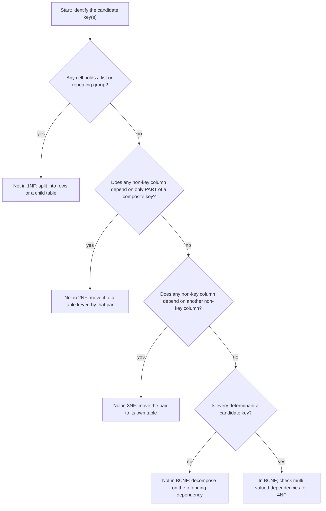
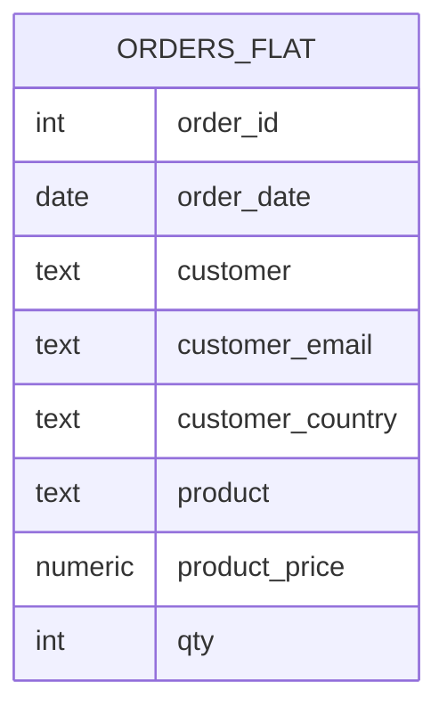
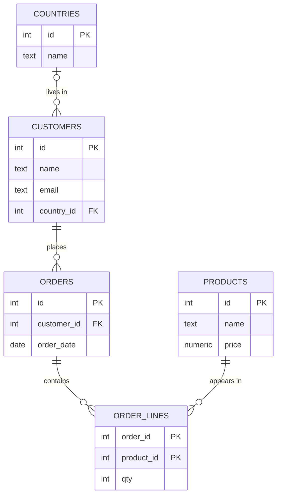

<div dir="rtl">

# 5. مدل‌سازی داده و نرمال‌سازی

> **زبان:** [English](../../en/part1/05-modelling-and-normalisation.md) | فارسی | **قبلی:** [4. SQL II: پرس‌وجوهای پیشرفته](04-sql-advanced.md) | **بعدی:** [6. درونیات ذخیره‌سازی](06-storage-internals.md)
> **سطح:** L2 حرفه‌ای | **بخش:** I
> **در یک جمله:** طراحی خوب جدول‌ها هر واقعیت را یک بار ذخیره می‌کند، با کلیدها و قیدها کاری می‌کند که پایگاه داده داده‌های بی‌معنا را نپذیرد، و این قاعده را فقط آگاهانه و به دلیلی اندازه‌گیری‌شده زیر پا می‌گذارد.
> **چه می‌آموزید:**
> - سه سطح یک مدل داده (مفهومی، منطقی، فیزیکی) و راه پیدا کردن موجودیت‌ها و ارتباط‌ها
> - وابستگی‌های تابعی و شکل‌های نرمال 1NF، 2NF، 3NF و BCNF، با یک مثال گام‌به‌گام که یک صفحه‌گسترده تخت را به جدول‌های `shop` تبدیل می‌کند
> - ناهنجاری‌های درج، به‌روزرسانی و حذف که نرمال‌سازی از آن‌ها جلوگیری می‌کند
> - چه زمانی و چگونه غیرنرمال‌سازی کنیم
> - قیدها (`PRIMARY KEY`، `FOREIGN KEY`، `UNIQUE`، `CHECK`، `NOT NULL`، `DEFAULT`) و کنش‌های آبشاری
> - انتخاب نوع داده: پول، کلیدها (عدد صحیح در برابر UUID)، مهر زمانی و منطقه زمانی، متن و collation
>
> **پیش‌نیازها:** [I-02](02-relational-model.md)، [I-03](03-sql-basics.md).
> **دربارهٔ خروجی‌ها:** رفتار قیدها در بخش 2.6 روی SQLite 3.51 با `PRAGMA foreign_keys = ON` اجرا شده است؛ در موتورهای دیگر عبارت پیام‌ها فرق می‌کند ولی معنایشان نه.
> برچسب‌های نمودارها به انگلیسی نگه داشته شده‌اند تا در GitHub درست نمایش داده شوند.

## 1. ایده (مبتدی)

فرض کنید صاحب فروشگاه پایگاه داده را همان‌طور طراحی کند که صفحه‌گستردهٔ خودش را طراحی کرده بود: یک جدول پهن، با یک سطر برای هر کالای فروخته‌شده.

| order_id | order_date | customer | customer_email | customer_country | product | product_price | qty |
|---|---|---|---|---|---|---|---|
| 1 | 2026-01-05 | Alice | alice@example.com | Germany | Keyboard | 49.90 | 2 |
| 1 | 2026-01-05 | Alice | alice@example.com | Germany | Mouse | 19.50 | 1 |
| 2 | 2026-02-11 | Alice | alice@example.com | Germany | Mouse | 19.50 | 1 |
| 3 | 2026-02-12 | Bob | NULL | France | Monitor | 199.00 | 1 |
| 4 | 2026-03-01 | Chie | chie@example.jp | Japan | Keyboard | 49.90 | 1 |

تا وقتی داده تغییر نکند همه‌چیز خوب پیش می‌رود. ایمیل Alice سه بار آمده است؛ اگر او ایمیلش را عوض کند و کسی فقط دو سطر را به‌روز کند، جدول با خودش ناسازگار می‌شود. تا وقتی کسی محصول تازه‌ای را سفارش نداده نمی‌شود آن را ثبت کرد، چون هر سطر به یک سفارش نیاز دارد. حذف سفارش 3 تنها ردپای وجود Bob را هم پاک می‌کند. این سه خرابی [ناهنجاری](../glossary.md#anomaly) (anomaly) نام دارند: ناهنجاری **به‌روزرسانی**، **درج** و **حذف**. ریشهٔ هر سه یکی است: یک جدول واقعیت‌های چند چیز متفاوت (مشتری‌ها، محصول‌ها، سفارش‌ها) را نگه می‌دارد، پس واقعیت‌های مربوط به یک چیز یا تکرار می‌شوند یا به چیز دیگری گره می‌خورند.

**نرمال‌سازی** (normalisation) رویه‌ای است برای شکستن چنین جدولی تا وقتی که هر جدول دربارهٔ یک نوع چیز باشد و هر واقعیت فقط در یک جا ذخیره شود. نتیجه اسکیمای `shop` در [فصل I-02](02-relational-model.md) است: `customers`، `products`، `orders`، `order_lines` و `countries`. این فصل توضیح می‌دهد چگونه با یک رویهٔ مشخص، و نه با شهود، به آنجا برسیم؛ از کجا بفهمیم کار تمام شده است؛ کجا باید توقف کرد؛ و کدام قابلیت‌های پایگاه داده (قیدها و نوع‌ها) طراحی را بعد از ساخته شدنش سالم نگه می‌دارند.

## 2. نحوهٔ کار (حرفه‌ای)

### 2.1 سه سطح یک مدل

طراحی در سه لایه انجام می‌شود، از انتزاعی‌ترین تا عینی‌ترین.

| سطح | به چه پرسشی پاسخ می‌دهد | خروجی معمول | مثال |
|---|---|---|---|
| **مفهومی** (conceptual) | کسب‌وکار به چه چیزهایی اهمیت می‌دهد و آن‌ها چه ارتباطی با هم دارند؟ | نمودار ER بدون نوع داده؛ یک واژه‌نامه | مشتری‌ها سفارش می‌دهند؛ هر سفارش شامل محصول‌هاست |
| **منطقی** (logical) | کدام جدول‌ها، ستون‌ها و کلیدها این را نمایش می‌دهند، مستقل از هر DBMS؟ | اسکیمای رابطه‌ای نرمال‌شده | `orders(id, customer_id, order_date, …)`؛ `order_lines` به‌عنوان جدول رابط |
| **فیزیکی** (physical) | در *این* DBMS برای سرعت و حجم چگونه ذخیره شود؟ | `CREATE TABLE` همراه با نوع‌ها، نمایه‌ها، پارتیشن‌ها و tablespaceها | `numeric(12,2)`، `ix_orders_customer … INCLUDE (total)` |

نرمال‌سازی به سطح منطقی تعلق دارد؛ نمایه‌ها، پارتیشن‌ها و گزینه‌های ذخیره‌سازی به سطح فیزیکی (فصل‌های [I-06](06-storage-internals.md) و [I-07](07-indexes.md)). اگر این دو را قاطی کنید به بحث‌هایی مثل «اسکیما کند است» می‌رسید، در حالی که راه‌حل واقعی یک نمایه است.

**پیدا کردن موجودیت‌ها و ارتباط‌ها.** جمله‌هایی را که اهل کسب‌وکار بلند می‌گویند بنویسید و زیر اسم‌ها و فعل‌ها خط بکشید. «مشتری سفارش می‌دهد. سفارش شامل چند خط سفارش است. هر خط به یک محصول اشاره می‌کند و تعدادی دارد.» اسم‌هایی که خودشان واقعیت‌هایی دارند (مشتری نام و ایمیل دارد) موجودیت می‌شوند، یعنی جدول. فعل‌ها ارتباط می‌شوند. هر ارتباط را از هر دو طرف بشمارید: یک مشتری، چند سفارش (یک‌به‌چند، کلید خارجی در سمت «چند»)؛ چند سفارش، چند محصول (چندبه‌چند، جدول رابط با کلید مرکب). ارتباط یک‌به‌یک (مشتری و مشخصات گذرنامه‌اش) معمولاً نشانهٔ آن است که این دو جدول می‌توانند یکی باشند، یا یک سمت اختیاری است و به‌ندرت استفاده می‌شود.

### 2.2 وابستگی‌های تابعی

[وابستگی تابعی](../glossary.md#functional-dependency) (functional dependency) به شکل `A → B` می‌گوید: *اگر مقدار A را بدانید، فقط یک مقدار ممکن برای B وجود دارد.* این نماد را «A، B را تعیین می‌کند» می‌خوانند. وابستگی‌ها واقعیت‌هایی دربارهٔ کسب‌وکارند، نه دربارهٔ داده‌ای که اتفاقاً امروز در دست دارید:

- `order_id → order_date, customer_email` (هر سفارش یک تاریخ و یک مشتری دارد)
- `customer_email → customer, customer_country` (فرض کنید هر ایمیل یک نفر را مشخص می‌کند)
- `product → product_price` (هر محصول در هر لحظه یک قیمت دارد)
- `(order_id, product) → qty` (تعداد به سفارش *و* محصول با هم وابسته است)

سمت چپ یک وابستگی را *تعیین‌کننده* (determinant) می‌نامند. مجموعه‌ای از ستون‌ها که همهٔ ستون‌های دیگر را تعیین کند ابرکلید است و کمینهٔ آن کلید کاندید ([فصل I-02](02-relational-model.md)). در جدول تخت بالا کلید `(order_id, product)` است، چون این جفت بقیهٔ ستون‌ها را تعیین می‌کند. شکل‌های نرمال قاعده‌هایی‌اند دربارهٔ اینکه بقیهٔ وابستگی‌ها با کلید چه نسبتی دارند.

### 2.3 شکل‌های نرمال

هر [شکل نرمال](../glossary.md#normal-form) (normal form) شرطی سخت‌گیرانه‌تر از شکل قبلی است. جدولی که در یک شکل بالاتر باشد در همهٔ شکل‌های پایین‌تر هم هست.

**شکل نرمال اول (1NF): هر خانه یک مقدار اتمی دارد و سطرها متمایزند.** گروه تکرارشونده و فهرست در یک خانه نداریم. خانه‌ای با `'Keyboard x2, Mouse x1'` 1NF را نقض می‌کند؛ ستون‌های `product1`، `product2`، `product3` هم همین‌طور. جدول تخت بالا در 1NF است. آرایه و ستون‌های JSON ([فصل I-04](04-sql-advanced.md)) از نظر فنی چند مقدار را در یک خانه نگه می‌دارند؛ آن‌ها را وقتی به کار ببرید که همیشه کل مقدار را می‌خوانید و می‌نویسید، نه برای داده‌ای که روی آن فیلتر می‌کنید.

**شکل نرمال دوم (2NF): 1NF، و هر ستون غیرکلید به *کل* کلید وابسته است، نه فقط بخشی از آن.** این فقط وقتی مهم است که کلید بیش از یک ستون داشته باشد. در جدول تخت، `product_price` فقط به `product` وابسته است که نیمی از کلید `(order_id, product)` است؛ `order_date` و ستون‌های `customer_*` فقط به `order_id` وابسته‌اند. این‌ها *وابستگی جزئی* (partial dependency) هستند و ناهنجاری‌های بالا را می‌سازند: قیمت Mouse به تعداد سفارش‌هایی که Mouse دارند ذخیره می‌شود. راه‌حل این است که هر گروه ستون را همراه با بخشی از کلید که آن را تعیین می‌کند به جدول جداگانه‌ای ببریم:

- `orders(order_id, order_date, customer, customer_email, customer_country)`
- `products(product, product_price)`
- `order_lines(order_id, product, qty)`

**شکل نرمال سوم (3NF): 2NF، و هیچ ستون غیرکلیدی به ستون غیرکلید دیگری وابسته نیست** (یعنی وابستگی انتقالی کلید → X → Y نداریم). در جدول `orders` تازه، `customer_email` و `customer_country` فقط *از راه* مشتری به `order_id` وابسته‌اند: `order_id → customer_email → customer_country`. مشتری‌ای که ده سفارش دارد کشورش را ده بار تکرار می‌کند. راه‌حل این است که مشتری جدول خودش را داشته باشد:

- `customers(customer_id, name, email, country)`
- `orders(order_id, order_date, customer_id)`

و چون `country` خودش موجودیتی با صفت‌های خودش است (و احتمال غلط املایی هم دارد)، یک جدول دیگر: `countries(id, name)` که `customers.country_id` به آن اشاره می‌کند. خلاصهٔ رایج 3NF این است: *هر ستون غیرکلید به کلید وابسته است، به کل کلید، و به هیچ چیز جز کلید.*

**شکل نرمال بویس-کاد (BCNF): هر تعیین‌کننده یک کلید کاندید است.** BCNF نسخهٔ کمی سخت‌گیرانه‌تر 3NF است که فقط وقتی فرق می‌کند که جدول چند کلید کاندید هم‌پوشان داشته باشد. مثال کتاب‌های درسی جدولی است از اینکه کدام مدرس کدام درس را به کدام دانشجو تدریس می‌کند، با این قاعده که هر مدرس فقط یک درس را تدریس می‌کند:

| student | course | instructor |
|---|---|---|
| Ana | Databases | Prof. Karimi |
| Ben | Databases | Prof. Karimi |
| Ana | Networks | Prof. Rossi |

کلیدهای کاندید `(student, course)` و `(student, instructor)` هستند. وابستگی `instructor → course` وجود دارد ولی `instructor` کلید نیست، پس جدول BCNF را نقض می‌کند، هرچند در 3NF است (هر ستون جزئی از یک کلید است). ناهنجاری: تا وقتی دانشجویی ثبت‌نام نکند نمی‌توانید ثبت کنید که Prof. Lee درس Security را تدریس می‌کند. تجزیهٔ BCNF عبارت است از `teaches(instructor, course)` و `enrolments(student, instructor)`. بهای آن این است که قاعدهٔ اصلی «هر دانشجو در هر درس یک مدرس دارد» دیگر فقط با کلید قابل اعمال نیست؛ بعضی تجزیه‌ها نمی‌توانند همهٔ وابستگی‌ها را حفظ کنند. در عمل هدف کاری 3NF است و BCNF بررسی‌ای است که هنگام دیدن کلیدهای هم‌پوشان انجام می‌دهید.

**شکل نرمال چهارم (4NF)** وابستگی‌های چندمقداری (multi-valued dependency) را حذف می‌کند: اگر یک محصول چند رنگ مستقل و چند اندازهٔ مستقل داشته باشد، جدولی با یک سطر برای هر ترکیب `(product, colour, size)` تعداد سطرها را چند برابر می‌کند و به ناسازگاری دعوت می‌کند؛ به‌جای آن از `product_colours` و `product_sizes` استفاده کنید. **شکل نرمال پنجم (5NF)** با وابستگی‌های پیوندی (join dependency) سروکار دارد که با جفت جدول‌ها قابل بیان نیستند؛ بیرون از کتاب‌های درسی کم پیش می‌آید.

**شکل 5.1: روشی برای تشخیص اینکه جدول در کدام شکل نرمال است.**

</div>



<div dir="rtl">

### 2.4 مثال گام‌به‌گام: از صفحه‌گسترده تا `shop`

از جدول تخت بخش 1 شروع کنید و گام‌ها را اجرا کنید.

**شکل 5.2: جدول تخت پیش از نرمال‌سازی و پس از آن.**

</div>





<div dir="rtl">

1. **وابستگی‌ها را پیدا کنید** (بخش 2.2) و کلید `(order_id, product)` را.
2. **2NF:** `products` را جدا کنید (`product → price`)، سپس `orders` را (`order_id → date, customer…`)؛ آنچه می‌ماند `order_lines(order_id, product, qty)` است.
3. **3NF:** `customers` را از `orders` جدا کنید (`customer → email, country`) و `countries` را از `customers`.
4. **کلیدهای جانشین:** `product` به‌صورت نام `Keyboard` کلید طبیعی است و وقتی بخش بازاریابی نامش را عوض کند تغییر می‌کند. آن را با `products.id` و یک ستون `name` جایگزین کنید. `customers.id` هم همین‌طور. (بخش 2.7 این انتخاب را بحث می‌کند.)
5. **نتیجه:** پنج جدول فصل I-02. هر واقعیت یک بار وجود دارد: ایمیل Alice یک خانه است، قیمت Mouse یک خانه.

ناهنجاری‌ها از بین رفته‌اند. ایمیل Alice را در یک سطر عوض کنید. محصولی بدون سفارش اضافه کنید: در `products` درج کنید. سفارش 3 را حذف کنید: Bob در `customers` می‌ماند. برای برگرداندن صفحه‌گسترده، جدول‌ها را پیوند بزنید ([فصل I-03](03-sql-basics.md)). پیوند بهای نرمال‌سازی است و یک DBMS امروزی اگر کلیدهای خارجی نمایه داشته باشند آن را ارزان می‌کند ([فصل I-07](07-indexes.md)).

**fixture کاملاً نرمال نیست.** به `orders.total` در seed مربوط به `shop` نگاه کنید. این عددی ذخیره‌شده است که اطلاعاتی را که از قبل در `order_lines` و `products.price` هست تکرار می‌کند. همان‌طور که [فصل I-02](02-relational-model.md) متوجه شد، حتی با خطوط خودش هم نمی‌خواند (سفارش 1 مقدار 120.50 را ذخیره کرده و مجموع خطوطش 119.30 است). مجموع ذخیره‌شده یک *غیرنرمال‌سازی* آگاهانه است که یک فروشگاه واقعی به دلیلی به آن نیاز دارد (قیمت‌ها تغییر می‌کنند؛ پایین‌تر را ببینید)، و fixture خطرش را نشان می‌دهد: داده‌های زائد از هم دور می‌شوند.

### 2.5 غیرنرمال‌سازی

[غیرنرمال‌سازی](../glossary.md#denormalisation) (denormalisation) یعنی افزودن عمدی افزونگی. دلیل‌هایی که پایدارند:

- **دقت تاریخی.** یک خط سفارش باید قیمت *در لحظهٔ فروش* را ثبت کند. `products.price` فردا عوض می‌شود؛ فاکتور سال پیش نباید عوض شود. پس `order_lines.unit_price` زائد نیست، واقعیتی متفاوت است (قیمت فروش). پایگاه داده نمونهٔ داخلی Rowlit همین کار را می‌کند (`OrderLines.UnitPrice`).
- **کارایی خواندن** برای گزارش‌هایی که چندین جدول بزرگ را پیوند می‌زنند: یک جدول خلاصه یا نمای مادی‌شده (materialized view) نگه دارید، یا شمارنده‌ای مثل `orders.total` را با تریگر یا برنامه به‌روز کنید، و تصمیم بگیرید چقدر می‌تواند کهنه باشد.
- **انبارهای داده.** اسکیماهای تحلیلی (اسکیمای ستاره‌ای یا star schema، [فصل I-15](15-oltp-vs-olap-columnar.md)) عمداً غیرنرمال‌اند، چون خوانده می‌شوند و به‌ندرت به‌روز می‌شوند.
- **سامانه‌های بدون پیوند.** در Cassandra و تا حدی در پایگاه‌های داده سندی، داده را تکرار می‌کنید تا یک پرس‌وجو از یک جا بخواند ([فصل I-16](16-nosql-families.md)).

انضباط کار: اول نرمال کنید، اندازه بگیرید، و فقط در جاهای مشخصی که اندازه‌گیری توجیه می‌کند غیرنرمال کنید؛ و بگویید منبع حقیقت یگانه کجاست و هر نسخه چگونه سازگار نگه داشته می‌شود (تریگر، کد برنامه، تازه‌سازی زمان‌بندی‌شده، یا «این یک عکس لحظه‌ای است و هرگز به‌روز نمی‌شود»).

### 2.6 قیدها

[قید](../glossary.md#constraint) (constraint) قاعده‌ای است که پایگاه داده در هر نوشتن اعمال می‌کند، پس هیچ باگ برنامه‌ای نمی‌تواند آن را بشکند. قیدها پیاده‌سازی کلیدها و دامنه‌های مدل‌اند.

| قید | معنا | نمونه در `shop` |
|---|---|---|
| `NOT NULL` | ستون باید مقدار داشته باشد | `customers.name`، `orders.customer_id` |
| `PRIMARY KEY` | یکتا و غیر NULL؛ حداکثر یکی برای هر جدول | `orders.id`؛ `(order_id, product_id)` در `order_lines` |
| `UNIQUE` | هیچ دو سطری مقدار(های) یکسان ندارند؛ NULL ممکن است مجاز باشد ([فصل I-02](02-relational-model.md)) | اگر ایمیل اجباری بود روی `customers.email` اعمال می‌شد |
| `FOREIGN KEY … REFERENCES` | مقدار باید در جدول والد وجود داشته باشد (یا NULL باشد) | `orders.customer_id → customers.id` |
| `CHECK (condition)` | قاعده‌ای در سطح سطر؛ وقتی شرط TRUE *یا UNKNOWN* باشد برقرار شمرده می‌شود | `CHECK (qty > 0)`، دامنهٔ `email_address` با `VALUE ~ '@'` |
| `DEFAULT value` | مقداری که وقتی ستون در `INSERT` نیامده به کار می‌رود | `order_lines.qty DEFAULT 1`، `orders.status DEFAULT 'new'` |

برای قیدها نام صریح بگذارید (`CONSTRAINT fk_orders_customers FOREIGN KEY …`)؛ نام در پیام‌های خطا و در اسکریپت‌های مهاجرت (migration) دیده می‌شود. seedها همین کار را می‌کنند.

وقتی قاعده‌ای شکسته شود چه می‌شود؟ در SQLite، با `PRAGMA foreign_keys = ON`، روی یک نسخهٔ کوچک از فروشگاه (پیام‌ها از خود موتورند):

</div>

```sql
DELETE FROM customers WHERE id = 1;            -- FOREIGN KEY constraint failed        (orders point at Alice)
INSERT INTO orders VALUES (9, 99, 10);         -- FOREIGN KEY constraint failed        (no customer 99)
INSERT INTO orders VALUES (9, 2, -5);          -- CHECK constraint failed: total >= 0
INSERT INTO order_lines VALUES (3, 2, 0);      -- CHECK constraint failed: qty > 0
```

<div dir="rtl">

PostgreSQL پیام `ERROR: insert or update on table "orders" violates foreign key constraint "fk_orders_customers"` را گزارش می‌کند (SQLSTATE 23503)؛ نقض `CHECK` کد 23514 است، نقض یکتایی 23505 و نقض not-null کد 23502. SQL Server شمارهٔ خطاهای 547 (کلید خارجی یا check)، 2627/2601 (یکتایی) و 515 (null) را به کار می‌برد. برنامه‌هایی که این کدها را می‌گیرند می‌توانند پیام‌های دوستانه نشان بدهند.

**کنش‌های ارجاعی** (referential actions) مشخص می‌کنند وقتی سطر والد حذف می‌شود یا کلیدش تغییر می‌کند، با سطرهای فرزند چه رخ دهد:

| کنش | هنگام حذف والد | کاربرد |
|---|---|---|
| `NO ACTION` (پیش‌فرض) / `RESTRICT` | حذف رد می‌شود | پیش‌فرض امن؛ `RESTRICT` بلافاصله بررسی می‌کند، `NO ACTION` در پایان دستور |
| `CASCADE` | سطرهای فرزند هم حذف می‌شوند | فرزندانی که بدون والد معنا ندارند (خطوط یک سفارش) |
| `SET NULL` | کلید خارجی فرزند NULL می‌شود | پیوندهای اختیاری، مثلاً یادداشتی که به یک سفارش اشاره می‌کند |
| `SET DEFAULT` | کلید فرزند برابر مقدار پیش‌فرض ستون می‌شود | کم‌کاربرد |

</div>

```sql
CREATE TABLE order_lines (
  order_id integer NOT NULL REFERENCES orders(id) ON DELETE CASCADE,
  line_no  integer NOT NULL,
  qty      integer NOT NULL CHECK (qty > 0),
  PRIMARY KEY (order_id, line_no));
```

<div dir="rtl">

روی نسخهٔ کوچک، پس از `DELETE FROM orders WHERE id = 1` دو خط سفارش 1 هم با آن حذف می‌شوند، و سطر یادداشتی که با `ON DELETE SET NULL` به سفارش 1 اشاره می‌کرد هنوز هست، با `order_id = NULL`. از `CASCADE` کم استفاده کنید: حذف در یک جدول سطح بالا می‌تواند بی‌صدا هزاران سطر را در عمق اسکیما پاک کند. محدودیت‌های موتورها: Oracle فقط `ON DELETE CASCADE` و `SET NULL` را پشتیبانی می‌کند (بدون `ON UPDATE`)؛ SQL Server چند مسیر آبشاری به یک جدول و چرخه را ممنوع می‌کند؛ در MySQL آبشاری‌ها تریگرهای سطرهای فرزند را فعال نمی‌کنند. کلید خارجی را معمولاً باید روی ستون فرزند نمایه کرد، وگرنه حذف یک والد جدول فرزند را کامل پویش می‌کند ([فصل I-07](07-indexes.md)).

**قیدها کجا زندگی می‌کنند.** دفاع چندلایه (defence in depth) می‌گوید هم در برنامه بررسی کنید *و* هم در پایگاه داده؛ نسخهٔ پایگاه داده همان است که نمی‌شود دورش زد (یک اسکریپت، سرویس دیگر، یا یک `UPDATE` دستی). هر چه باید همیشه درست باشد را در پایگاه داده اعمال کنید.

### 2.7 انتخاب کلیدها و نوع داده‌ها

**کلید جانشین در برابر کلید طبیعی.** [کلید جانشین](../glossary.md#surrogate-key) (surrogate key؛ عدد صحیح یا UUID تولیدشده) پایدار، کوچک و بی‌معناست؛ [کلید طبیعی](../glossary.md#natural-key) (natural key؛ ایمیل، شابک، کد کشور) معنادار است و گاهی تغییر می‌کند. به‌طور پیش‌فرض کلید اصلی را جانشین بگیرید و کلید طبیعی را به‌صورت قید `UNIQUE` نگه دارید. استثناها جدول‌های مرجع کوچک و پایدارند (جدول کشورها با کلید کد ISO مثل `DE`) و جدول‌های رابط، که در آن‌ها ترکیب دو کلید خارجی خودش کلید طبیعی است.

**عدد صحیح در برابر UUID.** عدد صحیح 32 یا 64 بیتی فشرده، مرتب، و برای نمایه‌سازی و پیوند سریع است؛ در عوض تعداد سطرهای شما را فاش می‌کند و در سامانه‌های توزیع‌شده، که نویسنده‌های متعدد باید بدون هماهنگی با هم شناسه تخصیص دهند، دست‌وپاگیر است. [UUID/GUID](../glossary.md#uuid) 128 بیت است، هر جا می‌تواند تولید شود، و قابل حدس زدن نیست؛ بهایش 16 بایت در هر نمایه است و، برای UUIDهای *تصادفی*، درج‌های پراکنده که نمایه‌ها را تکه‌تکه می‌کنند. گونه‌های UUID مرتب‌شده بر اساس زمان (UUIDv7؛ در SQL Server تابع `NEWSEQUENTIALID()`) بیشتر مزیت را با درج‌های پیاپی حفظ می‌کنند. PostgreSQL نوع بومی `uuid` و تابع `gen_random_uuid()` دارد (ستون `ext_id` در `extra_types` را ببینید)؛ SQL Server نوع `uniqueidentifier` دارد؛ Oracle از `RAW(16)` با `SYS_GUID()` استفاده می‌کند؛ MySQL از `BINARY(16)` با `UUID_TO_BIN()`. اگر می‌توانید، UUID را به‌صورت متن 36 نویسه‌ای ذخیره نکنید.

**پول.** هرگز برای پول از `float` یا `double` استفاده نکنید: ممیز شناور دودویی نمی‌تواند 0.10 را دقیق نمایش دهد و جمع‌ها دچار انحراف می‌شوند. از نوع اعشاری دقیق با [دقت و مقیاس](../glossary.md#precision-scale) (precision / scale) تعریف‌شده استفاده کنید: `numeric(12,2)` (PostgreSQL)، `DECIMAL(12,2)` (SQL Server، MySQL، و SQLite از طریق affinity)، `NUMBER(12,2)` (Oracle)، `Decimal(12,2)` (ClickHouse). دقت (precision) تعداد کل ارقام معنادار است و مقیاس (scale) تعداد ارقام بعد از ممیز: `numeric(12,2)` تا 9,999,999,999.99 را نگه می‌دارد. واحد پول را کنار مبلغ ذخیره کنید. نوع `MONEY` در SQL Server وجود دارد ولی در تقسیم رفتارهای گرد کردن غافلگیرکننده دارد؛ `DECIMAL` را ترجیح دهید. SQLite نوع `DECIMAL` را در درون به‌صورت مقدار ممیز شناور یا عدد صحیح ذخیره می‌کند («type affinity»)، پس برای حساب اعشاری دقیق باید از عدد صحیح (سنت) استفاده کرد.

**متن و collation.** نوعی با طول متغیر و حد معقول به کار ببرید. [collation](../glossary.md#collation) (ترتیب مرتب‌سازی و مقایسه) تعیین می‌کند متن چگونه مقایسه و مرتب شود: حساسیت به حروف بزرگ و کوچک، حساسیت به نشانه‌های تلفظ، و قواعد زبان. تعیین می‌کند که آیا `'alice' = 'Alice'` برقرار است یا نه و نام‌های فارسی، آلمانی یا ترکی با چه ترتیبی مرتب می‌شوند. collationهای پیش‌فرض SQL Server به حروف بزرگ و کوچک حساس نیستند؛ در PostgreSQL به locale پایگاه داده بستگی دارد (و برای برابری حساس است)؛ پیش‌فرض MySQL 8 یعنی `utf8mb4_0900_ai_ci` حساس نیست؛ SQLite بایت‌ها را مقایسه می‌کند مگر اینکه ستونی `COLLATE NOCASE` داشته باشد. همیشه از رمزگذاری سازگار با Unicode استفاده کنید (UTF-8؛ `nvarchar` در SQL Server و `NVARCHAR2` در Oracle هر جا مجموعه نویسهٔ پایگاه داده Unicode نیست)؛ جدول `customer_notes` در seed مربوط به MySQL دقیقاً به همین دلیل متن فارسی، عربی و عبری دارد.

**تاریخ، زمان و منطقه زمانی.** برای هر ستون تصمیم بگیرید که یک *لحظه* (instant) ذخیره می‌کنید (زمان وقوع چیزی، که همه‌جا یکسان است) یا یک *زمان محلی ساعت دیواری* (wall-clock؛ بازشدن فروشگاه ساعت 09:00 در هر جا که باشد). برای لحظه‌ها، UTC ذخیره کنید یا نوعی که به UTC نرمال می‌شود: `timestamptz` در PostgreSQL (UTC ذخیره می‌کند و بر اساس [منطقه زمانی](../glossary.md#time-zone) نشست نشان می‌دهد)، `datetimeoffset` یا `datetime2` حاوی UTC در SQL Server، `TIMESTAMP WITH TIME ZONE` در Oracle، `TIMESTAMP_LTZ` / `TIMESTAMP_TZ` در Snowflake، `DateTime('UTC')` در ClickHouse. از نوع‌هایی که با سکوت دروغ می‌گویند مراقب باشید: `DATE` در Oracle ساعت روز را هم دارد، `DATETIME` در MySQL منطقه ندارد و `TIMESTAMP` از طریق منطقهٔ نشست تبدیل می‌شود، SQLite اصلاً نوع تاریخ ندارد (متن، real یا عدد صحیح). seedهای `shop` اینها را مخلوط می‌کنند: `orders.order_date` در PostgreSQL از نوع `timestamptz` است (`seed-postgres.sql:39`)، در SQL Server `DATETIME2` و در Oracle یک `DATE` ساده.

**بولی، enum و ستون‌های وضعیت.** هر جا موتور نوع بولی دارد از آن استفاده کنید (`boolean` در PostgreSQL، Snowflake، `Bool` در ClickHouse، `BOOLEAN` در Oracle 23ai، `TINYINT(1)` در MySQL، `bit` در SQL Server). برای مجموعهٔ کوچک و بستهٔ حالت‌ها بین سه گزینه انتخاب کنید: نوع enum (`order_status` در PostgreSQL، `ENUM` در MySQL؛ فشرده است و تغییرش دردسر دارد)، قید `CHECK (status IN (…))` (SQLite و پایگاه داده نمونهٔ Rowlit این کار را می‌کنند)، و جدول مرجع (lookup table) با کلید خارجی (انعطاف‌پذیرترین و خودتوضیح‌دهنده‌ترین).

**نام‌گذاری.** یک قرارداد انتخاب کنید و به آن وفادار بمانید: نام جدول مفرد یا جمع، `snake_case` در برابر `PascalCase`، `id` در برابر `customer_id` برای کلیدها، پسوند `_id` برای کلیدهای خارجی. seedهای `shop` در PostgreSQL، MySQL و SQLite اسم‌های جمع با snake_case و در SQL Server از PascalCase استفاده می‌کنند، که نشان می‌دهد چرا ابزاری که از روی جدول‌ها کد تولید می‌کند به گزینه‌های قرارداد نام‌گذاری نیاز دارد. از واژه‌های رزروشده به‌عنوان نام پرهیز کنید (`order`، `user`، `group`، `date`)، به همین دلیل نام جدول `orders` است؛ فهرست واژه‌های رزرو در هر موتور فرق می‌کند و به‌ناچار گذاشتن آن‌ها در نقل‌قول ([فصل I-17](17-dialect-comparison.md)) آزاردهنده است.

### 2.8 اسکیما به‌مثابه فضای نام

واژهٔ [اسکیما](../glossary.md#schema) (schema) معنای دومی دارد ([فصل I-01](01-what-is-a-database.md)): ظرفی نام‌دار برای اشیا در درون یک پایگاه داده. از اسکیماها برای گروه‌بندی جدول‌ها بر اساس حوزه (`sales`، `hr`)، اعمال مجوز بر کل یک گروه، و جدا کردن جدول‌های برنامه از جدول‌های یک افزونه استفاده کنید. seed مربوط به `shop` جدول `invoices` را در `sales` قرار می‌دهد (`sales.invoices`) و کلید خارجی‌اش به `public.orders` از میان اسکیماها می‌گذرد، که مجاز است. در PostgreSQL تنظیم `search_path` مشخص می‌کند نام بدون پیشوند در کدام اسکیماها جست‌وجو شود؛ در SQL Server اسکیمای پیش‌فرض کاربر این نقش را دارد؛ در Oracle اسکیما همان کاربر است؛ در MySQL و ClickHouse سطح جداگانه‌ای وجود ندارد («اسکیما» همان پایگاه داده است). در اسکریپت‌های مهاجرت همیشه نام‌ها را کامل (با اسکیما) بنویسید.

## 3. بررسی عمیق (پیشرفته)

> **بررسی عمیق (L3): نظریهٔ وابستگی و تجزیه.**
> یک تجزیه باید *بدون اتلاف* (lossless) باشد (پیوند قطعه‌ها دقیقاً سطرهای اصلی را برمی‌گرداند، بدون چندتایی کاذب) و در حالت ایده‌آل *حافظ وابستگی* (dependency-preserving) باشد (هر وابستگی را بتوان درون یک جدول اعمال کرد). شکستن `R` به `R1` و `R2` وقتی بدون اتلاف است که ستون‌های مشترک کلید دست‌کم یکی از آن دو باشند (قضیهٔ Heath). برای 3NF همیشه یک تجزیهٔ بدون اتلاف و حافظ وابستگی وجود دارد (الگوریتم ترکیب از روی پوشش کمینه یا minimal cover)؛ برای BCNF همیشه تجزیهٔ بدون اتلاف هست ولی نه همیشه حافظ وابستگی، و به همین دلیل مثال درس بالا قاعدهٔ «یک مدرس برای هر دانشجو و درس» را از دست می‌دهد. اصول موضوعهٔ آرمسترانگ (بازتاب، افزایش، تعدی) همهٔ وابستگی‌های استنتاج‌پذیر را به دست می‌دهند؛ ابزارها *بستار* مجموعه‌ای از صفت‌ها را محاسبه می‌کنند تا کلیدها را پیدا کنند. اسکیماهای واقعی از قواعد کسب‌وکار طراحی می‌شوند، نه با اجرای الگوریتم روی داده، چون وابستگی‌هایی که در سطرهای امروز برقرارند ممکن است اتفاقی باشند.

> **بررسی عمیق (L3): وقتی نرمال‌سازی آسیب می‌زند و چه باید کرد.**
> اسکیماهای کاملاً نرمال یک خواندن منطقی را به پیوندهای زیاد تبدیل می‌کنند، و پیوندها CPU، حافظه (جدول‌های هش) و گاهی I/O مصرف می‌کنند. راه‌های کاهش که درستی را حفظ می‌کنند: نمایه‌های پوششی (covering index) تا پیوند به heap دست نزند ([فصل I-07](07-indexes.md))؛ نماهای مادی‌شده یا نمایه‌دار برای تجمیع‌های پرتکرار؛ replicaهای خواندنی ([I-12](12-backup-replication-ha.md))؛ حافظه نهان در برنامه با قاعدهٔ روشن ابطال. نسخه‌های غیرنرمال به یک *راهبرد همگام‌سازی* نیاز دارند: همگام (تریگر، در همان تراکنش)، ناهمگام (outbox یا جریان change-data-capture؛ با پذیرش تأخیر)، یا بازسازی (شبانه). شکست نسخهٔ همگام‌نشده همان است که در fixture دیدیم: دو عدد، هر دو «درست»، که با هم نمی‌خوانند. همچنین جدول‌های EAV (entity-attribute-value) و blobهای عمومی JSON را در نظر بگیرید، که منعطف به نظر می‌رسند و در عوض نوع‌ها، قیدها و کارایی نمایه را از دست می‌دهند؛ آن‌ها غیرنرمال‌سازی در جهت مخالف‌اند و بیرون از داده‌های پیکربندی به‌ندرت ایدهٔ خوبی‌اند.

> **بررسی عمیق (L3): قیدهای قابل تعویق و زمان بررسی.**
> قیدها در پایان هر دستور بررسی می‌شوند (یا برای `RESTRICT` بلافاصله). PostgreSQL و Oracle کلیدهای خارجی `DEFERRABLE INITIALLY DEFERRED` را هم مجاز می‌دانند، که فقط هنگام `COMMIT` بررسی می‌شوند و امکان می‌دهند والد و فرزند به هر ترتیب درج شوند یا دو کلید در یک تراکنش جابه‌جا شوند. SQL Server و MySQL کلید خارجی را به تعویق نمی‌اندازند؛ راه‌حل معمول مرتب کردن دستورهاست یا غیرفعال کردن موقت قید (`ALTER TABLE … NOCHECK CONSTRAINT`، `SET FOREIGN_KEY_CHECKS = 0`)، که هر دو خطرناک‌اند چون داده بد را بدون هیچ بررسی بعدی راه می‌دهند.

## 4. در هر موتور

| موضوع | PostgreSQL 17 | SQL Server 2022 | Oracle 23 | MySQL 8.4 / MariaDB 11 | SQLite 3.4x | ClickHouse 24.8 | Snowflake | Cassandra 5 |
|---|---|---|---|---|---|---|---|---|
| کلید خودکار | `GENERATED … AS IDENTITY`، `serial` | `IDENTITY(1,1)`، `SEQUENCE` | `GENERATED … AS IDENTITY`، `SEQUENCE` | `AUTO_INCREMENT` | `INTEGER PRIMARY KEY` (نام مستعار rowid)، `AUTOINCREMENT` | ندارد (از `generateUUIDv4()` استفاده کنید) | `IDENTITY` / `AUTOINCREMENT`، سکوئنس‌ها | ندارد (`uuid`، `timeuuid`) |
| اعمال `CHECK` | بله | بله | بله | بله، از MySQL 8.0.16 / MariaDB 10.2.1 | بله | بله (هنگام درج) | پشتیبانی نمی‌شود | خیر |
| اعمال `UNIQUE` / `PRIMARY KEY` | بله | بله | بله | بله | بله | خیر | اعمال نمی‌شود | کلید اصلی = upsert |
| کلیدهای خارجی | اعمال می‌شود، قابل تعویق | اعمال می‌شود | اعمال می‌شود، قابل تعویق | اعمال می‌شود (InnoDB) | اعمال می‌شود اگر `PRAGMA foreign_keys = ON` باشد | ندارد | تعریف می‌شود، اعمال نمی‌شود | ندارد |
| کنش‌های ارجاعی | هر چهار | هر چهار، بدون چند مسیر آبشاری | فقط `CASCADE`، `SET NULL` | همه (InnoDB) | همه | کاربرد ندارد | کاربرد ندارد | کاربرد ندارد |
| اعشاری دقیق | `numeric(p,s)` | `decimal(p,s)` | `NUMBER(p,s)` | `DECIMAL(p,s)` | نوع دقیق ندارد (عدد صحیح) | `Decimal(p,s)` | `NUMBER(p,s)` | `decimal` |
| مهر زمانی لحظه‌ای | `timestamptz` | `datetimeoffset` | `TIMESTAMP WITH TIME ZONE` | `TIMESTAMP` (در درون UTC) | متن/عدد صحیح بر پایهٔ قرارداد | `DateTime('UTC')` | `TIMESTAMP_LTZ` | `timestamp` |
| UUID | `uuid` | `uniqueidentifier` | `RAW(16)` | `BINARY(16)` | blob/متن | `UUID` | `VARCHAR` (`UUID_STRING()`) | `uuid`، `timeuuid` |
| فضای نام درون یک پایگاه داده | schema | schema | (اسکیما = کاربر) | ندارد | پایگاه داده متصل‌شده (attached) | ندارد | schema | ندارد (keyspace) |

## 5. تمرین‌ها

1. **ناهنجاری‌ها.** در جدول تخت بخش 1، برای هر یک از ناهنجاری‌های درج، به‌روزرسانی و حذف یک مثال مشخص بدهید. برای هر کدام بگویید کدام وابستگی تابعی مسئول است.
2. **شکل‌های نرمال.** جدول `enrolments(student, course, student_city, course_room, grade)` کلید `(student, course)` دارد. وابستگی‌هایی را که فرض می‌کنید فهرست کنید، بگویید ابتدا کدام شکل نرمال را نقض می‌کند، و تجزیهٔ آن به 3NF را همراه با کلیدها و کلیدهای خارجی بدهید.
3. **BCNF.** در بخش 2.3 مثال درس کلیدهای کاندید `(student, course)` و `(student, instructor)` را دارد. تجزیهٔ BCNF را نشان بدهید و یک قاعدهٔ کسب‌وکار بگویید که طراحی جدید دیگر نمی‌تواند با یک کلید اعمال کند. به‌هرحال چگونه آن را اعمال می‌کنید؟
4. **افزونگی.** seed مربوط به `shop` مقدار `orders.total` را ذخیره می‌کند. پرس‌وجویی بنویسید که سفارش‌هایی را فهرست کند که مجموع ذخیره‌شده‌شان با مجموع `qty * price` خطوطشان فرق دارد، و بگویید کدام سفارش‌ها را برمی‌گرداند. سپس دو راه برای سازگار نگه داشتن مجموع پیشنهاد کنید و هزینهٔ هر کدام را بگویید. چرا یک فروشگاه واقعی به `order_lines.unit_price` هم نیاز دارد؟
5. **قیدها.** برای حالت «هر مشتری می‌تواند یک بار برای هر محصول نقد بنویسد، با امتیاز 1 تا 5، متن اختیاری، و زمان ایجاد که پیش‌فرضش اکنون است»، `CREATE TABLE reviews` را با قیدهای نام‌دار بنویسید. برای `ON DELETE` مشتری و محصول کدام کنش‌ها را انتخاب می‌کنید و چرا؟
6. **نوع‌ها.** برای هر ستون یک نوع در PostgreSQL و یک نوع در SQL Server انتخاب و توجیه کنید: قیمت یک محصول؛ زمان ثبت یک سفارش (فروشگاه در سه منطقه زمانی می‌فروشد)؛ بارکد یک محصول (13 رقم، احتمال صفر در ابتدا)؛ زبان ترجیحی یک مشتری؛ اینکه آیا محصول از رده خارج شده است.

پاسخ‌ها: [فصل I-18، بخش I-05](18-exercise-answers.md#i-05).

## فصل‌های مرتبط

- قبلی: [I-04 SQL II](04-sql-advanced.md). بعدی: [I-06 درونیات ذخیره‌سازی](06-storage-internals.md) که بررسی می‌کند این جدول‌ها چگونه روی دیسک ذخیره می‌شوند.
- [I-02 مدل رابطه‌ای](02-relational-model.md): کلیدها و تمامیت ارجاعی، واژگانی که اینجا به کار رفته است.
- [I-07 نمایه‌ها](07-indexes.md): نمایه‌سازی کلیدهای خارجی؛ [I-14 امنیت](14-security.md): اسکیماها و امتیازها.
- [I-15 OLAP و ستونی](15-oltp-vs-olap-columnar.md): اسکیماهای ستاره‌ای و غیرنرمال‌سازی آگاهانه.
- بخش دوم: طراح جدول Rowlit قیدها و کلیدها را از روی یک فرم می‌سازد ([II-14](../part2/14-designers-and-ddl.md)).

## اصطلاحات جدید این فصل

[وابستگی تابعی](../glossary.md#functional-dependency)، [شکل نرمال](../glossary.md#normal-form)،
[نرمال‌سازی](../glossary.md#normalisation)، [غیرنرمال‌سازی](../glossary.md#denormalisation)، [ناهنجاری](../glossary.md#anomaly)،
[قید](../glossary.md#constraint)، [CHECK](../glossary.md#check-constraint)، [DEFAULT](../glossary.md#default-value)،
[UNIQUE](../glossary.md#unique-constraint)، [آبشاری](../glossary.md#cascade)، [نوع داده](../glossary.md#data-type)،
[دقت و مقیاس](../glossary.md#precision-scale)، [collation](../glossary.md#collation)، [منطقه زمانی](../glossary.md#time-zone)،
[UUID / GUID](../glossary.md#uuid)، [اسکیما (فضای نام)](../glossary.md#schema).

</div>
