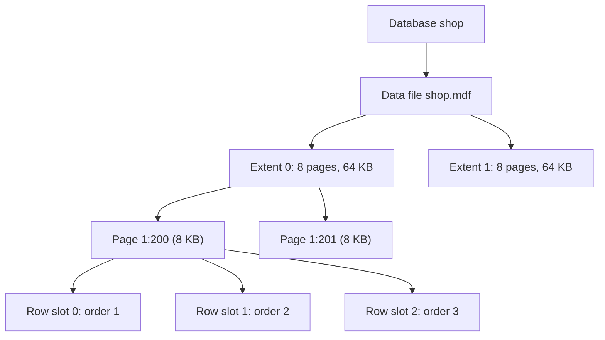
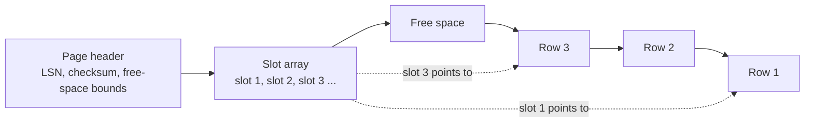
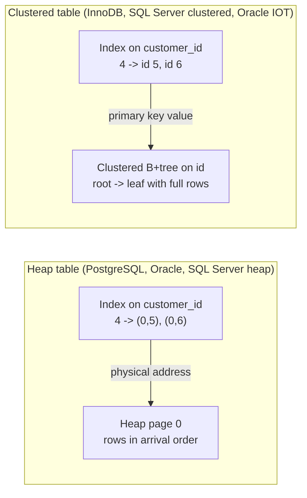

# 6. ساختار درونی ذخیره‌سازی

<div dir="rtl" markdown="1">

> **سطح:** L3 ارشد (شروع از L1) | **بخش:** I | **نسخهٔ Rowlit:** 1.6.3 | [English](../../en/part1/06-storage-internals.md)
> **قبلی:** [5. مدل‌سازی داده و نرمال‌سازی](05-modelling-and-normalisation.md) | **بعدی:** [7. نمایه‌ها به‌تفصیل](07-indexes.md)
>
> **در یک جمله:** پایگاه داده هر جدول را به شکل صفحه‌هایی با اندازهٔ ثابت در فایل‌ها نگه می‌دارد، و شیوهٔ نشستن سطرها
> روی این صفحه‌ها (هیپ یا خوشه‌ای، درون سطر یا بیرون از سطر، پر یا با فضای آزاد) تعیین می‌کند که هر پرس‌وجوی بعدی
> چقدر سریع باشد.
>
> **در این فصل یاد می‌گیرید:**
> - فایل‌ها، اکستنت‌ها، صفحه‌ها و سطرها چطور درون هم جا می‌گیرند و چرا صفحه واحد همهٔ ورودی/خروجی‌هاست؛
> - صفحهٔ شکاف‌دار از درون چه شکلی دارد و شناسهٔ سطر (RID، ctid، ROWID، rowid) در واقع به چه چیزی اشاره می‌کند؛
> - تفاوت جدول هیپ با جدول خوشه‌ای (سازمان‌یافته با نمایه)، موتور به موتور؛
> - وقتی سطری بزرگ می‌شود، جابه‌جا می‌شود یا در یک صفحه جا نمی‌شود چه اتفاقی می‌افتد (forwarding، migration، HOT،
>   TOAST، LOB، صفحه‌های سرریز)؛
> - ضریب پرشدگی و نقشه‌های فضای آزاد به چه کاری می‌آیند و استخر بافر چطور صفحه‌های داغ را در حافظه نگه می‌دارد؛
> - چرا ورودی/خروجی ترتیبی ارزان و ورودی/خروجی تصادفی گران است، و چیدمان ستونی چطور این تصویر را عوض می‌کند.
>
> **پیش‌نیازها:** [2. مدل رابطه‌ای](02-relational-model.md)، [3. SQL I](03-sql-basics.md). مفید:
> [5. مدل‌سازی](05-modelling-and-normalisation.md) (نوع‌های داده).
>
> برچسب‌های نمودارها به انگلیسی نگه داشته شده‌اند تا در GitHub درست نمایش داده شوند.

## 1. ایده (مبتدی)

جدول در ظاهر شبکه‌ای از سطرها و ستون‌هاست، اما دیسک شبکه ذخیره نمی‌کند؛ بایت‌ها را در فایل‌ها نگه می‌دارد. برای همین
موتور (engine) پایگاه داده هر فایل را به بلوک‌های هم‌اندازه‌ای به نام [صفحه (page)](../glossary.md#page) تقسیم می‌کند
(مثلاً 8 KB) و سطرها را داخل همین صفحه‌ها می‌گذارد. وقتی یک سطر را می‌خواهید، موتور هیچ‌وقت «یک سطر» از دیسک نمی‌خواند:
کل صفحه‌ای را که آن سطر در آن است می‌خواند، نسخه‌ای از آن را در حافظه نگه می‌دارد و سطر را از همین نسخه بیرون می‌کشد.
صفحه برای پایگاه داده همان نقشی را دارد که جعبه برای انبار: فقط جعبهٔ کامل جابه‌جا می‌شود.

دو پرسش تقریباً همهٔ مطالب بعدی را تعیین می‌کند. اول، **سطرها به چه ترتیبی در صفحه‌ها نشسته‌اند؟** یا بی‌هیچ ترتیب
خاصی ([هیپ (heap)](../glossary.md#heap): سطر تازه هرجا جا باشد می‌نشیند) یا مرتب‌شده بر اساس یک کلید
([نمایهٔ خوشه‌ای (clustered index)](../glossary.md#clustered-index): خود جدول یک درخت مرتب است). دوم، **هر بار خواندن
یک صفحه چند سطر به‌دردبخور می‌آورد؟** صفحه‌ای پر از سطرهای موردنیاز یعنی یک خواندن ارزان؛ صد صفحه که هر کدام فقط یک
سطر موردنظر دارند یعنی صد خواندن. نمایه‌ها ([فصل 7](07-indexes.md)) و بهینه‌ساز ([فصل 8](08-query-processing.md)) در
اصل راهبردهایی برای خواندن صفحه‌های کمتر هستند. این فصل نشان می‌دهد این صفحه‌ها از درون چه شکلی دارند.

## 2. سازوکار (کارشناس)

### 2.1 از فایل تا صفحه

همهٔ موتورهای رابطه‌ای از چهار لایهٔ یکسان استفاده می‌کنند، فقط با نام‌های متفاوت:

| لایه | چیست | PostgreSQL 17 | SQL Server 2022 | Oracle 23 | MySQL 8 / MariaDB 11 (InnoDB) | SQLite 3.4x |
|---|---|---|---|---|---|---|
| فایل | یک فایل سیستم‌عامل | برای هر جدول/نمایه یک فایل، تقسیم‌شده به قطعه‌های 1 GB، زیر `base/<db oid>/` | فایل‌های دادهٔ `.mdf` / `.ndf` برای هر پایگاه داده | فایل‌های داده که در فضاهای جدول گروه‌بندی می‌شوند | یک `.ibd` برای هر جدول (file-per-table، پیش‌فرض) یا فضای جدول سیستمی | کل پایگاه داده یک فایل است |
| اکستنت | دنباله‌ای از صفحه‌های پشت‌سرهم که با هم تخصیص داده می‌شوند | ندارد (فایل صفحه‌به‌صفحه بزرگ می‌شود) | 8 صفحه = 64 KB | مجموعه‌ای از بلوک‌های پیوسته؛ اندازه به فضای جدول بستگی دارد | 1 MB (64 صفحهٔ 16 KB) | ندارد |
| صفحه / بلوک | واحد ورودی/خروجی و نهان‌سازی | «block» با اندازهٔ 8 KB (`BLCKSZ`، تعیین‌شده در زمان کامپایل) | صفحهٔ 8 KB | `DB_BLOCK_SIZE`، پیش‌فرض 8 KB (2–32 KB) | صفحهٔ 16 KB (`innodb_page_size`) | به‌طور پیش‌فرض 4096 بایت (512–65536) |
| سطر | رکوردی درون صفحه | «tuple» | «row» / «record» | «row piece» | «record» | «cell» که یک «record» را در خود دارد |

[صفحه](../glossary.md#page) (در Oracle: [بلوک (block)](../glossary.md#block)) کوچک‌ترین مقدار داده‌ای است که موتور آن
را یکجا می‌خواند، می‌نویسد، در حافظه نگه می‌دارد، با latch قفل می‌کند و در لاگ ثبت می‌کند.
[اکستنت (extent)](../glossary.md#extent) گروهی از صفحه‌های پشت‌سرهم است که یکجا تخصیص داده می‌شود تا صفحه‌های یک جدول
در سراسر دیسک پراکنده نشوند. در Oracle و SQL Server مفهوم [فضای جدول (tablespace)](../glossary.md#tablespace) / filegroup
هم وجود دارد: مجموعه‌ای نام‌دار از فایل‌ها که اشیا را در آن جا می‌دهید.

**شکل 6.1 — از فایل تا یک سطر (با اندازه‌های SQL Server به‌عنوان نمونه).**

</div>



<div dir="rtl" markdown="1">

شناسهٔ «1:200» در شکل روشی است که SQL Server با آن صفحه را نام‌گذاری می‌کند: فایل 1، صفحهٔ 200. هر موتوری چنین نشانی
فیزیکی‌ای دارد، و نشانی هر سطر همیشه «نشانی صفحه + جایگاه روی صفحه» است.

#### عددهای واقعی: نمونهٔ SQLite در Rowlit

برنامهٔ Rowlit یک پایگاه دادهٔ نمونهٔ SQLite («Sample: Shop») می‌سازد با 24 کشور، 300 مشتری، 60 محصول و 1,500 سفارش
(`engine/src/DbStudio.Core/Sample/SampleDatabase.cs:21`)؛ طرحوارهٔ آن در `SampleDatabase.cs:100-180` است. شکل این
پایگاه داده با seedهای Docker ‏`shop` فرق دارد (نام‌های PascalCase، سطرهای بیشتر) و همین آن را آزمایشگاه خوبی می‌کند:
آن‌قدر سطر دارد که چند صفحه را پر کند. در SQLite یک جدول مجازی به نام `dbstat` هست که همهٔ صفحه‌ها را گزارش می‌کند.
روی یک کپی از فایل نمونه (SQLite 3.51.3، اجراشده با `node:sqlite` در Node؛ خروجی واقعی):

</div>

```sql
-- SQLite: page size, page count, pages per object
PRAGMA page_size;                    -- 4096
PRAGMA page_count;                   -- 112   (112 x 4 KB = 448 KB for the whole database)
SELECT name, count(*) AS pages, sum(ncell) AS cells, sum(unused) AS unused_bytes
FROM dbstat GROUP BY name ORDER BY pages DESC LIMIT 4;
```

<div dir="rtl" markdown="1">

| name | pages | cells | unused_bytes |
|---|---|---|---|
| OrderLines | 30 | 4551 | 7723 |
| Orders | 21 | 1519 | 6795 |
| sqlite_autoindex_OrderLines_1 | 14 | 4523 | 4905 |
| IX_OrderLines_ProductId | 11 | 4523 | 4429 |

این‌طور بخوانیدش: 1,500 سفارش 21 صفحهٔ 4 KB را پر می‌کنند، یعنی حدود 75 سطر در هر صفحه. آن 19 «cell» اضافه در `Orders`
(1,519 به‌جای 1,500) سلول‌های اشاره‌گرِ تنها صفحهٔ داخلی‌ای هستند که بالای 20 صفحهٔ برگ قرار دارد: جدول یک درخت است،
و بخش 2.3 این را توضیح می‌دهد.

### 2.2 درون صفحه: صفحهٔ شکاف‌دار

تقریباً همهٔ موتورهای سطرمحور (row store) از یک چیدمان صفحه استفاده می‌کنند:
[صفحهٔ شکاف‌دار (slotted page)](../glossary.md#slotted-page).

**شکل 6.2 — صفحهٔ شکاف‌دار. شکاف‌ها از ابتدای صفحه رشد می‌کنند، سطرها از انتهای آن، و فضای آزاد در میانه است.**

</div>



<div dir="rtl" markdown="1">

- **سرآیند صفحه (page header)** شمارهٔ ترتیبی لاگِ صفحه ([LSN](../glossary.md#lsn)، که در بازیابی به کار می‌رود،
  [فصل 11](11-logging-and-recovery.md))، یک checksum و محل شروع و پایان فضای آزاد را ثبت می‌کند. سرآیند PostgreSQL ‏24
  بایت و سرآیند SQL Server ‏96 بایت است.
- **آرایهٔ شکاف‌ها (slot array)** نشان می‌دهد هر سطر از کجا شروع می‌شود (در PostgreSQL:
  [اشاره‌گرهای سطر (line pointer)](../glossary.md#line-pointer)، هر کدام 4 بایت؛ در SQL Server: *row offset array* در
  انتهای صفحه، 2 بایت برای هر سطر).
- **سطرها** از سر دیگر صفحه چیده می‌شوند. هر سطر با سرآیند کوچک خودش شروع می‌شود (null bitmap، طول‌ها و در موتورهای
  MVCC، اطلاعات تراکنش؛ [فصل 10](10-concurrency-locking-mvcc.md)).

چرا این لایهٔ واسط؟ چون سطر می‌تواند **درون** صفحه جابه‌جا شود (وقتی صفحه فشرده می‌شود یا سطر بزرگ‌تر می‌شود) بی‌آنکه
نشانی‌اش عوض شود: نشانی به شکاف اشاره می‌کند و فقط offset شکاف تغییر می‌کند. نمایه‌ها همچنان به همان شکاف اشاره
می‌کنند.

پس نشانی فیزیکی هر سطر دو جزء دارد: صفحه و شکاف. هر موتور نام خودش را برای آن دارد:

| موتور | نام | ساختار | مثال |
|---|---|---|---|
| PostgreSQL | [`ctid`](../glossary.md#ctid) | (شمارهٔ بلوک، اشاره‌گر سطر) | `(0,3)` = بلوک 0، سومین اشاره‌گر سطر |
| SQL Server (هیپ) | [RID](../glossary.md#rid) | فایل : صفحه : شکاف (8 بایت) | `1:200:2` |
| Oracle | [ROWID](../glossary.md#rowid) | شیء داده، فایل، بلوک، سطر (به شکل 18 نویسهٔ base-64 نمایش داده می‌شود) | `AAAR3sAAEAAAACXAAA` |
| SQLite | [`rowid`](../glossary.md#rowid) | یک **کلید** عدد صحیح 64 بیتی، نه نشانی فیزیکی | `7` |
| InnoDB | ندارد | سطرها با کلید اصلی پیدا می‌شوند | — |

روی PostgreSQL امتحانش کنید (خروجی نمایشی است: هنگام نوشتن این فصل آزمایشگاه Docker در حال اجرا نبود):

</div>

```sql
-- PostgreSQL 17, Docker shop database
SELECT ctid, id, customer_id, total FROM orders ORDER BY id;
```

<div dir="rtl" markdown="1">

| ctid | id | customer_id | total |
|---|---|---|---|
| (0,1) | 1 | 1 | 120.50 |
| (0,2) | 2 | 1 | 19.50 |
| (0,3) | 3 | 2 | 199.00 |
| … | … | … | … |

هر شش سفارش در بلوک 0 هستند. دستور `UPDATE orders SET total = total WHERE id = 1;` را اجرا کنید و دوباره پرس‌وجو
بگیرید: سفارش 1 حالا `(0,7)` را نشان می‌دهد. در PostgreSQL هیچ سطری درجا بازنویسی نمی‌شود؛ هر به‌روزرسانی نسخهٔ
تازه‌ای می‌نویسد و نسخهٔ قدیمی می‌ماند تا [VACUUM](../glossary.md#vacuum) آن را پاک کند
([فصل 10](10-concurrency-locking-mvcc.md)). پس `ctid` یک نشانی فیزیکی است، نه هویت سطر: هرگز آن را در برنامه ذخیره
نکنید.

### 2.3 هیپ‌ها و جدول‌های خوشه‌ای

سطرهای یک جدول به یکی از دو روش ذخیره می‌شوند.

**هیپ.** سطرها هرجا فضای آزاد باشد قرار می‌گیرند، بدون هیچ ترتیبی بر اساس کلید. موتور سطر را با نشانی فیزیکی‌اش
(RID / ctid / ROWID) پیدا می‌کند. هر نمایه، از جمله کلید اصلی، ساختاری جداست که مدخل‌هایش به همین نشانی ختم می‌شوند.
جدول‌های PostgreSQL همیشه هیپ‌اند. جدول‌های Oracle به‌طور پیش‌فرض هیپ‌اند («heap-organised»). در SQL Server جدولی که
نمایهٔ خوشه‌ای ندارد هیپ است.

**جدول خوشه‌ای / جدول سازمان‌یافته با نمایه.** خود جدول یک B+tree است
([فصل 7](07-indexes.md#b-plus-tree-structure)) که بر اساس یک کلید مرتب شده: صفحه‌های برگ درخت سطرهای کامل را نگه
می‌دارند. این همان [نمایهٔ خوشه‌ای](../glossary.md#clustered-index) در SQL Server است،
[جدول سازمان‌یافته با نمایه (index-organised table, IOT)](../glossary.md#index-organised-table) در Oracle
(`ORGANIZATION INDEX`)، تنها قالب جدول در InnoDB، و در SQLite جدول rowid (مرتب بر اساس `rowid`) یا جدول
`WITHOUT ROWID` (مرتب بر اساس کلید اصلی اعلام‌شده). نمایهٔ ثانویه روی چنین جدولی نمی‌تواند نشانی فیزیکی نگه دارد،
چون با شکافتن صفحه‌ها سطرها جابه‌جا می‌شوند؛ به‌جای آن **کلید خوشه‌بندی (clustering key)** را نگه می‌دارد و سطر را با
جست‌وجوی دوم در درخت پیدا می‌کند.

**شکل 6.3 — یافتن سطرِ `customer_id = 4` از طریق نمایهٔ ثانویه: هیپ (چپ) در برابر جدول خوشه‌ای (راست).**

</div>



<div dir="rtl" markdown="1">

پیامدهایی که در عمل به کارتان می‌آید:

| پرسش | هیپ | خوشه‌ای |
|---|---|---|
| جست‌وجو با کلید اصلی | جست‌وجو در نمایه + خواندن یک صفحه | یک جست‌وجو در درخت؛ سطر در برگ است |
| جست‌وجو با نمایهٔ ثانویه | جست‌وجو در نمایه + خواندن یک صفحه برای هر سطر | جست‌وجو در نمایه + یک **جست‌وجوی درخت** برای هر سطر («bookmark» یا [جست‌وجوی کلید (key lookup)](../glossary.md#key-lookup)) |
| پویش بازه‌ای روی کلید (`WHERE id BETWEEN …`) | سطرها پراکنده‌اند، مگر اینکه جدول به ترتیب کلید بارگذاری شده باشد | سطرها کنار هم‌اند: صفحه‌های کم |
| درج | ارزان: افزودن به هر صفحه‌ای که جا دارد | باید به برگ درست برود؛ برگ پر شکافته می‌شود ([فصل 7](07-indexes.md#page-splits)) |
| کلید خوشه‌بندی پهن | — | همهٔ نمایه‌های ثانویه آن را با خود دارند: کلید UUID ‏16 بایتی همهٔ نمایه‌ها را بزرگ‌تر می‌کند |
| کلید خوشه‌بندی تصادفی (UUID v4) | — | درج‌ها روی برگ‌های تصادفی می‌نشینند: شکافتن صفحه، صفحه‌های نیمه‌خالی، استفادهٔ ضعیف از حافظهٔ نهان |

در InnoDB کلید خوشه‌بندی را خود موتور انتخاب می‌کند: `PRIMARY KEY`؛ اگر نباشد، نخستین نمایهٔ `UNIQUE` که همهٔ
ستون‌هایش `NOT NULL` باشند؛ وگرنه یک شناسهٔ سطر پنهان 6 بایتی (`GEN_CLUST_INDEX`). در SQL Server، اگر هنوز نمایهٔ
خوشه‌ای وجود نداشته باشد، کلید اصلی به‌طور پیش‌فرض خوشه‌ای ساخته می‌شود؛ به همین دلیل `PK_Orders` در
`seed-mssql.sql:37` خوشه‌ای است. نمایهٔ خوشه‌ای غیریکتا برای کلیدهای تکراری یک
[یکتاساز (uniquifier)](../glossary.md#uniquifier) پنهان 4 بایتی می‌گیرد.

در SQLite این تفاوت مستقیم دیده می‌شود. در پایگاه دادهٔ نمونه، `Orders.Id` به شکل `INTEGER NOT NULL PRIMARY KEY` تعریف
شده (`SampleDatabase.cs:133`) و همین آن را نام مستعار `rowid` می‌کند، یعنی کلید B-tree خود جدول. جست‌وجو با id اصلاً
به نمایه نیاز ندارد (خروجی واقعی):

</div>

```sql
EXPLAIN QUERY PLAN SELECT * FROM Orders WHERE Id = 7;
-- SEARCH Orders USING INTEGER PRIMARY KEY (rowid=?)
```

<div dir="rtl" markdown="1">

با کلید اصلی متنی، جدول همچنان جدول rowid می‌ماند و SQLite یک نمایهٔ یکتای جداگانه می‌سازد؛ جدول [`WITHOUT ROWID`](../glossary.md#without-rowid) را
به شکل خوشه‌ای روی کلید اعلام‌شده ذخیره می‌کند. خروجی واقعی روی 50,000 سطر با کلیدهایی مثل `C0001234`:

</div>

```sql
CREATE TABLE kv_rowid   (code TEXT PRIMARY KEY, v INTEGER);
CREATE TABLE kv_norowid (code TEXT PRIMARY KEY, v INTEGER) WITHOUT ROWID;
-- dbstat after loading 50,000 rows into each:
--   kv_rowid 234 pages + sqlite_autoindex_kv_rowid_1 230 pages = 464 pages
--   kv_norowid 230 pages, no extra index
EXPLAIN QUERY PLAN SELECT v FROM kv_rowid   WHERE code = 'C0001234';
-- SEARCH kv_rowid USING INDEX sqlite_autoindex_kv_rowid_1 (code=?)
EXPLAIN QUERY PLAN SELECT v FROM kv_norowid WHERE code = 'C0001234';
-- SEARCH kv_norowid USING PRIMARY KEY (code=?)
```

<div dir="rtl" markdown="1">

نسخهٔ خوشه‌ای نصف حجم را می‌گیرد و به‌جای دو جست‌وجوی درخت، فقط یکی لازم دارد.

### 2.4 سطرهایی که بزرگ می‌شوند، جابه‌جا می‌شوند یا جا نمی‌شوند

وقتی ستونی با طول متغیر را به‌روزرسانی می‌کنید، اندازهٔ سطر عوض می‌شود. موتورها با وضعیت «سطر دیگر در جای قبلی‌اش جا
نمی‌شود» به روش‌های مختلفی کنار می‌آیند:

- **هیپ در SQL Server: [رکوردهای ارجاعی (forwarded record)](../glossary.md#forwarded-record).** سطر به صفحهٔ دیگری
  می‌رود و در RID قدیمی یک forwarding stub باقی می‌گذارد، پس لازم نیست نمایه‌ها تغییر کنند. هر خواندنی که به این stub
  برسد یک خواندن صفحهٔ اضافه انجام می‌دهد. ستون `sys.dm_db_index_physical_stats(...).forwarded_record_count` تعدادشان
  را می‌شمارد؛ بازسازی هیپ آن‌ها را از بین می‌برد.
- **در Oracle: [مهاجرت سطر و زنجیره‌شدن سطر (row migration / chaining)](../glossary.md#row-chaining).** در *مهاجرت*،
  سطری که بزرگ شده به بلوک تازه‌ای می‌رود و در بلوک قدیمی یک اشاره‌گر می‌ماند (ROWID معتبر می‌ماند). در *زنجیره‌شدن*،
  سطری که از یک بلوک بزرگ‌تر است به چند تکه در چند بلوک شکسته می‌شود. هر دو در آمارهٔ «table fetch continued row» دیده
  می‌شوند.
- **در PostgreSQL: نسخهٔ تازه، و شاید [HOT](../glossary.md#hot-update).** هر به‌روزرسانی نسخهٔ تازه‌ای از tuple
  می‌نویسد. اگر هیچ ستون نمایه‌شده‌ای تغییر نکرده باشد و همان صفحه جا داشته باشد، به‌روزرسانی از نوع *heap-only tuple*
  (HOT) است: نسخهٔ قدیمی درون همان صفحه به نسخهٔ جدید اشاره می‌کند و هیچ مدخل نمایه‌ای اضافه نمی‌شود. اگر صفحه پر
  باشد، نسخهٔ جدید به صفحهٔ دیگری می‌رود و **همهٔ نمایه‌های** جدول یک مدخل تازه می‌گیرند. همین فضای آزادی که در صفحه
  باقی می‌گذارید (بخش 2.5) به‌روزرسانی HOT را ممکن می‌کند. ستون `pg_stat_user_tables.n_tup_hot_upd` نشان می‌دهد HOT
  چند بار موفق شده است.
- **در InnoDB و دیگر جدول‌های خوشه‌ای:** اگر سطر جا شود، در همان برگ می‌ماند؛ وگرنه برگ شکافته می‌شود. نمایه‌های ثانویه
  تأثیری نمی‌پذیرند، چون با کلید اشاره می‌کنند.

مقدارهایی که برای یک صفحه بیش از حد بزرگ‌اند **بیرون از سطر** ([off-row](../glossary.md#off-row)) ذخیره می‌شوند: سطر
فقط یک اشاره‌گر کوچک نگه می‌دارد و خود مقدار در صفحه‌های جداگانه است.

| موتور | نام | چه زمانی مقدار بیرون از سطر می‌رود | اشاره‌گری که در سطر می‌ماند |
|---|---|---|---|
| PostgreSQL | [TOAST](../glossary.md#toast) | وقتی سطر از حدود 2 KB (`TOAST_TUPLE_THRESHOLD`) پهن‌تر شود، مقدارها ابتدا فشرده می‌شوند (pglz، یا lz4 با `default_toast_compression`) و سپس در تکه‌های حدوداً 2 KB به جدول `pg_toast.pg_toast_<oid>` همان جدول منتقل می‌شوند | یک اشاره‌گر TOAST ‏18 بایتی |
| SQL Server | [LOB](../glossary.md#lob) / [row-overflow](../glossary.md#row-overflow) | هر سطر حداکثر 8,060 بایت را درون سطر نگه می‌دارد؛ ستون‌های `varchar(n)`/`varbinary(n)` که سطر را از این حد بیرون ببرند به `ROW_OVERFLOW_DATA` می‌روند؛ نوع‌های `(max)` بزرگ‌تر از 8,000 بایت به `LOB_DATA` می‌روند | یک اشاره‌گر کوچک (24 بایت برای row-overflow؛ یک LOB root یا text pointer برای `LOB_DATA`) |
| Oracle | سگمنت LOB (به‌طور پیش‌فرض SecureFiles) | LOBهای تا حدود 4,000 بایت می‌توانند در سطر بمانند (`ENABLE STORAGE IN ROW`)؛ بزرگ‌ترها در سگمنت LOB نگه‌داری می‌شوند | یک LOB locator |
| InnoDB | ستون‌های off-page | با قالب سطر پیش‌فرض `DYNAMIC`، مقدارهای بلند `TEXT`/`BLOB`/`VARCHAR` که سطر را بیش از حد بزرگ می‌کنند (هر سطر باید در حدود نیمی از یک صفحهٔ 16 KB جا شود) به‌طور کامل بیرون از صفحه ذخیره می‌شوند | یک اشاره‌گر 20 بایتی |
| SQLite | [صفحه‌های سرریز (overflow page)](../glossary.md#overflow-page) | رکوردی که از یک آستانهٔ وابسته به اندازهٔ صفحه بزرگ‌تر باشد، دنباله‌اش را در زنجیره‌ای از صفحه‌های سرریز می‌ریزد | بایت‌های اول به‌همراه شمارهٔ صفحهٔ بعدی |

خروجی واقعی از SQLite: یک متن 10,000 نویسه‌ای در پایگاه داده‌ای با صفحه‌های 4 KB، یک صفحهٔ برگ و دو صفحهٔ سرریز
می‌گیرد.

</div>

```sql
CREATE TABLE docs (id INTEGER PRIMARY KEY, body TEXT);
INSERT INTO docs (body) VALUES ('short'), (printf('%.*c', 10000, 'x'));
SELECT pagetype, count(*) FROM dbstat WHERE name = 'docs' GROUP BY pagetype;
-- leaf 1, overflow 2
```

<div dir="rtl" markdown="1">

قاعده‌های عملی: `SELECT *` روی جدولی با ستون‌های متنی بزرگ، صفحه‌های بیرون از سطر را هم می‌خواند (و de-TOAST می‌کند
که CPU مصرف می‌کند)؛ فقط ستون‌هایی را که لازم دارید فهرست کنید. مقدارهای بزرگ سطرها را پهن می‌کنند و سطر پهن یعنی
سطرهای کمتر در هر صفحه، پس هر پویش صفحه‌های بیشتری می‌خواند.

### 2.5 فضای آزاد و ضریب پرشدگی

وقتی صفحه‌ای ساخته یا بازسازی می‌شود، موتور می‌تواند بخشی از آن را خالی بگذارد تا به‌روزرسانی‌ها و درج‌های بعدی بدون
جابه‌جا کردن سطرها یا شکافتن صفحه‌ها جا شوند. این ذخیره همان [ضریب پرشدگی (fill factor)](../glossary.md#fill-factor)
است (در Oracle: [PCTFREE](../glossary.md#pctfree)، یعنی درصدی که خالی نگه داشته می‌شود).

| موتور | تنظیم | پیش‌فرض | کاربرد |
|---|---|---|---|
| PostgreSQL | `WITH (fillfactor = n)` روی جدول‌ها و نمایه‌ها | جدول‌ها 100، نمایه‌های B-tree ‏90 | صفحه‌های هیپ (به به‌روزرسانی‌های HOT کمک می‌کند) و صفحه‌های نمایه در زمان ساخت |
| SQL Server | `FILLFACTOR = n` روی نمایه‌ها، `PAD_INDEX` برای سطح‌های غیربرگ | 0 (= 100) | فقط هنگام ساخت یا بازسازی نمایه؛ درج‌های عادی صفحه‌ها را کامل پر می‌کنند |
| Oracle | `PCTFREE n` روی جدول‌ها و نمایه‌ها | 10 | جدول‌ها: جا برای بزرگ‌شدن سطر؛ نمایه‌ها: فقط هنگام ساخت |
| InnoDB | `innodb_fill_factor` | 100 | ساخت مرتب نمایه (sorted index build)؛ InnoDB هنگام پرکردن صفحه‌ها به ترتیب کلید، حدود 1/16 صفحه را هم خالی می‌گذارد |
| SQLite | ندارد | — | — |

ضریب پرشدگی پایین‌تر فضا را (و در نتیجه صفحه‌های بیشتری که در پویش‌ها باید خوانده شوند) با شکافتن کمتر صفحه‌ها و، در
PostgreSQL، به‌روزرسانی‌های HOT بیشتر معاوضه می‌کند. آن را برای جدول‌ها یا نمایه‌هایی به کار ببرید که مدام به‌روزرسانی
می‌شوند یا درج با کلید تصادفی دارند؛ جدول‌هایی را که بیشتر خوانده می‌شوند روی 100 نگه دارید.

موتورها برای پیدا کردن صفحه‌ای که برای سطر تازه جا دارد، بدون خواندن همهٔ صفحه‌ها، یک
[نقشهٔ فضای آزاد (free space map)](../glossary.md#free-space-map) نگه می‌دارند: fork ‏`_fsm` در PostgreSQL (درختی کوچک
از دسته‌بندی فضای آزاد هر صفحه)، صفحه‌های PFS (Page Free Space) در SQL Server، بلوک‌های bitmap در Oracle زیر Automatic
Segment Space Management، و bitmapهای هر اکستنت در InnoDB. در PostgreSQL برای هر جدول نقشهٔ دومی هم هست،
[نقشهٔ مرئی‌بودن (visibility map)](../glossary.md#visibility-map) (fork ‏`_vm`)، که صفحه‌هایی را علامت می‌زند که همهٔ
سطرهایشان برای همهٔ تراکنش‌ها مرئی‌اند؛ پویش‌های فقط‌نمایه (index-only scan) بر پایهٔ همین نقشه کار می‌کنند
([فصل 7](07-indexes.md#index-only-scans)).

### 2.6 استخر بافر

خواندن از دیسک هزاران بار کندتر از خواندن از RAM است، برای همین هر موتور صفحه‌هایی را که اخیراً استفاده شده‌اند در یک
ناحیهٔ حافظهٔ مشترک نگه می‌دارد: [استخر بافر (buffer pool)](../glossary.md#buffer-pool) (در PostgreSQL: `shared_buffers`؛
در Oracle: buffer cache؛ در SQLite: page cache).

**شکل 6.4 — یک خواندن و یک نوشتن از مسیر استخر بافر.**

</div>


<div dir="rtl" markdown="1">

- **[خواندن منطقی (logical read)](../glossary.md#logical-read)** صفحه را در حافظه پیدا می‌کند؛ **خواندن فیزیکی (physical read)** باید آن را از
  ذخیره‌ساز بیاورد. طرح‌های اجرا و آمارها هر دو را گزارش می‌کنند (PostgreSQL: `Buffers: shared hit=… read=…`؛ SQL Server
  با `SET STATISTICS IO`: `logical reads`، `physical reads`؛ Oracle: consistent gets / physical reads).
- صفحه‌ای که در حافظه تغییر کرده [صفحهٔ کثیف (dirty page)](../glossary.md#dirty-page) است. این صفحه بعداً به‌دست یک
  background writer یا در یک [نقطهٔ وارسی (checkpoint)](../glossary.md#checkpoint) به دیسک برگردانده می‌شود، و هرگز
  پیش از آنکه رکوردهای لاگِ توصیف‌کنندهٔ آن تغییر روی دیسک باشند (write-ahead logging،
  [فصل 11](11-logging-and-recovery.md)).
- وقتی استخر پر است، یک سیاست جایگزینی، قربانی (victim) را انتخاب می‌کند. LRU ساده با یک پویش بزرگ به‌راحتی خراب
  می‌شود، برای همین موتورها از گونه‌های دیگری استفاده می‌کنند: [clock sweep](../glossary.md#clock-sweep) در PostgreSQL
  با شمارندهٔ استفاده، به‌همراه یک **ring buffer** کوچک برای پویش‌های ترتیبی بزرگ و VACUUM (تا پویش یک جدول عظیم بقیهٔ
  صفحه‌ها را بیرون نراند)؛ *midpoint insertion* در InnoDB (صفحه‌های تازه وارد زیرفهرست «old» می‌شوند که 3/8 فهرست LRU
  است، و فقط اگر پس از `innodb_old_blocks_time`، که پیش‌فرضش 1 s است، دوباره لمس شوند ارتقا می‌یابند)؛ و پیرسازی به
  سبک LRU-K در SQL Server.
- در PostgreSQL خواندن از مسیر حافظهٔ نهان سیستم‌عامل انجام می‌شود، پس یک صفحه ممکن است دو بار نهان شود
  ([بافرگذاری دوگانه (double buffering)](../glossary.md#double-buffering))؛ به همین دلیل `shared_buffers` معمولاً حدود
  یک‌چهارم RAM تنظیم می‌شود، نه بیشترِ آن. SQL Server، Oracle و InnoDB (`innodb_flush_method = O_DIRECT` روی Linux)
  معمولاً حافظهٔ نهان سیستم‌عامل را دور می‌زنند و بیشتر حافظه را خودشان در اختیار می‌گیرند.

### 2.7 ورودی/خروجی ترتیبی و تصادفی

[پویش ترتیبی (sequential scan)](../glossary.md#sequential-scan) صفحه‌های جدول را به ترتیب فایل می‌خواند. ذخیره‌ساز
پیش‌خوانی (read-ahead) می‌کند، موتور در هر درخواست صفحه‌های زیادی می‌خواهد و هزینهٔ هر صفحه پایین است.
[ورودی/خروجی تصادفی (random I/O)](../glossary.md#random-io) میان صفحه‌های دور از هم می‌پرد (مثلاً یک صفحه برای هر سطری
که از طریق نمایه روی هیپ پیدا می‌شود). هر پرش یک درخواست جداست.

| ذخیره‌ساز | خواندن تصادفی 8 KB در ثانیه (معمول) | توان عملیاتی ترتیبی (معمول) |
|---|---|---|
| دیسک سخت 7,200 rpm | حدود 100–200 | حدود 150–250 MB/s |
| SSD از نوع SATA | ده‌ها هزار | حدود 500 MB/s |
| SSD از نوع NVMe | صدها هزار | چند GB/s |

با آمدن SSDها این فاصله کم شد اما از بین نرفت، و در حافظه همین اثر به شکل cache miss در CPU برمی‌گردد. بهینه‌سازها این
را در مدل هزینهٔ خود رمزگذاری می‌کنند: پیش‌فرض‌های PostgreSQL ‏`seq_page_cost = 1.0` و `random_page_cost = 4.0` هستند؛
روی SSD بسیاری از تیم‌ها `random_page_cost` را تا حدود 1.1 پایین می‌آورند. همین یک نسبت تعیین می‌کند که برنامه‌ریز
(planner) نمایه را ترجیح دهد یا پویش را ([فصل 8](08-query-processing.md#cost-model)).

قاعدهٔ سرانگشتی‌ای که از این نتیجه می‌شود: حتی خواندن چند درصد از یک جدول هیپ از طریق نمایه می‌تواند گران‌تر از خواندن
ترتیبی کل جدول تمام شود. فصل 7 نشان می‌دهد این از کجا شروع می‌شود، و چیدمان خوشه‌ای یا نمایهٔ پوشا چطور آن را تغییر
می‌دهد.

### 2.8 نگاهی به چیدمان ستونی

هرچه تا اینجا دیدیم **سطرمحور** (row store) بود: هر صفحه سطرهای کامل را نگه می‌دارد. موتورهای تحلیلی هر **ستون** را
جداگانه ذخیره می‌کنند، پس پرس‌وجویی که `total` را روی 100 میلیون سفارش جمع می‌زند فقط ستون `total` را، آن هم فشرده،
می‌خواند. ایده‌های سطح صفحه همچنان برقرارند، اما با واحدهای دیگر:

- در **ClickHouse MergeTree** هر درج به شکل یک *پارت (part)* تغییرناپذیر نوشته می‌شود؛ درون پارت، یا هر ستون فایل
  خودش را دارد (wide parts) یا همهٔ ستون‌ها یک فایل مشترک دارند (compact parts، برای درج‌های کوچک). سطرها بر اساس
  `ORDER BY` مرتب و در *گرانول‌هایی (granule)* به اندازهٔ `index_granularity` سطر گروه‌بندی می‌شوند (پیش‌فرض 8,192؛
  `seed-clickhouse.sql:56` آن را صریحاً تنظیم می‌کند)، و نمایهٔ اصلی تُنُک (sparse primary index) برای هر گرانول یک
  مدخل نگه می‌دارد ([فصل 7](07-indexes.md#clickhouse-sparse-primary-index)).
- در **Snowflake** جدول‌ها به شکل *ریزپارتیشن‌های (micro-partition)* تغییرناپذیر ذخیره می‌شوند، هر کدام تقریباً
  50–500 MB دادهٔ فشرده‌نشده، با چیدمان ستونی در درون و فرادادهٔ min/max برای هر ستون که برای کنار گذاشتن پارتیشن‌ها به
  کار می‌رود.
- در **columnstore در SQL Server** حدود یک میلیون سطر در یک *row group* کنار هم قرار می‌گیرند و هر ستون آن به شکل یک
  *segment* فشرده ذخیره می‌شود.

[فصل 15](15-oltp-vs-olap-columnar.md) این موتورها را به‌تفصیل بررسی می‌کند؛ اینجا همین کافی است که ببینیم پرسش «برای
پاسخ به این، چند بایت باید بخوانم؟» در هر دو دنیا یکی است.

## 3. نگاه عمیق (ارشد)

> **نگاه عمیق (L3): tuple هیپ در PostgreSQL، بایت به بایت.**
> هر tuple هیپ با یک سرآیند 23 بایتی شروع می‌شود (که تا 24 بایت پر می‌شود): `t_xmin` و `t_xmax` (شناسهٔ تراکنشی که
> آن را ساخته و تراکنشی که حذفش کرده، قلب MVCC)، `t_cid`، `t_ctid` (به خودش اشاره می‌کند، یا پس از به‌روزرسانی به
> نسخهٔ جدیدتر)، `t_infomask`/`t_infomask2` (پرچم‌هایی مثل «xmin committed» و «has nulls»، بیت‌های HOT و تعداد
> صفت‌ها) و `t_hoff` (محل شروع داده). اگر ستونی NULL باشد، پس از سرآیند یک null bitmap می‌آید و بعد مقدار ستون‌ها، که
> هر کدام با alignment نوع خودش هم‌تراز می‌شود (`int8` و `timestamptz` روی 8 بایت و سرآیند `numeric` روی 4 بایت). پس ترتیب
> ستون‌ها مهم است: گذاشتن ستون‌های 8 بایتی در ابتدا و `boolean`های 1 بایتی در انتها می‌تواند در هر سطر چند بایت صرفه‌جویی
> کند. افزونهٔ `pageinspect` همهٔ این‌ها را نشان می‌دهد (`SELECT * FROM heap_page_items(get_raw_page('orders', 0));`) و
> `pgstattuple` فضای مرده را گزارش می‌کند. این‌ها را فقط روی یک پایگاه دادهٔ آزمایشی اجرا کنید؛ به دسترسی superuser
> نیاز دارند.

> **نگاه عمیق (L3): ساختارهای تخصیص در SQL Server.**
> صفحه‌های هر شیء به *واحدهای تخصیص (allocation unit)* تعلق دارند: `IN_ROW_DATA`، `ROW_OVERFLOW_DATA` و `LOB_DATA`
> (`sys.allocation_units`). هر واحد تخصیص صفحه‌های IAM (Index Allocation Map) دارد که اکستنت‌هایش را فهرست می‌کنند.
> صفحه‌های GAM و SGAM نشان می‌دهند کدام اکستنت‌ها آزاد یا مختلط (mixed) هستند، و صفحه‌های PFS نشان می‌دهند هر صفحه چقدر
> پر است (فضای آزاد هیپ) و آیا تخصیص یافته یا نه. از SQL Server 2016 به بعد، پایگاه‌های دادهٔ کاربر فقط اکستنت یکنواخت
> (uniform) تخصیص می‌دهند (`MIXED_PAGE_ALLOCATION OFF`). هیپ ترتیبی ندارد، پس پویش هیپ IAM را به ترتیب فایل دنبال
> می‌کند («allocation order scan»). بارهای کاری tempdb با درج سنگین معروف بودند به اینکه روی صفحه‌های PFS/GAM به رقابت
> (contention) می‌خورند؛ SQL Server 2019 و 2022 امکان به‌روزرسانی هم‌زمان این صفحه‌ها را اضافه کردند.

> **نگاه عمیق (L3): رکوردهای InnoDB.**
> هر رکورد نمایهٔ خوشه‌ای دو ستون سیستمی پنهان دارد: `DB_TRX_ID` (6 بایت، آخرین تراکنشی که سطر را تغییر داده) و
> `DB_ROLL_PTR` (7 بایت، اشاره‌گری به undo log برای نسخهٔ قبلی، [فصل 10](10-concurrency-locking-mvcc.md))، و اگر
> InnoDB خودش کلید را ساخته باشد، `DB_ROW_ID` (6 بایت) هم دارد. رکورد نمایهٔ ثانویه به شکل (ستون‌های نمایه، ستون‌های
> کلید اصلی) است. وقتی صفحه‌ای پس از حذف‌ها از `MERGE_THRESHOLD` (به‌طور پیش‌فرض 50%) پایین‌تر برود، InnoDB تلاش می‌کند
> آن را با صفحهٔ همسایه ادغام کند. تغییرات صفحه‌های نمایهٔ ثانویه که در حافظه نیستند می‌توانند در *change buffer* ثبت و
> بعداً اعمال شوند، و این کار نوشتن‌های تصادفی را به نوشتن‌های دسته‌ای تبدیل می‌کند (در MySQL 8.4 این قابلیت به‌طور
> پیش‌فرض خاموش است: `innodb_change_buffering = none`).

> **نگاه عمیق (L3): B-treeها و رکوردهای SQLite.**
> فایل پایگاه دادهٔ SQLite مجموعه‌ای از B-treeهاست. *table B-tree* با rowid ‏64 بیتی کلیدگذاری می‌شود و سطرها را فقط
> در برگ‌ها نگه می‌دارد (یک B+tree)؛ *index B-tree* رکوردهای (ستون‌های نمایه، rowid) را ذخیره می‌کند و کلیدها را در
> صفحه‌های داخلی هم نگه می‌دارد (یک B-tree کلاسیک). هر رکورد یک سرآیند varint دارد که *serial type* هر ستون را فهرست
> می‌کند و پس از آن مقدارها می‌آیند؛ عددهای صحیح بسته به اندازه‌شان در 0، 1، 2، 3، 4، 6 یا 8 بایت ذخیره می‌شوند، پس
> عددهای کوچک ارزان‌اند. صفحهٔ 1 با یک سرآیند فایل 100 بایتی شروع می‌شود (اندازهٔ صفحه، قالب فایل، سرِ فهرست آزاد).
> صفحه‌های حذف‌شده به فهرست آزاد (free list) می‌روند و دوباره استفاده می‌شوند؛ `VACUUM` فایل را از نو می‌سازد. پایگاه
> دادهٔ نمونه بلافاصله پس از پرشدن با داده `ANALYZE; VACUUM;` را اجرا می‌کند (`SampleDatabase.cs:347`) و به همین دلیل
> صفحه‌هایش فشرده و پرند.

> **نگاه عمیق (L3): چرا اندازهٔ صفحه همین است که هست.**
> صفحهٔ بزرگ‌تر یعنی درخت‌های کم‌عمق‌تر و توان ترتیبی بهتر، اما در عوض خواندن هدررفتهٔ بیشتر برای جست‌وجوهای نقطه‌ای،
> حافظهٔ بیشتر به ازای هر سطر داغِ نهان‌شده و خطر بزرگ‌تر torn write ([فصل 11](11-logging-and-recovery.md)). اندازه‌های
> 8 KB (پیش‌فرض PostgreSQL، SQL Server و Oracle) و 16 KB (InnoDB) مصالحه‌هایی‌اند که دهه‌ها پیش انتخاب شدند و هنوز با
> اندازهٔ صفحه‌های SSD خوب جور درمی‌آیند. تغییرشان به‌ندرت می‌ارزد: PostgreSQL به کامپایل دوباره نیاز دارد، در SQL
> Server اصلاً قابل تغییر نیست، و InnoDB و SQLite آن را هنگام ساختن پایگاه داده (یا در InnoDB، هنگام ساختن instance)
> ثابت می‌کنند.

## 4. در هر موتور

| موضوع | PostgreSQL 17 | SQL Server 2022 | Oracle 23 | MySQL 8 / MariaDB 11 (InnoDB) | SQLite 3.4x | ClickHouse 24+ | Snowflake | Cassandra 4/5 |
|---|---|---|---|---|---|---|---|---|
| اندازهٔ صفحه | 8 KB | 8 KB | پیش‌فرض 8 KB | پیش‌فرض 16 KB | پیش‌فرض 4 KB | مبتنی بر صفحه نیست: گرانول‌های 8,192 سطری در فایل‌های ستونی فشرده | ریزپارتیشن‌ها | بلوک‌های SSTable (تکه‌های فشرده‌سازی، پیش‌فرض 16 KB در 4.x/5) |
| چیدمان پیش‌فرض جدول | هیپ | هیپ، یا خوشه‌ای وقتی نمایهٔ خوشه‌ای وجود دارد (به‌طور پیش‌فرض PK) | هیپ؛ IOT در صورت درخواست | خوشه‌ای روی PK | B-tree با کلید rowid؛ `WITHOUT ROWID` خوشه‌ای روی PK | مرتب بر اساس `ORDER BY` | ستونی، بدون ترتیب مگر با clustering key | مرتب بر اساس clustering key درون هر پارتیشن (LSM) |
| نشانی سطر | `ctid` | RID (هیپ) / کلید خوشه‌بندی | ROWID | کلید اصلی | rowid | (part, granule, offset) | چیزی در دسترس نیست | partition key + clustering key |
| مقدارهای بزرگ | TOAST | row-overflow، LOB | سگمنت‌های LOB (SecureFiles) | ستون‌های off-page | صفحه‌های سرریز | فایل‌های ستونی، فشرده | ستونی، فشرده | سلول‌ها درون SSTableها |
| ذخیرهٔ فضای آزاد | `fillfactor` | `FILLFACTOR` (هنگام ساخت نمایه) | `PCTFREE` | `innodb_fill_factor` | ندارد | ندارد (پارت‌های تغییرناپذیر) | ندارد (تغییرناپذیر) | ندارد (SSTableهای تغییرناپذیر) |
| حافظهٔ نهان | `shared_buffers` + حافظهٔ نهان سیستم‌عامل | buffer pool | buffer cache | `innodb_buffer_pool_size` | page cache برای هر اتصال | mark cache، uncompressed cache، حافظهٔ نهان سیستم‌عامل | حافظهٔ نهان دیسک محلی warehouse، result cache | key cache، chunk cache، حافظهٔ نهان سیستم‌عامل |
| بررسی صفحه‌ها | `pageinspect`، `pgstattuple` | `DBCC PAGE` (مستندنشده)، `sys.dm_db_index_physical_stats` | `DBMS_SPACE`، dump بلوک‌ها | `INFORMATION_SCHEMA.INNODB_*`، `innodb_ruby` (ابزار بیرونی) | `dbstat`، `sqlite3_analyzer` | `system.parts`، `system.parts_columns` | `TABLE_STORAGE_METRICS` | `nodetool tablestats`، `sstablemetadata` |

موتور ذخیره‌سازی Cassandra (درخت ادغام لاگ‌ساخت (log-structured merge tree): commit log → memtable → SSTableهای
تغییرناپذیر که با compaction ادغام می‌شوند) موضوع [فصل 16](16-nosql-families.md) است؛ این موتور هیچ‌وقت صفحه‌ای را
درجا به‌روزرسانی نمی‌کند.

*در Rowlit:* کاوشگر (explorer) نمایه‌های هر جدول را نشان می‌دهد و طراح (designer) می‌تواند برخی گزینه‌های ذخیره‌سازی را
برای هر provider تنظیم کند ([بخش II، فصل 14](../part2/14-designers-and-ddl.md))؛ پایگاه دادهٔ نمونهٔ SQLite که در این
فصل استفاده شد با `SampleDatabase.CreateAsync` ساخته می‌شود ([بخش II، فصل 9](../part2/09-relational-providers.md)).

## 5. تمرین‌ها

1. جدولی در PostgreSQL ‏1,000,000 سطر دارد که هر کدام حدود 100 بایت است (با احتساب سرآیند). تخمین بزنید به چند صفحهٔ
   8 KB نیاز دارد و یک پویش ترتیبی چند صفحه می‌خواند. سپس تعداد صفحه‌ها را با `fillfactor = 70` تخمین بزنید.
2. در SQL Server، جدول `dbo.Orders` یک کلید اصلی خوشه‌ای روی `Id` و نمایهٔ غیرخوشه‌ای
   `IX_Orders_CustomerId (CustomerId) INCLUDE (Total)` دارد (`seed-mssql.sql:51`). دقیقاً چه چیزی در یک سطر برگِ این
   نمایهٔ غیرخوشه‌ای ذخیره می‌شود؟ اگر جدول هیپ بود، چه چیزی تغییر می‌کرد؟
3. باید برای یک جدول InnoDB با 500 میلیون سطر و درج سنگین کلید اصلی انتخاب کنید: `BIGINT AUTO_INCREMENT` یا یک UUID
   تصادفی که به شکل `CHAR(36)` ذخیره می‌شود. سه دلیل مربوط به ذخیره‌سازی برای انتخابتان بیاورید.
4. در PostgreSQL، دستور `UPDATE orders SET status = 'paid' WHERE id = 3` به‌روزرسانی HOT نیست. دو دلیل احتمالی را نام
   ببرید.
5. با SQLite و `dbstat` پیدا کنید کدام شیء در پایگاه دادهٔ نمونهٔ Rowlit بیشترین بایت استفاده‌نشده به ازای هر صفحه را
   دارد. پرس‌وجو را بنویسید.
6. پرس‌وجویی 2% از سطرهای یک جدول هیپ 10 GB را از طریق نمایه و به ترتیب تصادفی می‌خواند. با `seq_page_cost = 1` و
   `random_page_cost = 4`، و با این فرض که هر سطر منطبق در صفحه‌ای جداست و هیچ‌چیز در حافظهٔ نهان نیست، کدام بر حسب
   واحد هزینهٔ صفحه ارزان‌تر است: مسیر نمایه یا پویش ترتیبی کامل؟ (صفحه‌های 8 KB، ‏80 سطر در هر صفحه.)

## پاسخ‌ها

پاسخ‌ها در [فصل 18](18-exercise-answers.md#chapter-6) گردآوری شده‌اند؛ اینجا هم تکرار شده‌اند تا این فصل به‌تنهایی
کامل باشد.

<details>
<summary>نمایش پاسخ‌ها</summary>

1. از 8 KB، پس از کم کردن سرآیند 24 بایتی، 8,168 بایت می‌ماند؛ هر سطر حدود 100 + 4 بایت (اشاره‌گر سطر) جا می‌گیرد،
   پس حدود 78 سطر در هر صفحه و 1,000,000 / 78 ≈ 12,800 صفحه (حدود 100 MB). پویش ترتیبی همهٔ آن‌ها را می‌خواند. با
   `fillfactor = 70`، درج‌ها در 70% صفحه متوقف می‌شوند: حدود 55 سطر در هر صفحه، ≈ 18,200 صفحه، پس پویش حدود 42% بیشتر
   می‌خواند.
2. هر سطر برگ کلید `CustomerId`، ستون افزوده‌شدهٔ `Total` و مکان‌یاب سطر (row locator) را نگه می‌دارد. چون جدول نمایهٔ
   خوشه‌ای دارد، مکان‌یاب همان کلید خوشه‌بندی `Id` است. روی هیپ، مکان‌یاب به‌جای آن RID ‏8 بایتی (file:page:slot) می‌بود.
   در هر دو حالت یک سرآیند کوچک سطر و null bitmap هم وجود دارد.
3. هر سه مورد از این فهرست کافی است: کلید auto-increment به راست‌ترین برگ اضافه می‌شود، پس صفحه‌ها کامل پر می‌شوند و
   از وسط شکافته نمی‌شوند؛ UUIDهای تصادفی درج‌ها را میان همهٔ برگ‌ها پخش می‌کنند و باعث شکافتن صفحه و صفحه‌های
   نیمه‌خالی می‌شوند؛ `CHAR(36)` دست‌کم 36 بایت است در برابر 8 بایت، و هر نمایهٔ ثانویه کلید اصلی را تکرار می‌کند؛
   کلیدهای تصادفی مجموعهٔ کاری (working set) را روی کل درخت پخش می‌کنند و نرخ اصابت (hit ratio) استخر بافر پایین
   می‌آید؛ کلیدهای ترتیبی سطرهای تازه را روی چند صفحهٔ داغ کنار هم نگه می‌دارند.
4. یا یک ستون نمایه‌شده تغییر کرده است (اگر `status` در نمایه‌ای باشد، مثلاً به‌عنوان ستون گزارهٔ نمایهٔ جزئی
   `ix_orders_open`، به‌روزرسانی نمی‌تواند HOT باشد: PostgreSQL ستون‌هایی را که در گزاره‌ها و عبارت‌های نمایه به کار
   رفته‌اند نمایه‌شده به حساب می‌آورد)، یا صفحه برای نسخهٔ جدید فضای آزاد نداشته است (fill factor برابر 100 روی صفحه‌ای
   پر).
5. پرس‌وجو:
   `SELECT name, count(*) AS pages, sum(unused) * 1.0 / count(*) AS unused_per_page FROM dbstat GROUP BY name ORDER BY unused_per_page DESC LIMIT 1;`
   روی فایل نمونه، این پرس‌وجو `sqlite_sequence` را گزارش می‌کند (جدول داخلی پشت `AUTOINCREMENT`: از 4,096 بایتش 4,070
   بایت استفاده‌نشده است) و پس از آن `sqlite_autoindex_Countries_1` (3,873): اشیای خیلی کوچک بیشترِ تنها صفحهٔ خود را
   هدر می‌دهند، و این ایرادی ندارد.
6. جدول 10 GB / 8 KB ≈ 1,310,720 صفحه و حدود 104.9 میلیون سطر دارد. 2% یعنی حدود 2.1 میلیون سطر که هر کدام یک خواندن
   صفحهٔ تصادفی با هزینهٔ 4 است: حدود 8.4 میلیون واحد، به‌علاوهٔ صفحه‌های نمایه. پویش ترتیبی حدود 1.31 میلیون واحد
   هزینه دارد. پویش کامل حدود شش برابر ارزان‌تر است، و به همین دلیل بهینه‌سازها در کسری به‌طرز شگفت‌آوری کوچک از سطرها،
   استفاده از نمایهٔ غیرپوشا روی هیپ را کنار می‌گذارند.

</details>

## فصل‌های مرتبط

- [7. نمایه‌ها به‌تفصیل](07-indexes.md): صفحه‌های B+tree، شکافتن صفحه، نمایه‌های پوشا و پویش‌های فقط‌نمایه بر پایهٔ این
  فصل بنا شده‌اند.
- [8. خط لولهٔ پرس‌وجو و بهینه‌ساز](08-query-processing.md): تعداد صفحه‌ها چطور به هزینه تبدیل می‌شود.
- [10. هم‌روندی: قفل‌ها، latchها، MVCC](10-concurrency-locking-mvcc.md): نسخه‌های tuple، `xmin`/`xmax`، undo.
- [11. WAL، redo/undo، checkpointها، بازیابی](11-logging-and-recovery.md): صفحه‌های کثیف، checkpointها، صفحه‌های ناقص
  (torn page).
- [15. OLTP در برابر OLAP و موتورهای ستونی](15-oltp-vs-olap-columnar.md): پارت‌ها، گرانول‌ها، ریزپارتیشن‌ها.
- بخش II: [9. providerهای رابطه‌ای](../part2/09-relational-providers.md) (پایگاه دادهٔ نمونهٔ SQLite).

## اصطلاح‌های واژه‌نامه که در این فصل معرفی شدند

[صفحه](../glossary.md#page)، [بلوک](../glossary.md#block)، [اکستنت](../glossary.md#extent)،
[فضای جدول](../glossary.md#tablespace)، [صفحهٔ شکاف‌دار](../glossary.md#slotted-page)،
[اشاره‌گر سطر](../glossary.md#line-pointer)، [هیپ](../glossary.md#heap)،
[نمایهٔ خوشه‌ای](../glossary.md#clustered-index)، [جدول سازمان‌یافته با نمایه](../glossary.md#index-organised-table)،
[rowid](../glossary.md#rowid)، [RID](../glossary.md#rid)، [ctid](../glossary.md#ctid)،
[یکتاساز (uniquifier)](../glossary.md#uniquifier)، [WITHOUT ROWID](../glossary.md#without-rowid)،
[رکورد ارجاعی](../glossary.md#forwarded-record)، [مهاجرت / زنجیره‌شدن سطر](../glossary.md#row-chaining)،
[به‌روزرسانی HOT](../glossary.md#hot-update)، [بیرون از سطر](../glossary.md#off-row)، [TOAST](../glossary.md#toast)،
[LOB](../glossary.md#lob)، [row-overflow](../glossary.md#row-overflow)، [صفحهٔ سرریز](../glossary.md#overflow-page)،
[ضریب پرشدگی](../glossary.md#fill-factor)، [PCTFREE](../glossary.md#pctfree)،
[نقشهٔ فضای آزاد](../glossary.md#free-space-map)، [استخر بافر](../glossary.md#buffer-pool)،
[خواندن منطقی / خواندن فیزیکی](../glossary.md#logical-read)، [صفحهٔ کثیف](../glossary.md#dirty-page)،
[clock sweep](../glossary.md#clock-sweep)، [بافرگذاری دوگانه](../glossary.md#double-buffering)،
[پویش ترتیبی](../glossary.md#sequential-scan)، [ورودی/خروجی تصادفی](../glossary.md#random-io).
پیوندداده‌شده، تعریف‌شده در جای دیگر: [LSN](../glossary.md#lsn)، [نقطهٔ وارسی](../glossary.md#checkpoint)،
[VACUUM](../glossary.md#vacuum)، [نقشهٔ مرئی‌بودن](../glossary.md#visibility-map)،
[جست‌وجوی کلید](../glossary.md#key-lookup).

</div>
