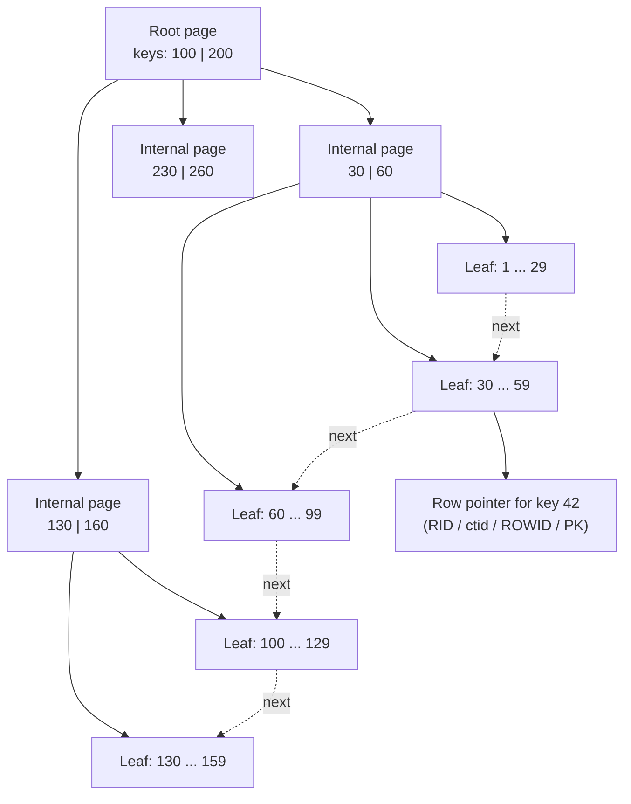
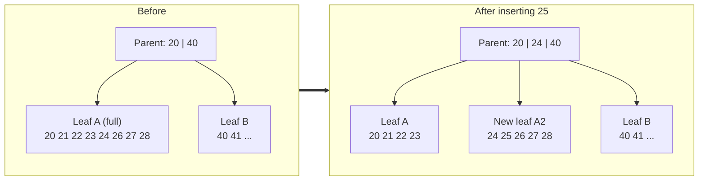
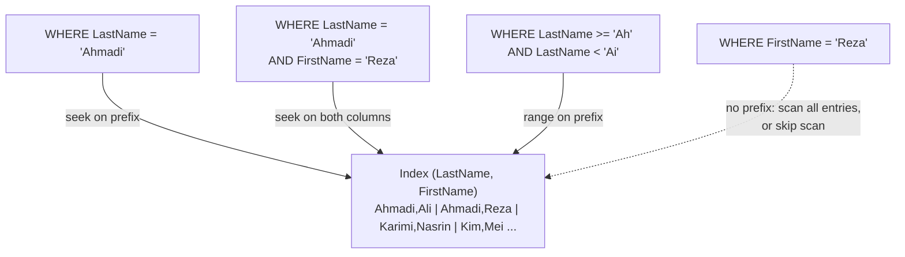
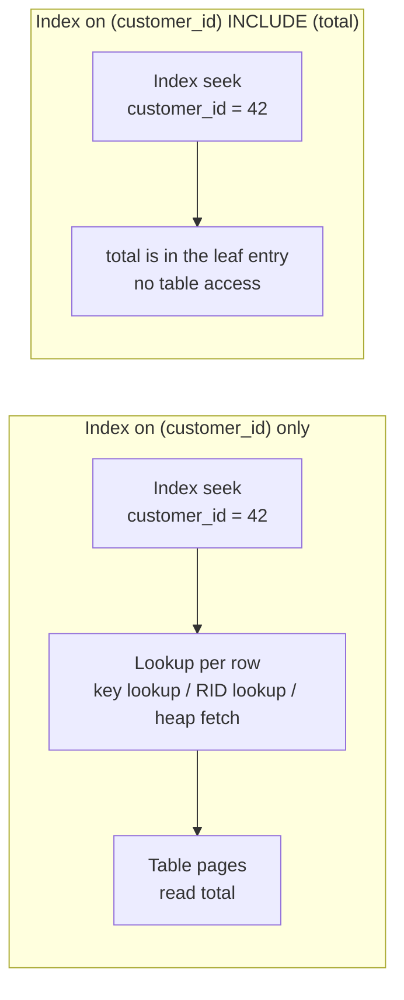
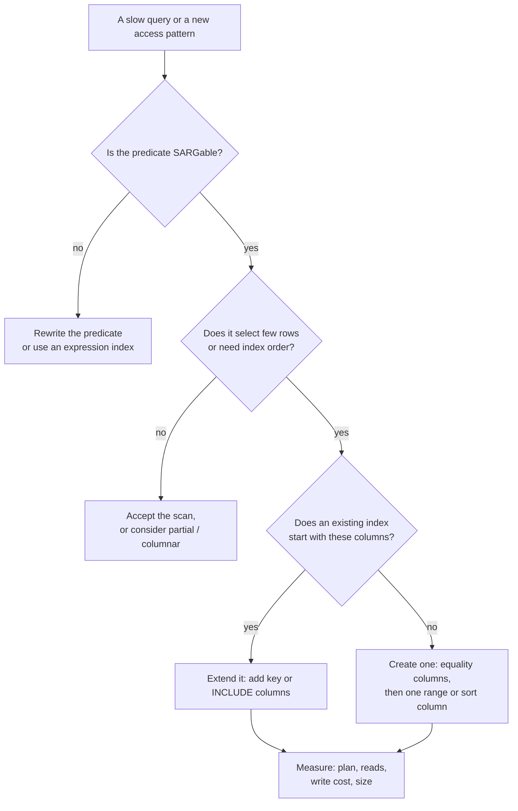
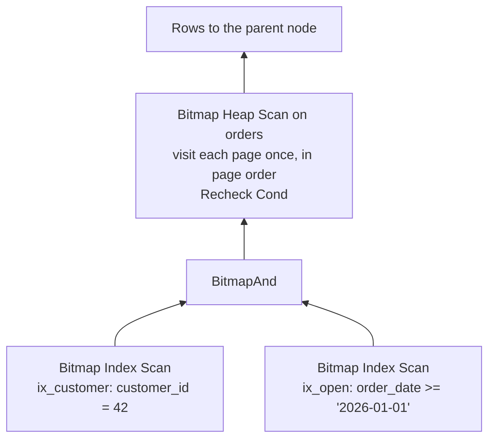
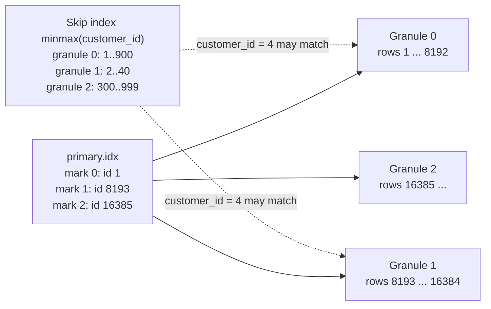

# 7. نمایه‌ها به‌تفصیل

<div dir="rtl" markdown="1">

> **سطح:** L3 ارشد (شروع از L1) | **بخش:** I | **نسخهٔ Rowlit:** 1.6.3 | [English](../../en/part1/07-indexes.md)
> **قبلی:** [6. ساختار درونی ذخیره‌سازی](06-storage-internals.md) | **بعدی:** [8. خط لولهٔ پرس‌وجو و بهینه‌ساز](08-query-processing.md)
>
> **در یک جمله:** نمایه (index) نسخهٔ دوم و مرتب‌شده‌ای از چند ستون است که به موتور اجازه می‌دهد به‌جای خواندن کل
> جدول، مستقیم سراغ سطرهایی برود که لازم دارد؛ و انتخاب، ترتیب‌دهی و نگه‌داری این نسخه‌ها مؤثرترین مهارت کارایی است
> که یک توسعه‌دهندهٔ پایگاه داده می‌تواند داشته باشد.
>
> **در این فصل یاد می‌گیرید:**
> - ساختار B+tree (صفحه‌های ریشه، داخلی و برگ، ضریب انشعاب، ارتفاع) چطور شکل می‌گیرد و چرا سه یا چهار خواندن صفحه
>   برای پیدا کردن هر سطری در میان میلیون‌ها سطر کافی است؛
> - درج‌ها چطور صفحه‌ها را می‌شکافند، چرا کلیدهای تصادفی آسیب می‌زنند، و ترتیب ستون‌ها در نمایهٔ ترکیبی چطور تعیین
>   می‌کند به کدام پرس‌وجوها پاسخ می‌دهد (قاعدهٔ پیشوند چپ)؛
> - نمایه‌های پوشا، `INCLUDE`، پویش‌های فقط‌نمایه، جست‌وجوهای کلید، نمایه‌های جزئی/فیلترشده و عبارتی، و نمایه‌های یکتا؛
> - گزینندگی، کاردینالیتی، آمار و هیستوگرام‌ها چطور انتخاب بهینه‌ساز را میان نمایه و پویش تعیین می‌کنند؛
> - چطور در هر موتور از روی طرح اجرا ببینید نمایه به کار رفته یا نه، چرا گاهی نمایه نادیده گرفته می‌شود، و کِی اصلاً
>   نباید نمایه ساخت؛
> - خانواده‌های دیگر نمایه: hash، bitmap، GiST، SP-GiST، GIN، BRIN، تمام‌متن، columnstore، نمایه‌های تُنُک و نمایه‌های
>   پرش در ClickHouse، ‏SAI در Cassandra، نمایه‌های ترکیبی MongoDB، و هرس (pruning) بدون نمایه در Snowflake.
>
> **پیش‌نیازها:** [6. ساختار درونی ذخیره‌سازی](06-storage-internals.md) (صفحه‌ها، هیپ‌ها، جدول‌های خوشه‌ای، استخر
> بافر). مفید: [3. SQL I](03-sql-basics.md)، [5. مدل‌سازی](05-modelling-and-normalisation.md) (کلیدها و قیدها).
>
> برچسب‌های نمودارها به انگلیسی نگه داشته شده‌اند تا در GitHub درست نمایش داده شوند.

## 1. ایده (مبتدی)

کتابی 900 صفحه‌ای را در نظر بگیرید که در انتهایش نمایه ندارد. برای پیدا کردن همهٔ صفحه‌هایی که از «deadlock» نام
برده‌اند باید هر 900 صفحه را بخوانید. با نمایه، «deadlock» را در فهرستی کوتاه و مرتب پیدا می‌کنید، می‌خوانید
«صفحه‌های 212، 388، 401» و فقط همان صفحه‌ها را باز می‌کنید. در پایگاه داده هم [نمایه (index)](../glossary.md#index)
همین است: ساختاری جدا و **مرتب** که مقدارهای یک یا چند ستون (*کلید*) را به جاهایی نگاشت می‌کند که سطرهای منطبق در
آن‌ها قرار دارند. آن‌وقت پرس‌وجویی مثل `SELECT * FROM orders WHERE customer_id = 42` به‌جای کل جدول فقط چند صفحه
می‌خواند.

نمایه رایگان نیست. فضا می‌گیرد، هر `INSERT`، `UPDATE` و `DELETE` باید آن را هم تغییر دهد، و فقط به پرس‌وجوهایی کمک
می‌کند که شرط‌هایشان با شیوهٔ مرتب‌شدن آن جور باشد. بقیهٔ این فصل دربارهٔ همین معامله است: نمایه‌ها از درون چطور کار
می‌کنند، بهینه‌ساز (optimizer) چطور تصمیم می‌گیرد از یکی استفاده کند (بر پایهٔ آماری که از داده‌هایتان دارد)، چطور طرح
اجرای (plan) پرس‌وجو را بخوانید تا ببینید واقعاً چه اتفاقی افتاده، و چطور آن چند نمایه‌ای را انتخاب کنید که هزینهٔ
خودشان را جبران می‌کنند.

## 2. سازوکار (کارشناس)

<a id="b-plus-tree-structure"></a>

### 2.1 B-tree و B+tree

تقریباً هر نمایهٔ «معمولی» در یک موتور رابطه‌ای یک [B+tree](../glossary.md#b-plus-tree) است، گونه‌ای از
[B-tree](../glossary.md#b-tree) (Bayer و McCreight، 1970). این ساختار درختی متوازن از صفحه‌هاست:

- [صفحه‌های برگ](../glossary.md#leaf-node) (گره‌های برگ، leaf node) همهٔ کلیدها را به ترتیب مرتب نگه می‌دارند، هر کدام
  با اشاره‌گری به سطرش (یک RID، `ctid`، ROWID یا کلید خوشه‌بندی؛ [فصل 6](06-storage-internals.md#heaps-and-clustered-tables))،
  یا در نمایهٔ خوشه‌ای، خود سطر را؛
- برگ‌ها به همسایه‌هایشان **پیوند** دارند، پس یک بازه (`BETWEEN`، `>`، `ORDER BY`) با حرکت به پهلو خوانده می‌شود؛
- [صفحه‌های داخلی](../glossary.md#internal-node) (گره‌های داخلی، internal node) در بالای آن‌ها فقط *کلیدهای جداکننده
  (separator key)* و اشاره‌گر به صفحه‌های فرزند را نگه می‌دارند: «کلیدهای کوچک‌تر از 40 در فرزند 1 هستند، کلیدهای 40
  تا 79 در فرزند 2 …»؛
- یک صفحهٔ ریشه (root) در بالا قرار دارد و **همهٔ برگ‌ها در یک عمق‌اند**، پس هر جست‌وجو به تعداد یکسانی خواندن صفحه
  نیاز دارد: [ارتفاع (height)](../glossary.md#index-height) درخت.

در B-tree کلاسیک، گره‌های داخلی هم اشاره‌گر سطر دارند، پس جست‌وجو ممکن است زودتر تمام شود. پایگاه‌های داده B+tree را
ترجیح می‌دهند، چون صفحه‌های داخلی‌ای که فقط جداکننده دارند مدخل‌های بیشتری جا می‌دهند، درخت کم‌عمق‌تر می‌شود و همهٔ
کلیدها برای پویش در سطح برگ کنار هم‌اند. (SQLite حالت مختلطی است: درخت‌های *جدول* آن B+tree هستند و درخت‌های *نمایه*
آن مثل B-tree کلاسیک کلیدها را در صفحه‌های داخلی هم نگه می‌دارند.)

**شکل 7.1 — یک B+tree سه‌سطحی روی `customer_id`. هر جست‌وجو از هر سطح یک صفحه می‌خواند؛ برگ‌ها برای پویش بازه‌ای به هم پیوند دارند.**

</div>



<div dir="rtl" markdown="1">

**ضریب انشعاب ارتفاع را تعیین می‌کند.** [ضریب انشعاب (fan-out)](../glossary.md#fan-out) تعداد فرزندانی است که یک
صفحهٔ داخلی می‌تواند به آن‌ها اشاره کند. با صفحه‌های 8 KB و کلیدهای کوچک (یک عدد صحیح 4 بایتی به‌علاوهٔ یک اشاره‌گر و
سرآیند کوچک مدخل، روی هم حدود 16–20 بایت) هر صفحهٔ داخلی چند صد مدخل جا می‌دهد. با ضریب انشعاب 400:

| سطح‌ها | صفحه‌های برگ در دسترس | کلیدها (حدود 300 در هر برگ) |
|---|---|---|
| 2 (ریشه + برگ‌ها) | 400 | 120,000 |
| 3 | 160,000 | 48 میلیون |
| 4 | 64 میلیون | 19 میلیارد |

پس جست‌وجو در جدولی با 50 میلیون سطر سه یا چهار صفحهٔ نمایه می‌خواند، و یکی دو سطح بالایی تقریباً همیشه در استخر
بافر (buffer pool) هستند. برای همین جست‌وجو با نمایه در نظریه «لگاریتمی» است و در عمل «چند خواندن صفحه از حافظهٔ
نهان».

عددهای واقعی (SQLite 3.51.3، صفحه‌های 4 KB؛ اندازه‌گیری‌شده با `dbstat` روی یک پایگاه دادهٔ آزمایشی): یک نمایهٔ
دوستونی روی یک میلیون سطر از `(a INTEGER, b INTEGER)` **3 سطح** دارد: یک صفحهٔ ریشه با 14 مدخل (15 فرزند)، 15 صفحهٔ
داخلی با حدود 241 مدخل در هر کدام، و 3,350 صفحهٔ برگ که هر کدام حدود 298 مدخل دارند. ضریب انشعاب حدود 240 از
صفحه‌های 4 KB می‌آید؛ با صفحه‌های 8 KB تقریباً دو برابر می‌شود.

</div>

```sql
-- SQLite: height and shape of an index (scratch database)
SELECT pagetype, count(*) AS pages FROM dbstat WHERE name = 'ix_big_ab' GROUP BY pagetype;
-- internal 16, leaf 3350
SELECT ncell FROM dbstat WHERE name = 'ix_big_ab' AND path = '/';   -- 14 (the root page)
```

<div dir="rtl" markdown="1">

### 2.2 جست‌وجو، پویش بازه‌ای و ترتیب

سه عمل تقریباً همهٔ کاربردهای نمایه را پوشش می‌دهند:

1. **جست‌وجو (seek، جست‌وجوی نقطه‌ای):** از ریشه پایین می‌رویم تا به تنها برگی برسیم که کلید در آن است. هزینه: به
   اندازهٔ ارتفاع خواندن صفحه، به‌علاوهٔ واکشی سطر.
2. **پویش بازه‌ای (range scan):** به نخستین کلید واجد شرط seek می‌کنیم، سپس در برگ‌های پیوندخورده جلو می‌رویم تا کلیدی
   بیرون از بازه بیفتد. هزینه: ارتفاع + تعداد صفحه‌های برگ در بازه، به‌علاوهٔ واکشی سطرها.
3. **پویش کامل نمایه (full index scan):** همهٔ برگ‌ها به ترتیب خوانده می‌شوند. وقتی نمایه خیلی باریک‌تر از جدول است،
   یا وقتی پرس‌وجو سطرها را به ترتیب نمایه لازم دارد (`ORDER BY`، `GROUP BY`، پیوند ادغامی (merge join))، از پویش
   جدول ارزان‌تر است.

چون برگ‌ها مرتب‌اند، نمایه **ترتیب را هم مجانی** تحویل می‌دهد. خروجی واقعی روی پایگاه دادهٔ نمونهٔ SQLite در Rowlit،
که نمایهٔ `CREATE INDEX IX_Orders_OrderDate ON Orders (OrderDate DESC)` را دارد (`SampleDatabase.cs:157`):

</div>

```sql
EXPLAIN QUERY PLAN
SELECT * FROM Orders WHERE OrderDate >= '2025-06-01' ORDER BY OrderDate DESC;
-- SEARCH Orders USING INDEX IX_Orders_OrderDate (OrderDate>?)
```

<div dir="rtl" markdown="1">

خطی با عنوان «USE TEMP B-TREE FOR ORDER BY» در کار نیست: سطرها از پیش مرتب از نمایه بیرون می‌آیند. مقایسه کنید با
ترتیبی که نمایه نمی‌تواند فراهم کند:

</div>

```sql
EXPLAIN QUERY PLAN SELECT * FROM Orders ORDER BY Total DESC LIMIT 10;
-- SCAN Orders
-- USE TEMP B-TREE FOR ORDER BY
```

<div dir="rtl" markdown="1">

همهٔ موتورها می‌توانند B-tree را از آخر به اول هم بخوانند (PostgreSQL در این حالت ‏`Index Scan Backward` نشان می‌دهد)،
پس `DESC` در تعریف نمایه فقط برای ترتیب‌های **مختلط** در نمایه‌های ترکیبی اهمیت دارد، مثل
`ORDER BY customer_id ASC, order_date DESC`.

<a id="page-splits"></a>

### 2.3 درج چطور صفحه را می‌شکافد

کلید تازه باید به همان برگی برود که در ترتیب مرتب به آن تعلق دارد. اگر آن برگ پر باشد، موتور
[شکافتن صفحه (page split)](../glossary.md#page-split) انجام می‌دهد: صفحهٔ تازه‌ای تخصیص می‌دهد، حدود نیمی از مدخل‌ها را
به آن منتقل می‌کند و جداکنندهٔ تازه‌ای در والد درج می‌کند. اگر والد هم پر باشد، آن هم شکافته می‌شود؛ وقتی ریشه شکافته
شود، درخت یک سطح بلندتر می‌شود. این **تنها** راهی است که B+tree بلندتر می‌شود، و به همین دلیل متوازن می‌ماند.

**شکل 7.2 — درج کلید 25 در برگی پر: برگ شکافته می‌شود و والد یک جداکنندهٔ تازه می‌گیرد.**

</div>



<div dir="rtl" markdown="1">

پیامدها:

- **شکافتن هزینهٔ نوشتن و حجم لاگ دارد**: سه صفحه یا بیشتر تغییر می‌کنند و در لاگ ثبت می‌شوند
  ([فصل 11](11-logging-and-recovery.md))، و در این فاصله نشست‌های دیگر پشت latchهای صفحه منتظر می‌مانند.
- **کلیدهای تصادفی صفحه‌ها را نیمه‌خالی می‌گذارند.** پس از شکافتن 50/50 هر دو صفحه نیمه‌پرند؛ با درج‌های تصادفی،
  B-tree در میانگین پرشدگی حدود 69% آرام می‌گیرد (ln 2، نتیجه‌ای کلاسیک از Yao). کلیدهای همیشه‌صعودی (identity،
  sequence، timestamp) همیشه در لبهٔ راست درج می‌شوند؛ موتورها این را تشخیص می‌دهند و راست‌ترین صفحه را نامتقارن
  می‌شکافند (PostgreSQL آن را تا ضریب پرشدگی پر می‌کند و بعد صفحهٔ تازه‌ای شروع می‌کند)، پس کلیدهای ترتیبی صفحه‌هایی
  تقریباً پر می‌سازند.
- **کلید خوشه‌بندی تصادفی مجموعهٔ کاری (working set) را پخش می‌کند.** وقتی UUID تصادفی (نسخهٔ 4) کلید خوشه‌ای باشد،
  هر درج یک برگ تصادفی را لمس می‌کند، پس برای پرهیز از خواندن دیسک کل نمایه باید در استخر بافر بماند. UUIDهای زمان‌مرتب
  (نسخهٔ 7) یا یک sequence این مشکل را ندارند.

اندازه‌گیری واقعی (SQLite، پایگاه دادهٔ آزمایشی، 200,000 عدد صحیح تصادفی که یکی‌یکی در یک ستون نمایه‌دار درج شدند):

| وضعیت نمایه | صفحه‌ها | بایت‌های استفاده‌شده در هر صفحه |
|---|---|---|
| پس از 200,000 درج تصادفی | 692 | 90.9% |
| پس از `REINDEX` (بازسازی به ترتیب مرتب) | 631 | 99.6% |

متوازن‌سازی SQLite مدخل‌ها را میان حداکثر سه صفحهٔ همسایه (sibling) پخش می‌کند، برای همین از آن 69% کتاب‌های درسی
پرتر می‌ماند؛ PostgreSQL، SQL Server و InnoDB نزدیک‌تر به 50/50 می‌شکافند و فاصلهٔ بیشتری نشان می‌دهند. باقی گذاشتن
فضای آزاد هنگام ساخت (ضریب پرشدگی، [فصل 6](06-storage-internals.md#free-space-and-fill-factor)) شکافتن را در
نمایه‌هایی که درج تصادفی می‌گیرند به تعویق می‌اندازد.

<a id="composite-index-column-order"></a>

### 2.4 نمایه‌های ترکیبی و قاعدهٔ پیشوند چپ

[نمایهٔ ترکیبی (composite index)](../glossary.md#composite-index) چند ستون کلید دارد و مثل دفترچهٔ تلفن مرتب می‌شود:
اول بر اساس ستون اول، بعد در میان مقدارهای برابرِ ستون اول بر اساس ستون دوم، و به همین ترتیب. نمایه‌ای روی
`(LastName, FirstName)` بر اساس نام خانوادگی مرتب است؛ درون «Ahmadi» نام‌های کوچک مرتب‌اند.

**شکل 7.3 — نمایهٔ ترکیبی روی (LastName, FirstName) چه کارهایی می‌تواند بکند. مسیرهای خط‌پر seek هستند؛ مسیر خط‌چین باید پویش کند.**

</div>



<div dir="rtl" markdown="1">

[قاعدهٔ پیشوند چپ (leftmost prefix)](../glossary.md#leftmost-prefix): نمایه را فقط روی دنباله‌ای از ستون‌های ابتدایی‌اش
می‌توان **جست‌وجو** کرد. خروجی واقعی از نمونهٔ SQLite در Rowlit، که نمایهٔ
`IX_Customers_LastName ON Customers (LastName, FirstName)` را دارد (`SampleDatabase.cs:155`):

</div>

```sql
EXPLAIN QUERY PLAN SELECT * FROM Customers WHERE LastName = 'Ahmadi';
-- SEARCH Customers USING INDEX IX_Customers_LastName (LastName=?)
EXPLAIN QUERY PLAN SELECT * FROM Customers WHERE LastName = 'Ahmadi' AND FirstName = 'Reza';
-- SEARCH Customers USING INDEX IX_Customers_LastName (LastName=? AND FirstName=?)
EXPLAIN QUERY PLAN SELECT * FROM Customers WHERE FirstName = 'Reza';
-- SCAN Customers
EXPLAIN QUERY PLAN SELECT LastName, FirstName FROM Customers WHERE FirstName = 'Reza';
-- SCAN Customers USING COVERING INDEX IX_Customers_LastName
```

<div dir="rtl" markdown="1">

پرس‌وجوی آخر نمی‌تواند روی `FirstName` ‏*seek* کند، اما نمایه هر دو ستون را دارد، پس پویش نمایهٔ باریک از پویش جدول
ارزان‌تر است: موتور نمایه را از اول تا آخر می‌خواند و فیلتر می‌کند.

**[پویش پرشی (skip scan)](../glossary.md#skip-scan).** اگر ستون اول مقدارهای متمایز کمی داشته باشد، موتور می‌تواند به ازای هر مقدار متمایز ستون
اول یک بار seek کند: «برای هر `a`، ‏`b = 500` را seek کن». Oracle (`INDEX SKIP SCAN`)، MySQL 8.0.13+ («Using index
for skip scan»)، SQLite (پس از `ANALYZE`) و PostgreSQL 18 این کار را می‌کنند؛ PostgreSQL 17 و SQL Server 2022 نه.
خروجی واقعی SQLite روی یک جدول آزمایشی با یک میلیون سطر که `a` در آن 10 مقدار متمایز دارد:

</div>

```sql
CREATE INDEX ix_big_ab ON big (a, b);
EXPLAIN QUERY PLAN SELECT a, b FROM big WHERE b = 500;
-- SCAN big                                                     (before ANALYZE: no statistics)
ANALYZE;     -- sqlite_stat1 row for ix_big_ab: '1000000 100000 1'
EXPLAIN QUERY PLAN SELECT a, b FROM big WHERE b = 500;
-- SEARCH big USING COVERING INDEX ix_big_ab (ANY(a) AND b=?)
```

<div dir="rtl" markdown="1">

نماد `ANY(a)` در SQLite نشانهٔ پویش پرشی است، و فقط وقتی ظاهر شد که آمار گفت هر مقدار `a` ‏100,000 بار تکرار می‌شود.

**ستون‌ها را به چه ترتیبی بچینیم.** قاعده‌هایی که در همهٔ موتورهای B-tree برقرارند:

1. اول ستون‌هایی که با **برابری** مقایسه می‌شوند، بعد **یک** ستون بازه یا مرتب‌سازی. در `(customer_id, order_date)`،
   پرس‌وجوی `WHERE customer_id = 42 AND order_date >= '2026-01-01' ORDER BY order_date` یک seek به‌علاوهٔ یک بازهٔ کوتاه
   و مرتب است. در `(order_date, customer_id)` همان پرس‌وجو باید همهٔ تاریخ‌ها از 2026 به بعد را پویش کند و روی
   `customer_id` فیلتر کند.
2. پس از یک شرط بازه‌ای، ستون‌های کلیدی بعدی همچنان می‌توانند درون نمایه **فیلتر** کنند (ارزان، بدون سر زدن به
   سطرها)، اما دیگر seek را تنگ‌تر نمی‌کنند.
3. ستونی را که بیشتر پرس‌وجوها در آن مشترک‌اند اول بگذارید؛ آن‌وقت نمایه به پرس‌وجوهایی که فقط همان ستون را دارند هم
   پاسخ می‌دهد و نمایهٔ تک‌ستونی جداگانه روی آن زائد می‌شود.
4. «گزیننده‌ترین ستون اول» قاعده‌ای ضعیف‌تر از 1 تا 3 است: وقتی روی همهٔ ستون‌ها فقط برابری داریم، ترتیب تقریباً اهمیتی
   ندارد، چون seek از همهٔ آن‌ها استفاده می‌کند.

در MongoDB قاعدهٔ 1 با نام [قاعدهٔ ESR](../glossary.md#esr-rule) شناخته می‌شود: Equality (برابری)، بعد Sort
(مرتب‌سازی)، بعد Range (بازه).

<a id="covering-indexes"></a>

### 2.5 نمایه‌های پوشا، INCLUDE و واکشی سطر

نمایه وقتی یک پرس‌وجو را **پوشش می‌دهد** ([نمایهٔ پوشا، covering index](../glossary.md#covering-index)) که هر ستونی که پرس‌وجو لازم دارد (در `SELECT`،
`WHERE`، `JOIN`، `ORDER BY`، `GROUP BY`) در نمایه باشد. در این صورت خود جدول اصلاً خوانده نمی‌شود. این مهم است، چون
مرحلهٔ بعد از seek، یعنی واکشی تک‌تک سطرها، معمولاً گران‌ترین بخش کار است: روی هیپ برای هر سطر یک خواندن صفحهٔ تصادفی،
و روی جدول خوشه‌ای برای هر سطر یک جست‌وجوی درخت دیگر.

**شکل 7.4 — همان seek، بدون نمایهٔ پوشا و با آن.**

</div>



<div dir="rtl" markdown="1">

هر موتور مرحلهٔ واکشی سطر (lookup) را به نام دیگری می‌خواند: [جست‌وجوی کلید (key lookup)](../glossary.md#key-lookup)
(SQL Server، جدول خوشه‌ای)، [جست‌وجوی RID (RID lookup)](../glossary.md#rid-lookup) (هیپ در SQL Server)،
`TABLE ACCESS BY INDEX ROWID` (Oracle)، «heap fetch» درون گرهٔ `Index Scan` (PostgreSQL)، و جست‌وجوی دوم با کلید
اصلی (InnoDB).

دو راه برای افزودن ستون به نمایه هست:

- **به‌عنوان ستون کلید:** `(customer_id, total)`. ستون‌های اضافه بخشی از ترتیب مرتب‌سازی‌اند، در صفحه‌های داخلی هم
  ظاهر می‌شوند، می‌توان روی آن‌ها جست‌وجو و مرتب‌سازی کرد، و در محدودیت‌های اندازهٔ کلید حساب می‌شوند.
- **به‌عنوان [ستون‌های افزوده (included columns)](../glossary.md#include-columns):** `(customer_id) INCLUDE (total)`.
  ستون‌های اضافه فقط در مدخل‌های برگ ذخیره می‌شوند. نمی‌توان روی آن‌ها جست‌وجو کرد، اما صفحه‌های داخلی را کوچک‌تر نگه
  می‌دارند و روی یکتایی اثری ندارند. SQL Server (از 2005) و PostgreSQL (از 11) از آن پشتیبانی می‌کنند. Oracle، MySQL
  و SQLite ‏`INCLUDE` ندارند؛ به‌جایش ستون‌ها را به انتهای کلید اضافه می‌کنید.

در seedهای Docker دقیقاً همین شکل به کار رفته است. در PostgreSQL:
`CREATE INDEX ix_orders_customer ON public.orders (customer_id) INCLUDE (total);` (`seed-postgres.sql:56`)؛ در SQL
Server: `CREATE NONCLUSTERED INDEX IX_Orders_CustomerId ON dbo.Orders (CustomerId) INCLUDE (Total);`
(`seed-mssql.sql:51`). در SQL Server کلید خوشه‌بندی `Id` به هر حال در هر برگ غیرخوشه‌ای هست، پس
`SELECT Id, Total FROM dbo.Orders WHERE CustomerId = 4` پوشش داده می‌شود، اما افزودن `OrderDate` به فهرست select برای
هر سطر یک key lookup را برمی‌گرداند.

روی جدول خوشه‌ای (InnoDB، یا SQL Server با نمایهٔ خوشه‌ای) هر نمایهٔ ثانویه به‌طور ضمنی ستون‌های کلید اصلی را هم
پوشش می‌دهد. برای همین در `shop` روی MySQL، نمایهٔ `ix_orders_customer (customer_id)` (`seed-mysql.sql:39`) پرس‌وجوی
`SELECT id FROM orders WHERE customer_id = 4` را پوشش می‌دهد: `EXPLAIN` در ستون `Extra` خود `Using index` را نشان
می‌دهد.

در SQLite مرحلهٔ واکشی سطر در bytecode دیده می‌شود. خروجی واقعی روی پایگاه دادهٔ نمونه، پیش و پس از ساختن یک نمایهٔ
پوشا:

</div>

```sql
EXPLAIN QUERY PLAN SELECT Id, Total FROM Orders WHERE CustomerId = 42;
-- SEARCH Orders USING INDEX IX_Orders_CustomerId (CustomerId=?)
CREATE INDEX IX_Orders_Customer_Total ON Orders (CustomerId, Total);
EXPLAIN QUERY PLAN SELECT Id, Total FROM Orders WHERE CustomerId = 42;
-- SEARCH Orders USING COVERING INDEX IX_Orders_Customer_Total (CustomerId=?)
```

<div dir="rtl" markdown="1">

در فهرست کامل `EXPLAIN` برای پرس‌وجوی اول، حلقه پیش از آنکه `Column` مقدار `Total` را از جدول بخواند، یک opcode
‏`DeferredSeek` روی cursor جدول دارد (رفتن به سطر در B-tree جدول)؛ نسخهٔ پوشا `Total` را از cursor نمایه می‌خواند و
`DeferredSeek` ندارد. [فصل 8](08-query-processing.md#sqlite-bytecode) هر دو فهرست را نشان می‌دهد.

<a id="index-only-scans"></a>

#### پویش‌های فقط‌نمایه و نقشهٔ مرئی‌بودن (PostgreSQL)

مدخل‌های نمایه در PostgreSQL هیچ اطلاعاتی دربارهٔ مرئی‌بودن ندارند (MVCC در سرآیند tuple هیپ است،
[فصل 10](10-concurrency-locking-mvcc.md)). پس [پویش فقط‌نمایه (index-only scan)](../glossary.md#index-only-scan) همچنان
باید بررسی کند که هر سطر برای snapshot فعلی مرئی است یا نه. این بررسی را ارزان و از راه
[نقشهٔ مرئی‌بودن (visibility map)](../glossary.md#visibility-map) انجام می‌دهد: اگر صفحهٔ هیپ *all-visible* علامت خورده
باشد، سطر مرئی است و به هیپ دست زده نمی‌شود؛ وگرنه PostgreSQL به صفحهٔ هیپ سر می‌زند. خروجی `EXPLAIN ANALYZE` این
سرزدن‌ها را با `Heap Fetches` می‌شمارد. این بیت‌ها را `VACUUM` تنظیم می‌کند، پس جدولی که تازه بارگذاری شده یا مدام
به‌روزرسانی می‌شود، تا وقتی vacuum نشده سود کمتری از پویش فقط‌نمایه می‌برد. SQL Server و InnoDB برای آخرین دادهٔ
commitشده این مشکل را ندارند، چون نمایه‌های ثانویه‌شان همراه با سطر درجا نگه‌داری می‌شوند؛ snapshot isolation در SQL
Server نسخه‌ها را به‌جای آن از version store می‌خواند.

#### مثال گام‌به‌گام: PostgreSQL پیش و پس از نمایه (آزمایشگاه)

پایگاه دادهٔ `shop` در Docker فقط شش سفارش دارد، و روی شش سطر PostgreSQL به‌درستی پویش ترتیبیِ یک صفحه را به هر
نمایه‌ای ترجیح می‌دهد. برای دیدن نمایه‌ها در عمل، یک schema آزمایشی با یک میلیون سفارش بسازید، مثال‌ها را اجرا کنید
و بعد آن را حذف کنید.

</div>

```sql
-- PostgreSQL 17, Docker shop database, scratch schema (drop it afterwards)
CREATE SCHEMA lab;
CREATE TABLE lab.orders AS
SELECT g AS id,
       1 + (g * 7919) % 100000 AS customer_id,              -- exactly 10 orders per customer
       timestamptz '2024-01-01' + (g % 730) * interval '1 day' AS order_date,
       round((random() * 500)::numeric, 2) AS total,
       (ARRAY['new','paid','shipped','delivered','cancelled'])[1 + g % 5] AS status
FROM generate_series(1, 1000000) AS g;
ALTER TABLE lab.orders ADD PRIMARY KEY (id);
ANALYZE lab.orders;
EXPLAIN (ANALYZE, BUFFERS) SELECT id, total FROM lab.orders WHERE customer_id = 42;
```

<div dir="rtl" markdown="1">

خروجی نمایشی (هنگام نوشتن این فصل آزمایشگاه Docker در حال اجرا نبود؛ هزینه‌ها و زمان‌ها برای PostgreSQL 17 معمول‌اند
و روی ماشین شما فرق خواهند کرد):

</div>

```text
Gather  (cost=1000.00..14542.43 rows=10 width=10) (actual time=0.412..38.917 rows=10 loops=1)
  Workers Planned: 2
  Workers Launched: 2
  Buffers: shared hit=8334
  ->  Parallel Seq Scan on orders  (cost=0.00..13542.43 rows=4 width=10) (actual time=12.106..33.014 rows=3 loops=3)
        Filter: (customer_id = 42)
        Rows Removed by Filter: 333330
        Buffers: shared hit=8334
Planning Time: 0.110 ms
Execution Time: 38.951 ms
```

<div dir="rtl" markdown="1">

از پایین به بالا بخوانیدش: سه پروسه (دو worker و leader، ‏`loops=3`) هر کدام یک‌سوم از 8,334 صفحه را پویش کردند و
333,330 سطر را دور ریختند تا 10 سطر پیدا شود. حالا همان شکل نمایهٔ seed را اضافه کنید:

</div>

```sql
CREATE INDEX ix_lab_orders_customer ON lab.orders (customer_id) INCLUDE (total);
EXPLAIN (ANALYZE, BUFFERS) SELECT id, total FROM lab.orders WHERE customer_id = 42;
```

```text
Bitmap Heap Scan on orders  (cost=4.50..44.27 rows=10 width=10) (actual time=0.041..0.067 rows=10 loops=1)
  Recheck Cond: (customer_id = 42)
  Heap Blocks: exact=10
  Buffers: shared hit=13
  ->  Bitmap Index Scan on ix_lab_orders_customer  (cost=0.00..4.50 rows=10 width=0) (actual time=0.030..0.030 rows=10 loops=1)
        Index Cond: (customer_id = 42)
        Buffers: shared hit=3
Execution Time: 0.089 ms
```

<div dir="rtl" markdown="1">

حالا 13 صفحه به‌جای 8,334: ‏3 صفحهٔ نمایه (ریشه، داخلی، برگ) و 10 صفحهٔ هیپ، چون `id` در نمایه نیست و ده سطر روی ده
صفحهٔ متفاوت قرار دارند. (پویش بیت‌نگاشتی هیپ (bitmap heap scan) پیش از سر زدن به هیپ، اشاره‌گرهای سطر را بر اساس صفحه
مرتب می‌کند؛ بخش 3 آن را توضیح می‌دهد.) فقط ستون‌های نمایه‌شده را انتخاب کنید تا هیپ از طرح اجرا حذف شود:

</div>

```sql
EXPLAIN (ANALYZE, BUFFERS) SELECT customer_id, total FROM lab.orders WHERE customer_id = 42;
```

```text
Index Only Scan using ix_lab_orders_customer on orders  (cost=0.42..4.60 rows=10 width=9) (actual time=0.022..0.025 rows=10 loops=1)
  Index Cond: (customer_id = 42)
  Heap Fetches: 10
  Buffers: shared hit=13
```

<div dir="rtl" markdown="1">

مقدار `Heap Fetches: 10` یعنی جدول تازه ساخته شده و هرگز vacuum نشده، پس نقشهٔ مرئی‌بودن خالی است و هر سطر هنوز به
سرزدن به هیپ نیاز دارد. دستور `VACUUM lab.orders;` را اجرا و پرس‌وجو را تکرار کنید: `Heap Fetches: 0` و
`Buffers: shared hit=3`. در پایان `DROP SCHEMA lab CASCADE;` را اجرا کنید.

<a id="partial-and-expression-indexes"></a>

### 2.6 نمایه‌های جزئی، فیلترشده و عبارتی

[نمایهٔ جزئی (partial index)](../glossary.md#partial-index) (در SQL Server:
[نمایهٔ فیلترشده (filtered index)](../glossary.md#filtered-index)) فقط سطرهایی را نمایه می‌کند که در یک بند `WHERE`
صدق کنند. کوچک‌تر است، نگه‌داری‌اش ارزان‌تر است و آمارش فقط همان سطرها را توصیف می‌کند. در seed ‏PostgreSQL یکی از
این نمایه‌ها هست: `CREATE INDEX ix_orders_open ON public.orders (order_date) WHERE status <> 'cancelled';`
(`seed-postgres.sql:57`). بهینه‌ساز فقط وقتی اجازه دارد از آن استفاده کند که بتواند **اثبات کند** `WHERE` پرس‌وجو
گزارهٔ نمایه را نتیجه می‌دهد (implies). خروجی واقعی SQLite روی نمونه (یک کپی آزمایشی):

</div>

```sql
CREATE INDEX IX_Orders_Open ON Orders (OrderDate) WHERE Status <> 'cancelled';
EXPLAIN QUERY PLAN SELECT Id, OrderDate FROM Orders
WHERE Status <> 'cancelled' AND OrderDate >= '2025-06-01';
-- SEARCH Orders USING INDEX IX_Orders_Open (OrderDate>?)
EXPLAIN QUERY PLAN SELECT Id, OrderDate FROM Orders WHERE OrderDate >= '2025-06-01';
-- SEARCH Orders USING COVERING INDEX IX_Orders_OrderDate (OrderDate>?)
```

<div dir="rtl" markdown="1">

پرس‌وجوی دوم از `Status` نامی نمی‌برد، پس نمایهٔ جزئی ممکن است سطرهایی را از قلم بیندازد؛ موتور به‌جایش از نمایهٔ کامل
`IX_Orders_OrderDate` استفاده می‌کند. کاربردهای معمول: سطرهای «باز» یا «پردازش‌نشده» در یک جدول صف، کنار گذاشتن
سطرهای soft-deleted (`WHERE deleted_at IS NULL`)، و قید یکتایی که فقط روی سطرهای فعال اعمال می‌شود
(`CREATE UNIQUE INDEX … ON users (email) WHERE active`).

یادداشت‌های هر موتور:

- **PostgreSQL، SQLite:** پشتیبانی کامل؛ اثبات نتیجه‌گیری ساده است (پرس‌وجو باید خود گزاره را داشته باشد یا چیزی
  آشکارا قوی‌تر، مثل `x = 5` برای نمایه‌ای با `WHERE x > 0` در PostgreSQL).
- **نمایه‌های فیلترشدهٔ SQL Server:** فقط گزاره‌های ساده (بدون `OR` میان ستون‌های مختلف، بدون تابع)؛ به برخی
  گزینه‌های `SET` نیاز دارند (`ANSI_NULLS`، `QUOTED_IDENTIFIER` … روی ON)؛ و پرس‌وجوی **پارامتری** مثل
  `WHERE Status = @s` نمی‌تواند از نمایهٔ فیلترشده روی `Status = 'new'` استفاده کند، چون طرح نهان‌شده باید برای هر
  مقدار `@s` معتبر باشد. با `OPTION (RECOMPILE)` یا یک مقدار literal کار درست می‌شود.
- **Oracle:** روی جدول‌های معمولی نمایهٔ جزئی ندارد. از این واقعیت استفاده کنید که B-tree مدخل‌هایی را که همهٔ
  ستون‌های کلیدشان NULL است ذخیره نمی‌کند:
  `CREATE INDEX ix_open ON orders (CASE WHEN status <> 'cancelled' THEN order_date END);` فقط سفارش‌های باز را نمایه
  می‌کند، و پرس‌وجوها باید همان عبارت `CASE` را به کار ببرند. (`INDEXING PARTIAL` در Oracle به پارتیشن‌ها مربوط است.)
- **MySQL، MariaDB:** نمایهٔ جزئی ندارند.

[نمایهٔ عبارتی (expression index)](../glossary.md#expression-index) (در Oracle: نمایهٔ تابع‌محور (function-based
index)؛ در MySQL 8.0.13+: ‏functional key part) نتیجهٔ یک عبارت را نمایه می‌کند. گزاره‌ای روی تابعی از یک ستون
نمی‌تواند از نمایهٔ سادهٔ آن ستون استفاده کند، چون نمایه بر اساس خود ستون مرتب شده، نه بر اساس نتیجهٔ تابع. خروجی
واقعی SQLite:

</div>

```sql
EXPLAIN QUERY PLAN SELECT * FROM Customers WHERE lower(LastName) = 'ahmadi';
-- SCAN Customers
CREATE INDEX IX_Customers_LowerLast ON Customers (lower(LastName));
EXPLAIN QUERY PLAN SELECT * FROM Customers WHERE lower(LastName) = 'ahmadi';
-- SEARCH Customers USING INDEX IX_Customers_LowerLast (<expr>=?)
```

<div dir="rtl" markdown="1">

| موتور | نحو | یادداشت |
|---|---|---|
| PostgreSQL | `CREATE INDEX ON customers (lower(name));` | تابع باید `IMMUTABLE` باشد؛ پرس‌وجو باید دقیقاً همان عبارت را به کار ببرد |
| SQL Server | نمایه روی یک ستون محاسباتی: `ALTER TABLE t ADD name_lower AS LOWER(Name); CREATE INDEX … (name_lower);` | بهینه‌ساز خود عبارت را هم با ستون محاسباتی تطبیق می‌دهد؛ فقط تابع‌های قطعی (deterministic) |
| Oracle | `CREATE INDEX ix ON customers (LOWER(name));` | پس از ساخت، آمار جمع‌آوری کنید؛ زیر آن یک ستون مجازی پنهان هست |
| MySQL 8.0.13+ | `CREATE INDEX ix ON customers ((lower(name)));` | به پرانتزهای دوتایی دقت کنید |
| MariaDB 11 | نمایهٔ تابعی ندارد؛ یک ستون تولیدشدهٔ `VIRTUAL` / `PERSISTENT` را نمایه کنید | |
| SQLite 3.9+ | `CREATE INDEX ix ON Customers (lower(LastName));` | فقط تابع‌های قطعی |

نمایه‌های عبارتی راه‌حل تمیز برای جست‌وجوی غیرحساس به بزرگی و کوچکی حروف، بریدن تاریخ (`date_trunc('day', created)`)
و فیلدهای JSON هم هستند (`(meta->>'tier')` در PostgreSQL، ستون‌های محاسباتی `JSON_VALUE` در SQL Server).

### 2.7 نمایه‌ها و قیدهای یکتا

[نمایهٔ یکتا (unique index)](../glossary.md#unique-index) مدخل دوم با همان کلید را نمی‌پذیرد. قیدهای `PRIMARY KEY` و
`UNIQUE` ([فصل 5](05-modelling-and-normalisation.md)) با یک نمایهٔ یکتا اعمال می‌شوند که خودکار ساخته می‌شود (SQLite
نام آن را `sqlite_autoindex_<table>_<n>` می‌گذارد؛ در نمونه، قید `UQ_Customers_Email` نمایهٔ
`sqlite_autoindex_Customers_1` را ساخته است و خروجی واقعی `WHERE Email = …` چنین است:
`SEARCH Customers USING INDEX sqlite_autoindex_Customers_1 (Email=?)`). یکتایی به بهینه‌ساز هم کمک می‌کند: برابری روی کلید یکتا حداکثر
یک سطر برمی‌گرداند، پس طرح اجرا می‌تواند پس از نخستین تطابق متوقف شود (PostgreSQL، SQL Server و Oracle از این برای
حذف پیوند (join elimination) و تخمین‌های بهتر استفاده می‌کنند).

رفتار با NULL در موتورها فرق دارد، و هنگام مهاجرت دردسر می‌سازد:

| موتور | چند NULL در یک ستون یکتا؟ |
|---|---|
| PostgreSQL | بله، به‌طور پیش‌فرض؛ `UNIQUE NULLS NOT DISTINCT` (15+) فقط یکی را مجاز می‌کند |
| SQL Server | **نه**: نمایهٔ یکتا فقط یک NULL را مجاز می‌کند؛ برای «یکتا در صورت وجود مقدار» از نمایهٔ یکتای فیلترشده با `WHERE col IS NOT NULL` استفاده کنید |
| Oracle | بله برای کلیدهای تک‌ستونی (کلیدهای تماماً NULL ذخیره نمی‌شوند)؛ در کلیدهای ترکیبی که برخی ستون‌هایشان NULL است، بقیهٔ ستون‌ها باید یکتا باشند |
| MySQL / MariaDB، SQLite | بله |

### 2.8 گزینندگی، کاردینالیتی و آمار

<a id="statistics-and-histograms"></a>

بهینه‌ساز میان «seek در نمایه و واکشی سطرها» و «پویش جدول» با **تخمین تعداد سطرهای منطبق** انتخاب می‌کند.

- [گزینندگی (selectivity)](../glossary.md#selectivity) کسری از سطرهاست که یک گزاره نگه می‌دارد: `customer_id = 42` روی
  جدولی که هر مشتری 10 سفارش از 1,000,000 دارد، گزینندگی 0.00001 دارد؛ `status <> 'cancelled'` ‏0.8 را نگه می‌دارد.
  «بسیار گزیننده» یعنی کسری *کوچک*.
- [کاردینالیتی (cardinality)](../glossary.md#cardinality-statistics) در زبان بهینه‌ساز یا به تعداد مقدارهای متمایز یک
  ستون (`n_distinct`) گفته می‌شود یا به تعداد تخمینی سطرهایی که یک عملگر برمی‌گرداند. (معنای آن در مدل‌سازی داده،
  یعنی «یک به چند»، مفهوم دیگری است؛ [فصل 2](02-relational-model.md) را ببینید.)
- [چگالی (density)](../glossary.md#density) (اصطلاح SQL Server) برابر 1 / تعداد مقدارهای متمایز است: میانگین
  گزینندگی یک برابری.

این عددها از کجا می‌آیند؟ از [آمار (statistics)](../glossary.md#statistics) که با `ANALYZE` (PostgreSQL، SQLite، و
`ANALYZE TABLE` در MySQL)، `UPDATE STATISTICS` / آمار خودکار (SQL Server) یا `DBMS_STATS` (Oracle) جمع‌آوری می‌شود:
تعداد سطرها و صفحه‌ها، نسبت NULLها، تعداد مقدارهای متمایز، پرتکرارترین مقدارها با فراوانی‌شان، و یک
[هیستوگرام (histogram)](../glossary.md#histogram) برای بقیهٔ مقدارها.

**آمار واقعی را بخوانید: `sqlite_stat1` در SQLite.** روی پایگاه دادهٔ نمونهٔ Rowlit (خروجی واقعی):

| tbl | idx | stat |
|---|---|---|
| Orders | IX_Orders_CustomerId | `1500 6` |
| Orders | IX_Orders_OrderDate | `1500 3` |
| Customers | IX_Customers_LastName | `300 8 2` |
| OrderLines | sqlite_autoindex_OrderLines_1 | `4523 4 1` |

عدد اول تعداد سطرهاست؛ بعد، برای هر پیشوند ابتدایی نمایه، میانگین تعداد سطر به ازای هر مقدار متمایز. مقدار `1500 6`
می‌گوید برابری روی `CustomerId` به‌طور میانگین حدود 6 سطر برمی‌گرداند (1,500 سفارش / 296 مشتری متمایز ≈ 5.1، که SQLite
آن را به بالا گرد می‌کند). مقدار `300 8 2` می‌گوید هر نام خانوادگی با حدود 8 مشتری منطبق است و هر جفت (نام خانوادگی،
نام) با حدود 2. مقدار `4523 4 1` می‌گوید هر سفارش حدود 4 سطر دارد و `(OrderId, LineNo)` یکتاست.

**وقتی داده چوله (skewed) است، میانگین‌ها دروغ می‌گویند.** پایگاه دادهٔ نمونه عمداً توزیع چوله‌ای از مشتری‌ها می‌سازد
(`SampleDatabase.cs:329`): مشتری 1 ‏37 سفارش دارد و مشتری 2 ‏22 سفارش، در حالی که میانگین حدود 5 است. تخمین 6 سطر برای
بیشتر مشتری‌ها درست است و برای مشتری 1 با ضریب 6 اشتباه. برای همین موتورهای بزرگ چیزی بیش از میانگین نگه می‌دارند:

- **[پرتکرارترین مقدارها (most common values، MCV)](../glossary.md#most-common-values)** با فراوانی‌شان: `pg_stats.most_common_vals` / `most_common_freqs`
  در PostgreSQL؛ هیستوگرام‌های frequency و top-frequency در Oracle. برابری روی یک مقدار پرتکرار از فراوانی دقیق همان
  مقدار استفاده می‌کند.
- **هیستوگرام‌ها** برای بقیه: مقدارهای مرتب‌شده به سطل‌هایی (bucket) بریده می‌شوند. PostgreSQL از هیستوگرام
  *هم‌عمق (equi-depth)* استفاده می‌کند (`histogram_bounds`: هر سطل تعداد سطر یکسانی دارد؛
  `default_statistics_target = 100` تا 100 سطل و 100 MCV می‌دهد)؛ SQL Server حداکثر 200 گام (step) نگه می‌دارد که هر
  کدام `RANGE_HI_KEY`، `EQ_ROWS`، `RANGE_ROWS`، `DISTINCT_RANGE_ROWS` و `AVG_RANGE_ROWS` دارند
  (`DBCC SHOW_STATISTICS`)؛ Oracle هیستوگرام‌های frequency، top-frequency، height-balanced (قدیمی) و hybrid با حداکثر
  2,048 سطل دارد؛ MySQL 8 هیستوگرام‌های singleton و equi-height دارد که بنا به درخواست ساخته می‌شوند
  (`ANALYZE TABLE t UPDATE HISTOGRAM ON col WITH 64 BUCKETS`) و از آن‌ها برای ستون‌های بدون نمایه استفاده می‌کند؛ SQLite
  فقط وقتی با `SQLITE_ENABLE_STAT4` کامپایل شده باشد، سطرهای نمونه را در `sqlite_stat4` نگه می‌دارد.
- **همبستگی (correlation)**: `pg_stats.correlation` در PostgreSQL (از −1 تا 1) نشان می‌دهد ترتیب فیزیکی سطرها چقدر از
  ترتیب ستون پیروی می‌کند. نزدیک ±1، پویش بازه‌ای نمایه صفحه‌های مجاور هیپ را می‌خواند (ارزان)؛ نزدیک 0، هر سطر یک
  صفحهٔ تصادفی است. معادل آن در Oracle، برای هر نمایه، [ضریب خوشه‌بندی (clustering factor)](../glossary.md#clustering-factor)
  است (`USER_INDEXES.CLUSTERING_FACTOR`): نزدیک به تعداد بلوک‌های جدول خوب است و نزدیک به تعداد سطرها بد.

</div>

```sql
-- PostgreSQL 17: what the planner knows about a column
SELECT null_frac, n_distinct, most_common_vals, most_common_freqs, correlation
FROM pg_stats WHERE schemaname = 'public' AND tablename = 'orders' AND attname = 'status';
```

<div dir="rtl" markdown="1">

روی seed شش‌سطری، `n_distinct` را نزدیک به تعداد وضعیت‌های موجود و فهرست MCV را شامل همهٔ مقدارها خواهید دید
(نمایشی: seed هر شش سفارش را با مقدار پیش‌فرض `'new'` درج می‌کند، پس `most_common_vals = {new}` و
`most_common_freqs = {1}`).

</div>

```sql
-- SQL Server 2022: the histogram behind IX_Orders_CustomerId
DBCC SHOW_STATISTICS ('dbo.Orders', 'IX_Orders_CustomerId') WITH HISTOGRAM;
```

<div dir="rtl" markdown="1">

**ترکیب گزاره‌ها.** برای `WHERE a = 1 AND b = 2` فرض کلاسیک *استقلال* است: گزینندگی(a) × گزینندگی(b). برای ستون‌های
همبسته (شهر و کشور، مدل و سازنده) این فرض تعداد سطرها را بسیار کمتر از واقع تخمین می‌زند. راه‌حل‌ها: آمار گسترش‌یافته
(extended statistics) در PostgreSQL (`CREATE STATISTICS s (dependencies, ndistinct, mcv) ON city, country FROM customers;`)،
تخمین‌گر کاردینالیتی جدیدتر SQL Server (2014+) که به‌جای ضرب خالص از *exponential backoff* استفاده می‌کند، و آمار
چندستونی (SQL Server آن را برای نمایه‌های ترکیبی می‌سازد؛ در Oracle گروه‌های ستون با
`DBMS_STATS.CREATE_EXTENDED_STATS`).

**آمار کهنه (stale)** رایج‌ترین دلیل نادیده گرفته شدن یک نمایهٔ خوب یا ظاهر شدن طرحی بد پس از یک بارگذاری بزرگ است.
موتورها آمار را خودکار اما با تأخیر تازه می‌کنند: autovacuum در PostgreSQL جدول را وقتی analyze می‌کند که
`autovacuum_analyze_threshold` (50) + `autovacuum_analyze_scale_factor` (0.1) × تعداد سطرها تغییر کرده باشد؛ SQL Server
(سطح سازگاری 130+) پس از حدود MIN(500 + 20% of rows, √(1000 × rows)) تغییر؛ پنجرهٔ نگه‌داری Oracle آمارهای کهنه را
جمع‌آوری می‌کند (به‌طور پیش‌فرض با بیش از 10% تغییر)؛ InnoDB آمار ماندگار (persistent) را پس از تغییر حدود 10% سطرها
دوباره محاسبه می‌کند. پس از بارگذاری انبوه، خودتان `ANALYZE` را اجرا کنید.

<a id="reading-a-plan-for-index-use"></a>

### 2.9 خواندن طرح اجرا برای دیدن استفاده از نمایه

[فصل 8](08-query-processing.md) طرح‌های اجرا را به‌طور کلی آموزش می‌دهد؛ اینجا واژگان مخصوص نمایه را کنار هم می‌بینید.

| چه اتفاقی افتاد | PostgreSQL | SQL Server | Oracle | MySQL / MariaDB | SQLite |
|---|---|---|---|---|---|
| خواندن کل جدول | `Seq Scan` | `Table Scan` (هیپ) / `Clustered Index Scan` | `TABLE ACCESS FULL` | `type: ALL` | `SCAN t` |
| seek / بازه در نمایه | `Index Scan` با `Index Cond` | `Index Seek` با `Seek Predicates` | `INDEX UNIQUE SCAN` / `INDEX RANGE SCAN` | `type: const / eq_ref / ref / range` | `SEARCH t USING INDEX i (…)` |
| خواندن کل نمایه | `Index Scan` بدون `Index Cond`، `Index Only Scan` | `Index Scan` | `INDEX FULL SCAN` / `INDEX FAST FULL SCAN` | `type: index` | `SCAN t USING INDEX i` |
| پوشش‌داده‌شده، بدون دسترسی به جدول | `Index Only Scan` (+ `Heap Fetches`) | seek/scan بدون عملگر lookup | هیچ خط `TABLE ACCESS` زیر نمایه نیست | `Extra: Using index` | `USING COVERING INDEX` |
| واکشی سطر پس از نمایه | درون `Index Scan`؛ `Bitmap Heap Scan` | `Key Lookup` / `RID Lookup` + `Nested Loops` | `TABLE ACCESS BY INDEX ROWID [BATCHED]` | ضمنی (lookup با PK) | ضمنی (`DeferredSeek` در bytecode) |
| شرطی که پس از خواندن اعمال می‌شود | `Filter:` + `Rows Removed by Filter` | `Predicate` (در برابر `Seek Predicates`) | `filter(…)` (در برابر `access(…)`) | `Extra: Using where` | در EQP نشان داده نمی‌شود |
| شرطی که پیش از واکشی سطر، درون نمایه بررسی می‌شود | (index qualها روی ستون‌های غیرابتدایی) | `Predicate` روی عملگر نمایه | `filter` روی خط نمایه | `Extra: Using index condition` ([فروراندن شرط به نمایه، index condition pushdown](../glossary.md#index-condition-pushdown)) | — |
| ترکیب چند نمایه | `BitmapAnd` / `BitmapOr` | index intersection (نادر) | `BITMAP AND` / `BITMAP CONVERSION` | `type: index_merge` | `MULTI-INDEX OR` |
| نیاز به مرتب‌سازی | `Sort` (+ `Sort Method`) | `Sort` | `SORT ORDER BY` | `Extra: Using filesort` | `USE TEMP B-TREE FOR ORDER BY` |

مهم‌ترین تمایز، تمایز **[گزارهٔ جست‌وجو (seek predicate)](../glossary.md#seek-predicate) با
[گزارهٔ باقی‌مانده (residual predicate)](../glossary.md#residual-predicate)** است. گزارهٔ جست‌وجو تعیین می‌کند *کدام
بخش از نمایه خوانده شود*. گزارهٔ باقی‌مانده *پس از* خواندن یک سطر یا مدخل بررسی می‌شود و فقط سطرها را دور می‌ریزد.
خروجی واقعی SQLite: جدول `Orders` در نمونه روی `CustomerId` نمایه دارد اما روی `Status` نه:

</div>

```sql
EXPLAIN QUERY PLAN SELECT * FROM Orders WHERE CustomerId = 42 AND Status = 'new';
-- SEARCH Orders USING INDEX IX_Orders_CustomerId (CustomerId=?)
```

<div dir="rtl" markdown="1">

در پرانتز فقط `CustomerId=?` آمده است: همین seek است. شرط `Status = 'new'` روی هر سطر واکشی‌شده بررسی می‌شود. در SQL
Server همین شکل به صورت `Seek Predicates: CustomerId = 42` روی `Index Seek` و `Predicate: Status = 'new'` روی
`Key Lookup` دیده می‌شود؛ در Oracle به صورت `access("CUSTOMER_ID"=42)` و `filter("STATUS"='new')`.

خروجی نمایشی Oracle برای نمایهٔ سادهٔ seed، یعنی `IX_ORDERS_CUSTOMER (CUSTOMER_ID)` (`seed-oracle.sql:50`):

</div>

```sql
EXPLAIN PLAN FOR SELECT id, total FROM orders WHERE customer_id = 4;
SELECT * FROM TABLE(DBMS_XPLAN.DISPLAY);
```

```text
------------------------------------------------------------------------------------------
| Id  | Operation                           | Name               | Rows | Bytes | Cost (%CPU)|
------------------------------------------------------------------------------------------
|   0 | SELECT STATEMENT                    |                    |    2 |    52 |     2   (0)|
|   1 |  TABLE ACCESS BY INDEX ROWID BATCHED| ORDERS             |    2 |    52 |     2   (0)|
|*  2 |   INDEX RANGE SCAN                  | IX_ORDERS_CUSTOMER |    2 |       |     1   (0)|
------------------------------------------------------------------------------------------
Predicate Information (identified by operation id):
---------------------------------------------------
   2 - access("CUSTOMER_ID"=4)
```

<div dir="rtl" markdown="1">

خروجی نمایشی MySQL 8.4 روی seed:

</div>

```sql
EXPLAIN SELECT id, total FROM orders WHERE customer_id = 4;
```

<div dir="rtl" markdown="1">

| id | select_type | table | type | possible_keys | key | key_len | ref | rows | filtered | Extra |
|---|---|---|---|---|---|---|---|---|---|---|
| 1 | SIMPLE | orders | ref | ix_orders_customer | ix_orders_customer | 4 | const | 2 | 100.00 | NULL |

مقدار `type = ref` یعنی seek برابری روی نمایهٔ غیریکتا؛ `key_len = 4` می‌گوید هر 4 بایت کلید `INT` استفاده شده است
(در نمایهٔ ترکیبی، `key_len` نشان می‌دهد seek از چند ستون ابتدایی استفاده می‌کند)؛ و `rows` تخمین است. فهرست select را
به `id` تنها تغییر دهید تا `Extra` به `Using index` تبدیل شود.

### 2.10 وقتی نمایه استفاده نمی‌شود

اگر طرح اجرا جایی پویش نشان می‌دهد که انتظار seek داشتید، این علت‌ها را به همین ترتیب بررسی کنید. همهٔ مثال‌های زیر
خروجی واقعی SQLite روی پایگاه دادهٔ نمونه‌اند، مگر آنکه خلافش ذکر شده باشد.

1. **تابع یا محاسبهٔ حسابی روی ستون نمایه‌شده.** شرط `WHERE CustomerId + 0 = 42` به `SCAN Orders` می‌رسد. گزاره را طوری
   بازنویسی کنید که ستون تنها بماند (`WHERE created >= '2026-03-01' AND created < '2026-03-02'` به‌جای
   `WHERE date(created) = '2026-03-01'`)، یا یک نمایهٔ عبارتی بسازید. گزاره‌ای را که موتور می‌تواند با آن seek کند
   [SARGable](../glossary.md#sargable) می‌نامند ([فصل 13](13-performance-tuning.md)).
2. **تبدیل نوع روی ستون.** شرط `WHERE CAST(CustomerId AS TEXT) = '42'` به `SCAN Orders` می‌رسد. همین اتفاق به‌طور ضمنی
   هم می‌افتد: در SQL Server مقایسهٔ یک ستون `VARCHAR` با پارامتر `NVARCHAR` ستون را تبدیل می‌کند (هشدار
   `CONVERT_IMPLICIT` در طرح اجرا)؛ در MySQL مقایسهٔ ستون رشته‌ای با یک عدد، تک‌تک سطرها را تبدیل می‌کند. نوع پارامترها
   را با نوع ستون‌ها یکی کنید.
3. **قاعده‌های collation یا بزرگی و کوچکی حروف که با نمایه فرق دارد.** شرط `WHERE LastName LIKE 'Ah%'` به
   `SCAN Customers` می‌رسد، در حالی که `WHERE LastName >= 'Ah' AND LastName < 'Ai'` به
   `SEARCH … (LastName>? AND LastName<?)` می‌رسد. در SQLite ‏`LIKE` به‌طور پیش‌فرض به بزرگی و کوچکی حروف حساس نیست،
   اما نمایه با collation حساس به حروف `BINARY` مرتب شده، پس نمی‌توان از آن استفاده کرد؛ نمایه‌ای که با
   `COLLATE NOCASE` تعریف شده باشد (یا `PRAGMA case_sensitive_like = ON`) استفاده از آن را ممکن می‌کند. PostgreSQL هم
   همین تله را دارد: در collationای غیر از C، ‏`LIKE 'abc%'` به نمایه‌ای نیاز دارد که با `text_pattern_ops` ساخته شده
   باشد.
4. **نویسهٔ عام (wildcard) در ابتدای الگو.** الگوی `LIKE '%son'` هرگز نمی‌تواند در B-tree ‏seek کند؛ از نمایهٔ trigram
   (`pg_trgm` با GIN در PostgreSQL) یا جست‌وجوی تمام‌متن (بخش 3) استفاده کنید.
5. **نبودن ستون ابتدایی** نمایهٔ ترکیبی در گزاره (بخش 2.4)، و نبودن skip scan.
6. **`OR` میان ستون‌های مختلف.** موتورها این را با ترکیب نمایه‌ها (`MULTI-INDEX OR` در SQLite، `BitmapOr` در
   PostgreSQL، `index_merge` در MySQL) یا با پویش اداره می‌کنند؛ گاهی بازنویسی با `UNION ALL` کمک می‌کند. خروجی واقعی
   SQLite:

</div>

   ```sql
   EXPLAIN QUERY PLAN SELECT * FROM Orders WHERE CustomerId = 42 OR OrderDate = '2025-01-01';
   -- MULTI-INDEX OR
   --   INDEX 1
   --     SEARCH Orders USING INDEX IX_Orders_CustomerId (CustomerId=?)
   --   INDEX 2
   --     SEARCH Orders USING INDEX IX_Orders_OrderDate (OrderDate=?)
   ```

<div dir="rtl" markdown="1">

7. **گزینندگی پایین.** شرط `Status = 'cancelled'` با 228 سفارش از 1,500 سفارش نمونه (15%) منطبق است: بدون نمایه روی
   `Status` طرح اجرا `SCAN Orders` است، و حتی با نمایه، واکشی یکی‌یکی 15% سطرها گران‌تر از خواندن 21 صفحه تمام می‌شد.
   اینجا بهینه‌ساز درست عمل می‌کند، نه اشتباه.
8. **جدول خیلی کوچک.** پویش یکی دو صفحه از seek ارزان‌تر است: seedهای شش‌سطری Docker همه‌جا پویش می‌کنند.
9. **آمار کهنه یا ناموجود** (بخش 2.8)، یا **طرح پارامتری** که برای مقدار دیگری کامپایل شده است
   ([parameter sniffing](08-query-processing.md#parameter-sniffing)، «بو کشیدن پارامتر»).
10. **`IS NULL` در Oracle** روی B-tree تک‌ستونی: کلیدهای NULL ذخیره نمی‌شوند، پس `WHERE col IS NULL` نمی‌تواند از آن
    استفاده کند (به‌جایش نمایهٔ `(col, 0)` را بسازید که همهٔ سطرها را ذخیره می‌کند).

### 2.11 هزینهٔ نمایه، و وقتی نباید نمایه ساخت

هر نمایه هم مالیات نوشتن است و هم مالیات حافظه:

- **تقویت نوشتن (write amplification).** هر `INSERT` در جدولی با پنج نمایه، شش ساختار را می‌نویسد. هر `UPDATE` روی یک
  ستون نمایه‌شده یک مدخل نمایه را حذف و یکی را درج می‌کند. در PostgreSQL به‌روزرسانی‌ای که نتواند HOT باشد، به **همهٔ**
  نمایه‌ها یک مدخل تازه اضافه می‌کند ([فصل 6](06-storage-internals.md#rows-that-grow)). هر تغییر در لاگ هم ثبت می‌شود.
- **فضا و حافظهٔ نهان.** نمایه‌ها با صفحه‌های جدول بر سر استخر بافر رقابت می‌کنند. در بسیاری از سیستم‌های OLTP
  نمایه‌ها از خود جدول‌ها بزرگ‌ترند.
- **قفل‌گذاری و رقابت (contention).** بررسی‌های یکتایی، شکافتن صفحه‌ها و صفحه‌های داغ لبهٔ راست (نشست‌های زیادی که
  کلیدهای صعودی درج می‌کنند) نویسنده‌ها را پشت سر هم صف می‌کنند. SQL Server 2019+ گزینهٔ `OPTIMIZE_FOR_SEQUENTIAL_KEY`
  را دارد؛ Oracle نمایه‌های کلید معکوس ([reverse key index](../glossary.md#reverse-key-index)) را ارائه می‌کند، به
  بهای از دست دادن پویش بازه‌ای.
- **ریسک طرح اجرا.** هر نمایهٔ اضافه گزینهٔ دیگری است که بهینه‌ساز ممکن است اشتباه ارزیابی‌اش کند.

نمایه اضافه نکنید وقتی: جدول کوچک است؛ ستون مقدارهای متمایز کمی دارد و در نمایهٔ جزئی یا برای پویش پوشا به کار
نمی‌رود؛ گزاره هیچ‌وقت SARGable نیست؛ جدول پرنوشتن است و پرس‌وجو روزی یک بار اجرا می‌شود (پویشش کنید)؛ یک نمایهٔ
ترکیبی موجود از قبل با همان ستون‌ها شروع می‌شود (نمایه روی `(a)` در کنار `(a, b)` زائد است، مگر از نظر اندازه و
یکتایی).

**همیشه نمایه بسازید برای:** کلیدهای اصلی و قیدهای یکتا (خودکار)؛ **ستون‌های کلید خارجی** که روی آن‌ها پیوند (join)
می‌زنید یا از طریق آن‌ها والدها را حذف می‌کنید (PostgreSQL، SQL Server و Oracle این‌ها را خودکار *نمی‌سازند*؛ MySQL
InnoDB می‌سازد). بدون چنین نمایه‌ای، هر `DELETE` یک مشتری `orders` را پویش می‌کند تا کلید خارجی را بررسی کند، و در
Oracle ممکن است کل جدول فرزند را هم قفل کند.

نمایه‌های بلااستفاده و نمایه‌های گم‌شده را با شمارنده‌های خود موتور پیدا کنید:

</div>

```sql
-- PostgreSQL: indexes never scanned since statistics were reset
SELECT schemaname, relname, indexrelname, idx_scan, pg_size_pretty(pg_relation_size(indexrelid)) AS size
FROM pg_stat_user_indexes WHERE idx_scan = 0 ORDER BY pg_relation_size(indexrelid) DESC;
```

```sql
-- SQL Server: reads vs writes per index since the last restart
SELECT OBJECT_NAME(s.object_id) AS table_name, i.name, s.user_seeks, s.user_scans, s.user_lookups, s.user_updates
FROM sys.dm_db_index_usage_stats AS s
JOIN sys.indexes AS i ON i.object_id = s.object_id AND i.index_id = s.index_id
WHERE s.database_id = DB_ID() ORDER BY s.user_updates DESC;
-- Missing-index suggestions: sys.dm_db_missing_index_details (treat them as hints, not orders)
```

<div dir="rtl" markdown="1">

همچنین: `DBA_INDEX_USAGE` در Oracle (12.2+) و نمایه‌های نامرئی (`ALTER INDEX … INVISIBLE`) برای آزمودن بی‌خطر حذف یک
نمایه؛ `sys.schema_unused_indexes` و نمایه‌های نامرئی در MySQL (`ALTER TABLE … ALTER INDEX … INVISIBLE`، 8.0+)؛ و
نمایه‌های `IGNORED` در MariaDB (10.6+).

**شکل 7.5 — مسیر تصمیم کوتاهی برای یک نمایهٔ پیشنهادی.**

</div>



<div dir="rtl" markdown="1">

### 2.12 چندپارگی، آماس و نگه‌داری

نمایه با گذشت زمان از دو راه شکلش را از دست می‌دهد:

- **چندپارگی درونی / [آماس (bloat)](../glossary.md#index-bloat):** صفحه‌ها خالی‌تر از حد ممکن‌اند (پس از شکافتن‌ها و
  حذف‌ها)، پس نمایه بزرگ‌تر از نیاز است و پویش‌ها صفحه‌های بیشتری می‌خوانند. در PostgreSQL مدخل‌های حذف‌شده یا
  به‌روزشده تا وقتی VACUUM پاکشان نکند در نمایه می‌مانند؛ PostgreSQL 13+ کلیدهای برابر را deduplicate می‌کند و 14+
  پیش از شکافتن، مدخل‌های منسوخ را به روش «bottom-up» حذف می‌کند، که آماس را بسیار کم می‌کند.
- **[چندپارگی (fragmentation)](../glossary.md#fragmentation) منطقی:** برگ بعدی در ترتیب کلید، صفحهٔ بعدی در فایل
  نیست، پس پویش‌های بازه‌ای روی دیسک‌های چرخان به ورودی/خروجی تصادفی تبدیل می‌شوند. روی SSD این خیلی کمتر اهمیت دارد.

اندازه‌گیری و رفع ([بازسازی / سازمان‌دهی مجدد](../glossary.md#index-rebuild)):

| موتور | اندازه‌گیری | رفع به‌صورت آنلاین | رفع به‌صورت آفلاین |
|---|---|---|---|
| PostgreSQL | `pgstattuple`/`pgstatindex` (افزونه)، پرس‌وجوهای تخمین آماس | `REINDEX INDEX CONCURRENTLY ix` (12+)، `pg_repack` (ابزار بیرونی) | `REINDEX`، `VACUUM FULL` (جدول و نمایه‌هایش، با قفل انحصاری) |
| SQL Server | `sys.dm_db_index_physical_stats` (`avg_fragmentation_in_percent`، `avg_page_space_used_in_percent`) | `ALTER INDEX … REORGANIZE` (همیشه آنلاین)، `REBUILD WITH (ONLINE = ON, RESUMABLE = ON)` (Enterprise) | `ALTER INDEX … REBUILD` |
| Oracle | `INDEX_STATS` پس از `ANALYZE INDEX … VALIDATE STRUCTURE` | `ALTER INDEX … REBUILD ONLINE`، `ALTER INDEX … COALESCE` / `SHRINK SPACE` | `ALTER INDEX … REBUILD` |
| MySQL / MariaDB | `INFORMATION_SCHEMA.INNODB_TABLESPACES`، `data_free` | `OPTIMIZE TABLE` (بازسازی آنلاین برای InnoDB) | `ALTER TABLE … FORCE` |
| SQLite | `dbstat`، `sqlite3_analyzer` | — | `REINDEX`، `VACUUM` |

راهنمای کلاسیک SQL Server («سازمان‌دهی مجدد (reorganize) در 5–30% چندپارگی، بازسازی (rebuild) بالای 30%») از دوران
دیسک سخت آمده است؛ روی SSD، چگالی صفحه (فضای استفاده‌شده) از ترتیب مهم‌تر است، و بسیاری از تیم‌ها فقط پس از حذف‌های
بزرگ یا برای تغییر ضریب پرشدگی بازسازی می‌کنند. در SQL Server بازسازی، آمار نمایه را هم با پویش کامل تازه می‌کند؛
سازمان‌دهی مجدد این کار را نمی‌کند.

ساختن نمایه روی سیستم زنده: `CREATE INDEX CONCURRENTLY` در PostgreSQL (بدون قفل نوشتن، با دو پویش جدول، و بیرون از
تراکنش؛ ساختِ ناموفق یک نمایهٔ `INVALID` باقی می‌گذارد که باید drop شود)، `WITH (ONLINE = ON)` در SQL Server (ویرایش
Enterprise)، `ONLINE` در Oracle، و DDL آنلاین در MySQL/InnoDB (`ALGORITHM=INPLACE, LOCK=NONE`).

## 3. نگاه عمیق (ارشد)

> **نگاه عمیق (L3): نمایه‌های هش.**
> [نمایهٔ هش (hash index)](../glossary.md#hash-index) مدخل‌ها را در سطل‌هایی نگه می‌دارد که با هش کلید انتخاب می‌شوند.
> فقط به برابری پاسخ می‌دهد، ترتیبی ندارد (نه بازه، نه `ORDER BY`، نه پیشوند) و اندازه‌اش به طول کلید بستگی ندارد.
> PostgreSQL ‏`USING hash` را دارد (از نسخهٔ 10 در برابر crash ایمن است؛ گاهی برای کلیدهای متنی بلند از B-tree
> کوچک‌تر است)؛ موتور `MEMORY` در MySQL از نمایهٔ هش استفاده می‌کند، و InnoDB خودش روی صفحه‌های داغ B-tree یک
> *adaptive hash index* داخلی می‌سازد؛ SQL Server نمایهٔ هش را فقط برای جدول‌های memory-optimized دارد
> (`BUCKET_COUNT`)؛ Oracle به‌جای آن hash *cluster* دارد. پیوندهای هش (hash join)
> ([فصل 8](08-query-processing.md#hash-join)) جدول‌های هش موقت می‌سازند؛ آن موضوع دیگری است.

> **نگاه عمیق (L3): نمایه‌های بیت‌نگاشت و پویش‌های بیت‌نگاشتی.**
> [نمایهٔ بیت‌نگاشت (bitmap index)](../glossary.md#bitmap-index) در Oracle برای هر مقدار متمایز یک رشتهٔ بیتی فشرده
> نگه می‌دارد که برای هر سطر یک بیت دارد. شرط `status = 'new' AND country = 'IR'` به AND بیتیِ دو bitmap تبدیل
> می‌شود، که برای ستون‌های کم‌کاردینالیتی در انبار داده (data warehouse) فوق‌العاده سریع است. اما هر مدخل bitmap
> سطرهای زیادی را پوشش می‌دهد، پس به‌روزرسانی یک سطر همهٔ آن‌ها را قفل می‌کند: نمایه‌های بیت‌نگاشت برای جدول‌های OLTP
> با نوشتن‌های هم‌زمان انتخاب نادرستی‌اند. PostgreSQL نمایهٔ بیت‌نگاشت ذخیره‌شده ندارد، اما bitmapها را **در زمان
> اجرا** می‌سازد: `Bitmap Index Scan` اشاره‌گرهای سطرهای منطبق را در یک bitmap درون‌حافظه‌ای که بر اساس صفحه مرتب است
> جمع می‌کند، `BitmapAnd`/`BitmapOr` چند تا از آن‌ها را ترکیب می‌کنند، و
> [پویش بیت‌نگاشتی هیپ (bitmap heap scan)](../glossary.md#bitmap-heap-scan) به هر صفحهٔ هیپ یک بار و به ترتیب فایل
> سر می‌زند. اگر bitmap از `work_mem` بزرگ‌تر شود *lossy* می‌شود (به‌جای یک بیت برای هر سطر، یک بیت برای هر صفحه)، و
> برای همین طرح اجرا `Recheck Cond` و `Heap Blocks: exact=… lossy=…` را نشان می‌دهد.

**شکل 7.6 — پویش بیت‌نگاشتی PostgreSQL که دو نمایه را ترکیب می‌کند.**

</div>



<div dir="rtl" markdown="1">

> **نگاه عمیق (L3): روش‌های دسترسی دیگر PostgreSQL.**
> نمایه‌های PostgreSQL *روش‌های دسترسی (access method)* افزودنی (pluggable) هستند (`pg_am`)، و هر کدام
> *کلاس‌های عملگر (operator class)* دارد که مشخص می‌کنند از کدام عملگرها پشتیبانی می‌کند.
> - نمایهٔ [GiST](../glossary.md#gist) (generalized search tree، درخت جست‌وجوی تعمیم‌یافته): درختی متوازن از
>   گزاره‌های دربرگیرنده («هرچه زیر این گره است درون این جعبه / بازه است»). برای هندسه (PostGIS)، نوع‌های بازه‌ای
>   (هم‌پوشانی با `&&`)، تمام‌متن، مرتب‌سازی بر اساس نزدیک‌ترین همسایه (`ORDER BY pos <-> point(1,2)`) و قیدهای
>   exclusion (`EXCLUDE USING gist (room WITH =, during WITH &&)` برای «هیچ دو رزروی هم‌پوشانی نداشته باشند») به کار
>   می‌رود.
> - نمایهٔ [SP-GiST](../glossary.md#sp-gist) (space-partitioned GiST، ‏GiST با افراز فضا): درخت‌های افرازی نامتوازن
>   (quadtree، k-d tree، radix trie) برای داده‌ای که به‌طور طبیعی تقسیم می‌شود: نقطه‌ها، بازه‌های IP (`inet`)، پیشوندهای
>   متن.
> - نمایهٔ [GIN](../glossary.md#gin) (generalized inverted index، نمایهٔ معکوس تعمیم‌یافته): برای هر *عنصر* (عضو آرایه،
>   کلید/مقدار JSON، واژه، trigram) یک مدخل که به همهٔ سطرهای شامل آن اشاره می‌کند. برای `tags @> ARRAY['vip']`،
>   `meta @> '{"tier":"gold"}'` (`jsonb_ops`، یا `jsonb_path_ops` کوچک‌تر که فقط `@>` را پشتیبانی می‌کند)، تمام‌متن
>   `@@` و `LIKE '%son%'` با `pg_trgm` ایدئال است. نوشتن در آن گران است، پس GIN مدخل‌های تازه را در یک *pending list*
>   (`fastupdate`) بافر می‌کند و بعداً ادغام می‌کند. روی seed، `CREATE INDEX ON extra_types USING gin (meta);` به
>   `WHERE meta ? 'tier'` پاسخ می‌دهد (همان عملگری که README هشدار می‌دهد placeholder نیست).
> - نمایهٔ [BRIN](../glossary.md#brin) (block range index، نمایهٔ بازهٔ بلوک): برای هر بازهٔ 128 صفحه‌ای از هیپ
>   (`pages_per_range`) یک خلاصهٔ بسیار کوچک (به‌طور پیش‌فرض min/max). یک BRIN روی ستون `created_at` در جدولی
>   فقط‌افزودنی (append-only) با یک میلیارد سطر می‌تواند فقط چند صد KB باشد و باز هم بیشتر جدول را کنار بگذارد، به شرط
>   آنکه ترتیب فیزیکی از ستون پیروی کند (همبستگی بالا). این همان [نقشهٔ ناحیه (zone map)](../glossary.md#zone-map) برای
>   PostgreSQL است.
> - افزونه‌ها انواع بیشتری اضافه می‌کنند: `bloom` (یک امضای [فیلتر بلوم (Bloom filter)](../glossary.md#bloom-filter)
>   برای هر سطر، برای برابری روی ستون‌های زیاد)، `pgvector` (نمایه‌های HNSW و IVFFlat برای شباهت برداری)،
>   `btree_gin`/`btree_gist` (عملگرهای B-tree درون GIN/GiST برای نمایه‌های مختلط).

> **نگاه عمیق (L3): نمایه‌های تمام‌متن و نمایه‌های معکوس.**
> [نمایهٔ تمام‌متن (full-text index)](../glossary.md#full-text-index) یک
> [نمایهٔ معکوس (inverted index)](../glossary.md#inverted-index) است: متن با یک تحلیل‌گر (analyzer) به توکن‌ها شکسته
> می‌شود (کوچک‌کردن حروف، ریشه‌یابی (stemming)، واژه‌های ایست (stop words))، و هر توکن به فهرست سطرهایی (و
> موقعیت‌هایی) نگاشت می‌شود که آن را دارند. PostgreSQL مقدارهای `tsvector` را ذخیره و با GIN نمایه می‌کند
> (`to_tsvector('english', body) @@ to_tsquery('index & scan')`)؛ SQL Server کاتالوگ‌های full-text با
> `CONTAINS`/`FREETEXT` دارد؛ InnoDB در MySQL نمایه‌های `FULLTEXT` با `MATCH … AGAINST` دارد (seed ‏MySQL نمایهٔ
> `FULLTEXT KEY ft_products_name (name, description)` را دارد، `seed-mysql.sql:49`)؛ Oracle Text نمایه‌های `CONTEXT`
> با `CONTAINS` دارد؛ SQLite از جدول مجازی FTS5 استفاده می‌کند. متن فارسی همه‌جا مراقبت می‌خواهد: parserهای پیش‌فرض
> روی فاصله می‌شکنند اما روی نیم‌فاصله (zero-width non-joiner) نه، و شکل‌های عربی و فارسی «ی» و «ک» را یکسان نمی‌کنند؛
> متن را پیش از نمایه‌سازی نرمال کنید. Elasticsearch سراسر بر پایهٔ نمایه‌های معکوس Lucene ساخته شده است
> ([فصل 16](16-nosql-families.md)).

> **نگاه عمیق (L3): نمایه‌های columnstore.**
> نمایهٔ [ستون‌انبار (columnstore)](../glossary.md#columnstore) در SQL Server جدول را ستون به ستون در *row group*هایی
> با حداکثر 1,048,576 سطر ذخیره می‌کند؛ هر ستونِ یک row group یک *segment* فشرده با فرادادهٔ min/max است، پس پرس‌وجو
> segmentهایی را که بازه‌شان نمی‌تواند منطبق باشد کنار می‌گذارد (*segment elimination*) و سطرها را در دسته‌های حدوداً
> 900 تایی پردازش می‌کند (*batch mode*، [فصل 8](08-query-processing.md#vectorised-execution)). سطرهای تازه در یک
> *delta store* سطرمحور می‌نشینند که یک tuple mover در پس‌زمینه بعداً فشرده‌اش می‌کند. یک columnstore خوشه‌ای خودِ
> جدول است (مناسب جدول‌های fact)؛ یک columnstore غیرخوشه‌ای روی جدول سطرمحور، تحلیل روی دادهٔ OLTP را ممکن می‌کند
> (HTAP). معادل Oracle ‏In-Memory column store است؛ MySQL HeatWave و MariaDB ColumnStore موتورهای جداگانه‌ای‌اند.
> [فصل 15](15-oltp-vs-olap-columnar.md) خود ذخیره‌سازی ستونی را پوشش می‌دهد.

<a id="clickhouse-sparse-primary-index"></a>

> **نگاه عمیق (L3): نمایهٔ اصلی تُنُک و نمایه‌های پرش در ClickHouse.**
> جدول MergeTree درون هر پارت (part) بر اساس کلید `ORDER BY` خود مرتب است. نمایهٔ اصلی یک
> [نمایهٔ تُنُک (sparse index)](../glossary.md#sparse-index) است: برای هر *گرانول (granule)* از `index_granularity` سطر
> (به‌طور پیش‌فرض 8,192) یک مدخل («mark»)، نه برای هر سطر. پرس‌وجویی با شرط روی پیشوند کلید، روی markها جست‌وجوی
> دودویی می‌کند و فقط گرانول‌هایی را می‌خواند که ممکن است منطبق باشند؛ بقیهٔ کار یک پویش برداری سریع درون همان
> گرانول‌هاست. کلید اصلی لازم نیست یکتا باشد و ترتیب آن همه‌چیز را تعیین می‌کند: در seed ‏`shop`، جدول `orders` با
> `ORDER BY (id)` تعریف شده (`seed-clickhouse.sql:54`)، پس `WHERE id = 3` فقط یک گرانول را لمس می‌کند، در حالی که
> `WHERE customer_id = 4` نمی‌تواند از نمایهٔ اصلی استفاده کند. برای این مورد، seed یک
> [نمایهٔ پرش (skip index)](../glossary.md#skip-index) داده اضافه می‌کند:
> `INDEX ix_orders_customer customer_id TYPE minmax GRANULARITY 1` (`seed-clickhouse.sql:49`)، که min و max
> ‏`customer_id` را برای هر بلوک از گرانول‌ها نگه می‌دارد و بلوک‌هایی را که بازه‌شان 4 را شامل نمی‌شود کنار می‌گذارد.
> نوع‌های دیگر نمایهٔ پرش: `set(N)` (مقدارهای متمایز، تا N مقدار)، `bloom_filter`، `tokenbf_v1` و `ngrambf_v1`
> (فیلترهای بلوم روی توکن‌ها یا n-gramها برای جست‌وجوی متن). نمایه‌های پرش فقط وقتی کمک می‌کنند که مقدارهای منطبق در
> گرانول‌های کمی جمع شده باشند؛ روی مقدارهایی که تصادفی پخش شده‌اند هزینهٔ خواندن دارند بی‌آنکه چیزی را کنار بگذارند.
> *Projection*ها (یک نسخهٔ پنهان و دوباره‌مرتب‌شده از جدول) پاسخ ClickHouse به «ترتیب مرتب‌سازی دوم» هستند.

**شکل 7.7 — ClickHouse: نمایهٔ اصلی تُنُک به گرانول‌ها اشاره می‌کند، نه به سطرها.**

</div>



<div dir="rtl" markdown="1">

خروجی نمایشی ClickHouse 24.8 روی seed (شش سفارش آن در سه پارتیشن ماهانه، یعنی سه پارت، قرار دارند):

</div>

```sql
EXPLAIN indexes = 1 SELECT id, total FROM shop.orders WHERE customer_id = 4;
```

```text
Expression ((Project names + Projection))
  Expression
    ReadFromMergeTree (shop.orders)
    Indexes:
      MinMax
        Condition: true
        Parts: 3/3
        Granules: 3/3
      Partition
        Condition: true
        Parts: 3/3
        Granules: 3/3
      PrimaryKey
        Condition: true
        Parts: 3/3
        Granules: 3/3
      Skip
        Name: ix_orders_customer
        Description: minmax GRANULARITY 1
        Parts: 1/3
        Granules: 1/3
```

<div dir="rtl" markdown="1">

فقط پارت ماه مارس مشتری 4 را دارد (سفارش‌های 5 و 6)، پس نمایهٔ پرش minmax پارت‌های ژانویه و فوریه را کنار می‌گذارد.

> **نگاه عمیق (L3): نمایه‌های ثانویهٔ Cassandra، ‏SAI و جدول‌های مخصوص پرس‌وجو.**
> در Cassandra سطرها با کلید پارتیشن (partition key) پیدا می‌شوند (که با هش به نودها نگاشت می‌شود) و با ستون‌های
> خوشه‌بندی (clustering column) (که درون پارتیشن مرتب‌اند). پرس‌وجو روی هر ستون دیگری باید از همهٔ نودها بپرسد. پاسخ
> سنتی **غیرنرمال‌سازی (denormalisation)** است: برای هر پرس‌وجو یک جدول، مثل `orders_by_customer` در seed با
> `PRIMARY KEY ((customer_id), order_date, order_id)` و `CLUSTERING ORDER BY (order_date DESC, …)`
> (`seed-cassandra.cql:80-87`). جایگزین‌های داخلی: نسخهٔ قدیمی [نمایه‌های ثانویه (secondary index)](../glossary.md#secondary-index)
> (محلی برای هر نود، پس پرس‌وجو به همهٔ نودها پخش می‌شود؛ فقط همراه با کلید پارتیشن مناسب است)، SASI (آزمایشی،
> منسوخ‌شده) و از Cassandra 5.0، ‏**SAI** ([storage-attached index](../glossary.md#sai))، که به هر SSTable و memtable
> پیوست است، برابری و بازه را پشتیبانی می‌کند و بسیار ارزان‌تر است: seed از
> `CREATE INDEX customers_email_idx ON shop.customers (email) USING 'sai'` استفاده می‌کند (`seed-cassandra.cql:56`).
> نماهای مادی‌شده (materialized view؛ `orders_by_status` در seed) را خود سرور نگه‌داری می‌کند، اما آزمایشی‌اند و در
> Cassandra 4 و 5 به‌طور پیش‌فرض غیرفعال‌اند. بدون نمایه، CQL فیلتر روی ستون غیرکلیدی را رد می‌کند مگر اینکه
> `ALLOW FILTERING` اضافه کنید، که یعنی «همه‌چیز را پویش کن، هزینه‌اش را می‌پذیرم».

> **نگاه عمیق (L3): نمایه‌های MongoDB.**
> نمایه‌های MongoDB (WiredTiger) درخت‌های B-tree روی فیلدهای سند هستند: تک‌فیلدی، ترکیبی (compound؛ از قاعدهٔ ESR
> پیروی کنید)، multikey (خودکار، وقتی فیلدی آرایه نگه می‌دارد: برای هر عنصر یک مدخل)، text، ‏`2dsphere` (جغرافیایی)،
> hashed (برای sharding هش‌شده)، wildcard (`$**`، برای نام فیلدهای پیش‌بینی‌ناپذیر)، TTL (منقضی کردن سندها پس از
> مدتی)، partial (`partialFilterExpression`)، sparse و unique. خروجی `explain("executionStats")` مرحله‌ها را نشان
> می‌دهد: `IXSCAN` (نمایه)، `FETCH` (بارگذاری سند: یک lookup)، `COLLSCAN` (پویش کامل)، `SORT` (مرتب‌سازی درون حافظه،
> محدود به 100 MB مگر اینکه بتواند سرریز (spill) کند)، و عددهای تعیین‌کنندهٔ `totalKeysExamined`، `totalDocsExamined`
> و `nReturned`. پرس‌وجوی پوشش‌داده‌شده `totalDocsExamined: 0` را نشان می‌دهد.

> **نگاه عمیق (L3): Snowflake و DuckDB.**
> جدول‌های استاندارد Snowflake **هیچ نمایه‌ای** ندارند که بتوانید بسازید. هر ریزپارتیشن (micro-partition) برای هر ستون
> فرادادهٔ min/max و تعداد مقدارهای متمایز دارد، و بهینه‌ساز پارتیشن‌هایی را که بازه‌شان نمی‌تواند منطبق باشد هرس
> می‌کند؛ یک *clustering key* (`ALTER TABLE orders CLUSTER BY (order_date)`) همراه با Automatic Clustering مقدارهای
> مشابه را کنار هم نگه می‌دارد تا هرس کار کند. سرویس *Search Optimization Service* (ویرایش Enterprise) برای هر جدول
> مسیرهای دسترسی جست‌وجو اضافه می‌کند، برای جست‌وجوهای نقطه‌ای گزیننده و جست‌وجوی زیررشته. کلیدهای اصلی، یکتا و خارجی
> روی جدول‌های استاندارد اعلام می‌شوند اما **اعمال نمی‌شوند** (فقط `NOT NULL` اعمال می‌شود)؛ جدول‌های hybrid
> (Unistore) استثنا هستند، با کلیدهای اعمال‌شده و نمایه‌های واقعی. موتور DuckDB، که پشت پایگاه‌های دادهٔ پیوندی Rowlit
> است ([بخش II، فصل 16](../part2/16-linked-databases-federation.md))، برای هر row group نقشه‌های ناحیهٔ min/max خودکار
> نگه می‌دارد و برای کلیدهای اصلی، قیدهای یکتا و `CREATE INDEX` صریح از نمایه‌های ART (adaptive radix tree) استفاده
> می‌کند.

> **نگاه عمیق (L3): هم‌روندی درون B-tree.**
> نشست‌های زیادی هم‌زمان یک درخت را می‌خوانند و تغییر می‌دهند. طراحی ساده‌لوحانه از ریشه تا برگ قفل می‌گرفت. موتورهای
> واقعی از **latch**های کوتاه ([فصل 10](10-concurrency-locking-mvcc.md)) با *latch coupling* (والد فقط تا وقتی نگه
> داشته می‌شود که latch فرزند گرفته شود) یا از **B-link tree** ‏Lehman–Yao استفاده می‌کنند (`nbtree` در PostgreSQL):
> هر صفحه یک *high key* و یک پیوند به همسایهٔ راست دارد، پس خواننده‌ای که روی صفحه‌ای فرود می‌آید که همین حالا شکافته
> شده، می‌تواند به‌جای شروع دوباره به راست برود، و خواننده‌ها latch صفحه‌های داخلی را بیش از مدت یک صفحه نگه نمی‌دارند.
> InnoDB از یک latch در سطح نمایه به‌علاوهٔ latchهای صفحه و یک مسیر بدبینانه (pessimistic) برای تغییرات ساختاری استفاده
> می‌کند. به همین دلایل است که یک صفحهٔ داغ (راست‌ترین برگ یک نمایهٔ identity زیر هزاران درج در ثانیه) خیلی پیش از
> دیسک به گلوگاه تبدیل می‌شود.

## 4. در هر موتور

| ویژگی | PostgreSQL 17 | SQL Server 2022 | Oracle 23 | MySQL 8.4 / MariaDB 11 | SQLite 3.4x | ClickHouse 24+ | Snowflake | Cassandra 5 |
|---|---|---|---|---|---|---|---|---|
| نمایهٔ پیش‌فرض | B-tree (B-link) | B+tree (rowstore) | B-tree | B+tree (InnoDB) | B-tree | نمایهٔ اصلی تُنُک | ندارد (هرس) | کلید پارتیشن + کلید خوشه‌بندی |
| جدول خوشه‌ای | نه (`CLUSTER` یک بار مرتب می‌کند) | نمایهٔ خوشه‌ای | IOT | همیشه (PK) | rowid / `WITHOUT ROWID` | `ORDER BY` در هر پارت | clustering key (در پس‌زمینه نگه‌داری می‌شود) | ستون‌های خوشه‌بندی |
| ستون‌های `INCLUDE` | بله (11+) | بله | نه | نه | نه | نه | — | — |
| جزئی / فیلترشده | بله | فیلترشده (گزاره‌های ساده) | نه (ترفند کلید NULL) | نه | بله | نه | — | — |
| نمایهٔ عبارتی | بله (`IMMUTABLE`) | ستون محاسباتی + نمایه | تابع‌محور | functional key part در MySQL؛ ستون مجازی در MariaDB | بله | عبارت‌ها در `ORDER BY` / نمایهٔ پرش | — | — |
| پویش پرشی | نه (در 18 اضافه می‌شود) | نه | بله | MySQL 8.0.13+ | بله (با `ANALYZE`) | — | — | — |
| هش | بله | جدول‌های memory-optimized | hash clusterها | موتور MEMORY؛ adaptive hash (داخلی) | نه | نمایه‌های پرش `set`/بلوم | — | partitioner کلیدها را هش می‌کند |
| بیت‌نگاشت | bitmapهای زمان اجرا | — | نمایه‌های بیت‌نگاشت ذخیره‌شده | — | — | — | — | — |
| تمام‌متن | GIN روی `tsvector` | full-text catalog | Oracle Text | `FULLTEXT` | FTS5 | `tokenbf_v1`، `ngrambf_v1` | search optimization | SAI (تحلیل متن در 5.0) |
| مکانی (spatial) | GiST / SP-GiST (PostGIS) | نمایه‌های spatial | Spatial (R-tree) | `SPATIAL` (R-tree) | ماژول R*Tree | — | تابع‌های geo، بدون نمایه | — |
| ستون‌انبار | افزونه‌ها | columnstore خوشه‌ای / غیرخوشه‌ای | In-Memory column store | موتورهای جداگانه | — | خود جدول ستونی است | خود جدول ستونی است | — |
| آمار | `ANALYZE`، `pg_stats`، `CREATE STATISTICS` | آمار خودکار، `DBCC SHOW_STATISTICS` | `DBMS_STATS` | `ANALYZE TABLE`، هیستوگرام‌ها | `ANALYZE`، `sqlite_stat1/4` | آمار ستون (24+، اختیاری) | فرادادهٔ خودکار | هیچ آماری برای بهینه‌ساز نیست |
| ساخت آنلاین | `CONCURRENTLY` | `ONLINE = ON` (Enterprise) | `ONLINE` | online DDL | — | mutation ‏`MATERIALIZE INDEX` | — | SAI در پس‌زمینه ساخته می‌شود |

*در Rowlit:* کاوشگر (explorer) نمایه‌های هر جدول را فهرست می‌کند، طراح جدول (table designer) آن‌ها را برای هر provider
می‌سازد و تغییر می‌دهد ([بخش II، فصل 14](../part2/14-designers-and-ddl.md))، و نمای طرح اجرا (plan view) عملگرهای بخش
2.9 را نمایش می‌دهد ([بخش II، فصل 15](../part2/15-import-export-plans-er.md)). برای PostgreSQL، طرح واقعی دستور
`EXPLAIN (ANALYZE true, BUFFERS true, VERBOSE true, COSTS true, TIMING true, FORMAT JSON)` را اجرا می‌کند
(`engine/src/DbStudio.Providers.PostgreSql/Plans/PgPlanReader.cs:22`)، پس `Heap Fetches` و شمارش بافرها در آن هست.
طرح‌های SQL Server پیشنهادهای نمایهٔ گم‌شدهٔ سرور را با خود به گره‌های طرح می‌برند (`SqlServerPlanReader.cs:11-15`).

## 5. تمرین‌ها

1. جدولی 200 میلیون سطر دارد. مدخل‌های نمایه‌اش حدود 20 بایت‌اند و صفحه‌ها 8 KB با پرشدگی 90%. ضریب انشعاب و ارتفاع
   یک B+tree روی آن را تخمین بزنید. اگر دو سطح بالایی در حافظهٔ نهان باشند، جست‌وجوی نقطه‌ای به چند خواندن صفحه نیاز
   دارد؟
2. پرس‌وجویی روی `customers` شرط `WHERE country_id = ? AND created_at >= ? ORDER BY created_at DESC LIMIT 20` را اجرا
   می‌کند. بهترین نمایهٔ B-tree را طراحی کنید و توضیح دهید چرا `(created_at, country_id)` بدتر است.
3. روی seed ‏PostgreSQL، پرس‌وجویی بنویسید که **می‌تواند** از `ix_orders_open` استفاده کند و پرس‌وجویی که شبیه آن است
   اما **نمی‌تواند**. تفاوت را با واژهٔ «نتیجه می‌دهد» (implies) توضیح دهید.
4. در SQL Server، طرح اجرای `SELECT Id, Total, OrderDate FROM dbo.Orders WHERE CustomerId = @c` یک `Index Seek` روی
   `IX_Orders_CustomerId` و برای هر سطر یک `Key Lookup` روی `PK_Orders` نشان می‌دهد. دو تغییر متفاوت در نمایه پیشنهاد
   دهید که lookup را حذف کنند، و برای هر کدام یک مزیت و یک عیب بگویید.
5. با نمونهٔ SQLite در Rowlit توضیح دهید چرا `SELECT * FROM Customers WHERE LastName LIKE 'Ah%'` جدول را پویش می‌کند، و
   دست‌کم دو راه‌حل متفاوت ارائه دهید. آن‌ها را با `EXPLAIN QUERY PLAN` تأیید کنید.
6. جدول `sqlite_stat1` سطر `Orders IX_Orders_CustomerId 1500 6` را نشان می‌دهد. مشتری 1 ‏37 سفارش دارد. توضیح
   دهید SQLite برای `WHERE CustomerId = 1` از چه تخمینی استفاده می‌کند، PostgreSQL با آمار پیش‌فرض روی جدولی یکسان
   همین گزاره را چطور تخمین می‌زند، و چرا این تفاوت برای یک join مهم است.

## پاسخ‌ها

پاسخ‌ها در [فصل 18](18-exercise-answers.md#chapter-7) گردآوری شده‌اند؛ اینجا هم تکرار شده‌اند تا این فصل به‌تنهایی
کامل باشد.

<details>
<summary>نمایش پاسخ‌ها</summary>

1. فضای قابل استفاده ≈ 8,168 × 0.9 ≈ 7,350 بایت؛ 7,350 / 20 ≈ 367 مدخل در هر صفحه، پس ضریب انشعاب ≈ 360. برگ‌های
   لازم: 200,000,000 / 367 ≈ 545,000. یک ریشه بالای برگ‌ها می‌تواند 360 برگ را نشانی بدهد، دو سطح 360² ≈ 130,000
   (خیلی کم)، و سه سطح 360³ ≈ 46.7 میلیون (کافی). پس درخت سه سطح بالای برگ‌ها دارد: ریشه، داخلی، داخلی، برگ؛ یعنی
   ارتفاع 4. با دو سطح بالایی در حافظهٔ نهان، هر جست‌وجو 2 صفحه می‌خواند (صفحهٔ داخلی پایینی و برگ)، به‌علاوهٔ واکشی
   سطر.
2. نمایهٔ `(country_id, created_at)`، در صورت تمایل با `INCLUDE` ستون‌های انتخاب‌شده یا با `DESC` روی `created_at`
   (لازم نیست، B-treeها رو به عقب هم پویش می‌کنند). seek از `country_id = ?` استفاده می‌کند و بازه را از
   `created_at >= ?` شروع می‌کند؛ سطرها به ترتیب `created_at` بیرون می‌آیند، پس `LIMIT 20` پس از 20 مدخل و بدون
   مرتب‌سازی متوقف می‌شود. با `(created_at, country_id)` بازهٔ روی `created_at` اول می‌آید، پس موتور همهٔ مشتری‌های
   اخیرِ همهٔ کشورها را می‌خواند و روی `country_id` فیلتر می‌کند (`country_id` فقط یک بررسی باقی‌مانده درون نمایه است)،
   و باز هم بیش از 20 مدخل می‌خواند.
3. می‌تواند: `SELECT id, order_date FROM orders WHERE status <> 'cancelled' AND order_date >= '2026-02-01';` (همچنین
   `WHERE status = 'paid' AND …`، چون از `status = 'paid'` نتیجه می‌شود که `status <> 'cancelled'`). نمی‌تواند:
   `SELECT id FROM orders WHERE order_date >= '2026-02-01';` چون هیچ چیز در این `WHERE` نتیجه نمی‌دهد که
   `status <> 'cancelled'`؛ نمایه سفارش‌های لغوشده را ندارد، پس استفاده از آن ممکن است سطرهایی را از قلم بیندازد. (روی
   شش سطر، برنامه‌ریز باز هم `Seq Scan` را انتخاب می‌کند؛ `SET enable_seqscan = off` نشان می‌دهد کدام طرح‌ها *ممکن*‌اند.)
4. (الف) `OrderDate` را به‌عنوان ستون افزوده اضافه کنید:
   `CREATE INDEX IX_Orders_CustomerId ON dbo.Orders (CustomerId) INCLUDE (Total, OrderDate) WITH (DROP_EXISTING = ON);`
   مزیت: پرس‌وجو پوشش داده می‌شود و صفحه‌های داخلی کوچک می‌مانند. عیب: سطح برگ پهن‌تر می‌شود، و هر تغییر در `OrderDate`
   باید این نمایه را هم به‌روز کند. (ب) آن را ستون کلید کنید: `(CustomerId, OrderDate) INCLUDE (Total)`. مزیت: به
   `ORDER BY OrderDate` و بازه‌های تاریخ برای هر مشتری هم پاسخ می‌دهد. عیب: صفحه‌های داخلی بزرگ‌تر و محدودیت‌های اندازهٔ
   کلید؛ همچنان با هر تغییر `OrderDate` به‌روز می‌شود. (ج) گزینهٔ سوم نمایهٔ خوشه‌ای روی `CustomerId` است که هر
   پرس‌وجو بر اساس مشتری را به یک پویش بازه‌ای تبدیل می‌کند؛ اما چیدمان کل جدول و مکان‌یاب سطر (row locator) همهٔ
   نمایه‌های دیگر را تغییر می‌دهد، پس برای یک پرس‌وجو به‌ندرت انتخاب درستی است.
5. در SQLite ‏`LIKE` به‌طور پیش‌فرض به بزرگی و کوچکی حروف حساس نیست، در حالی که `IX_Customers_LastName` از collation
   حساس به حروف `BINARY` استفاده می‌کند، پس یک بازهٔ پیشوندی روی نمایه `ahmadi` را از قلم می‌انداخت. راه‌حل‌ها:
   (الف) وقتی حساسیت به حروف پذیرفتنی است، به شکل بازه بازنویسی کنید: `WHERE LastName >= 'Ah' AND LastName < 'Ai'`،
   که نتیجه‌اش `SEARCH … USING INDEX IX_Customers_LastName (LastName>? AND LastName<?)` است؛
   (ب) `CREATE INDEX IX_Customers_LastName_NoCase ON Customers (LastName COLLATE NOCASE);` که پس از آن پرس‌وجوی
   `LIKE 'Ah%'` می‌تواند در همین نمایه جست‌وجو کند؛ (ج) `PRAGMA case_sensitive_like = ON;` که `LIKE` را با نمایهٔ
   `BINARY` جور می‌کند (و معنای `LIKE` را برای آن اتصال تغییر می‌دهد).
6. SQLite از میانگین `sqlite_stat1` استفاده می‌کند: حدود 6 سطر برای هر مقدار `CustomerId` (بدون `sqlite_stat4` هیچ
   اطلاعاتی به تفکیک مقدار ندارد). PostgreSQL تا 100 مقدار پرتکرار را جمع‌آوری می‌کند: مشتری 1 با 37/1,500 ≈ 2.5% به
   احتمال زیاد در فهرست MCV خواهد بود، پس تخمین برای `= 1` حدود 37 می‌شود، در حالی که مقدارهای بیرون از فهرست سهم
   (1 − مجموع فراوانی‌های MCV) / (تعداد بقیهٔ مقدارهای متمایز) را می‌گیرند. در یک join، تعداد سطر تخمینی این سمت،
   الگوریتم و ترتیب join را تعیین می‌کند: تخمین 6 به نفع پیوند حلقهٔ تودرتو (nested loop join) با seek نمایه روی جدول
   دیگر است، که برای 6 سطر خوب است و برای 37 هم هنوز قابل قبول، اما همان خطای ضریب 6 روی جدولی با میلیون‌ها سطر
   (6,000 تخمینی، 37,000 واقعی) می‌تواند یک طرح nested loop خوب را به طرحی کند تبدیل کند
   ([فصل 8](08-query-processing.md#cardinality-estimation)).

</details>

## فصل‌های مرتبط

- [6. ساختار درونی ذخیره‌سازی](06-storage-internals.md): صفحه‌ها، هیپ‌ها، جدول‌های خوشه‌ای، ضریب پرشدگی.
- [8. خط لولهٔ پرس‌وجو و بهینه‌ساز](08-query-processing.md): مسیرهای دسترسی، هزینه‌ها، الگوریتم‌های join، خواندن طرح
  اجرا.
- [10. هم‌روندی](10-concurrency-locking-mvcc.md): latchها، MVCC و اینکه چرا PostgreSQL به نقشهٔ مرئی‌بودن نیاز دارد.
- [13. تنظیم کارایی](13-performance-tuning.md): گزاره‌های SARGable، مسئلهٔ N+1، اندازه‌گیری پیش از نمایه‌سازی.
- [15. OLTP در برابر OLAP](15-oltp-vs-olap-columnar.md) و [16. خانواده‌های NoSQL](16-nosql-families.md): ذخیره‌سازی
  ستونی، MergeTree، و سازوکار درونی Cassandra و MongoDB.
- بخش II: [14. طراح‌ها و DDL](../part2/14-designers-and-ddl.md)، [15. ورود، خروج، طرح‌های اجرا و نمودارهای ER](../part2/15-import-export-plans-er.md).

## اصطلاح‌های واژه‌نامه که در این فصل معرفی شدند

[نمایه](../glossary.md#index)، [B-tree](../glossary.md#b-tree)، [B+tree](../glossary.md#b-plus-tree)،
[گرهٔ برگ](../glossary.md#leaf-node)، [گرهٔ داخلی](../glossary.md#internal-node)، [ضریب انشعاب](../glossary.md#fan-out)،
[ارتفاع نمایه](../glossary.md#index-height)، [شکافتن صفحه](../glossary.md#page-split)،
[نمایهٔ ترکیبی](../glossary.md#composite-index)، [قاعدهٔ پیشوند چپ](../glossary.md#leftmost-prefix)،
[پویش پرشی](../glossary.md#skip-scan)، [قاعدهٔ ESR](../glossary.md#esr-rule)، [نمایهٔ پوشا](../glossary.md#covering-index)،
[ستون‌های INCLUDE](../glossary.md#include-columns)، [جست‌وجوی کلید](../glossary.md#key-lookup)،
[جست‌وجوی RID](../glossary.md#rid-lookup)، [پویش فقط‌نمایه](../glossary.md#index-only-scan)،
[نقشهٔ مرئی‌بودن](../glossary.md#visibility-map)، [نمایهٔ جزئی](../glossary.md#partial-index)،
[نمایهٔ فیلترشده](../glossary.md#filtered-index)، [نمایهٔ عبارتی](../glossary.md#expression-index)،
[نمایهٔ یکتا](../glossary.md#unique-index)، [گزینندگی](../glossary.md#selectivity)،
[کاردینالیتی (آمار)](../glossary.md#cardinality-statistics)، [چگالی](../glossary.md#density)،
[آمار](../glossary.md#statistics)، [هیستوگرام](../glossary.md#histogram)،
[پرتکرارترین مقدارها](../glossary.md#most-common-values)، [ضریب خوشه‌بندی](../glossary.md#clustering-factor)،
[گزارهٔ جست‌وجو](../glossary.md#seek-predicate)، [گزارهٔ باقی‌مانده](../glossary.md#residual-predicate)،
[فروراندن شرط به نمایه (index condition pushdown)](../glossary.md#index-condition-pushdown)، [نمایهٔ کلید معکوس](../glossary.md#reverse-key-index)،
[آماس نمایه](../glossary.md#index-bloat)، [چندپارگی](../glossary.md#fragmentation)،
[بازسازی / سازمان‌دهی مجدد](../glossary.md#index-rebuild)، [نمایهٔ هش](../glossary.md#hash-index)،
[نمایهٔ بیت‌نگاشت](../glossary.md#bitmap-index)، [پویش بیت‌نگاشتی هیپ](../glossary.md#bitmap-heap-scan)،
[GiST](../glossary.md#gist)، [SP-GiST](../glossary.md#sp-gist)، [GIN](../glossary.md#gin)، [BRIN](../glossary.md#brin)،
[نقشهٔ ناحیه](../glossary.md#zone-map)، [فیلتر بلوم](../glossary.md#bloom-filter)،
[نمایهٔ تمام‌متن](../glossary.md#full-text-index)، [نمایهٔ معکوس](../glossary.md#inverted-index)،
[ستون‌انبار](../glossary.md#columnstore)، [نمایهٔ تُنُک](../glossary.md#sparse-index)،
[نمایهٔ پرش](../glossary.md#skip-index)، [نمایهٔ ثانویه](../glossary.md#secondary-index)، [SAI](../glossary.md#sai).
پیوندداده‌شده، تعریف‌شده در جای دیگر: [SARGable](../glossary.md#sargable) (I-13).

</div>
