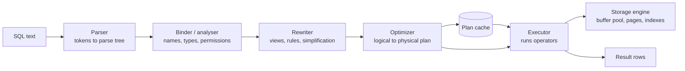
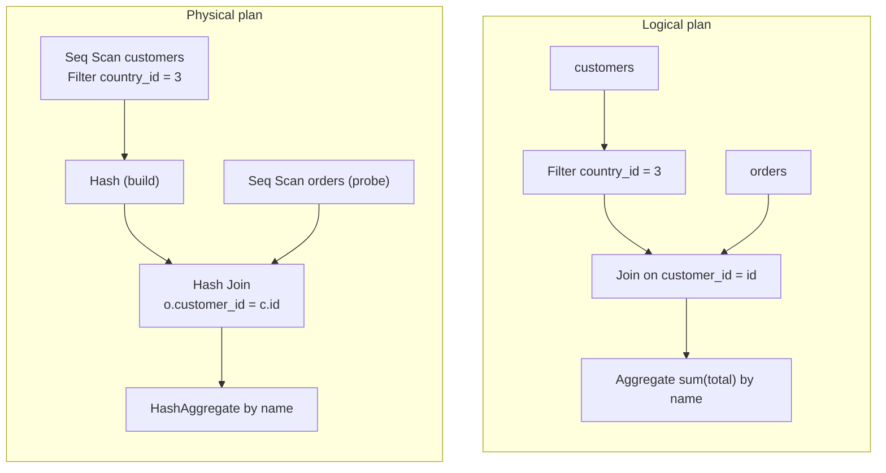
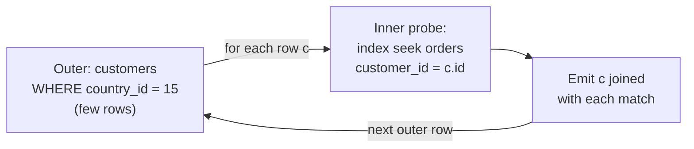
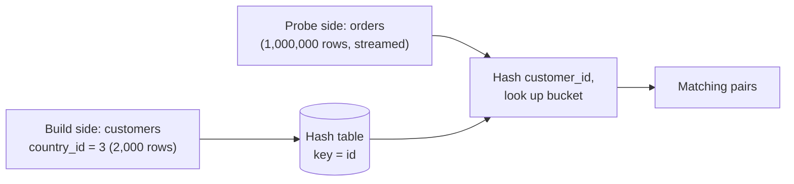
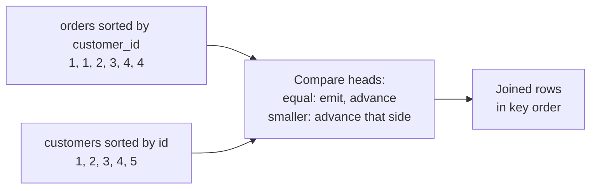
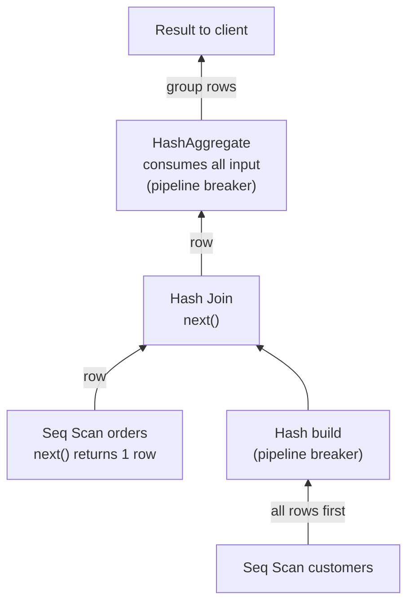
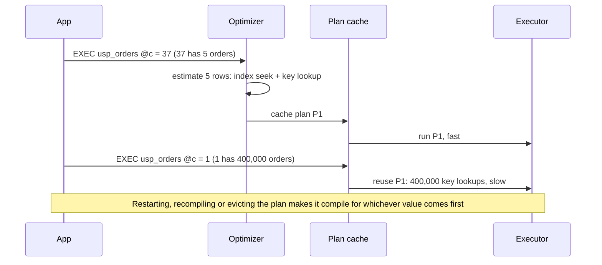

# 8. خط لولهٔ پرس‌وجو و بهینه‌ساز

<div dir="rtl" markdown="1">

> **سطح:** L3 ارشد (شروع از L1) | **بخش:** I | **نسخهٔ Rowlit:** 1.6.3 | [English](../../en/part1/08-query-processing.md)
> **قبلی:** [7. نمایه‌ها به‌تفصیل](07-indexes.md) | **بعدی:** [9. تراکنش‌ها، ACID و جداسازی](09-transactions-and-isolation.md)
>
> **در یک جمله:** SQL می‌گوید *چه* می‌خواهید؛ تجزیه‌گر، پیونددهنده، بازنویس و بهینه‌ساز هزینه‌محور موتور آن را به
> درختی از عملگرهای فیزیکی تبدیل می‌کنند که می‌گوید *چطور* به آن برسیم، و خواندن همین درخت (طرح اجرا) راه فهمیدن این
> است که یک پرس‌وجو چرا کند است.
>
> **در این فصل یاد می‌گیرید:**
> - پنج مرحله‌ای که هر دستور SQL از آن‌ها می‌گذرد، و تفاوت درخت تجزیه، طرح منطقی و طرح فیزیکی؛
> - مدل هزینه چطور تعداد صفحه‌ها و تخمین سطرها را به یک عدد تبدیل می‌کند، و چرا تخمین‌های کاردینالیتی ضعیف‌ترین حلقهٔ
>   زنجیرند؛
> - مسیرهای دسترسی، سه الگوریتم پیوند (join) یعنی nested loop، hash و merge، و اینکه ترتیب پیوندها چطور جست‌وجو
>   می‌شود؛
> - بازنویسی‌های پرس‌وجو مثل باز کردن زیرپرس‌وجو (subquery unnesting)، فروراندن گزاره و هرس ستون‌ها؛
> - مدل تکرارگر Volcano، اجرای برداری و کامپایل‌شده، طرح‌های موازی، سهمیه‌های حافظه و سرریزها؛
> - حافظهٔ نهان طرح، دستورهای آماده، parameter sniffing، ‏bind peeking، طرح‌های عمومی، راهنماها (hint) و راهنماهای
>   طرح؛
> - خواندن خروجی `EXPLAIN` در PostgreSQL، SQL Server، Oracle، MySQL/MariaDB، SQLite، ClickHouse و Snowflake (و اینکه
>   چرا Cassandra اصلاً چنین چیزی ندارد).
>
> **پیش‌نیازها:** [6. ساختار درونی ذخیره‌سازی](06-storage-internals.md)، [7. نمایه‌ها به‌تفصیل](07-indexes.md)،
> [3. SQL I](03-sql-basics.md) و [4. SQL II](04-sql-advanced.md) (پیوندها، زیرپرس‌وجوها).
>
> برچسب‌های نمودارها به انگلیسی نگه داشته شده‌اند تا در GitHub درست نمایش داده شوند.

## 1. ایده (مبتدی)

SQL زبانی *اعلانی (declarative)* است: نتیجه را توصیف می‌کنید (`the total spent by each customer from Iran`)، نه
گام‌ها را. پیدا کردن گام‌ها کار خود پایگاه داده است. سریع‌تر است همهٔ سفارش‌ها را بخواند و سفارش‌های ایرانی را نگه
دارد، یا اول مشتری‌های ایرانی را پیدا کند و بعد سفارش‌هایشان را از راه یک نمایه بیابد؟ سطرها را مرتب کند یا یک جدول
هش بسازد؟ برای پرس‌وجویی که پنج جدول را با هم پیوند (join) می‌دهد، هزاران ترتیب ممکن برای گام‌ها وجود دارد و سریع‌ترین
آن‌ها می‌تواند یک میلیون برابر سریع‌تر از کندترین باشد.

مؤلفه‌ای که این انتخاب را انجام می‌دهد [بهینه‌ساز (optimizer)](../glossary.md#optimizer) است. بهینه‌ساز حدس می‌زند هر
گام چند سطر تولید می‌کند (از روی آمار، [فصل 7](07-indexes.md#statistics-and-histograms))، هزینهٔ هر طرح نامزد را
تخمین می‌زند و ارزان‌ترین را برمی‌دارد. حاصل کار یک [طرح اجرای پرس‌وجو (query plan)](../glossary.md#explain) است:
درختی از عملگرها مثل «این جدول را پویش کن»، «در این نمایه seek کن»، «این دو ورودی را با hash join پیوند بده». هر
موتوری این درخت را با نوعی `EXPLAIN` نشانتان می‌دهد. خواندن آن مفیدترین مهارت عیب‌یابی در این کتاب است: وقتی
پرس‌وجویی کند است، طرح اجرا می‌گوید زمان کجا صرف می‌شود و معمولاً چرا.

## 2. سازوکار (کارشناس)

### 2.1 خط لوله: تجزیه، تحلیل نام‌ها، بازنویسی، بهینه‌سازی، اجرا

**شکل 8.1 — زندگی یک دستور SQL.**

</div>



<div dir="rtl" markdown="1">

1. **[تجزیه‌گر (parser)](../glossary.md#parser).** متن را به توکن‌ها می‌شکند، دستور زبان را بررسی می‌کند و یک
   [درخت تجزیه (parse tree)](../glossary.md#parse-tree) می‌سازد. خطاهای نحوی از همین‌جا می‌آیند، پیش از آنکه پایگاه
   داده حتی به یک جدول نگاه کند. دستور زبان PostgreSQL یک فایل Bison است (`gram.y`)؛ SQLite مولد تجزیه‌گر خودش، یعنی
   Lemon، را به کار می‌برد؛ تجزیه‌گر SQL Server و تشخیص خطاهای T-SQL در Rowlit هر دو روی قاعده‌های یکسانی از زبان کار
   می‌کنند (Rowlit در سمت کلاینت از کتابخانهٔ ScriptDom مایکروسافت استفاده می‌کند؛
   [بخش II، فصل 11](../part2/11-intellisense.md)).
2. **[پیونددهنده / تحلیل‌گر (binder / analyser)](../glossary.md#binder).** هر نام را در کاتالوگ پیدا می‌کند (کدام
   `orders`؟ در کدام schema، کدام ستون، کدام overload از `fn_tax`؟)، نوع‌های داده را به دست می‌آورد، مجوزها را بررسی
   می‌کند و `*` را باز می‌کند. خطاهای «Invalid column name» و «relation does not exist» از اینجا می‌آیند. SQL Server
   این مرحله را *algebrizer* می‌نامد.
3. **[بازنویس (rewriter)](../glossary.md#rewriter).** تبدیل‌هایی را اعمال می‌کند که همیشه معتبرند: نماها (view) را با
   تعریفشان جایگزین می‌کند، ruleهای PostgreSQL و سیاست‌های امنیت سطری (row-level security) را اعمال می‌کند، عبارت‌های
   ثابت را از پیش حساب می‌کند (`WHERE 1 = 1 AND x > 2 + 3` به `x > 5` تبدیل می‌شود) و گزاره‌ها را به شکل نرمال
   درمی‌آورد. بعضی موتورها این مرحله را با بهینه‌سازی یکی کرده‌اند.
4. **[بهینه‌ساز](../glossary.md#optimizer).** [طرح منطقی (logical plan)](../glossary.md#logical-plan) را (جبر رابطه‌ای:
   پیوند، فیلتر، projection، تجمیع) به ارزان‌ترین [طرح فیزیکی (physical plan)](../glossary.md#physical-plan) که پیدا
   کند تبدیل می‌کند (hash join یا nested loop، seek در نمایه یا پویش، مرتب‌سازی یا تجمیع هش، ترتیب پیوندها). این
   مرحلهٔ گران خط لوله است و برای همین موتورها نتیجه‌اش را در حافظهٔ نهان نگه می‌دارند ([بخش 2.9](#parameter-sniffing)).
5. **اجراکننده (executor).** عملگرهای فیزیکی را اجرا می‌کند، صفحه‌ها را از استخر بافر بیرون می‌کشد
   ([فصل 6](06-storage-internals.md)) و سطرهای نتیجه را به‌صورت جریانی برای کلاینت می‌فرستد.

تفاوت طرح منطقی و طرح فیزیکی همان تفاوت *چه* و *چطور* است:

**شکل 8.2 — یک پرس‌وجوی فروشگاه به شکل طرح منطقی (چپ) و به شکل یکی از طرح‌های فیزیکی ممکن (راست).**

</div>

```sql
SELECT c.name, sum(o.total)
FROM customers c JOIN orders o ON o.customer_id = c.id
WHERE c.country_id = 3
GROUP BY c.name;
```



<div dir="rtl" markdown="1">

طرح منطقی نمی‌گوید پیوند چطور انجام می‌شود یا ورودی‌ها به چه ترتیبی خوانده می‌شوند؛ طرح فیزیکی این را می‌گوید، و
برای یک طرح منطقی طرح‌های فیزیکی زیادی وجود دارد. طرح‌ها از پایین به بالا رسم می‌شوند: داده از برگ‌ها (دسترسی به
جدول و نمایه) به سمت ریشه (نتیجه) جریان دارد.

<a id="cost-model"></a>

### 2.2 مدل هزینه

یک [بهینه‌ساز هزینه‌محور (cost-based optimizer)](../glossary.md#cost-based-optimizer) به هر طرح نامزد یک عدد می‌دهد و
کمترینش را برمی‌دارد. این عدد ثانیه نیست؛ واحدی انتزاعی است که از یک [مدل هزینه (cost model)](../glossary.md#cost-model)
ساخته می‌شود: تعداد تخمینی خواندن صفحه (ترتیبی و تصادفی) و کار تخمینی CPU برای هر سطر، هر دو ضرب در تعداد تخمینی
سطرها. بهینه‌سازهای قدیمی‌تر *قاعده‌محور* (RBO در Oracle که پشتیبانی‌اش در 10g کنار گذاشته شد؛ نسخه‌های اولیهٔ MySQL)
مسیرهای دسترسی را با قاعده‌های ثابت رتبه‌بندی می‌کردند («نمایه همیشه از پویش بهتر است»). امروز همهٔ موتورهای این کتاب
هزینه‌محورند، هرچند MySQL و SQLite هنوز بیش از سه موتور بزرگ به قاعده‌های سرانگشتی (heuristic) تکیه می‌کنند.

مدل هزینهٔ PostgreSQL به‌طور کامل مستند شده و محاسبهٔ دستی‌اش از همه آسان‌تر است. ثابت‌های اصلی آن (پیش‌فرض‌ها در
PostgreSQL 17):

| تنظیم | پیش‌فرض | معنا |
|---|---|---|
| `seq_page_cost` | 1.0 | خواندن یک صفحه در جریان یک پویش ترتیبی |
| `random_page_cost` | 4.0 | خواندن یک صفحه از یک موقعیت تصادفی (روی SSD اغلب حدود 1.1 تنظیم می‌شود) |
| `cpu_tuple_cost` | 0.01 | پردازش یک سطر |
| `cpu_index_tuple_cost` | 0.005 | پردازش یک مدخل نمایه |
| `cpu_operator_cost` | 0.0025 | ارزیابی یک عملگر یا یک فراخوانی تابع (مثلاً یک `=` در فیلتر) |
| `effective_cache_size` | 4 GB | برنامه‌ریز می‌تواند فرض کند چه مقدار از داده در حافظهٔ نهان است (سیستم‌عامل + shared buffers)؛ روی هزینهٔ نمایه اثر می‌گذارد |
| `parallel_setup_cost` / `parallel_tuple_cost` | 1000 / 0.1 | راه‌اندازی workerها، و فرستادن یک سطر از worker به leader |

مثال گام‌به‌گام با جدول آزمایشگاهی [فصل 7](07-indexes.md#covering-indexes) (1,000,000 سطر در 8,334 صفحه): هزینهٔ
یک پویش ترتیبی با یک فیلتر چنین است

`8,334 × 1.0 (pages) + 1,000,000 × 0.01 (rows) + 1,000,000 × 0.0025 (one "=" per row) = 20,834`

و PostgreSQL آن را به شکل `cost=0.00..20834.00` چاپ می‌کند. عدد اول **هزینهٔ راه‌اندازی (startup cost)** است (هزینهٔ
پیش از آنکه نخستین سطر بتواند برگردد؛ برای پویش 0 و برای مرتب‌سازی کل ورودی) و عدد دوم **هزینهٔ کل (total cost)**
(برای همهٔ سطرها). همین هزینهٔ راه‌اندازی است که طرح‌های `LIMIT` را متفاوت می‌کند: طرحی که نخستین سطر را سریع
برمی‌گرداند می‌تواند برنده شود، حتی اگر هزینهٔ کلش بیشتر باشد.

موتورهای دیگر همین ایده را با جزئیات عمومی کمتری به کار می‌برند. هزینه‌های SQL Server در واحدی هستند که در گذشته بر
پایهٔ «ثانیه روی یک ماشین دههٔ 1990» کالیبره شده و با عنوان *Estimated Subtree Cost* نمایش داده می‌شوند؛ ستون `Cost`
در Oracle بر حسب خواندن تک‌بلوکی بیان می‌شود و I/O و CPU را با هم ترکیب می‌کند (`%CPU` سهم CPU را نشان می‌دهد)؛ MySQL
مقدار `query_cost` را در `EXPLAIN FORMAT=JSON` و `cost=` را در `EXPLAIN ANALYZE` نشان می‌دهد؛ برنامه‌ریز SQLite از
تخمین‌های داخلی با مقیاس لگاریتمی استفاده می‌کند و آن‌ها را چاپ نمی‌کند.

دو هشدار. هزینه‌ها فقط **درون یک جست‌وجوی طرح** با هم مقایسه‌پذیرند، هرگز میان پرس‌وجوها یا سرورها. و هزینه فقط به
اندازهٔ تخمین‌های سطری که به آن داده می‌شود درست است؛ موضوع بخش بعد همین است.

<a id="cardinality-estimation"></a>

### 2.3 تخمین کاردینالیتی

[تخمین کاردینالیتی (cardinality estimate)](../glossary.md#cardinality-estimate) یک عملگر، تعداد سطرهایی است که
بهینه‌ساز انتظار دارد آن عملگر برگرداند. همهٔ هزینه‌ها به آن وابسته‌اند، و خطاها در مسیر بالا رفتن در درخت **در هم
ضرب می‌شوند**. فرمول‌های کلاسیک (System R، 1979، که هنوز همه‌جا پایهٔ کارند):

| گزاره | گزینندگی تخمینی |
|---|---|
| `col = constant` | فراوانی آن ثابت از فهرست MCV یا هیستوگرام؛ در غیر این صورت 1 / n_distinct |
| `col > constant` | کسری از هیستوگرام که بالای آن ثابت قرار دارد |
| `p1 AND p2` | sel(p1) × sel(p2) (فرض استقلال) |
| `p1 OR p2` | sel(p1) + sel(p2) − sel(p1) × sel(p2) |
| `NOT p` | 1 − sel(p) |
| `col = ?` (پارامتر ناشناخته) | 1 / n_distinct (میانگین) |
| `a.x = b.y` (پیوند برابری، equi-join) | 1 / max(n_distinct(a.x), n_distinct(b.y)) |
| `col LIKE '%abc%'`، یک تابع، یک UDF | یک حدس ثابت (PostgreSQL برای برابری‌ها و تطبیق الگوهایی که نمی‌تواند تخمین بزند 0.5% و برای نابرابری‌ها 33% در نظر می‌گیرد؛ SQL Server و Oracle ثابت‌های خودشان را دارند) |

عددهای واقعی نمونهٔ SQLite در Rowlit این اثر را نشان می‌دهند. جدول `sqlite_stat1` می‌گوید یک برابری روی
`Orders.CustomerId` حدود 6 سطر برمی‌گرداند ([فصل 7](07-indexes.md#statistics-and-histograms)). برای مشتری 1، که
توزیعش نامتوازن است، پاسخ واقعی 37 است. اگر این تخمین وارد پیوندی با `OrderLines` شود (حدود 4 قلم برای هر سفارش)،
بهینه‌ساز انتظار 24 سطر دارد و 148 سطر می‌گیرد؛ یک سطح پیوند دیگر با خطایی مشابه، و تخمین حدود 38 برابر (‏(37 / 6)²) با واقعیت فاصله
دارد. طرحی که برای 24 سطر انتخاب شده (nested loop با seek در نمایه) عالی است؛ همان طرح برای 100,000 سطر به‌جای 600
فاجعه می‌شد.

تخمین‌ها معمولاً در این جاها خراب می‌شوند:

- ستون‌های همبسته‌ای که مستقل فرض می‌شوند (`city = 'Tehran' AND country = 'IR'` کمتر از واقع تخمین زده می‌شود)؛
- مقدارهای نامتوازن (skewed) وقتی فقط میانگین‌ها معلوم‌اند (پارامترها، نبودن هیستوگرام)؛
- گزاره‌هایی که آمار نمی‌تواند درونشان را ببیند: تابع روی ستون، `LIKE '%…%'`، عبارت‌هایی که چند ستون را درگیر
  می‌کنند، فیلدهای JSON، تابع‌های جدول‌مقدار (table-valued function)، متغیرهای جدولی (SQL Server پیش از 2019 برایشان
  یک سطر فرض می‌کرد)؛
- آمار کهنه پس از بارگذاری‌های بزرگ؛
- پیوندِ پیوندها، که در آن خطای هر سطح روی خطای سطح قبلی انباشته می‌شود.

راه‌حل تقریباً هرگز «یک hint بگذارید» نیست؛ راه‌حل این است که اطلاعات بهتری به بهینه‌ساز بدهید (آمار تازه، آمار
گسترده یا چندستونی، گزاره‌ای SARGable، ستون محاسباتی همراه با آمار) یا پرس‌وجو را به شکلی بنویسید که تخمینش آسان‌تر
باشد. بخش 3 به موتورهایی می‌پردازد که در زمان اجرا خودشان را اصلاح می‌کنند.

### 2.4 مسیرهای دسترسی

[مسیر دسترسی (access path)](../glossary.md#access-path) شیوه‌ای است که یک عملگر با آن یک جدول را می‌خواند. فهرست
گزینه‌ها، با واژگان [فصل 7](07-indexes.md#reading-a-plan-for-index-use):

| مسیر دسترسی | بهترین وقتی | PostgreSQL | SQL Server | Oracle |
|---|---|---|---|---|
| [پویش جدول (table scan)](../glossary.md#table-scan) | کسر بزرگی از سطرها، جدول کوچک، نبودن نمایهٔ قابل استفاده | `Seq Scan` | `Table Scan` / `Clustered Index Scan` | `TABLE ACCESS FULL` |
| [جست‌وجوی نمایه (index seek)](../glossary.md#index-seek) + واکشی سطر | سطرهای کم، گزارهٔ SARGable | `Index Scan` | `Index Seek` + `Key Lookup` | `INDEX RANGE SCAN` + `TABLE ACCESS BY INDEX ROWID` |
| seek پوشا / فقط‌نمایه | نمایه همهٔ ستون‌های لازم را دارد | `Index Only Scan` | `Index Seek` به‌تنهایی | `INDEX RANGE SCAN` به‌تنهایی |
| [پویش نمایه (index scan)](../glossary.md#index-scan) کامل | نمایه از جدول باریک‌تر است، یا ترتیب آن لازم است | `Index Scan` / `Index Only Scan` بدون شرط | `Index Scan` | `INDEX FULL SCAN` / `FAST FULL SCAN` |
| بیت‌نگاشت (bitmap) | کسر متوسطی از سطرها، یا ترکیب چند نمایه | `Bitmap Index Scan` + `Bitmap Heap Scan` | — | عملیات `BITMAP` |
| با نشانی سطر | یک RID / ROWID / ctid معلوم | `Tid Scan` | `RID Lookup` | `TABLE ACCESS BY USER ROWID` |

نقطهٔ تقاطع «seek + واکشی» و «پویش» پایین‌تر از چیزی است که شهود می‌گوید. روی هیپی که سطرها در آن به‌طور تصادفی
چیده شده‌اند، واکشی هر سطر یک خواندن تصادفی صفحه خرج دارد (4 واحد در مدل پیش‌فرض PostgreSQL)، در حالی که پویش
ترتیبی برای هر صفحه، که ده‌ها سطر در خود دارد، حدود 1 واحد خرج دارد. [فصل 6](06-storage-internals.md) (تمرین 6)
حساب می‌کند که خواندن 2% سطرها از راه نمایه همین حالا شش برابر یک پویش کامل هزینه دارد. همبستگی (correlation) و
حافظهٔ نهان این خط را جابه‌جا می‌کنند، و برای همین تصمیم با برنامه‌ریز است، نه با یک قاعدهٔ ثابت.

### 2.5 الگوریتم‌های پیوند

هر موتوری پیوند را با یکی از سه الگوریتم پیاده می‌کند، به‌علاوهٔ گونه‌هایی برای نیم‌پیوندها (semi-join؛ `EXISTS`،
`IN`) و پادپیوندها (anti-join؛ `NOT EXISTS`، `NOT IN`).

<a id="nested-loop-join"></a>

**[پیوند حلقهٔ تودرتو (nested loop join)](../glossary.md#nested-loop-join).** برای هر سطر ورودی *بیرونی* (outer)،
سطرهای منطبق در ورودی *درونی* (inner) پیدا می‌شوند. اگر روی ستون پیوند در سمت درونی نمایه باشد، هر کاوش یک seek است:
یک *index nested loop*. هزینه ≈ سطرهای بیرونی × هزینهٔ یک کاوش درونی. وقتی سمت بیرونی کوچک است رقیب ندارد؛ وقتی
بزرگ است و سمت درونی نمایه ندارد، افتضاح است.

**شکل 8.3 — پیوند حلقهٔ تودرتو: یک کاوش درونی برای هر سطر بیرونی.**

</div>



<div dir="rtl" markdown="1">

خروجی واقعی SQLite روی نمونه (SQLite پیوند را فقط با nested loop انجام می‌دهد؛ خط اول حلقهٔ بیرونی است):

</div>

```sql
EXPLAIN QUERY PLAN
SELECT c.LastName, sum(o.Total)
FROM Customers c JOIN Orders o ON o.CustomerId = c.Id
WHERE c.CountryId = 15 GROUP BY c.LastName;
-- SCAN c USING INDEX IX_Customers_LastName
-- SEARCH o USING INDEX IX_Orders_CustomerId (CustomerId=?)
```

<div dir="rtl" markdown="1">

دقت کنید که پویش بیرونی از `IX_Customers_LastName` استفاده می‌کند: خواندن مشتری‌ها به ترتیب نام خانوادگی،
`GROUP BY c.LastName` را مجانی می‌کند (بدون B-tree موقت)؛ تصمیمی که یک *ترتیب جالب (interesting order)* آن را رقم
زده است. وقتی برای سمت درونی نمایه‌ای وجود ندارد، SQLite برای مدت اجرای پرس‌وجو یک *نمایهٔ خودکار (automatic index)*
موقت می‌سازد، و از نسخهٔ 3.38 می‌تواند یک فیلتر بلوم (Bloom filter) هم اضافه کند تا از کاوش‌هایی که امکان تطبیق
ندارند بگذرد.

<a id="hash-join"></a>

**[پیوند هش (hash join)](../glossary.md#hash-join).** ورودی کوچک‌تر ([سمت ساخت، build side](../glossary.md#build-side))
در یک جدول هش درون‌حافظه‌ای خوانده می‌شود که کلیدش ستون پیوند است؛ سپس ورودی دیگر
([سمت کاوش، probe side](../glossary.md#probe-side)) به‌صورت جریانی خوانده می‌شود و هر سطرش در جدول هش جست‌وجو
می‌شود. هزینه ≈ سطرهای سمت ساخت + سطرهای سمت کاوش، تقریباً خطی. این الگوریتم فقط برای پیوندهای برابری کار می‌کند،
برای سمت ساخت حافظه لازم دارد، و تا ساخت تمام نشود چیزی برنمی‌گرداند (برای ورودی ساختش یک عملگر *مسدودکننده
(blocking)* است). اگر سمت ساخت در حافظه جا نشود، هر دو ورودی با هش به دسته‌هایی (batch) پارتیشن می‌شوند که روی دیسک
نوشته می‌شوند و دسته به دسته پیوند می‌خورند (*grace* / *hybrid hash join*): طرح اجرا در PostgreSQL ‏`Batches: 8`،
در SQL Server یک *hash warning / spill* و در Oracle ‏`TempSpc` نشان می‌دهد.

**شکل 8.4 — پیوند هش: یک بار ساخت، بارها کاوش.**

</div>



<div dir="rtl" markdown="1">

**[پیوند ادغامی (merge join)](../glossary.md#merge-join).** هر دو ورودی، مرتب‌شده بر اساس کلید پیوند، خوانده می‌شوند و
مثل دو لبهٔ زیپ با هم جلو می‌روند. هزینه ≈ هر دو ورودی + مرتب‌سازی، اگر از پیش مرتب نباشند (یک نمایه یا کلید خوشه‌ای
می‌تواند این ترتیب را فراهم کند). برای ورودی‌های بزرگی که از قبل مرتب‌اند، در بعضی موتورها برای پیوندهای بازه‌ای یا
نابرابری، و وقتی نتیجه به هر حال باید بر اساس کلید مرتب باشد، انتخاب خوبی است.

**شکل 8.5 — پیوند ادغامی: دو ورودی مرتب که هم‌گام جلو می‌روند.**

</div>



<div dir="rtl" markdown="1">

| | Nested loop | Hash join | Merge join |
|---|---|---|---|
| شرط پیوند | هر شرطی | فقط برابری | برابری (در بعضی موتورها بازه هم) |
| نیاز دارد به | نمایه روی سمت درونی تا سریع باشد | حافظه برای سمت ساخت | ورودی‌های مرتب (یا یک مرتب‌سازی) |
| هزینه رشد می‌کند با | بیرونی × کاوش درونی | ساخت + کاوش | مرتب‌سازی + هر دو ورودی |
| نخستین سطر می‌رسد | بلافاصله | پس از ساخت | پس از مرتب‌سازی (یا بلافاصله اگر از پیش مرتب باشد) |
| کاربرد معمول | OLTP: سطرهای بیرونی کم | گزارش‌گیری، ورودی‌های بزرگ نامرتب | ورودی‌های بزرگ از پیش مرتب، `FULL OUTER JOIN` |
| PostgreSQL / SQL Server / Oracle | بله / بله / بله | بله / بله / بله | بله / بله / بله |
| MySQL 8.0.18+ / MariaDB 11 | بله / بله | بله (در 8.0.20 جای block nested loop را گرفت) / block hash join (`join_cache_level`) | نه / نه |
| SQLite | بله (تنها الگوریتم) | نه (به‌جایش نمایه‌های خودکار) | نه |
| ClickHouse | — | پیش‌فرض (جدول سمت راست در حافظه) | `full_sorting_merge`، `partial_merge` |

نسخه‌های 2017 به بعد SQL Server یک **پیوند تطبیقی (adaptive join)** هم دارند (به batch mode نیاز دارد که SQL Server 2019 آن را به جدول‌های row-store هم گسترش داد):
طرح اجرا هم یک hash join و هم یک nested loop را در خود دارد و در زمان اجرا، پس از شمردن سطرهای سمت ساخت و مقایسهٔ
آن با یک آستانه، یکی را انتخاب می‌کند.

### 2.6 ترتیب پیوند

برای *n* جدول، *n!* ترتیب چپ‌عمیق و شکل‌های انبوه (bushy) بسیار بیشتری وجود دارد؛ برای 10 جدول، 3.6 میلیون ترتیب
چپ‌عمیق، تازه پیش از انتخاب الگوریتم‌ها. بهینه‌سازها این فضا را هوشمندانه جست‌وجو می‌کنند:

- **برنامه‌نویسی پویا (dynamic programming)** (Selinger و همکاران، System R): بهترین طرح برای هر زیرمجموعهٔ 2 جدولی
  پیدا می‌شود، بعد 3 جدولی، و هر بار روی بهترین طرح‌های کوچک‌تر ساخته می‌شود؛ طرح‌های اضافه‌ای هم که ترتیب مرتب‌سازی
  مفیدی تحویل می‌دهند نگه داشته می‌شوند (*[ترتیب‌های جالب (interesting orders)](../glossary.md#interesting-order)*).
  PostgreSQL این کار را تا `geqo_threshold` = 12 رابطه به‌طور کامل انجام می‌دهد و از آن به بعد سراغ یک الگوریتم
  ژنتیک (GEQO) می‌رود. تنظیم‌های `join_collapse_limit` و `from_collapse_limit` (هر دو 8) نمی‌گذارند فهرست‌های صریح
  `JOIN` با بیش از 8 عضو بازچینی شوند.
- **جست‌وجوی مبتنی بر تبدیل (Cascades / Volcano optimizer generator)**: SQL Server (و CockroachDB و Orca در Greenplum)
  یک *memo* از عبارت‌های هم‌ارز نگه می‌دارند و قاعده‌ها را اعمال می‌کنند تا بودجهٔ زمانی تمام شود. SQL Server در چند
  فاز جست‌وجو می‌کند (trivial plan → search 0 → search 1 → search 2) و وقتی طرح به قدر کافی ارزان باشد زود دست
  می‌کشد؛ ویژگی `Reason For Early Termination Of Statement Optimization` در طرح اجرا می‌گوید «Good Enough Plan Found»
  یا «Time Out».
- **جست‌وجوی حریصانه / heuristic**: بهینه‌ساز MySQL ترتیب‌های پیوند را به‌صورت عمق‌اول و با هرس کاوش می‌کند
  (`optimizer_search_depth` = 62، `optimizer_prune_level` = 1)؛ «next generation query planner» در SQLite در هر گام N
  مسیر جزئی برتر را نگه می‌دارد.

[درخت‌های چپ‌عمیق (left-deep tree)](../glossary.md#left-deep-tree) (هر پیوند یک جدول پایه را به‌عنوان ورودی درونی
دارد) با nested loopها خوب خط لوله می‌سازند و جست‌وجو را کوچک نگه می‌دارند؛ [درخت‌های انبوه (bushy tree)](../glossary.md#bushy-tree)
(پیوندِ پیوندها) برای schemaهای ستاره‌ای و hash joinهای موازی می‌توانند بهتر باشند. شما ترتیب را عمدتاً با آمار خوب
تحت تأثیر قرار می‌دهید؛ hintها آخرین راه‌اند (بخش 2.9).

<a id="predicate-push-down"></a>

### 2.7 بازنویسی‌های پرس‌وجو: فروراندن، هرس، باز کردن زیرپرس‌وجو

پیش از جست‌وجو و در حین آن، بهینه‌سازها بازنویسی‌هایی را اعمال می‌کنند که همیشه (یا معمولاً) سودمندند:

- **[فروراندن گزاره (predicate push-down)](../glossary.md#predicate-push-down).** فیلتر تا جای ممکن زود (هرچه
  پایین‌تر در درخت) اعمال می‌شود: زیر پیوندها، درون نماها و جدول‌های مشتق (derived table)، درون خود پویش، و حتی از روی
  شبکه در یک منبع راه دور. سطرهای کمتری بالا می‌آیند، پس هر عملگر بعدی ارزان‌تر است. در شکل 8.2 شرط
  `WHERE c.country_id = 3` درون پویش `customers` اجرا می‌شود، نه پس از پیوند.
- **[هرس ستون‌ها (projection pruning)](../glossary.md#projection-pruning).** فقط ستون‌هایی خوانده و حمل می‌شوند که به
  کار می‌آیند. در ذخیره‌سازی سطرمحور (row store) این کار سطرهای میانی را کوچک می‌کند (جدول‌های هش و مرتب‌سازی‌های
  کوچک‌تر)؛ در ذخیره‌سازی ستون‌محور (column store) صرفه‌جویی اصلی همین است، چون ستون‌هایی که خوانده نمی‌شوند هرگز روی
  دیسک لمس نمی‌شوند.
- **ادغام نما و باز کردن زیرپرس‌وجو (view merging، subquery unnesting).** یک نما یا جدول مشتق در پرس‌وجوی بیرونی
  ادغام می‌شود تا جدول‌هایش با هر ترتیبی پیوند بخورند؛ `IN (subquery)` و `EXISTS` به
  [نیم‌پیوند (semi-join)](../glossary.md#semi-join) تبدیل می‌شوند، `NOT EXISTS` به
  [پادپیوند (anti-join)](../glossary.md#anti-join)، و یک زیرپرس‌وجوی اسکالر همبسته ممکن است به یک پیوند به‌علاوهٔ
  تجمیع تبدیل شود. خروجی واقعی SQLite هر دو سبک را نشان می‌دهد:

</div>

  ```sql
  EXPLAIN QUERY PLAN SELECT c.Id, (SELECT count(*) FROM Orders o WHERE o.CustomerId = c.Id) AS n FROM Customers c;
  -- SCAN c USING COVERING INDEX sqlite_autoindex_Customers_1
  -- CORRELATED SCALAR SUBQUERY 1
  --   SEARCH o USING COVERING INDEX IX_Orders_CustomerId (CustomerId=?)
  EXPLAIN QUERY PLAN SELECT * FROM Customers c
  WHERE EXISTS (SELECT 1 FROM Orders o WHERE o.CustomerId = c.Id AND o.Status = 'new');
  -- SCAN c
  -- SEARCH o EXISTS USING INDEX IX_Orders_CustomerId (CustomerId=?)
  ```

<div dir="rtl" markdown="1">

  در اینجا SQLite زیرپرس‌وجوی همبسته را نگه می‌دارد و آن را برای هر مشتری یک بار از راه یک نمایهٔ پوشا اجرا می‌کند
  (که اینجا مشکلی ندارد)؛ PostgreSQL، SQL Server و Oracle معمولاً پرس‌وجوی دوم را به یک *نیم‌پیوند* از نوع hash یا
  nested loop تبدیل می‌کنند.
- **حذف پیوند (join elimination).** یک `LEFT JOIN` روی کلید یکتا به جدولی که هیچ ستونی از آن استفاده نمی‌شود قابل
  حذف است (PostgreSQL، SQL Server، Oracle). کلیدهای خارجی مورد اعتماد (trusted) همین کار را برای پیوندهای درونی (inner
  join) در SQL Server و Oracle ممکن می‌کنند.
- **گسترش OR (OR expansion)، محاسبهٔ پیشاپیش ثابت‌ها، گزاره‌های تعدی‌پذیر** (از `a.x = b.x AND a.x = 5` نتیجه می‌شود
  `b.x = 5`، که حالا می‌تواند از نمایه‌ای روی `b` استفاده کند)، **هرس پارتیشن (partition pruning)**
  ([فصل 12](12-backup-replication-ha.md)).

پایگاه‌های دادهٔ متصل (linked databases) در Rowlit، وقتی هم‌زمان از چند سرور پرس‌وجو می‌کنند، همین دو ایده را به کار
می‌برند: گزاره‌ها و فهرست ستون‌ها را به هر منبع فرومی‌رانند و فقط چیزی را واکشی می‌کنند که موتور DuckDB محلی لازم
دارد. قاعدهٔ هر گویش (dialect) برای اینکه منبع کدام گزاره‌ها را می‌تواند ارزیابی کند، `PushdownSql.Accept` است
(`engine/src/DbStudio.Federation/Pushdown/PushdownSql.cs:30-40`)؛ [بخش II، فصل 16](../part2/16-linked-databases-federation.md)
را ببینید.

### 2.8 مدل‌های اجرا

<a id="volcano-model"></a>

**مدل Volcano (مدل تکرارگر، iterator model).** بیشتر موتورهای سطرمحور طرح اجرا را به شکل درختی از عملگرها اجرا
می‌کنند که هر کدام `open()`، `next()` و `close()` را پیاده می‌کنند (Graefe، 1994). ریشه سطر بعدی را از فرزندش
می‌خواهد، فرزند از فرزند خودش، و همین‌طور تا پایین به یک پویش: سطرها یکی‌یکی به سمت بالا *کشیده* می‌شوند. این مدل
ساده است و به‌طور طبیعی خط لوله می‌سازد: یک `LIMIT 10` بالای یک پویش، پویش را پس از ده سطر متوقف می‌کند.

**شکل 8.6 — مدل Volcano هر بار یک سطر را بالا می‌کشد؛ ساخت هش یک شکنندهٔ خط لوله است.**

</div>



<div dir="rtl" markdown="1">

عملگرهایی که باید کل ورودی‌شان را مصرف کنند تا خروجی بدهند (مرتب‌سازی، ساخت هش، تجمیع هش)
[شکننده‌های خط لوله (pipeline breaker)](../glossary.md#pipeline-breaker) هستند؛ هر چیزی میان دو شکننده به شکل یک
خط لوله اجرا می‌شود. حافظه هم دقیقاً در همین عملگرها لازم است و سرریز هم همین‌جا رخ می‌دهد (بخش 2.10).

<a id="vectorised-execution"></a>

**اجرای برداری (vectorised execution).** فراخوانی `next()` برای هر سطر، به ازای هر سطر یک فراخوانی تابع و چند
پیش‌بینی نادرست انشعاب (branch misprediction) خرج دارد، و وقتی داده در حافظه است همین خرج غالب می‌شود. موتورهای
[برداری](../glossary.md#vectorised-execution) میان عملگرها *دسته‌هایی* از مقدارها (بردارهای ستونی با حدود هزار مقدار)
را جابه‌جا می‌کنند و روی آن‌ها حلقه‌های فشرده‌ای اجرا می‌کنند که CPU می‌تواند خط لوله‌شان کند و با SIMD شتابشان دهد
(MonetDB/X100، 2005). ClickHouse، DuckDB، Snowflake و *batch mode* در SQL Server (روی columnstore، و از 2019 روی row
store هم) این‌گونه کار می‌کنند؛ `EXPLAIN PIPELINE` در ClickHouse پردازنده‌هایی (processor) را نشان می‌دهد که بلوک‌ها
را دست به دست می‌کنند.

**اجرای کامپایل‌شده.** راه دیگر حذف سربار هر سطر، کامپایل کردن طرح اجرا به کد ماشین است. PostgreSQL وقتی هزینهٔ کل
طرح از `jit_above_cost` (100,000) بیشتر شود، عبارت‌ها و tuple deforming را با LLVM به‌صورت JIT کامپایل می‌کند؛ آن‌وقت
طرح اجرا یک بخش `JIT:` نشان می‌دهد. SQL Server فقط برای جدول‌های memory-optimized به‌صورت native کامپایل می‌کند
(رویه‌های natively compiled).

<a id="sqlite-bytecode"></a>

**بایت‌کد SQLite.** SQLite هر دستور را به برنامه‌ای برای ماشین مجازی خودش (VDBE) کامپایل می‌کند، و `EXPLAIN` ساده
همین برنامه را چاپ می‌کند. خروجی واقعی روی پایگاه دادهٔ نمونه برای `SELECT Id, Total FROM Orders WHERE CustomerId = 42`
وقتی فقط `IX_Orders_CustomerId` وجود دارد (کوتاه‌شده: ستون‌های ثبات (register) حذف شده‌اند):

</div>

```text
addr  opcode        p1  p2  p3  p4
0     Init          0   12  0
1     OpenRead      0   9   0   6          -- cursor 0: the Orders table B-tree (root page 9)
2     OpenRead      1   14  0   k(2,,)     -- cursor 1: the index IX_Orders_CustomerId
3     Integer       42  1   0              -- r1 = 42
4     SeekGE        1   11  1   1          -- position the index cursor at the first key >= 42
5     IdxGT         1   11  1   1          -- stop when the index key > 42
6     DeferredSeek  1   0   0              -- move the table cursor to this entry's rowid (the lookup)
7     IdxRowid      1   2   0              -- Id = the rowid stored in the index entry
8     Column        0   5   3              -- Total read from the table row
9     ResultRow     2   2   0
10    Next          1   5   1              -- next index entry, loop to 5
11    Halt          0   0   0
```

<div dir="rtl" markdown="1">

با نمایهٔ پوشای `IX_Orders_Customer_Total (CustomerId, Total)` برنامه به یک cursor کوچک می‌شود: نه `OpenRead` جدول در
کار است و نه `DeferredSeek`، و `Column 1 1 3` مقدار `Total` را از خود مدخل نمایه می‌خواند. این روشن‌ترین تصویری است
که از تفاوت lookup و خواندن پوشش‌داده‌شده خواهید دید ([فصل 7](07-indexes.md#covering-indexes)).

**پرس‌وجوی موازی.** PostgreSQL، SQL Server، Oracle و موتورهای تحلیلی یک پویش را میان پردازه‌ها یا threadهای worker
تقسیم می‌کنند و نتیجه‌هایشان را با یک عملگر exchange ترکیب می‌کنند: در PostgreSQL ‏`Gather` / `Gather Merge`
(`Workers Planned: 2`، با کنترل `max_parallel_workers_per_gather`)، در SQL Server
‏`Parallelism (Gather Streams / Repartition Streams)` (`MAXDOP`، cost threshold for parallelism)، در Oracle
‏`PX COORDINATOR` (hint ‏`PARALLEL` / درجهٔ موازی‌سازی جدول). موازی‌سازی یک پرس‌وجو را سریع‌تر می‌کند، به بهای
مصرف کل CPU بیشتر؛ روی یک سرور OLTP شلوغ اغلب عمداً محدودش می‌کنند.

<a id="parameter-sniffing"></a>

### 2.9 حافظهٔ نهان طرح، پارامترها و parameter sniffing

بهینه‌سازی یک پرس‌وجوی پیچیده می‌تواند از چند میلی‌ثانیه تا چند ثانیه طول بکشد، پس موتورها طرح‌ها را دوباره به کار
می‌برند. [حافظهٔ نهان طرح (plan cache)](../glossary.md#plan-cache) طرح‌های کامپایل‌شده را با کلید متن دستور (و
تنظیمات) نگه می‌دارد. یک [دستور آماده (prepared statement)](../glossary.md#prepared-statement) با پارامتر
(`WHERE customer_id = @c`، `= $1`، `= :c`، `= ?`) اجازه می‌دهد یک طرح برای همهٔ مقدارها به کار رود. این کار زمان
کامپایل را صرفه‌جویی می‌کند و جلوی تزریق SQL را می‌گیرد ([فصل 14](14-security.md))، اما یک پرسش پیش می‌کشد: **طرح
برای کدام مقدار بهینه شده است؟**

<a id="parameter-sniffing-sequence"></a>

**[parameter sniffing](../glossary.md#parameter-sniffing) («بو کشیدن پارامتر»، SQL Server).** نخستین اجرا طرح را با
مقدارهای واقعی پارامتر که می‌بیند (و به اصطلاح «بو می‌کشد») کامپایل می‌کند، و طرح در حافظهٔ نهان می‌ماند و برای همهٔ
مقدارهای بعدی دوباره به کار می‌رود.

**شکل 8.7 — parameter sniffing: طرحی که برای یک مقدار نادر کامپایل شده، برای یک مقدار رایج دوباره به کار می‌رود.**

</div>



<div dir="rtl" markdown="1">

نشانه‌اش این است که «همان رویه گاهی سریع است و گاهی کند»، یا «تا وقتی طرح از حافظهٔ نهان بیرون رانده نشده بود سریع
بود». راه‌حل‌ها، از هدفمندترین تا کلی‌ترین:

| راه‌حل | چه می‌کند | بها |
|---|---|---|
| `OPTION (RECOMPILE)` روی دستور | برای مقدارهای هر اجرا کامپایل می‌کند | هر بار CPU کامپایل |
| `OPTION (OPTIMIZE FOR (@c = 1))` | همیشه برای یک مقدار انتخاب‌شده کامپایل می‌کند | فقط برای حالت رایج خوب است |
| `OPTION (OPTIMIZE FOR UNKNOWN)` / متغیرهای محلی | برای میانگین (چگالی) کامپایل می‌کند | یک طرح میانگین، هرگز بهترین |
| مسیرهای کد جدا (دو رویه، SQL پویا برای مشتری‌های بزرگ) | طرح‌های متفاوت برای شکل‌های متفاوت | کد بیشتر |
| اجبار طرح با Query Store ([فصل 13](13-performance-tuning.md)) | یک طرح خوبِ شناخته‌شده را ثابت می‌کند | باید نگه‌داری شود |
| بهینه‌سازی *Parameter Sensitive Plan* در SQL Server 2022 (سطح سازگاری 160) | تا سه گونهٔ طرح برای هر دستور را بر اساس بازهٔ پارامتر در حافظهٔ نهان نگه می‌دارد | خودکار، فقط برای نامتوازنی‌ای که تشخیص داده شود |

**موتورهای دیگر، همان مسئله:**

- **PostgreSQL** هر دستور را در هر نشست یک بار آماده می‌کند. با `plan_cache_mode = auto` (پیش‌فرض)، پنج اجرای نخست
  *طرح‌های سفارشی (custom plan)* می‌گیرند که با مقدارهای واقعی برنامه‌ریزی شده‌اند؛ پس از آن PostgreSQL یک
  [طرح عمومی (generic plan)](../glossary.md#generic-plan) می‌سازد (بدون مقدارها برنامه‌ریزی می‌شود) و اگر هزینهٔ
  تخمینی‌اش به‌طور محسوسی بدتر از میانگین طرح‌های سفارشی نباشد، از آن استفاده می‌کند. `force_custom_plan` و
  `force_generic_plan` این انتخاب را کنار می‌زنند، و `EXPLAIN (GENERIC_PLAN)` (16+) طرح عمومی را برای دستوری با
  placeholderهای `$1` نشان می‌دهد. درایورهایی که از پروتکل گسترده (extended protocol) استفاده می‌کنند دستورها را برایتان
  آماده می‌کنند (Npgsql فقط وقتی آماده‌سازی خودکار، یعنی `Max Auto Prepare`، روشن باشد).
- **Oracle** یک حافظهٔ نهان cursor مشترک در سطح instance دارد. [bind peeking](../glossary.md#bind-peeking) («نگاه به
  مقدار bind»، از 9i) در hard parse به مقدارهای bind نگاه می‌کند، با همان خطر sniffing؛ *adaptive cursor sharing*
  (11g) متوجه می‌شود که یک cursor حساس به bind برای بعضی مقدارها بد کار می‌کند و cursorهای فرزند اضافه می‌سازد.
  تنظیم `CURSOR_SHARING = FORCE` برای برنامه‌هایی که از bind استفاده نمی‌کنند، literalها را با bind جایگزین می‌کند
  (hard parse کمتر، خطر sniffing بیشتر).
- **MySQL / MariaDB** حافظهٔ نهان طرح مشترک ندارند: دستور آمادهٔ سمت سرور به یک نشست تعلق دارد، و بهینه‌ساز همچنان
  بیشتر کارش را در هر اجرا انجام می‌دهد. (حافظهٔ نهان قدیمی *نتیجهٔ* پرس‌وجو در MySQL 8.0 حذف شد.)
- **SQLite** دستورهای آماده را برای هر اتصال درون درایور نگه می‌دارد؛ طرح در زمان prepare ثابت می‌شود، مگر آنکه schema
  یا آمار تغییر کند (یک حالت خاص: مقداری که تازه bind شده، وقتی برای طرح اهمیت دارد، می‌تواند prepare دوباره را راه
  بیندازد؛ مثلاً یک الگوی `LIKE` یا، با `SQLITE_ENABLE_STAT4`، مقداری که با نمونه‌ها مقایسه می‌شود).

<a id="hints"></a>

**راهنماها (hint) و راهنماهای طرح (plan guide).** وقتی بهینه‌ساز اشتباه می‌کند و آمار بهتر هم درستش نمی‌کند، یک
[راهنما (hint)](../glossary.md#hint) یک تصمیم را کنار می‌زند:

| موتور | نحو | مثال‌ها |
|---|---|---|
| SQL Server | hintهای پرس‌وجو با `OPTION (…)`، hintهای جدول با `WITH (…)`، hintهای پیوند | `OPTION (HASH JOIN, MAXDOP 1)`، `WITH (INDEX (IX_Orders_CustomerId), FORCESEEK)`، `INNER LOOP JOIN` |
| Oracle | hint در قالب توضیح (comment) ‏`/*+ … */` | `/*+ INDEX(o ix_orders_customer) LEADING(c o) USE_NL(o) */`، `/*+ FULL(o) PARALLEL(4) */` |
| MySQL 8 | optimizer hintهای `/*+ … */`، index hintها | `/*+ JOIN_ORDER(c, o) */`، `/*+ NO_HASH_JOIN(o) */`، `FROM orders USE INDEX (ix_orders_customer)` |
| PostgreSQL | در هستهٔ اصلی ندارد؛ کلیدهای برنامه‌ریز در سطح نشست؛ افزونهٔ `pg_hint_plan` | `SET enable_seqscan = off;` (فقط برای عیب‌یابی) |
| SQLite | `INDEXED BY`، `NOT INDEXED`، `+col` برای غیرفعال کردن یک نمایه، `likelihood()` | `FROM Orders INDEXED BY IX_Orders_CustomerId` |
| ClickHouse | تنظیمات پرس‌وجو | `SETTINGS join_algorithm = 'grace_hash'` |
| Snowflake | عملاً هیچ | — |

هر hint انتخاب امروز را منجمد می‌کند؛ وقتی داده تغییر کند، ممکن است همان hint به طرح کند تبدیل شود. *راهنماهای طرح*
(plan guide) در SQL Server، *SQL plan baselines* و *SQL profiles* در Oracle و *اجبار طرح با Query Store* hintها یا کل
طرح را **بدون تغییر متن** پرس‌وجو به آن می‌چسبانند، و بازبینی و حذفشان آسان‌تر است. `SET enable_* = off` را در
PostgreSQL فقط برای فهمیدن هزینهٔ طرح جایگزین به کار ببرید، هرگز در کد production.

### 2.10 حافظه، سهمیه‌ها و سرریزها

مرتب‌سازی‌ها، جدول‌های هش و تجمیع‌های هش به حافظهٔ کاری نیاز دارند. هر موتور بودجهٔ آن را به شکل خودش تعیین می‌کند:

| موتور | تنظیم | واحد | وقتی کم باشد |
|---|---|---|---|
| PostgreSQL | `work_mem` (پیش‌فرض 4 MB) × `hash_mem_multiplier` (2.0) برای هش‌ها | برای هر عملگر، برای هر worker | `Sort Method: external merge  Disk: …kB`، `Batches: n` > 1 در `Hash`، `Disk Usage` در `HashAggregate` |
| SQL Server | سهمیهٔ حافظه که از روی تخمین‌ها محاسبه و پیش از اجرای پرس‌وجو رزرو می‌شود | برای هر پرس‌وجو | هشدارهای *spill* مرتب‌سازی / هش به tempdb؛ انتظارهای `RESOURCE_SEMAPHORE` وقتی سهمیه‌ها در صف می‌مانند |
| Oracle | PGA، `pga_aggregate_target` / `pga_aggregate_limit` | خودکار برای هر work area | work areaهای one-pass / multi-pass، `TempSpc` در طرح‌ها |
| MySQL | `sort_buffer_size`، `join_buffer_size`، `tmp_table_size` | برای هر عمل | جدول‌های موقت روی دیسک، گذرهای ادغام مرتب‌سازی (sort merge passes) |
| ClickHouse | `max_memory_usage`، `max_bytes_before_external_group_by` / `_sort` | برای هر پرس‌وجو | سرریز به دیسک اگر فعال باشد، وگرنه پرس‌وجو با `MEMORY_LIMIT_EXCEEDED` شکست می‌خورد |
| Snowflake | اندازهٔ warehouse | برای هر warehouse | «Bytes spilled to local storage» و سپس «remote storage» در query profile |

[سرریز (spill)](../glossary.md#spill) داده‌های میانی را روی دیسک می‌نویسد و دوباره می‌خواند، و اغلب یک عملگر را ده
برابر کندتر می‌کند. علت سرریز معمولاً **کم تخمین زدن سطرها** است (سهمیه یا جدول هش برای سطرهای کمتری اندازه‌گذاری
شده بود)، پس پیش از بالا بردن حافظه تخمین را بررسی کنید. اگر [سهمیهٔ حافظه (memory grant)](../glossary.md#memory-grant)
در SQL Server بیش از حد بزرگ باشد، حافظه هدر می‌رود و پرس‌وجوهای دیگر منتظر می‌مانند؛ SQL Server 2017 به بعد سهمیه‌ها
را برای پرس‌وجوهای تکراری تنظیم می‌کند (*memory grant feedback*).

<a id="reading-explain"></a>

### 2.11 خواندن EXPLAIN، موتور به موتور

دستور [`EXPLAIN`](../glossary.md#explain) طرح اجرا را نشان می‌دهد. همه‌جا دو نوع طرح وجود دارد:
[طرح تخمینی (estimated plan)](../glossary.md#estimated-plan) (انتخاب و تخمین‌های بهینه‌ساز؛ چیزی اجرا نمی‌شود) و
[طرح واقعی (actual plan)](../glossary.md#actual-plan) (دستور اجرا می‌شود و هر [عملگر (operator)](../glossary.md#operator)
تعداد واقعی سطرها، زمان و I/O را گزارش می‌دهد). برای عیب‌یابی باید سراغ طرح واقعی رفت، چون مهم‌ترین بررسی این است:
**سطرهای تخمینی و واقعی کجا از هم فاصله می‌گیرند؟** پایین‌ترین عملگری که این دو در آن یک مرتبهٔ بزرگی (order of
magnitude) با هم فرق دارند معمولاً علت اصلی است؛ هر چیزی بالاتر از آن برای عددهای غلط برنامه‌ریزی شده است.

روشی برای خواندن که در همهٔ موتورها جواب می‌دهد:

1. عملگرهایی را پیدا کنید که بیشترین زمان یا I/O را دارند (نقطه‌های داغ)، نه بالاترین درصد هزینهٔ *تخمینی* را.
2. در هر نقطهٔ داغ، سطرهای تخمینی و واقعی را مقایسه کنید. فاصلهٔ زیاد یعنی مشکل آمار یا تخمین.
3. مسیرهای دسترسی را بررسی کنید: پویش جدول‌های بزرگ در حالی که سطرهای کمی باقی می‌مانند (`Rows Removed by Filter`
   بزرگ)، lookupهایی که هزاران بار تکرار می‌شوند، گزاره‌هایی که به‌جای seek به شکل فیلتر باقی‌مانده اعمال می‌شوند.
4. پیوندها را بررسی کنید: nested loopهایی با سمت بیرونی بزرگ، hash joinهایی که سرریز می‌کنند، مرتب‌سازی‌هایی که
   سرریز می‌کنند.
5. هشدارها را بررسی کنید: تبدیل‌های ضمنی نوع، آمار ناموجود، پیشنهادهای نمایهٔ گم‌شده، سهمیه‌های بیش از حد بزرگ.
6. فقط یک چیز را تغییر دهید، طرح واقعی را دوباره بگیرید و مقایسه کنید.

مراقب باشید: طرح واقعی **دستور را اجرا می‌کند**. برای `UPDATE`، `DELETE` یا `INSERT` آن را درون یک تراکنش بگذارید و
rollback کنید (`BEGIN; EXPLAIN ANALYZE UPDATE …; ROLLBACK;`)، یا از طرح تخمینی استفاده کنید.

#### PostgreSQL

</div>

```sql
-- PostgreSQL 17: estimated plan, then actual plan with buffer counts
EXPLAIN SELECT …;
EXPLAIN (ANALYZE, BUFFERS) SELECT …;
EXPLAIN (ANALYZE, BUFFERS, VERBOSE, SETTINGS, FORMAT JSON) SELECT …;   -- machine-readable, all details
```

<div dir="rtl" markdown="1">

هر خط گره این شکل را دارد:
`Node Type on table (cost=startup..total rows=estimate width=bytes) (actual time=first..last rows=actual loops=n)`.
زمان‌ها و سطرها **برای هر حلقه (loop)** هستند: گره‌ای با `rows=10 loops=2000` در مجموع 20,000 سطر تولید کرده، و
زمانش را هم باید در `loops` ضرب کرد. خط `Buffers: shared hit=… read=… dirtied=…` صفحه‌های 8 KB را می‌شمارد که به
ترتیب در shared buffers پیدا شده‌اند، از سیستم‌عامل خوانده شده‌اند و تغییر کرده‌اند. گزینه‌هایی که در 17 ارزش دانستن
دارند: `SETTINGS` (تنظیمات برنامه‌ریز که با پیش‌فرض فرق دارند)، `WAL` (WAL تولیدشده)، `SERIALIZE` (هزینهٔ تبدیل خروجی
به قالب انتقال روی شبکه، 17+)، `MEMORY` (حافظهٔ برنامه‌ریز، 17+)، `GENERIC_PLAN` (16+).

یک پیوند گام‌به‌گام روی جدول‌های آزمایشگاه (خروجی نمایشی؛ `lab.orders` را مثل [فصل 7](07-indexes.md#covering-indexes)
بسازید و سپس customers را اضافه کنید):

</div>

```sql
CREATE TABLE lab.customers AS
SELECT g AS id, 'customer ' || g AS name, g % 50 AS country_id FROM generate_series(1, 100000) AS g;
ANALYZE lab.customers;
SET max_parallel_workers_per_gather = 0;      -- keep the plan small for reading
EXPLAIN (ANALYZE, BUFFERS)
SELECT c.name, sum(o.total)
FROM lab.customers c JOIN lab.orders o ON o.customer_id = c.id
WHERE c.country_id = 3
GROUP BY c.name;
```

```text
HashAggregate  (cost=23103.00..23123.00 rows=2000 width=46) (actual time=96.512..96.903 rows=2000 loops=1)
  Group Key: c.name
  Batches: 1  Memory Usage: 369kB
  Buffers: shared hit=9103
  ->  Hash Join  (cost=2044.00..23053.00 rows=20000 width=19) (actual time=8.921..91.974 rows=20000 loops=1)
        Hash Cond: (o.customer_id = c.id)
        Buffers: shared hit=9103
        ->  Seq Scan on orders o  (cost=0.00..18334.00 rows=1000000 width=10) (actual time=0.010..38.122 rows=1000000 loops=1)
              Buffers: shared hit=8334
        ->  Hash  (cost=2019.00..2019.00 rows=2000 width=17) (actual time=8.811..8.812 rows=2000 loops=1)
              Buckets: 2048  Batches: 1  Memory Usage: 110kB
              Buffers: shared hit=769
              ->  Seq Scan on customers c  (cost=0.00..2019.00 rows=2000 width=17) (actual time=0.012..8.436 rows=2000 loops=1)
                    Filter: (country_id = 3)
                    Rows Removed by Filter: 98000
                    Buffers: shared hit=769
Planning Time: 0.231 ms
Execution Time: 97.104 ms
```

<div dir="rtl" markdown="1">

خواندن آن: 2,000 مشتری کشور 3 سمت ساخت‌اند (`Hash`، 110 kB، یک دسته: بدون سرریز)؛ همهٔ یک میلیون سفارش سمت
کاوش‌اند؛ تخمین‌ها در همهٔ سطح‌ها با مقدارهای واقعی جورند (2,000، 20,000، 2,000)، پس طرح برای این داده شکل درستی
دارد. بخش عمدهٔ هزینه، پویش همهٔ 8,334 صفحهٔ سفارش‌هاست برای نگه داشتن 2% آن‌ها. تنها راه اینکه این پرس‌وجو خیلی
سریع‌تر شود، مسیر دسترسی دیگری برای `orders` است: با `ix_lab_orders_customer` و کشوری که به قدر کافی گزینشی باشد،
برنامه‌ریز به nested loop با 2,000 کاوش نمایه می‌رود، و می‌توانید با یک بار اجرای پرس‌وجو همراه با
`SET enable_hashjoin = off` (فقط برای عیب‌یابی) این دو را مقایسه کنید. وقتی کارتان تمام شد، `DROP SCHEMA lab CASCADE;`
را اجرا کنید.

نشانه‌های دردسر در طرح‌های PostgreSQL: `rows=1` تخمینی در برابر هزاران سطر واقعی (اغلب یک گزارهٔ همبسته یا یک تابع)،
`Rows Removed by Filter` نزدیک به اندازهٔ ورودی روی یک جدول بزرگ، `Sort Method: external merge`، `Batches` > 1،
`loops` بالا روی یک `Index Scan` درونی زیر یک `Nested Loop`، `Heap Fetches` نزدیک به `rows` روی یک `Index Only Scan`
(جدول را vacuum کنید)، و زمان `JIT` بیشتر از زمان اجرا در پرس‌وجوهای کوتاه.

#### SQL Server

</div>

```sql
-- SQL Server 2022: I/O and time counters, then the actual plan as XML
SET STATISTICS IO, TIME ON;
SET STATISTICS XML ON;          -- actual plan (the statement runs)
SELECT Id, Total, OrderDate FROM dbo.Orders WHERE CustomerId = 4;
SET STATISTICS XML OFF;
-- estimated plan only (nothing runs): SET SHOWPLAN_XML ON; … ; SET SHOWPLAN_XML OFF;
```

<div dir="rtl" markdown="1">

خروجی نمایشی بخش پیام‌ها (messages):

</div>

```text
Table 'Orders'. Scan count 1, logical reads 4, physical reads 0, read-ahead reads 0, lob logical reads 0.
 SQL Server Execution Times:
   CPU time = 0 ms,  elapsed time = 0 ms.
```

<div dir="rtl" markdown="1">

طرح گرافیکی **از راست به چپ و از بالا به پایین** خوانده می‌شود: داده از راست‌ترین عملگرها به سمت `SELECT` در سمت چپ
جریان دارد. برای این پرس‌وجو روی یک جدول بزرگ، شکل طرح چنین است:
`Index Seek (NonClustered) [IX_Orders_CustomerId]` → `Nested Loops (Inner Join)` ← `Key Lookup (Clustered) [PK_Orders]`
(چون `OrderDate` در نمایه نیست). ویژگی‌هایی که روی هر عملگر باید نگاه کنید: *Actual Number of Rows* در برابر
*Estimated Number of Rows*، *Number of Executions* (یک key lookup که 40,000 بار اجرا شده همان مشکل است)،
*Estimated Number of Rows to be Read* در برابر سطرهای برگشتی (نشانهٔ یک گزارهٔ باقی‌مانده)، *Seek Predicates* در
برابر *Predicate*، و مثلث هشدار: `CONVERT_IMPLICIT`، *Operator used tempdb to spill data*،
*Columns With No Statistics*، *No Join Predicate*، *Excessive Grant*. پیشنهاد سبز *Missing Index* فقط برای همین یک
پرس‌وجو محاسبه شده است؛ پیش از ساختنش آن را با نمایه‌های موجودتان مقایسه کنید. درصدهای *Estimated Subtree Cost* حتی
در طرح واقعی هم تخمین‌اند.

#### Oracle

</div>

```sql
-- Oracle 23: estimated plan
EXPLAIN PLAN FOR SELECT o.id, o.total FROM orders o JOIN customers c ON c.id = o.customer_id WHERE c.country_id = 1;
SELECT * FROM TABLE(DBMS_XPLAN.DISPLAY);
-- actual plan of the last statement run in this session (needs access to V$ views)
SELECT /*+ GATHER_PLAN_STATISTICS */ o.id, o.total FROM orders o JOIN customers c ON c.id = o.customer_id WHERE c.country_id = 1;
SELECT * FROM TABLE(DBMS_XPLAN.DISPLAY_CURSOR(NULL, NULL, 'ALLSTATS LAST'));
```

<div dir="rtl" markdown="1">

خروجی نمایشی `ALLSTATS LAST` روی seed (دو مشتری در کشور 1، با روی هم چهار سفارش):

</div>

```text
--------------------------------------------------------------------------------------------------------
| Id  | Operation                             | Name               | Starts | E-Rows | A-Rows | Buffers |
--------------------------------------------------------------------------------------------------------
|   0 | SELECT STATEMENT                      |                    |      1 |        |      4 |       9 |
|   1 |  NESTED LOOPS                         |                    |      1 |      4 |      4 |       9 |
|   2 |   NESTED LOOPS                        |                    |      1 |      4 |      4 |       8 |
|*  3 |    TABLE ACCESS FULL                  | CUSTOMERS          |      1 |      2 |      2 |       6 |
|*  4 |    INDEX RANGE SCAN                   | IX_ORDERS_CUSTOMER |      2 |      2 |      4 |       2 |
|   5 |   TABLE ACCESS BY INDEX ROWID         | ORDERS             |      4 |      1 |      4 |       1 |
--------------------------------------------------------------------------------------------------------
Predicate Information (identified by operation id):
   3 - filter("C"."COUNTRY_ID"=1)
   4 - access("O"."CUSTOMER_ID"="C"."ID")
```

<div dir="rtl" markdown="1">

طرح‌های Oracle را از روی تورفتگی بخوانید: فرزندان هر والد خط‌هایی‌اند که یک پله زیر آن تورفته‌اند، و فرزند اول زودتر
اجرا می‌شود. ستون `Starts` تعداد دفعاتی است که عملیات اجرا شده (اینجا index range scan برای هر مشتری یک بار اجرا
شده: 2)، `E-Rows` تخمین **برای هر start** و `A-Rows` مقدار واقعی **کل** است، پس `E-Rows × Starts` را با `A-Rows`
مقایسه کنید. دو nested loop تودرتو همان *nested-loop batching* در Oracle 12c به بعد است: حلقهٔ درونی ROWIDها را جمع
می‌کند و حلقهٔ بیرونی سطرهای جدول را دسته‌دسته واکشی می‌کند. گزاره‌های `access` جست‌وجو در نمایه را هدایت می‌کنند و
گزاره‌های `filter` سطرها را دور می‌ریزند. `Buffers` خواندن‌های منطقی‌اند (consistent gets).

#### MySQL و MariaDB

</div>

```sql
-- MySQL 8.4
EXPLAIN SELECT o.id, o.total FROM orders o JOIN customers c ON c.id = o.customer_id WHERE c.country_id = 1;
EXPLAIN FORMAT=TREE SELECT …;          -- the iterator tree, estimates only
EXPLAIN ANALYZE SELECT …;              -- runs the query: estimates and actuals per iterator (8.0.18+)
EXPLAIN FORMAT=JSON SELECT …;          -- cost_info, used_columns, attached_condition
```

<div dir="rtl" markdown="1">

خروجی جدولی `EXPLAIN` برای هر دسترسی به جدول، به ترتیب پیوند، یک سطر دارد (سطر اول بیرونی‌ترین جدول است). ستون‌هایی
که باید خواند: `type` (`const`، `eq_ref` یک سطر با کلید یکتا برای هر سطر بیرونی، `ref` جست‌وجوی غیریکتا، `range`،
`index` پویش کامل نمایه، `ALL` پویش کامل جدول)، `key` و `key_len` (کدام نمایه و چند بایت از کلید استفاده شده)، `rows`
(سطرهای تخمینی بررسی‌شده برای هر سطر بیرونی) و `filtered` (درصدی که پس از شرط‌ها باقی می‌ماند)، و `Extra`
(`Using index` = پوشا، `Using where` = فیلتر باقی‌مانده، `Using index condition` = فروراندن شرط به نمایه (index
condition pushdown)، `Using temporary`، `Using filesort`، `Using join buffer (hash join)`). خروجی نمایشی
`EXPLAIN ANALYZE` روی seed:

</div>

```text
-> Nested loop inner join  (cost=1.40 rows=1) (actual time=0.048..0.061 rows=4 loops=1)
    -> Filter: (c.country_id = 1)  (cost=0.75 rows=1) (actual time=0.031..0.037 rows=2 loops=1)
        -> Table scan on c  (cost=0.75 rows=5) (actual time=0.029..0.034 rows=5 loops=1)
    -> Index lookup on o using ix_orders_customer (customer_id=c.id)  (cost=0.65 rows=1.2) (actual time=0.009..0.011 rows=2 loops=2)
```

<div dir="rtl" markdown="1">

مثل PostgreSQL، مقدار `rows` و زمان‌ها در بخش `actual` میانگین برای هر حلقه‌اند. MariaDB به‌جای `EXPLAIN ANALYZE` از
`ANALYZE FORMAT=JSON SELECT …` استفاده می‌کند (`r_rows`، `r_filtered`، `r_total_time_ms` در کنار تخمین‌ها). برای
پرسش «چرا این را انتخاب کرد؟»، در MySQL دستور `SET optimizer_trace = 'enabled=on'` و پس از آن
`SELECT * FROM information_schema.OPTIMIZER_TRACE` همهٔ گزینه‌ها و هزینهٔ هر کدام را نشان می‌دهد.

#### SQLite

دستور `EXPLAIN QUERY PLAN` برای هر حلقه یک خط چاپ می‌کند (خروجی‌های واقعی در سراسر فصل‌های 7 و 8): `SCAN` (پویش
کامل)، `SEARCH` (seek، با قید در پرانتز)، `USING COVERING INDEX`، `USING INTEGER PRIMARY KEY`،
`USE TEMP B-TREE FOR ORDER BY / GROUP BY / DISTINCT` (یک مرتب‌سازی)، `CORRELATED SCALAR SUBQUERY`، `MULTI-INDEX OR`،
`AUTOMATIC COVERING INDEX`. تورفتگی، تودرتویی را نشان می‌دهد؛ حلقهٔ اول بیرونی‌ترین است. `EXPLAIN` ساده بایت‌کد را
نشان می‌دهد (بخش 2.8). SQLite حالت طرح واقعی با شمارش سطرها ندارد؛ نزدیک‌ترین چیز به آن `.scanstats on` در پوستهٔ
`sqlite3` است (اگر هنگام کامپایل گنجانده شده باشد).

#### ClickHouse

</div>

```sql
-- ClickHouse 24.8
EXPLAIN SYNTAX SELECT …;                          -- the query after rewrites
EXPLAIN QUERY TREE SELECT …;                      -- the analyzer's resolved tree (24.3+ analyzer)
EXPLAIN PLAN indexes = 1, actions = 1 SELECT …;   -- steps, with parts and granules pruned by each index
EXPLAIN PIPELINE SELECT …;                        -- processors and parallel streams
EXPLAIN ESTIMATE SELECT …;                        -- parts, rows and marks to read per table
```

<div dir="rtl" markdown="1">

در ClickHouse مدل هزینهٔ سطری به معنای کلاسیک وجود ندارد: طرح اجرا بیشتر از روی شکل پرس‌وجو تعیین می‌شود، و تصمیم
بزرگ این است که `ReadFromMergeTree` چه مقدار داده را می‌تواند کنار بگذارد (هرس پارتیشن، کلید اصلی، نمایه‌های پرش؛
مثال [فصل 7](07-indexes.md#clickhouse-sparse-primary-index) را ببینید). برای عددهای واقعی از `system.query_log`
پرس‌وجو کنید (`read_rows`، `read_bytes`، `memory_usage`، `query_duration_ms`، `ProfileEvents['SelectedMarks']`). در
پیوندها، ClickHouse به‌طور پیش‌فرض جدول **سمت راست** یک `JOIN` را در حافظه می‌سازد، پس جدول کوچک‌تر را سمت راست
بگذارید (analyzer جدید می‌تواند حالت‌های ساده را بازچینی کند).

#### Snowflake

</div>

```sql
-- Snowflake: compiled plan, no warehouse needed
EXPLAIN USING TEXT SELECT …;
EXPLAIN USING JSON SELECT …;
-- after running a query: operator statistics of the last query
SELECT * FROM TABLE(GET_QUERY_OPERATOR_STATS(LAST_QUERY_ID()));
```

<div dir="rtl" markdown="1">

خروجی `EXPLAIN` عملگرها (`TableScan`، `Filter`، `Join`، `Aggregate`، `Sort`، `Result`) را همراه با `partitionsTotal`
و `partitionsAssigned` نشان می‌دهد: ریزپارتیشن‌هایی (micro-partition) که پس از هرس باقی مانده‌اند. *Query Profile* در
رابط وب (و `GET_QUERY_OPERATOR_STATS`) درخت عملگرهای اجراشده را با سهم زمان هر عملگر، تعداد سطرها، آمار هرس
(«Partitions scanned» در برابر «Partitions total») و «Bytes spilled to local / remote storage» نشان می‌دهد. Snowflake
تقریباً هیچ hintی ندارد؛ اهرم‌ها هرس (کلیدهای خوشه‌بندی، فیلتر روی ستون‌های خوشه‌بندی‌شده)، اندازهٔ warehouse و شکل
پرس‌وجو هستند.

#### Cassandra

در Cassandra ‏`EXPLAIN` وجود ندارد: یک پرس‌وجوی CQL فقط می‌تواند همان چیزی باشد که کلید اصلی اجازه می‌دهد، پس
چیزی برای انتخاب نمی‌ماند. دستور `TRACING ON` در `cqlsh` همهٔ گام‌ها را در coordinator و replicaها (از کدام گره‌ها
پرسیده شد، کدام SSTableها خوانده شدند، چند tombstone پویش شد) همراه با زمان‌بندی ثبت می‌کند.

*در Rowlit:* فرمان Explain این طرح‌ها را در یک نمای طرح اجرا (plan view) نشان می‌دهد
([بخش II، فصل 15](../part2/15-import-export-plans-er.md)). کلاس خوانندهٔ طرح (plan reader) هر provider فرمان خود موتور
را اجرا می‌کند و خروجی را به یک مدل گرهٔ واحد با سطرهای تخمینی و واقعی، هزینه و گزاره‌ها تبدیل می‌کند
(`engine/src/DbStudio.Core/Plans/PlanModels.cs:9-25`):

| موتور | طرح تخمینی در Rowlit | طرح واقعی در Rowlit | منبع |
|---|---|---|---|
| PostgreSQL | `EXPLAIN (FORMAT JSON, VERBOSE, COSTS)`، `GENERIC_PLAN` برای پارامترهای bind‌نشده | `EXPLAIN (ANALYZE, BUFFERS, VERBOSE, COSTS, TIMING, FORMAT JSON)`؛ پرس‌وجوی فقط‌خواندنی دو بار اجرا می‌شود تا سطرهایش هم نمایش داده شوند | `PgPlanReader.cs:12-24` |
| SQL Server | `SET SHOWPLAN_XML ON` | `SET STATISTICS XML ON` (سطرها به‌طور عادی جریان می‌یابند) | `SqlServerPlanReader.cs:11-15` |
| Oracle | `EXPLAIN PLAN SET STATEMENT_ID = … FOR` + `DBMS_XPLAN.DISPLAY` | `STATISTICS_LEVEL = ALL`، سپس `DBMS_XPLAN.DISPLAY_CURSOR(…, 'ALLSTATS LAST')` | `OraclePlanReader.cs:12-16` |
| MySQL / MariaDB | `EXPLAIN FORMAT=JSON` | در MySQL ‏`EXPLAIN ANALYZE`، در MariaDB ‏`ANALYZE FORMAT=JSON` | `MySqlPlanReader.cs:13-17` |
| SQLite | `EXPLAIN QUERY PLAN` | همان درخت (SQLite آمار زمان اجرا ندارد) | `SqlitePlanReader.cs:10-11` |
| ClickHouse | `EXPLAIN json = 1, indexes = 1, description = 1` + `EXPLAIN PIPELINE` | پرس‌وجو اجرا می‌شود؛ شمارنده‌ها از `system.query_log` | `ChPlanReader.cs:13-17` |
| Snowflake | `EXPLAIN USING JSON` | پرس‌وجو اجرا می‌شود؛ `GET_QUERY_OPERATOR_STATS` | `SnowflakePlanReader.cs:11-17` |
| Cassandra | پشتیبانی نمی‌شود: پیام به tracing ارجاع می‌دهد | — | `CassandraModule.cs:27-28`، `CqlSession.cs:37-39` |

(مسیرها زیر `engine/src/DbStudio.Providers.<Name>/Plans/` هستند، به‌جز فایل‌های Cassandra و Core.)

## 3. نگاه عمیق (ارشد)

> **نگاه عمیق (L3): درون یک بهینه‌ساز Cascades.**
> بهینه‌ساز SQL Server (که از کارهای Graefe روی Volcano/Cascades ریشه گرفته) پرس‌وجو را در یک *memo* نگه می‌دارد:
> گروه‌هایی از عبارت‌هایی که از نظر منطقی هم‌ارزند. *قاعده‌های کاوش (exploration rules)* گزینه‌های منطقی هم‌ارز را به
> یک گروه اضافه می‌کنند (جابه‌جایی‌پذیری پیوند `A⋈B → B⋈A`، شرکت‌پذیری، پایین بردن تجمیع‌ها به زیر پیوندها)؛
> *قاعده‌های پیاده‌سازی (implementation rules)* گزینه‌های فیزیکی اضافه می‌کنند (یک پیوند منطقی به hash join، merge join
> یا nested loop join تبدیل می‌شود). هزینه‌یابی از پایین به بالا انجام می‌شود و *ویژگی‌های لازم (required properties)*
> (ترتیب مرتب‌سازی، توزیع) از بالا به پایین فرستاده می‌شوند، پس یک merge join می‌تواند از فرزندانش ورودی مرتب بخواهد و
> memo ارزان‌ترین راه تحویل آن را به خاطر می‌سپارد. چون کل فضا بیش از حد بزرگ است، جست‌وجو در چند مرحله و با بودجهٔ
> زمانی اجرا می‌شود. پرچم‌های ردیابی (trace flag) 8606/8607/8615 (مستند نشده) درخت‌ها را بیرون می‌ریزند؛ به‌ندرت
> لازمشان دارید، اما دانستن اینکه memo وجود دارد توضیح می‌دهد چرا تغییرهای کوچک در پرس‌وجو می‌توانند طرح‌هایی بی‌ربط
> به هم تولید کنند: درخت شروع متفاوت، پیش از تمام شدن بودجه، بخش دیگری از فضا را کاوش می‌کند.

> **نگاه عمیق (L3): بهینه‌سازی تطبیقی و مبتنی بر بازخورد.**
> موتورها روزبه‌روز بیشتر تخمین‌ها را در زمان اجرا اصلاح می‌کنند. خانوادهٔ *Intelligent Query Processing* در SQL
> Server: adaptive joinها (2017)، interleaved execution برای تابع‌های جدول‌مقدار چنددستوری (2017)، memory grant
> feedback (2017 در batch mode، 2019 در row mode، 2022 به شکل percentile و ماندگار)، table-variable deferred
> compilation (2019)، و در 2022 بازخورد تخمین کاردینالیتی (cardinality estimation feedback)، بازخورد درجهٔ موازی‌سازی
> (degree-of-parallelism feedback) و بهینه‌سازی Parameter Sensitive Plan. در Oracle *طرح‌های تطبیقی (adaptive plans)*
> هست (12c: یک گردآورندهٔ آمار درون طرح، در نخستین اجرا nested loop را به hash join تغییر می‌دهد)، *آمار تطبیقی
> (adaptive statistics)* (نمونه‌برداری پویا، SQL plan directiveها) و مدیریت خودکار SQL plan. PostgreSQL عمداً هیچ‌کدام
> از این‌ها را در هسته ندارد (جز انتخاب میان طرح سفارشی و عمومی)؛ پاسخ‌های آن آمار گسترده، گره‌های `Memoize` (14+)
> که نتیجه‌های سمت درونی nested loopها را در حافظهٔ نهان نگه می‌دارند، و `Incremental Sort` (13+) است.

> **نگاه عمیق (L3): هدف‌های سطری (row goals).**
> عبارت‌های `LIMIT`/`TOP n`، `EXISTS`، `IN` و `FAST n` به بهینه‌ساز می‌گویند فقط بخشی از سطرها لازم است. آن‌وقت
> بهینه‌ساز طرح‌هایی با هزینهٔ راه‌اندازی کم را ترجیح می‌دهد: یک nested loop روی نمایه‌ای که سطرها را به ترتیب درست
> برمی‌گرداند، hash joinی را که اول باید بسازد شکست می‌دهد. این معمولاً درست است و گاهی فاجعه‌بار: اگر سطرهای واجد شرط
> نادر باشند، «پس از 10 سطر بایست» به «تقریباً همه‌چیز را به ترتیب نمایه پویش کن» تبدیل می‌شود. نشانه‌اش پرس‌وجویی
> با `LIMIT 10` است که از نسخهٔ بدون آن کندتر است. SQL Server ویژگی `EstimateRowsWithoutRowGoal` را در طرح اجرا نشان
> می‌دهد و `USE HINT ('DISABLE_OPTIMIZER_ROWGOAL')` را دارد؛ در PostgreSQL هزینه‌های راه‌اندازی و کل گزینه‌ها را با هم
> مقایسه کنید.

> **نگاه عمیق (L3): hash join در مقیاس بزرگ.**
> یک *hybrid hash join* دستهٔ اول سمت ساخت را در حافظه نگه می‌دارد و بقیهٔ دسته‌ها را روی دیسک می‌نویسد، پس سمت ساختی
> که کمی از حافظه بزرگ‌تر باشد فقط کمی I/O اضافه خرج دارد. نامتوازنی (skew) این طرح را می‌شکند: اگر یک کلید بیشتر
> سطرهای سمت ساخت را داشته باشد، دسته‌اش هرگز در حافظه جا نمی‌شود، و موتورها یا به‌صورت بازگشتی دوباره پارتیشن
> می‌کنند یا برای آن دسته به nested loop برمی‌گردند. فیلترهای بلوم که از سمت ساخت ساخته و به پویش سمت کاوش فرورانده
> می‌شوند (*bitmap filters* در SQL Server، *Bloom filters* در Oracle و ClickHouse، *runtime filters* در Snowflake و
> DuckDB) سطرهای کاوشی را که منطبق نیستند پیش از رسیدن به پیوند دور می‌ریزند، و اغلب حتی پیش از آنکه از حالت فشرده
> باز شوند. در موتورهای توزیع‌شده (Snowflake، خوشه‌های ClickHouse، Oracle PX) پیوند به یک راهبرد جابه‌جایی داده هم
> نیاز دارد: یا سمت کوچک به همهٔ گره‌ها *broadcast* می‌شود، یا هر دو سمت بر اساس کلید پیوند *shuffle* می‌شوند.
> ClickHouse این انتخاب را با `GLOBAL JOIN` و تنظیم `join_algorithm` صریح می‌کند (`hash`، `parallel_hash`،
> `grace_hash`، `partial_merge`، `full_sorting_merge`، `direct`).

> **نگاه عمیق (L3): چرا یک پرس‌وجو روی دو سرور طرح‌های متفاوت دارد.**
> آمار متفاوت (که در زمان‌های متفاوت نمونه‌برداری شده)، تنظیمات متفاوت (`random_page_cost`، `work_mem`، `MAXDOP`،
> cost threshold for parallelism، سطح سازگاری و نسخهٔ cardinality estimator در SQL Server،
> `optimizer_features_enable` در Oracle)، حافظه و تعداد CPU متفاوت (طرح‌های موازی)، حجم دادهٔ متفاوت (سرور آزمایشی 1%
> دادهٔ production را دارد)، و طرح‌های متفاوت در حافظهٔ نهان (که با مقدارهای متفاوت sniff شده‌اند). پیش از مقایسهٔ
> طرح‌ها، این‌ها را مقایسه کنید. `EXPLAIN (SETTINGS)` در PostgreSQL تنظیمات برنامه‌ریز را که با پیش‌فرض فرق دارند چاپ
> می‌کند.

## 4. در هر موتور

| ویژگی | PostgreSQL 17 | SQL Server 2022 | Oracle 23 | MySQL 8.4 / MariaDB 11 | SQLite 3.4x | ClickHouse 24+ | Snowflake | Cassandra 5 |
|---|---|---|---|---|---|---|---|---|
| سبک بهینه‌ساز | هزینه‌محور، DP + GEQO برای ≥ 12 رابطه | هزینه‌محور Cascades، جست‌وجوی مرحله‌ای | هزینه‌محور با تبدیل‌های پرس‌وجو، طرح‌های تطبیقی | هزینه‌محور، جست‌وجوی حریصانهٔ ترتیب پیوند؛ مدل هزینهٔ جدید در MariaDB 11 | هزینه‌محور با N مسیر برتر، فقط nested loop | طرح قاعده‌محور + تحلیل نمایه | هزینه‌محور در cloud services | ندارد (کلیدمحور) |
| الگوریتم‌های پیوند | NL، hash، merge، `Memoize` | NL، hash، merge، adaptive | NL (دسته‌ای)، hash، merge | NL (+BKA)، hash (8.0.18+)؛ MariaDB: NL، block hash | NL (+ نمایهٔ خودکار، فیلتر بلوم) | گونه‌های hash، گونه‌های merge، direct | hash، merge؛ broadcast / shuffle | پیوند ندارد |
| اجرا | Volcano، JIT، workerهای موازی | row mode + batch mode، موازی | row source iteratorها، موازی‌سازی PX | اجراکنندهٔ iterator | بایت‌کد VDBE | خط لولهٔ برداری | برداری، توزیع‌شده | خواندن به تفکیک پارتیشن |
| حافظهٔ نهان طرح | برای هر نشست (دستورهای آماده) | حافظهٔ نهان طرح در سطح instance، Query Store | حافظهٔ نهان cursor مشترک، baselineهای SPM | مشترک ندارد | برای هر اتصال (دستورهای آماده) | حافظه‌های نهان شرط پرس‌وجو / نتیجه (اختیاری) | حافظهٔ نهان نتیجه (24 ساعت) | دستورهای آماده برای هر گره |
| مدیریت پارامتر | طرح سفارشی در برابر عمومی | sniffing، بهینه‌سازی PSP | bind peeking، adaptive cursor sharing | در هر اجرا | در زمان prepare | — | — | — |
| hintها | در هسته ندارد (`pg_hint_plan`) | hintهای پرس‌وجو، جدول و پیوند، plan guideها | hintهای `/*+ */`، profileها، baselineها | optimizer hintهای `/*+ */`، index hintها | `INDEXED BY`، `likelihood()` | تنظیمات | تقریباً هیچ | — |
| طرح تخمینی | `EXPLAIN` | `SHOWPLAN_XML` | `EXPLAIN PLAN` + `DBMS_XPLAN.DISPLAY` | `EXPLAIN [FORMAT=JSON/TREE]` | `EXPLAIN QUERY PLAN` | `EXPLAIN PLAN` | `EXPLAIN` | — |
| طرح واقعی | `EXPLAIN ANALYZE` | `STATISTICS XML`، live query stats | `DISPLAY_CURSOR ALLSTATS LAST` | `EXPLAIN ANALYZE` / در MariaDB ‏`ANALYZE` | — | `system.query_log` | Query Profile | `TRACING ON` |

## 5. تمرین‌ها

1. در PostgreSQL جدولی 50,000 صفحه و 4,000,000 سطر دارد. هزینهٔ `SELECT * FROM t WHERE a = 1` را به‌صورت پویش
   ترتیبی با ثابت‌های پیش‌فرض حساب کنید. اگر یک index scan برای همین گزاره 1,000 سطر را روی 1,000 صفحهٔ تصادفی
   برگرداند، هزینه‌اش تقریباً چقدر است (صفحه‌های نمایه و CPU را نادیده بگیرید)؟ با چند سطر منطبق روی صفحه‌های متمایز
   هزینهٔ این دو برابر می‌شود؟
2. طرحی `Nested Loop (rows=12) (actual rows=480000)` را بالای
   `Index Scan on orders (rows=3) (actual rows=12000 loops=40)` نشان می‌دهد. توضیح دهید چه چیزی غلط است، خطا از کجا
   شروع می‌شود و کدام سه چیز را بررسی می‌کنید.
3. برای هر حالت یک الگوریتم پیوند انتخاب کنید و دلیلش را بگویید: (الف) 20 مشتری که از راه نمایه‌ای روی
   `orders.customer_id` به سفارش‌هایشان پیوند می‌خورند؛ (ب) یک جدول واقعیت (fact table) با 50 میلیون سطر که روی کلیدی
   بدون نمایه به یک جدول بُعد (dimension) با 10,000 سطر پیوند می‌خورد؛ (ج) دو جدول 200 میلیون سطری که هر دو بر اساس
   کلید پیوند خوشه‌بندی شده‌اند، و نتیجه به ترتیب کلید لازم است.
4. یک رویهٔ ذخیره‌شده (stored procedure) در SQL Server برای بیشتر مشتری‌ها سریع است و برای بزرگ‌ترین مشتری خیلی کند،
   اما فقط در بعضی روزها. علت را توضیح دهید و دو راه‌حل همراه با بده‌بستان‌هایشان پیشنهاد کنید.
5. با نمونهٔ SQLite در Rowlit پرس‌وجویی بنویسید که `EXPLAIN QUERY PLAN` آن شامل `USE TEMP B-TREE FOR ORDER BY` باشد،
   سپس فقط schema را تغییر دهید (یک `CREATE INDEX`) تا آن خط ناپدید شود. توضیح دهید چرا.

## پاسخ‌ها

پاسخ‌ها در [فصل 18](18-exercise-answers.md#chapter-8) گردآوری شده‌اند؛ اینجا هم تکرار شده‌اند تا این فصل به‌تنهایی
کامل باشد.

<details>
<summary>نمایش پاسخ‌ها</summary>

1. پویش ترتیبی: 50,000 × 1.0 + 4,000,000 × 0.01 + 4,000,000 × 0.0025 = 50,000 + 40,000 + 10,000 = **100,000**.
   هزینهٔ index scan برای 1,000 سطر روی 1,000 صفحهٔ تصادفی: حدود 1,000 × 4.0 = **4,000** (به‌علاوهٔ هزینه‌های کوچک
   نمایه و CPU). نقطهٔ سربه‌سر: 100,000 / 4 = **25,000** سطر روی صفحه‌های متمایز، یعنی 0.625% جدول. (در واقعیت مدل
   هزینهٔ نمایه در PostgreSQL حافظهٔ نهان را از راه `effective_cache_size` و همبستگی را هم به حساب می‌آورد، پس نقطهٔ
   سربه‌سر واقعی جابه‌جا می‌شود، و بالای چند هزار سطر معمولاً bitmap heap scan را انتخاب می‌کند که هر صفحه را یک بار
   و به ترتیب صفحه می‌خواند.)
2. در PostgreSQL سطرهای واقعی برای هر حلقه گزارش می‌شوند: برای index scan درونی 3 سطر در هر حلقه تخمین زده شده بود
   و در هر حلقه 12,000 سطر برگرداند (40 × 12,000 = 480,000، یعنی همان خروجی واقعی nested loop)؛ ضریب 4,000. تخمین
   nested loop (12) نشان می‌دهد برنامه‌ریز سمت بیرونی را هم حدود 4 سطر (4 × 3) فرض کرده بود، در حالی که 40 سطر رسید:
   خطای دوم و کوچک‌تر. خطای تعیین‌کننده از تخمین index scan درونی برای `customer_id = outer.id` شروع می‌شود:
   برنامه‌ریز فکر می‌کند هر مشتری 3 سفارش دارد، اما این مشتری‌ها 12,000 سفارش دارند. بررسی کنید: (الف) `pg_stats` برای `orders.customer_id`
   (n_distinct و MCVها: آیا نامتوازنی دیده می‌شود؟ هدف آمار (statistics target) را بالا ببرید)؛ (ب) آیا سمت بیرونی با
   گزاره‌ای فیلتر شده که با «مشتری‌های بزرگ» همبسته است (آمار گسترده، یا بازنویسی پرس‌وجو)؛ (ج) آیا آمار پس از یک
   بارگذاری کهنه شده است (`ANALYZE`). با تخمین‌های درست، احتمالاً hash join سمت بیرونی با `orders` انتخاب می‌شد.
3. (الف) index nested loop: ‏20 seek روی `orders.customer_id`، نخستین سطرها بلافاصله، کمترین کار. (ب) hash join با
   جدول بُعد 10,000 سطری به‌عنوان سمت ساخت (جدول هش کوچک در حافظه) و جدول واقعیت به‌عنوان سمت کاوش جریانی؛ nested
   loop به نمایه‌ای روی کلید بُعد و 50 میلیون کاوش نیاز داشت. (ج) merge join: هر دو ورودی از قبل بر اساس کلید
   مرتب‌اند، نه مرتب‌سازی لازم است نه جدول هش، و خروجی بی‌هزینه به ترتیب کلید است.
4. علت parameter sniffing است: طرح برای مقدار پارامتر نخستین اجرا پس از ساخته شدن یا بیرون رانده شدن طرح کامپایل
   می‌شود. در روزهایی که یک مشتری کوچک زودتر می‌آید، طرح ذخیره‌شده (index seek + key lookupها) برای مشتری بزرگ دوباره
   به کار می‌رود که به صدها هزار lookup نیاز دارد. راه‌حل‌ها: `OPTION (RECOMPILE)` روی دستور (همیشه طرح درست، هزینهٔ
   کامپایل در هر فراخوانی)؛ `OPTIMIZE FOR` یک مقدار معمول یا `OPTIMIZE FOR UNKNOWN` (پایدار، اما یک طرح برای همه)؛
   اجبار طرح از راه Query Store (پایدار، و وقتی داده تغییر می‌کند باید بازبینی شود)؛ یک رویه یا شاخهٔ جدا برای
   بزرگ‌ترین مشتری‌ها؛ در سطح سازگاری 160، بهینه‌سازی Parameter Sensitive Plan ممکن است خودش از پس آن بربیاید.
5. دستور `EXPLAIN QUERY PLAN SELECT * FROM Orders ORDER BY Total DESC LIMIT 10;` خروجی `SCAN Orders` و
   `USE TEMP B-TREE FOR ORDER BY` را نشان می‌دهد (خروجی واقعی؛ فصل 7، بخش 2.2 را ببینید). پس از
   `CREATE INDEX IX_Orders_Total ON Orders (Total);` طرح به `SCAN Orders USING INDEX IX_Orders_Total` بدون B-tree موقت
   تبدیل می‌شود (خروجی واقعی): نمایه سطرها را از پیش مرتب‌شده بر اساس `Total` تحویل می‌دهد (برای `DESC` رو به عقب
   خوانده می‌شود)، و `LIMIT 10` پس از ده مدخل نمایه و ده واکشی سطر متوقف می‌شود.

</details>

## فصل‌های مرتبط

- [6. ساختار درونی ذخیره‌سازی](06-storage-internals.md): صفحه‌ها، ورودی/خروجی ترتیبی در برابر تصادفی، استخر بافر.
- [7. نمایه‌ها به‌تفصیل](07-indexes.md): مسیرهای دسترسی، آمار و هیستوگرام‌ها، خواندن طرح اجرا برای دیدن استفاده از
  نمایه.
- [9. تراکنش‌ها](09-transactions-and-isolation.md) و [10. هم‌روندی](10-concurrency-locking-mvcc.md): آنچه اجراکننده
  در حین اجرا باید رعایت کند.
- [12. پشتیبان‌گیری، تکثیر، پارتیشن‌بندی](12-backup-replication-ha.md): هرس پارتیشن.
- [13. تنظیم کارایی](13-performance-tuning.md): اول اندازه‌گیری، Query Store، `pg_stat_statements`، ضدالگوها.
- [15. OLTP در برابر OLAP](15-oltp-vs-olap-columnar.md): اجرای برداری و ستونی به‌تفصیل.
- بخش II: [15. ورود، خروج، طرح‌های اجرا و نمودارهای ER](../part2/15-import-export-plans-er.md) (نمای طرح اجرا)،
  [16. پایگاه‌های دادهٔ متصل و فدراسیون](../part2/16-linked-databases-federation.md) (فروراندن به منابع)،
  [9. providerهای رابطه‌ای](../part2/09-relational-providers.md) (خواننده‌های طرح برای هر provider).

## اصطلاح‌های واژه‌نامه که در این فصل معرفی شدند

[تجزیه‌گر](../glossary.md#parser)، [درخت تجزیه](../glossary.md#parse-tree)، [پیونددهنده / تحلیل‌گر](../glossary.md#binder)،
[بازنویس](../glossary.md#rewriter)، [بهینه‌ساز](../glossary.md#optimizer)،
[بهینه‌ساز هزینه‌محور](../glossary.md#cost-based-optimizer)، [مدل هزینه](../glossary.md#cost-model)،
[طرح منطقی](../glossary.md#logical-plan)، [طرح فیزیکی](../glossary.md#physical-plan)،
[تخمین کاردینالیتی](../glossary.md#cardinality-estimate)، [مسیر دسترسی](../glossary.md#access-path)،
[پویش جدول](../glossary.md#table-scan)، [جست‌وجوی نمایه](../glossary.md#index-seek)، [پویش نمایه](../glossary.md#index-scan)،
[پیوند حلقهٔ تودرتو](../glossary.md#nested-loop-join)، [پیوند هش](../glossary.md#hash-join)،
[پیوند ادغامی](../glossary.md#merge-join)، [سمت ساخت](../glossary.md#build-side)، [سمت کاوش](../glossary.md#probe-side)،
[نیم‌پیوند](../glossary.md#semi-join)، [پادپیوند](../glossary.md#anti-join)، [ترتیب پیوند](../glossary.md#join-order)،
[ترتیب جالب](../glossary.md#interesting-order)، [درخت چپ‌عمیق](../glossary.md#left-deep-tree)،
[درخت انبوه](../glossary.md#bushy-tree)، [فروراندن گزاره](../glossary.md#predicate-push-down)،
[هرس ستون‌ها](../glossary.md#projection-pruning)، [مدل Volcano](../glossary.md#volcano-model)،
[شکنندهٔ خط لوله](../glossary.md#pipeline-breaker)، [اجرای برداری](../glossary.md#vectorised-execution)،
[حافظهٔ نهان طرح](../glossary.md#plan-cache)، [دستور آماده](../glossary.md#prepared-statement)،
[parameter sniffing](../glossary.md#parameter-sniffing)، [طرح عمومی](../glossary.md#generic-plan)،
[bind peeking](../glossary.md#bind-peeking)، [راهنما (hint)](../glossary.md#hint)، [سرریز](../glossary.md#spill)،
[سهمیهٔ حافظه](../glossary.md#memory-grant)، [EXPLAIN](../glossary.md#explain)،
[طرح تخمینی](../glossary.md#estimated-plan)، [طرح واقعی](../glossary.md#actual-plan)،
[عملگر](../glossary.md#operator).
پیوندداده‌شده، تعریف‌شده در جای دیگر: [SARGable](../glossary.md#sargable) (I-13)، [Query Store](../glossary.md#query-store) (I-13).

</div>
