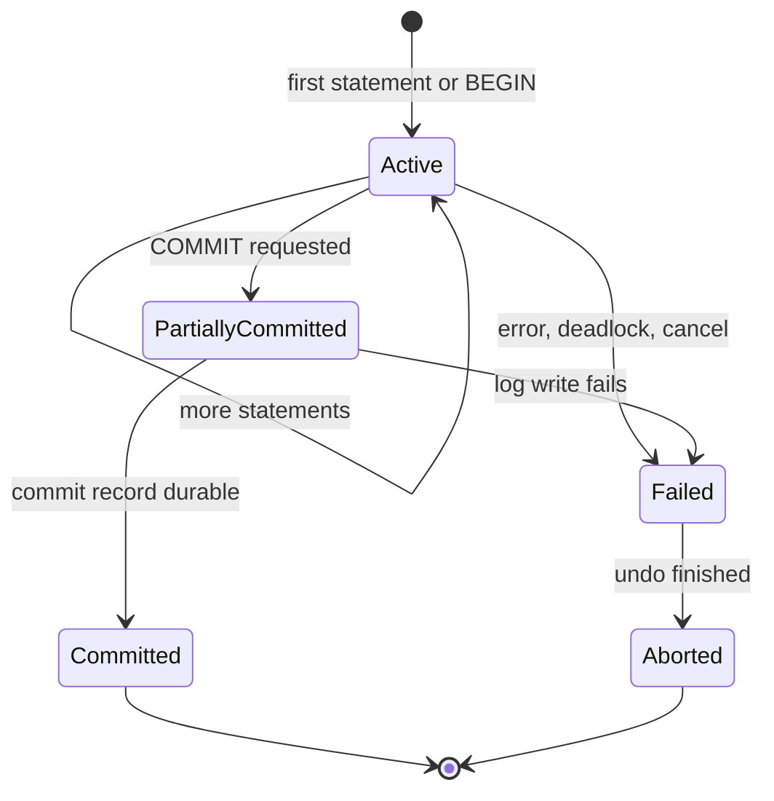
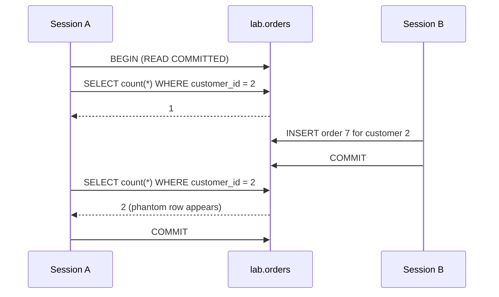
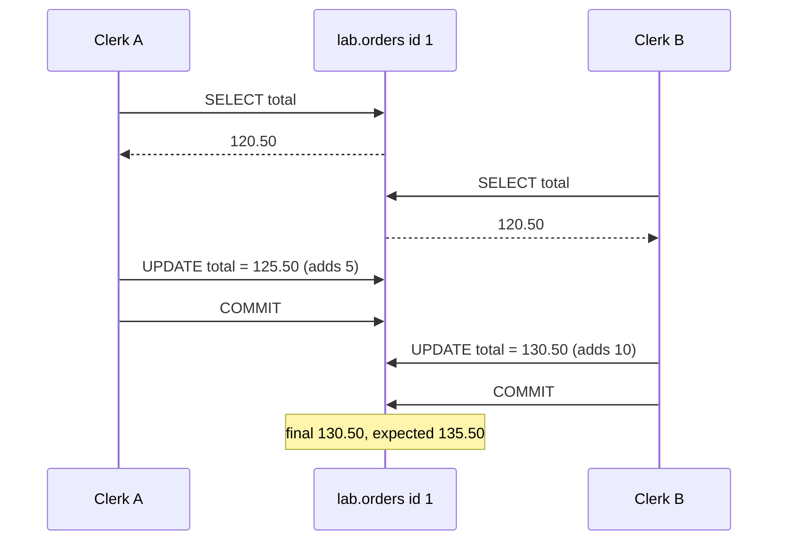

<div dir="rtl" markdown="1">

# 9. تراکنش‌ها، ACID و جداسازی

> **سطح:** L2 کاربردی ← L3 ارشد | **بخش:** I | **ارجاع‌های Rowlit خوانده‌شده در:** `1d57848` (Rowlit 1.6.3)
> **در یک جمله:** تراکنش چند دستور را به یک واحد «همه یا هیچ» تبدیل می‌کند و سطح جداسازی تعیین می‌کند تراکنش‌های هم‌زمان چه اندازه از کار نیمه‌تمام یکدیگر را ببینند.
> **چه می‌آموزید:**
> - هر حرف ACID چه وعده‌ای می‌دهد و کدام بخش موتور آن را نگه می‌دارد؛
> - BEGIN / COMMIT / ROLLBACK، حالت ثبت خودکار و savepoint در هر موتور چگونه کار می‌کنند؛
> - ناهنجاری‌های کلاسیک (خواندن کثیف، خواندن تکرارناپذیر، phantom، به‌روزرسانی گم‌شده، write skew) و بازسازی آن‌ها روی `shop`؛
> - چهار سطح جداسازی SQL به‌همراه snapshot isolation و SSI، و پیش‌فرض هر موتور؛
> - چرا تراکنش طولانی حتی وقتی کاری نمی‌کند گران است.
>
> **پیش‌نیازها:** [3. SQL بخش یک](03-sql-basics.md)، [6. سازوکار درونی ذخیره‌سازی](06-storage-internals.md) (صفحه، استخر بافر).
>
> [English](../../en/part1/09-transactions-and-isolation.md) · قبلی: [8. مسیر پرس‌وجو و بهینه‌ساز](08-query-processing.md) · بعدی: [10. هم‌روندی: قفل، latch و MVCC](10-concurrency-locking-mvcc.md)
>
> برچسب‌های نمودارها به انگلیسی نگه داشته شده‌اند تا در GitHub درست نمایش داده شوند.

---

<a id="1-the-idea-beginner"></a>
## 1. ایده (مبتدی)

یک فروشگاه سفارش را در چند گام ثبت می‌کند: درج سرِ سفارش، درج سطرهای آن، به‌روزکردن جمع سفارش و شاید صدور فاکتور. اگر سرور
پس از گام دوم از کار بیفتد، پایگاه داده نباید نیمی از سفارش را نگه دارد. و اگر دو کارمند هم‌زمان یک سفارش را ویرایش کنند،
تغییر یکی نباید بی‌صدا تغییر دیگری را پاک کند. **[تراکنش (transaction)](../glossary.md#transaction)**، یعنی گروهی از دستورها که
پایگاه داده آن‌ها را یک واحد کار می‌شمارد، ابزار حل هر دو مسئله است: یا همهٔ دستورهای گروه اثر می‌کنند یا هیچ‌کدام، و در طول
اجرا از کار نیمه‌تمام دیگران محافظت می‌شود.

این محافظت در برابر دیگران «همه یا هیچ» نیست. محافظت کامل با انتظار یا تکرار تراکنش هزینه دارد، پس هر موتور چند
**[سطح جداسازی (isolation level)](../glossary.md#isolation-level)** ارائه می‌کند؛ تنظیم‌هایی که می‌گویند یک تراکنش چه مقدار از
تغییرهای هم‌زمانِ commitنشده یا تازه commitشده را می‌تواند ببیند. سطح‌های ضعیف‌تر سریع‌ترند و غافل‌گیری‌هایی را مجاز می‌کنند که به
آن‌ها **ناهنجاری (anomaly)** می‌گوییم. این فصل هر ناهنجاری را نام می‌برد، روی جدول‌های `shop` نشانش می‌دهد و می‌گوید در هر موتور کدام
سطح جلوی آن را می‌گیرد. فصل بعد ([10](10-concurrency-locking-mvcc.md)) سازوکاری را توضیح می‌دهد که این سطح‌ها روی آن ساخته شده‌اند:
قفل‌ها و سطرهای چندنسخه‌ای.

<a id="2-how-it-works-practitioner"></a>
## 2. چگونه کار می‌کند (کاربردی)

<a id="21-acid-letter-by-letter"></a>
### 2.1 ACID، حرف به حرف

**[ACID](../glossary.md#acid)** فهرست کلاسیک چهار تضمین تراکنش است. بهترین راه به‌خاطرسپردن آن این است که بدانیم هر حرف را بخش
متفاوتی از موتور نگه می‌دارد.

| حرف | وعده | چه کسی نگهش می‌دارد | فصل |
|---|---|---|---|
| **[اتمی‌بودن (atomicity)](../glossary.md#atomicity)** | همهٔ دستورهای تراکنش اثر می‌کنند یا هیچ‌کدام. شکست در میانه کارهای قبلی را برمی‌گرداند. | اطلاعات بازگردانی (لاگ undo، نسخه‌های قدیمی سطر) و مدیر بازیابی. | [11](11-logging-and-recovery.md) |
| **[سازگاری (consistency)](../glossary.md#consistency)** | تراکنش پایگاه داده را از یک وضعیت معتبر به وضعیت معتبر دیگر می‌برد: قیدها (PK، FK، CHECK، UNIQUE) هنگام commit برقرارند. | بررسی قیدها، triggerها و قواعد خود برنامه. | [5](05-modelling-and-normalisation.md) |
| **[جداسازی (isolation)](../glossary.md#isolation)** | تراکنش‌های هم‌زمان کار نیمه‌تمام یکدیگر را نمی‌بینند (به اندازه‌ای که سطح جداسازی وعده می‌دهد). | کنترل هم‌روندی: قفل‌ها و/یا MVCC. | [10](10-concurrency-locking-mvcc.md) |
| **[ماندگاری (durability)](../glossary.md#durability)** | وقتی COMMIT برگشت، تغییر از خرابی یا قطع برق جان سالم به در می‌برد. | لاگ پیش‌نویس که هنگام commit روی حافظهٔ پایدار نوشته می‌شود. | [11](11-logging-and-recovery.md) |

دو هشدار که جلوی بحث‌های زیادی را می‌گیرد:

- حرف C در ACID همان C در قضیهٔ CAP نیست ([12](12-backup-replication-ha.md#33-cap-and-pacelc)). سازگاری در ACID یعنی «قیدها برقرارند»؛
  سازگاری در CAP یعنی «هر رونوشت با آخرین مقدار پاسخ می‌دهد».
- سازگاری تا حدی کار *شماست*. پایگاه داده فقط قاعده‌هایی را بررسی می‌کند که اعلام کرده‌اید. «جمع سفارش برابر مجموع سطرهای آن است»
  قاعده‌ای است که طرح `shop` اعلام نکرده، پس هیچ موتوری آن را برایتان اجرا نمی‌کند.

<a id="22-starting-and-ending-a-transaction"></a>
### 2.2 آغاز و پایان تراکنش

هر موتور رابطه‌ای سه فعل دارد: *آغاز*، *[commit](../glossary.md#commit)* (ماندگار و دیدنی‌کردن تغییرها) و
*[بازگردانی (rollback)](../glossary.md#rollback)* (برگرداندن آن‌ها). واژه‌ها از موتوری به موتور دیگر فرق می‌کنند.

#### PostgreSQL 17

</div>

```sql
BEGIN;                          -- or START TRANSACTION
UPDATE orders SET total = total + 5 WHERE id = 1;
INSERT INTO sales.invoices VALUES (3, 1, 125.50);
COMMIT;                         -- or ROLLBACK;
```

<div dir="rtl" markdown="1">

بدون `BEGIN` هر دستور در تراکنش جداگانهٔ خودش اجرا می‌شود (**[ثبت خودکار (autocommit)](../glossary.md#autocommit)**: موتور پس از
هر دستور commit می‌کند). DDL در PostgreSQL تراکنشی است: `CREATE TABLE`، `ALTER TABLE` و حتی `DROP TABLE` درون تراکنش با `ROLLBACK`
برگردانده می‌شوند. استثنا چند دستور است که اصلاً درون بلوک تراکنش اجرا نمی‌شوند، مانند `CREATE DATABASE`، `VACUUM` و
`CREATE INDEX CONCURRENTLY`.

#### SQL Server 2022

</div>

```sql
BEGIN TRANSACTION;              -- BEGIN TRAN
UPDATE dbo.Orders SET Total = Total + 5 WHERE Id = 1;
COMMIT TRANSACTION;             -- or ROLLBACK TRANSACTION
SELECT @@TRANCOUNT;             -- nesting depth of BEGIN TRAN; 0 = no transaction
```

<div dir="rtl" markdown="1">

SQL Server به‌طور پیش‌فرض در حالت ثبت خودکار است. `SET IMPLICIT_TRANSACTIONS ON` آن را به سبک
**[تراکنش دستی (manual transaction)](../glossary.md#manual-transaction)** (مانند Oracle) می‌برد: نخستین دستور داده تراکنشی باز می‌کند
که تا commit شما باز می‌ماند. `BEGIN TRAN` تودرتو فقط `@@TRANCOUNT` را یکی بالا می‌برد؛ `COMMIT` درونی آن را پایین می‌آورد و تنها
بیرونی‌ترین commit واقعاً commit می‌کند، در حالی که هر `ROLLBACK` (بدون نام savepoint) همه چیز را برمی‌گرداند. بیشتر DDLها تراکنشی‌اند.

#### Oracle Database 23ai Free

Oracle دستور `BEGIN` برای تراکنش ندارد. تراکنش به‌طور ضمنی با نخستین دستور DML آغاز و با `COMMIT` یا `ROLLBACK` تمام می‌شود.
**هر دستور DDL پیش و پس از اجرا به‌طور ضمنی commit می‌کند**: یک `CREATE TABLE` در میانهٔ کار، کار انجام‌شده تا آن لحظه را commit
می‌کند. این‌که کلاینت خودکار commit کند یا نه به خود کلاینت بستگی دارد: در SQL*Plus پیش‌فرض `SET AUTOCOMMIT OFF` است، ولی بسیاری از
درایورها (ODP.NET، JDBC) هر فرمان را commit می‌کنند مگر برنامه شیء تراکنش باز کرده باشد.

#### MySQL 8 / MariaDB 11 (InnoDB)

</div>

```sql
START TRANSACTION;              -- or BEGIN
UPDATE orders SET total = total + 5 WHERE id = 1;
COMMIT;
SET autocommit = 0;             -- session-wide manual mode, like Oracle
```

<div dir="rtl" markdown="1">

پیش‌فرض `autocommit = 1` است. DDL (و چند دستور دیگر مانند `LOCK TABLES`) یک **[commit ضمنی (implicit commit)](../glossary.md#implicit-commit)**
انجام می‌دهد. تراکنش فقط برای موتورهای ذخیره‌سازی تراکنشی وجود دارد؛ جدول `MyISAM` به `ROLLBACK` اعتنایی نمی‌کند.

#### SQLite 3.4x

</div>

```sql
BEGIN DEFERRED;     -- default: take locks only when first needed
BEGIN IMMEDIATE;    -- take the write lock now (recommended before a read-then-write)
BEGIN EXCLUSIVE;
COMMIT;             -- or END
```

<div dir="rtl" markdown="1">

SQLite هر دستور را خودکار commit می‌کند مگر `BEGIN` صادر شده باشد. DDL تراکنشی است. SQLite در هر لحظه فقط یک نویسنده برای کل
فایل پایگاه داده مجاز می‌داند و همین آن را ذاتاً سریال‌پذیر می‌کند ([پیش‌فرض هر موتور](#defaults-per-engine)).

#### ClickHouse، Cassandra، Snowflake

- **ClickHouse 24** در کاربرد عادی تراکنش چنددستوری عمومی ندارد. `INSERT` یک بلوک در جدول MergeTree اتمی است (یک part می‌سازد،
  [15](15-oltp-vs-olap-columnar.md) را ببینید)؛ تراکنش‌های آزمایشی (`allow_experimental_transactions`) هست، اما نمی‌شود به آن تکیه کرد.
- **Cassandra 4/5** تراکنش چندسطری ندارد. `BATCH` (logged batch) تضمین می‌کند همهٔ نوشتن‌هایش *سرانجام* اعمال شوند، اما کلاینت‌های دیگر
  ممکن است آن‌ها را یکی‌یکی ببینند. **[تراکنش‌های سبک (lightweight transaction)](../glossary.md#lightweight-transaction)**
  (`INSERT … IF NOT EXISTS`، `UPDATE … IF col = x`) مقایسه‌و‌جایگزینی روی یک پارتیشن را با Paxos فراهم می‌کنند. تراکنش‌های عمومی
  (Accord، CEP-15) بخشی از نسخهٔ 5.0 نبودند.
- **Snowflake** به‌طور پیش‌فرض خودکار commit می‌کند؛ `BEGIN` … `COMMIT` تراکنش صریح باز می‌کند. تنها سطح جداسازی آن READ COMMITTED است،
  DDL ضمنی commit می‌کند و savepoint ندارد.

> **در Rowlit:** موتور دو سبک کلاینت را به‌صورت `TransactionMode { Auto, Manual }` مدل می‌کند
> (`engine/src/DbStudio.Core/Models/CoreModels.cs:23`). در حالت دستی تراکنش با تأخیر باز می‌شود، یعنی فقط وقتی دستوری اجرا شود که به
> آن نیاز دارد (`engine/src/DbStudio.Core/Services/AdoSessionBase.cs:1127-1131`). [فصل 8 بخش دوم](../part2/08-connections-sessions-execution.md) را ببینید.

<a id="23-transaction-states"></a>
### 2.3 وضعیت‌های تراکنش

**شکل 9.1 — چرخهٔ زندگی یک تراکنش.**

</div>



<div dir="rtl" markdown="1">

شکل 9.1 الگوی کتاب‌های درسی است. دو وضعیت آن توجه بیشتری می‌خواهند:

- **Partially committed** همان فاصلهٔ کوتاهی است که COMMIT را خواسته‌اید ولی رکورد commit هنوز روی دیسک نرسیده. خرابی در این فاصله
  یعنی تراکنش هرگز commit نشده، هرچند همهٔ دستورهایش اجرا شده‌اند. ماندگاری فقط وقتی آغاز می‌شود که نوشتن لاگ تمام شود
  ([11](11-logging-and-recovery.md)).
- **Failed** در هر موتور رفتار متفاوتی دارد. PostgreSQL پس از هر خطا کل تراکنش را به وضعیت *aborted* می‌برد: هر دستور بعدی با
  `ERROR: current transaction is aborted, commands ignored until end of transaction block` (SQLSTATE `25P02`) شکست می‌خورد تا
  وقتی `ROLLBACK` کنید. SQL Server، Oracle و MySQL در عوض **فقط دستور شکست‌خورده** را برمی‌گردانند و تراکنش را زنده نگه می‌دارند،
  مگر در خطاهای سنگین (قربانی بن‌بست، و در SQL Server هر خطایی وقتی `SET XACT_ABORT ON` فعال است).

<a id="24-savepoints"></a>
### 2.4 نقطه‌های ذخیره

**[نقطهٔ ذخیره (savepoint)](../glossary.md#savepoint)** نشانه‌ای نام‌دار درون تراکنش است. بازگشت به آن فقط کار پس از نشانه را
برمی‌گرداند و تراکنش باز می‌ماند.

</div>

```sql
-- PostgreSQL, MySQL, SQLite (and Oracle without RELEASE)
BEGIN;
INSERT INTO sales.invoices VALUES (3, 4, 54.15);
SAVEPOINT before_fix;
UPDATE orders SET total = 0 WHERE id = 4;      -- oops
ROLLBACK TO SAVEPOINT before_fix;               -- the INSERT survives
RELEASE SAVEPOINT before_fix;                   -- forget the marker
COMMIT;
```

```sql
-- SQL Server: different words, no RELEASE
BEGIN TRAN;
INSERT INTO Sales.Invoices VALUES (3, 4, 54.15);
SAVE TRANSACTION before_fix;
UPDATE dbo.Orders SET Total = 0 WHERE Id = 4;
ROLLBACK TRANSACTION before_fix;
COMMIT;
```

<div dir="rtl" markdown="1">

برنامه‌ها با savepoint یک گام را بدون از دست دادن کل واحد کار تکرار می‌کنند، و کلاینت PostgreSQL با آن از وضعیت aborted دوری
می‌کند: هر دستور پرخطر را در یک savepoint بپیچید و در صورت خطا به آن برگردید. این کار بی‌هزینه نیست: PostgreSQL هر savepoint را یک
زیرتراکنش با شناسهٔ تراکنش جداگانه پیاده می‌کند و شمار بسیار زیاد آن‌ها در یک تراکنش، بررسی دیدپذیری را کند می‌کند.

> **در Rowlit:** حالت دستی PostgreSQL هر دسته (batch) را در `SAVEPOINT dbstudio_stmt` می‌پیچد، در موفقیت آزادش می‌کند و در خطا به آن
> برمی‌گردد، تا هیچ دستور شکست‌خورده‌ای زبانه را در وضعیت `25P02` رها نکند
> (`engine/src/DbStudio.Providers.PostgreSql/PgSession.cs:22-23`، تصمیم D-PG3 در `docs/PLAN-PG.md`).

<a id="25-the-anomalies-on-shop"></a>
### 2.5 ناهنجاری‌ها، روی `shop`

نمایش‌های زیر از **دو نشست** (دو اتصال، مثلاً دو پنجرهٔ `psql` یا دو زبانهٔ ویرایشگر) به نام A و B استفاده می‌کنند. گام‌ها به ترتیب
زمان شماره خورده‌اند. این نمایش‌ها داده را تغییر می‌دهند، پس آن‌ها را روی یک کپی آزمایشی اجرا کنید:

</div>

```sql
-- PostgreSQL 17, run once
CREATE SCHEMA lab;
CREATE TABLE lab.orders AS SELECT * FROM public.orders;
ALTER TABLE lab.orders ADD PRIMARY KEY (id);
-- … and when you are done:  DROP SCHEMA lab CASCADE;
```

<div dir="rtl" markdown="1">

هنگام نوشتن این فصل Docker در دسترس نبود، پس خروجی‌های زیر **خروجی نمونه (illustrative output)** هستند که از رفتار مستند PostgreSQL 17 و
SQL Server 2022 نوشته شده‌اند، نه از سرور گرفته شده‌اند.

#### خواندن کثیف

**[خواندن کثیف (dirty read)](../glossary.md#dirty-read)** یعنی خواندن تغییری که تراکنش دیگر هنوز commit نکرده (و ممکن است برگرداند).

| گام | نشست A | نشست B |
|---|---|---|
| 1 | | `BEGIN TRAN; UPDATE dbo.Orders SET Total = 0 WHERE Id = 1;` |
| 2 | `SET TRANSACTION ISOLATION LEVEL READ UNCOMMITTED;`<br/>`SELECT Total FROM dbo.Orders WHERE Id = 1;` ← **0.00** | |
| 3 | | `ROLLBACK;` |

A جمعی را گزارش کرد که هرگز وجود نداشت. فقط SQL Server (`READ UNCOMMITTED` یا راهنمای جدول `WITH (NOLOCK)`) و MySQL/MariaDB
(`READ UNCOMMITTED`) خواندن کثیف را مجاز می‌کنند. PostgreSQL نام این سطح را می‌پذیرد اما آن را مثل READ COMMITTED اجرا می‌کند؛ Oracle اصلاً
آن را ندارد.

#### خواندن تکرارناپذیر

**[خواندن تکرارناپذیر (non-repeatable read)](../glossary.md#non-repeatable-read)** یعنی یک سطر که دوبار در یک تراکنش خوانده می‌شود، در
فاصلهٔ دو خواندن تغییر کرده، چون تراکنش دیگری commit کرده است.

| گام | نشست A (PostgreSQL، READ COMMITTED) | نشست B |
|---|---|---|
| 1 | `BEGIN;`<br/>`SELECT total FROM lab.orders WHERE id = 1;` ← **120.50** | |
| 2 | | `UPDATE lab.orders SET total = 130.50 WHERE id = 1;` (autocommit) |
| 3 | `SELECT total FROM lab.orders WHERE id = 1;` ← **130.50** | |
| 4 | `COMMIT;` | |

در READ COMMITTED هر *دستور* snapshot تازه‌ای از دادهٔ commitشده می‌بیند. گام 1 را با `BEGIN ISOLATION LEVEL REPEATABLE READ;` اجرا کنید
تا گام 3 دوباره 120.50 برگرداند: snapshot یک بار برای هر *تراکنش* گرفته می‌شود.

#### خواندن شبح

**[خواندن شبح (phantom read)](../glossary.md#phantom-read)** یعنی پرس‌وجویی با شرط جست‌وجو که در یک تراکنش تکرار می‌شود، *مجموعهٔ*
متفاوتی از سطرها برمی‌گرداند، چون تراکنش دیگری سطرهای منطبق درج یا حذف کرده است. قفل‌کردن سطری که خوانده‌اید جلوی این را نمی‌گیرد،
چون سطر تازه هنگام خواندن شما وجود نداشت.

**شکل 9.2 — یک phantom: یک شمارش، درون یک تراکنش، دو پاسخ می‌دهد.**

</div>



<div dir="rtl" markdown="1">

در PostgreSQL سطح REPEATABLE READ از همین حالا جلوی این phantom را می‌گیرد (snapshot سفارش 7 را پنهان می‌کند). در SQL Server سطح
REPEATABLE READ جلوی آن را **نمی‌گیرد** (سطرهای خوانده‌شده را قفل می‌کند، نه شکافی را که سطر تازه در آن پیدا می‌شود)؛ SERIALIZABLE با
قفل‌های بازهٔ کلید جلوی آن را می‌گیرد ([10](10-concurrency-locking-mvcc.md)).

#### به‌روزرسانی گم‌شده

**[به‌روزرسانی گم‌شده (lost update)](../glossary.md#lost-update)** وقتی رخ می‌دهد که دو تراکنش یک مقدار را می‌خوانند، هر کدام در برنامه
مقدار تازه‌ای حساب می‌کند و نوشتن دوم نوشتن اول را بازنویسی می‌کند.

**شکل 9.3 — به‌روزرسانی گم‌شده: دو کارمند به سفارش 1 هزینه‌ای می‌افزایند و فقط یکی باقی می‌ماند.**

</div>



<div dir="rtl" markdown="1">

READ COMMITTED در همهٔ موتورها این ناهنجاری را مجاز می‌کند. چهار راه‌حل، از ساده به کلی:

1. **حساب را به پایگاه داده بسپارید:** `UPDATE lab.orders SET total = total + 5 WHERE id = 1;`. به‌روزرسانی دوم منتظر قفل سطرِ اولی
   می‌ماند و سپس تازه‌ترین مقدار commitشده را دوباره می‌خواند. وقتی مقدار تازه را بشود به‌صورت عبارت نوشت، همیشه درست است.
2. **قفل بدبینانه:** با `SELECT total FROM lab.orders WHERE id = 1 FOR UPDATE;` بخوانید (در SQL Server:
   `WITH (UPDLOCK, ROWLOCK)`). خوانندهٔ دوم تا commit اولی منتظر می‌ماند.
3. **بررسی خوش‌بینانه:** ستونی برای نسخه نگه دارید و بنویسید `UPDATE … SET total = 125.50, version = version + 1 WHERE id = 1 AND
   version = 7;`. اگر صفر سطر تغییر کرد یعنی «کس دیگری تغییرش داده؛ دوباره بخوان و تکرار کن»
   ([10](10-concurrency-locking-mvcc.md#27-optimistic-and-pessimistic-concurrency)).
4. **سطح قوی‌تر:** REPEATABLE READ در PostgreSQL تعارض را کشف می‌کند و کارمند B را با `ERROR: could not serialize access due to
   concurrent update` (SQLSTATE `40001`) متوقف می‌کند؛ SNAPSHOT در SQL Server با خطای 3960 و SERIALIZABLE در Oracle با `ORA-08177`
   شکست می‌خورد. برنامه باید خطا را بگیرد و کل تراکنش را دوباره اجرا کند.

MySQL مراقبت ویژه می‌خواهد: در REPEATABLE READ موتور InnoDB، `SELECT` ساده snapshot قدیمی را می‌خواند، اما `UPDATE` همیشه روی تازه‌ترین سطر
commitشده کار می‌کند؛ پس الگوی شکل 9.3 *حتی در REPEATABLE READ* یک به‌روزرسانی را گم می‌کند. از راه‌حل 1، 2 یا 3 استفاده کنید.

#### write skew

**[write skew](../glossary.md#write-skew)** ظریف‌ترین ناهنجاری است. دو تراکنش مجموعهٔ هم‌پوشانی از سطرها را می‌خوانند، هر کدام بر پایهٔ
آنچه خوانده تصمیم می‌گیرد و هر کدام سطر *متفاوتی* می‌نویسد. هیچ سطری دوبار نوشته نمی‌شود، پس هیچ تعارض سطری کشف نمی‌شود، اما
نوشتن‌ها با هم قاعده‌ای را می‌شکنند که هر دو تراکنش بررسی کرده بودند.

قاعدهٔ کسب‌وکار در این مثال: *هر مشتری حداکثر دو سفارش پرداخت‌نشده (`status = 'new'`) دارد.* Bob (مشتری 2) یکی دارد.

| گام | نشست A (REPEATABLE READ) | نشست B (REPEATABLE READ) |
|---|---|---|
| 1 | `SELECT count(*) FROM lab.orders WHERE customer_id = 2 AND status = 'new';` ← 1 | |
| 2 | | همان پرس‌وجو ← 1 |
| 3 | `INSERT INTO lab.orders VALUES (7, 2, now(), 10, 'new');` | |
| 4 | | `INSERT INTO lab.orders VALUES (8, 2, now(), 20, 'new');` |
| 5 | `COMMIT;` | `COMMIT;` ← هر دو موفق: Bob حالا **سه** سفارش پرداخت‌نشده دارد |

snapshot isolation (REPEATABLE READ در PostgreSQL، SNAPSHOT در SQL Server، SERIALIZABLE در Oracle) write skew را مجاز می‌کند. درمان،
سریال‌پذیری واقعی است: SERIALIZABLE در PostgreSQL یکی از دو تراکنش را با `ERROR: could not serialize access due to read/write
dependencies among transactions` (SQLSTATE `40001`) لغو می‌کند، و SERIALIZABLE در SQL Server درج دوم را با قفل بازهٔ کلید مسدود می‌کند
(در این ترتیب، هر دو نشست از پیش قفل بازهٔ اشتراکی دارند و هر کدام می‌خواهد در بازه‌ای درج کند که دیگری قفل کرده، پس معمولاً یکی
قربانی بن‌بست می‌شود). بدون سطح سریال‌پذیر، راه‌حل‌های معمول قفل‌کردن یک سطر «والد» مشترک است (`SELECT … FROM customers WHERE id = 2
FOR UPDATE` در هر دو نشست) یا تبدیل قاعده به قیدی که موتور بتواند اجرایش کند.

نسخهٔ کتاب درسی write skew دو پزشک کشیک است: هر کدام بررسی می‌کند «دست‌کم یک پزشک دیگر کشیک است» و هر کدام فقط خودش را از کشیک
برمی‌دارد.

<a id="26-the-isolation-levels"></a>
### 2.6 سطح‌های جداسازی

استاندارد SQL چهار سطح را با ناهنجاری‌هایی که ممنوع می‌کنند تعریف می‌کند. جدول، snapshot isolation را هم نشان می‌دهد که استاندارد نامی از
آن نبرده ولی بیشتر موتورها پیاده‌اش کرده‌اند.

| سطح | خواندن کثیف | خواندن تکرارناپذیر | phantom | به‌روزرسانی گم‌شده | write skew |
|---|---|---|---|---|---|
| **[READ UNCOMMITTED](../glossary.md#read-uncommitted)** | ممکن | ممکن | ممکن | ممکن | ممکن |
| **[READ COMMITTED](../glossary.md#read-committed)** | نه | ممکن | ممکن | ممکن | ممکن |
| **[REPEATABLE READ](../glossary.md#repeatable-read)** (استاندارد، مبتنی بر قفل) | نه | نه | ممکن | نه | ممکن |
| **[snapshot isolation](../glossary.md#snapshot-isolation)** | نه | نه | نه | نه (نخستین commitکننده برنده است) | **ممکن** |
| **[SERIALIZABLE](../glossary.md#serializable)** | نه | نه | نه | نه | نه |

جدول را «دست‌کم آنچه سطح تضمین می‌کند» بخوانید. موتورهای واقعی اغلب بهتر از حداقل عمل می‌کنند و در چند جا متفاوت:

- **PostgreSQL** سه رفتار جدا دارد: READ UNCOMMITTED = READ COMMITTED؛ REPEATABLE READ = snapshot isolation (بدون phantom، اما write skew
  ممکن)؛ SERIALIZABLE = **[جداسازی تصویر لحظه‌ای سریال‌پذیر (SSI)](../glossary.md#ssi)**.
- **SQL Server** پنج سطح دارد: READ UNCOMMITTED، READ COMMITTED (مبتنی بر قفل، یا نسخه‌بندی سطر وقتی گزینهٔ پایگاه دادهٔ
  `READ_COMMITTED_SNAPSHOT` روشن است)، REPEATABLE READ (قفلی)، SNAPSHOT (نیازمند `ALLOW_SNAPSHOT_ISOLATION ON`) و SERIALIZABLE (قفلی، با
  قفل‌های بازهٔ کلید).
- **Oracle** این‌ها را دارد: READ COMMITTED (پیش‌فرض)، SERIALIZABLE (که در واقع snapshot isolation است، پس write skew ممکن است) و
  `SET TRANSACTION READ ONLY`.
- **MySQL InnoDB** هر چهار سطح را دارد. REPEATABLE READ آن ترکیبی است: خواندن ساده از snapshot، و خواندن قفل‌دار و نوشتن از آخرین داده
  به‌همراه قفل‌های next-key.

<a id="defaults-per-engine"></a>
#### پیش‌فرض هر موتور

| موتور | سطح پیش‌فرض | معنای عملی |
|---|---|---|
| PostgreSQL 17 | READ COMMITTED | snapshot برای هر دستور؛ بدون قفل خواندن. |
| SQL Server 2022 | READ COMMITTED (قفلی) | خواننده‌ها قفل اشتراکی کوتاه می‌گیرند و **منتظر نویسنده‌ها می‌مانند**، مگر `READ_COMMITTED_SNAPSHOT` روشن باشد (در Azure SQL Database پیش‌فرض روشن است، در SQL Server نصبی نه). |
| Oracle 23ai | READ COMMITTED | سازگاری خواندن در سطح دستور از روی undo؛ خواننده هرگز منتظر نویسنده نمی‌ماند. |
| MySQL 8 / MariaDB 11 | REPEATABLE READ | snapshot از نخستین خواندن تراکنش؛ قفل next-key در خواندن قفل‌دار. |
| SQLite 3.4x | در عمل SERIALIZABLE | در هر لحظه یک نویسنده برای کل فایل. |
| Snowflake | READ COMMITTED (تنها سطح) | snapshot در سطح دستور. |
| ClickHouse 24 | بدون تراکنش | هر پرس‌وجو مجموعهٔ سازگاری از partها را می‌خواند. |
| Cassandra 4/5 | بدون تراکنش | به‌جای آن، سطح سازگاری برای هر درخواست ([12](12-backup-replication-ha.md#32-consistency-models)). |

چگونه سطح را تنظیم کنیم:

</div>

```sql
-- PostgreSQL (first statement of the transaction, or as a session default)
BEGIN ISOLATION LEVEL SERIALIZABLE;
SET SESSION CHARACTERISTICS AS TRANSACTION ISOLATION LEVEL REPEATABLE READ;
SHOW transaction_isolation;

-- SQL Server (session setting, applies to following transactions)
SET TRANSACTION ISOLATION LEVEL SNAPSHOT;
DBCC USEROPTIONS;                                  -- shows "isolation level"

-- Oracle
SET TRANSACTION ISOLATION LEVEL SERIALIZABLE;      -- first statement of the transaction
ALTER SESSION SET ISOLATION_LEVEL = SERIALIZABLE;

-- MySQL
SET SESSION TRANSACTION ISOLATION LEVEL READ COMMITTED;
SELECT @@transaction_isolation;
```

<div dir="rtl" markdown="1">

> **در Rowlit:** جست‌وجوی داده در «Find in database» برای MySQL درون یک تراکنش فقط‌خواندنی REPEATABLE READ انجام می‌شود تا کل
> جست‌وجو یک snapshot ببیند (`engine/src/DbStudio.Providers.MySql/MySqlSearcher.cs:75`).

<a id="27-choosing-a-level"></a>
### 2.7 انتخاب سطح

یک دستورالعمل عملی:

1. با پیش‌فرض موتور شروع کنید و هر خواندن‌ـ‌تغییرـ‌نوشتن را به‌صورت یک دستور یا یک خواندن قفل‌دار بنویسید.
2. گزارش چندپرس‌وجویی سازگار می‌خواهید (جمع‌هایی که در چند پرس‌وجو با هم جور درآیند)؟ برای آن تراکنش REPEATABLE READ / SNAPSHOT یا یک
   تراکنش فقط‌خواندنی به کار ببرید.
3. قاعده‌هایی دارید که چند سطر را دربرمی‌گیرند (سقف، یکتایی میان جدول‌ها، «دست‌کم یکی»)؟ برای آن تراکنش‌ها SERIALIZABLE به کار ببرید و
   **در [شکست سریال‌پذیری (serialization failure)](../glossary.md#serialization-failure) دوباره تلاش کنید**، یا یک سطر والد را قفل کنید.
4. هرگز READ UNCOMMITTED / `NOLOCK` را برای چیزی که کسی بر پایه‌اش تصمیم می‌گیرد به کار نبرید. جدا از خواندن کثیف، پویش‌های `NOLOCK` در
   SQL Server ممکن است وقتی صفحه‌ای حین پویش شکافته می‌شود، سطری را دوبار برگردانند یا جا بیندازند.

هر سطحی بالاتر از READ COMMITTED به **منطق تکرار (retry)** نیاز دارد. سامانهٔ سریال‌پذیری که هرگز تکرار نمی‌کند سریال‌پذیر نیست؛ فقط
شکست می‌خورد.

<a id="3-deep-dive-senior"></a>
## 3. ژرفا (ارشد)

> **ژرفا (L3) — چرا جدول استاندارد کافی نیست.** سطح‌های ANSI SQL-92 با ناهنجاری‌های خواندن کثیف (P1)، خواندن تکرارناپذیر (P2) و phantom
> (P3) تعریف شدند. در 1995 مقالهٔ Berenson، Bernstein، Gray، Melton و O'Neil («A Critique of ANSI SQL Isolation Levels») نشان داد این
> تعریف مبهم است و ناهنجاری‌هایی را جا می‌اندازد: به‌روزرسانی گم‌شده (P4)، read skew و write skew (A5A، A5B). همان مقاله snapshot isolation
> را توصیف کرد که در خوانش سخت‌گیرانهٔ آن‌ها P1 تا P3 را ممنوع می‌کند و با این حال به خاطر write skew سریال‌پذیر نیست. به همین دلیل جدول
> بخش 2.6 ستون‌های اضافه دارد و «REPEATABLE READ» در SQL Server (قفلی، phantom ممکن) و PostgreSQL (مبتنی بر snapshot، بدون phantom)
> معنای متفاوتی دارد.

<a id="31-serializability-and-two-ways-to-get-it"></a>
### 3.1 سریال‌پذیری و دو راه رسیدن به آن

یک زمان‌بندی (درهم‌آمیختگی عملیات تراکنش‌های هم‌زمان) وقتی **سریال‌پذیر** است که اثرش با یک ترتیب سریال از همان تراکنش‌ها برابر
باشد. موتورها از دو راه بسیار متفاوت به این هدف می‌رسند.

**[قفل‌گذاری دومرحله‌ای (2PL)](../glossary.md#two-phase-locking)**. هر تراکنش یک مرحلهٔ رشد دارد (قفل می‌گیرد و رها نمی‌کند) و یک مرحلهٔ
کاهش (رها می‌کند و نمی‌گیرد). 2PL *سخت‌گیر (strict)* قفل‌های نوشتن را تا commit نگه می‌دارد؛ 2PL *rigorous* همهٔ قفل‌ها را تا commit نگه
می‌دارد، که همان کاری است که SERIALIZABLE در SQL Server و MySQL می‌کند. برای جلوگیری از phantom قفل‌ها باید *گزاره‌ها* یا بازه‌ها را
بپوشانند، نه فقط سطرهای موجود را: SQL Server از قفل بازهٔ کلید روی نمایه استفاده می‌کند و InnoDB از قفل next-key (شکاف). بدون نمایهٔ
قابل‌استفاده موتور باید چیزهای بسیار بیشتری (کل جدول یا بازهٔ نمایه) را قفل کند که به انسداد می‌انجامد. 2PL بدبینانه است: تعارض‌ها به
انتظار می‌انجامند و انتظار می‌تواند به بن‌بست برسد ([10](10-concurrency-locking-mvcc.md#24-deadlocks)).

**جداسازی تصویر لحظه‌ای سریال‌پذیر (SSI)**. PostgreSQL (از 9.1) هر تراکنش سریال‌پذیر را مانند snapshot isolation روی یک snapshot اجرا
می‌کند و افزون بر آن **وابستگی‌های خواندن/نوشتن** را دنبال می‌کند (rw-antidependency: T1 نسخه‌ای را خوانده که T2 بعداً بازنویسی کرده).
Cahill، Röhm و Fekete ثابت کردند هر اجرای غیرسریال‌پذیر زیر SI یک «ساختار خطرناک» از دو یال rw پشت‌سرهم در یک چرخه دارد. PostgreSQL
خواندن‌ها را به‌صورت *قفل‌های گزاره‌ای* SIREAD ثبت می‌کند (در `pg_locks` با حالت `SIReadLock` دیده می‌شوند و هرگز کسی را مسدود
نمی‌کنند)، ساختار خطرناک را کشف می‌کند و یک تراکنش را با SQLSTATE `40001` لغو می‌کند. مثبت کاذب وجود دارد: ممکن است تراکنشی لغو شود
در حالی که ترتیب واقعی بی‌خطر بوده، به‌ویژه وقتی خواندن‌ها با پویش ترتیبی انجام می‌شوند (آنگاه قفل گزاره‌ای کل رابطه را می‌پوشاند).
نمایه روی ستون‌های فیلترشده SSI را دقیق‌تر می‌کند.

<a id="32-read-skew-and-the-snapshot"></a>
### 3.2 read skew و snapshot

**[read skew](../glossary.md#read-skew)** خویشاوند چندسطری خواندن تکرارناپذیر است: گزارشی `orders` و سپس `sales.invoices` را می‌خواند و
یک انتقال میان دو خواندن commit می‌شود، پس گزارش «پیش» یک جدول و «پس» جدول دیگر را می‌بیند. READ COMMITTED آن را مجاز می‌کند چون هر
دستور snapshot تازه‌ای می‌گیرد. در موتورهای MVCC یک دستور تنها همیشه با خودش سازگار است (snapshot در سطح دستور)، پس یک پرس‌وجو که هر دو
جدول را join می‌کند حتی در READ COMMITTED امن است، در حالی که دو پرس‌وجوی جدا امن نیستند. این دلیل محکمی است که بخش‌هایی از گزارش که باید
با هم جور باشند را در یک دستور یا در یک تراکنش REPEATABLE READ / SNAPSHOT بگذارید.

<a id="33-postgresql-read-committed-and-concurrent-updates"></a>
### 3.3 READ COMMITTED در PostgreSQL و به‌روزرسانی‌های هم‌زمان

در READ COMMITTED وقتی `UPDATE` یا `DELETE` می‌بیند سطر هدفش را تراکنشی تغییر داده که پس از snapshot دستور commit کرده، PostgreSQL منتظر
آن تراکنش می‌ماند، سپس **شرط WHERE را روی تازه‌ترین نسخهٔ سطر دوباره ارزیابی می‌کند** و اگر هنوز منطبق بود تغییر را اعمال می‌کند (بازبینی
«EvalPlanQual»). به همین دلیل `SET total = total + 5` هرگز به‌روزرسانی را گم نمی‌کند. اثر جانبی غافل‌گیرکننده: دستوری مانند
`UPDATE lab.orders SET status = 'paid' WHERE total > 100` ممکن است زیر هم‌روندی مجموعه‌ای از سطرها را به‌روز کند که هرگز در یک snapshot با
هم وجود نداشته‌اند. در REPEATABLE READ و SERIALIZABLE، PostgreSQL به‌جای آن نمی‌پذیرد و `40001` می‌دهد.

<a id="34-the-cost-of-a-long-transaction"></a>
### 3.4 هزینهٔ تراکنش طولانی

تراکنشی که باز می‌ماند، حتی اگر فقط یک `SELECT` اجرا کرده و حالا منتظر کاربر است، مدام هزینه می‌پردازد:

- **قفل‌هایی** که نوشتن‌هایش (و در سطح‌های قفلی، خواندن‌هایش) گرفته‌اند تا پایانش نگه داشته می‌شوند. دیگران پشت سرش صف می‌کشند
  ([زنجیره‌های انسداد](10-concurrency-locking-mvcc.md#25-blocking-chains-and-kill)).
- **نسخه‌های قدیمی سطرها پاک نمی‌شوند.** VACUUM در PostgreSQL تاپل‌های مردهٔ تازه‌تر از قدیمی‌ترین snapshot باز را نمی‌تواند حذف کند
  (حجیم‌شدگی رشد می‌کند)؛ انبارهٔ نسخه‌های SQL Server در `tempdb` (یا انبارهٔ نسخهٔ ماندگار با Accelerated Database Recovery) بزرگ می‌شود؛
  purge در InnoDB جلو نمی‌رود و *history list length* بالا می‌رود؛ Oracle ممکن است هنوز از undo پاسخش را بدهد، اما دیگران اگر undo کوچک
  باشد به `ORA-01555 snapshot too old` برمی‌خورند.
- **لاگ از قدیمی‌ترین تراکنش فعال به آن سو کوتاه نمی‌شود** (در SQL Server `log_reuse_wait_desc = ACTIVE_TRANSACTION`)، پس لاگ تراکنش رشد
  می‌کند ([11](11-logging-and-recovery.md#25-log-truncation-and-log-growth)).
- **بازیابی طولانی‌تر می‌شود:** خرابی همهٔ کار آن را برمی‌گرداند.

دو مقصر رایج: کلاینت تعاملی در حالت دستی که کسی commit کردنش را فراموش کرده، و برنامه‌ای که تراکنش باز می‌کند و سپس یک سرویس بیرونی کند
را صدا می‌زند. PostgreSQL برای پایان‌دادن چنین نشست‌هایی `idle_in_transaction_session_timeout` دارد؛ `pg_stat_activity.state = 'idle in
transaction'` پیدایشان می‌کند.

<a id="35-error-handling-and-retries"></a>
### 3.5 مدیریت خطا و تکرار

این‌ها را نشانهٔ «کل تراکنش را دوباره اجرا کن» بدانید، با کمی تأخیر تصادفی و سقفی برای تعداد تکرار:

| موتور | شکست سریال‌پذیری | قربانی بن‌بست |
|---|---|---|
| PostgreSQL | SQLSTATE `40001` | SQLSTATE `40P01` |
| SQL Server | خطای 3960 (تعارض به‌روزرسانی در snapshot) | خطای 1205 |
| Oracle | `ORA-08177` | `ORA-00060` (فقط *دستور* برگردانده می‌شود؛ تصمیم با برنامه است) |
| MySQL / MariaDB | (در SERIALIZABLE نیست؛ قفل می‌گیرد) | خطای 1213؛ پایان مهلت قفل خطای 1205 است |

تکرار باید *خواندن‌ها* را هم دوباره اجرا کند، نه فقط نوشتن شکست‌خورده را: تصمیمی که بر پایهٔ خواندن قدیمی گرفته شده دقیقاً همان چیزی
بود که اشتباه بود.

<a id="4-in-each-engine"></a>
## 4. در هر موتور

| موضوع | PostgreSQL 17 | SQL Server 2022 | Oracle 23ai | MySQL 8 / MariaDB 11 | SQLite 3.4x | ClickHouse 24 | Snowflake | Cassandra 4/5 |
|---|---|---|---|---|---|---|---|---|
| آغاز | `BEGIN` / `START TRANSACTION` | `BEGIN TRAN` | ضمنی با نخستین DML | `START TRANSACTION` / `BEGIN` | `BEGIN [DEFERRED\|IMMEDIATE\|EXCLUSIVE]` | ندارد (فقط آزمایشی) | `BEGIN` | ندارد؛ LWT برای هر پارتیشن |
| ثبت خودکار به‌طور پیش‌فرض | بله | بله | با کلاینت | بله (`autocommit=1`) | بله | — | بله | — |
| DDL در تراکنش | تراکنشی | بیشتر تراکنشی | commit ضمنی | commit ضمنی | تراکنشی | — | commit ضمنی | — |
| savepoint | `SAVEPOINT` / `ROLLBACK TO` / `RELEASE` | `SAVE TRAN` / `ROLLBACK TRAN name` | `SAVEPOINT` / `ROLLBACK TO` | `SAVEPOINT` / `ROLLBACK TO` / `RELEASE` | `SAVEPOINT` / `ROLLBACK TO` / `RELEASE` | ندارد | ندارد | ندارد |
| خطا درون تراکنش | کل تراکنش aborted (`25P02`) | دستور برگردانده می‌شود (با `XACT_ABORT ON` کل تراکنش) | دستور برگردانده می‌شود | دستور برگردانده می‌شود (بن‌بست: کل) | دستور برگردانده می‌شود | — | دستور شکست می‌خورد | — |
| سطح پیش‌فرض | READ COMMITTED | READ COMMITTED (قفلی) | READ COMMITTED | REPEATABLE READ | SERIALIZABLE | — | READ COMMITTED | — |
| قوی‌ترین سطح | SERIALIZABLE (SSI) | SERIALIZABLE (2PL) | SERIALIZABLE (= SI) | SERIALIZABLE (2PL) | SERIALIZABLE | — | READ COMMITTED | LWT (خطی‌پذیر در هر پارتیشن) |

<a id="5-exercises"></a>
## 5. تمرین‌ها

1. در نشست A اجرا کنید `BEGIN; SELECT total FROM lab.orders WHERE id = 3;`، سپس در B `UPDATE lab.orders SET total = 1 WHERE id = 3;`، و
   سپس در A دوباره select را اجرا کنید. A در PostgreSQL زیر READ COMMITTED و زیر REPEATABLE READ چه می‌بیند؟ در SQL Server با READ COMMITTED
   و `READ_COMMITTED_SNAPSHOT OFF`، اگر A از `SELECT … WITH (HOLDLOCK)` استفاده کرده بود، در گام B چه رخ می‌دهد؟
2. مثال به‌روزرسانی گم‌شدهٔ شکل 9.3 را به سه روش برای PostgreSQL بازنویسی کنید تا هر دو هزینه باقی بمانند.
3. یک کار دسته‌ای روی Oracle و روی PostgreSQL اجرا می‌کند `BEGIN; UPDATE orders …; CREATE TABLE tmp_x (…); ROLLBACK;`. پس از آن در هر پایگاه
   داده چه باقی می‌ماند؟
4. چرا یک `SELECT` که `orders` و `sales.invoices` را join می‌کند در PostgreSQL زیر READ COMMITTED سازگار است، اما دو `SELECT` جدا در همان
   تراکنش READ COMMITTED ممکن است نباشند؟
5. مثال write skew از REPEATABLE READ در PostgreSQL استفاده کرد. دو راه متفاوت برای امن‌کردن آن بدون تغییر سطح جداسازی و یک راه با تغییر سطح
   نام ببرید. وقتی سطح را تغییر می‌دهید برنامه چه چیزی باید اضافه کند؟
6. توسعه‌دهنده‌ای می‌گوید: «ما SERIALIZABLE داریم، پس هرگز به تکرار نیاز نداریم.» توضیح دهید چرا این برای PostgreSQL و SQL Server نادرست است.

<a id="answers"></a>
## پاسخ‌ها

کلید پاسخ همهٔ فصل‌های بخش یک در [18. کلید پاسخ و راه‌اندازی آزمایشگاه](18-exercise-answers.md) گرد آمده است.

<details><summary>پاسخ‌های فصل 9</summary>

1. PostgreSQL با READ COMMITTED: A مقدار تازهٔ 1 را می‌بیند (snapshot تازه برای هر دستور). REPEATABLE READ: A هنوز 199.00 را می‌بیند
   (snapshot در نخستین دستور ثابت شده). SQL Server با READ COMMITTED قفلی و `HOLDLOCK` (= SERIALIZABLE برای آن جدول): A قفل اشتراکی خود را
   تا commit نگه می‌دارد، پس `UPDATE` نشست B تا commit یا rollback نشست A **منتظر می‌ماند**.
2. (الف) `UPDATE lab.orders SET total = total + 5 WHERE id = 1;` در هر دو نشست. (ب) `SELECT total … FOR UPDATE` پیش از محاسبه، تا کارمند
   دوم منتظر بماند و 125.50 را بخواند. (ج) خوش‌بینانه: ستون `version int NOT NULL DEFAULT 0` بیفزایید، با `WHERE id = 1 AND version = :v`
   به‌روز کنید و وقتی صفر سطر تغییر کرد دوباره تلاش کنید. (REPEATABLE READ به‌همراه تکرار در `40001` هم پذیرفتنی است.)
3. Oracle: `CREATE TABLE` پیش از اجرا `UPDATE` را ضمنی commit کرد، پس هم به‌روزرسانی و هم `tmp_x` می‌مانند؛ `ROLLBACK` چیزی برای برگرداندن
   ندارد. PostgreSQL: DDL تراکنشی است، پس `ROLLBACK` هم به‌روزرسانی و هم جدول را حذف می‌کند.
4. یک دستور یک snapshot را می‌خواند که در آغازش گرفته شده؛ هر دو جدول در یک لحظه دیده می‌شوند. دو دستور در READ COMMITTED دو snapshot
   می‌گیرند و commitی میان آن‌ها read skew می‌سازد.
5. بدون تغییر سطح: ابتدا یک سطر مشترک را قفل کنید (`SELECT 1 FROM customers WHERE id = 2 FOR UPDATE` در هر دو تراکنش تا پشت سر هم اجرا
   شوند)، یا قاعده را در طرح پایگاه داده اجرا کنید (مثلاً triggerی که سطر مشتری را قفل می‌کند، یا ستون شمارنده با قید CHECK). با تغییر سطح:
   SERIALIZABLE. برنامه باید SQLSTATE `40001` را بگیرد و کل تراکنش را دوباره اجرا کند.
6. SERIALIZABLE در PostgreSQL (SSI) وقتی ساختار خطرناکی کشف کند، از جمله در مثبت‌های کاذب، تراکنش‌ها را با `40001` لغو می‌کند؛ بدون تکرار
   این تراکنش‌ها فقط کار از دست‌رفته‌اند. SERIALIZABLE در SQL Server قفل به کار می‌برد، پس تعارض‌ها به انتظار و اغلب به بن‌بست (خطای 1205)
   تبدیل می‌شوند و قربانی باید دوباره اجرا شود.

</details>

<a id="related-chapters"></a>
## فصل‌های مرتبط

- [10. هم‌روندی: قفل، latch و MVCC](10-concurrency-locking-mvcc.md) — سازوکار پشت هر سطح.
- [11. WAL، redo/undo، checkpoint و بازیابی](11-logging-and-recovery.md) — اتمی‌بودن و ماندگاری چگونه نگه داشته می‌شوند.
- [12. پشتیبان‌گیری، همانندسازی و دسترس‌پذیری بالا](12-backup-replication-ha.md) — سازگاری میان چند ماشین و commit دومرحله‌ای.
- [17. مقایسهٔ گویش‌ها](17-dialect-comparison.md) — نحو تراکنش در کنار هم.
- بخش دوم: [8. اتصال‌ها، نشست‌ها و اجرای SQL](../part2/08-connections-sessions-execution.md) — حالت‌های Auto و Manual در Rowlit.

<a id="glossary-terms-introduced-here"></a>
## اصطلاحات واژه‌نامه در این فصل

[تراکنش](../glossary.md#transaction) ·
[ACID](../glossary.md#acid) ·
[اتمی‌بودن](../glossary.md#atomicity) ·
[سازگاری](../glossary.md#consistency) ·
[جداسازی](../glossary.md#isolation) ·
[ماندگاری](../glossary.md#durability) ·
[commit](../glossary.md#commit) ·
[بازگردانی (rollback)](../glossary.md#rollback) ·
[ثبت خودکار](../glossary.md#autocommit) ·
[تراکنش دستی](../glossary.md#manual-transaction) ·
[commit ضمنی](../glossary.md#implicit-commit) ·
[نقطهٔ ذخیره](../glossary.md#savepoint) ·
[سطح جداسازی](../glossary.md#isolation-level) ·
[خواندن کثیف](../glossary.md#dirty-read) ·
[خواندن تکرارناپذیر](../glossary.md#non-repeatable-read) ·
[خواندن شبح](../glossary.md#phantom-read) ·
[read skew](../glossary.md#read-skew) ·
[write skew](../glossary.md#write-skew) ·
[به‌روزرسانی گم‌شده](../glossary.md#lost-update) ·
[READ UNCOMMITTED](../glossary.md#read-uncommitted) ·
[READ COMMITTED](../glossary.md#read-committed) ·
[REPEATABLE READ](../glossary.md#repeatable-read) ·
[SERIALIZABLE](../glossary.md#serializable) ·
[snapshot isolation](../glossary.md#snapshot-isolation) ·
[SSI](../glossary.md#ssi) ·
[شکست سریال‌پذیری](../glossary.md#serialization-failure) ·
[قفل‌گذاری دومرحله‌ای](../glossary.md#two-phase-locking) ·
[تراکنش سبک](../glossary.md#lightweight-transaction)

</div>
